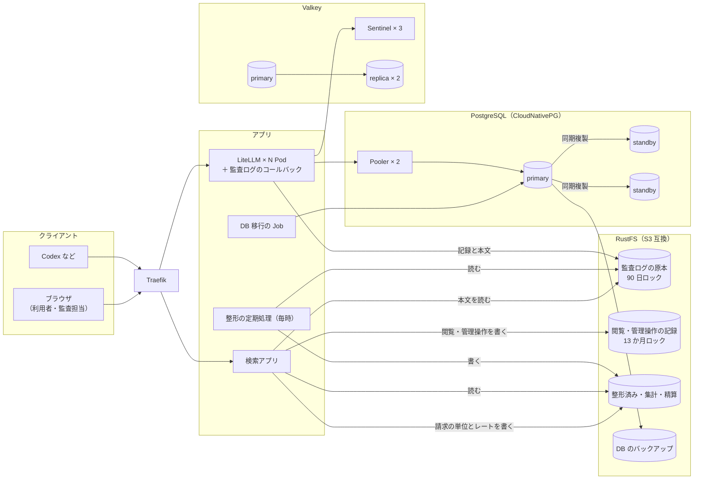

# 変更仕様書: DB と Redis の自前冗長化、監査ログ（S3）、利用料・入出力の履歴検索アプリ

作成: 2026-10-11
状態: 案（実装前。仕様の検討中）
前提の検討: 同日の会話で、登録 1 万 5 千人・同時接続 3 千人の規模を前提に検討した結果
この文書の役割: **何を満たすか（要件）と、何を決めたか（決定）**。どう作るか（設定値、ファイルの形、項目の一覧）は、同じディレクトリの `変更設計書.md` に書く

---

## 0. 背景と決定事項

### 0.1 背景

- LiteLLM 本体は、状態を持たない Pod を増やせば伸ばせる作りになっている。
- 共有している PostgreSQL と Redis は、検証環境では 1 台ずつで、冗長化していない。
- マネージドサービス（RDS、ElastiCache など）は使わず、自前で冗長化する。
- 監査のため、ログを 90 日保持する必要がある。保持するログは、ユーザー別・期間別に検索でき、利用量と利用料を計算できなければならない。
- 本番では Bedrock や Azure の従量課金のモデルを使う想定。検証環境の ChatGPT Plus と Claude Max は検証用に限る。

### 0.2 決定事項（2026-10-11、ユーザーの回答）

| 項目 | 決定 |
|---|---|
| DB の窓口 | **CloudNativePG の Pooler（PgBouncer）を主に使う。比較用に直結の構成も試す** |
| Valkey の入れ方 | **公式イメージで Valkey 3 台と Sentinel 3 台を自分で書く**（Helm チャートやオペレーターは使わない） |
| バックアップ置き場 | **RustFS**（S3 に置き換えられること。3 章） |
| 監査ログの中身 | **プロンプトと応答の中身まで、改ざんできない形で 90 日残す** |
| ログの保存先 | **S3 互換ストレージにだけ記録する。検索は自前で実装する**（ClickHouse や Langfuse は使わない） |
| ログの書き込み | **自作のコールバック**（LiteLLM の Pod の中で動く。LiteLLM に元からある S3 への出力は使わない。6.4 節） |
| 追加 | **ユーザーごとの利用料と、入出力の履歴を検索するアプリを作る** |
| 利用料 | **単価表での概算（A）と、実費の按分（B）の両方を出す。** B は、A の額の割合で実費を配る（6.7 節）。本番は請求書の金額、検証環境は月額を実費とする |
| 審査の利用料 | **審査されたツールコールを出した利用者の利用として数え、「審査」の内訳として分けて出す** |
| 請求の単位 | **全員で共有し、使った割合で配る形だけを扱う**（人ごとの契約は扱わない） |
| 日次の集計の保持 | **13 か月** |
| 日付と月の区切り | **すべて日本時間（JST）**。画面の日付、期間の検索、日ごとの集計、精算の月を日本時間で区切る。クラウドの請求の期間（UTC の月）とは 9 時間ずれることを受け入れる |
| 通貨 | **請求の単位ごとに通貨（米ドルか円）を持たせ、実費と按分はその通貨で計算する。精算は最後に円に換算して出す**（換算のレートは月ごとに管理者が入れる。6.7 節） |
| 本番の監査ログのロック | **COMPLIANCE**（保存から 90 日は管理者でも消せない） |
| 閲覧と管理操作の記録の保持 | **13 か月**（消せない形のまま。精算と同じ期間たどれるように）。管理操作とは、管理者が検索アプリで行う「請求の単位の定義と月ごとの実費の変更」と「換算のレートの変更」のこと |
| S3 に書けない間に Pod を止めたとき | **退避した記録は失われうることを受け入れる。** 止まる直前に、失った件数を警告に出す。運用で、S3 の障害中は LiteLLM を更新しない |
| 検索アプリの URL | **`/lab-audit/`**（LiteLLM 自身が `/audit` という API を持っているため） |
| LiteLLM の管理画面の利用ログ | **書き込みを止める**（`disable_spend_logs`）。管理画面の「Usage」と「Logs」が使えなくなることを了承し、検索アプリで見る |
| S3 に書けない状態が続いたとき | **ディスクに退避し、上限を超えたら記録を捨てて要求は通し、捨てた件数を数えて警告する** |
| 文書の扱い | **変更仕様書（要件）と変更設計書（作り方）を `.history/<日付>-<目的>/` に分けて置き、両方をコミットに含める**（1.1 節） |

### 0.3 既存の設計から変える方針

- 利用量と利用料の集計は、S3 に書いた記録から作る。LiteLLM の DB にある利用ログ（`LiteLLM_SpendLogs`）は、監査にも課金にも使わない（6.6 節）。
- LiteLLM の `use_redis_transaction_buffer` を有効にする。本番では 20〜30 Pod になるため（公式は「10 台以上か 1,000 件/秒以上」で推奨）。

---

## 1. 対象範囲

| やること | やらないこと |
|---|---|
| RustFS（S3 互換のオブジェクトストレージ、1 台）を検証環境に置く | RustFS 自体の冗長化（本番では、冗長化した RustFS か、別の S3 互換基盤に置き換える） |
| PostgreSQL を CloudNativePG の 3 台構成にする。Pooler、バックアップ、任意の時点への復元を含む（バックアップの部品が cert-manager を要るので、cert-manager も入れる） | PostgreSQL のメジャー版を上げる手順 |
| Valkey を primary 1 台・replica 2 台・Sentinel 3 台にする | Redis Cluster |
| 障害を起こして測る試験 | 本番の規模での性能試験（検証環境はメモリ 8 GB のため） |
| 監査ログを S3 に書く仕組みと、検索用に整形する定期処理 | 本文のキーワード検索（1 版目ではやらない。7.5 節） |
| 利用料と入出力の履歴を検索するアプリ | 予算の超過を通知する機能 |
| 大量の合成データを使った、検索の速さの試験 | |
| 変更仕様書と変更設計書をコミットに含める（1.1 節） | |

### 1.1 変更仕様書と変更設計書をコミットに含める

- 今は `.gitignore` が `.history/` を丸ごと除外しているので、この 2 つがコミットに入らない。
- `.history/` には、セッションの引き継ぎの記録（`summary.md`）とバックログ（`BACKLOG.md`）も置かれる。これらは非公開のままにする。
- そのため、除外の規則を「`.history/` の中は既定で除外し、`変更仕様書.md` と `変更設計書.md` だけを含める」に変える。

```gitignore
.history/*
!.history/*/
.history/*/*
!.history/*/変更仕様書.md
!.history/*/変更設計書.md
```

- 変えた後、除外したいファイルが含まれていないことを `git status --ignored` で確かめる。
- このリポジトリは公開しているので、2 つの文書には秘密値、実在のメールアドレス、社内の固有名を書かない（コミット前に検索して確かめる）。

---

## 2. 全体構成



- **Traefik**: クラスタの入口（リバースプロキシ）。`http://localhost:8080` に届いた要求を、経路（`/v1/...` は LiteLLM、`/lab-audit/` は検索アプリなど）ごとに中のアプリへ振り分ける。今の検証環境ですでに使っている（k3s の標準の入口）。本番では、使う Kubernetes の入口（ロードバランサーとイングレス）に置き換わる。

---

## 3. オブジェクトストレージ

| 要件 | 内容 |
|---|---|
| ソフト | 検証環境は RustFS（1 台） |
| 置き換え | **S3 の API だけを使い、接続先・リージョン・資格情報は設定で与える。** AWS S3 や、冗長化した別の S3 互換基盤に、設定の変更だけで置き換えられること |
| 置き場の分け方 | 監査ログの原本、閲覧と管理操作の記録、整形済みのデータと集計・精算、DB のバックアップの 4 つを分ける |
| 改ざんの防止 | 監査ログの原本は 90 日、閲覧と管理操作の記録は 13 か月、Object Lock で消すことも書き換えることもできないようにする。検証環境は GOVERNANCE（作り直せるように）、本番は COMPLIANCE |
| 保持 | 原本と整形済みのデータは 90 日（91 日目に消える）。閲覧と管理操作の記録、日次の集計、月次の精算は 13 か月。DB のバックアップは 30 日 |
| 権限 | 用途ごとに資格情報を分け、必要な操作だけを許す。LiteLLM には原本への追記だけを許し、読み取りと削除は許さない |
| 公開 | クラスタの外には出さない |
| 検証環境での扱い | 置き場はクラスタの中にあるので、`./lab down` や `./lab rebuild` で監査ログも消える（検証環境だけの振る舞い。本番の置き場はクラスタの外に置く） |

**S3 への置き換えについての注意**:

- AWS S3 はマネージドサービスなので、「マネージドを使わない」方針に含めるかは別に判断する。
- 運用を始めてから置き場を移すと、原本のロックの期限を移した先で付け直すことになる。本番の置き場は運用を始める前に決める。

---

## 4. PostgreSQL の冗長構成

| 要件 | 内容 |
|---|---|
| 構成 | CloudNativePG で 3 台（primary 1、standby 2）。3 台は別々のノードに置く |
| 複製 | 同期複製。standby が 1 台落ちても書き込みは止めない。切り替えでデータを失わない |
| 接続の窓口 | Pooler（PgBouncer、transaction モード）を主にし、直結の方式と設定 1 つで切り替えられること。両方で試験する |
| DB 移行 | Pooler を通さず、primary に直結して流す。LiteLLM の Pod の起動時には移行しない |
| バックアップ | WAL のアーカイブと毎日のバックアップを、オブジェクトストレージに送る。任意の時点に戻せること |
| 今の DB の扱い | 中身は引き継がない（作り直せるものと、サインインし直せば戻るものしか無いため）。切り替えた後、Gmail のサインインをやり直す（手順書に書き足す） |

---

## 5. Valkey の冗長構成

| 要件 | 内容 |
|---|---|
| 構成 | 公式イメージで、Valkey 3 台（primary 1、replica 2）と Sentinel 3 台。それぞれ別々のノードに置く |
| 切り替え | primary が落ちたら、Sentinel の判断で人の操作なしに replica が primary になる。落ちた primary が戻ったら replica として戻る。primary が 2 台になる状態（スプリットブレイン）を作らない |
| 永続化 | ディスクに書く（利用量を Redis に溜める仕組みを使うため）。メモリが溢れても黙ってデータを消さない |
| 認証 | データの Pod と Sentinel は、それぞれ別のパスワードで守る |
| 今の Redis の扱い | 中身は引き継がない（キャッシュと回数の集計しか無いため） |

---

## 6. 監査ログ

### 6.1 要件

| 要件 | 内容 |
|---|---|
| 保持 | 90 日。その間は消すことも書き換えることもできない |
| 中身 | LLM への入力（受け取った要求の全体）と出力（応答の全体）を保存する。例外として、審査のガードレールが内部で行う呼び出し（審査官と Jev の一次判定）は要求として記録せず、利用量と利用料を審査の記録に書く |
| 検索 | ユーザー別・期間別に検索できる |
| 利用量と利用料 | 入力・出力・キャッシュのトークン数と、利用料を計算できる |
| 閲覧の記録 | 本文を誰がいつ見たかを、消せない形で 13 か月残す |
| 欠けの扱い | Pod が普通に止まるとき（ローリング更新）は記録を失わない。S3 に書けないときはディスクに退避して再送する。それでも書けないまま上限を超えたら捨て、捨てた件数を数えて警告する。S3 に書けない状態が続いている間に Pod を止めると、退避した記録は Pod と一緒に失われうる（了承済み。失った件数を止まる直前に警告に出す）。ノードが突然止まったときは、書き出し前の記録（検証 10 秒、本番 60 秒分）を失いうる。1 版目の警告はログと数値の出力まで（監視の仕組みへのつなぎ込みは範囲外） |
| 時刻 | 記録の時刻は UTC で書く。置き場の区切り、検索、集計は日本時間で行う |

### 6.2 記録する対象

| 種類 | 何を |
|---|---|
| 要求 | LLM への要求 1 件（Responses、Chat Completions、Anthropic Messages。Claude Code の要求〔審査を省くもの〕を含む） |
| MCP | MCP のツールの呼び出し 1 件（Gmail など） |
| 審査 | 審査のガードレールの判定 1 件（審査官の呼び出しの利用量を含む）。今の標準出力への判定ログと `./lab review-log` も残す |
| 閲覧 | 検索アプリでの本文の閲覧 1 件 |
| 管理操作 | 管理者が検索アプリで行った、請求の単位の定義・月ごとの実費・換算のレートの変更 1 件（誰が、いつ、何を、変更前と変更後） |

### 6.3 1 件ごとに残すこと・残さないこと

| 残すこと | 残さないこと |
|---|---|
| 誰が（利用者、チーム、キーの別名、クライアントの種類）、いつ（開始と終了）、何を（呼び出しの種類、モデル）、結果（成功か失敗か）、量（トークン数）、利用料、所要時間、ツールコールの名前と引数の先頭、審査の結果、本文の場所 | キーそのもの（ハッシュだけを残す）、認証情報、要求の見出し（ヘッダー） |

項目の一覧と形は、変更設計書の 5 章に書く。

### 6.4 書き込みの方式（決定）

**LiteLLM の Pod の中で動く、自作のコールバックで書く。** LiteLLM に元からある S3 への出力（`s3_v2`）は使わない。

決定のもとにした事実（使っている版 v1.104.2 のソースで確かめた。詳細は変更設計書 5.1 節）:

| 元からある出力の振る舞い | この仕様との関係 |
|---|---|
| 中身を圧縮せずに書く | 本文を 90 日残すので、保存量が約 5 倍になる（本番の規模の仮定で、90 日 約 90 TB と約 18 TB）。AWS S3 はストレージ側で圧縮しないので、書く側で圧縮するしかない |
| S3 に書けないときは、メモリの中で待ってから捨てる（ディスクに退避しない） | 6.1 節の「退避して再送する」を満たさない |
| 1 件 1 ファイル（既定）か、書き出しごとに日付ごとの 1 ファイル（まとめる設定） | 記録と本文を分けて書けないので、整形の処理が本文（本番で 1 日 200 GB 規模）を毎回読むことになる |

自作でも、1 件の中身には LiteLLM が文書で定めている記録（`StandardLoggingPayload`）をそのまま使う。

経路ごとに記録がどう届くかも、同じ版のソースと今の構成で確かめた（変更設計書 5.2 節と 13 章）:

| 経路 | 記録の届き方 |
|---|---|
| Codex など（`/v1/responses`、`/v1/chat/completions`） | 成功時・失敗時のフックに届く。ストリーミングも、組み立て後の応答とトークン数・利用料が入る |
| Claude Code（`/v1/messages`） | 同上。審査のガードレールは User-Agent を見て審査を省くが、記録はほかの要求と同じく残る。応答は LiteLLM が OpenAI の形に変換したもの（文章とツールコールは保たれる） |
| 素通しの中継（`/anthropic/...` など） | 今の構成では入口で拒否している（403）ので、記録の対象外 |
| MCP のツールの呼び出し | 成功時・失敗時とも届く。引数は記録の `mcp_tool_call_metadata` に入る |
| 審査官と Jev の呼び出し（ガードレールの中） | 何もしないと別の要求として届き、利用者の無い要求として数えられる。二重に数えないよう、記録しない指定（`no-log`）で呼び、審査官の利用量と利用料は審査の記録に書く |

要求と審査の記録は、LiteLLM が要求ごとに付ける ID（`litellm_call_id`）で結び付ける（記録の `id` は上流の応答の ID で、結び付けに使えない）。

### 6.5 保存量の見積もり（仮定。実機で 1 件の大きさを測って直す）

| 項目 | 仮定 | 1 日（1,000 万件） | 90 日 |
|---|---|---|---|
| 記録（圧縮後） | 1 件 0.3 KB | 3 GB | 270 GB |
| 本文（圧縮後） | 1 件 100 KB を 1/5 に圧縮 → 20 KB | 200 GB | **18 TB** |
| 整形済みのデータ | 記録の半分 | 1.5 GB | 135 GB |

- 本文の量は、コーディングエージェントが毎回会話全体を送ることで膨らむ。
- 重複を除く方式（同じセッションの過去のメッセージを参照にする）で 1 桁減らせる見込みがあるが、監査の原本としての扱いが複雑になる。1 版目ではやらず、実測してから判断する。

### 6.6 LiteLLM の DB にある利用ログの扱い

- LiteLLM の利用ログ（`LiteLLM_SpendLogs`）は使わず、書き込みを止めて PostgreSQL が膨らむのを防ぐ（`disable_spend_logs`）。
- 止めても、キー・ユーザー・チームの使用額（予算の判定に使う）と、日次の集計の表は更新され続ける（v1.104.2 のソースで確認。この設定が止めるのは利用ログの表への書き込みだけ。利用量を Redis に溜める設定でも同じ）。
- LiteLLM の管理画面の「Usage」と「Logs」は使えなくなる。代わりに検索アプリを使う（2026-10-11 に了承）。

### 6.7 利用料（概算と按分）

| 環境 | モデル | 課金の形 |
|---|---|---|
| 本番（想定） | Bedrock、Azure OpenAI などの従量課金 | 使った分だけ、月ごとの請求書で払う |
| 検証環境 | ChatGPT Plus（Codex と審査官）、Claude Max（Claude Code） | 月額の定額。ChatGPT のモデルは LiteLLM の単価表に無いので、そのままでは利用料が 0 になる（単価を設定する）。Claude のモデルは単価表にあるので、API の定価で概算される |

| 段 | 名前 | いつ | 決まり |
|---|---|---|---|
| A | **概算**（単価表） | 要求ごと、すぐ | トークン数 × 単価。本番は LiteLLM の単価表（従量課金の公開価格）、検証環境は同等の API の公開価格を設定して使う |
| B | **按分**（実費） | 月ごと | その月の実費（本番は請求書の金額、検証環境は月額）を、A の額の割合で利用者に配る |

**B が本番でも要る理由**: 従量課金でも、請求書の金額は A の合計と一致しない。次の差を B で実費に合わせる。

- 割引や利用の確約による値引き
- 為替
- 単価の改定と、単価表の更新の遅れ
- キャッシュの単価の扱いの違い
- LiteLLM を通らない利用

**B の決まり**（請求の単位 k、月 m）:

```
配分率 r(k, m)   = 実費 F(k, m) ÷ その月にその請求の単位のモデルで使った A の合計 C(k, m)
利用者 u の按分額 = 利用者 u の A の額 × r(k, m)
```

- 月は日本時間で区切る。クラウドの請求書の期間（UTC の月）とは 9 時間ずれるので、月の境目の 9 時間分の利用が、請求書とは隣の月に入る（了承済み）。
- 端数: 合計が実費にちょうど合うようにする。
- その月に利用が無い（C = 0）ときは、配らずに「未配分」として出す。
- 実費がまだ入っていない月は、B を出さず A だけを出す。定額で月額が決まっているときは、月の途中でも**見込み**を出す。
- 遅れて届いた記録や、実費を直したときは、締めた月も計算し直し、その履歴を残す。
- 請求の単位は、全員で共有する形だけを扱う。単位に属さないモデルは A だけを出す。
- 利用者の無い要求（マスターキーでの試験や初期設定）も C に含め、「利用者なし」の行にその分の按分額を出す（利用者には付けない）。
- 請求の単位の定義と実費は、管理者が検索アプリで編集し、その変更を記録する。

**通貨と円への換算**:

- 請求の単位ごとに通貨（米ドルか円）を持たせ、実費 F をその通貨で入れる（Azure の円の請求書は円のまま入れる）。
- A は米ドル（LiteLLM の単価表が米ドルのため）。按分額 = A の額 × r なので、按分額は請求の単位の通貨で出る。
- 精算は最後に円で出す。通貨が米ドルの請求の単位は、その月の換算レート（米ドル → 円）を掛ける。レートは、管理者が月ごとに検索アプリで入れる（どのレートを使うかは社内の規程による）。
- A を円で見せるときも同じレートを使い、「参考」と書く。
- その月のレートが未入力なら、円の列は出さずに「レート未入力」と出す。

**審査の利用料**:

- 審査官の呼び出しも A で計算し、その請求の単位の合計 C に含める（本番は Bedrock や Azure の審査用のモデル）。Jev の一次判定は別の請求なので含めない。
- 審査されたツールコールを出した利用者の利用として数え、「審査」の内訳として分けて出す。

---

## 7. 利用料と入出力の履歴を検索するアプリ

### 7.1 目的

- 利用者が、自分の利用量・利用料と、入出力の履歴を見られる。
- 監査担当が、全員の分を検索し、本文まで確かめられる。
- 按分のために、利用料と精算を表計算ソフトに書き出せる。

### 7.2 利用者と権限

| 役割 | 見られる範囲 |
|---|---|
| 一般の利用者 | 自分の利用量・利用料・履歴・本文・精算の行 |
| 監査担当 | 全員の利用量・利用料・履歴・本文・精算、閲覧の記録 |
| 管理者 | 監査担当と同じ。加えて請求の単位の設定、換算のレートの設定、整形の状態 |

- 権限による絞り込みは、サーバー側で必ずかける（画面で隠すだけにしない）。
- **本文の閲覧は、自分の分であっても必ず記録を残す。** 記録を残せなかったときは本文を見せない。
- 監査担当が他人の本文を開くときは、理由の入力を必須にする。
- サインインは、検証環境は Google、本番は Entra ID。設定だけで切り替えられること。サインインの設定が無いとき（Google の手作業の準備をしていないとき）は、検索アプリは入れない（整形の処理は入れる）。
- 書き込みを伴う操作（本文の表示、設定の更新）は、なりすましの要求（CSRF）を防ぐ。
- 画面の日時と期間の指定は、すべて日本時間。

### 7.3 画面

| 画面 | 内容 |
|---|---|
| 利用状況 | 期間を選び、ユーザーごとの件数、入力・出力・キャッシュのトークン数、利用料（A。見出しに「概算（単価表）」と書く）。モデル別・クライアント別・審査の内訳と、日ごとの推移。CSV の書き出し |
| 履歴の一覧 | 条件（ユーザー〔監査担当のみ〕、期間〔必須、最大 90 日〕、モデル、クライアント、成功・失敗、審査で止めたものだけ、ツール名）で絞り、新しい順に出す |
| 履歴の詳細 | 記録、審査の結果、ツールコール。「本文を表示」で入力と出力を出す（ここで閲覧の記録を残す） |
| 精算 | 月（日本時間）を選び、請求の単位ごとの通貨・実費・A の合計・配分率、利用者ごとの A と B（請求の単位の通貨）と、円に換算した額。「見込み」「確定」「実費未入力」「レート未入力」を区別して出す。「利用者なし」の行と、どの請求の単位にも当てはまらないモデルの「対象外」の行（A だけ）も出す。CSV の書き出し |
| 閲覧の記録 | 誰がいつ誰の本文を開いたか（監査担当のみ） |
| 請求の単位の設定 | 追加・編集（通貨、モデル、月ごとの実費）と変更の履歴（管理者のみ） |
| 換算のレートの設定 | 月ごとの米ドル → 円のレートの入力と変更の履歴（管理者のみ） |
| 整形の状態 | 整形が済んだ最後の時間、遅れ、失敗（管理者のみ） |

### 7.4 速さの目標（本番の規模、1 日 1,000 万件で）

| 操作 | 目標 |
|---|---|
| 1 か月分の利用状況（全員） | 3 秒以内 |
| 1 人の 1 日分の履歴 | 3 秒以内 |
| 1 人の 90 日分の履歴 | 30 秒以内 |
| 本文の表示 | 1 秒以内 |

合成データで測る（9.4 節）。

### 7.5 1 版目でやらないこと

- 本文のキーワード検索（90 日で 18 TB を走査することになるため）。
- 予算の通知。

---

## 8. 構築ツールに足すコマンド

| コマンド | 内容 |
|---|---|
| `./lab test-failover` | 障害を起こして測る（Pooler と直結の両方） |
| `./lab test-restore` | バックアップから任意の時点に戻す |
| `./lab test-audit` | 監査ログの試験 |
| `./lab audit-synth` | 検索の速さの試験用の合成データを作る |
| `./lab audit-compact` | 整形を手で流す |

`./lab up` の冪等性（2 回目で何も変わらない）は、新しい部品を含めて保つ。段階、設定の項目、`.env` に足す項目は変更設計書の 8 章。

---

## 9. 試験と合格の条件

### 9.1 単体テスト

監査ログの書き込み、本文の取り出し、整形、精算、検索アプリの権限、構築ツールの設定の生成に、単体テストを足す（対象の一覧は変更設計書 11 章）。

### 9.2 監査ログの試験

| 確かめること | 合格の条件 |
|---|---|
| 3 形式の要求の記録が S3 に届く | 全件ある。トークン数と利用料が LiteLLM の応答と一致する |
| 審査の結び付け | 審査の記録が要求の記録と結び付く |
| 本文の取り出し | 送った要求と同じ内容が取り出せる |
| 改ざんの防止 | 原本（90 日）と閲覧・管理操作の記録（13 か月）を、どの資格情報でも、保持の回避を指定せずには消せない（検証環境は GOVERNANCE なので、回避の権限を持つ管理者が回避を指定した場合だけ消せる。本番の COMPLIANCE では誰も消せない） |
| 権限 | ユーザー 2 がユーザー 1 の履歴と本文を取れない（403） |
| 閲覧の記録 | 本文を開くと記録が増える |
| MCP の記録 | Gmail の MCP のツールの呼び出しが、引数と結果とともに記録される |
| 失敗した要求 | 上流がエラーを返した要求も記録される |
| S3 に書けないとき | RustFS を止めている間の要求が退避され、RustFS を戻すと再送されて欠けが 0 件になる。退避の上限を超えた分は捨てられ、その件数が数えられる |
| 利用者なし | マスターキーでの要求が「利用者なし」として記録され、精算の「利用者なし」の行に入る |
| 円の請求の単位 | 円の請求の単位の実費が、換算なしで按分される |
| 審査官の呼び出し | 審査官の呼び出しが、別の要求として記録されない（利用者なしの行に入らない）。審査の記録に利用量と利用料が入る |
| Pod の停止 | 普通の停止では記録を失わない |
| 集計の照合 | 要求の分（審査を除く）の利用者ごとのトークン数と件数が、LiteLLM の日次の集計と一致する。LiteLLM の日次の集計は UTC の日で区切られるので、照合は監査ログの 1 時間ごとの整形済みのデータから UTC の日で集計し直して行う |
| 精算 | 2 人が偏った量を使い、審査も起こしてから実費を入れて精算すると、按分の合計が実費に一致し、割合が A の額（審査の分を含む）の割合と一致する。審査の分がツールコールを出した利用者に付く。米ドルの請求の単位は、入れたレートで円に換算される。日本時間の月の境目（0 時）の前後の要求が、正しい月に入る |

### 9.3 障害の試験

1 秒 20 件の要求を流しながら、次の場面を Pooler と直結の両方で起こす。

| 場面 | 回復までの時間 |
|---|---|
| PostgreSQL の計画的な切り替え | 60 秒以内 |
| PostgreSQL の primary の Pod を消す | 60 秒以内 |
| PostgreSQL の primary があるノードを止める | 120 秒以内 |
| Valkey の primary の Pod を消す | 60 秒以内 |
| Valkey の primary があるノードを止める | 120 秒以内 |

ノードを止める場面では、k3d の server ノード（Kubernetes の制御部分が載っている）は止めない。primary が server ノードにあるときは、先に agent ノードの台へ切り替えてから止める。

すべての場面で、次も満たすこと（目安。1 回目の結果を見て見直す）:

- 人の操作なしに回復する。
- LiteLLM の Pod が再起動を繰り返さない。
- Valkey の primary が 1 台だけになる。
- 監査ログの欠けが 0 件。ただしノードを止める場面では、止めたノードにあった LiteLLM の Pod の、止める直前の書き出し前の記録（10 秒分まで）の欠けは許す（6.1 節で受け入れている欠け）。

ノードを止める場面で止めるのは agent ノードだけで、RustFS は止めない側（server ノード）に置く。

### 9.4 復元の試験と速さの試験

- 復元: 時刻 T を指定して別のクラスタに戻すと、T までの行があり、T より後の行が無い。
- 速さ: 1 日 100 万件 × 7 日、1 万 5 千人の合成データで 7.4 節の操作を測り、1 日 1,000 万件のときを比例で見積もる。目標に届かなければ、変更設計書 6.4 節の手立てを入れる。本文の表示の速さは、合成データには本文が無いので、監査ログの試験で書いた実際の記録で測る。

### 9.5 既存の試験

`test-unit`、`test-smoke`、`test-idempotency`、`test-judge` が引き続き通ること。疎通確認に、Sentinel 経由で動くこと、Pooler 経由で書けること、`/lab-audit/` にサインインせずに入るとサインインに送られることを足す。

---

## 10. 実装の順序

| 段 | 内容 | 終わりの条件 |
|---|---|---|
| 1 | `.gitignore` の変更（1.1 節）とオブジェクトストレージ | 文書がコミットの対象になる。`./lab objectstore` の最後の自己確認（許した操作ができ、原本を消せないこと）が通る |
| 2 | PostgreSQL と DB 移行 | Pooler と直結の両方で既存の試験が通る |
| 3 | Valkey と Sentinel | 既存の試験が通る |
| 4 | 障害の試験と復元の試験 | 結果を変更設計書に記録する |
| 5 | 監査ログの書き込みと整形 | 監査ログの試験が通る |
| 6 | 検索アプリと精算 | 権限、閲覧の記録、精算の試験が通る |
| 7 | 合成データでの速さの試験 | 結果を変更設計書に記録する |
| 8 | 文書の更新（README、設計書、手順書）、冪等性の試験 | — |

各段の終わりでコミットする。push は段 8 で、まとめて確認を取ってから。段 1〜4 の間は検索アプリのイメージがまだ無いので、構築ツールはそれを飛ばす（変更設計書 8.1 節）。

見積もり（11 章）の単位との対応: 段 1 = 単位 1、段 2 = 単位 2、段 3 = 単位 3、段 4 = 単位 4、段 5 = 単位 5 と 6、段 6 = 単位 6b と 7、段 7 = 単位 8、段 8 = 単位 9。

---

## 11. 作業量の見積もり（AI の作業時間。三点見積もり、単位: 時間）

| 単位 | 種類 | 楽観 / 最頻 / 悲観 | 期待値 |
|---|---|---|---|
| 1. オブジェクトストレージ | 実装 | 0.2 / 0.4 / 1.0 | 0.47 |
| | 実行 | 0.1 / 0.2 / 0.5 | 0.23 |
| 2. PostgreSQL と DB 移行 | 実装 | 0.6 / 1.2 / 3.0 | 1.40 |
| | 実行 | 0.3 / 0.5 / 1.0 | 0.55 |
| | 手戻り | 0.3 / 0.8 / 2.5 | 1.00 |
| 3. Valkey と Sentinel | 実装 | 0.5 / 1.0 / 2.5 | 1.17 |
| | 実行 | 0.2 / 0.4 / 0.8 | 0.43 |
| | 手戻り | 0.3 / 0.6 / 2.0 | 0.78 |
| 4. 障害と復元の試験 | 実装 | 0.4 / 0.8 / 1.5 | 0.85 |
| | 実行 | 0.5 / 1.0 / 2.0 | 1.08 |
| | 手戻り | 0.2 / 0.5 / 1.5 | 0.62 |
| 5. 監査ログの書き込み | 実装 | 0.5 / 1.0 / 2.0 | 1.08 |
| | 実行 | 0.2 / 0.3 / 0.6 | 0.33 |
| | 手戻り | 0.2 / 0.5 / 1.5 | 0.62 |
| 6. 整形の処理 | 実装 | 0.4 / 0.8 / 1.6 | 0.87 |
| | 実行 | 0.2 / 0.3 / 0.6 | 0.33 |
| | 手戻り | 0.1 / 0.3 / 0.8 | 0.35 |
| 6b. 精算 | 実装 | 0.3 / 0.6 / 1.2 | 0.65 |
| | 手戻り | 0.1 / 0.2 / 0.6 | 0.25 |
| 7. 検索アプリ | 実装 | 0.8 / 1.5 / 3.5 | 1.72 |
| | 実行 | 0.2 / 0.4 / 0.8 | 0.43 |
| | 手戻り | 0.3 / 0.8 / 2.0 | 0.92 |
| 8. 合成データの試験 | 実装 | 0.2 / 0.4 / 0.8 | 0.43 |
| | 実行 | 0.3 / 0.6 / 1.5 | 0.70 |
| 9. 文書と最終の試験 | 実装 | 0.3 / 0.6 / 1.0 | 0.62 |
| | 実行 | 0.2 / 0.3 / 0.5 | 0.32 |

- 合計の期待値: 実装 9.3、実行 4.4、手戻り 4.5 → **18.2 時間**。
- 過去の記録では、実装と手戻りの実績が期待値の 0.4〜0.8 倍だった。実装と手戻りを 0.5 倍で補正すると、**約 11.3 時間**（実行は補正しない）。
- 悲観値が最頻値の 3 倍以上の単位: 2 の手戻り（Prisma と PgBouncer の組み合わせ）、3 の手戻り（Sentinel の起動スクリプトの切り替えの扱い）、4・5・6b の手戻り（ちょうど 3 倍。障害の試験の結果次第の調整、ストリーミングの記録の組み立て、精算の端数と計算し直し）。
- この見積もりは、仕様の見直し（`/lab-audit/`、`call_id` での結び付け、Helm の DB の設定など）の前に出したもの。変更の量は小さく、見積もりの幅の中に収まる。
- ユーザーの操作（Google のコンソールで戻り先の URL を足す、Gmail のサインインをやり直す）の待ち時間は含めない。

---

## 12. リスク

| リスク | 影響 | 対策 |
|---|---|---|
| 本文の保存量が見積もりより大きい | 90 日で数十 TB | 実機で測る。重複を除く方式を次の版で検討する |
| Pod が突然落ちると、書き出し前の記録（検証 10 秒、本番 60 秒分）を失う | 監査の欠け | 書き出しの間隔を短くする（S3 への書き込み回数とのつり合い）。欠けを数えて見えるようにする |
| S3 に書けない間に Pod を止めると、退避した記録が消える | 監査の欠け | 了承済み。止まる直前に件数を警告に出す。運用で、S3 の障害中は LiteLLM を更新しない |
| 監査担当が全員の本文を読める | 機密の漏えい | 閲覧の記録と理由の入力。閲覧の記録も消せない形で残す |
| 検証環境のメモリが足りない | 試験が不安定 | 2026-10-11 に OrbStack の上限を 12 GB に上げた。見積もりは負荷時で約 11 GB（変更設計書 9 章） |
| RustFS が新しい（1.0 の正式版は 2026-09） | 不具合 | 本番の置き場は運用前に決める（3 章） |
| 自前の Valkey と Sentinel の起動の不具合 | primary が 2 台になる | 障害の試験で、切り替えの後に primary が 1 台だけであることを確かめる |
| 精算の月（日本時間）と請求書の期間（UTC）のずれ | 月の境目の 9 時間分が、請求書と隣の月に入る | 了承済み。月ごとの按分の合計は実費に一致するので、年間の合計では差が出ない |
| Pooler と LiteLLM（Prisma）の相性 | 要求の一部がエラーになる | LiteLLM が使う Prisma 5.4.2 は、準備済みの問い合わせを PgBouncer の機能と組み合わせると失敗する既知の問題がある（prisma#21799）。PgBouncer 側の準備済みの問い合わせの機能を切る（`max_prepared_statements=0`）設定で避ける（変更設計書 3.3 節）。障害の試験でも Pooler 経由の失敗が出ないことを確かめる |

---

## 13. 出典

- LiteLLM: [Production best practices](https://docs.litellm.ai/docs/proxy/prod) / [DB sizing](https://docs.litellm.ai/docs/proxy/db_sizing) / [Redis sizing](https://docs.litellm.ai/docs/proxy/redis_sizing) / [Redis and Valkey](https://docs.litellm.ai/docs/proxy/caching_redis) / [Redis circuit breaker](https://docs.litellm.ai/blog/redis-circuit-breaker) / [Prisma reconnect incident](https://docs.litellm.ai/blog/prisma-reconnect-blocking-incident) / [PR #42556](https://github.com/BerriAI/litellm/pull/42556) / [StandardLoggingPayload](https://docs.litellm.ai/docs/proxy/logging_spec) / [Logging](https://docs.litellm.ai/docs/proxy/logging) / [UI logs（disable_spend_logs）](https://docs.litellm.ai/docs/proxy/ui_logs) / [Custom pricing](https://docs.litellm.ai/docs/proxy/custom_pricing) / [ChatGPT provider](https://docs.litellm.ai/docs/providers/chatgpt)
- LiteLLM v1.104.2 のソース（S3 への出力）: [s3_v2.py](https://github.com/BerriAI/litellm/blob/v1.104.2/litellm/integrations/s3_v2.py) / [s3.py](https://github.com/BerriAI/litellm/blob/v1.104.2/litellm/integrations/s3.py)
- Prisma: [PgBouncer](https://www.prisma.io/docs/orm/prisma-client/setup-and-configuration/databases-connections/pgbouncer)
- CloudNativePG: [Replication](https://cloudnative-pg.io/docs/devel/replication) / [Failover](https://cloudnative-pg.io/docs/devel/failover) / [Connection pooling](https://cloudnative-pg.io/docs/devel/connection_pooling) / [Barman Cloud Plugin](https://cloudnative-pg.io/plugin-barman-cloud/docs/object_stores/) / [CNCF](https://www.cncf.io/projects/cloudnativepg/)
- Valkey: [Releases](https://github.com/valkey-io/valkey/releases) / [Redis Sentinel](https://redis.io/docs/latest/operate/oss_and_stack/management/sentinel/) / [Redis licenses](https://redis.io/legal/licenses/)
- RustFS: [GitHub](https://github.com/rustfs/rustfs) / [Object Lock](https://docs.rustfs.com/administration/data/object/object-lock)
- MinIO の開発終了: [GitHub（archived）](https://github.com/minio/minio)
- Langfuse（採らなかった理由）: [License key](https://langfuse.com/self-hosting/license-key) / [Metrics API](https://langfuse.com/docs/metrics/features/metrics-api)

---

## 決定の記録

| 日付 | 問い | 決定 |
|---|---|---|
| 2026-10-11 | DB の窓口 | Pooler を主、直結を比較用 |
| 2026-10-11 | Valkey の入れ方 | 公式イメージで自分で書く |
| 2026-10-11 | バックアップ置き場 | RustFS（S3 に置き換えられること） |
| 2026-10-11 | 監査ログの中身 | 本文まで 90 日 |
| 2026-10-11 | ログの保存先と検索 | S3 にだけ記録し、検索は自前 |
| 2026-10-11 | 利用料の出し方 | 単価表での概算（A）と、実費の按分（B）の両方。B は A の額の割合で実費を配る |
| 2026-10-11 | 日次の集計の保持 | 13 か月 |
| 2026-10-11 | S3 に書けない状態が続いたとき | 退避し、上限を超えたら捨てて数える。要求は止めない |
| 2026-10-11 | 審査の利用料を誰の利用として数えるか | 審査されたツールコールを出した利用者。「審査」の内訳として分けて出す |
| 2026-10-11 | 人ごとの契約を扱うか | 扱わない |
| 2026-10-11 | 本番のモデル | Bedrock や Azure の従量課金を想定。B は本番では請求書の金額に合わせるために使う |
| 2026-10-11 | ログの書き込みの方式 | 自作のコールバック。LiteLLM の元からある S3 への出力をソースで確かめ、圧縮しないことと退避が無いことから採らなかった（6.4 節） |
| 2026-10-11 | 文書の分け方 | 要件と決定は変更仕様書、作り方は同じディレクトリの変更設計書。両方をコミットに含める |
| 2026-10-11 | 日付と月の区切り | すべて日本時間。請求書の期間とのずれは受け入れる |
| 2026-10-11 | 通貨 | 請求の単位ごとに通貨を持たせ、精算は円に換算して出す。レートは月ごとに管理者が入れる |
| 2026-10-11 | 本番の監査ログのロック | COMPLIANCE |
| 2026-10-11 | 閲覧と管理操作の記録の保持 | 13 か月 |
| 2026-10-11 | LiteLLM の管理画面の利用ログ | 書き込みを止め、「Usage」と「Logs」が使えなくなることを了承 |
| 2026-10-11 | 実装後の確認項目の扱い | 実装の前に、インターネットと LiteLLM などのソースで確証を取った（変更設計書 13 章）。実装後に残るのは、実測でしか決まらない値（本文の大きさ、検索の速さ、切り替えの時間）だけ |

| 2026-10-11 | S3 に書けない間に Pod を止めたときの退避した記録 | 失われうることを受け入れ、件数を警告に出す。S3 の障害中は LiteLLM を更新しない |
| 2026-10-11 | 検証環境のメモリ | OrbStack の上限を 12 GB に上げた（ユーザーの操作） |
| 2026-10-11 | 仕様と設計、設計と今のコードの突き合わせ | Claude Code の経路（`/v1/messages`）、`/audit` の衝突（`/lab-audit/` に変更）、結び付けの ID（`litellm_call_id`）、Helm の DB の設定、Pod の止まり方、構築ツールから RustFS へのつなぎ方などを直した |

## 確認事項

なし（2026-10-11 時点）。
