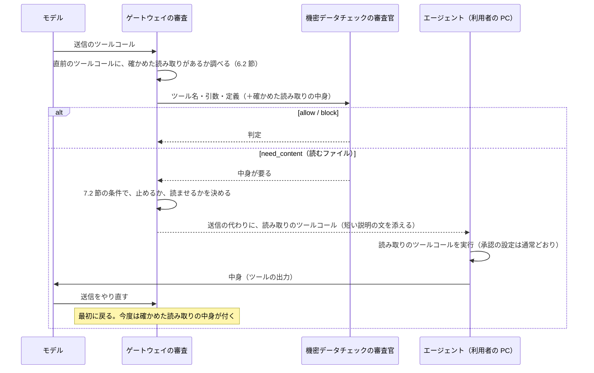

# 変更仕様書: 送信するファイルの中身の審査（機密データチェックの拡張）

作成: 2026-10-13
更新: 2026-10-13（本物のエージェントの試験で、拒否の文で読ませる方式が Codex で動かないと分かり、ゲートウェイが読み取りのツールコールを返す方式に変えた。経緯は 14 章）
状態: 実装中。設計は同じフォルダの `変更設計書.md`。

## 1. 目的

機密データチェック（文脈独立審査。`litellm/guardrails/tool_call_review.py`）は、ツール名・引数・ツールの定義だけを見て、
機密情報の持ち出しを止める。ファイルを外へ送る操作では、引数にファイルの名前しか無く、中身は見えない。
判定基準（`litellm/guardrails/policies/confidential.md`）は、名前で機密と分かるファイル（認証情報のファイルなど）の指定を止めるが、
次のような送信は、中身を見ないと判定できない。

- 機密のファイルを、別の名前に写してから送る
- 名前に手がかりの無いファイルに、個人情報や社外秘の内容が入っている

ゲートウェイは利用者の PC のファイルを直接読めない（ツールを実行するのは PC のエージェントで、ゲートウェイは実行前の要求を見るだけ）。
そこで、**審査官が中身を求めたら、ゲートウェイが送信のツールコールを、ファイルを読むツールコールに差し替えて返す。
エージェントがそれを実行し、モデルが送信をやり直すと、次の要求で、その読み取りがゲートウェイの指定どおりだったことを確かめ、
出力（ファイルの中身）を機密データチェックに渡す。**

## 2. 決定事項（2026-10-13 のヒアリング）

| 項目 | 決定 |
|---|---|
| 目的 | 機密の持ち出し（ファイルを指定して外へ送る操作）を、中身を見て止める。削除などの判定（文脈あり審査）には使わない |
| 中身の入手 | ゲートウェイが、送信のツールコールを、読み取りのツールコール（エージェントのシェルのツールで、指定のコマンドを実行するもの）に差し替えて返す。エージェントはそれを実行し、出力が会話に載る。利用者の PC 側のフックは使わない（2026-10-13 に、拒否の文で頼む方式から変更。14 章） |
| 読み取りに使うツール | リクエストのツールの一覧から、決まった規則でシェルのツールを選ぶ（6.4 節）。エージェントごとの作り分けや、ツールの名前での決め打ちはしない。LLM には選ばせない。読み取り専用のツール（Claude Code の `Read` など）は使わない（出力の形をツールが決めるので、大きさ・途中切れ・加工の有無を確かめられないため） |
| シェルのツールが見つからないとき | 読み取りのツールコールを返さず、拒否の文で読み取りのコマンドを示す（8.2 節） |
| 読み方 | ゲートウェイが、読み取りのコマンドを一字一句指定する。モデルに読み方を選ばせない（読み方を選べると、無害に見える中身を審査官に見せられるため） |
| 使う出力 | ゲートウェイの指定どおりに行われ、送信の直前のツールコールである読み取りの出力だけ |
| 機密データチェックに渡すもの | 今までの入力（ツール名・引数・ツールの定義）に、確かめた読み取りの出力だけを足す。会話のほかの部分（利用者の発言、モデルの文章、ほかのツールの出力）は渡さない |
| 中身が要るかの判定 | 機密データチェックの審査官が、`allow`・`block` に加えて `need_content`（中身が要る）と、読むファイルを返す。決まった規則でコマンドを解析することはしない |
| 大きいファイル | 上限より 1 バイト多く読ませ、上限を超えていたら止める |
| 大きさの上限 | 設定で変えられる。既定は 1 ファイル 24KB（24,576 バイト）。Claude Code は約 30,000 文字を超える出力をモデルに先頭 2KB しか渡さないため、英数字だけのファイルでも上限の内側なら最後まで読める値にした |
| 読めないファイル | 文字として読めないファイル（画像、`zip`、`tar`、暗号化されたファイルなど）は止める。画像を LLM で判定する拡張は後回し |
| ファイルの数 | 設定で変えられる。既定は 3 つまで。超えたら止める |
| 対象のエージェント | ゲートウェイを通るエージェント全般（Codex、Claude Code を含む）。確かめ方はツールの名前を見ない。Codex のようにシェルをプログラムで包むツールだけ、プログラムの形で確かめる（6.2 節） |
| もう一度求められたとき | 読み取りを確かめたファイルについて、審査官がもう一度中身を求めたら止める |
| 引数に無いファイル | 審査官が返した読むファイルが、送信のツールコールの引数に書かれていなければ止める |
| 審査官に中身が渡ること | 認める。機密データチェックの審査官のモデルには、送られるファイルの中身が渡る（エージェントが読めば同じ中身はエージェントの LLM にも渡る）。本番で審査官のモデルを選ぶときの条件になる |
| 機能の入り切り | 設定で切れる。既定は入り。切ると今の動き（中身を見ずに判定）に戻る |
| 読み取りと送信のずれ | 審査官の決まり（作業フォルダを変える、送るファイルを作る・書き換える、変数やワイルドカードでパスを組み立てる送信は block）に加えて、ゲートウェイも決まった規則で止める。読ませるファイルの指定が相対パスで、送信のコマンドに作業フォルダを変える指定（`cd`、`pushd`、`-C` など）があれば、読ませずに止める。規則はゲートウェイのコードに置き、判定基準には書かない |

## 3. 用語

| 用語 | 意味 |
|---|---|
| 送信 | 審査対象のツールコールのうち、ファイルを外へ送るもの（シェルのコマンド、MCP のツールなど、形は問わない） |
| 読み取りの指定 | ゲートウェイが決める、ファイルを読むコマンド（6.1 節） |
| 読み取りのツールコール | 送信の代わりにゲートウェイが返す、読み取りの指定を実行するツールコール（6.4 節） |
| 確かめた読み取り | 6.2 節の条件をすべて満たした読み取り。その出力だけを中身として使う |
| 中身の要求 | 審査官の答え `need_content` と、それを受けてゲートウェイが返す読み取りのツールコール（または拒否の文） |

## 4. 処理の流れ



ゲートウェイは状態を持たない。2 回目の要求でも、会話の中の読み取りを調べ直して判定する（Pod が替わっても同じ結果になる）。

## 5. 審査官の答え

今までの `{"decision": "allow" | "block", "reason": "…"}` に、次を足す。

```json
{"decision": "need_content", "files": ["<引数に書かれたとおりのファイルの指定>", "…"], "reason": "日本語で 1 文の理由"}
```

- `need_content` は、外へ送るファイルの中身が機密かどうかを、名前と引数から判断できないときに返す
- `files` は、送信の引数に書かれた文字列をそのまま返す（パスを組み立て直さない）
- 確かめた読み取りの中身が渡されているファイルについては、`need_content` を返さず `allow` か `block` で答える

審査官に向けた決まり（プロンプトの固定部分）の変更は、変更設計書 3.4 節。
機能が切られているとき（9 章）は、固定部分に `need_content` を載せない。それでも `need_content` が返ったら、判定できなかったものとして止める。

## 6. 読み取りの指定と確かめ方

### 6.1 読み取りの指定（コマンド）

POSIX のシェルで動く、1 行のコマンドにする。ファイルごとに「区切りとバイト数」を出してから、上限より 1 バイト多く中身を出す。
最後に終わりの区切りを出す。形は変更設計書 4.1 節。

- ファイルの指定は、審査官が返した文字列を、単一引用符で包んでそのまま使う（改行を含む指定は止める）
- 先頭の `~/` だけは、ホームフォルダとして扱う（`"$HOME"/'残り'` の形にする）
- ファイルが無い・読めないときは、バイト数が出ないので、7.1 節で止める

### 6.2 確かめ方

次の条件をすべて満たした読み取りだけを、確かめた読み取りとする。

1. 会話の中で最後のツールコールであり、その出力が会話にある（読み取りと送信の間に、ほかの操作が無い）
2. 次のどちらかの照合に通る。ツールの名前は見ない
   - **コマンドの一致**: ツールの引数のどれかの値（文字列）が、6.1 節のコマンドと完全に一致する
   - **プログラムの形の一致**: 引数が、シェルを 1 回呼んでその出力をそのまま返すだけのプログラムで、渡すコマンドが 6.1 節のコマンドと完全に一致する。
     今の対象は Codex の `exec`（`const r = await tools.exec_command({...}); text(r.output);`）。認めるキーは `cmd`、`workdir`、`yield_time_ms`、`max_output_tokens`
3. 送信が Codex の `exec_command` で `workdir` を持つときは、読み取りの `workdir` が同じである
4. 出力が 6.1 節の形をしていて、区切りに書かれたバイト数と中身の長さが合う（7.1 節）

条件 2 の「プログラムの形の一致」が要るのは、プログラムで包むツールでは、引数にコマンドが含まれていても、プログラムが出力を差し替えられるため。
シェル以外のツール（入力をそのまま返すツールなど）にコマンドを渡しても、出力は 6.1 節の形にならないので、条件 4 で外れる。

### 6.3 出力の取り出し

API の形式ごとに、ツールの出力を文字列として取り出す。エージェントごとには作らない。

| 形式 | ツールコール | 出力 |
|---|---|---|
| Responses（Codex など） | `function_call`、`custom_tool_call`、`local_shell_call` | 同じ `call_id` の `function_call_output`、`custom_tool_call_output`、`local_shell_call_output` |
| Anthropic Messages（Claude Code など） | `tool_use` | 次の利用者の発言の中の、同じ `tool_use_id` の `tool_result` |
| Chat Completions | `tool_calls` | 同じ `tool_call_id` の `role: tool` |

出力の前後にエージェントが付ける文（Codex の「Script completed …」など）は許す。中身は区切りとバイト数で切り出すので、前後の文が混ざることは無い。

### 6.4 読み取りのツールコールの組み立て

リクエストのツールの一覧（入れ子の `namespace` もたどる）から、次の順で選ぶ。ツールの名前は見ない。

1. **プログラムで包むツール**: 自由入力のツール（Responses の `custom`）で、説明に `tools.exec_command` を含むもの（今は Codex の `exec`）。
   6.2 節の「プログラムの形の一致」に通るプログラムを入力にする
2. **シェルのツール**: 次をすべて満たすものが、ちょうど 1 つあるとき
   - 引数の型に、名前が `command` か `cmd` の文字列の欄がある
   - 必須の欄は、その欄だけ（ほかの必須の欄を推測で埋めない）
   - 名前か説明に、シェルやコマンドの実行を表す語（shell、bash、command、terminal、シェル、コマンド）がある

   その欄に 6.1 節のコマンドを入れる
3. どちらも無い、または 2 の候補が複数あるときは、読み取りのツールコールを返さず、8.2 節の拒否の文にする

返す応答では、送信のツールコール（複数あればすべて）を外し、読み取りのツールコール 1 つと、短い説明の文に差し替える。
説明の文は、モデルと利用者に、ゲートウェイが送信の前に中身を確かめていることを伝える（8.3 節）。
文脈あり審査も止めたときは、読み取りのツールコールを返さず、8.1 節の拒否にする（読んでも送信は通らないため）。

## 7. 判定

### 7.1 確かめた読み取りの中身の扱い

| 状態 | 条件 | 扱い |
|---|---|---|
| 読めた | バイト数が上限以下で、中身の長さが合い、文字として読める | 中身を審査官に渡す |
| 大きすぎる | バイト数が上限を超える | 止める（審査官に渡さない） |
| 読めない | 文字として読めない（NUL、置換文字 U+FFFD、改行・タブ以外の制御文字を含む）、または中身の長さが合わない（エージェントが途中で切った、文字に直せなかった） | 止める |
| 無い | 区切りにバイト数が無い（ファイルが無い、読めない） | 止める |

止めるときの理由は、状態ごとの決まった文にする（変更設計書 4.4 節）。

### 7.2 審査官が `need_content` を返したとき

次のどれかに当たれば止める。どれにも当たらなければ、中身の要求を返す（8.2 節）。

1. `files` が空、または設定の上限の数を超える
2. `files` のどれかが、送信の引数に書かれていない（引数の文字列の中に、そのままの形で現れない）
3. `files` のどれかが、確かめた読み取りですでに読んだファイルである（もう一度の要求）
4. `files` のどれかに改行が含まれる
5. `files` のどれかが相対パスで、送信の引数に作業フォルダを変える指定がある（2 章の「読み取りと送信のずれ」）

### 7.3 文脈あり審査との組み合わせ

今までどおり、2 つの審査を並列に行い、どちらかが止めれば止める。中身の要求も「止める」に数える（`blocked_by` は `isolated`）。
文脈あり審査も止めたときは、両方の理由を並べる。

## 8. 拒否の表示

### 8.1 止めるとき

今までどおり `拒否: 機密情報の持ち出し: <理由>` と出す。

### 8.2 中身の要求（シェルのツールが見つからないとき）

```
確認: 送信するファイルの中身を確かめるため、この操作はまだ実行していません。
シェルを実行するツールで、次のコマンドを一字一句そのまま、ほかの操作と組み合わせずに実行してください。
出力は切らずに受け取ってください。そのあとで、同じ操作をもう一度行ってください。
<6.1 節のコマンド>
（ゲートウェイのツールコール審査により、次の操作は実行されませんでした: <操作の要約>）
```

クライアントが Codex（User-Agent で判定）のときは、コマンドの代わりに、`exec` で実行するプログラムをそのまま示す
（`max_output_tokens` を、上限 × ファイルの数から決めた値にして、出力が切れないようにする）。
クライアントの種類を使うのは、この文の書き方だけで、確かめ方（6.2 節）には使わない。

### 8.3 読み取りのツールコールに添える説明の文

```
ゲートウェイの確認: 送信するファイルの中身を確かめるため、送信の前にファイルを読みます（<審査官の理由>）。読み終えたら、送信をやり直してください。
```

## 9. 設定

### 9.1 ガードレールの `litellm_params`

| 名前 | 既定 | 意味 |
|---|---|---|
| `isolated_content` | `true` | この機能を使うか。`isolated_review` が `false` なら効かない |
| `isolated_content_max_bytes` | `24576` | 1 ファイルの大きさの上限（バイト） |
| `isolated_content_max_files` | `3` | 1 回の送信で読ませるファイルの数の上限 |

### 9.2 `.env`（`.env.example` に追加）

| 名前 | 既定 | 渡す先 |
|---|---|---|
| `LAB_ISOLATED_CONTENT` | `true` | `isolated_content` |
| `LAB_ISOLATED_CONTENT_MAX_BYTES` | `24576` | `isolated_content_max_bytes` |
| `LAB_ISOLATED_CONTENT_MAX_FILES` | `3` | `isolated_content_max_files` |

## 10. 判定ログと監査ログ

標準出力の判定ログ（`event: review`）と、監査ログの審査の記録（`review_kind: isolated`）に、次を足す。中身そのものは書かない
（中身は、エージェントの要求として監査ログにすでに残る）。

| 項目 | 意味 |
|---|---|
| `isolated_decision` | `allow`、`block`、`need_content` |
| `need_content_files` | 審査官が求めたファイル（中身の要求を返したとき） |
| `read_call` | 中身の要求で返したもの。`tool_call`（読み取りのツールコール）か `text`（拒否の文） |
| `content_reads` | 確かめた読み取りの結果。ファイルごとに `path`、`bytes`、`status`（`ok`、`too_large`、`unreadable`、`missing`） |

`./lab review-log` の集計に、中身の要求の件数と、確かめた読み取りの件数を足す。

## 11. 試験

| 種類 | 内容 |
|---|---|
| 単体テスト | 読み取りのコマンドの組み立て、出力の切り出し（読めた・大きすぎる・読めない・無い・前後の文）、照合（コマンドの一致を 3 つの API 形式で、プログラムの形の一致、出力を加工するプログラムを外す、最後のツールコールでないものを外す）、7.2 節の各条件 |
| 疎通確認（`./lab test-smoke`） | 試験用の審査官（偽 LLM）で、中身の要求 → 読み取り → 判定、の 2 往復を Responses と Anthropic Messages の形で流す |
| 事例試験（`./lab test-judge`） | 本物の審査官で、名前から分からないファイルの送信（中身が機密・無害）、名前で分かるファイルの送信（中身を求めずに止める）、確かめた中身付きの送信 |
| 回帰試験（`tests/review-scenarios/`） | 上の事例を `isolated-cases.json` に足す。止めるコマンドの具体例は、判定基準ではなくここに置く |
| 本物のエージェント | Codex と Claude Code で、`docs/guardrail-gaps.md` の作業場所を使い、中身の要求 → 読み取り → 判定まで通るか |

## 12. 既知の限界とリスク

- **ゲートウェイを通らないエージェント**（Kiro など。接続先を変えられない）には効かない。今の審査全体も同じ
- **シェルのツールを持たないエージェント**、**POSIX のシェルが無い環境**（PowerShell だけの Windows）では、読み取りができないので、中身の要求は止めたままになる
- **出力を途中で切るエージェント**では、上限の内側でも止まることがある（長さが合わないため）。すり抜けにはならない
- **読み取りのツールコールの実行は、エージェントの承認の設定に従う**: Claude Code で許可の確認が出て、利用者が断ると、送信は止まったままになる
- **モデルが送信をやり直さないことがある**: 読み取りの結果を見て、モデルが自分で送信をやめる場合もある（中身が個人情報だと気づいたときなど）。止まる側なので、すり抜けにはならない
- **審査官の判定の揺れ**: 中身を求めるべきときに `allow` と答えることがある。今の機密データチェックと同じ弱さで、悪くはならない
- **読み取りと送信のずれ**: 送信のコマンドの中で、作業フォルダを変える、ファイルを作る・書き換える、変数やワイルドカードでパスを組み立てる場合、読んだファイルと送るファイルが一致しない。審査官の決まりと、相対パスでの作業フォルダの変更を止める規則（7.2 節の 5）で止める。規則に無い書き方は、審査官の決まり頼みになる
- **中身に埋め込まれた指示**: ファイルの中に審査官への指示が書かれていても従わない、という決まりを固定部分に足す
- **符号化した持ち出し**: 文章の言い換えや符号化で機密を隠したファイルは、今の文字列の送信と同じく見落とすことがある
- **審査官に中身が渡る**（2 章）。審査官に社外のモデルを使う場合は、そのモデルにも中身が渡る
- **利用者の PC のエージェント自体の改ざん**（出力を偽る）は範囲の外（今の審査と同じ）

## 13. 未決事項

無し（2026-10-13 時点）。

## 14. 経緯（2026-10-13 の本物のエージェントでの試験）

最初の方式は「拒否の文で読み取りのコマンドを示し、エージェントに実行してもらう」だった（ゲートウェイがツールコールを作る方式より単純なため）。
実装して、本物の Codex（gpt-5.6-terra、推論の強さ none）と Claude Code で試したところ、次のことが分かった。

| エージェント | 結果 |
|---|---|
| Codex | 拒否の文が出たあと、手番が終わった。利用者が「続けて」と言うと、読まずに送信をやり直した。「ゲートウェイの確認に従って」と頼んでも、「ファイル全体を出力するのは、アップロードに必要な範囲を超えている」として実行を断った |
| Claude Code | 拒否の文が出たあと、手番が終わった。利用者が「続けて」と言うと、指定のコマンドを一字一句そのまま実行した |

原因: 拒否の文は、モデル自身の応答として会話に残る。モデルから見ると自分が書いた文で、誰かからの指示として扱われない。
そのため、どのエージェントでも手番が終わり、Codex のモデルは読み取りを自分の判断で断った。

そこで、ゲートウェイが送信のツールコールを読み取りのツールコールに差し替える方式に変えた。読み取りに使うツールは、
エージェントごとに作り分けず、リクエストのツールの一覧から決まった規則で選ぶ（6.4 節）。実物の一覧では、Codex は `namespace` の
入れ子の中に `exec`（説明に `await tools.exec_command(...)` がある）を、Claude Code は `Bash`（必須は `command` だけ）を持ち、
どちらも規則で 1 つに決まることを確かめた。

### 14.1 読み取りのツールコールに変えたあとの試験（2026-10-13）

| エージェント | 結果 |
|---|---|
| Codex | ツールの一覧が最上位の `tools` ではなく、`input` の中の `additional_tools` の項目にあった。これを読むように直すと、`exec` が選ばれ、Codex は差し替えた読み取りをそのまま実行した（出力も指定どおりの形）。そのあと、モデルが中身の個人情報に気づき、自分で送信をやめた。無害なファイルでは、モデルが外部へのアップロード自体を自分で断ることが多く、確かめた中身で `allow` になる段までは引き出せなかった |
| Claude Code（無害なファイル） | 最後まで通った。中身の要求 → 差し替えた `Bash` の読み取り → 送信のやり直し → 確かめた読み取り（54 バイト、`ok`）→ 審査官が `allow` → `curl` が実行された（宛先が実在しないので名前解決で失敗） |
| Claude Code（個人情報のファイル） | 1 回目は、Claude Code が `cd <絶対パス> && curl …` の形で送ったため、7.2 節の 5 の規則（と審査官の決まり）で、中身を読まずに止まった。2 回目は、差し替えた読み取りを、Claude Code の自動モードの判定が「[Auto-Mode Bypass]」として拒否した（無害なファイルの回では通っていた） |

あわせて、機密データチェックの審査官が Codex の `exec` の定義を受け取れるようになった結果、`exec` の引数 `workdir`（実行する場所）を
「作業フォルダを移っている」と取り違えて止めることが分かり、固定部分の決まりに「実行する場所を指定する引数は当たらない」と書き添えた。
