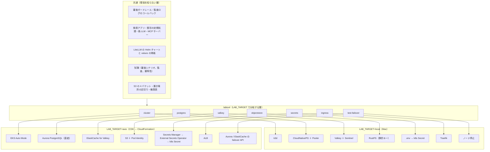

# 変更仕様書: AWS 環境の追加（Mac の k3d 構成と両方で動かし続ける）

作成: 2026-10-24
状態: 案（実装前。ユーザーとの 3 回のヒアリングで決めた内容を反映。末尾の「前提」は未確認）
この文書の役割: **何を満たすか（要件）と、何を決めたか（決定）**。どう作るか（CDK のスタックの分け方、設定値、マニフェストの描画、環境変数の名前）は、同じディレクトリの `変更設計書.md` に書く（未作成）
`docs/spec.md` への反映: 実装と試験が済んでから、12 章の表に従って本文を書き換える（AWS だけの独立した仕様書は作らず、1 つの仕様書に併記する）

---

## 0. 背景と決定事項

### 0.1 背景

- 検証環境は Mac 1 台の k3d の中に、PostgreSQL（CloudNativePG 3 台と Pooler）、Valkey（3 台と Sentinel 3 台）、RustFS（1 台）を自前で立てている（`docs/spec.md` 5 章、8 章）。
- 仕様書 5 章は「マネージドサービス（RDS、ElastiCache など）は使わず、自前で冗長化する」を前提にしている。
- 同じ仕組みを AWS（CloudFormation、EKS、RDS、S3 など）でも組み立てたい。ただし **Mac の構成を AWS の構成に置き換えるのではなく、両方を同じコードで動かし続ける**。
- 本番は Bedrock などの従量課金のモデルを使う想定（仕様書 6.5）。検証環境の ChatGPT Plus と Claude Max は個人の検証に限る（仕様書 8.2）。

### 0.2 決定事項（2026-10-24、ユーザーの回答）

| 項目 | 決定 |
|---|---|
| Mac の構成との関係 | **置き換えではなく、両方で動かし続ける。** 環境の違いは構築ツールと Kubernetes マニフェストの描画に閉じ込め、審査・監査・検索アプリの層は環境を知らない |
| 環境の切り替え | **`.env` の `LAB_TARGET`（`local` か `aws`）で、1 つの構築ツール（labtool）の各段階が分岐する。** AWS の基盤を作るコードは同じリポジトリの `cdk/` に置く。別のツールやリポジトリには分けない |
| AWS での状態を持つ部品 | **マネージドサービスに置き換える**（PostgreSQL、Valkey、オブジェクトストレージ）。EKS の中に自前の構成は残さない |
| PostgreSQL | **Aurora PostgreSQL**（writer 1 ＋ reader 1。ストレージは 3 AZ）。検証規模は Serverless v2 |
| DB の接続の窓口 | **直結**（既存の `LAB_DB_POOLER=direct` の方式）。Pooler は AWS では使わない。RDS Proxy は使わない（Prisma の prepared statement と `SET` でセッションが固定され、多重化が効かないため） |
| Redis 互換 | **ElastiCache for Valkey 9**（ノード型、クラスターモード無効、primary 1 ＋ replica 2、Multi-AZ 自動フェイルオーバー、durability sync）。Sentinel は使わない |
| オブジェクトストレージ | **S3**（Mac と同じ 4 バケットの分け方、同じ置き場所の区切り、同じ権限表）。資格情報は静的キーではなく **EKS Pod Identity**（IAM ロール） |
| Kubernetes | **EKS Auto Mode**、3 AZ |
| 入口 | **ALB**（Ingress）。本番は internal ALB に VPN か Direct Connect で届く。**検証の AWS 環境は internet-facing ALB で、VPN も送信元 IP の制限もしない**（守りは HTTPS と仮想キーだけ） |
| HTTPS のドメイン | 手持ちのドメインを使う。そのドメインは別件で使っているので Route 53 には置かず、**今の DNS に CNAME を手で足す**（ACM の DNS 検証用と、ALB の DNS 名への別名）。環境を作り直して ALB の DNS 名が変わったら手で直すことを受け入れる |
| 秘密情報 | **Secrets Manager に置き、External Secrets Operator（EKS に入れる）で Kubernetes の Secret に同期する**。Secret の名前とキーは Mac と同じにする |
| AWS の基盤のコード | **CDK（Python）で書き、CloudFormation のスタックとして配備する。** Kubernetes の中（Helm、マニフェスト）は CloudFormation の範囲外で、今の labtool が受け持つ |
| Claude Code 用のモデル | **Bedrock の Claude**（`bedrock/` のデプロイ）。Claude Max のトークン転送は AWS 環境では使わない |
| 2 つの審査官（`review-judge`、`isolated-judge`） | **Bedrock の Claude Haiku 4.5（日本内で処理するクロスリージョン推論プロファイル）** |
| Jev（一次判定） | **AWS 環境では使わない**（`use_jev: false`）。セルフホスト版が無く、ツールコールの内容が社外の API に出るため |
| Codex 用のモデル | **未決。** 決まるまでは Mac と同じ `chatgpt/`（ChatGPT Plus）を AWS でも使う。Bedrock Mantle の gpt-oss か GPT-5.x、Bedrock の Claude（LiteLLM の変換経由）、Azure OpenAI のどれにするかは別途決める |
| 最初に組む規模 | **検証環境相当**（LiteLLM 2〜4 Pod、Aurora Serverless v2 の最小、ElastiCache の最小ノード）。本番規模（LiteLLM 20〜30 Pod、1 日 1,000 万件）は構成を変えず数字を入れ替える |
| 冗長化の試験 | **AWS でも行う。** LiteLLM の Pod の退避（ノードの drain）と、Aurora・ElastiCache のフェイルオーバーを API で起こし、要求が止まらないことを見る |
| 仕様書の形 | **`docs/spec.md` 1 つに併記する。** AWS だけの独立した仕様書は作らない（共通部分が大半で、2 冊だと審査や監査の変更を揃え続けることになる）。今回はこの変更仕様書を書き、実装と試験の後に `docs/spec.md` に反映する |

### 0.3 既存の仕様から変える方針

- 仕様書 5 章の前提「マネージドサービスは使わず、自前で冗長化する」を、「**Mac の検証環境は自前で冗長化する。AWS 環境はマネージドサービスを使う**」に書き分ける。要件（切り替えでデータを失わない、人の操作なしに回復する、任意の時点に戻せる、改ざんできない形で残す）は両環境で同じにする。
- 仕様書 5.3 の「S3 の API だけを使い、設定だけで置き換えられる」はそのまま活かし、S3 への置き換えを実際に行う。
- 仕様書 8.2 の「本番は API キーまたは Bedrock」のうち、Bedrock を AWS 環境で実際に使う。

---

## 1. 対象範囲

| やること | やらないこと |
|---|---|
| `LAB_TARGET` による環境の切り替えを構築ツールに入れ、Mac（`local`）の振る舞いを変えない | Mac の構成（k3d、CloudNativePG、Valkey ＋ Sentinel、RustFS）の変更 |
| AWS の基盤（VPC、EKS、Aurora、ElastiCache、S3、IAM、Secrets Manager、ECR、ACM）を CDK で書く | 監視・通知の仕組み（CloudWatch のアラームなど。仕様書 6.1 のとおり警告はログと数値の出力まで） |
| Kubernetes の中の部品（LiteLLM、検索アプリ、整形の定期処理、MCP サーバー、偽 LLM、DB 移行の Job）を両環境で同じマニフェスト・同じ Helm の値の骨格で動かす | Kubernetes の中の部品を ECS や Lambda に移すこと |
| 審査官と Claude Code 用のモデルを Bedrock にする | Codex 用のモデルの決定（0.2。未決のまま `chatgpt/` を使う） |
| S3 の権限を IAM ロール（Pod Identity）で与え、静的キーを無くす | Mac の RustFS の静的キーを無くすこと（Mac はそのまま） |
| AWS でのフェイルオーバー試験と、両環境で共通の試験の実行 | 本番規模での負荷試験（9A の決定。検証規模で組む） |
| 検証の AWS 環境を使わないときに計算資源を消して費用を抑える運用 | 本番の AWS 環境の運用手順（VPN、監査担当の体制） |

---

## 2. 全体構成

### 2.1 層の分け方

### 2.2 両環境で同じにするもの（要件）

| 対象 | 要件 |
|---|---|
| 審査ガードレールと監査ログのコールバック | コードも設定の意味も同じ。環境による分岐を入れない |
| 検索アプリ、整形の定期処理 | 同じイメージ、同じマニフェスト。S3 の資格情報の渡し方だけが違う（2.3） |
| LiteLLM | 同じイメージのタグ、同じ Helm チャートの版。values は共通の骨格に環境ごとの値（DB・Redis・S3・入口・モデル）を差し込む |
| S3 の置き場所 | バケット名の分け方（`audit-raw`、`audit-access`、`audit-derived`、`pg-backup` に相当するもの）、`dt=` / `hour=` の区切り、ファイル名の付け方、保持日数、ライフサイクル、権限表（仕様書 5.3、設計書 8.2〜8.3）を同じ定義から両環境に渡す |
| 利用者・キー・MCP の権限の初期化（`./lab bootstrap`） | 同じ手順。キーの値は `.env` 相当の固定値 |
| 試験 | 審査シナリオ、監査ログの試験、冪等性の試験、疎通確認を、kubeconfig を切り替えるだけで両環境に流せる |
| バージョン | LiteLLM のイメージ、Helm チャート、監査のイメージの版は 1 か所で持ち、両環境が同じ値を参照する。片方だけ上げない |

### 2.3 環境で違ってよいもの（差分の 7 か所）

| 段階 | `local`（今のまま） | `aws` | 共通にするための決まり |
|---|---|---|---|
| cluster | k3d を作る | CDK のスタックを配備し、CloudFormation の出力（エンドポイント、バケット名、ロールの ARN、Secret の ARN、ALB のホスト名）を読んで以降の段階に渡す。kubeconfig は EKS のもの | ほかの段階は kubeconfig と渡された値だけを見る |
| postgres | CloudNativePG の Cluster と Pooler、Barman のバックアップ | 何も作らない（Aurora は CDK 側）。DB 移行の Job と LiteLLM の接続先に Aurora の writer を入れる | LiteLLM と移行の Job は `DATABASE_URL` しか見ない。移行は両環境で直結 |
| valkey | Valkey ＋ Sentinel の StatefulSet | 何も作らない。LiteLLM に単一のエンドポイント（TLS）を渡す | Sentinel 用と単一エンドポイント用の環境変数の組を出し分ける。`use_redis_transaction_buffer` などの設定は共通 |
| objectstore | RustFS にバケット・ロック・ライフサイクル・利用者を作る | バケット・ロック・ライフサイクル・IAM は CDK が作る。labtool は検査だけ流す（2.4） | バケットと権限の定義を 1 つにし、CDK と labtool の両方に渡す |
| secrets | `.env` の値から Kubernetes の Secret を作る | Secrets Manager の値を External Secrets Operator が同じ名前の Secret に同期する | Secret の名前とキーは共通 |
| ingress | Traefik の経路とパススルーの遮断 | 同じ経路を ALB の Ingress として描画。ACM の証明書で HTTPS | 経路（`/v1/...`、`/{server}/mcp`、`/lab-audit/`）と遮断の対象は共通 |
| test-failover | agent ノードを止める | LiteLLM の Pod はノードの drain で退避。DB と Redis は Aurora と ElastiCache のフェイルオーバー API で切り替える | 「切り替え中に要求が止まらないか」の判定と合格の基準は共通。起こし方だけ違う |

### 2.4 S3 の権限の検査（両環境で共通）

- `./lab objectstore` は両環境で、**バケットがあり、バージョニング・Object Lock の既定の保持・ライフサイクルが仕様どおりで、各利用者（ロール）に許した操作ができ、許していない操作（原本の削除、保持の回避）が拒否される**ことを確かめる。
- `local` では作る処理と検査の両方、`aws` では検査だけを流す（作るのは CDK）。
- `audit-raw` と `audit-access` に相当するバケットが Object Lock 無効のまま存在したらエラーで止める（後から有効にできないため。既存の仕様と同じ）。

---

## 3. 冗長化（仕様書 5 章の書き分け）

要件は両環境で同じ。満たし方が違う。

### 3.1 PostgreSQL

| 要件 | `local` | `aws` |
|---|---|---|
| 構成 | CloudNativePG 3 台（primary 1、standby 2）、別々のノード | Aurora PostgreSQL。writer 1 ＋ reader 1 を別の AZ に置く。ストレージは 3 AZ |
| 切り替えでデータを失わない | 同期複製（standby 1 台が受け取れば完了） | Aurora のストレージ層で担保（昇格した reader は WAL の再生なしに書き込みを受ける） |
| 接続の窓口 | Pooler（PgBouncer）を主にし、直結と切り替えられる | 直結のみ。Pod 数が増えて接続数が足りなくなったら、PgBouncer を EKS に置く案を検討する（RDS Proxy は使わない） |
| 接続数 | Pooler で DB 側を 40 × 2 に抑える | Pod あたりの上限 × Pod 数が Aurora の `max_connections` に収まることを設計で確かめる（検証規模 4 Pod × 5、本番規模 30 Pod × 5） |
| DB 移行 | primary に直結した Job | writer に直結した Job（同じ Job） |
| バックアップ | WAL のアーカイブと毎日のバックアップを RustFS へ。30 日 | Aurora の自動バックアップと任意の時点への復元。保持 30 日 |
| 任意の時点に戻せる | 別の Cluster に復元する試験 | 別のクラスターに時刻を指定して復元する試験（Aurora の機能） |

### 3.2 Redis（Valkey）

| 要件 | `local` | `aws` |
|---|---|---|
| 構成 | Valkey 3 台（primary 1、replica 2）＋ Sentinel 3 台、別々のノード | ElastiCache for Valkey 9。ノード型、クラスターモード無効、primary 1 ＋ replica 2 を別の AZ に |
| 切り替え | Sentinel が人の操作なしに replica を昇格。primary は常に 1 台 | Multi-AZ 自動フェイルオーバー。primary のエンドポイントが DNS で切り替わる |
| 永続化・書き込みの確実さ | AOF（`appendfsync everysec`）、`min-replicas-to-write 1` | durability sync（2 AZ 以上に複製してから書き込みを返す） |
| メモリ溢れ | `noeviction` | パラメータグループで `noeviction` |
| 認証 | データと Sentinel で別のパスワード | 転送中の暗号化（TLS）と認証トークン（Sentinel が無いので 1 つ） |

### 3.3 オブジェクトストレージ

| 要件 | `local` | `aws` |
|---|---|---|
| ソフト | RustFS 1 台（クラスタ内） | S3（リージョン内で冗長） |
| 置き場の分け方 | 4 バケット | 同じ 4 つ（名前には環境の接頭辞か接尾辞を付ける。S3 のバケット名は全世界で一意のため） |
| 改ざんの防止 | Object Lock。検証は GOVERNANCE | 同じ。検証の AWS 環境は GOVERNANCE、本番は COMPLIANCE（既存の `LAB_AUDIT_LOCK_MODE` と同じ切り替え）。Object Lock はバケット作成時にだけ有効化できるので、CDK で新規作成時に有効にする |
| 保持 | 原本と整形済み 90 日、閲覧と管理操作の記録 13 か月、バックアップ 30 日 | 同じ。ロック中の版はライフサイクルでも消えず、保持が切れてから消える |
| 権限 | 利用者 4 つ、用途ごとに許す操作だけ | IAM ロール 4 つ（Pod Identity で ServiceAccount に紐づけ）。許す操作は同じ表。保持の回避（`s3:BypassGovernanceRetention`）は明示的に拒否 |
| 資格情報 | 静的キー（`.env`） | 静的キー無し。アプリは「キーが設定されていればそれを使い、無ければ既定の資格情報チェーンを使う」。この分岐がアプリ側で変える唯一の箇所 |
| 公開 | クラスタの外に出さない | バケットのパブリックアクセスを全部遮断。VPC の中からだけ届く |
| クラスタを消したとき | 監査ログも消える（検証環境だけの振る舞い） | **バケットは消えない。** 計算資源（EKS）を消しても監査ログと DB は残る（6 章） |

---

## 4. AWS 環境（仕様書に新しく足す章）

### 4.1 構成

| 項目 | 選択 |
|---|---|
| リージョン | 東京（前提。13 章） |
| AZ | 3 |
| Kubernetes | EKS Auto Mode（ノード、EBS、ALB の各コントローラーを内蔵。ノードは AWS が定期的に入れ替えるので、既存の PDB と anti-affinity で退避に耐える） |
| LiteLLM | Mac と同じ Helm チャート（一体型）、同じカスタムイメージ（ECR に置く）。レプリカ 2、HPA 2〜4（検証規模） |
| DB | Aurora PostgreSQL（3.1） |
| Redis 互換 | ElastiCache for Valkey（3.2） |
| オブジェクトストレージ | S3（3.3） |
| 秘密情報 | Secrets Manager ＋ External Secrets Operator。マスターキー、ソルトキー、DB の接続情報、Redis の認証トークン、OIDC のクライアントシークレット、Bedrock 以外の API キー |
| 入口 | ALB（Ingress）。検証は internet-facing、IP 制限なし。本番は internal ＋ VPN か Direct Connect |
| HTTPS | ACM の証明書。ドメインは手持ちのものを使い、今の DNS に CNAME を手で足す（ACM の検証用、ALB への別名） |
| AWS の API の経路 | S3、Bedrock、Secrets Manager は VPC エンドポイント経由。Google API（MCP サーバー）と、`chatgpt/` などの外部のモデルは NAT 経由 |
| MCP サーバー（検証用） | `google_workspace_mcp`（EKS の中、Mac と同じ） |
| 試験用の LLM | 偽 LLM（EKS の中、Mac と同じ） |
| 基盤のコード | CDK（Python）。配備は CloudFormation のスタック |

### 4.2 モデル

| 用途 | `local`（Mac） | `aws` |
|---|---|---|
| Claude Code | Claude Max のトークン転送（`anthropic/`） | Bedrock の Claude（`bedrock/`。従量課金）。Anthropic 形式（`/v1/messages`）で受け、Bedrock へ送る |
| Codex | ChatGPT Plus（`chatgpt/`） | **未決。** 決まるまで `chatgpt/` を使う。`chatgpt/` のトークンは全 Pod で共有し、更新が競合しないこと（Mac では全ノードに同じホストのフォルダを見せている。AWS での置き場は設計で決める） |
| 審査官 `review-judge` | ChatGPT Plus のモデル | Bedrock の Claude Haiku 4.5（日本内で処理するプロファイル） |
| 審査官 `isolated-judge` | ChatGPT Plus のモデル | 同上 |
| Jev（一次判定） | 設定で切り替え（`LAB_USE_JEV`） | 使わない（`use_jev: false`） |
| 試験用 | 偽 LLM | 偽 LLM |

- 審査官の方針（判定基準）と出力の形はモデルに依存しない書き方になっているので、審査官のモデルを変えても判定基準は変えない。判定の揺れは評価セット（仕様書 9.2）で測り直す。
- 審査官に渡る中身（送るファイルの中身、環境変数の値。仕様書 10 章）は、AWS 環境では Bedrock の日本内のプロファイルで処理される。

### 4.3 利用料（仕様書 6.5 への影響）

- AWS 環境では、Claude Code と審査官は従量課金（Bedrock）、Codex は定額（ChatGPT Plus）が混ざる。請求の単位ごとに実費を入れる既存の仕組み（概算 A と按分 B）で扱える。Bedrock の Claude は LiteLLM の単価表にあるので A は自動で出る。
- 審査官の利用料は、審査されたツールコールを出した利用者の「審査」の内訳として出す（既存のとおり）。

### 4.4 認証（仕様書 2 章、8.3 への影響）

- LiteLLM のログインと検索アプリの OIDC は、検証の AWS 環境でも Google SSO（前提。13 章）。本番は Entra ID。
- Google の OAuth クライアントの承認済みリダイレクト URI と、検索アプリの OIDC の戻り先に、AWS 環境のホスト名を足す。

---

## 5. 構築ツール（`./lab`）の要件

- `LAB_TARGET` が `local` のとき、今の振る舞いを一切変えない（既存の試験で確かめる）。
- `LAB_TARGET` が `aws` のとき、`./lab up` は CDK の配備 → 出力の取得 → イメージのビルドと ECR への push → External Secrets Operator → Kubernetes の中の部品 → bootstrap → 監査 → クライアント設定、の順に流す。
- どの段階も、何度実行しても同じ状態になる（既存の冪等性の原則、設計書 17 章）。CDK の配備も差分が無ければ何もしない。
- `./lab down` は `aws` では計算資源（EKS とその中身）を消し、**S3 のバケット、Aurora、Secrets Manager は消さない**（6 章）。
- 構築ツールが S3 やクラスタの中のサービスに触るときの経路（Mac では `kubectl port-forward`）は、`aws` では S3 は直接（IAM の資格情報）、クラスタの中のサービスは同じく `port-forward` とする。
- クライアント設定（`./lab clients`）は、AWS 環境のホスト名（HTTPS）を接続先にして生成する。Mac 用と AWS 用の設定を同時に持てる（別の出力先）。

---

## 6. 費用と、使わないときの扱い

- 検証の AWS 環境は、止めていても料金が出る部品がある（EKS のコントロールプレーン、ElastiCache のノード、NAT ゲートウェイ、Aurora は 0 ACU まで落ちる）。
- **使わないときは計算資源（EKS とその中身、ALB）を消し、監査ログ（S3）、DB（Aurora）、秘密情報は残す**ことができる。Object Lock のバケットは消せないので、消す対象から構造的に分ける（CDK のスタックの分け方は設計で決める）。
- 作り直すと ALB の DNS 名が変わるので、手持ちの DNS の CNAME を直す。この手間を受け入れる（0.2）。
- 費用の概算は、インスタンスの種類を設計で決めてから、価格表を確かめて出す（この文書には書かない）。

---

## 7. 検証項目（仕様書 9 章への追加）

### 7.1 両環境で共通に流すもの

- 9.1 認証・Copilot 連携、9.2 ツールコール審査、9.4 監査ログ・利用料・検索アプリ の項目を、kubeconfig を切り替えて `aws` でも流す。
- 構築ツールの冪等性の試験（設計書 17.4）を `aws` でも流す。

### 7.2 AWS だけの項目（9.3 に足す）

- [ ] `LAB_TARGET=local` で既存の試験がすべて通る（切り替えを入れても Mac の振る舞いが変わらない）
- [ ] LiteLLM の Pod をノードの drain で退避させている間、要求（1 秒 20 件）が止まらない
- [ ] Aurora のフェイルオーバーを API で起こしている間、要求を流し続け、人の操作なしに回復する。直結の接続プールが新しい writer に付け直されることを確かめる
- [ ] ElastiCache のフェイルオーバーを API で起こしている間、要求を流し続け、回復する。利用量の集計（`use_redis_transaction_buffer`）が失われない
- [ ] 任意の時点への復元: 時刻 T を指定して別のクラスターに戻すと、T までの行があり、T より後の行は無い
- [ ] Pod Identity で、各ロールに許した操作ができ、許していない操作（原本の削除、保持の回避）が拒否される
- [ ] 計算資源を消して作り直しても、S3 の監査ログと Aurora のデータが残り、検索アプリから見える
- [ ] Bedrock の Claude で Claude Code が動き、文脈独立審査が Mac と同じ事例で同じ判定になる（審査官が Haiku 4.5 に変わった影響を評価セットで測る）
- [ ] 審査官の待ち時間（判定ログの `timings_ms`）を Mac と比べる

---

## 8. リスク・注意事項（仕様書 10 章への追加）

- **検証の AWS 環境は IP 制限なしで公開する。** 守りは HTTPS と仮想キーだけ。`chatgpt/` のトークン転送を置く間は、仕様書 8.2 の「エンドポイントを他人と共有しない」を運用で守る。キーが漏れたら `./lab bootstrap` で作り直す
- **料金**: 検証規模でも常時の料金が出る。使わないときは計算資源を消す運用（6 章）
- **Object Lock のバケットは消せない**: COMPLIANCE の本番だけでなく、GOVERNANCE の検証でも保持中の版は消せない。環境を捨てるときはバケットを残すか、保持の回避で消す
- **EKS Auto Mode のノードの入れ替え**: AWS が定期的にノードを入れ替えるので、Pod の退避が計画外に起きる。PDB と anti-affinity で耐えることを 7.2 で確かめる
- **審査官のモデルの変更**: Mac と AWS で審査官が違う（ChatGPT Plus のモデルと Claude Haiku 4.5）。評価セットの結果が環境で違いうる。判定基準は変えず、結果の差を記録する
- **Codex 用のモデルが未決**: `chatgpt/` を AWS で使う間、トークンの共有の置き場と更新の競合（仕様書 9.3 の未確認項目）が AWS でも残る
- **ドメインの手作業**: ALB の DNS 名が変わるたびに CNAME を直す。直し忘れると Claude Code・Codex・OIDC の戻り先が全部つながらない
- **Bedrock のモデルの提供状況**: Claude の提供とプロファイル（東京はモデルによって Global のみ）は変わる。使うモデルの ID は設計で確かめる

---

## 9. 用語

| 用語 | 意味 |
|---|---|
| `LAB_TARGET` | 構築ツールが向ける環境。`local`（Mac の k3d）か `aws` |
| Pod Identity | EKS の機能。Kubernetes の ServiceAccount に IAM ロールを紐づけ、Pod が静的キーなしで AWS の API を呼べる |
| External Secrets Operator | Secrets Manager などの値を Kubernetes の Secret に同期するオペレーター |
| durability sync | ElastiCache for Valkey 9 の機能。書き込みを複数の AZ に複製してから応答を返す |
| EKS Auto Mode | ノードの用意・入れ替えと、EBS・ALB のコントローラーを AWS が受け持つ EKS の動かし方 |
| CDK | AWS Cloud Development Kit。プログラム（ここでは Python）で書いた構成を CloudFormation のテンプレートに変換して配備する |

---

## 10. この文書で決めないこと（変更設計書に書く）

- CDK のスタックの分け方（計算資源を消しても S3・Aurora・秘密情報が残る分け方）
- インスタンスの種類、ACU の範囲、ElastiCache のノードの種類、費用の概算
- VPC、サブネット、VPC エンドポイント、NAT の構成
- Bedrock のモデル ID とプロファイル、`bedrock/` のデプロイの LiteLLM の設定
- `chatgpt/` のトークンの AWS での置き場（全 Pod で共有し、更新が競合しない方式）
- labtool の各段階の分岐の作り、CloudFormation の出力の受け渡し、マニフェストの描画の仕方
- Helm の values の骨格と環境ごとの差し込みの形
- External Secrets Operator の設定と、Secret の名前の対応表
- `./lab test-failover` の AWS 版の作り
- 両環境の版を 1 か所で持つ方法

---

## 11. 参考資料

- [ElastiCache Multi-AZ 自動フェイルオーバー](https://docs.aws.amazon.com/AmazonElastiCache/latest/dg/AutoFailover.html) / [Valkey の durability](https://docs.aws.amazon.com/AmazonElastiCache/latest/dg/Durability.GettingStarted.html)
- [RDS Proxy の pinning（prepared statement と SET で固定される）](https://docs.aws.amazon.com/AmazonRDS/latest/UserGuide/rds-proxy-pinning.html)
- [CloudFormation AWS::EKS::Cluster（ComputeConfig、StorageConfig）](https://docs.aws.amazon.com/AWSCloudFormation/latest/TemplateReference/aws-resource-eks-cluster.html) / [EKS Auto Mode ベストプラクティス](https://docs.aws.amazon.com/eks/latest/best-practices/automode.html)
- [CloudFormation S3 ObjectLockConfiguration](https://docs.aws.amazon.com/AWSCloudFormation/latest/UserGuide/aws-properties-s3-bucket-objectlockconfiguration.html) / [既存バケットへの後付けができない報告（CDK issue）](https://github.com/aws/aws-cdk/issues/5247)
- [Bedrock が OpenAI の Responses API に対応（gpt-oss）](https://aws.amazon.com/about-aws/whats-new/2025/12/amazon-bedrock-responses-api-from-openai) / [Bedrock Mantle](https://docs.aws.amazon.com/bedrock/latest/userguide/bedrock-mantle.html)
- [Claude Sonnet 4.5 / Haiku 4.5 の日本内クロスリージョン推論](https://aws.amazon.com/blogs/machine-learning/introducing-amazon-bedrock-cross-region-inference-for-claude-sonnet-4-5-and-haiku-4-5-in-japan-and-australia/)
- [LiteLLM /v1/messages（Bedrock の例）](https://docs.litellm.ai/docs/anthropic_unified/)
- [TypeSafe（`TYPESAFE_BASE_URL`。セルフホスト版は無い）](https://docs.langchain.com/oss/javascript/integrations/providers/typesafe)
- 検討の経緯: `.history/2026-10-24-1037-組み込み審査の調査とQiita記事の中断/summary.md`（中断前の下書き）と、2026-10-24 のセッション（3 回のヒアリング）

---

## 12. `docs/spec.md` への反映の仕方（実装と試験の後）

| 章 | 変更 |
|---|---|
| 決定事項の表 | 「DB と Redis の冗長化」の行を「Mac は自前、AWS はマネージド」に書き直し、`LAB_TARGET`、Aurora、ElastiCache、S3 と Pod Identity、Bedrock、Jev 不使用、Codex 未決の行を足す |
| 1. 全体構成 | 図を 2.1 の層の形にし、`LAB_TARGET` を定義する |
| 2. 認証 | 検証の AWS 環境の SSO と OIDC の戻り先（4.4） |
| 5. 冗長化 | 前提を書き分け、5.1〜5.3 を 3 章の 2 列の表にする |
| 6.5 利用料 | 従量と定額の混在（4.3） |
| 8. 検証環境（Mac 1 台） | そのまま |
| 新しい章: AWS 環境 | 4 章と 5 章と 6 章 |
| 9.3 スケールと冗長化 | 7.2 の項目を足す |
| 10. リスク | 8 章の項目を足す |
| 11. 参考資料 | 11 章の資料を足す |

---

## 13. 前提（この文書で仮定したこと。ユーザーに未確認）

| 前提 | 仮定した内容 | 外れたときの影響 |
|---|---|---|
| リージョン | 東京（ap-northeast-1） | 審査官の「日本内で処理するプロファイル」の前提と、Bedrock のモデルの提供状況が変わる |
| 検証の AWS 環境の Object Lock | GOVERNANCE（Mac と同じ。本番だけ COMPLIANCE） | COMPLIANCE にすると、検証で書いた監査ログを 90 日間誰も消せない |
| 検証の AWS 環境の SSO | Google SSO（Mac と同じ。本番は Entra ID） | Entra ID にするなら、テナントと LiteLLM の SSO の設定（5 ユーザー超は Enterprise ライセンス）が先に要る |
