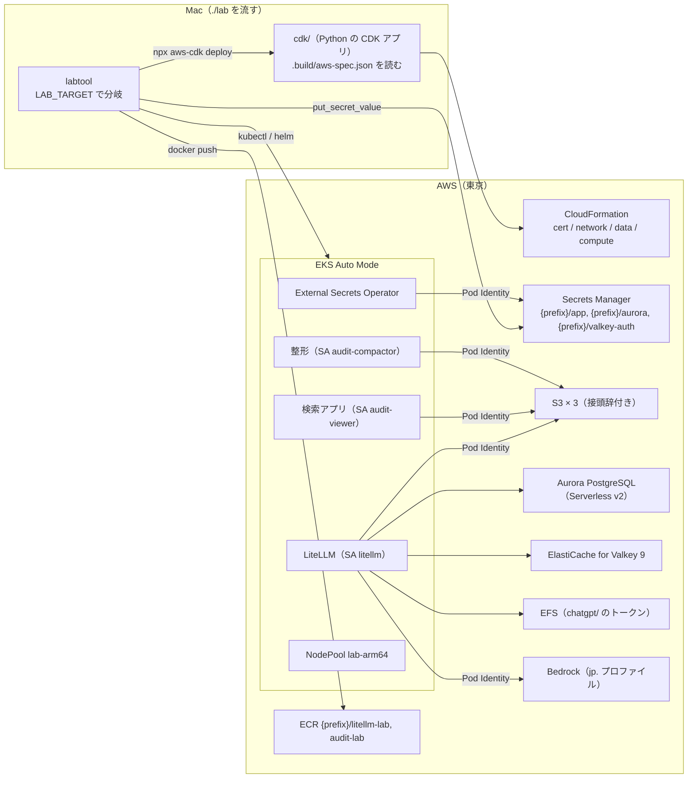

# 変更設計書: AWS 環境の追加（Mac の k3d 構成と両方で動かし続ける）

作成: 2026-10-24
状態: 実装済み（Mac の試験は済み。AWS への配備と試験は資格情報の用意の後）
対応する変更仕様書: 同じディレクトリの `変更仕様書.md`
この文書の役割: **どう作るか**（スタックの分け方、設定値、構築ツールの分岐、マニフェストの描画、環境変数）。
何を満たすかは変更仕様書に書いてある。実装と試験が済んだら `docs/design.md` に反映する（12 章）

---

## 1. 作りの全体

| 層 | 置き場 | 環境を知るか |
|---|---|---|
| 審査ガードレール、監査ログのコールバック、検索アプリ、整形 | `litellm/guardrails/`、`apps/audit/` | 知らない。S3 の資格情報だけ「静的キーがあれば使い、無ければ boto3 の資格情報チェーン」（2.1） |
| Helm の値の骨格、マニフェスト | `litellm/values.yaml`、`k8s/*.yaml` | 知らない。環境ごとの値は labtool が重ねる（`helm_overrides`、`${VAR}` の置き換え） |
| 構築ツール | `labtool/` | `Env.target`（`LAB_TARGET`）で分岐。AWS 固有の処理は `labtool/aws.py` に集める |
| AWS の基盤 | `cdk/` | AWS だけ。labtool が書く定義（`.build/aws-spec.json`）を読む |

---

## 2. 環境を知らない層の変更（両環境で同じコード）

### 2.1 S3 の資格情報とバケット名

| ファイル | 変更 |
|---|---|
| `apps/audit/audit/common.py` | `Config.static_keys`（キーが両方あるか）。`s3()` は静的キーがあれば渡し、無ければ boto3 の既定の資格情報チェーン（EKS Pod Identity）。接続先（`AUDIT_S3_ENDPOINT`）が空なら AWS S3 の既定（仮想ホスト形式）、あればパス形式。`duckdb_secret_sql()` も同じ分岐で、キーが無ければ `PROVIDER credential_chain`。バケット名は `AUDIT_S3_BUCKET_PREFIX`（既定 空）を論理名の前に付ける |
| `litellm/guardrails/audit_log.py` | `enabled = bucket があり、かつ（静的キーがある or AUDIT_S3_CREDENTIAL_CHAIN=true）`。クライアントの作り方は上と同じ |
| `labtool/objectstore.py` | `admin_s3(env)`: Mac は RustFS に port-forward、AWS は操作者の資格情報で S3 へ。`user_s3(env, user)` は Mac だけ |

環境変数（Pod に渡す）:

| 変数 | Mac | AWS |
|---|---|---|
| `AUDIT_S3_ENDPOINT` | `http://rustfs:9000` | 空 |
| `AUDIT_S3_REGION` | `us-east-1` | `ap-northeast-1` |
| `AUDIT_S3_ACCESS_KEY` / `AUDIT_S3_SECRET_KEY` | Secret（RustFS の利用者） | 無い（Secret の参照は `optional: true`） |
| `AUDIT_S3_CREDENTIAL_CHAIN` | 無い | `true`（LiteLLM だけ。監査アプリはキーが無ければ自動でチェーン） |
| `AUDIT_S3_BUCKET` | `audit-raw` | `<接頭辞>audit-raw` |
| `AUDIT_S3_BUCKET_PREFIX` | 空 | `<prefix>-<アカウント>-` |

### 2.2 マニフェスト（`k8s/`）

- `audit-viewer.yaml`、`audit-compactor.yaml`: `serviceAccountName`（`audit-viewer`、`audit-compactor`）、`AUDIT_S3_BUCKET_PREFIX`、S3 の Secret の参照を `optional: true`。Service `audit-viewer` に ALB のヘルスチェックの注釈（Traefik は無視する）
- ServiceAccount 2 つは `render.service_accounts_manifest()` が両環境で作る（`./lab cluster`）
- Traefik の `ingress.yaml` は変えない。ALB の入口は labtool が生成する（4.6）

---

## 3. CDK（`cdk/`）

| ファイル | 中身 |
|---|---|
| `cdk.json` | `app: uv run --quiet python app.py`。機能フラグ |
| `pyproject.toml` | `aws-cdk-lib>=2.274,<3`、`constructs` |
| `app.py` | `-c spec=<.build/aws-spec.json>` を読み、4 つのスタックを作る。`env` はアカウントとリージョンを明示（AZ は spec の一覧を使うので AZ の参照は要らないが、CDK が `availability-zones` の参照を 1 回だけ行う。初回の synth は資格情報が要る） |
| `lab_stacks.py` | 下の 4 スタック |

### 3.1 `<prefix>-cert`

`acm.Certificate(domain_name=hostname, validation=from_dns())`。Route 53 を使わないので、CloudFormation が「Content of DNS Record is: …」のイベントを出し、手持ちの DNS に CNAME を足すまで待つ。labtool は配備の前に、証明書が未発行なら手順を知らせる（`aws._cert_hint`）。`RemovalPolicy.RETAIN`。

### 3.2 `<prefix>-network`

| 項目 | 値 |
|---|---|
| VPC | `10.60.0.0/16`、AZ は `LAB_AWS_AZS`（既定 a, c, d）をリージョンに付けた 3 つ |
| サブネット | public /22 × 3（ALB。タグ `kubernetes.io/role/elb=1`）、private /20 × 3（ノード、Pod、Aurora、ElastiCache、EFS。タグ `kubernetes.io/role/internal-elb=1`） |
| NAT | `LAB_AWS_NAT_GATEWAYS`（既定 1。検証規模。本番は 3） |
| VPC エンドポイント | S3（ゲートウェイ型）、Bedrock Runtime と Secrets Manager（インターフェース型、private） |
| 出力 | `VpcId` |

### 3.3 `<prefix>-data`（消えてはいけないもの）

| 部品 | 作り |
|---|---|
| S3 | 論理名 3 つ（`audit-raw`、`audit-access`、`audit-derived`）に `bucket_prefix` を付けた名前。`pg-backup` は作らない（Aurora のバックアップは RDS が持つ）。バージョニング、Object Lock（`object_lock_enabled` と既定の保持。モードは `LAB_AUDIT_LOCK_MODE`）、ライフサイクル、パブリックアクセスの全遮断、SSL の強制、SSE-S3、`RETAIN`。すべて `render.s3_buckets()` の定義から |
| Pod Identity の IAM ロール | `<prefix>-litellm-writer`、`-audit-compactor`、`-audit-viewer`、`-external-secrets`、`-efs-csi`。信頼は `pods.eks.amazonaws.com`（`sts:AssumeRole` と `sts:TagSession`）。S3 の権限は `render.s3_policies()` の表の Resource に接頭辞を付けたもの。全員に明示的な Deny: ロック付きバケットの `s3:DeleteObject*`、`s3:BypassGovernanceRetention`、`s3:PutObjectRetention`、`s3:PutObjectLegalHold`、`s3:PutBucketObjectLockConfiguration`。`litellm-writer` には Bedrock の `InvokeModel*`（推論プロファイルと基盤モデル）。`external-secrets` には `{prefix}/app-*`、Aurora、Valkey の秘密情報の `GetSecretValue`。`efs-csi` には `AmazonEFSCSIDriverPolicy` |
| Aurora | `aurora_postgres` 17.6、マスターユーザー `litellm`（RDS が Secrets Manager `{prefix}/aurora` に置く）、DB `litellm`、writer と reader（`scale_with_writer=True` で一緒に止まる）とも Serverless v2、最小 0 ACU（自動停止 `LAB_AWS_AURORA_PAUSE_MINUTES` 分、既定 20）、最大 `LAB_AWS_AURORA_MAX_ACU`（既定 4）、暗号化、バックアップ 30 日、`RemovalPolicy.SNAPSHOT`。削除保護は `LAB_AWS_SCALE` が `lab` 以外のとき。SG は VPC の中からの 5432 |
| ElastiCache | Valkey 9.0、ノード型 `LAB_AWS_VALKEY_NODE_TYPE`（既定 `cache.t4g.micro`）× 3（primary 1 ＋ replica 2）、自動フェイルオーバー、Multi-AZ、`durability: sync`、転送中の暗号化（`required`）、認証トークン（Secrets Manager `{prefix}/valkey-auth` に生成し、動的参照で渡す）、パラメータグループ `valkey9` に `maxmemory-policy: noeviction`、スナップショット 1 日。削除時と置き換え時はスナップショット |
| EFS | 暗号化、private の各 AZ にマウントターゲット、`RETAIN`。chatgpt/ のトークンの共有に使う |
| ECR | `{prefix}/litellm-lab`、`{prefix}/audit-lab`。最新 10 タグを残す。`RETAIN` |
| 出力 | `EcrRegistry`、`BucketPrefix`、`AuroraClusterIdentifier`、`AuroraClusterResourceId`、`AuroraWriterEndpoint`、`AuroraSecretName`、`ValkeyReplicationGroupId`、`ValkeyPrimaryEndpoint`、`ValkeyPort`、`ValkeyAuthSecretName`、`EfsFileSystemId`、`Role<名前>Arn` |

### 3.4 `<prefix>-compute`（消して作り直せる）

| 部品 | 作り |
|---|---|
| クラスタの IAM ロール | 信頼 `eks.amazonaws.com`（`AssumeRole` と `TagSession`）。`AmazonEKSClusterPolicy`、`AmazonEKSComputePolicy`、`AmazonEKSBlockStoragePolicyV2`、`AmazonEKSLoadBalancingPolicy`、`AmazonEKSNetworkingPolicy` |
| ノードの IAM ロール | 信頼 `ec2.amazonaws.com`。`AmazonEKSWorkerNodeMinimalPolicy`、`AmazonEC2ContainerRegistryPullOnly` |
| EKS | `CfnCluster`（L1）。版 `LAB_EKS_VERSION`（既定 1.34）、private サブネット、API は public と private の両方、認証は `API`、`bootstrap_cluster_creator_admin_permissions=False`（操作者はアクセスエントリで明示）、`bootstrap_self_managed_addons=False`、Auto Mode（`compute_config` 有効、組み込みのノードプールは `system` だけ、`storage_config` と `elastic_load_balancing` 有効）、制御部分のログ（api、audit） |
| アクセスエントリ | 操作者の IAM 主体（`sts get-caller-identity` の ARN。SSO の一時的な資格情報はロールの ARN に直す）に `AmazonEKSClusterAdminPolicy`（cluster） |
| Pod Identity の関連付け | `aws.POD_IDENTITIES` の表（`litellm-lab/litellm`、`litellm-lab/audit-compactor`、`litellm-lab/audit-viewer`、`external-secrets/external-secrets`）。`efs-csi` はアドオン側で結ぶ |
| アドオン | `aws-efs-csi-driver`（Pod Identity 付き）。Pod Identity Agent、EBS CSI、ALB は Auto Mode に内蔵 |
| 出力 | `ClusterName`、`ClusterEndpoint` |

ノードプールは組み込みの `general-purpose`（amd64 だけ）を使わず、labtool が `NodePool lab-arm64`（`karpenter.sh/v1`、NodeClass `default`、`kubernetes.io/arch: arm64`、c/m/r/t の第 6 世代以降、on-demand、CPU の上限 `LAB_AWS_NODEPOOL_CPU_LIMIT` 既定 32）を入れる。Mac と同じ linux/arm64 のイメージをそのまま使うため。`system` を有効にしておくのは、`default` の NodeClass を EKS に用意させるため。

---

## 4. 構築ツール（`labtool/`）

### 4.1 共通部分（`core.py`）

| 変更 | 内容 |
|---|---|
| `Env.target` / `is_aws` | `LAB_TARGET`（`local` か `aws`。それ以外はエラー） |
| `Env.base_url` | Mac `http://localhost:<port>`、AWS `https://<LAB_AWS_HOSTNAME>`。`public_host` も同様 |
| `Env.aws_*` | `aws_hostname`（無ければエラー）、`aws_region`、`aws_profile`、`aws_prefix`（`LAB_AWS_STACK_PREFIX`）、`aws_cluster_name`（`<prefix>-eks`） |
| kube context | `Env.load()` が `set_kube_context()` で `k3d-litellm` か `litellm-lab-aws`（`aws eks update-kubeconfig --alias`）に切り替える。`kc`/`kn`/`helm` は呼ばれた時点の値を使う。`failover.py`・`checks.py` は `kube_context()` 経由 |
| `run()` | `cwd` と `env_vars`（CDK と aws CLI に渡す） |

### 4.2 AWS 固有の部品（`aws.py`、新規）

| 関数 | 役割 |
|---|---|
| `identity()` | `sts get-caller-identity`。無ければ、`aws configure sso` → `aws sso login` → `.env` の `LAB_AWS_PROFILE` の手順を添えて止める |
| `operator_principal_arn()` | `assumed-role` の ARN をロールの ARN（パス無し）に直す |
| `spec()` | CDK に渡す定義。`render.s3_buckets()`・`s3_policies()`・`POD_IDENTITIES`・規模の値をまとめる。`.build/aws-spec.json` |
| `deploy()` / `destroy()` | `npx --yes aws-cdk@2 bootstrap` → `deploy <4 スタック> --require-approval never --outputs-file`。`destroy` は指定したスタックだけ |
| `outputs()` / `load_outputs()` | CloudFormation の出力をスタック横断で 1 つの辞書に（`.build/aws-outputs.json`） |
| `kubeconfig()` | `aws eks update-kubeconfig --alias litellm-lab-aws` |
| `ecr_login()` / `ecr_has_tag()` | ECR の認可トークンで `docker login`、タグの有無 |
| `ensure_app_secret()` / `load_app_secret()` | `{prefix}/app`（JSON）。空の項目を生成（マスターキー、ソルトキー、セッションの秘密、利用者のキー）、`.env` の Google OAuth と TypeSafe の値を写す。既存の値は上書きしない。値は Env に載せる（`.env` には書かない） |
| `sync_chatgpt_token()` | Mac の `auth.json` を、使い捨ての Pod 経由で PVC `chatgpt-token`（EFS）に `kubectl cp` |
| `aurora_failover()` / `valkey_failover()` / `drain_litellm_node()` | 障害の試験の起こし方（5 章） |
| `wait_for_cname()` | ホスト名が解決できるまで待ち、できない間は「CNAME: ホスト名 → ALB」の手順を知らせる |

### 4.3 段階ごとの分岐（`stages.py`）

| 段階 | Mac（変えていない） | AWS |
|---|---|---|
| preflight | k3d、kubectl cnpg、Docker、ポート | docker、kubectl、helm、aws、npx。資格情報の確認。`LAB_AWS_HOSTNAME`。`LAB_AWS_ACCOUNT` と `LAB_AWS_BUCKET_PREFIX` を Env に載せる |
| cluster | k3d、Traefik、namespace、SA、オペレーター | `aws.deploy()` → kubeconfig → API の疎通 → NodePool → namespace → SA → ESO（Helm `external-secrets/external-secrets` 2.14.0、SA 名 `external-secrets`、`installCRDs`）→ ClusterSecretStore `aws-secretsmanager`（auth なし＝Pod Identity）→ EFS の StorageClass `lab-efs`（`efs-ap`、`basePath /lab`）と PVC `chatgpt-token`（RWX 1Gi） |
| images | ビルド → k3d のレジストリ | 同じ Dockerfile で `--platform linux/arm64` のビルド → ECR（`<registry>/<prefix>/<名前>:<タグ>`）。タグがあれば push しない |
| secrets | `.env` → Secret | `ensure_app_secret()` → ExternalSecret 6 つ（`render.external_secrets_manifest`）→ 全部 Ready になるまで待つ |
| objectstore | RustFS を作り、検査 | `objstore.check_buckets()`: バケットの有無、バージョニング、Object Lock の既定の保持、ライフサイクル、パブリックアクセスの遮断を仕様と比べる |
| datastores | CloudNativePG、Valkey | Aurora と ElastiCache が `available` かの確認（primary、durability を表示） |
| mcp | 同じ | 同じ |
| litellm | ConfigMap → 移行 Job（Cluster の uid）→ helm → Traefik の入口 | トークンの同期（あれば）→ ConfigMap → 移行 Job（Aurora の `ClusterResourceId`）→ helm（`helm_overrides` の aws 分岐）→ ALB の入口（`render.alb_ingress_manifest`）→ ALB のホスト名を待つ → CNAME の解決を待つ → `/health/liveliness` |
| bootstrap | 同じ | 先に `load_app_secret()`（マスターキー、利用者のキー） |
| audit | compactor、初期値（port-forward）、viewer | compactor（`S3_ENDPOINT` 空、`S3_BUCKET_PREFIX`）、初期値（`admin_s3`）、viewer |
| clients | `http://localhost` | `https://<ホスト名>`、Claude Code の別名を固定（4.5） |

### 4.4 Secret の対応（ESO）

| Kubernetes の Secret | 元 | 作り方 |
|---|---|---|
| `litellm-secrets` | `{prefix}/app`（extract）＋ `{prefix}/valkey-auth` | テンプレートで `LITELLM_MASTER_KEY`、`LITELLM_SALT_KEY`、`REDIS_PASSWORD`、`GOOGLE_CLIENT_*`、`GOOGLE_OAUTH_CLIENT_*` |
| `litellm-pg-app` | `{prefix}/aurora`（RDS が生成。username、password、host、port、dbname） | `username`、`password` |
| `litellm-migrate-db` | 同上 | `DATABASE_URL=postgresql://{{ .username }}:{{ .password \| urlquery }}@{{ .host }}:{{ .port }}/{{ .dbname }}?sslmode=require` |
| `audit-viewer-session` | `{prefix}/app` | `AUDIT_SESSION_SECRET` |
| `audit-viewer-oidc` | `{prefix}/app` | `LAB_AUDIT_OIDC_CLIENT_*` か無ければ `GOOGLE_OAUTH_CLIENT_*` |
| `workspace-mcp` | `{prefix}/app` | `GOOGLE_OAUTH_CLIENT_ID` / `_SECRET` |

Mac で作る `audit-compactor-s3`、`audit-viewer-s3`、`valkey`、`rustfs`、`pg-backup-s3` は AWS では作らない（静的キーが無い。参照は optional）。

### 4.5 LiteLLM の設定（`render.py`）

| 項目 | Mac | AWS |
|---|---|---|
| Claude Code のモデル | `anthropic/*`（トークン転送） | `claude-sonnet-4-5` → `bedrock/jp.anthropic.claude-sonnet-4-5-20250929-v1:0`、`claude-haiku-4-5` → `bedrock/jp.anthropic.claude-haiku-4-5-20251001-v1:0`、`claude-opus-4-6` は `LAB_BEDROCK_OPUS` が入っているときだけ。`aws_region_name` 付き |
| 審査官 2 つ | `chatgpt/<LAB_JUDGE_MODEL>` | `bedrock/<LAB_AWS_JUDGE_MODEL>`（既定は Haiku 4.5 の jp. プロファイル）。単価は LiteLLM の単価表 |
| Jev | `LAB_USE_JEV` | 常に false |
| Codex | `chatgpt/<LAB_CODEX_MODEL>`（トークンがあるとき） | 同じ |
| Redis | Sentinel の環境変数 | `REDIS_HOST`（primary のエンドポイント）、`REDIS_PORT`、`REDIS_SSL=True`、`REDIS_PASSWORD`（Secret） |
| DB | `db.endpoint` Pooler か直結 | `db.endpoint` = Aurora の writer、`db.url` に `:5432` と `?sslmode=require`。Pooler の設定（`DATABASE_DISABLE_PREPARED_STATEMENTS`）は付けない |
| ServiceAccount | チャートの既定 | `serviceAccount.create: true, name: litellm`（Pod Identity） |
| ボリューム | `chatgpt-token` は hostPath | `chatgpt-token` は PVC（EFS） |
| Service | 注釈なし | `alb.ingress.kubernetes.io/healthcheck-path: /health/liveliness` |
| 環境変数 | — | `AWS_REGION`、`AWS_DEFAULT_REGION`、`AUDIT_S3_CREDENTIAL_CHAIN=true` |

Claude Code 側（`clients/out/claude.env`）: `ANTHROPIC_MODEL`、`ANTHROPIC_DEFAULT_SONNET_MODEL`、`ANTHROPIC_DEFAULT_HAIKU_MODEL`、`ANTHROPIC_DEFAULT_OPUS_MODEL`（Opus が無ければ Sonnet）、`CLAUDE_CODE_SUBAGENT_MODEL` を登録したモデル名に向ける。Mac では付けない。

請求の単位の初期値（AWS）: `bedrock`（invoice、USD、`claude-*`・`review-judge`・`isolated-judge`）と `chatgpt-plus`（subscription、Codex のモデルだけ）。

### 4.6 ALB の入口（`render.alb_ingress_manifest`）

| 資源 | 中身 |
|---|---|
| `IngressClassParams lab-alb`（`eks.amazonaws.com/v1`） | `scheme`（`LAB_AWS_ALB_SCHEME`）、`certificateARNs`、`group.name`（prefix）、idle timeout 600 秒 |
| `IngressClass lab-alb` | controller `eks.amazonaws.com/alb` |
| `Ingress litellm` | 注釈: `listen-ports` 80/443、`ssl-redirect 443`、`target-type ip`、`healthcheck-path /health/liveliness`、`deregistration_delay 30`、固定応答 `deny-passthrough`（403）と `mcp-get-not-allowed`（405、条件 `http-request-method GET`）。規則の順: `/<provider>` と `/<provider>/*` × 23（403）→ `/*/mcp`（GET は 405）→ `/lab-audit`、`/lab-audit/*`（検索アプリ。OIDC があるとき）→ `/*`（LiteLLM） |

パススルーの一覧（`render.PASSTHROUGH_PROVIDERS`）は Traefik の正規表現（`k8s/ingress.yaml`）と同じで、単体テストが一致を確かめる。`group.name` の注釈は Auto Mode で使えないので IngressClassParams に書く。

---

## 5. 障害の試験（`failover.py`）

| 場面（AWS） | 起こし方 | 合格の目安 |
|---|---|---|
| `litellm-drain` | LiteLLM の Pod が載ったノードを `kubectl drain`（終わったら uncordon） | 60 秒 |
| `aurora-failover` | `rds failover-db-cluster` | 90 秒 |
| `valkey-failover` | `elasticache test-failover --node-group-id 0001` | 90 秒 |

健全性（`healthy`）は Aurora と ElastiCache が `available` で、LiteLLM の rollout が済んでいること。結果の `pg_primary_after` は Aurora の writer、`valkey_primary_after` は ElastiCache の primary。Mac の場面（`pg-*`、`valkey-*`）は AWS では使えないと止める（逆も同じ）。`--pooler` は AWS では無視。

---

## 6. `.env` の項目（AWS）

| 項目 | 既定 | 意味 |
|---|---|---|
| `LAB_TARGET` | `local` | 向ける環境 |
| `LAB_AWS_PROFILE` | 空 | AWS CLI のプロファイル |
| `LAB_AWS_REGION` | `ap-northeast-1` | |
| `LAB_AWS_AZS` | `a,c,d` | AZ の末尾 |
| `LAB_AWS_HOSTNAME` | （必須） | HTTPS のホスト名 |
| `LAB_AWS_STACK_PREFIX` | `litellm-lab` | スタック、Secrets Manager、ECR、S3 の接頭辞 |
| `LAB_AWS_ALB_SCHEME` | `internet-facing` | 検証。本番は `internal` |
| `LAB_AWS_AURORA_MAX_ACU` / `LAB_AWS_AURORA_PAUSE_MINUTES` | `4` / `20` | Serverless v2 |
| `LAB_AWS_VALKEY_NODE_TYPE` | `cache.t4g.micro` | |
| `LAB_AWS_NAT_GATEWAYS` | `1` | |
| `LAB_EKS_VERSION` | `1.34` | |
| `LAB_BEDROCK_SONNET` / `_HAIKU` / `_OPUS` | jp. の ID / jp. の ID / 空 | Claude Code 用 |
| `LAB_AWS_JUDGE_MODEL` | 空（Haiku と同じ） | 審査官 |
| `LAB_AWS_NODEPOOL_CPU_LIMIT` | `32` | NodePool の上限 |
| `LAB_AWS_SCALE` | `lab` | `lab` 以外で Aurora の削除保護 |

Env に載るだけで `.env` に書かないもの: `LAB_AWS_ACCOUNT`、`LAB_AWS_BUCKET_PREFIX`、`{prefix}/app` の中身。

---

## 7. AWS の資格情報の作り方と使う時点

| いつ | 何 | 誰が |
|---|---|---|
| `./lab up` の前（1 回） | IAM Identity Center で利用者と許可セット（AdministratorAccess 相当。検証）を作り、`aws configure sso` でプロファイル、`aws sso login --profile <名前>`、`.env` に `LAB_AWS_PROFILE` | 人（コンソールとターミナル） |
| `./lab up` の前（1 回） | Bedrock のモデルアクセス（Anthropic の Claude。コンソールの「モデルアクセス」） | 人 |
| `./lab cluster` の cert の配備中 | ACM の検証用 CNAME を手持ちの DNS に足す | 人 |
| `./lab litellm` の入口の後 | ホスト名 → ALB の CNAME を手持ちの DNS に足す | 人 |
| Pod の実行時 | Pod Identity の IAM ロール（CDK が作る。静的キー無し） | 自動 |
| 配備時 | CDK の bootstrap のロール、CloudFormation の実行 | 操作者のプロファイル（自動） |

SSO の一時的な資格情報は 8〜12 時間で切れる。切れたら `aws sso login` をやり直して `./lab up` を流し直す（途中から続く）。

---

## 8. 費用の目安を決めるもの（検証規模）

| 部品 | 常時か | 下げ方 |
|---|---|---|
| EKS の制御部分 | 常時 | `./lab down` で compute を消す |
| ノード（Graviton、Pod の分だけ） | Pod がある間 | 同上 |
| NAT ゲートウェイ 1 | 常時 | 同上（network は残るので NAT の時間料金は残る。長く止めるなら `cdk destroy network` も） |
| Aurora Serverless v2 | 接続が無ければ 0 ACU（20 分で停止） | 自動 |
| ElastiCache t4g.micro × 3 | 常時 | 止められない。`data` を消すなら手で |
| ALB | Ingress がある間 | `./lab down` が Ingress を消す |
| S3、EFS、Secrets Manager、ECR | 容量と件数 | 小さい |
| VPC エンドポイント（インターフェース型 2 × 3 AZ） | 常時 | 本番向け。検証では NAT 経由にして減らせる（`network` の変更） |

価格は配備の後に請求のダッシュボードで確かめ、`docs/spec.md` の反映時に書く。

---

## 9. 試験

| 試験 | Mac | AWS |
|---|---|---|
| 単体（labtool 52、監査アプリ 19、監査ログ 12） | 済み（2026-10-24） | 同じコード |
| `./lab up` を既存の k3d に流し直し（SA の追加、監査アプリの Pod の作り直し） | 済み | — |
| `./lab test-smoke` | 流す | 流す（入口が https になるだけ） |
| `./lab test-idempotency` | 流す | 流す（`snapshot` はバケットの設定だけ） |
| `./lab test-audit` | 流す | RustFS を止める試験とロール別の削除拒否は省く（クラスタの中の試験は別。BACKLOG） |
| `./lab test-failover` | `pg-*`、`valkey-*` | `litellm-drain`、`aurora-failover`、`valkey-failover` |
| `./lab test-judge` | ChatGPT の審査官 | Bedrock の審査官（評価セットの差を記録） |

---

## 10. 分かっていること・残していること

- `general-purpose` のノードプールは amd64 だけなので、arm64 のイメージを使うには自前のノードプールが要る（3.4）。multi-arch のビルドにすれば組み込みのプールでも動くが、Mac での amd64 のビルドは QEMU で遅いので採らなかった
- Pod Identity のロールごとの権限（許した操作ができ、許していない操作が拒否される）の検査は、Mac から IAM ロールを借りられないので省いている。クラスタの中で各 ServiceAccount の Pod から試す試験を足す（BACKLOG）
- ESO の `template` に `default` を使って Google の OAuth が無いときも空文字で Secret を作る。LiteLLM は空の `GOOGLE_CLIENT_ID` を「SSO なし」と扱う（Mac では項目自体を作らない。差が出たら Mac と揃える）
- ElastiCache の `durability: sync` が `cache.t4g.micro` で使えるかは配備で確かめる（使えなければ `cache.m7g.large` に上げる）
- CDK の synth は資格情報が無いと `availability-zones` の参照で止まる（テンプレートは出る）。配備時は解決される
- Aurora の自動停止の後の最初の接続は 15 秒ほどかかる。LiteLLM の起動の probe は既定で最大 300 秒なので収まる見込み

---

## 11. 参考資料

変更仕様書 11 章に加えて:

- [CDK `DatabaseCluster`（serverless_v2_min_capacity、auto_pause_duration）](https://docs.aws.amazon.com/cdk/api/v2/python/aws_cdk.aws_rds/DatabaseCluster.html)
- [CloudFormation `AWS::ElastiCache::ReplicationGroup`（`Durability`）](https://docs.aws.amazon.com/AWSCloudFormation/latest/TemplateReference/aws-resource-elasticache-replicationgroup.html)
- [EKS Auto Mode のクラスタ IAM ロール](https://docs.aws.amazon.com/eks/latest/userguide/auto-cluster-iam-role.html) / [ノードプール](https://docs.aws.amazon.com/eks/latest/userguide/create-node-pool.html) / [組み込みのノードプール](https://docs.aws.amazon.com/eks/latest/userguide/set-builtin-node-pools.html) / [ALB の IngressClass](https://docs.aws.amazon.com/eks/latest/userguide/auto-configure-alb.html) / [サブネットのタグ](https://docs.aws.amazon.com/eks/latest/userguide/tag-subnets-auto.html)
- [Pod Identity の関連付け](https://docs.aws.amazon.com/eks/latest/userguide/pod-id-association.html) / [EFS CSI ドライバー](https://docs.aws.amazon.com/eks/latest/userguide/efs-csi.html)
- [External Secrets Operator: AWS の認証（Pod Identity）](https://external-secrets.io/latest/provider/aws-access/) / [テンプレート](https://external-secrets.io/latest/guides/templating/)
- [AWS Load Balancer Controller の注釈（actions、conditions）](https://kubernetes-sigs.github.io/aws-load-balancer-controller/latest/guide/ingress/annotations/)
- [LiteLLM: Redis の TLS（`REDIS_SSL`）](https://docs.litellm.ai/docs/proxy/caching_redis) / [Bedrock](https://docs.litellm.ai/docs/providers/bedrock)
- [Claude Code のモデルの設定（`ANTHROPIC_DEFAULT_*_MODEL`）](https://code.claude.com/docs/en/model-config)

---

## 12. `docs/design.md` への反映の仕方（試験の後）

| 章 | 変更 |
|---|---|
| 1.1 バージョン | ESO 2.14.0、aws-cdk-lib 2.274、EKS 1.34、Aurora PostgreSQL 17.6、Valkey 9.0 |
| 2. 全体構成 | 1 章の図を足す（Mac の図と並べる） |
| 3. リポジトリ構成 | `labtool/aws.py`、`cdk/` |
| 4. 構築の流れ | AWS の流れ（4.3 の表） |
| 5. Kubernetes の構成 | 5.4 の配置の表に AWS の列（ノードプール、SA、PVC） |
| 6. LiteLLM | 6.2 に `helm_overrides` の aws 分岐、6.3 にモデルの表、6.4 に環境変数 |
| 7. PostgreSQL と Valkey | Aurora と ElastiCache の節 |
| 8. オブジェクトストレージ | S3 と Pod Identity の節、バケット名の接頭辞 |
| 10. 監査ログ | 2.1 の資格情報の分岐 |
| 15. クライアントの設定 | Claude Code のモデルの環境変数 |
| 16. 試験 | AWS の結果 |
| 17. 冪等性 | CDK の配備と Secrets Manager の扱い |
| 18. 実装で分かったこと | 10 章 |
| 新しい章: AWS 環境 | 3〜8 章 |
