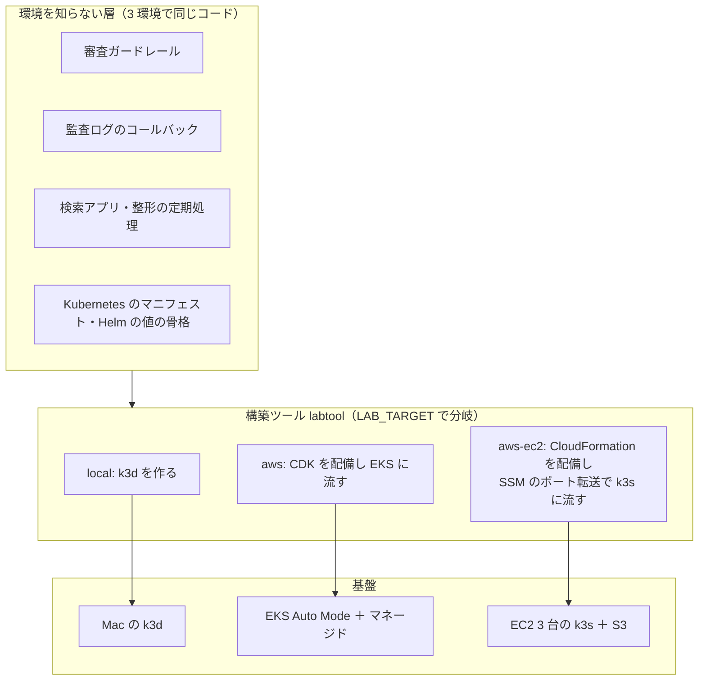
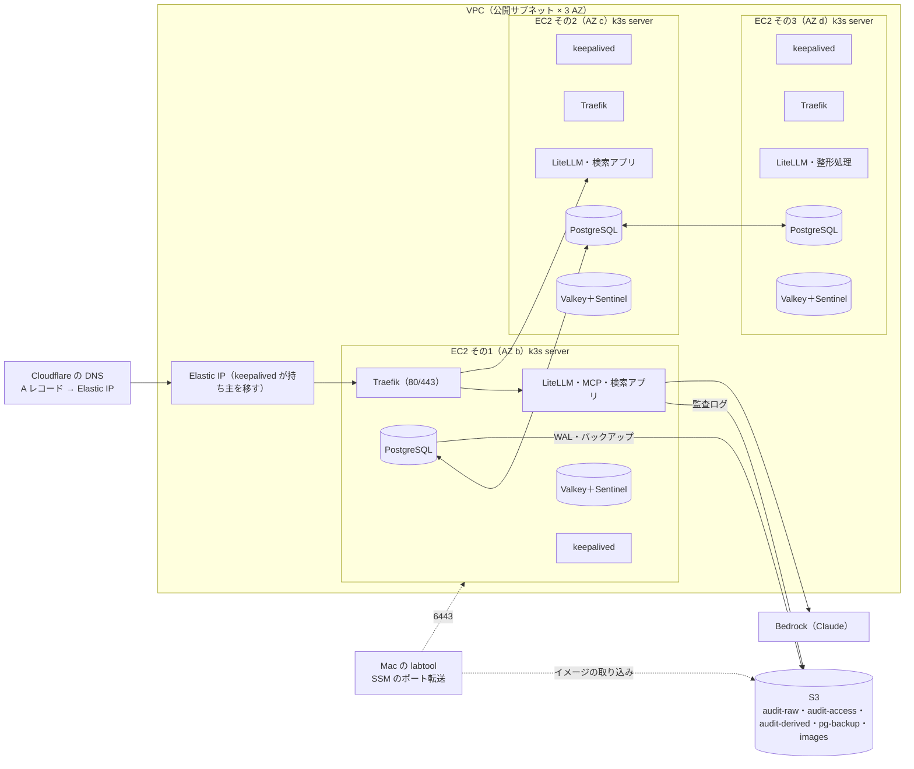

# 変更仕様書: AWS の EC2 3 台と S3 だけで組む環境の追加（`LAB_TARGET=aws-ec2`）

作成: 2026-10-25
状態: 案（実装前。ユーザーとの 3 回のヒアリングで決めた内容を反映。末尾の「前提」は未確認）
この文書の役割: **何を満たすか（要件）と、何を決めたか（決定）**。どう作るか（CloudFormation のスタックの分け方、設定値、構築ツールの分岐、環境変数の名前）は、同じディレクトリの `変更設計書.md` に書く
`docs/spec.md` への反映: 実装と試験が済んでから、12 章の表に従って本文を書き換える（EKS 版と同じく、独立した仕様書は作らず 1 つの仕様書に併記する）

---

## 0. 背景と決定事項

### 0.1 背景

- 検証環境は Mac 1 台の k3d の中に、PostgreSQL（CloudNativePG 3 台と Pooler）、Valkey（3 台と Sentinel 3 台）、RustFS（1 台）を自前で立てている（`docs/spec.md` 5 章、8 章）。
- 2026-10-24 に、同じコードを AWS のマネージドサービス（EKS Auto Mode、Aurora、ElastiCache、S3、Bedrock）で動かす `LAB_TARGET=aws` を実装した（`.history/2026-10-24-AWS構成/`）。CloudFormation の 4 スタックまでは配備できたが、アカウントの制限（EC2 の vCPU 上限 0、Bedrock の `Error 002`）の解除待ちで、計算資源は消してある。
- EKS 版は止めていても料金が出る部品が多く（EKS の制御部分、ElastiCache、NAT）、検証の規模には重い。**AWS の有料の部品を EC2 と S3 だけに絞り、1 台が落ちても処理が続く構成**を 3 つ目の環境として足したい。
- 2 台で検討したところ、主系を決める仕組み（k3s の組み込み etcd、CloudNativePG、Valkey の Sentinel）がすべて 3 台の多数決を前提にしていて、2 台では S3 を審判にする自作の仕組みと Docker Compose への書き直しが要ることが分かった。3 台なら Mac の k3d 構成をほぼそのまま載せられるので、**3 台で組む**（ユーザー回答 1A）。

### 0.2 決定事項（2026-10-25、ユーザーの回答）

| 項目 | 決定 |
|---|---|
| 台数 | **EC2 3 台**。k3s を 3 台とも server（組み込み etcd）にし、1 台を失っても多数決が保てるようにする（1A） |
| 有料の部品 | **EC2（インスタンス、EBS、Elastic IP、パブリック IPv4）と S3 だけ。** マネージドの DB・キャッシュ・ロードバランサー・共有ファイルシステム・コンテナレジストリ・秘密情報の保管は使わない。モデルの呼び出しは EKS 版と同じく Bedrock（従量） |
| 状態を持つ部品 | **Mac と同じ自前の構成を 3 台の上で動かす**（CloudNativePG 3 台、Valkey ＋ Sentinel 各 3 台）。オブジェクトストレージだけ RustFS を S3 に替える |
| 入口 | **Elastic IP 1 つを keepalived で 3 台の間で移す。** HTTPS の証明書は cert-manager が Let's Encrypt（DNS-01、Cloudflare）で取る（2B）。ロードバランサーも Cloudflare Tunnel も使わない |
| HTTPS のドメイン | 手持ちのドメイン（Cloudflare で管理）に、**Elastic IP への A レコードを手で 1 回足す**。Elastic IP は作り直しても変わらないようにする（別スタックで保持） |
| S3 の権限 | **役割ごとの IAM ユーザーと静的キー**（Mac の RustFS の利用者表と同じ形。3B）。Pod Identity 相当の仕組みは k3s では使えないので採らない |
| 秘密情報 | **Mac と同じく `.env` から構築ツールが Kubernetes の Secret を作る**（4A）。Secrets Manager と External Secrets Operator は使わない |
| 既存の環境との関係 | **`LAB_TARGET=aws-ec2` を 3 つ目の環境として足し、Mac（`local`）と EKS 版（`aws`）はそのまま残す**（5A） |
| 基盤のコード | **素の CloudFormation（YAML）** を `cfn/` に置き、構築ツールが `aws cloudformation deploy` で配備する。CDK は使わない。Kubernetes の中（Helm、マニフェスト）は CloudFormation の範囲外で、今までどおり構築ツールが Mac から流す（回答 1A、CloudFormation の問いに対して） |
| 構築ツールの接続経路 | **Systems Manager の Session Manager のポート転送**で k3s の API に届く。SSH も 6443 の公開もしない |
| モデル | EKS 版と同じ。Claude Code 用と 2 つの審査官は **Bedrock の Claude**（日本内のクロスリージョン推論プロファイル）。Jev は使わない |
| 文書の進め方 | **変更仕様書と変更設計書を一度に書く**（6A）。実装と試験の後に `docs/spec.md` と `docs/design.md` に反映する |

### 0.3 既存の仕様から変える方針

- 仕様書 5 章の前提は、EKS 版で「Mac は自前、AWS はマネージド」に書き分けた。これを「**Mac と AWS の EC2 3 台は自前で冗長化する。AWS の EKS 版はマネージドサービスを使う**」にする。要件（切り替えでデータを失わない、人の操作なしに回復する、任意の時点に戻せる、改ざんできない形で残す）は 3 環境で同じ。
- 仕様書 5.3 の「S3 の API だけを使い、設定だけで置き換えられる」は EKS 版で実際に S3 に置き換えた。この環境でも同じ S3 の定義（バケット、保持、ライフサイクル、権限表）を使う。
- EKS 版で決めた「静的キーを使わない」は、この環境では**採らない**（3B）。理由は、k3s に Pod Identity 相当の仕組みが無く、ServiceAccount を IAM に信頼させる方式（IRSA 相当）は手順が増えるため。静的キーは Kubernetes の Secret にだけ置き、`.env` には書かない。

---

## 1. 対象範囲

| やること | やらないこと |
|---|---|
| `LAB_TARGET=aws-ec2` を構築ツールに足し、`local` と `aws` の振る舞いを変えない | Mac の構成と EKS 版の変更 |
| AWS の基盤（VPC、EC2 3 台、Elastic IP、セキュリティグループ、IAM ユーザー、S3）を CloudFormation で書く | 監視・通知の仕組み（CloudWatch のアラームなど。仕様書 6.1 のとおり警告はログと数値の出力まで） |
| 3 台の上に k3s を組み、Mac と同じマニフェスト・同じ Helm の値の骨格で Kubernetes の中の部品を動かす | Kubernetes の中の部品の作り替え（Docker Compose への移行など） |
| 入口（Elastic IP の移動、Let's Encrypt の証明書）を Kubernetes の中と EC2 の上で組む | Cloudflare Tunnel や ALB の利用 |
| イメージを S3 経由で 3 台に配る | ECR の利用 |
| 1 台を止める障害試験と、3 環境で共通の試験の実行 | 本番規模での負荷試験 |
| 使わないときに `./lab down` で有料の部品をすべて消す運用 | 本番の運用手順 |

---

## 2. 全体構成

### 2.1 層の分け方

### 2.2 EC2 3 台の構成

- 3 台は別々のアベイラビリティゾーンに置く。1 台（1 ゾーン）を失っても、etcd・PostgreSQL・Valkey の多数決が保たれ、LiteLLM の Pod は残りの台で動き続ける。
- Elastic IP を持つ台が落ちたら、keepalived が残りの台の 1 つに Elastic IP を移す。どの台でも Traefik が 80 と 443 で待っているので、A レコードは変えない。
- 外から入るのは 80 と 443 だけ。構築ツールは Session Manager のポート転送で k3s の API に届き、以降は Mac と同じ `kubectl` と `helm` と `port-forward` を使う。

### 2.3 3 環境で同じにするもの（要件）

EKS 版の変更仕様書 2.2 と同じ。審査ガードレールと監査ログのコールバックはコードも設定の意味も同じ。検索アプリと整形は同じイメージと同じマニフェスト。LiteLLM は同じイメージのタグと同じ Helm チャートの版。S3 の置き場所は同じ定義から 3 環境に渡す。`./lab bootstrap` は同じ手順。試験は kubeconfig を切り替えるだけで流せる。版は 1 か所で持つ。

### 2.4 環境で違ってよいもの（`aws-ec2` の差分）

| 段階 | `local` | `aws`（EKS 版） | `aws-ec2` | 共通にするための決まり |
|---|---|---|---|---|
| cluster | k3d を作る | CDK のスタックを配備、EKS の kubeconfig | CloudFormation のスタックを配備し、出力（Elastic IP、バケット名、静的キー、インスタンス ID）を以降の段階に渡す。k3s の kubeconfig を Session Manager 経由で取り、ポート転送で接続 | ほかの段階は kubeconfig と渡された値だけを見る |
| images | k3d のレジストリに push | ECR に push | arm64 でビルド → `docker save` → S3 の `images` バケット → 3 台で `k3s ctr images import` | イメージの名前とタグは 3 環境で同じ |
| datastores | CloudNativePG、Valkey ＋ Sentinel | 何も作らない | **`local` と同じ**。バックアップの宛先だけ S3（`pg-backup` の静的キー） | `S3_ENDPOINT` を空にすれば AWS の S3 に向く既存の作り |
| objectstore | RustFS にバケットと利用者を作り、検査 | 検査だけ（作るのは CDK） | 検査だけ（作るのは CloudFormation）。利用者ごとの許可・拒否の検査は静的キーがあるので **Mac と同じ検査を全部流せる** | バケットと権限の定義は 1 つ |
| secrets | `.env` → Secret | Secrets Manager ＋ ESO | **`local` と同じ**。S3 の静的キーは CloudFormation の出力から Secret に入れる | Secret の名前とキーは共通 |
| ingress | Traefik の経路（HTTP、localhost） | ALB の Ingress（ACM） | Traefik の経路（`local` と同じ描画）＋ Let's Encrypt の証明書 ＋ 80 → 443 の転送 | 経路と遮断の対象は共通 |
| test-failover | agent ノードを `docker stop` | drain と、Aurora・ElastiCache の API | **`local` の場面（`pg-*`、`valkey-*`）をそのまま流し**、ノードを止める場面だけ EC2 の停止（API）に替える。加えて Elastic IP を持つ台を止める場面 | 合格の基準は共通 |

### 2.5 S3 の権限の検査（3 環境で共通）

EKS 版 2.4 と同じ。`aws-ec2` では静的キーがあるので、Mac と同じく「各利用者で許した操作ができ、許していない操作（原本の削除、保持の回避）が拒否される」ことを構築ツールから直接確かめる（EKS 版で省いていた検査が、この環境では流せる）。

---

## 3. 冗長化（仕様書 5 章の書き分け）

要件は 3 環境で同じ。`aws-ec2` の満たし方は Mac と同じで、違いは置き場だけ。

### 3.1 PostgreSQL

| 観点 | `local` | `aws-ec2` |
|---|---|---|
| 構成 | CloudNativePG 3 台、別々のノード | 同じ。3 台が別々の EC2（別 AZ）に載る |
| 切り替え | オペレーターが約 30 秒で昇格 | 同じ |
| バックアップと WAL | Barman Cloud Plugin → RustFS | Barman Cloud Plugin → S3（`pg-backup`） |
| 任意の時点に戻す | RustFS から | S3 から。3 台すべてを失っても S3 から戻せる |
| 記憶装置 | ノードのローカルディスク（PVC） | EC2 の EBS（local-path の PVC）。インスタンスを作り直すとその台の複製は消え、オペレーターが残りから作り直す |

### 3.2 Redis（Valkey）

| 観点 | `local` | `aws-ec2` |
|---|---|---|
| 構成 | Valkey 3 台 ＋ Sentinel 3 台 | 同じ |
| 切り替え | Sentinel が約 60 秒で昇格 | 同じ |
| LiteLLM の接続 | Sentinel 経由 | 同じ（EKS 版の単一エンドポイントではない） |

### 3.3 オブジェクトストレージ

| 観点 | `local` | `aws-ec2` |
|---|---|---|
| 実体 | RustFS 1 台（クラスタの中） | S3 |
| 耐久性 | 1 台 | 3 AZ |
| 利用者 | RustFS の利用者（静的キー） | IAM ユーザー（静的キー）。利用者の名前と権限表は同じ |
| Object Lock | GOVERNANCE（検証） | 同じ |

### 3.4 入口（新しい観点）

| 観点 | `aws-ec2` |
|---|---|
| 要件 | 入口の台が落ちても、人の操作なしに別の台で受け続ける。ホスト名と IP は変えない |
| 満たし方 | Elastic IP を keepalived が多数決（3 台のユニキャスト VRRP）で持ち主を決め、持ち主になった台が EC2 の API で自分に付け替える。Traefik は 3 台すべてで 80 と 443 を待つ |
| 目安 | 切り替えは 30 秒以内（keepalived の検知 ＋ API の付け替え ＋ 到達の切り替わり） |

---

## 4. AWS の EC2 3 台の環境（仕様書に新しく足す章）

### 4.1 構成

| 部品 | 内容 |
|---|---|
| ネットワーク | VPC 1 つ、公開サブネット 3 つ（別 AZ）。NAT は置かない（3 台は公開サブネットに置き、外向きはインターネットゲートウェイから） |
| EC2 | 3 台。Graviton（arm64）、Amazon Linux 2023、各台に EBS 1 本。詳細は設計書 |
| k3s | 3 台とも server（組み込み etcd）。Traefik は k3s 同梱のものを Mac と同じ設定で使う |
| Elastic IP | 1 つ。別スタックで保持し、作り直しても変わらない |
| S3 | Mac と同じ 4 バケット（`audit-raw`、`audit-access`、`audit-derived`、`pg-backup`）に、イメージ配布用の `images` を足す。名前は EKS 版と同じ接頭辞の付け方 |
| IAM | 役割ごとの IAM ユーザー（`litellm-writer`、`audit-compactor`、`audit-viewer`、`pg-backup`、`litellm-bedrock`）と静的キー。EC2 のインスタンスロールは Session Manager と Elastic IP の付け替えとイメージの取り込みだけに絞る |
| 外から届くもの | 80 と 443（Elastic IP）。6443 と SSH は開けない |

### 4.2 モデル

EKS 版 4.2 と同じ（Claude Code 用は Bedrock の Claude、2 つの審査官は Bedrock の Claude Haiku 4.5、Jev は使わない）。Bedrock の資格情報は IAM ユーザー `litellm-bedrock` の静的キーで、LiteLLM のモデルの設定に明示して渡す（S3 の資格情報と混ざらないようにする）。

Codex 用のモデルは EKS 版と同じく未決。`chatgpt/` のトークンは全 Pod で共有する書き込み可能な置き場（EKS 版は EFS）が要るが、この環境には共有ファイルシステムが無い。**決まるまで `aws-ec2` では `chatgpt/` を使わず、Codex 用のモデルを置かない**（13 章の前提。Codex と `review-judge` の二次判定が無い状態で動かす。審査官は Bedrock なので審査は動く）。

### 4.3 利用料・認証

EKS 版 4.3〜4.4 と同じ（モデルは従量、Google SSO、OIDC の戻り先は `https://<ホスト名>/...`）。

---

## 5. 構築ツール（`./lab`）の要件

- `LAB_TARGET` が `local` と `aws` のとき、今の振る舞いを一切変えない（既存の試験で確かめる）。
- `LAB_TARGET` が `aws-ec2` のとき、`./lab up` は CloudFormation の配備 → 出力の取得 → k3s の準備の待ち合わせと kubeconfig の取得 → ポート転送 → イメージのビルドと S3 経由の取り込み → Kubernetes の中の部品（Mac と同じ順）→ 入口（証明書）→ bootstrap → 監査 → クライアント設定、の順に流す。
- どの段階も、何度実行しても同じ状態になる（既存の冪等性の原則）。CloudFormation の配備は差分が無ければ何もしない（`deploy --no-fail-on-empty-changeset`）。
- `./lab down` は `aws-ec2` では **有料の部品をすべて消す**（EC2、EBS、Elastic IP、S3 のバケットの中身とバケット）。IAM ユーザーとキーも S3 のスタックと一緒に消える。残すのは DNS の A レコードと、Mac 側に退避した証明書だけ。Elastic IP を残すと月数百円かかるので、残す・残さないを `.env` で選べるようにし、既定は消す（消すと A レコードを直す）。
- 構築ツールが k3s の API に届く経路は Session Manager のポート転送。クラスタの中のサービスには Mac と同じく `kubectl port-forward`。S3 には直接（操作者のプロファイル）。
- クライアント設定（`./lab clients`）は EKS 版と同じく `https://<ホスト名>` を接続先にする。

---

## 6. 費用と、使わないときの扱い

- 動かしている間の費用は EC2 3 台（インスタンス、EBS、パブリック IPv4 4 つ）と S3 の容量、Bedrock の従量。EKS 版の「止めていても出る」部品（EKS の制御部分、ElastiCache、NAT）は無い。
- `./lab down` で有料の部品はすべて消える（5 章）。`./lab down` で消えない有料のものがあってはならない（2026-10-24 のユーザー指示を引き継ぐ）。
- 費用の概算はこの文書に書かない。設計で決めたインスタンスの種類をもとに、配備の前に価格表で確かめて応答で報告する。

---

## 7. 検証項目（仕様書 9 章への追加）

### 7.1 3 環境で共通に流すもの

EKS 版 7.1 と同じ: `./lab test-smoke`、`./lab test-idempotency`、`./lab test-audit`、`./lab test-judge`、審査シナリオ。`aws-ec2` では `test-audit` の利用者ごとの削除拒否の検査も Mac と同じく流す。

### 7.2 `aws-ec2` だけの項目（9.3 に足す）

| 項目 | 合格の目安 |
|---|---|
| PostgreSQL の primary の Pod を消す、計画的な切り替え（Mac と同じ場面） | Mac と同じ（失敗 0 件、60 秒以内） |
| Valkey の primary の Pod を消す（Mac と同じ場面） | 同じ（60 秒以内） |
| PostgreSQL の primary が載った EC2 を止める（API で停止、120 秒後に起動） | 失敗 0 件、120 秒以内に回復。戻った台が複製に戻る |
| Valkey の primary が載った EC2 を止める | 同上 |
| Elastic IP を持つ EC2 を止める | 30 秒以内に別の台が Elastic IP を持ち、要求が通る。戻った台は Elastic IP を奪い返さない（揺れを防ぐ） |
| 1 台を止めた状態で `./lab up` を流し直す | 止まらずに通る（残り 2 台で多数決が保てる） |
| `./lab down` → `./lab up` | 有料の部品が消え、作り直せる。S3 の監査ログは消える（検証環境の振る舞い） |
| Session Manager のポート転送が切れたときの構築ツールの振る舞い | 再接続して続く、または分かるメッセージで止まる |

---

## 8. リスク・注意事項（仕様書 10 章への追加）

- **2 台を同時に失うと止まる。** etcd・PostgreSQL・Valkey の多数決が保てない。3 台とも失うと、S3 の `pg-backup` から DB を戻し、監査ログは S3 に残る（ユーザー、キー、MCP のサインインは復元の対象）。
- **アカウントの制限。** EC2 の vCPU 上限が 0 のままでは配備できない（3 台 × 2 vCPU = 6。申請中の 16 に収まる）。Bedrock の `Error 002` が解けるまで、モデルの呼び出しは失敗する。
- **k3s の記憶装置はノードに固定される。** local-path の PVC はその台にしか無い。インスタンスを作り直すと PostgreSQL と Valkey のその台の複製は消え、オペレーターと Sentinel が残りから作り直す。これは Mac の k3d と同じ振る舞い。
- **Let's Encrypt の発行数の上限。** 同じホスト名は 1 週間に 5 枚まで。`./lab down` → `up` を繰り返すと当たりうるので、証明書の Secret を `./lab down` の前に Mac に退避し、`up` で戻す（設計書）。
- **Elastic IP の付け替えは EC2 の API に依存する。** API が遅いと切り替えが遅れる。keepalived の多数決そのものは API に依存しない。
- **静的キーが Kubernetes の Secret にある。** k3s の Secret は etcd に平文で載る（Mac と同じ）。漏れたときの影響は IAM ユーザーの権限表の範囲に限られる。`./lab down` で IAM ユーザーとキーもスタックと一緒に消える。
- **パブリック IPv4 に料金がかかる。** 3 台のパブリック IP と Elastic IP の 4 つ分。NAT にすると高くなるので受け入れる。

---

## 9. 用語

| 用語 | 意味 |
|---|---|
| `LAB_TARGET` | 構築ツールが向ける環境。`local`（Mac の k3d）、`aws`（EKS 版）、`aws-ec2`（この文書） |
| k3s | 軽量な Kubernetes。server（制御部分と etcd）と agent がある。3 台の server で組み込み etcd の多数決が成り立つ |
| keepalived | VRRP で主系を決め、主系が変わったときにスクリプトを呼べる仕組み。AWS ではマルチキャストが使えないのでユニキャストで組む |
| Elastic IP | AWS の固定のパブリック IP。インスタンスの間で付け替えられる |
| Session Manager | Systems Manager の機能。SSH を開けずにインスタンスへ接続し、ポート転送もできる |
| DNS-01 | Let's Encrypt のドメイン所有の確かめ方の 1 つ。DNS に TXT レコードを置く。cert-manager が Cloudflare の API で自動で置く |
| local-path | k3s 同梱の記憶装置の割り当て。ノードのディスクをそのまま使う |

---

## 10. この文書で決めないこと（変更設計書に書く）

- CloudFormation のスタックの分け方（Elastic IP を残す分け方、S3 とイメージの置き場、3 台の分け方）
- インスタンスの種類、EBS の大きさ、VPC の CIDR、セキュリティグループの穴
- k3s の起こし方（cloud-init の内容、参加トークンの渡し方、待ち合わせ）
- keepalived の設定（優先度、健全性の検査、付け替えのスクリプト、戻った台が奪い返さない設定）
- Let's Encrypt の設定（ClusterIssuer、Cloudflare の API トークンの渡し方、証明書の退避）
- イメージの S3 経由の配り方（tar の形、取り込みの命令、タグの一致の確かめ方）
- Session Manager のポート転送の起こし方と、切れたときの扱い
- 静的キーの Secret への入れ方（CloudFormation の出力から）
- Bedrock の資格情報の LiteLLM への渡し方
- `./lab test-failover` の `aws-ec2` の場面の作り
- `./lab down` の手順（S3 を空にする、スタックを消す順）

---

## 11. 参考資料

- [k3s: 組み込み etcd の高可用性（server は奇数、3 台以上）](https://docs.k3s.io/datastore/ha-embedded)
- [k3s: ServiceLB（全ノードで 80/443 を待つ）](https://docs.k3s.io/networking/networking-services#service-load-balancer) / [Traefik の設定](https://docs.k3s.io/helm#customizing-packaged-components-with-helmchartconfig)
- [keepalived のユニキャスト設定](https://keepalived.readthedocs.io/en/latest/configuration_synopsis.html)
- [EC2 Elastic IP の付け替え（`associate-address --allow-reassociation`）](https://docs.aws.amazon.com/cli/latest/reference/ec2/associate-address.html)
- [Session Manager のポート転送](https://docs.aws.amazon.com/systems-manager/latest/userguide/session-manager-working-with-sessions-start.html#sessions-remote-port-forwarding)
- [cert-manager: Cloudflare の DNS-01](https://cert-manager.io/docs/configuration/acme/dns01/cloudflare/) / [Let's Encrypt の発行数の上限](https://letsencrypt.org/docs/rate-limits/)
- [CloudFormation `AWS::IAM::AccessKey`（`SecretAccessKey` の取り出し）](https://docs.aws.amazon.com/AWSCloudFormation/latest/TemplateReference/aws-resource-iam-accesskey.html)
- [CloudFormation S3 ObjectLockConfiguration](https://docs.aws.amazon.com/AWSCloudFormation/latest/UserGuide/aws-properties-s3-bucket-objectlockconfiguration.html)
- [パブリック IPv4 の料金](https://aws.amazon.com/blogs/aws/new-aws-public-ipv4-address-charge-public-ip-insights/)
- EKS 版の変更仕様書・変更設計書: `.history/2026-10-24-AWS構成/`
- 検討の経緯: 2026-10-25 のセッション（2 台案 → 3 台案 → CloudFormation の問い、3 回のヒアリング）

---

## 12. `docs/spec.md` への反映の仕方（実装と試験の後）

| 章 | 変更 |
|---|---|
| 決定事項の表 | `LAB_TARGET` に `aws-ec2` を足す。「DB と Redis の冗長化」を「Mac と EC2 3 台は自前、EKS 版はマネージド」に。入口（Elastic IP ＋ keepalived）、静的キー、`.env` の行を足す |
| 1. 全体構成 | 2.1 の 3 環境の図 |
| 5. 冗長化 | 3 章の表を 3 列（`local` / `aws` / `aws-ec2`）にし、3.4 の入口を足す |
| AWS 環境の章（EKS 版で足す） | 4 章・5 章・6 章を「EC2 3 台の環境」として併記 |
| 9.3 スケールと冗長化 | 7.2 の項目を足す |
| 10. リスク | 8 章の項目を足す |
| 11. 参考資料 | 11 章の資料を足す |

---

## 13. 前提（この文書で仮定したこと。ユーザーに未確認）

| 前提 | 仮定した内容 | 外れたときの影響 |
|---|---|---|
| 「EC2 と S3 のみ」の範囲 | 有料の部品を EC2（EBS、Elastic IP、パブリック IPv4 を含む）と S3 に限る。無料で使う IAM、CloudFormation、Systems Manager（Session Manager）、Cloudflare の DNS と、従量の Bedrock は使ってよい | Session Manager も不可なら、6443 を操作者の IP にだけ開ける（SG の穴が増える）。Bedrock も不可なら審査官とモデルの置き場が無くなる |
| イメージの配り方 | ECR を使わず、S3 の `images` バケットに tar を置き、3 台で取り込む | ECR を許すなら EKS 版の仕組みをそのまま使え、取り込みの段階が消える |
| `chatgpt/` のトークン | 共有ファイルシステムが無いので、`aws-ec2` では `chatgpt/` を使わず Codex 用のモデルを置かない（Codex 用のモデルの決定は BACKLOG のまま） | `chatgpt/` が要るなら、1 台に固定した PVC を NFS で 3 台に見せる（その台が落ちると Codex だけ止まる）か、Codex 用のモデルを先に決める |
| インスタンスの種類 | `t4g.large`（2 vCPU、8 GiB）× 3。Mac の 12 GB 上限に対して 24 GiB で余裕を持たせる | `t4g.medium`（4 GiB）× 3 なら費用は半分だが、Mac の配置表（設計書 5.4）の合計がぎりぎりになる |
| Elastic IP の扱い | `./lab down` の既定は消す（残すと月数百円）。残す設定もできる | 消すたびに Cloudflare の A レコードを直す（手で 1 回） |
| リージョン、Object Lock、SSO | EKS 版と同じ（東京、GOVERNANCE、Google SSO） | EKS 版の前提の表と同じ |
