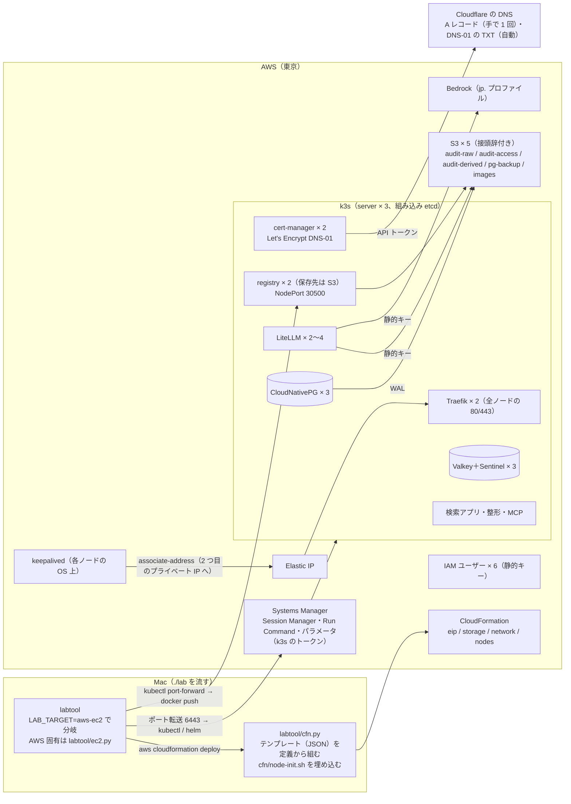

# 変更設計書: AWS の EC2 3 台と S3 だけで組む環境の追加（`LAB_TARGET=aws-ec2`）

作成: 2026-10-25
状態: 実装済み（単体試験 65 本、cfn-lint と `validate-template` が通る。AWS への配備と試験はアカウントの制限の解除の後）。2026-10-26 に k3s の版上げと AMI の固定で 3.4 節と 4.2 節を変えた（`.history/2026-10-26-k3s版上げ/`。単体試験は 68 本）
対応する変更仕様書: 同じディレクトリの `変更仕様書.md`
この文書の役割: **どう作るか**（CloudFormation のスタックの分け方、k3s と keepalived の組み方、構築ツールの分岐、マニフェストの描画、環境変数）。
何を満たすかは変更仕様書に書いてある。実装と試験が済んだら `docs/design.md` に反映する（12 章）

---

## 1. 作りの全体

| 層 | 置き場 | 環境を知るか |
|---|---|---|
| 審査ガードレール、監査ログのコールバック、検索アプリ、整形 | `litellm/guardrails/`、`apps/audit/` | 知らない（EKS 版で入れた「静的キーがあれば使い、無ければ資格情報チェーン」のまま。この環境は静的キーを渡す） |
| Helm の値の骨格、マニフェスト | `litellm/values.yaml`、`k8s/*.yaml` | 知らない。環境ごとの値は labtool が重ねる |
| 構築ツール | `labtool/` | `Env.target` で分岐（`is_aws_ec2`、AWS のどちらかは `on_aws`）。`aws-ec2` 固有の処理は `labtool/ec2.py` に集める（`aws.py` は EKS 版のまま。boto3 セッション、`identity()`、`empty_bucket()` を `aws.py` から借りる） |
| AWS の基盤 | `labtool/cfn.py`、`cfn/node-init.sh` | AWS だけ。4 スタックのテンプレートは `cfn.py` が Python の辞書で組み（S3 の定義 `render.s3_buckets` / `render.s3_policies` をそのまま使う）、`.build/cfn/*.json` に書いて `aws cloudformation deploy` に渡す。YAML の `!Ref` などの独自タグを扱わずに済み、単体試験で中身を確かめられる。ノードの cloud-init は `cfn/node-init.sh` を台ごとの値で置き換えて埋め込む |

---

## 2. 環境を知らない層の変更（3 環境で同じコード）

変更は 2 か所だけ。いずれも `local` の振る舞いは変わらない。

| 対象 | 変更 | 理由 |
|---|---|---|
| `k8s/postgres-cnpg.yaml` の `ObjectStore` | `destinationPath` のバケット名を `${S3_BUCKET_PREFIX}pg-backup` に、`endpointURL` の行を `${S3_ENDPOINT_LINE}`（`local` は `endpointURL: http://rustfs:9000`、`aws-ec2` は空）に、サイドカーに `AWS_DEFAULT_REGION`（`${S3_REGION}`）を足す。値は `render.pg_backup_values(env)` が出す | AWS の S3 はエンドポイントの指定が要らず、バケット名に接頭辞が付く（EKS 版では CloudNativePG を使わなかったので未対応だった） |
| `k8s/*.yaml` の server ノード固定（cert-manager、CloudNativePG のオペレーター、Barman Cloud Plugin、Traefik、RustFS） | 変えない。固定の条件は「server ノード」のラベルで、`aws-ec2` は 3 台とも server なので全台に当たる。代わりに labtool が `aws-ec2` では **オペレーターと Traefik の replica を 2** にする（`operators(replicas=2)`、`k8s/traefik-config-ec2.yaml`） | 1 台だけで動くオペレーターの台が止まると、Pod の作り直し（既定 5 分）まで PostgreSQL の昇格が始まらない。Mac は止めない server ノードに置いて避けていた |

イメージの `imagePullPolicy` は変えない（`IfNotPresent`）。イメージ置き場（registry）は保存先が S3 で 2 Pod あり、どの台が落ちても引けるため。

---

## 3. CloudFormation（`cfn/`）

スタックは 4 つ。接頭辞は `.env` の `LAB_AWS_STACK_PREFIX`（既定 `litellm-lab`）に `-ec2-` を挟む（EKS 版の `litellm-lab-network` などと衝突しない）。テンプレートは `labtool/cfn.py` が JSON で組み（`.build/cfn/<スタック>.json`）、配備は `aws cloudformation deploy --no-fail-on-empty-changeset --capabilities CAPABILITY_NAMED_IAM`。順は eip → storage → network → nodes（nodes は eip の出力の割り当て ID と network の出力のサブネット・セキュリティグループを使う）。

| スタック | 中身 | `./lab down` で |
|---|---|---|
| `<prefix>-ec2-eip` | Elastic IP 1 つ（`AWS::EC2::EIP`、出力 `EipAllocationId`、`EipPublicIp`） | `LAB_EC2_KEEP_EIP=true` のときだけ残す（既定は消す） |
| `<prefix>-ec2-storage` | S3 の 5 バケット、IAM ユーザー 6 つとアクセスキー（権限は IAM ユーザーのポリシーに。監査ログの削除と保持の回避は明示的に拒否） | 空にしてから消す（IAM ユーザーとキーも消える） |
| `<prefix>-ec2-network` | VPC、公開サブネット 3 つ、IGW、ルート、S3 のゲートウェイエンドポイント（無料）、セキュリティグループ 1 つ | 消す |
| `<prefix>-ec2-nodes` | EC2 3 台、インスタンスロールとプロファイル、k3s と keepalived の cloud-init | 消す |

k3s の参加トークンは Systems Manager のパラメータ（SecureString、`/<prefix>-ec2/k3s-token`。無料）に置き、ノードがインスタンスロールで読む。テンプレートにも user data にも秘密を書かない。`./lab down` が消す。

### 3.1 `<prefix>-ec2-eip`

- 別スタックにする理由は、`nodes` と `network` を作り直しても IP が変わらず、Cloudflare の A レコードを直さずに済むため。
- `DeletionPolicy` は付けない（スタックごと消すかどうかで決める）。

### 3.2 `<prefix>-ec2-storage`（`cfn.storage_template`）

- `render.s3_buckets`（バケット）と `render.s3_policies`（利用者の権限）から組む。定義の置き場を増やさないため。
- バケット名は EKS 版と同じ `<prefix>-<アカウント ID>-<バケット名>`（グローバルで一意）。`images` はこの環境だけ（クラスタの中の registry の保存先。バージョニング無し、途中で止まった分割アップロードだけ 7 日で消す）。
- `audit-raw` と `audit-access` は `ObjectLockEnabled: true` と既定の保持（モードと日数は `.env`）、バージョニング有効。`audit-derived` はバージョニングと接頭辞ごとのライフサイクル。`pg-backup` は素のバケット（EKS 版は作らなかったが、この環境は CloudNativePG のバックアップ先に要る）。パブリックアクセスはすべて遮断、暗号化は SSE-S3。
- IAM ユーザーは `<prefix>-ec2-litellm-writer`、`-audit-compactor`、`-audit-viewer`、`-pg-backup`、`-registry`、`-litellm-bedrock`。S3 の 4 利用者の権限は Mac の利用者表（設計書 8.3）を接頭辞付きの ARN に写し、`audit-raw` と `audit-access` の削除・保持の回避・ロック設定の変更を明示的に拒否する文を足す（`cfn._deny_audit_deletion`）。`registry` は `images` だけ `s3:*`。`litellm-bedrock` は `bedrock:InvokeModel` と `bedrock:InvokeModelWithResponseStream` を基盤モデルと推論プロファイルに限って許す。
- アクセスキーは `AWS::IAM::AccessKey` で作り、`Outputs` に `<利用者の CamelCase>AccessKeyId` と `...SecretAccessKey`（`GetAtt`）を出す（`cfn.output_key`）。出力は CloudFormation を読める人（この環境では管理者 1 人）に見える。labtool（`ec2.load_credentials`）は出力を読んで Env に載せ、Kubernetes の Secret に入れる。`.env` には書かない。
- `DeletionPolicy: Delete`。消す前に labtool が空にする（Object Lock のバケットは `BypassGovernanceRetention`。EKS 版の `purge_retained` から切り出した `aws.empty_bucket` を使う）。

### 3.3 `<prefix>-ec2-network`

| 項目 | 値 |
|---|---|
| VPC | `10.60.0.0/16`（EKS 版の VPC と重ならない値。`.env` の `LAB_EC2_VPC_CIDR`） |
| サブネット | 先頭の /24 × 3（`10.60.0.0/24`、`10.60.1.0/24`、`10.60.2.0/24`。`cfn.network_plan`）。AZ は `Fn::GetAZs` の先頭 3 つ（このアカウントの東京は b、c、d）。公開サブネット（`MapPublicIpOnLaunch: true`） |
| NAT | 無し。S3 へはゲートウェイエンドポイント（無料）経由 |
| セキュリティグループ `nodes` | 入: 80 と 443 を `0.0.0.0/0` から、同じグループからの全プロトコル（k3s の 6443・2379-2380・10250、flannel の 8472/udp、VRRP の IP プロトコル 112、registry の NodePort をまとめて許す）。出: 全部 |

SSH と 6443 は開けない。構築ツールは Session Manager で入る。

### 3.4 `<prefix>-ec2-nodes`

| 項目 | 値 |
|---|---|
| インスタンス | 3 台、`t4g.large`（`.env` の `LAB_EC2_INSTANCE_TYPE`）、AL2023 arm64（初回は SSM の公開パラメータ `/aws/service/ami-amazon-linux-latest/al2023-ami-kernel-default-arm64` を labtool が解き、**以後は配備済みの AMI ID を固定で渡す**。テンプレートから直接「最新」を参照すると、新しい AMI で 3 台が同時に置き換えられる。2026-10-26 に変更、`.history/2026-10-26-k3s版上げ/`）、IMDSv2 必須 |
| プライベート IP | 各台 2 つを固定で持つ。1 つ目（`.10`。k3s と keepalived が使う）と、**Elastic IP を付ける 2 つ目（`.11`）**。1 つ目には起動時のパブリック IP が付き、Elastic IP が別の台に移っても残るので、外向きの通信（Bedrock、Let's Encrypt、Docker Hub）が途切れない |
| EBS | gp3 40 GiB（`LAB_EC2_DISK_GIB`）、暗号化、インスタンスと一緒に消える |
| インスタンスロール | `AmazonSSMManagedInstanceCore`、`ec2:AssociateAddress` / `ec2:DisassociateAddress` / `ec2:DescribeAddresses`（このリージョンに限る）、`ssm:GetParameter`（参加トークンと k3s の版の 2 つのパラメータだけ） |
| パラメータ | `AmiId`（固定の AMI ID。`ec2.resolve_ami`）、`InstanceType`、`SecurityGroupId`、`Subnet1Id`〜`Subnet3Id`（network の出力を labtool が渡す）。Elastic IP の割り当て ID は user data に埋め込む。**k3s の版は user data に書かず**、SSM のパラメータ `/<prefix>-ec2/k3s-version` から各台が読む（版を上げても nodes スタックに差分が出ない。2026-10-26 に変更） |
| 出力 | `InstanceIds`（3 つ、カンマ区切り）、`PrivateIps`、`SecondaryIps` |

cloud-init（`cfn/node-init.sh`。3 台で同じ内容で、`@@名前@@` を台ごとの値に置き換える。`Fn::Sub` は使わない。シェルの `${...}` と衝突するため）:

1. `dnf install -y keepalived`（AWS CLI v2 は AL2023 に入っている）。
2. containerd のミラー設定（`/etc/rancher/k3s/registries.yaml`）: `lab-registry:5000` → `http://<自分の 1 つ目の IP>:30500`（クラスタの中の registry の NodePort）。`/etc/hosts` にも `lab-registry` を足す。
3. k3s の版と参加トークンを SSM のパラメータから取る（版は `./lab upgrade-k8s` が上げた後に作り直した台も同じ版で参加するため。2026-10-26 に変更）。
4. **k3s の起こし方。** まず他の 2 台の 6443 に順に HTTP で触り、**誰か答えたらそこへ `server: https://<ip>:6443` で参加**する。誰も答えず自分が 1 番なら `cluster-init: true`。誰も答えず 2 番か 3 番なら、1 番が答えるまで（最長 15 分）待ってから参加。これで初回も、1 台を作り直したときも、新しいクラスタを別に作ってしまう（分裂）ことがない。
5. k3s の引数は **`/etc/rancher/k3s/config.yaml` に書き**（コマンドラインに書くと版上げの再実行で消える。2026-10-26 に変更）、Mac の `k3d-config.yaml` と同じにする: `kube-apiserver-arg` の `default-not-ready-toleration-seconds=30`、`default-unreachable-toleration-seconds=30`、`kube-controller-manager-arg` の `node-monitor-grace-period=20s`（ノードが止まったら 30 秒で Pod を移す）。`node-ip` は 1 つ目の IP。参加先か `cluster-init` も同じファイル。Traefik と ServiceLB は同梱のものを使う（`disable` しない）。`tls-san` は不要（k3s の証明書に `127.0.0.1` と `localhost` が入っていて、ポート転送で届く）。インストールスクリプトには `server` だけを渡す。初回の版は Mac の `K3S_IMAGE` のタグから（`cfn.k3s_install_version` → SSM のパラメータ）。
6. keepalived（3.5）を設定して起動。
7. 終わったら `/var/lib/lab/ready` を置く（labtool の待ち合わせの印）。ログは `/var/log/lab-node-init.log`。

### 3.5 keepalived（Elastic IP の持ち主を決める）

| 項目 | 値 |
|---|---|
| 方式 | VRRP のユニキャスト（`unicast_src_ip` 自分、`unicast_peer` 他の 2 台）。AWS はマルチキャストが通らない |
| 状態と優先度 | 3 台とも `state BACKUP`、`nopreempt`。優先度 200 / 150 / 100。**戻った台が奪い返さない**（揺れを防ぐ） |
| 健全性の検査（`track_script`） | 2 秒ごとに `systemctl is-active k3s` と、ローカルの 80（Traefik）への HTTP。失敗が 3 回続けば優先度を 100 下げて主系を譲る |
| 主系になったとき（`notify_master`） | IMDSv2 で自分のインスタンス ID を取り、`aws ec2 associate-address --allocation-id <割り当て ID> --instance-id <自分> --private-ip-address <2 つ目の IP> --allow-reassociation`。失敗したら 5 秒おきに 6 回まで繰り返す。結果は `logger -t lab-eip` に残す |
| 仮想 IP | VRRP の `virtual_ipaddress` には使わないダミーのリンクローカル（`169.254.60.1/32`）を置く。実際の経路は Elastic IP の付け替えで切り替わり、サブネットの中の IP は動かさない |

Traefik は k3s の ServiceLB が 3 台すべての 80 と 443 を Traefik の Service に転送するので、Elastic IP がどの台に付いても届く。Traefik の Pod 自体は replica 2 にして、Pod が載った台が止まっても Service の宛先が残るようにする（2 章）。

---

## 4. 構築ツール（`labtool/`）

### 4.1 共通部分（`core.py`）

- `Env.target` は `local` / `aws` / `aws-ec2` の 3 値。`is_aws`（EKS 版）はそのまま、`is_aws_ec2` を足す。「AWS のどちらか」が要る場所（ホスト名、Bedrock のモデル、`https://`）は `is_aws or is_aws_ec2` をまとめた `on_aws` を使う。
- kube のコンテキストは `aws-ec2` では `litellm-lab-ec2`（EKS 版は `litellm-lab-aws`、Mac は `k3d-litellm`）。
- `.env` の必須項目: `LAB_AWS_PROFILE`、`LAB_AWS_HOSTNAME`、`LAB_CLOUDFLARE_API_TOKEN`（6 章）。

### 4.2 `aws-ec2` 固有の部品（`ec2.py`、新規）

| 関数 | 役割 |
|---|---|
| `ensure_token_parameter(env)` | k3s の参加トークンを SSM のパラメータ（SecureString）に置く（あれば何もしない） |
| `ensure_version_parameter(env)` / `set_version_parameter` / `resolve_ami(env)` | k3s の版のパラメータ（無ければコードの版で作る。上書きは `./lab upgrade-k8s` だけ）と、固定の AMI ID（配備済みならその値、初回は SSM の公開パラメータ）。2026-10-26 に追加、`.history/2026-10-26-k3s版上げ/変更設計書.md` 4.1 節 |
| `deploy(env, ident)` | `cfn.py` のテンプレートを `.build/cfn/*.json` に書き、`aws cloudformation deploy` で eip → storage → network → nodes の順に配備。出力を `.build/ec2-outputs.json` に保存。配備済みの k3s の版とコードの版が違えば止める（版は `./lab up` では変えない） |
| 版上げ（`node_versions`、`etcd_snapshot`、`drain_node`、`install_k3s`、`wait_node_version`、`uncordon_node`、`parse_k3s_version`、`check_upgrade_step`、`upgrade_order`） | `./lab upgrade-k8s` の部品（2026-10-26 に追加。同上 4.1 節） |
| `outputs(env)` / `load_outputs(env)` | 4 スタックの出力をまとめて返す（EKS 版と同じ形） |
| `load_credentials(env, out)` | IAM ユーザーの静的キーを出力から Env に載せる（S3 の利用者は Mac と同じ名前 `S3_<利用者>_KEY / _SECRET`、Bedrock は `BEDROCK_ACCESS_KEY_ID / _SECRET_ACCESS_KEY`）。`.env` には書かない |
| `run_on(env, instance_id, commands)` | Run Command（`AWS-RunShellScript`）でインスタンスの中のコマンドを流し、標準出力を返す |
| `wait_nodes_ready(env, out)` | 3 台が SSM で `Online` になり、`/var/lib/lab/ready` があるまで待つ（最長 10 分 ＋ 15 分） |
| `fetch_kubeconfig(env, instance_id)` | 1 台から `/etc/rancher/k3s/k3s.yaml` を読み、証明書を埋め込んで `kubectl config set-cluster / set-credentials / set-context` でコンテキスト `litellm-lab-ec2`（`server` は `https://127.0.0.1:<LAB_EC2_LOCAL_PORT>`）を `~/.kube/config` に書く |
| `ensure_forward(env, avoid=None)` / `stop_forward(env)` | `kubectl get --raw /readyz` が通らなければ（または `avoid` の台に張ってあれば）、SSM で `Online` の台（`avoid` 以外）の先頭に `aws ssm start-session --document-name AWS-StartPortForwardingSession`（6443 → ローカルのポート）を**背景のプロセスとして残して**張る（PID は `.build/ec2-forward.pid`）。`./lab` を何度も流すため閉じない。Session Manager は既定で 20 分使わないと切れるので、各コマンドの最初（`stages.ensure_access`）で確かめて張り直す。`./lab down` が止める |
| `registry_forward(env)` | クラスタの中の registry（`svc/lab-registry`）への `kubectl port-forward`（`./lab images` が push に使う） |
| `instance_id_for_node(env, out, node)` / `node_for_instance(env, id)` | Kubernetes のノード名とインスタンス ID の相互変換（プライベート IP で突き合わせる） |
| `stop_node(env, instance_id)` / `start_node(...)` | 障害試験で EC2 を止める・起こす（`stop-instances` → `stopped` を待つ） |
| `eip_holder(env, out)` | `describe-addresses` で Elastic IP が付いているインスタンス ID |
| `wait_for_a_record(env, ip)` | ホスト名が Elastic IP に解決できるまで待つ（引けない間は A レコードの足し方を知らせる） |
| `save_tls_secret(env)` / `restore_tls_secret(env)` | 証明書の Secret `litellm-tls` を `.build/ec2-tls-secret.json` に退避・復元（Let's Encrypt の上限を避ける） |
| `empty_buckets(env, out)` / `destroy(env, keep_eip)` | S3 を空にし（`aws.empty_bucket`。COMPLIANCE は残して知らせる）、スタックを nodes → network → storage →（eip）の順に消し、SSM のパラメータも消す |

`preflight` で確かめるもの: `aws`（v2）、`session-manager-plugin`、`docker`、`kubectl`、`helm`、`kubectl cnpg`、資格情報、`LAB_AWS_HOSTNAME`、`LAB_CLOUDFLARE_API_TOKEN`、`LAB_ACME_EMAIL`、`cfn/node-init.sh` の有無。

### 4.3 段階ごとの分岐（`stages.py`）

| 段階 | Mac（変えない） | `aws-ec2` |
|---|---|---|
| preflight | k3d、kubectl cnpg、Docker、ポート | 4.2 の確認。`LAB_AWS_ACCOUNT` と `LAB_AWS_BUCKET_PREFIX` を Env に載せる（EKS 版と同じ） |
| （各コマンドの最初） | — | `stages.ensure_access`: 出力があれば `ec2.ensure_forward`（ポート転送の確認と張り直し）。`lab` の `loaded()` と `up()` が呼ぶ |
| cluster | k3d、Traefik、namespace、SA、オペレーター | `ec2.deploy()` → `wait_nodes_ready` → `ensure_forward` → 全ノード Ready → Traefik の設定（`traefik-config-ec2.yaml`: replica 2、80 → 443 の転送）→ namespace → SA → **イメージ置き場**（`_ec2_registry`: IAM の静的キーを Env に載せ、Secret `lab-registry` と registry の Deployment・NodePort）→ オペレーター（`operators(replicas=2)`。cert-manager とそのウェブフック・cainjector、CloudNativePG のオペレーターが 2。Barman Cloud Plugin は 1）→ Secret `cloudflare-api-token`（`cert-manager` の名前空間）→ `ClusterIssuer letsencrypt`（4.6） |
| images | ビルド → k3d のレジストリ | `_build_and_push_ec2`: `--platform linux/arm64` でビルド → `registry_forward` で HEAD → 無ければ `docker push`。クラスタの中からの名前は `lab-registry:5000/<名前>:<タグ>` |
| secrets | `.env` の空の値を生成 → Secret | **Mac と同じ関数**を通す。違いは、RustFS の管理者キーと S3 の利用者のキーを生成せず `_ec2_registry`（`load_credentials`）で CloudFormation の出力から Env に載せる（`.env` には書かない）、`rustfs` の Secret の代わりに `cloudflare-api-token` を作る、`litellm-secrets` に `BEDROCK_ACCESS_KEY_ID` / `BEDROCK_SECRET_ACCESS_KEY` が入る（`render.secrets_for_litellm`） |
| objectstore | RustFS を作り、検査 | `objstore.check_buckets()`（`pg-backup` も検査）＋ **Mac と同じ利用者ごとの許可・拒否の検査**（`self_check(env, 管理者のクライアント, 利用者のクライアントを返す関数)` に揃え、両環境で同じ検査） |
| datastores | CloudNativePG、Valkey ＋ Sentinel | **Mac と同じ**。`render.pg_backup_values` で `endpointURL` の行を省き、接頭辞付きのバケット名とリージョンを渡す（2 章）。`pg-backup-s3` の Secret は IAM ユーザーのキー |
| mcp | 同じ | 同じ |
| litellm | ConfigMap → 移行 Job → helm → Traefik の入口 | `load_credentials` → ConfigMap（モデルは Bedrock、`has_chatgpt` は常に偽。4.5）→ 移行 Job（Mac と同じ Cluster の uid）→ helm（`helm_overrides`: Mac と同じ Sentinel・Pooler の値に、監査ログの S3 と、`chatgpt/` の hostPath を外した volumes を重ねる）→ Traefik の入口（Mac と同じ `ingress.yaml`）→ `_ingress_ec2`: 退避した証明書の復元 → `Certificate litellm-tls` → `render.tls_ingressroutes(ingress.yaml)` → A レコードの待ち → 証明書 `Ready` の待ち → `https://<ホスト名>/health/liveliness` |
| bootstrap | 同じ | 同じ（キーは `.env`） |
| audit | compactor、初期値（port-forward）、viewer | 同じ（`S3_ENDPOINT` 空、`S3_BUCKET_PREFIX`。EKS 版の分岐を `on_aws` にした）。viewer があれば `tls_ingressroutes(viewer のマニフェスト)` で HTTPS の経路も置く |
| clients | `http://localhost` | `https://<ホスト名>`、Claude Code の別名を Bedrock のモデル名に固定（EKS 版と同じ分岐を `on_aws` にした） |
| down | k3d を消す | 出力があれば `ensure_forward` → `save_tls_secret`。`ec2.destroy(keep_eip)`（ポート転送を止め、S3 を空にし、nodes → network → storage →（eip）、SSM のパラメータ）。残るのは A レコードと `.build/` の退避だけ |

### 4.4 Secret の対応

Mac の Secret の名前とキーをそのまま使う。値の出どころだけが違う。

| Secret | Mac | `aws-ec2` |
|---|---|---|
| `litellm-pg-app`、`litellm-migrate-db`、`valkey`、`audit-viewer-session`、`audit-viewer-oidc` | `.env`（生成） | 同じ |
| `pg-backup-s3`、`audit-compactor-s3`、`audit-viewer-s3` | `.env`（生成した RustFS の利用者） | CloudFormation の出力（IAM ユーザーのキー） |
| `litellm-secrets` | `.env` ＋ `litellm-writer` の RustFS のキー | `.env` ＋ `litellm-writer` の IAM のキー ＋ `BEDROCK_ACCESS_KEY_ID` / `BEDROCK_SECRET_ACCESS_KEY` |
| `rustfs` | 作る | 作らない |
| `cloudflare-api-token`（`cert-manager` の名前空間、キー `api-token`） | 無し | `.env` の `LAB_CLOUDFLARE_API_TOKEN` |
| `lab-registry`（`REGISTRY_STORAGE_S3_ACCESSKEY` / `_SECRETKEY`、`REGISTRY_HTTP_SECRET`） | 無し | IAM ユーザー `registry` のキーと、`.env` に生成する `LAB_REGISTRY_HTTP_SECRET` |
| `litellm-tls`（`litellm-lab`） | 無し | cert-manager が作る。`./lab down` で退避、`up` で復元 |

### 4.5 LiteLLM の設定（`render.py`）

- モデルは EKS 版と同じ（`on_aws` の分岐。Claude Code 用は Bedrock の Claude、審査官は Bedrock の Haiku 4.5、Jev 無し）。`has_chatgpt` は `aws-ec2` では常に偽（`chatgpt/` を置かない。変更仕様書 4.2）。契約の初期値（`initial_contracts`）も Bedrock だけ。
- Bedrock の資格情報は `render.bedrock_params` が各モデルの `litellm_params` に `aws_access_key_id: os.environ/BEDROCK_ACCESS_KEY_ID`、`aws_secret_access_key: os.environ/BEDROCK_SECRET_ACCESS_KEY`、`aws_region_name` を明示する（EKS 版は Pod Identity なので無し）。`AWS_ACCESS_KEY_ID` の名前は使わない（監査ログの S3 クライアントと混ざるのを避ける）。
- Redis は Mac と同じ Sentinel の設定。DB の接続先も Mac と同じく `LAB_DB_POOLER` で選ぶ。

### 4.6 入口の TLS（`render.ec2_tls_manifest`、新規）

| 物 | 内容 |
|---|---|
| `ClusterIssuer letsencrypt` | ACME（`LAB_ACME_STAGING=true` なら staging の URL）、DNS-01 の Cloudflare solver、`apiTokenSecretRef` は `cloudflare-api-token`。メールは `LAB_ACME_EMAIL` |
| `Certificate litellm-tls` | `dnsNames: [<ホスト名>]`、`secretName: litellm-tls`、`cert-manager` が 30 日前に更新 |
| Traefik | `render.tls_ingressroutes` が、Mac の `ingress.yaml`（と検索アプリの `audit-viewer.yaml`）の `IngressRoute` を `websecure` に TLS 付きで写す（名前は `litellm-tls`、`audit-viewer-tls`。`routes` と Middleware は同じ）。`web`（80）は Traefik の設定（`traefik-config-ec2.yaml` の `ports.web.redirections`）で 443 へ 301 で転送するので、`web` 側の IngressRoute は Mac のまま置いてよい |

Cloudflare の API トークンは「Zone / DNS / Edit」をそのゾーンに限って発行したもの。`.env` に書く（公開しない）。

---

## 5. 障害の試験（`failover.py`）

| 場面（`aws-ec2`） | 起こし方 | 合格の目安 |
|---|---|---|
| `pg-switchover`、`pg-pod`、`valkey-pod` | Mac と同じ | Mac と同じ（60 秒） |
| `pg-node`、`valkey-node` | `_stop_node(node, load, env)` の `aws-ec2` 分岐（`_stop_ec2_node`）: ノード名からインスタンスを引き、`stop-instances`、120 秒後に `start-instances`、Ready を待つ | 120 秒 |
| `eip-node`（新規） | `eip_holder` のインスタンスを止め、120 秒後に起こす。負荷は Elastic IP 宛て（ほかの場面と同じ）。起こした後に `eip_holder` を読み、**別の台に移っていて元の台に戻っていない**ことを `load.eip_moved` に記録し、合格の条件に足す | 30 秒以内に別の台が Elastic IP を持ち要求が通る |

`_move_pg_primary_off_server` などの「server ノードから退避」は `aws-ec2` では不要なので飛ばす。健全性（`healthy`）は Mac と同じ（PostgreSQL と Valkey の Pod がそろい、LiteLLM の rollout が済む）。場面の一覧は `SCENARIOS_EC2`（Mac の 5 つ ＋ `eip-node`）。`SCENARIOS_AWS`（EKS 版）は `aws-ec2` では使えないと止める。負荷の宛先は `https://<ホスト名>`。

---

## 6. `.env` の項目（`aws-ec2`）

EKS 版の項目（`LAB_AWS_PROFILE`、`LAB_AWS_REGION`、`LAB_AWS_HOSTNAME`、`LAB_AWS_STACK_PREFIX`、`LAB_BEDROCK_*`、`LAB_AWS_JUDGE_MODEL`）はそのまま使う。足すもの:

| 項目 | 既定 | 意味 |
|---|---|---|
| `LAB_TARGET` | `local` | `aws-ec2` を足す |
| `LAB_EC2_INSTANCE_TYPE` | `t4g.large` | 3 台の種類 |
| `LAB_EC2_VPC_CIDR` | `10.60.0.0/16` | /16。先頭の /24 × 3 がサブネット |
| `LAB_EC2_DISK_GIB` | `40` | 各台の EBS |
| `LAB_EC2_LOCAL_PORT` | `16443` | ポート転送のローカル側 |
| `LAB_EC2_KEEP_EIP` | `false` | `./lab down` で Elastic IP を残すか |
| `LAB_CLOUDFLARE_API_TOKEN` | （必須） | DNS-01 用 |
| `LAB_ACME_EMAIL` | （必須） | Let's Encrypt の連絡先 |
| `LAB_ACME_STAGING` | `false` | 試験中は staging で上限を避ける |
| `LAB_REGISTRY_HTTP_SECRET` | （空＝生成） | registry の 2 Pod で共通の HTTP の秘密 |

k3s の版は `.env` に持たず、Mac と同じ `core.K3S_IMAGE` のタグから作る（1 か所で持つ）。Env に載るだけで `.env` に書かないもの: `LAB_AWS_ACCOUNT`、`LAB_AWS_BUCKET_PREFIX`、IAM ユーザーのキー（CloudFormation の出力）。使わなくなる EKS 版の項目（`LAB_AWS_ALB_SCHEME`、Aurora、Valkey、NAT、EKS、`LAB_AWS_AZS`）は `aws-ec2` では読まない。

---

## 7. 手作業の時点

| いつ | 何 | 誰が |
|---|---|---|
| `./lab up` の前（1 回） | `aws sso login --profile <名前>`（Identity Center は済み）。Session Manager plugin の導入（`brew install --cask session-manager-plugin`） | 人 |
| `./lab up` の前（1 回） | Cloudflare で API トークン（Zone / DNS / Edit、そのゾーンだけ）を発行して `.env` に書く | 人 |
| `./lab up` の前（1 回） | Bedrock のモデルアクセス（アカウントの制限の解除待ち） | 人 |
| `./lab cluster` の `eip` の配備の後 | Elastic IP への A レコードを Cloudflare に足す（DNS のみ。プロキシは使わない）。labtool が IP を表示して待つ | 人 |
| 証明書の発行 | DNS-01 の TXT は cert-manager が自動 | 自動 |
| `./lab down` の後（Elastic IP を消したとき） | 次の `up` で IP が変わるので A レコードを直す | 人 |

---

## 8. 費用の目安を決めるもの（検証規模）

| 部品 | 常時か | 下げ方 |
|---|---|---|
| EC2 `t4g.large` × 3 | 動かしている間 | `./lab down`。`t4g.medium` にすれば半分（配置表の合計がぎりぎり） |
| EBS gp3 40 GiB × 3 | 同上 | 同上 |
| パブリック IPv4 × 4（3 台 ＋ Elastic IP） | 同上 | Elastic IP を残すと、付いていない間も料金が出る |
| S3（監査ログ、WAL、イメージ） | 容量 | 小さい |
| Bedrock | 従量 | — |
| Systems Manager、CloudFormation、IAM | 無料 | — |

価格は配備の前に価格表で確かめて応答で報告し、`docs/spec.md` の反映時に実測を書く。

---

## 9. 試験

| 試験 | Mac | `aws-ec2` |
|---|---|---|
| 単体（labtool、監査アプリ、監査ログ） | 既存 53 本が変わらず通る（2026-10-25） | 12 本を足した（`Ec2TargetTest`、`CfnTemplateTest`: 環境の判定、Bedrock の静的キー、Helm の値、`pg_backup_values`、TLS の経路の写し、ClusterIssuer・Certificate・registry、出力からの静的キー、障害試験の場面、`network_plan`、storage・network・nodes のテンプレート、`node-init.sh` の置き換え漏れ）。計 65 本が通る |
| CloudFormation のテンプレート | — | 見本の値で 4 つを生成し、cfn-lint 1.58.0 で指摘なし、`aws cloudformation validate-template` で 4 つとも有効（2026-10-25。資格情報だけ使う読み取りの API） |
| `cfn/node-init.sh` | — | `bash -n` が通る。shellcheck は未実施（Mac に無い） |
| `./lab up` を Mac に流し直し | 流す（`local` が変わらないこと） | — |
| `./lab test-smoke` / `test-idempotency` / `test-audit` / `test-judge` | 流す | 流す。`test-audit` は Mac と同じ全項目（利用者ごとの拒否を含む） |
| `./lab test-failover` | `pg-*`、`valkey-*` | `pg-switchover`、`pg-pod`、`valkey-pod`、`pg-node`、`valkey-node`、`eip-node` |
| 1 台を止めたまま `./lab up` | — | 通ること |
| `./lab down` → `up` | — | 有料の部品が消え、作り直せること。Elastic IP を残した場合は A レコードを直さずに届くこと |

---

## 10. 分かっていること・残していること

- **2 台だけでは組めない理由**（検討の記録）: k3s の組み込み etcd、CloudNativePG、Sentinel は多数決が要る。2 台で済ませるには S3 の条件付き書き込みで主系の札を自作し、Docker Compose に書き直す必要があった。3 台にして Mac の構成をそのまま使う。
- **cloud-init で参加先を探す順**（3.4）は、1 台を作り直したときに新しいクラスタを別に作らないための決まり。3 台を同時に作り直すときだけ 1 番が `--cluster-init` になる。
- **Pod Identity 相当は k3s に無い。** ServiceAccount のトークンを IAM の OIDC で信頼させる方式（IRSA 相当）は、k3s の OIDC の公開文書を S3 に置き IAM の ID プロバイダーを作れば組めるが、手順が増えるので採らなかった（ユーザー回答 3B）。本番で静的キーを無くすならこの方式。
- **`chatgpt/` のトークンの共有先が無い**（EKS 版は EFS）。`aws-ec2` では置かない（変更仕様書 13 章の前提）。
- **Let's Encrypt の上限**は証明書の Secret の退避・復元で避ける。試験の繰り返しの間は `LAB_ACME_STAGING=true` にする（ブラウザに警告は出るが curl は `-k` で通る）。
- **keepalived の `nopreempt`** は 3 台とも `state BACKUP` でないと効かない。優先度の差は最初の持ち主を決めるためだけに使う。
- **EC2 の API による付け替えの遅さ**は実測で確かめる（目安 5〜15 秒）。VRRP の検知（約 3 秒）と合わせて 30 秒以内を目標にする。
- **アカウントの制限**（EC2 の vCPU 上限 0、Bedrock の `Error 002`）が解けるまで配備できない。コードと単体試験、テンプレートの検査まで先に進めた（2026-10-25）。
- **イメージ置き場はクラスタの中の registry（保存先 S3）にした**（ユーザーの問い「3 台の中でリポジトリを立てられないか」への答え）。S3 に tar を置いて取り込む案より、取り込みの段階が要らず、Mac の k3d のレジストリと同じ使い方（`docker push`、`imagePullPolicy: IfNotPresent`）になる。ノードは `registries.yaml` のミラーで `lab-registry:5000` を自分の NodePort（`http://<自分の IP>:30500`）に向ける。NodePort の宛先を 127.0.0.1 にしなかったのは、kube-proxy が localhost の NodePort を受けるかが設定に依るため。
- **Elastic IP は 2 つ目のプライベート IP に付ける。** 1 つ目に付けると、起動時のパブリック IP が外れて戻らず、Elastic IP が別の台に移った後にその台の外向きの通信（Bedrock、Let's Encrypt、Docker Hub）が途切れるため。AL2023 は 2 つ目のプライベート IP を自動で設定する（`amazon-ec2-net-utils`）前提。配備で確かめる。
- **k3s（Kubernetes）の版上げ**は `.history/2026-10-26-k3s版上げ/` で足した（`./lab upgrade-k8s`。1 台ずつ、Elastic IP の台は最後）。同時に、AMI を「最新」の SSM パラメータで解いていたために配備後の `./lab up` で 3 台が同時に置き換えられうる不具合を直した（固定の AMI ID を渡す）。配備で確かめることはその設計書の 6 章。
- **配備で確かめること（机上では決め切れない）**: (1) ユニキャスト VRRP が別サブネット（別 AZ）の間で通るか。keepalived は VRRP の TTL が 255 であることを確かめるが、VPC の中の経路は TTL を減らさないと見ている。通らなければ 3 台を同じサブネットに置くか、VRRP をやめて k3s の Lease で主系を決める小さなデーモンに替える。(2) k3s 同梱の Traefik の Helm チャートで `ports.web.redirections.entryPoint` の形が使えるか（チャートの版で `redirectTo` から変わった）。(3) cert-manager のチャートの `replicaCount` / `webhook.replicaCount` / `cainjector.replicaCount` の名前。(4) `/ping` が k3s の 6443 で答えるか（答えなくても「何か応答がある」で判定するので動く）。(5) Session Manager の転送の寿命（既定の idle 20 分）と、張り直しの挙動。

---

## 11. 参考資料

変更仕様書 11 章に加えて:

- [k3s の server の引数（`--cluster-init`、`--server`、`--kube-apiserver-arg`）](https://docs.k3s.io/cli/server) / [k3s の証明書の SAN](https://docs.k3s.io/cli/server#listener)
- [k3s: Traefik の HelmChartConfig（replicas など）](https://docs.k3s.io/helm#customizing-packaged-components-with-helmchartconfig)
- [CloudNativePG: オペレーターの replica とリーダー選出](https://cloudnative-pg.io/documentation/current/installation_upgrade/) / [Barman Cloud Plugin の `ObjectStore`（S3、`endpointURL` 省略）](https://cloudnative-pg.io/plugin-barman-cloud/docs/object_stores/)
- [cert-manager: ACME の ClusterIssuer と Cloudflare](https://cert-manager.io/docs/configuration/acme/dns01/cloudflare/) / [既存の Secret の再利用](https://cert-manager.io/docs/usage/certificate/#renewal)
- [keepalived: `nopreempt`、`track_script`、`notify_master`](https://keepalived.readthedocs.io/en/latest/configuration_synopsis.html)
- [Session Manager plugin の導入](https://docs.aws.amazon.com/systems-manager/latest/userguide/session-manager-working-with-install-plugin.html) / [Run Command の出力の上限（24,000 文字）](https://docs.aws.amazon.com/systems-manager/latest/userguide/run-command.html)
- [AL2023 の AMI の SSM パラメータ](https://docs.aws.amazon.com/linux/al2023/ug/ec2.html#launch-from-ec2-console)
- [k3s: private registry の設定（`registries.yaml` の mirrors）](https://docs.k3s.io/installation/private-registry)
- [Docker の registry（distribution）の S3 ストレージドライバー](https://distribution.github.io/distribution/storage-drivers/s3/) / [設定（環境変数 `REGISTRY_...`）](https://distribution.github.io/distribution/about/configuration/)
- [Elastic IP を 2 つ目のプライベート IP に付ける（`associate-address --private-ip-address`）](https://docs.aws.amazon.com/AWSEC2/latest/UserGuide/MultipleIP.html)
- [Systems Manager パラメータストア（SecureString）](https://docs.aws.amazon.com/systems-manager/latest/userguide/systems-manager-parameter-store.html)
- [LiteLLM: Bedrock の資格情報を `litellm_params` で渡す](https://docs.litellm.ai/docs/providers/bedrock#set-aws-credentials-in-config)
- [CloudFormation `aws cloudformation deploy`（`--no-fail-on-empty-changeset`）](https://docs.aws.amazon.com/cli/latest/reference/cloudformation/deploy.html)

---

## 12. `docs/design.md` への反映の仕方（試験の後）

| 章 | 変更 |
|---|---|
| 1.1 バージョン | k3s（EC2 上）、keepalived、cert-manager の ACME の版 |
| 2. 全体構成 | 1 章の図を足す（Mac、EKS 版と並べる） |
| 3. リポジトリ構成 | `labtool/ec2.py`、`cfn/` |
| 4. 構築の流れ | `aws-ec2` の流れ（4.3 の表） |
| 5. Kubernetes の構成 | 5.1 に EC2 上の k3s の起こし方、5.2 に Traefik の replica、5.4 の配置表に `aws-ec2` の列（全台 server、オペレーター 2） |
| 6. LiteLLM | 6.3 に Bedrock の資格情報の渡し方、6.4 に環境変数 |
| 7. PostgreSQL と Valkey | 7.2 のバックアップの宛先（S3、接頭辞、`endpointURL` 省略） |
| 8. オブジェクトストレージ | S3 と IAM ユーザー（静的キー）の節 |
| 新しい節: 入口 | keepalived と Elastic IP、Let's Encrypt |
| 16. 試験 | `aws-ec2` の結果（`eip-node` を含む） |
| 17. 冪等性 | CloudFormation の配備、イメージの取り込み、証明書の退避 |
| 18. 実装で分かったこと | 10 章 |
| 新しい章: AWS の EC2 3 台の環境 | 3〜8 章 |
