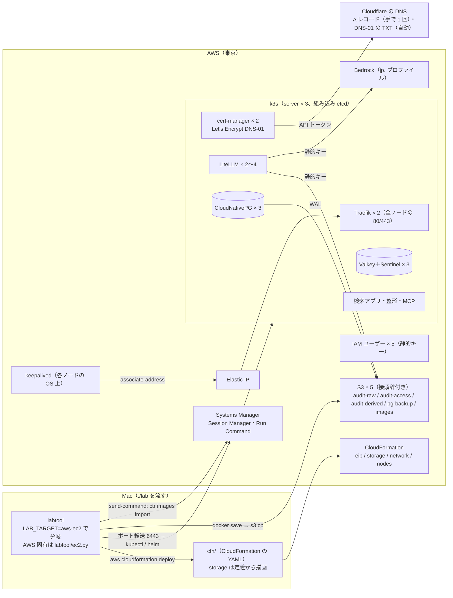

# 変更設計書: AWS の EC2 3 台と S3 だけで組む環境の追加（`LAB_TARGET=aws-ec2`）

作成: 2026-10-25
状態: 案（実装前）
対応する変更仕様書: 同じディレクトリの `変更仕様書.md`
この文書の役割: **どう作るか**（CloudFormation のスタックの分け方、k3s と keepalived の組み方、構築ツールの分岐、マニフェストの描画、環境変数）。
何を満たすかは変更仕様書に書いてある。実装と試験が済んだら `docs/design.md` に反映する（12 章）

---

## 1. 作りの全体

| 層 | 置き場 | 環境を知るか |
|---|---|---|
| 審査ガードレール、監査ログのコールバック、検索アプリ、整形 | `litellm/guardrails/`、`apps/audit/` | 知らない（EKS 版で入れた「静的キーがあれば使い、無ければ資格情報チェーン」のまま。この環境は静的キーを渡す） |
| Helm の値の骨格、マニフェスト | `litellm/values.yaml`、`k8s/*.yaml` | 知らない。環境ごとの値は labtool が重ねる |
| 構築ツール | `labtool/` | `Env.target` で分岐。`aws-ec2` 固有の処理は `labtool/ec2.py` に集める（`aws.py` は EKS 版のまま。共通の boto3 セッションと `identity()` だけ `aws.py` から借りる） |
| AWS の基盤 | `cfn/` | AWS だけ。`storage.yaml` は labtool が S3 の定義（`objectstore.py`）から `.build/cfn/storage.yaml` に描画し、ほかは静的なテンプレート |

---

## 2. 環境を知らない層の変更（3 環境で同じコード）

変更は 3 か所だけ。いずれも `local` の振る舞いは変わらない。

| 対象 | 変更 | 理由 |
|---|---|---|
| `k8s/postgres-cnpg.yaml` の `ObjectStore` | `destinationPath` のバケット名を `${S3_BUCKET_PREFIX}pg-backup` に、`endpointURL` を `${S3_ENDPOINT}` が空なら行ごと省く描画にする（`local` では今の値のまま） | AWS の S3 はエンドポイントの指定が要らず、バケット名に接頭辞が付く（EKS 版では CloudNativePG を使わなかったので未対応だった） |
| `k8s/*.yaml` の server ノード固定（cert-manager、CloudNativePG のオペレーター、Barman Cloud Plugin、Traefik、RustFS） | 変えない。固定の条件は「server ノード」のラベルで、`aws-ec2` は 3 台とも server なので全台に当たる。代わりに labtool が `aws-ec2` では **オペレーターと Traefik の replica を 2** にする（4.3） | 1 台だけで動くオペレーターの台が止まると、Pod の作り直し（既定 5 分）まで PostgreSQL の昇格が始まらない。Mac は止めない server ノードに置いて避けていた |
| イメージの参照 | `imagePullPolicy` を環境で出し分ける（`local` と `aws` は今のまま。`aws-ec2` は `Never`） | レジストリが無く、ノードに取り込んだイメージだけを使う。無ければはっきり失敗させる |

---

## 3. CloudFormation（`cfn/`）

スタックは 4 つ。接頭辞は `.env` の `LAB_AWS_STACK_PREFIX`（既定 `litellm-lab`）に `-ec2-` を挟む（EKS 版の `litellm-lab-network` などと衝突しない）。配備は `aws cloudformation deploy --no-fail-on-empty-changeset --capabilities CAPABILITY_NAMED_IAM`。

| スタック | 中身 | `./lab down` で |
|---|---|---|
| `<prefix>-ec2-eip` | Elastic IP 1 つ（`AWS::EC2::EIP`、出力 `AllocationId`、`PublicIp`） | `LAB_EC2_KEEP_EIP=true` のときだけ残す（既定は消す） |
| `<prefix>-ec2-storage` | S3 の 5 バケット、IAM ユーザー 5 つとアクセスキー、バケットポリシー（削除と保持の回避の禁止） | 空にしてから消す（IAM ユーザーとキーも消える） |
| `<prefix>-ec2-network` | VPC、公開サブネット 3 つ、IGW、ルート、セキュリティグループ 1 つ | 消す |
| `<prefix>-ec2-nodes` | EC2 3 台、インスタンスロールとプロファイル、k3s と keepalived の cloud-init | 消す |

### 3.1 `<prefix>-ec2-eip`

- 別スタックにする理由は、`nodes` と `network` を作り直しても IP が変わらず、Cloudflare の A レコードを直さずに済むため。
- `DeletionPolicy` は付けない（スタックごと消すかどうかで決める）。

### 3.2 `<prefix>-ec2-storage`（labtool が描画）

- `objectstore.py` のバケットと利用者の定義から、labtool が `.build/cfn/storage.yaml` を描く。定義の置き場を増やさないため。
- バケット名は EKS 版と同じ `<prefix>-<アカウント ID>-<バケット名>`（グローバルで一意）。`images` はこの環境だけ（ライフサイクル 7 日、バージョニング無し）。
- `audit-raw` と `audit-access` は `ObjectLockEnabled: true` と既定の保持（モードと日数は `.env`）、バージョニング有効。`audit-derived` はバージョニングと接頭辞ごとのライフサイクル。`pg-backup` は素のバケット。パブリックアクセスはすべて遮断。
- IAM ユーザーは `<prefix>-litellm-writer`、`<prefix>-audit-compactor`、`<prefix>-audit-viewer`、`<prefix>-pg-backup`、`<prefix>-litellm-bedrock`。権限は Mac の利用者表（設計書 8.3）をそのまま IAM ポリシーに写す。`litellm-bedrock` は `bedrock:InvokeModel` と `bedrock:InvokeModelWithResponseStream` を日本内の推論プロファイルと基盤モデルに限って許す。
- どのユーザーにも `s3:DeleteObject*` と `s3:BypassGovernanceRetention` を明示的に拒否する（`audit-raw`、`audit-access`）。
- アクセスキーは `AWS::IAM::AccessKey` で作り、`Outputs` に `<利用者>AccessKeyId` と `<利用者>SecretAccessKey`（`GetAtt`）を出す。出力は CloudFormation を読める人（この環境では管理者 1 人）に見える。labtool は出力を読んで Kubernetes の Secret に入れ、`.env` には書かない。
- `DeletionPolicy: Delete`。消す前に labtool が空にする（Object Lock のバケットは `BypassGovernanceRetention`。EKS 版の `purge_retained` の S3 の部分を共通化して使う）。

### 3.3 `<prefix>-ec2-network`

| 項目 | 値 |
|---|---|
| VPC | `10.60.0.0/16`（EKS 版の VPC と重ならない値。`.env` で変えられる） |
| サブネット | `10.60.1.0/24`、`10.60.2.0/24`、`10.60.3.0/24`。AZ は `Fn::GetAZs` の先頭 3 つ（このアカウントの東京は b、c、d）。公開サブネット（`MapPublicIpOnLaunch: true`） |
| NAT | 無し |
| セキュリティグループ `nodes` | 入: 80 と 443 を `0.0.0.0/0` から、同じグループからの全プロトコル（k3s の 6443・2379-2380・10250、flannel の 8472/udp、VRRP の IP プロトコル 112 をまとめて許す）。出: 全部 |

SSH と 6443 は開けない。構築ツールは Session Manager で入る。

### 3.4 `<prefix>-ec2-nodes`

| 項目 | 値 |
|---|---|
| インスタンス | 3 台、`t4g.large`（`.env` で変えられる）、AL2023 arm64（SSM の公開パラメータ `/aws/service/ami-amazon-linux-latest/al2023-ami-kernel-default-arm64` を参照）、固定のプライベート IP `10.60.1.10` / `10.60.2.10` / `10.60.3.10`、IMDSv2 必須 |
| EBS | gp3 40 GiB、暗号化、インスタンスと一緒に消える |
| インスタンスロール | `AmazonSSMManagedInstanceCore`、`ec2:AssociateAddress` / `ec2:DisassociateAddress` / `ec2:DescribeAddresses`（このリージョンに限る）、`s3:GetObject` / `s3:ListBucket`（`images` バケットだけ） |
| パラメータ | `K3sToken`（`NoEcho`。labtool が初回に生成して `.build/ec2-k3s-token` に置き、以後は同じ値を渡す）、`K3sVersion`（Mac の `K3S_IMAGE` のタグと揃える）、`EipAllocationId`、`InstanceType`、`ImagesBucket` |
| 出力 | `InstanceIds`（3 つ）、`PrivateIps` |

cloud-init（3 台で同じスクリプト。自分が何番かは固定 IP で判断）:

1. `dnf install -y keepalived awscli-2 zstd`。
2. **k3s の起こし方。** まず他の 2 台の 6443 に順に `curl -k https://<ip>:6443/ping` を試し、**誰か答えたらそこへ `server --server https://<ip>:6443` で参加**する。誰も答えず自分が 1 番なら `server --cluster-init`。誰も答えず 2 番か 3 番なら、1 番が答えるまで待ってから参加。これで初回も、1 台を作り直したときも、新しいクラスタを別に作ってしまう（分裂）ことがない。
3. k3s の引数は Mac の `k3d-config.yaml` と同じにする: `--kube-apiserver-arg default-not-ready-toleration-seconds=30`、`default-unreachable-toleration-seconds=30`、`--kube-controller-manager-arg node-monitor-grace-period=20s`（ノードが止まったら 30 秒で Pod を移す）。Traefik と ServiceLB は同梱のものを使う（`--disable` しない）。`--tls-san` は不要（k3s の証明書に `127.0.0.1` と `localhost` が入っていて、ポート転送で届く）。
4. keepalived（3.5）を設定して起動。
5. 終わったら `/var/lib/lab/ready` を置く（labtool の待ち合わせの印）。

### 3.5 keepalived（Elastic IP の持ち主を決める）

| 項目 | 値 |
|---|---|
| 方式 | VRRP のユニキャスト（`unicast_src_ip` 自分、`unicast_peer` 他の 2 台）。AWS はマルチキャストが通らない |
| 状態と優先度 | 3 台とも `state BACKUP`、`nopreempt`。優先度 150 / 100 / 50。**戻った台が奪い返さない**（揺れを防ぐ） |
| 健全性の検査（`track_script`） | 2 秒ごとに `systemctl is-active k3s` と、ローカルの 443 への TCP 接続。失敗が 3 回続けば優先度を 100 下げて主系を譲る |
| 主系になったとき（`notify_master`） | IMDSv2 で自分のインスタンス ID を取り、`aws ec2 associate-address --allocation-id <EipAllocationId> --instance-id <自分> --allow-reassociation`。失敗したら 5 秒おきに 6 回まで繰り返す |
| 仮想 IP | VRRP の `virtual_ipaddress` には使わないダミーのリンクローカル（`169.254.60.1/32`）を置く。実際の経路は Elastic IP の付け替えで切り替わり、サブネットの中の IP は動かさない |

Traefik は k3s の ServiceLB が 3 台すべての 80 と 443 を Traefik の Service に転送するので、Elastic IP がどの台に付いても届く。Traefik の Pod 自体は replica 2 にして、Pod が載った台が止まっても Service の宛先が残るようにする（2 章）。

---

## 4. 構築ツール（`labtool/`）

### 4.1 共通部分（`core.py`）

- `Env.target` は `local` / `aws` / `aws-ec2` の 3 値。`is_aws`（EKS 版）はそのまま、`is_aws_ec2` を足す。「AWS のどちらか」が要る場所（ホスト名、Bedrock のモデル、`https://`）は `is_aws or is_aws_ec2` をまとめた `on_aws` を使う。
- kube のコンテキストは `aws-ec2` では `litellm-lab-ec2`（EKS 版は `litellm-lab-aws`、Mac は `k3d-litellm`）。
- `.env` の必須項目: `LAB_AWS_PROFILE`、`LAB_AWS_HOSTNAME`、`LAB_CLOUDFLARE_API_TOKEN`（6 章）。

### 4.2 `aws-ec2` 固有の部品（`ec2.py`、新規）

| 関数 | 役割 |
|---|---|
| `deploy(env, stacks)` | `cfn/` のテンプレート（`storage` は描画してから）を `aws cloudformation deploy` で順に配備（eip → storage → network → nodes）。出力を `.build/ec2-outputs.json` に保存 |
| `outputs(env)` / `load_outputs(env)` | 4 スタックの出力をまとめて返す（EKS 版と同じ形） |
| `wait_nodes_ready(env, out)` | 3 台が SSM で `Online` になり、`/var/lib/lab/ready` があるまで待つ（`send-command` で確かめる。最長 10 分） |
| `fetch_kubeconfig(env, out)` | 生きている台 1 つに `send-command` で `/etc/rancher/k3s/k3s.yaml` を読み、`server` を `https://127.0.0.1:<LAB_EC2_LOCAL_PORT>` に書き換えてコンテキスト `litellm-lab-ec2` として `~/.kube/config` に合流 |
| `api_forward(env, out)` | `aws ssm start-session --document-name AWS-StartPortForwardingSession`（6443 → ローカルのポート）を背景で張り、`kubectl get --raw /readyz` が通るまで待つ。`with` で使い、終わりに閉じる。相手は SSM で `Online` の台の先頭（1 番が止まっていても別の台につなぐ）。切れたら 1 回だけ張り直し、だめなら「Session Manager の接続が切れました」で止める |
| `publish_image(env, out, image)` | `docker save <name>:<tag> | zstd` を `s3://<images>/<name>-<tag>.tar.zst` に上げる（既にあれば飛ばす） |
| `import_image(env, out, image)` | 3 台に `send-command`（`AWS-RunShellScript`）で `aws s3 cp ... - | zstd -d | k3s ctr images import -` を流し、`k3s ctr images ls -q` にタグがあることを確かめる。既にある台は飛ばす |
| `stop_node(env, instance_id)` / `start_node(...)` | 障害試験で EC2 を止める・起こす（`stop-instances` → `stopped` を待つ） |
| `eip_holder(env, out)` | `describe-addresses` で Elastic IP が付いているインスタンス ID |
| `empty_buckets(env, out)` / `destroy(env, stacks)` | S3 を空にし（Object Lock は `BypassGovernanceRetention`）、スタックを nodes → network → storage →（eip）の順に消す。EKS 版 `purge_retained` の S3 の部分を `aws.py` から共通の関数にして使う |
| `save_tls_secret(env)` / `restore_tls_secret(env)` | 証明書の Secret `litellm-tls` を `.build/ec2-tls-secret.json` に退避・復元（Let's Encrypt の上限を避ける） |

`preflight` で確かめるもの: `aws`（v2）、`session-manager-plugin`、`zstd`、`docker`、`kubectl`、`helm`、資格情報、`LAB_AWS_HOSTNAME`、`LAB_CLOUDFLARE_API_TOKEN`。

### 4.3 段階ごとの分岐（`stages.py`）

| 段階 | Mac（変えない） | `aws-ec2` |
|---|---|---|
| preflight | k3d、kubectl cnpg、Docker、ポート | 4.2 の確認。`LAB_AWS_ACCOUNT` と `LAB_AWS_BUCKET_PREFIX` を Env に載せる（EKS 版と同じ） |
| cluster | k3d、Traefik、namespace、SA、オペレーター | `ec2.deploy()` → `wait_nodes_ready` → `fetch_kubeconfig` → `api_forward`（以降の段階はこの転送の中で動く）→ Traefik の設定（Mac と同じ `traefik-config.yaml` ＋ `deployment.replicas: 2`）→ namespace → SA → オペレーター（cert-manager と CloudNativePG のオペレーターは `replicaCount: 2`。Barman Cloud Plugin は 1）→ `ClusterIssuer letsencrypt`（4.6） |
| images | ビルド → k3d のレジストリ | `--platform linux/arm64` でビルド（Mac は arm64 なのでそのまま）→ `publish_image` → `import_image`。イメージ名は `litellm-lab/<名前>:<タグ>`（レジストリ無し）、`imagePullPolicy: Never` |
| secrets | `.env` の空の値を生成 → Secret | **Mac と同じ関数**を通す。違いは、RustFS の管理者キーを生成しない、S3 の利用者のキー（`render.s3_env_names(user)` の名前）を生成せず CloudFormation の出力から Env に載せる（`.env` には書かない）、`rustfs` の Secret を作らない、`litellm-secrets` に `BEDROCK_ACCESS_KEY_ID` / `BEDROCK_SECRET_ACCESS_KEY` を足す、cert-manager の名前空間に `cloudflare-api-token` を作る |
| objectstore | RustFS を作り、検査 | `objstore.check_buckets()`（EKS 版）＋ **Mac と同じ利用者ごとの許可・拒否の検査**（静的キーがあるので `self_check` をそのまま流す。エンドポイントは AWS の S3） |
| datastores | CloudNativePG、Valkey ＋ Sentinel | **Mac と同じ**。`S3_ENDPOINT` を空、`S3_BUCKET_PREFIX` を接頭辞にして描画（2 章）。`pg-backup-s3` の Secret は IAM ユーザーのキー |
| mcp | 同じ | 同じ |
| litellm | ConfigMap → 移行 Job → helm → Traefik の入口 | ConfigMap（モデルは Bedrock。4.5）→ 移行 Job → helm（`helm_overrides` の `aws-ec2` 分岐: イメージ名、`imagePullPolicy`、Sentinel の環境変数は Mac と同じ）→ Traefik の入口（Mac と同じ `ingress.yaml`）＋ TLS の経路と証明書（4.6）→ 証明書が `Ready` になるまで待つ → `https://<ホスト名>/health/liveliness` |
| bootstrap | 同じ | 同じ |
| audit | compactor、初期値（port-forward）、viewer | 同じ（`S3_ENDPOINT` 空、`S3_BUCKET_PREFIX`。EKS 版の分岐を `on_aws` にする） |
| clients | `http://localhost` | `https://<ホスト名>`（EKS 版と同じ分岐を `on_aws` に） |
| down | k3d を消す | `save_tls_secret` → `ec2.destroy()`（nodes → network → storage。`LAB_EC2_KEEP_EIP` でなければ eip も）。残るのは A レコードと `.build/` の退避だけ |

### 4.4 Secret の対応

Mac の Secret の名前とキーをそのまま使う。値の出どころだけが違う。

| Secret | Mac | `aws-ec2` |
|---|---|---|
| `litellm-pg-app`、`litellm-migrate-db`、`valkey`、`audit-viewer-session`、`audit-viewer-oidc` | `.env`（生成） | 同じ |
| `pg-backup-s3`、`audit-compactor-s3`、`audit-viewer-s3` | `.env`（生成した RustFS の利用者） | CloudFormation の出力（IAM ユーザーのキー） |
| `litellm-secrets` | `.env` ＋ `litellm-writer` の RustFS のキー | `.env` ＋ `litellm-writer` の IAM のキー ＋ `BEDROCK_ACCESS_KEY_ID` / `BEDROCK_SECRET_ACCESS_KEY` |
| `rustfs` | 作る | 作らない |
| `cloudflare-api-token`（`cert-manager` の名前空間） | 無し | `.env` の `LAB_CLOUDFLARE_API_TOKEN` |
| `litellm-tls`（`litellm-lab`） | 無し | cert-manager が作る。`./lab down` で退避、`up` で復元 |

### 4.5 LiteLLM の設定（`render.py`）

- モデルは EKS 版の `aws` 分岐と同じ（Claude Code 用は Bedrock の Claude、審査官は Bedrock の Haiku 4.5、Jev 無し）。`has_chatgpt` は `aws-ec2` では常に偽（`chatgpt/` を置かない。変更仕様書 4.2）。
- Bedrock の資格情報は各モデルの `litellm_params` に `aws_access_key_id: os.environ/BEDROCK_ACCESS_KEY_ID`、`aws_secret_access_key: os.environ/BEDROCK_SECRET_ACCESS_KEY`、`aws_region_name` を明示する。`AWS_ACCESS_KEY_ID` の名前は使わない（監査ログの S3 クライアントと混ざるのを避ける）。
- Redis は Mac と同じ Sentinel の設定。

### 4.6 入口の TLS（`render.ec2_tls_manifest`、新規）

| 物 | 内容 |
|---|---|
| `ClusterIssuer letsencrypt` | ACME（`LAB_ACME_STAGING=true` なら staging の URL）、DNS-01 の Cloudflare solver、`apiTokenSecretRef` は `cloudflare-api-token`。メールは `LAB_ACME_EMAIL` |
| `Certificate litellm-tls` | `dnsNames: [<ホスト名>]`、`secretName: litellm-tls`、`cert-manager` が 30 日前に更新 |
| Traefik | Mac の `ingress.yaml` の `IngressRoute litellm` に、`websecure` の経路（同じ `routes`、`tls.secretName: litellm-tls`）を足し、`web` の経路は 301 で `https://` に転送する `Middleware redirect-https` だけにする。経路と遮断の対象（`deny-all`、`mcp-get-not-allowed`、`litellm-retry`、`litellm-fast-dial`）は共通の描画を使う |

Cloudflare の API トークンは「Zone / DNS / Edit」をそのゾーンに限って発行したもの。`.env` に書く（公開しない）。

---

## 5. 障害の試験（`failover.py`）

| 場面（`aws-ec2`） | 起こし方 | 合格の目安 |
|---|---|---|
| `pg-switchover`、`pg-pod`、`valkey-pod` | Mac と同じ | Mac と同じ（60 秒） |
| `pg-node`、`valkey-node` | `_stop_node` の `aws-ec2` 分岐: Pod が載ったノードのインスタンスを `stop-instances`、120 秒後に `start-instances` | 120 秒 |
| `eip-node`（新規） | `eip_holder` のインスタンスを止め、120 秒後に起こす。負荷は Elastic IP 宛て（ほかの場面と同じ） | 30 秒以内に別の台が Elastic IP を持ち要求が通る。戻った台が奪い返さない（`eip_holder` が変わらない） |

`_move_pg_primary_off_server` などの「server ノードから退避」は `aws-ec2` では不要なので飛ばす。健全性（`healthy`）は Mac と同じ（PostgreSQL と Valkey の Pod がそろい、LiteLLM の rollout が済む）。`SCENARIOS_AWS`（EKS 版）は `aws-ec2` では使えないと止める。負荷の宛先は `https://<ホスト名>`。

---

## 6. `.env` の項目（`aws-ec2`）

EKS 版の項目（`LAB_AWS_PROFILE`、`LAB_AWS_REGION`、`LAB_AWS_HOSTNAME`、`LAB_AWS_STACK_PREFIX`、`LAB_BEDROCK_*`、`LAB_AWS_JUDGE_MODEL`）はそのまま使う。足すもの:

| 項目 | 既定 | 意味 |
|---|---|---|
| `LAB_TARGET` | `local` | `aws-ec2` を足す |
| `LAB_EC2_INSTANCE_TYPE` | `t4g.large` | 3 台の種類 |
| `LAB_EC2_VPC_CIDR` | `10.60.0.0/16` | |
| `LAB_EC2_K3S_VERSION` | Mac の `K3S_IMAGE` のタグ | 1 か所で持つ（`core.py` の定数から） |
| `LAB_EC2_LOCAL_PORT` | `16443` | ポート転送のローカル側 |
| `LAB_EC2_KEEP_EIP` | `false` | `./lab down` で Elastic IP を残すか |
| `LAB_CLOUDFLARE_API_TOKEN` | （必須） | DNS-01 用 |
| `LAB_ACME_EMAIL` | （必須） | Let's Encrypt の連絡先 |
| `LAB_ACME_STAGING` | `false` | 試験中は staging で上限を避ける |

Env に載るだけで `.env` に書かないもの: `LAB_AWS_ACCOUNT`、`LAB_AWS_BUCKET_PREFIX`、IAM ユーザーのキー（CloudFormation の出力）。使わなくなる EKS 版の項目（`LAB_AWS_ALB_SCHEME`、Aurora、Valkey、NAT、EKS）は `aws-ec2` では読まない。

---

## 7. 手作業の時点

| いつ | 何 | 誰が |
|---|---|---|
| `./lab up` の前（1 回） | `aws sso login --profile <名前>`（Identity Center は済み）。Session Manager plugin の導入（`brew install --cask session-manager-plugin`） | 人 |
| `./lab up` の前（1 回） | Cloudflare で API トークン（Zone / DNS / Edit、そのゾーンだけ）を発行して `.env` に書く | 人 |
| `./lab up` の前（1 回） | Bedrock のモデルアクセス（アカウントの制限の解除待ち） | 人 |
| `./lab cluster` の `eip` の配備の後 | Elastic IP への A レコードを Cloudflare に足す（DNS のみ。プロキシは使わない）。labtool が IP を表示して待つ | 人 |
| 証明書の発行 | DNS-01 の TXT は cert-manager が自動 | 自動 |
| `./lab down` の後（Elastic IP を消したとき） | 次の `up` で IP が変わるので A レコードを直す | 人 |

---

## 8. 費用の目安を決めるもの（検証規模）

| 部品 | 常時か | 下げ方 |
|---|---|---|
| EC2 `t4g.large` × 3 | 動かしている間 | `./lab down`。`t4g.medium` にすれば半分（配置表の合計がぎりぎり） |
| EBS gp3 40 GiB × 3 | 同上 | 同上 |
| パブリック IPv4 × 4（3 台 ＋ Elastic IP） | 同上 | Elastic IP を残すと、付いていない間も料金が出る |
| S3（監査ログ、WAL、イメージ） | 容量 | 小さい |
| Bedrock | 従量 | — |
| Systems Manager、CloudFormation、IAM | 無料 | — |

価格は配備の前に価格表で確かめて応答で報告し、`docs/spec.md` の反映時に実測を書く。

---

## 9. 試験

| 試験 | Mac | `aws-ec2` |
|---|---|---|
| 単体（labtool、監査アプリ、監査ログ） | 既存 | `ec2.py` の純粋な部分（出力の整形、cloud-init の描画、storage の描画、kubeconfig の書き換え）に単体試験を足す。`local` と `aws` の分岐が変わらないことを既存の試験で確かめる |
| CloudFormation のテンプレート | — | `aws cloudformation validate-template` と cfn-lint を単体試験から流す（資格情報が無ければ cfn-lint だけ） |
| `./lab up` を Mac に流し直し | 流す（`local` が変わらないこと） | — |
| `./lab test-smoke` / `test-idempotency` / `test-audit` / `test-judge` | 流す | 流す。`test-audit` は Mac と同じ全項目（利用者ごとの拒否を含む） |
| `./lab test-failover` | `pg-*`、`valkey-*` | `pg-switchover`、`pg-pod`、`valkey-pod`、`pg-node`、`valkey-node`、`eip-node` |
| 1 台を止めたまま `./lab up` | — | 通ること |
| `./lab down` → `up` | — | 有料の部品が消え、作り直せること。Elastic IP を残した場合は A レコードを直さずに届くこと |

---

## 10. 分かっていること・残していること

- **2 台だけでは組めない理由**（検討の記録）: k3s の組み込み etcd、CloudNativePG、Sentinel は多数決が要る。2 台で済ませるには S3 の条件付き書き込みで主系の札を自作し、Docker Compose に書き直す必要があった。3 台にして Mac の構成をそのまま使う。
- **cloud-init で参加先を探す順**（3.4）は、1 台を作り直したときに新しいクラスタを別に作らないための決まり。3 台を同時に作り直すときだけ 1 番が `--cluster-init` になる。
- **Pod Identity 相当は k3s に無い。** ServiceAccount のトークンを IAM の OIDC で信頼させる方式（IRSA 相当）は、k3s の OIDC の公開文書を S3 に置き IAM の ID プロバイダーを作れば組めるが、手順が増えるので採らなかった（ユーザー回答 3B）。本番で静的キーを無くすならこの方式。
- **`chatgpt/` のトークンの共有先が無い**（EKS 版は EFS）。`aws-ec2` では置かない（変更仕様書 13 章の前提）。
- **Let's Encrypt の上限**は証明書の Secret の退避・復元で避ける。試験の繰り返しの間は `LAB_ACME_STAGING=true` にする（ブラウザに警告は出るが curl は `-k` で通る）。
- **keepalived の `nopreempt`** は 3 台とも `state BACKUP` でないと効かない。優先度の差は最初の持ち主を決めるためだけに使う。
- **EC2 の API による付け替えの遅さ**は実測で確かめる（目安 5〜15 秒）。VRRP の検知（約 3 秒）と合わせて 30 秒以内を目標にする。
- **アカウントの制限**（EC2 の vCPU 上限 0、Bedrock の `Error 002`）が解けるまで配備できない。コードと単体試験、テンプレートの検査まで先に進める。

---

## 11. 参考資料

変更仕様書 11 章に加えて:

- [k3s の server の引数（`--cluster-init`、`--server`、`--kube-apiserver-arg`）](https://docs.k3s.io/cli/server) / [k3s の証明書の SAN](https://docs.k3s.io/cli/server#listener)
- [k3s: Traefik の HelmChartConfig（replicas など）](https://docs.k3s.io/helm#customizing-packaged-components-with-helmchartconfig)
- [CloudNativePG: オペレーターの replica とリーダー選出](https://cloudnative-pg.io/documentation/current/installation_upgrade/) / [Barman Cloud Plugin の `ObjectStore`（S3、`endpointURL` 省略）](https://cloudnative-pg.io/plugin-barman-cloud/docs/object_stores/)
- [cert-manager: ACME の ClusterIssuer と Cloudflare](https://cert-manager.io/docs/configuration/acme/dns01/cloudflare/) / [既存の Secret の再利用](https://cert-manager.io/docs/usage/certificate/#renewal)
- [keepalived: `nopreempt`、`track_script`、`notify_master`](https://keepalived.readthedocs.io/en/latest/configuration_synopsis.html)
- [Session Manager plugin の導入](https://docs.aws.amazon.com/systems-manager/latest/userguide/session-manager-working-with-install-plugin.html) / [Run Command の出力の上限（24,000 文字）](https://docs.aws.amazon.com/systems-manager/latest/userguide/run-command.html)
- [AL2023 の AMI の SSM パラメータ](https://docs.aws.amazon.com/linux/al2023/ug/ec2.html#launch-from-ec2-console)
- [`k3s ctr images import`（containerd のイメージの取り込み）](https://docs.k3s.io/installation/airgap#manually-deploy-images-method)
- [LiteLLM: Bedrock の資格情報を `litellm_params` で渡す](https://docs.litellm.ai/docs/providers/bedrock#set-aws-credentials-in-config)
- [CloudFormation `aws cloudformation deploy`（`--no-fail-on-empty-changeset`）](https://docs.aws.amazon.com/cli/latest/reference/cloudformation/deploy.html)

---

## 12. `docs/design.md` への反映の仕方（試験の後）

| 章 | 変更 |
|---|---|
| 1.1 バージョン | k3s（EC2 上）、keepalived、cert-manager の ACME の版 |
| 2. 全体構成 | 1 章の図を足す（Mac、EKS 版と並べる） |
| 3. リポジトリ構成 | `labtool/ec2.py`、`cfn/` |
| 4. 構築の流れ | `aws-ec2` の流れ（4.3 の表） |
| 5. Kubernetes の構成 | 5.1 に EC2 上の k3s の起こし方、5.2 に Traefik の replica、5.4 の配置表に `aws-ec2` の列（全台 server、オペレーター 2） |
| 6. LiteLLM | 6.3 に Bedrock の資格情報の渡し方、6.4 に環境変数 |
| 7. PostgreSQL と Valkey | 7.2 のバックアップの宛先（S3、接頭辞、`endpointURL` 省略） |
| 8. オブジェクトストレージ | S3 と IAM ユーザー（静的キー）の節 |
| 新しい節: 入口 | keepalived と Elastic IP、Let's Encrypt |
| 16. 試験 | `aws-ec2` の結果（`eip-node` を含む） |
| 17. 冪等性 | CloudFormation の配備、イメージの取り込み、証明書の退避 |
| 18. 実装で分かったこと | 10 章 |
| 新しい章: AWS の EC2 3 台の環境 | 3〜8 章 |
