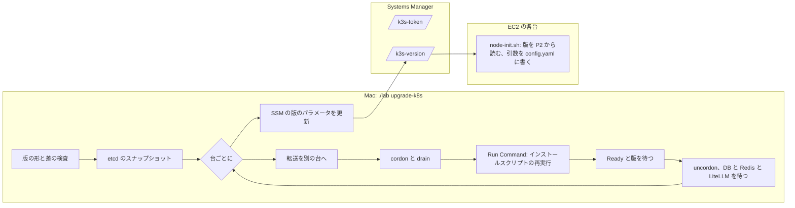

# 変更設計書: EC2 3 台の k3s（Kubernetes）を無停止で上げる手順と、AMI の固定

作成: 2026-10-26
状態: 実装済み（単体試験 68 本、cfn-lint と `validate-template` が通る。AWS への配備と試験は EC2 3 台の環境の配備の後）
対応する変更仕様書: 同じディレクトリの `変更仕様書.md`
元になる設計: `.history/2026-10-25-EC2三台構成/変更設計書.md`（3.4 節の nodes スタックと cloud-init、4.2 節の `ec2.py` をこの文書で変える）
この文書の役割: **どう作るか**。実装と試験が済んだら `docs/design.md` に反映する（7 章）

---

## 1. 変更の全体

変えるものは 4 つ。

| # | 変更 | 要件 |
|---|---|---|
| 1 | nodes スタック: AMI を固定の ID で受ける。k3s の版を user data から外し、SSM のパラメータ名だけを渡す | R11〜R14 |
| 2 | `cfn/node-init.sh`: 版を SSM から読む。k3s の引数を `/etc/rancher/k3s/config.yaml` に書き、インストールスクリプトには `server` だけ渡す | R8、R11 |
| 3 | `labtool/ec2.py` と `ops.py`、`lab`: `./lab upgrade-k8s <版> [--measure]`。版の検査、順序、転送の張り直し、drain、再実行、待ち、パラメータの更新。`./lab cluster` の版の食い違いの検知 | R1〜R10 |
| 4 | `render.litellm_pdb_manifest`: LiteLLM の PodDisruptionBudget（3 環境） | R15 |

---

## 2. CloudFormation（`labtool/cfn.py`）

### 2.1 AMI の固定（R12〜R14）

| 項目 | 変更前 | 変更後 |
|---|---|---|
| `AmiId` パラメータ | `AWS::SSM::Parameter::Value<AWS::EC2::Image::Id>`、既定値は `/aws/service/ami-amazon-linux-latest/al2023-ami-kernel-default-arm64`。配備のたびに解き直され、値が変わると `ImageId` の更新（Replacement）になる | `AWS::EC2::Image::Id`（既定値なし）。`ec2.resolve_ami` が値を渡す |
| `ec2.resolve_ami(env)` | — | nodes スタックがあれば **その `AmiId` パラメータの今の値**（置き換えを起こさない）。無ければ SSM の公開パラメータを `get-parameter` で解いて使う（初回は最新。`./lab down` → `up` でも新しくなる） |

AMI を新しくする手順（台を 1 台ずつ作り直す）はこの変更の対象外（BACKLOG）。

### 2.2 k3s の版を user data から外す（R11）

| 項目 | 変更前 | 変更後 |
|---|---|---|
| `node-init.sh` の置き換え | `@@K3S_VERSION@@`（`v1.35.5+k3s1`） | `@@VERSION_PARAM@@`（SSM のパラメータ名 `/<prefix>-ec2/k3s-version`） |
| インスタンスロール | `ssm:GetParameter` は参加トークンのパラメータだけ | 参加トークンと版の 2 つのパラメータ |
| `nodes_template(env, token_param, eip_allocation_id, script=None, version_param="")`、`templates(..., version_param="")`、`render_node_init(..., version_param="")` | — | 引数を足した（既存の呼び方は壊さない） |

版を上げても user data は変わらないので、nodes スタックに差分が出ない。コードの版（`core.K3S_IMAGE`）はテンプレートに入らず、`ec2.ensure_version_parameter` が初回にパラメータの値にするだけ。

---

## 3. `cfn/node-init.sh`

| 手順 | 変更前 | 変更後 |
|---|---|---|
| 版 | 置き換え済みの固定値 | `aws ssm get-parameter --name "$VERSION_PARAM"` で読む。`./lab upgrade-k8s` が上げた後に作り直した台も新しい版で参加する（R8） |
| 引数 | `k3s server --node-ip … --kube-apiserver-arg=… --cluster-init` または `--server https://<参加先>:6443` をコマンドラインで | `/etc/rancher/k3s/config.yaml`（mode 600）に `node-ip`、`kube-apiserver-arg`（2 つ）、`kube-controller-manager-arg`、`cluster-init: true` または `server: https://<参加先>:6443` を書き、インストールスクリプトには `sh -s - server` だけ渡す |
| トークン | `K3S_TOKEN` 環境変数（インストールスクリプトが `k3s.service.env` に書く） | 同じ。参加のときだけ要る。k3s は `server/token` に保存するので、再起動と版上げでは渡さない |

k3s の文書は「インストールスクリプトを再実行するときは元と同じ設定で。省くと元の値は失われる」とし、設定ファイルを勧めている。設定ファイルはスクリプトが触らないので、版上げの再実行（4.3）は `INSTALL_K3S_VERSION` と `server` だけで済む。`server:` と `cluster-init` は etcd のデータがある台の再起動では無視される（k3s の挙動。配備で確かめる。6 章）。

---

## 4. 構築ツール

### 4.1 `ec2.py` に足した関数

| 関数 | 役割 |
|---|---|
| `version_parameter(env)` | `/<prefix>-ec2/k3s-version` |
| `ensure_version_parameter(env) -> str` | 無ければコードの版（`cfn.k3s_install_version()`）で作る。あれば今の値を返す（上書きしない） |
| `set_version_parameter(env, version)` | 上げ終わった後に更新（`Overwrite=True`） |
| `resolve_ami(env)` | 2.1 |
| `parse_k3s_version(text)` / `normalize_k3s_version(text)` | `v1.36.1+k3s1`（`-k3s1` も受けて `+k3s1` にそろえる）→ `(1, 36, 1)`。形が違えば `LabError` |
| `check_upgrade_step(current, target)` | マイナー版は 1 つずつ、下げない（R2）。同じマイナー版のパッチは可 |
| `upgrade_order(instance_ids, eip_holder, forward_target=None)` | Elastic IP の台は最後、転送先の台はその前（R5、張り直しを 1 回に） |
| `forward_target()` | 転送先のインスタンス ID（`.build/ec2-forward.target`。`ensure_forward` が書き、`stop_forward` が消す） |
| `ensure_forward(env, avoid=None)` | 既存に `avoid` を足した。転送が生きていても `avoid` の台に張ってあれば、別の Online の台へ張り直す（R6） |
| `node_versions()` | ノード名 → kubelet の版（`v1.35.5+k3s1`） |
| `etcd_snapshot(env, instance_id, name)` | Run Command で `k3s etcd-snapshot save --name <名前>`（その台の `/var/lib/rancher/k3s/server/db/snapshots/`）（R3） |
| `drain_node(node)` | `kubectl cordon` → `kubectl drain --ignore-daemonsets --delete-emptydir-data --timeout=600s`。PDB（PostgreSQL、Valkey、LiteLLM）を守って 1 つずつ動く。CloudNativePG は primary なら先に切り替える（オペレーターの挙動） |
| `install_k3s(env, instance_id, version)` | Run Command で `curl -sfL https://get.k3s.io \| INSTALL_K3S_VERSION='<版>' sh -s - server`（timeout 600 秒）。binary を置き替え、k3s を再起動する。引数は `config.yaml` から |
| `wait_node_version(node, version)` | kubelet の版が新しくなり、Ready になるまで（最長 600 秒） |
| `uncordon_node(node)` | `kubectl uncordon` |
| `destroy` | SSM の版のパラメータも消す |

`deploy(env, ident)` は、`ensure_version_parameter` の値とコードの版が違えば `LabError` で止める（R9。案内: 上げるなら `./lab upgrade-k8s <コードの版>`、戻すなら `core.py` の `K3S_IMAGE` を配備済みの版に）。`AmiId` を `resolve_ami` の値で渡す。

### 4.2 `ops.upgrade_k8s(env, version, measure=False)`（`./lab upgrade-k8s`）

1. `aws-ec2` でなければ止める（Mac は `K3S_IMAGE` を変えて `./lab rebuild`、EKS 版は CDK の版）。
2. `normalize_k3s_version`、`ensure_forward`、`node_versions`。3 台そろっていなければ止める。**いちばん古い台の版**から `check_upgrade_step`（途中で止まった後の再実行で、混ざった版でも進める。R7）。3 台とも目標の版なら、パラメータだけ更新して終わる。
3. `eip_holder`、`upgrade_order(instance_ids, holder, forward_target())`。`failover.wait_healthy`（PostgreSQL 3 台、Sentinel の一致、LiteLLM の rollout）。
4. `etcd_snapshot(順の最後の台, "lab-pre-upgrade-<日時>")`。
5. 目標の版でない台（`todo`）と終了見込み（1 台 8 分で計算した時刻）を表示。
6. `--measure` なら `failover.Load`（偽 LLM `fake-tools` へ毎秒 20 件）を開始し、10 秒の平常時を取る。
7. 台ごとに: `ensure_forward(avoid=その台)` → `drain_node` → `install_k3s` → `wait_node_version` → `uncordon_node` → `failover.wait_healthy` → `kube-system` の `deploy/traefik` の rollout（k3s 同梱の Traefik が一緒に上がる）→ 完了の表示。
8. `--measure` なら最後の台の後に 20 秒取ってから止める。
9. `set_version_parameter(target)`。
10. 結果: 上げた台、所要秒、LiteLLM の Pod の繰り返し再起動（障害の試験と同じ計算）、`--measure` なら要求数・失敗数・状態コード・失敗が散らばった幅（秒）。
11. 目標の版がコードの版（`cfn.k3s_install_version()`）と違えば、`core.py` の `K3S_IMAGE` を `rancher/k3s:<版>-k3s1` の形に変えてコミットするよう警告（変えないと次の `./lab up` が R9 で止まる。Mac の k3d も同じ版になる）。

途中で止まったとき: cordon したままの台が残ることがある。再実行すると、その台は版が古いので `todo` に入り、drain から進む。cordon だけ解きたいときは `kubectl uncordon <ノード>`。

### 4.3 `lab`

`upgrade-k8s <版> [--measure]` を足した。説明は「aws-ec2: k3s（Kubernetes）を 1 台ずつ上げる（マイナー版は 1 つずつ）」。

### 4.4 LiteLLM の PodDisruptionBudget（`render.litellm_pdb_manifest`、`stages.litellm`）

`policy/v1` の `PodDisruptionBudget litellm`（`minAvailable: 1`、selector は `app.kubernetes.io/name: litellm`。Helm チャートの Pod のラベルと、`litellm/values.yaml` の topologySpread と同じ）。`stages.litellm` が LiteLLM の rollout の後に `kapply` する（3 環境で同じ）。ノードの故障（追い出しではない）には効かない。

---

## 5. 試験

| 試験 | 内容 | 結果 |
|---|---|---|
| 単体 | `Ec2TargetTest` に 3 本（版の形と差の規則、上げる順、PDB のマニフェスト）、`CfnTemplateTest` を更新（`AmiId` の型、user data に版が無い、`ssm:GetParameter` の資源 2 つ、`node-init.sh` の `config.yaml` と `sh -s - server`） | 68 本が通る（2026-10-26） |
| CloudFormation のテンプレート | 見本の値で 4 つを生成（user data 7,175 バイト／台）、cfn-lint、`aws cloudformation validate-template` | 指摘なし、4 つとも有効。nodes のパラメータは `AmiId`、`InstanceType`、`SecurityGroupId`、`Subnet1Id`〜`3Id` |
| `cfn/node-init.sh` | `bash -n` | 通る |
| `./lab -h`、`./lab upgrade-k8s -h` | 引数の解釈 | 通る |
| 配備後 | 変更仕様書 4 章の検証項目 | 未実施（EC2 3 台の環境の配備の後） |

---

## 6. 分かっていること・残していること（配備で確かめること）

- **`config.yaml` の `server:` と `cluster-init`** が、etcd のデータがある台の再起動と版上げで無視されること（k3s の挙動の前提）。無視されなければ、`node-init.sh` の最後で `server:` と `cluster-init` の行を消す。
- **drain の時間**。CloudNativePG の primary の切り替え（`switchoverDelay` 20 秒）、Valkey の primary の昇格（5 秒 ＋ 同期）、LiteLLM の終了の猶予（既定 30 秒）、local-path の Pod（追い出せるが台が戻るまで Pending）。`--timeout=600s` で足りるかを実測する。
- **インストールスクリプトの再実行が `k3s.service.env` を書き換える**こと（`K3S_TOKEN` が消える）。server は `server/token` から読むので動く前提。動かなければ `install_k3s` で `K3S_TOKEN` を SSM から読んで渡す。
- **Run Command の中で k3s を再起動**しても Run Command 自体（SSM Agent）は k3s と無関係なので続く前提。
- **Traefik の値の形**が新しい k3s 同梱のチャートで変わっていないか（2026-10-25 の設計書 10 章の (2) と同じ）。
- **Elastic IP の移動**: 最後の台の drain で Traefik の Pod が消え、keepalived の健全性検査が落ちて移る（6 秒 ＋ API）。drain の前に `lab-take-eip.sh` を別の台で先に流す手も取れるが、まず自然に移るのを実測する。
- **AMI を新しくする手順**（1 台ずつ作り直す）は未実装。`resolve_ami` が今の値を返し続けるので、放っておくと AMI が古くなる。BACKLOG。

---

## 7. `docs/design.md` への反映の仕方（配備と試験の後）

| 章 | 変更 |
|---|---|
| EC2 3 台の環境の章（2026-10-25 の設計書 12 章で足す章） | nodes スタックの `AmiId` の受け方と `resolve_ami`、k3s の版のパラメータ、`node-init.sh` の `config.yaml`、`ec2.py` の版上げの関数（4.1）、`upgrade-k8s` の手順（4.2） |
| 7.5 ローリング更新（LiteLLM の `./lab upgrade`） | Kubernetes の版上げ（`./lab upgrade-k8s`）を併記 |
| 16.5 試験の結果 | 変更仕様書 4 章の実測 |
| `docs/maintenance.md` 3.3（k3s の行）と 4 章 | `aws-ec2` では 1 台ずつ上げられること、LiteLLM の PDB を足したこと |

---

## 8. 参考資料

変更仕様書 7 章に加えて:

- [k3s: 設定ファイル（`/etc/rancher/k3s/config.yaml`）](https://docs.k3s.io/installation/configuration#configuration-file)
- [k3s: etcd のスナップショット（`k3s etcd-snapshot save`）](https://docs.k3s.io/datastore/backup-restore)
- [Kubernetes: `kubectl drain` と PodDisruptionBudget](https://kubernetes.io/docs/tasks/administer-cluster/safely-drain-node/)
- [CloudNativePG: Kubernetes Upgrade and Maintenance（drain で primary を先に切り替える、PDB）](https://cloudnative-pg.io/docs/1.28/kubernetes_upgrade)
- [CloudFormation: `AWS::EC2::Image::Id` パラメータ型](https://docs.aws.amazon.com/AWSCloudFormation/latest/UserGuide/parameters-section-structure.html#aws-specific-parameter-types)
