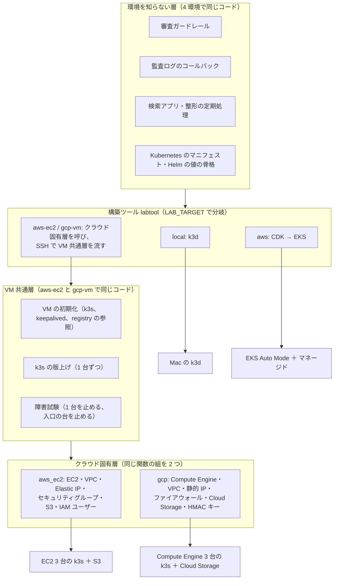

# 変更仕様書: VM 3 台の環境の共通化（EC2 版の作り替え）と GCP 版の追加（`LAB_TARGET=gcp-vm`）

作成: 2026-10-30
状態: ヒアリング完了（2026-10-29〜30 の 4 回の回答で決定事項と前提を確定）。変更設計書は同じディレクトリ。実装は未着手
この文書の役割: **何を満たすか（要件）と、何を決めたか（決定）**。どう作るか（API の呼び方、設定値、構築ツールの分岐、環境変数の名前、ファイルの置き場）は、同じディレクトリに後で書く `変更設計書.md` に書く
`docs/spec.md` への反映: 実装と試験が済んでから、12 章の表に従って本文を書き換える

---

## 0. 背景と決定事項

### 0.1 背景

- 2026-10-25 に、AWS の EC2 3 台（k3s の server 3 台）と S3 だけで動く `LAB_TARGET=aws-ec2` を実装した（`.history/2026-10-25-EC2三台構成/`）。基盤は CloudFormation の 4 スタック（`labtool/cfn.py` のテンプレート約 320 行、約 40 のリソース）で書き、構築ツール（`labtool/ec2.py`）はスタックの配備・出力の取得・削除を CloudFormation に任せている。アカウントの制限（EC2 の vCPU 上限 0、Bedrock の `Error 002`）で、配備と試験はまだ行っていない。
- 同じ構成を GCP でも作りたい（ユーザー 2026-10-29）。調べた結果、GCP には CloudFormation に相当する純正の仕組みが無い（Deployment Manager は新規の利用者に提供されない）。Claude は Vertex AI の東京には無い。それ以外（VM 3 台、浮動 IP、S3 互換のオブジェクトストレージ）は GCP でも同じ形に組める。
- **GCP 版と EC2 版は、計算資源とネットワークを作るところ以外を出来るだけ同じにしたい**（ユーザー 2026-10-29）。そのために EC2 版の CloudFormation を外し、両方のクラウドで「構築ツールが API を直接呼ぶ」形にそろえる。
- **クラウドの部品は計算資源と S3（オブジェクトストレージ）以外を使わない**（ユーザー 2026-10-30）。EC2 版で使っていた Systems Manager（パラメータストア、Session Manager、Run Command）と Bedrock、GCP 版で検討した IAP と Vertex AI は使わない。

### 0.2 決定事項（2026-10-29〜30、ユーザーの回答）

| 項目 | 決定 |
|---|---|
| 基盤のコード | **CloudFormation を使わない。** 構築ツールが AWS の API（boto3）と GCP の API（Google Cloud の Python クライアント）を直接呼んで、作る・探す・消す。CDK、Terraform、Deployment Manager、Infrastructure Manager も使わない（「出来るだけ同じにしたい」の答えから。CloudFormation の置き換えの問いに対して） |
| 層の分け方 | **クラウドごとに違ってよいのは「計算資源とネットワークを作るところ」だけ。** 具体的には、VM 3 台、ネットワーク（VPC と公開サブネット、ファイアウォール）、浮動 IP、バケットと静的キー、VM の権限、全部を消す手順。それ以外（VM の中で k3s を起こす手順、Kubernetes の中、k3s の版上げ、試験）は 1 つのコードを両方で使う（2.1 節） |
| 使うクラウドの部品の範囲 | **計算資源と S3（オブジェクトストレージ）以外を使わない。** 残るのは、計算資源に付随するもの（ネットワーク、浮動 IP、VM の権限）と、S3 に付随するもの（役割ごとの静的キー）だけ。パラメータストア、Secret Manager、Session Manager、Run Command、IAP、Bedrock、Vertex AI は使わない。クラウドの外の Cloudflare の DNS と Let's Encrypt、Anthropic の API は使う（回答 3「計算資源と S3 以外を使わない設計に」、2 回目の回答 3B「トンネルも外す」） |
| OS | **両方とも Ubuntu 24.04 LTS の arm64**（AWS は Graviton、GCP は Axion の C4A）。EC2 版の Amazon Linux 2023 は使わない（回答 1A） |
| 構築ツールから VM への経路 | **SSH に統一する。22 は操作者の今のパブリック IP だけに開ける。** 6443 は開けず、SSH のポート転送で届く。クラウドのトンネル（Session Manager、IAP）は使わない。SSH の公開鍵は VM の起動時の設定（ユーザーデータ）で入れる（回答 2A「SSH に統一」を、2 回目の回答 3B でトンネル無しに変更） |
| k3s のトークンと版の置き場 | **S3（GCP は Cloud Storage）の決まった鍵に置く。** VM は起動時に自分の権限（インスタンスロール / サービスアカウント）でそれを読む。構築ツールは `./lab upgrade-k8s` でその鍵を更新する（回答 3） |
| オブジェクトストレージ | **クラウドのもの（S3 / Cloud Storage）を S3 互換の API と静的キーで使う。** クラスタの中の設定（監査ログの書き込み先、PostgreSQL のバックアップ先、registry の保存先）は両方で同じ。バケットの作成と保持の設定だけクラウドごと。クラスタの中の RustFS は使わない（回答 4A） |
| Claude Code のモデル | **両方のクラウドで、Mac と同じく Claude Max のトークンの転送**（LiteLLM に `anthropic/*` を登録し、Claude Code が送る自分のサブスクリプションのトークンをそのまま Anthropic に転送する）。Bedrock と Vertex AI は使わない（回答 5「両方とも Max の契約を使う」。「両方」は AWS と GCP の両方、と 2 回目の回答 1A で確認） |
| 審査官のモデル | **Anthropic の API キーで Claude Haiku 4.5**（従量）。`review-judge` と `isolated-judge` の両方。Claude Max のトークンは審査官に使わない（Anthropic の文書が認めていない。8 章）。クラウドに依存せず、共有の置き場も要らない（2 回目の回答 2B） |
| 環境の名前 | **GCP 版は `LAB_TARGET=gcp-vm`。EC2 版は `aws-ec2` のまま**（3 回目の回答 1A） |
| GCP の場所 | **東京（`asia-northeast1`）。** C4A の割り当てが無ければ申請する（3 回目の回答 1A）。**C4A が置けるゾーンは b と c の 2 つだけと分かり、3 台は b・c・b に置く**（配備前の確認で判明、2026-10-30 の回答 1A。3 ゾーンに分けたければ台湾 `asia-east1` に変える） |
| 浮動 IP の扱い | **EC2 版と同じ。`./lab down` の既定は消し、`.env` で残せる**（3 回目の回答 1A。EC2 版の未確認の前提もこれで確定） |
| 保持と SSO | **Cloud Storage の保持日数とバージョニングは S3 と同じ値。SSO は Google のまま**（3 回目の回答 1A） |
| 操作者の IP の決め方 | **構築ツールが毎回パブリック IPv4 を外部に問い合わせて調べる。`.env` に書けば固定できる。IPv6 は使わない**（3 回目の回答 2A） |
| 入口（80/443）の送信元 | **22 と同じく操作者の IP だけに絞る**（`.env` の `LAB_WEB_ALLOW_CIDR` で広げられる）。配備の約 2 時間後からインターネットの 1 つの IP が API キーの総当たりを毎秒 40 件送り、監査の原本に消せない失敗の記録が増え続けたため（2026-10-30 の回答 A） |
| 仕様書の形 | **この 1 冊に「共通層の切り出し、EC2 版の CloudFormation の置き換え、GCP 版の追加」をまとめる。** 実装は EC2 版の作り替え → GCP 版の追加の順（回答 6A） |

### 0.3 既存の仕様から変える方針

EC2 版の変更仕様書（`.history/2026-10-25-EC2三台構成/`）の決定のうち、次を変える。変えない決定（3 台、全台 server、keepalived で浮動 IP を移す、Let's Encrypt の DNS-01、静的キー、`.env` から Secret を作る、クラスタの中の registry、`t4g.large` 相当の大きさ、`./lab down` で有料のものを全部消す）はそのまま引き継ぐ。

| EC2 版の決定 | この文書での扱い | 理由 |
|---|---|---|
| 素の CloudFormation を `cfn/` に置く | **使わない。** 構築ツールが API を直接呼ぶ | GCP に同じものが無く、両方で同じ形にするため |
| Amazon Linux 2023 の arm64 | **Ubuntu 24.04 LTS の arm64** | 両クラウドの公式イメージで同じ OS にするため |
| Session Manager のポート転送（6443 を Mac の 16443 へ）と Run Command | **操作者の IP だけに開けた 22 への SSH。** コマンドの実行、kubeconfig の取得、6443 と registry のポート転送をすべて SSH で行う | 計算資源と S3 以外を使わないため。GCP と同じ経路にするため |
| k3s のトークンと版は SSM のパラメータ | **S3 の鍵** | 同上 |
| 「EC2 と S3 のみ」＝有料の常駐部品を限る意味。無料の IAM・CloudFormation・Systems Manager と従量の Bedrock は使ってよい | **「計算資源と S3 以外を使わない」に狭める**（0.2 の範囲） | 回答 3、3B |
| Claude Code 用と審査官は Bedrock の Claude（日本内のクロスリージョン推論プロファイル） | **Claude Code 用は Max の転送。審査官は Anthropic の API キーで Claude Haiku 4.5** | 回答 5、2B。Bedrock を外すので「日本内で処理する」はこの環境では成り立たなくなる（Anthropic の API の処理場所は選べない） |
| IAM ユーザー `litellm-bedrock` | **作らない** | Bedrock を使わないため |
| `docs/spec.md` 8.2「検証環境では Anthropic の API キーも使わない」 | **VM の環境（`aws-ec2`、`gcp-vm`）の審査官には使う。** Mac は ChatGPT Plus のまま | 2B |

---

## 1. 対象範囲

| やること | やらないこと |
|---|---|
| EC2 版（`aws-ec2`）の基盤を CloudFormation から構築ツールの API 呼び出しに作り替える | Mac（`local`）と EKS 版（`aws`）の変更。EKS 版の CDK はそのまま |
| VM の中の手順（k3s、keepalived、registry の参照）と Kubernetes の中を、クラウドを知らない共通層として切り出す | Kubernetes の中の部品の作り替え |
| `LAB_TARGET=gcp-vm` を 4 つ目の環境として足す（Compute Engine 3 台 ＋ Cloud Storage） | GKE やマネージドの DB・キャッシュの利用。Vertex AI の利用 |
| 両クラウドで OS を Ubuntu 24.04 LTS arm64 に、経路を操作者の IP だけに開けた SSH にそろえる | 他の OS や x86 の対応。クラウドのトンネル（Session Manager、IAP） |
| k3s のトークンと版の置き場を S3 / Cloud Storage に移す | パラメータストア・Secret Manager の利用 |
| 審査官を Anthropic の API キーの Claude Haiku 4.5 にする（VM の環境だけ） | Mac の審査官の変更。Codex 用のモデルの決定 |
| `./lab upgrade-k8s`、障害試験、共通の試験を両クラウドで流せるようにする | 本番規模の負荷試験、監視・通知 |
| `./lab down` で両クラウドの有料の部品をすべて消す | 本番の運用手順 |

---

## 2. 全体構成

### 2.1 層の分け方

- **環境を知らない層**は EKS 版・EC2 版と同じ（審査、監査ログ、検索アプリ、マニフェスト）。この文書で変えない。
- **VM 共通層**は、EC2 版で `cfn/node-init.sh` と `labtool/ec2.py` の中に書いてある「VM の中の手順」と「k3s の版上げ」「障害試験」を、クラウドの名前が出ない形にしたもの。クラウドに依存する部分（オブジェクトを読む、自分のインスタンスの識別子を知る、浮動 IP を自分に付ける）は、クラウド固有層が渡す小さな手順（シェルの関数 1 つずつ）に置き換える。
- **クラウド固有層**は、同じ名前・同じ引き数・同じ戻り値の関数の組を AWS と GCP で 1 つずつ持つ（2.2 節）。構築ツールは `LAB_TARGET` でどちらを使うか決め、それ以外の場所でクラウドの名前を分岐に使わない。

### 2.2 クラウド固有層が提供する関数の組（要件）

| 役割 | AWS（`aws-ec2`） | GCP（`gcp-vm`） |
|---|---|---|
| ネットワークを用意する | VPC 1 つ、公開サブネット 3 つ（別 AZ）、インターネットゲートウェイ、セキュリティグループ | VPC 1 つ、サブネット 1 つ（リージョン単位）、ファイアウォールの規則。3 台は同じリージョンの別ゾーン |
| 22 の許可を操作者の今の IP に合わせる | セキュリティグループの 22 の送信元を操作者のパブリック IP の `/32` だけに置き換える | ファイアウォールの 22 の規則の送信元を同じく置き換える |
| 浮動 IP を確保し、保つ | Elastic IP 1 つ（`./lab down` で消す・残すを `.env` で選ぶ。EC2 版と同じ） | リージョンの静的な外部 IP 1 つ（同じ扱い） |
| VM 3 台を用意する | EC2 3 台、Ubuntu 24.04 LTS arm64 の公式 AMI、インスタンスロール、ユーザーデータ（SSH の公開鍵を含む） | Compute Engine 3 台（C4A）、Ubuntu 24.04 LTS arm64 の公式イメージ、サービスアカウント、起動スクリプトと SSH の公開鍵のメタデータ |
| 浮動 IP を今の台に付ける（VM の中から呼ぶ） | `associate-address --allow-reassociation`（EC2 版と同じ。2 つ目のプライベート IP に付ける） | 前の台の外部 IP の access-config を外し、自分の NIC に付ける |
| VM の接続先を知る | 3 台のパブリック IP とプライベート IP | 同じ |
| バケットを用意する（保持、バージョニング、ライフサイクル、公開の遮断） | S3（Object Lock、EC2 版と同じ 5 バケットに、k3s のトークンと版を置く小さなバケットを足す） | Cloud Storage（バケットの保持ポリシー、公開アクセスの防止）。S3 互換の XML API で使う |
| 役割ごとの静的キーを用意する | IAM ユーザー 5 つ（`litellm-writer`、`audit-compactor`、`audit-viewer`、`pg-backup`、`registry`）とアクセスキー | サービスアカウント 5 つと HMAC キー |
| VM の権限 | インスタンスロール: Elastic IP の付け替え、S3 の決まった鍵（k3s のトークンと版）の読み取りだけ | サービスアカウント: 外部 IP の付け替え、Cloud Storage の決まったオブジェクトの読み取りだけ |
| k3s のトークンと版を置く・読む・更新する | S3 の鍵（Mac から書く。VM は起動時に読む） | Cloud Storage の鍵（同じ） |
| 台を止める・起こす・作り直す（障害試験と版上げ） | `stop-instances` / `start-instances` | `instances stop` / `start` |
| 全部を消す | 作った順の逆に消す（空にしたバケット、IAM ユーザーとキー、EC2、セキュリティグループ、サブネット、VPC、Elastic IP） | 同じ |

- 関数の組は両方で同じでなければならない（単体試験で、2 つの層が同じ名前の組を持つことを確かめる）。
- どの関数も**何度呼んでも同じ状態になる**（既存の冪等性の原則）。「あれば使い、なければ作る」を、タグ（AWS）とラベル（GCP）で自分が作ったものだけを対象にして行う。
- 作ったものの識別子（VM の ID と IP、浮動 IP、バケット名、静的キー）は、構築ツールが毎回 API で探し直す。CloudFormation の出力に相当する保存場所は持たない（静的キーの秘密の値だけは作った瞬間にしか取れないので、Kubernetes の Secret に入れ、Secret が無いときだけキーを作り直す）。

### 2.3 VM 共通層（要件）

- VM の初期化（EC2 版の `cfn/node-init.sh` の後継）: パッケージの導入、keepalived の設定、k3s の server の起こし方（1 台目が cluster-init、残りが参加）、registry の参照先、ノードの待ち合わせ。EC2 版の 3 台 BACKUP・nopreempt・健全性の検査（k3s と 80 番）の設計をそのまま使う。
- クラウドに依存する手順は次の 3 つだけに限り、クラウド固有層が初期化の冒頭に差し込む: (a) オブジェクトストレージの決まった鍵を読む、(b) 自分の VM の識別子と 3 台のプライベート IP を知る、(c) 浮動 IP を自分に付ける。
- 構築ツールは VM に SSH でだけ届く（コマンドの実行、kubeconfig の取得、6443 と registry のポート転送）。この部分は VM 共通層にあり、接続先の IP だけをクラウド固有層から受け取る。
- k3s の版上げ（`./lab upgrade-k8s`）は、EC2 版（`.history/2026-10-26-k3s版上げ/`）の流れをそのまま両クラウドで使う: 置き場の版を更新 → 浮動 IP を持たない台から 1 台ずつ、etcd のスナップショット → drain → k3s の入れ替え → 版の確認 → uncordon。浮動 IP の台は最後。
- 障害試験（`./lab test-failover`）は Mac の場面に加えて、EC2 版の `eip-node`（入口の台を止める）を両クラウドで流す。場面の名前はクラウドの名前を含まないものに変える（例: `entry-node`。EC2 版の `eip-node` は別名として残す）。

### 2.4 避けられない差

| 差 | 扱い |
|---|---|
| オブジェクトストレージの保持の仕組み（S3 の Object Lock と、Cloud Storage の保持ポリシー・Object Retention Lock） | クラウド固有層の「バケットを用意する」の中に閉じる。検査（`./lab` の S3 の権限と保持の検査）は「仕様の保持日数が設定されている」ことを両方で確かめる |
| 浮動 IP の付け替えの API（Elastic IP の関連付けと、access-config の付け外し） | VM の中の手順 (c) に閉じる。GCP は付け外しに十数秒かかるので、切り替えの所要時間は障害試験で測って記録する |
| 22 の許可の規則（セキュリティグループとファイアウォール） | クラウド固有層の 1 つの関数に閉じる。SSH のそれ以降は同じ |
| LLM の接続先 | 差は無い（Claude Code 用は Max の転送、審査官は Anthropic の API。どちらもクラウドを使わない） |

---

## 3. クラウド固有層の構成（仕様書に足す章）

### 3.1 AWS（`aws-ec2`。EC2 版からの変更点だけ）

| 部品 | 内容 |
|---|---|
| 基盤の作り方 | 構築ツールが boto3 で作る。CloudFormation のスタックは使わない（既存の 4 スタックが残っていれば `./lab down` が消す） |
| EC2 | 3 台、Ubuntu 24.04 LTS arm64 の Canonical の公式 AMI（EC2 の API で最新を探す）、`t4g.large`、EBS 1 本（EC2 版と同じ大きさ） |
| 外から届くもの | 80 と 443（Elastic IP）は全体に。22（3 台のパブリック IP）は操作者の今の IP だけに。6443 は開けない |
| k3s のトークンと版 | S3 の決まった鍵。SSM のパラメータは使わない |
| 構築ツールの経路 | 操作者の IP だけに開けた 22 への SSH。Systems Manager（Session Manager、Run Command）と `session-manager-plugin` は要らない |
| IAM | ユーザー 5 つ（`litellm-bedrock` を除く）。インスタンスロールは Elastic IP の付け替えと、S3 の決まった鍵の読み取りだけ |

### 3.2 GCP（`gcp-vm`）

| 部品 | 内容 |
|---|---|
| プロジェクトと場所 | 操作者のプロジェクト（`.env`）。リージョンは東京（`asia-northeast1`）、3 台は別ゾーン |
| ネットワーク | VPC 1 つ、サブネット 1 つ。ファイアウォールは 80/443 を全体に、22 を操作者の今の IP だけに、6443 と VRRP を 3 台の間だけに開ける |
| Compute Engine | 3 台、C4A（Axion、arm64）、Ubuntu 24.04 LTS arm64 の公式イメージ、永続ディスク 1 本。各台に一時的な外部 IP（外向きの通信と SSH のため。NAT は置かない。EC2 版の「3 台のパブリック IPv4」と同じ扱い） |
| 浮動 IP | リージョンの静的な外部 IP 1 つ。keepalived の主系の台が自分の NIC の access-config に付ける |
| 構築ツールの経路 | 操作者の IP だけに開けた 22 への SSH。IAP は使わない |
| Cloud Storage | S3 と同じバケット（名前の付け方も同じ）。S3 互換の XML API（`storage.googleapis.com`）と HMAC キーで、クラスタの中からは S3 と同じ設定で使う |
| 権限 | 役割ごとのサービスアカウント 5 つと HMAC キー（IAM ユーザーに対応）。VM のサービスアカウントは外部 IP の付け替えと決まったオブジェクトの読み取りだけ |
| 外から届くもの | 80 と 443（静的な外部 IP）は全体に。22 は操作者の今の IP だけに |
| DNS と証明書 | EC2 版と同じ構成だが、**A レコードも `./lab` が Cloudflare の API で作る**（2026-10-30 のユーザーの指示「セットアップスクリプトで全て実行できるように」。cert-manager が Let's Encrypt の DNS-01） |

---

## 4. モデル（仕様書 4 章・8 章の書き分け）

- **Claude Code 用**: `aws-ec2` と `gcp-vm` の両方で、Mac と同じく Claude Max のトークンの転送（LiteLLM に `anthropic/*` を登録し、`api_key` は設定しない。Claude Code 側の設定も Mac と同じ）。Bedrock と Vertex AI は使わない。LiteLLM の設定の生成（`labtool/render.py`）で「AWS では Bedrock」としている分岐を、「VM の環境では Mac と同じ」にする。
- **審査官（`review-judge`、`isolated-judge`）**: 両方とも **Anthropic の API キーで Claude Haiku 4.5**。API キーは `.env` に置き、構築ツールが Kubernetes の Secret に入れる（TypeSafe のキーと同じ扱い）。Claude Code 用の `anthropic/*`（キー無し、トークンの転送）とは別の登録にし、審査官の呼び出しにだけキーを使う。Claude Max のトークンは審査官に使わない（8 章）。
- **Codex 用（`chatgpt/`）**: EC2 版と同じく、共有の書き込み可能な置き場が無いので置かない（Codex 用のモデルの決定は BACKLOG のまま）。
- **Jev**: 使わない（EC2 版と同じ）。
- **利用料の請求の単位**（検索アプリの精算）: Claude Code 用は Mac と同じ「Claude Max の定額」。審査官は「Anthropic の API の従量」（実費は月ごとに請求書から入れる。EC2 版の Bedrock の単位の置き換え）。

---

## 5. 構築ツール（`./lab`）の要件

- `LAB_TARGET` が `local` と `aws` のとき、今の振る舞いを一切変えない。
- `LAB_TARGET` が `aws-ec2` と `gcp-vm` のとき、`./lab up` は次の順に流す: クラウド固有層で基盤を用意する（ネットワーク → 22 の許可を操作者の IP に → 浮動 IP → バケットと静的キー → k3s のトークンと版を置く → VM 3 台）→ SSH で k3s の準備を待ち、kubeconfig を取る → SSH のポート転送 → イメージを中の registry へ → Kubernetes の中（Mac と同じ順）→ 入口（証明書）→ bootstrap → 監査 → クライアント設定。
- **構築ツールは、VM に SSH で届く前に必ず 22 の許可を操作者の今のパブリック IP に合わせる**（`./lab up` だけでなく、`status`、`upgrade-k8s`、`test-failover`、`down` も）。操作者の IP が変わっても、次に `./lab` を流せば届く。
- 基盤の各段階は、何度実行しても同じ状態になる（2.2 節）。差分が無ければ API を呼ぶだけで何も変えない。
- `./lab down` は両クラウドで有料の部品をすべて消す（VM、ディスク、浮動 IP、バケットの中身とバケット、静的キー）。残すのは DNS の A レコードと Mac 側に退避した証明書だけ。浮動 IP を残す選択は EC2 版と同じ。
- `./lab upgrade-k8s`、`./lab test-failover`、`./lab status` は両クラウドで同じ引き数で動く。
- SSH の鍵は構築ツールが Mac で作り（`.env` の隣。公開しない）、公開鍵をユーザーデータ（GCP はメタデータ）で VM に入れる。
- 操作者の資格情報: AWS は EC2 版と同じ（`LAB_AWS_PROFILE` の SSO）。GCP は `gcloud auth application-default login` のアプリケーション既定の資格情報と `.env` のプロジェクト名。静的キーと Anthropic の API キーは Kubernetes の Secret にだけ置く（API キーは `.env` にも置く。既存の TypeSafe のキーと同じ）。

---

## 6. 費用と、使わないときの扱い

- 動かしている間の費用は、VM 3 台（インスタンス、ディスク、外部 IP）とオブジェクトストレージの容量、審査官の Anthropic の API の従量。EC2 版の Bedrock の従量は無くなる。
- `./lab down` で有料の部品はすべて消える。消えない有料のものがあってはならない（2026-10-24 のユーザー指示を引き継ぐ）。
- 費用の概算はこの文書に書かない。配備の前に両クラウドの価格表と Anthropic の価格で確かめて応答で報告する。

---

## 7. 検証項目（仕様書 9 章への追加）

### 7.1 両クラウドで共通に流すもの

EC2 版の 7.1 と同じ（`test-unit`、`test-smoke`、`test-idempotency`、`test-audit`、`test-failover`、`test-restore`、`upgrade-k8s` の試験）。kubeconfig を切り替えるだけで流せる。

### 7.2 この変更で足す項目

| 項目 | 期待 |
|---|---|
| 2 つのクラウド固有層が同じ関数の組を持つ（単体試験） | 名前と引き数が一致する |
| `./lab up` を 2 回流す | 2 回目は基盤の API を「探す」だけで、作り直しも変更も起きない |
| VM が起動時に k3s のトークンと版をオブジェクトストレージから読む | 3 台が同じトークンで同じ版の server になる |
| `./lab upgrade-k8s` が置き場の版を更新し、作り直した台が新しい版で参加する | 両クラウドで同じ |
| SSH 越しの kubeconfig の取得とポート転送 | 両クラウドで同じコードで通る |
| 操作者の IP が変わった後に `./lab status` | 22 の許可が新しい IP に置き換わって届く。前の IP からは届かない |
| 操作者の IP 以外から 22 と 6443 | 届かない |
| 入口の台を止める（`entry-node`） | 浮動 IP が別の台に移り、HTTPS が続く。移るまでの秒数を両クラウドで測って記録する |
| `./lab down` → `up` | 有料の部品が消え、作り直せる。CloudFormation のスタックが残っていた場合も消える |
| Claude Code から Max のトークンの転送で応答が返る | 両クラウドで Mac と同じ |
| `./lab test-judge` | 審査官が Anthropic の API の Claude Haiku 4.5 で動き、事例の試験が Mac と同じ結果になる |

---

## 8. リスク・注意事項（仕様書 10 章への追加）

- **Claude Max のトークンの転送の規約上の扱い。** Anthropic の Claude Code の文書（Legal and compliance、2026-02-19 更新）は、OAuth のトークンは Claude Code と Anthropic のアプリの通常の利用に限る、開発者は Free/Pro/Max の資格情報で要求を中継してはならない、Claude.ai の資格情報やセッションのトークンを集める・保存する・仲介してはならない、と明記し、予告なく制限しうるとしている。自分のゲートウェイで自分のトークンだけを転送する使い方は `docs/spec.md` 8.2 が既に「判断が分かれる」としているが、文書の書き方は 2026-02 に強まった。クラウドの上で動かしても同じリスクで、エンドポイントを他人と共有しないことは変わらない。審査官は API キーにし、Max のトークンを使わない。
- **「日本内で処理する」が成り立たない。** EC2 版は Bedrock の日本内のプロファイルで処理場所を固定していた。Max の転送と Anthropic の API では処理場所は選べない。
- **22 が 1 つの IP に開く。** 操作者の IP の `/32` だけなので、総当たりの対象にはなりにくいが、同じ回線を共有する他の端末からは届く。鍵認証だけにし、パスワード認証は無効にする。操作者の回線が IPv4 の共有アドレス（CGNAT）だと、同じ出口を使う他の加入者からも届く。
- **操作者の IP の判定が外部に依存する。** 構築ツールが自分のパブリック IP を知る手段（外部のサービスに問い合わせる）が止まると `./lab` が VM に届かない。`.env` で IP を固定して回避できるようにする。
- **k3s のトークンがオブジェクトストレージにある。** バケットは公開を遮断し、VM の権限とその鍵の読み取りに限る。漏れたときの影響はクラスタへの参加に限られ、6443 は開いていないので外からは参加できない。トークンは `./lab down` でバケットと一緒に消える。
- **Anthropic の API キーが `.env` と Kubernetes の Secret にある。** TypeSafe のキーと同じ扱い。漏れたときの影響は Anthropic の利用料。Anthropic の Console で利用上限を設ける。
- **CloudFormation の出力に相当する保存場所が無い。** 構築ツールは毎回 API で探すので、タグ・ラベルが消えると見失う。自分が作ったものにだけ付けるタグ・ラベルを決め、消すときもそれで選ぶ。
- **GCP の浮動 IP の付け替えは十数秒かかる**（access-config の付け外し。Google はロードバランサーを勧めている）。検証環境の入口として受け入れ、所要時間を測る。
- **GCP の Arm（C4A）と外部 IP の割り当て。** 新しいプロジェクトは機械系列ごとの割り当てが小さいことがある。配備の前に確かめる。VM の外部 IP は時間課金。
- EC2 版の 8 章のリスク（2 台同時の喪失、local-path の記憶装置、Let's Encrypt の発行数、静的キーが Secret にある、パブリック IP の料金）はそのまま当てはまる。

---

## 9. 用語

| 用語 | 意味 |
|---|---|
| `LAB_TARGET` | 構築ツールが向ける環境。`local`、`aws`、`aws-ec2`、`gcp-vm`（この文書で足す） |
| クラウド固有層 | 計算資源・ネットワーク・浮動 IP・バケットと静的キー・削除を、クラウドの API で行う層。AWS と GCP で同じ関数の組 |
| VM 共通層 | VM の中の手順と、SSH での操作、k3s の版上げ・障害試験。クラウドの名前が出ない |
| 操作者の IP | 構築ツールを動かす Mac のパブリック IPv4。22 の許可はこれだけ |
| C4A | GCP の Arm（Axion）の機械系列 |
| HMAC キー | Cloud Storage を S3 互換の API で使うための静的キー。IAM ユーザーのアクセスキーに相当 |
| 保持ポリシー / Object Retention Lock | Cloud Storage の、オブジェクトを一定期間消せなくする仕組み。S3 の Object Lock に相当 |

---

## 10. この文書で決めないこと（変更設計書に書く）

- クラウド固有層のモジュールの名前と置き場、関数の正確な名前と引き数
- タグ・ラベルの付け方、作ったものを探す条件
- VM 共通層のファイルの置き場（EC2 版の `cfn/node-init.sh` の移し先）と、クラウド固有の 3 つの手順の差し込み方
- k3s のトークンと版を置くバケットと鍵の名前
- SSH の鍵の置き場、接続の設定（鍵認証だけ、ホスト鍵の扱い）、kubeconfig の取り方、ポート転送の張り方と切れたときの扱い
- 操作者のパブリック IP を知る手段と、22 の規則の更新の仕方
- GCP の浮動 IP の付け替えの手順（access-config の付け外しの順と失敗時の再試行）
- Cloud Storage の保持の設定の仕方（保持ポリシーと Object Retention Lock のどちらをどう使うか）と、S3 の Object Lock との検査の対応
- サービスアカウントと HMAC キーの作り方、Secret への入れ方
- 審査官のモデルの登録名と、Anthropic の API キーの環境変数の名前
- GCP のゾーンの選び方、ディスクの大きさ、サブネットの範囲、ファイアウォールの規則の詳細
- `./lab down` の消す順
- 既存の CloudFormation のスタックを消す移行の手順

---

## 11. 参考資料

- [Anthropic: Claude Code の Legal and compliance（Authentication and credential use）](https://code.claude.com/docs/en/legal-and-compliance)
- [Anthropic: モデルの一覧（Claude Haiku 4.5）](https://docs.claude.com/en/docs/about-claude/models/overview)
- [LiteLLM: Anthropic プロバイダ](https://docs.litellm.ai/docs/providers/anthropic)
- [Google Cloud: Compute Engine の Arm（C4A）](https://cloud.google.com/compute/docs/instances/arm-on-compute)
- [Google Cloud: Cloud Storage の XML API と HMAC キー](https://cloud.google.com/storage/docs/authentication/hmackeys)
- [Google Cloud: バケットの保持ポリシー](https://cloud.google.com/storage/docs/bucket-lock)
- [Google Cloud: Deployment Manager の提供終了](https://cloud.google.com/deployment-manager/docs/deprecations)
- EC2 版の変更仕様書・変更設計書（`.history/2026-10-25-EC2三台構成/`）、k3s の版上げ（`.history/2026-10-26-k3s版上げ/`）

---

## 12. `docs/spec.md` への反映の仕方（実装と試験の後）

| 仕様書の章 | 反映 |
|---|---|
| 環境の一覧（`LAB_TARGET`） | `gcp-vm` を足し、`aws-ec2` の基盤の作り方（API の直接呼び出し）、OS、経路、置き場を直す |
| 4 章（モデル） | VM の環境は Claude Code 用が Max の転送、審査官が Anthropic の API キーの Claude Haiku 4.5 |
| 5 章（冗長化） | 「Mac と VM の環境（AWS、GCP）は自前で冗長化する。EKS 版はマネージド」に書き分ける |
| 8 章（検証環境、8.2 の規約） | VM の環境の構成を 2.1〜2.4 節と 3 章の形で書く。「API キーも使わない」を「VM の環境の審査官には使う」に直し、Anthropic の文書の 2026-02 の更新を書く |
| 9 章（検証項目） | 7.2 節を足す |
| 10 章（リスク） | 8 章を足す |

---

## 13. 前提と未決点

無し。下書きの前提 5 つ（環境の名前、GCP の場所、浮動 IP の扱い、保持と SSO、操作者の IP の決め方）は 2026-10-30 の 3 回目の回答（1A、2A）で、未決点 2 つ（「両方」の意味、審査官のモデル）とトンネルの扱いは 2 回目の回答（1A、2B、3B）で確定し、0.2 の決定事項に移した。
