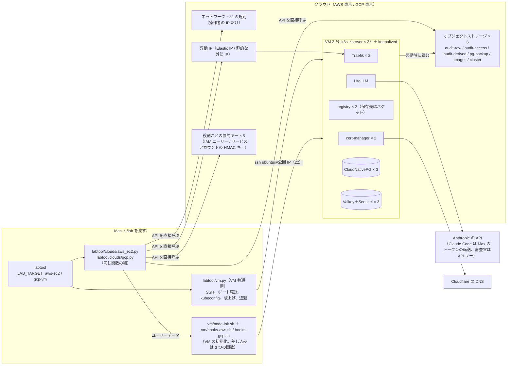

# 変更設計書: VM 3 台の環境の共通化（EC2 版の作り替え）と GCP 版の追加（`LAB_TARGET=gcp-vm`）

作成: 2026-10-30
状態: 実装済み（2026-10-30。単体試験 69 本、pyflakes、描画した初期化スクリプトの `bash -n` が通る。クラウドへの配備と試験はこれから。13 章に加え 16 章の実装で分かったことを見る）
対応する変更仕様書: 同じディレクトリの `変更仕様書.md`
この文書の役割: **どう作るか**（クラウド固有層の関数の組、AWS と GCP の API の呼び方、VM の初期化の手順の差し込み方、SSH と 22 の規則、構築ツールの分岐、LiteLLM の設定、環境変数）。
何を満たすかは変更仕様書に書いてある。実装と試験が済んだら `docs/design.md` に反映する（15 章）

---

## 1. 作りの全体

| 層 | 置き場 | 環境を知るか |
|---|---|---|
| 審査ガードレール、監査ログ、検索アプリ、整形 | `litellm/guardrails/`、`apps/audit/` | 知らない（変更なし） |
| Helm の値の骨格、マニフェスト | `litellm/values.yaml`、`k8s/*.yaml` | 知らない。`k8s/traefik-config-ec2.yaml` は `traefik-config-vm.yaml` に改名（中身は同じ） |
| 構築ツールの段階 | `labtool/stages.py`、`ops.py`、`failover.py` | `Env.target` で分岐。EC2 版の `is_aws_ec2` の分岐はすべて `is_vm`（`aws-ec2` と `gcp-vm` の両方）に置き換える。クラウドの名前で分岐する場所を**段階のコードに残さない** |
| VM 共通層 | `labtool/vm.py`（新規。`labtool/ec2.py` の SSH・kubeconfig・版上げ・退避・A レコード待ちを移す）、`vm/node-init.sh`（`cfn/node-init.sh` を移す） | クラウドを知らない。クラウド固有層のオブジェクト（3 章）を受け取って動く |
| クラウド固有層 | `labtool/clouds/__init__.py`（契約と `for_env(env)`）、`labtool/clouds/aws_ec2.py`、`labtool/clouds/gcp.py`、`vm/hooks-aws.sh`、`vm/hooks-gcp.sh` | AWS だけ / GCP だけ |
| 消すもの | `labtool/cfn.py`、`labtool/ec2.py`、`cfn/`、単体試験 `CfnTemplateTest` | — |

AWS の boto3 のセッションと `identity()`、`empty_bucket()` は `labtool/aws.py`（EKS 版）から借りる（EC2 版と同じ）。GCP の依存は `lab` の冒頭の `dependencies` に `google-cloud-compute`、`google-cloud-storage`、`google-cloud-iam`、`google-cloud-resource-manager` を足す（uv が入れる。AWS だけ使う人にも入るが、読み込みは `gcp-vm` のときだけ）。

---

## 2. 共通部分（`core.py`）

| 項目 | 変更 |
|---|---|
| `TARGETS` | `("local", "aws", "aws-ec2", "gcp-vm")` |
| `Env.is_vm` | `target in ("aws-ec2", "gcp-vm")`。`is_aws_ec2` は残す（AWS の資格情報の読み方だけに使う）。`is_gcp_vm` を足す |
| `Env.on_cloud` | `is_aws or is_vm`（HTTPS のホスト名、バケット名の接頭辞、Jev を使わない、の判定）。EC2 版の `on_aws` の使い場所をすべて見直し、「AWS のどちらか」の意味で残るのは `aws.py` の資格情報だけにする |
| `Env.hostname` | `LAB_HOSTNAME` を読み、無ければ `LAB_AWS_HOSTNAME`（EC2 版・EKS 版の互換）。`aws_hostname` は `hostname` の別名にする |
| kube のコンテキスト | `aws-ec2` は `litellm-lab-ec2`（変えない）、`gcp-vm` は `litellm-lab-gcp`。`VM_KUBE_CONTEXTS = {"aws-ec2": ..., "gcp-vm": ...}` |
| `Env.vm_*` | 9 章の `.env` の項目（`LAB_VM_*`）を読むプロパティ。`ec2_*` は `vm_*` に改名（`LAB_EC2_*` の名前も読む互換は置かない。配備前なので） |
| `BUILD_DIR` の中 | `vm-ssh-key` / `vm-ssh-key.pub`（SSH の鍵）、`vm-known-hosts`、`vm-forward.pid` / `.target`、`vm-tls-secret.json`、`vm-infra.json`（最後に探した基盤の記録。無くても API で探し直せる） |

---

## 3. クラウド固有層の契約（`labtool/clouds/__init__.py`）

### 3.1 データの形

| 型 | 中身 |
|---|---|
| `Node` | `id`（AWS はインスタンス ID、GCP は `<ゾーン>/<名前>`）、`index`（1〜3）、`private_ip`、`public_ip`（無ければ空）、`zone` |
| `Infra` | `nodes: list[Node]`、`entry_ip`（浮動 IP）、`entry_ip_id`（AWS は割り当て ID、GCP はアドレスの名前）、`buckets: dict[論理名, 実名]`、`bucket_prefix`、`region`、`network_id`、`sg_or_tag`（AWS はセキュリティグループ ID、GCP はネットワークタグ） |

### 3.2 関数の組（両方の実装が同じ名前・引き数・戻り値を持つ。単体試験で突き合わせる）

| 関数 | 役割 | 冪等の決まり |
|---|---|---|
| `identity(env) -> dict` | 操作者の資格情報の確認（AWS はアカウント ID と ARN、GCP はプロジェクト ID とアカウント）。バケット名の接頭辞の材料 | 読み取りだけ |
| `bucket_prefix(env, ident) -> str` | バケット名の接頭辞（AWS は `<接頭辞>-<アカウント ID>-`、GCP は `<接頭辞>-<プロジェクト ID>-`。バケット名は世界で一意なので） | 純粋な関数 |
| `ensure_network(env) -> dict` | VPC / サブネット / 経路 / 80・443・台間の規則 | 名前かタグで探し、無ければ作る |
| `allow_ssh_from(env, cidr)` | 22 の許可を `cidr` だけに置き換える（他の送信元の 22 を消す） | 今の規則と同じなら何もしない |
| `ensure_entry_ip(env) -> tuple[str, str]` | 浮動 IP（IP、識別子） | 名前かタグで探し、無ければ確保 |
| `ensure_buckets(env, prefix) -> dict[論理名, 実名]` | 6 バケット（`render.s3_buckets` の 4 つ ＋ `images` ＋ `cluster`）。保持・バージョニング・ライフサイクル・公開の遮断 | 設定が仕様と違えば直す |
| `check_buckets(env, prefix)` | 設定が仕様どおりか確かめる（EC2 版の `objectstore.check_buckets` の S3 の API 依存の部分を移す。Mac の RustFS 向けは `objectstore.py` に残る） | 読み取りだけ |
| `ensure_static_keys(env, prefix, have: set[str]) -> dict[利用者, (key, secret)]` | 役割ごとの静的キー。`have`（Kubernetes の Secret に既にある利用者）に無いものだけ作り直す（秘密は作った瞬間にしか取れない） | 権限は毎回そろえる。キーは Secret に無いときだけ |
| `put_object(env, bucket, key, body)` / `get_object(env, bucket, key) -> bytes \| None` | `cluster` バケットの読み書き（k3s のトークンと版。操作者の資格情報で） | — |
| `ensure_nodes(env, infra, user_data: Callable[[Node, list[Node]], str]) -> list[Node]` | VM 3 台。`user_data(node, all_nodes)` は VM 共通層が渡す描画関数（6 章）。VM の権限（インスタンスロール / サービスアカウント）もここで | 名前とインデックスのタグで探し、無い台だけ作る。あればユーザーデータを変えない（作り直しは `recreate_node`） |
| `recreate_node(env, infra, index, user_data)` | 1 台を消して作り直す（版上げの後の AMI / イメージの更新。BACKLOG の「AMI を新しくする手順」の受け皿） | — |
| `discover(env) -> Infra \| None` | 作ってあるものを API で探して `Infra` にまとめる（基盤が無ければ `None`） | 読み取りだけ |
| `entry_ip_holder(env, infra) -> str \| None` | 浮動 IP を持つ `Node.id` | 読み取りだけ |
| `stop_node(env, node)` / `start_node(env, node)` | 障害試験と版上げ | 待ち合わせ付き |
| `node_init_hooks() -> str` | VM の初期化に差し込むシェルの関数（6.2 節。`vm/hooks-aws.sh` / `vm/hooks-gcp.sh` の中身） | 純粋な関数 |
| `destroy(env, keep_entry_ip: bool)` | 作った順の逆に全部消す（4.5 節、5.5 節） | 無いものは飛ばす |

- 探す目印: AWS は全リソースにタグ `lab:prefix=<env.vm_prefix>` と `Name`、GCP はラベル `lab-prefix=<env.vm_prefix>` と名前。消すときも同じ目印で選ぶ（他のリソースに触らない）。
- `env.vm_prefix` は `aws-ec2` が `<LAB_AWS_STACK_PREFIX>-ec2`（EC2 版と同じ）、`gcp-vm` が `<LAB_GCP_PREFIX>`（既定 `litellm-lab`）。
- 契約は `typing.Protocol` の `Cloud` として書き、`for_env(env)` が `aws-ec2` → `aws_ec2`、`gcp-vm` → `gcp` のモジュールを返す。単体試験は 2 つのモジュールの公開関数の名前と `inspect.signature` が一致することを確かめる。

---

## 4. AWS の実装（`labtool/clouds/aws_ec2.py`）

CloudFormation の 4 スタックの中身を boto3 の呼び出しに写す。リソースは EC2 版と同じで、違いは「CloudFormation が持っていた依存と出力を、タグで探すこと」と、Ubuntu・SSH・パラメータストア無しに伴う 4.2〜4.4 節。

### 4.1 ネットワーク（`ensure_network`）

| リソース | API | 内容 |
|---|---|---|
| VPC | `create_vpc`、`modify_vpc_attribute` | `LAB_VM_CIDR`（既定 `10.60.0.0/16`）、DNS 有効。タグ `Name=<prefix>` |
| インターネットゲートウェイ、経路表、既定の経路 | `create_internet_gateway`、`attach_internet_gateway`、`create_route_table`、`create_route` | NAT は置かない |
| S3 のゲートウェイエンドポイント | `create_vpc_endpoint`（Gateway） | 無料。VM からの S3 の読み取り（k3s のトークンと版、registry、WAL） |
| 公開サブネット × 3 | `create_subnet`（`describe_availability_zones` の先頭 3 つ）、`associate_route_table`、`MapPublicIpOnLaunch` | `network_plan(cidr)`（EC2 版の関数を移す。先頭の /24 × 3、各台の固定 IP は `.10`、浮動 IP 用の 2 つ目は `.11`） |
| セキュリティグループ | `create_security_group`、`authorize_security_group_ingress` | 80・443 は `0.0.0.0/0`、台の間はすべて（自分自身を送信元に）。**22 は `allow_ssh_from` が管理** |

### 4.2 22 の規則（`allow_ssh_from`）

`describe_security_groups` で 22 の規則を読み、送信元が `cidr` 1 つだけでなければ、22 の規則を全部消して（`revoke_security_group_ingress`）`cidr` で 1 つ足す（`Description=lab-operator`）。

### 4.3 浮動 IP、バケット、静的キー

| 項目 | 内容 |
|---|---|
| Elastic IP（`ensure_entry_ip`） | `describe_addresses` のタグ `Name=<prefix>-entry` で探し、無ければ `allocate_address(Domain=vpc)` ＋ タグ |
| バケット（`ensure_buckets`） | `objectstore.ensure_buckets` の論理を使う（EC2 版は CloudFormation の `_bucket` に写していたが、Mac の RustFS 向けの同じ関数を `admin_s3` の代わりに操作者のセッションの S3 クライアントで流す）。追加の `images`（保持なし、バージョニングなし）と `cluster`（保持なし、バージョニングあり、既定の暗号化のまま、公開の遮断）。`put_public_access_block` を 6 つ全部に |
| IAM ユーザー 5 つ（`ensure_static_keys`） | `create_user`（無ければ）、`put_user_policy`（`cfn.iam_policies` を移す。`litellm-bedrock` は無し。監査ログの削除の明示的な拒否は残す）。アクセスキーは `have` に無い利用者だけ `delete_access_key`（残骸）→ `create_access_key`。タグ `lab:prefix` |
| `cluster` バケットの鍵 | `k3s/token`（32 バイトの乱数）と `k3s/version`（`core.K3S_IMAGE` の版）。`put_object` は操作者の資格情報。読むのはインスタンスロール |

### 4.4 VM 3 台（`ensure_nodes`）

| 項目 | 内容 |
|---|---|
| AMI | `describe_images(Owners=["099720109477"], Filters: name=ubuntu/images/hvm-ssd-gp3/ubuntu-noble-24.04-arm64-server-*, state=available)` の最新。**配備済みの台があればその `ImageId` を使う**（EC2 版の「AMI の固定」と同じ考え。3 台が同時に置き換わらない） |
| インスタンスロール | `create_role`（`<prefix>-node`）、`put_role_policy`: `ec2:AssociateAddress` / `DisassociateAddress` / `DescribeAddresses`（リージョン条件）、`s3:GetObject` を `cluster` バケットの `k3s/*` だけ。`AmazonSSMManagedInstanceCore` は**付けない**。`create_instance_profile`、`add_role_to_instance_profile` |
| インスタンス | `run_instances` × 3（台ごとに別のサブネット、`PrivateIpAddresses` に `.10`（primary）と `.11`、`AssociatePublicIpAddress`、gp3 の EBS（暗号化、`LAB_VM_DISK_GIB`）、IMDSv2 必須、`UserData` は 6 章の描画、タグ `Name=<prefix>-node<i>`、`lab:node-index=<i>`、`lab:prefix`）。`t4g.large`（`LAB_EC2_INSTANCE_TYPE`） |
| 探し方（`discover`） | `describe_instances(Filters: tag:lab:prefix, instance-state-name in pending/running/stopping/stopped)` → `Node`（`public_ip` は `PublicIpAddress`） |

### 4.5 消す（`destroy`）

順: ポート転送を止める → バケットを空にして消す（`aws.empty_bucket`。COMPLIANCE の監査ログは残して知らせる）→ IAM ユーザー（アクセスキー → インラインポリシー → ユーザー）→ インスタンス（`terminate_instances`、`instance_terminated` を待つ）→ インスタンスプロファイルとロール → セキュリティグループ → サブネット → 経路表の関連付けと経路表 → S3 のエンドポイント → インターネットゲートウェイ（detach → delete）→ VPC → Elastic IP（`keep_entry_ip` でなければ `release_address`）。

**移行**: EC2 版の CloudFormation のスタック（`<prefix>-ec2-{nodes,network,storage,eip}`）が残っていれば、`destroy` の最初に `cloudformation.delete_stack` で消す（配備はしていないので実際には無いはずだが、残骸を残さない）。

---

## 5. GCP の実装（`labtool/clouds/gcp.py`）

### 5.1 前提と道具

- 資格情報はアプリケーション既定の資格情報（`gcloud auth application-default login`）。プロジェクトは `.env` の `LAB_GCP_PROJECT`。
- 使う API: Compute Engine、Cloud Storage、IAM、Cloud Resource Manager。有効化は手作業（10 章）。
- クライアント: `google-cloud-compute`（`NetworksClient`、`SubnetworksClient`、`FirewallsClient`、`AddressesClient`、`InstancesClient`、`ZoneOperationsClient` など）、`google-cloud-storage`（バケット、HMAC キー、バケットの IAM）、`google-cloud-iam`（`iam_admin_v1`: サービスアカウント、カスタムロール）、`google-cloud-resource-manager`（プロジェクトの IAM ポリシー）。
- 長い操作（インスタンスの作成・削除、アドレスの確保）は返ってきた `Operation` を `wait` で待つ。

### 5.2 ネットワーク、22 の規則、浮動 IP

| リソース | 内容 |
|---|---|
| VPC ネットワーク | `<prefix>-net`、カスタムモード |
| サブネット | `<prefix>-subnet`、リージョン `LAB_GCP_REGION`（既定 `asia-northeast1`）、範囲は `LAB_VM_CIDR` の先頭の /24（3 台は同じサブネットの別ゾーン。GCP のサブネットはリージョン単位）。**Private Google Access を有効**（外部 IP が無い瞬間でも Cloud Storage と Compute の API に届く。5.6 節） |
| ファイアウォール | `<prefix>-web`: tcp 80/443、送信元 `0.0.0.0/0`、宛先タグ `<prefix>-node`。`<prefix>-internal`: すべてのプロトコル（VRRP の 112 を含む）、送信元はサブネットの範囲。`<prefix>-ssh`: tcp 22、送信元は `allow_ssh_from` が置き換える |
| `allow_ssh_from` | `<prefix>-ssh` の `source_ranges` が `[cidr]` でなければ `firewalls.patch` |
| 静的な外部 IP（`ensure_entry_ip`） | `addresses.insert`（リージョン、`<prefix>-entry`、EXTERNAL、PREMIUM）。識別子は名前 |

### 5.3 VM 3 台（`ensure_nodes`）

| 項目 | 内容 |
|---|---|
| イメージ | `projects/ubuntu-os-cloud/global/images/family/ubuntu-2404-lts-arm64` の最新（`images.get_from_family`）。配備済みの台があれば**その台のディスクの `source_image`** を使う（AWS と同じ固定の考え） |
| 機械 | `c4a-standard-2`（2 vCPU、8 GB。`LAB_GCP_MACHINE_TYPE`）、ゾーンは `LAB_GCP_REGION` の UP なゾーンのうち**その機種が置けるゾーン**（`machineTypes.get` で確かめる）を名前順に、台数より少なければ繰り返して割り振る（`assign_zones`。東京の C4A は `-b` と `-c` だけなので b・c・b。16 章） |
| ディスク | `hyperdisk-balanced`（C4A は永続ディスクの pd-* を使えない）、`LAB_VM_DISK_GIB` |
| ネットワーク | `network_ip` を `.10 + (index-1)`（例 `10.60.0.10`、`.11`、`.12`）に固定。`access_configs` に一時的な外部 IP を 1 つ（外向きの通信と SSH）。ネットワークタグ `<prefix>-node` |
| サービスアカウント | `<prefix>-node@<project>.iam.gserviceaccount.com`。スコープは `cloud-platform`（権限は IAM で絞る） |
| メタデータ | `startup-script`（6 章の描画。GCP は cloud-init の user data ではなく startup-script として渡す。**毎回起動時に走るので、`/var/lib/lab/ready` があれば抜ける**のは EC2 版と同じ）、`ssh-keys`: `ubuntu:<公開鍵> ubuntu`、`enable-oslogin=FALSE`（鍵はメタデータで入れる） |
| ラベル | `lab-prefix=<prefix>`、`lab-node-index=<i>` |
| 探し方 | `instances.aggregated_list(filter="labels.lab-prefix=<prefix>")` → `Node`（`public_ip` は `access_configs[0].nat_i_p`） |

### 5.4 VM の権限、バケット、静的キー

| 項目 | 内容 |
|---|---|
| VM 用のカスタムロール | `<prefix>_node`（プロジェクトのカスタムロール）: `compute.instances.get`、`compute.instances.list`、`compute.instances.addAccessConfig`、`compute.instances.deleteAccessConfig`、`compute.addresses.get`、`compute.addresses.list`、`compute.addresses.use`、`compute.zoneOperations.get`、`compute.subnetworks.use`、`compute.subnetworks.useExternalIp`。プロジェクトの IAM ポリシーで VM のサービスアカウントに付ける |
| VM のバケットの権限 | `cluster` バケットの IAM に `roles/storage.objectViewer` を VM のサービスアカウントへ（条件 `resource.name.startsWith("projects/_/buckets/<cluster>/objects/k3s/")`） |
| バケット（`ensure_buckets`） | 6 つ。`storage.Client().create_bucket(location=region, uniform_bucket_level_access)`、`iam_configuration.public_access_prevention="enforced"`。`render.s3_buckets` の仕様を写す: `versioning` → `versioning_enabled`、`lock.Days` → `retention_period = Days × 86400`（`LAB_AUDIT_LOCK_MODE=COMPLIANCE` のときだけ `lock_retention_policy()`。GOVERNANCE は解除できる保持ポリシーのまま）、`lifecycle` → GCS のライフサイクル規則（`Expiration.Days` → `age` ＋ `is_live=True`、`NoncurrentVersionExpiration.NoncurrentDays` → `days_since_noncurrent_time` ＋ `is_live=False`、`Filter.Prefix` → `matches_prefix`） |
| 役割ごとのサービスアカウント 5 つと HMAC キー（`ensure_static_keys`） | `<prefix>-<利用者>@...`。HMAC キーは `storage.Client().create_hmac_key(service_account_email)`（秘密は作成時だけ）。`have` に無い利用者は既存のキーを `INACTIVE` → `delete` して作り直す |
| 利用者の権限 | バケットの IAM の条件付きバインディングで `render.s3_policies` を写す。`s3:PutObject` → `roles/storage.objectCreator`、`s3:GetObject` → `roles/storage.objectViewer`（`objects.list` を含むので `s3:ListBucket` も兼ねる）、`s3:*` → `roles/storage.objectAdmin`。資源の接頭辞（`raw/*`、`billing/contracts/*`）は条件 `resource.name.startsWith(...)`。**明示的な拒否は書かない**（許可しない操作は IAM に無いので拒否される。監査ログの保護はバケットの保持ポリシーが担う。AWS 版の `_deny_audit_deletion` に当たる IAM Deny ポリシーは使わない） |
| 操作者の S3 互換の接続先 | `https://storage.googleapis.com`。クラスタの中の設定（`AUDIT_S3_ENDPOINT`、Barman の `endpointURL`、registry の `REGISTRY_STORAGE_S3_REGIONENDPOINT`）に入れる（AWS は空で既定。`Cloud.s3_endpoint(env) -> str` を契約に足す。AWS は `https://s3.<region>.amazonaws.com`）。リージョン名は `auto` ではなく `LAB_GCP_REGION` を渡す |

### 5.5 消す（`destroy`）

ポート転送を止める → バケットを空にして消す（保持ポリシーが残る監査ログは保持が切れるまで消せないので知らせる。`lock` されていれば消せない）→ HMAC キー（INACTIVE → delete）とサービスアカウント 5 つ → インスタンス 3 台 → VM のサービスアカウントとカスタムロール（IAM のバインディングも外す）→ ファイアウォール 3 つ → サブネット → ネットワーク → 静的な外部 IP（`keep_entry_ip` でなければ）。

### 5.6 浮動 IP の付け替え（VM の中。`hooks-gcp.sh` の `lab_take_entry_ip`）

GCP は 1 つの NIC に外部 IP を 1 つしか付けられない（2 つ目のプライベート IP に別の外部 IP、はできない）。そのため AWS 版（Elastic IP を 2 つ目のプライベート IP に付け、1 つ目の公開 IP を残す）と違い、主系の台は一時的な外部 IP を静的 IP に置き換え、主系でなくなった台は一時的な外部 IP を付け直す。

1. メタデータサーバーのトークンで Compute の REST API を呼ぶ（`curl -H "Metadata-Flavor: Google" .../instance/service-accounts/default/token`。gcloud は要らない）。
2. `addresses.get(<prefix>-entry)` の `users` に今の持ち主があれば、その台の `deleteAccessConfig`（`External NAT`）→ その台に一時的な外部 IP の `addAccessConfig`（natIP を指定しない）。持ち主の台が落ちていても API は通る（ゾーン障害で通らないときは 6 回まで 5 秒おきに再試行し、諦めてログに残す）。
3. 自分の `deleteAccessConfig` → `addAccessConfig(natIP=<静的 IP>)`。
4. keepalived の `notify_backup` に `lab_ensure_egress`（自分に外部 IP が無ければ一時的なものを `addAccessConfig`）を付け、主系を降りた台と起動直後の台の外向きの通信を保つ。VM の起動時（startup-script）にも呼ぶ。

Private Google Access を有効にしてあるので、外部 IP が無い瞬間でも手順 2〜3 の API 呼び出しと Cloud Storage の読み取りは届く。切り替わるまでの時間（目安 10〜20 秒）は障害試験で測る。

---

## 6. VM 共通層（`labtool/vm.py`、`vm/node-init.sh`、`vm/hooks-*.sh`）

### 6.1 `vm/node-init.sh`（`cfn/node-init.sh` を移して直す）

EC2 版の構造（`ready` の判定、registry のミラー、k3s の参加先の探し方、`config.yaml`、keepalived の 3 台 BACKUP・nopreempt・健全性の検査）はそのまま。変える点:

| 箇所 | EC2 版 | この設計 |
|---|---|---|
| パッケージ | `dnf install -y keepalived` | `apt-get update && apt-get install -y keepalived curl`。AWS の hooks が `snap install aws-cli --classic` を足す（Ubuntu 24.04 には awscli の apt パッケージが無い。snap は AWS が公開） |
| SSH の鍵 | 無し | `install -d -m 700 /home/ubuntu/.ssh && echo "@@SSH_PUBKEY@@" >> authorized_keys`（AWS。GCP は guest agent がメタデータから入れるので不要だが、同じ行を置いても害は無い）。`PasswordAuthentication no` を確かめる |
| k3s のトークンと版 | `aws ssm get-parameter` | `lab_read_object k3s/version`、`lab_read_object k3s/token`（hooks の関数） |
| 自分の識別子 | IMDSv2 の `instance-id` | `lab_self_id`（hooks の関数。AWS はインスタンス ID、GCP は `<ゾーン>/<名前>`） |
| 浮動 IP を取る | `lab-take-eip.sh`（`aws ec2 associate-address`） | `lab-take-entry-ip.sh` ← `lab_take_entry_ip`（hooks の関数）。GCP は `notify_backup` に `lab_ensure_egress` も |
| 置き換える名前 | `@@REGION@@` など 11 個 | `@@SELF_IP@@`、`@@FIRST_IP@@`、`@@PEER_IPS@@`、`@@NODE_INDEX@@`、`@@PRIORITY@@`、`@@REGISTRY_HOST@@`、`@@REGISTRY_NODEPORT@@`、`@@SSH_PUBKEY@@`、`@@HOOKS@@`（hooks のシェルをそのまま埋める）。クラウドの値（リージョン、バケット名、割り当て ID、2 つ目の IP）は hooks の中に埋まる |
| 2 つ目のプライベート IP | AL2023 が自動で設定 | AWS: netplan が 2 つ目の IP を自動では設定しないので、hooks が `ip addr add <.11>/24 dev <IF>` と netplan の設定を書く。GCP: 無い |
| 版上げ | `install_k3s` は `curl \| INSTALL_K3S_VERSION=... sh -s - server` | 同じ |

### 6.2 hooks（`vm/hooks-aws.sh`、`vm/hooks-gcp.sh`）

| 関数 | AWS | GCP |
|---|---|---|
| `lab_read_object <鍵>` | `aws s3 cp s3://<cluster バケット>/<鍵> -`（インスタンスロール） | `curl -H "Authorization: Bearer <メタデータのトークン>" https://storage.googleapis.com/storage/v1/b/<バケット>/o/<URL エンコードした鍵>?alt=media` |
| `lab_self_id` | IMDSv2 で `instance-id` | メタデータの `instance/zone` と `instance/name` |
| `lab_take_entry_ip` | `aws ec2 associate-address --allocation-id ... --private-ip-address <.11> --allow-reassociation`（EC2 版と同じ、6 回まで） | 5.6 節 |
| `lab_ensure_egress` | 何もしない（1 つ目の公開 IP が残る） | 5.6 節の 4 |

`Cloud.node_init_hooks()` はこのファイルの中身にクラウドの値（リージョン、バケット名、割り当て ID / アドレス名、2 つ目の IP）を埋めて返す。`vm.render_node_init(node, all_nodes, hooks, pubkey)` が `@@HOOKS@@` に差し込む。単体試験は両方の hooks が 4 つの関数を定義していることを `bash -n` と `grep` で確かめる。

### 6.3 SSH（`vm.py`）

| 関数 | 役割 |
|---|---|
| `ensure_ssh_key()` | `.build/vm-ssh-key` が無ければ `ssh-keygen -t ed25519 -N ""`（権限 600。`.gitignore` の `.build/` の中） |
| `operator_cidr(env) -> str` | `LAB_SSH_ALLOW_CIDR` があればそれ。無ければ `https://checkip.amazonaws.com` に問い合わせ（5 秒。失敗なら `https://api.ipify.org`）、IPv4 なら `<IP>/32`。IPv6 や失敗は `LabError`（`.env` で固定するよう案内） |
| `ensure_access(env)` | `cloud.discover` → `cloud.allow_ssh_from(operator_cidr)` → `ensure_forward`。`stages.ensure_access` が各コマンドの最初に呼ぶ（EC2 版の Session Manager の確認に当たる） |
| `ssh_base(env, node) -> list[str]` | `ssh -i .build/vm-ssh-key -o UserKnownHostsFile=.build/vm-known-hosts -o StrictHostKeyChecking=accept-new -o ConnectTimeout=10 -o BatchMode=yes ubuntu@<public_ip>` |
| `run_on(env, node, script, timeout)` | `ssh ... sudo bash -s` に `script` を標準入力で渡し、標準出力を返す（EC2 版の Run Command の置き換え。24,000 文字の上限は無くなる） |
| `wait_nodes_ready(env, nodes)` | 22 が開く（`socket.connect_ex`）→ `test -f /var/lib/lab/ready` を 3 台で（最長 10 分 ＋ 15 分） |
| `fetch_kubeconfig(env, node)` | `run_on(cat /etc/rancher/k3s/k3s.yaml)` → EC2 版と同じく `kubectl config set-*` で `https://127.0.0.1:<LAB_VM_LOCAL_PORT>` のコンテキスト |
| `ensure_forward(env, avoid=None)` / `stop_forward` / `forward_target` | `ssh -N -L <LAB_VM_LOCAL_PORT>:127.0.0.1:6443 ...` を背景のプロセスで（PID は `.build/vm-forward.pid`、転送先は `.build/vm-forward.target`）。`kubectl get --raw /readyz` で生存を確かめ、切れていれば張り直す。`ServerAliveInterval=30` で切れにくくする |
| `forget_host(node)` | 台を作り直したとき `.build/vm-known-hosts` からその IP の行を消す（`recreate_node` と `destroy` が呼ぶ） |

### 6.4 k3s のトークンと版、版上げ、退避、A レコード

- `ensure_cluster_objects(env, cloud, infra)`: `k3s/token` が無ければ乱数を `put_object`。`k3s/version` が無ければコードの版を置く。あれば返す（上書きは `upgrade_k8s` だけ）。配備済みの版とコードの版が違えば止める（EC2 版の R9 と同じ案内）。
- 版上げの部品（`node_versions`、`etcd_snapshot`、`drain_node`、`install_k3s`、`wait_node_version`、`uncordon_node`、`parse_k3s_version`、`check_upgrade_step`、`upgrade_order`）は `ec2.py` から `vm.py` に移す。`run_on` が SSH になるだけ。`ops.upgrade_k8s` は `ec2.` を `vm.` と `cloud.` に置き換える（`set_version_parameter` → `cloud.put_object(cluster, "k3s/version", ...)`、`eip_holder` → `cloud.entry_ip_holder`、`instance_ids(out)` → `infra.nodes`）。
- `save_tls_secret` / `restore_tls_secret`、`wait_for_a_record(env, ip)` はそのまま移す。
- `instance_id_for_node` / `node_for_instance` → `node_for_k8s_name(infra, name)` / `k8s_name_for_node(node)`（プライベート IP で突き合わせる。クラウドを知らない）。

---

## 7. 構築ツールの段階（`stages.py`、`ops.py`、`failover.py`）

EC2 版の 4.3 節の表の `aws-ec2` の列を、`is_vm` の列にする。違いだけ書く。

| 段階 | `aws-ec2` / `gcp-vm` |
|---|---|
| preflight | `require_commands("docker", "kubectl", "helm", "ssh", "ssh-keygen")` ＋ AWS は `aws`、GCP は `gcloud`（資格情報の確認だけ）。`session-manager-plugin` は要らない。`cloud.identity` → `env.values["LAB_BUCKET_PREFIX"]`（`LAB_AWS_BUCKET_PREFIX` の後継。`render.bucket_name` は両方読む）。`.env` の必須: ホスト名、`LAB_CLOUDFLARE_API_TOKEN`、`LAB_ACME_EMAIL`、`LAB_JUDGE_ANTHROPIC_API_KEY`（8 章）、GCP は `LAB_GCP_PROJECT` |
| ensure_access | `vm.ensure_access`（22 の規則 → ポート転送）。基盤が無ければ飛ばす |
| cluster（`_cluster_vm`） | `ensure_ssh_key` → `cloud.ensure_network` → `allow_ssh_from` → `ensure_entry_ip` → `ensure_buckets` → `ensure_cluster_objects` → `ensure_nodes(user_data=vm.render_node_init)` → `wait_nodes_ready` → `ensure_forward` → 全ノード Ready → `traefik-config-vm.yaml` → namespace → SA → `_vm_registry`（静的キー → Secret `lab-registry` → registry の Deployment。`REGISTRY_STORAGE_S3_REGIONENDPOINT` に `cloud.s3_endpoint`）→ `operators(replicas=2)` → Cloudflare の Secret → `ClusterIssuer` |
| images | `_build_and_push_vm`（EC2 版の `_build_and_push_ec2` と同じ。`registry_forward` は `kubectl port-forward`） |
| secrets | Mac と同じ関数。静的キーは `_vm_static_keys`: Kubernetes の Secret（`pg-backup-s3`、`audit-compactor-s3`、`audit-viewer-s3`、`litellm-secrets`、`lab-registry`）に既にある利用者を `have` にして `cloud.ensure_static_keys` → Env に載せる（`.env` には書かない）。`litellm-secrets` に `LAB_JUDGE_ANTHROPIC_API_KEY`（8 章）。`rustfs` の Secret は作らない |
| objectstore | `cloud.check_buckets` ＋ `objstore.self_check`（利用者ごとの許可・拒否。両クラウドで同じ検査。GCP の XML API のエラーコードが `AccessDenied` で返るかは配備で確かめる。13 章） |
| datastores | Mac と同じ。`render.pg_backup_values` に `cloud.s3_endpoint`（AWS は `endpointURL` を省く今の形、GCP は `https://storage.googleapis.com`） |
| litellm | モデルは 8 章。`_ingress_vm`（EC2 版の `_ingress_ec2`。`entry_ip` を `infra` から） |
| audit | `S3_ENDPOINT` に `cloud.s3_endpoint`（AWS は空）、`S3_REGION`、`S3_BUCKET_PREFIX`。HTTPS の経路は EC2 版と同じ |
| clients | `https://<ホスト名>`。Claude Code の別名の固定（Bedrock 向け）は VM では**しない**（Mac と同じ `anthropic/*`） |
| down（`ops.down`） | 退避 → `cloud.destroy(keep_entry_ip=env.vm_keep_entry_ip)` |
| status | ノード 3 台（`discover`）、浮動 IP の持ち主、k3s の版、22 の許可の送信元 |
| upgrade-k8s | 6.4 節。両クラウドで同じ |
| test-failover | `SCENARIOS_VM = [*SCENARIOS, "entry-node"]`。`eip-node` は `entry-node` の別名として受ける。`_stop_vm_node` は `cloud.stop_node` / `start_node`。`entry-node` は `cloud.entry_ip_holder` で前後を比べる（`load.entry_ip_moved`） |

---

## 8. LiteLLM の設定と Secret（`render.py`）

| 項目 | 内容 |
|---|---|
| Claude Code 用 | `is_vm` では Mac と同じ `{"model_name": "anthropic/*", "litellm_params": {"model": "anthropic/*"}}`（`api_key` 無し。Max のトークンの転送）。Bedrock の分岐は `is_aws`（EKS 版）だけに残す |
| 審査官 | `is_vm` では `review-judge` / `isolated-judge` を `{"model": "anthropic/<LAB_VM_JUDGE_MODEL>", "api_key": "os.environ/LAB_JUDGE_ANTHROPIC_API_KEY"}`。既定の `LAB_VM_JUDGE_MODEL` は `claude-haiku-4-5-20251001`（Anthropic のモデル一覧で確かめる）。単価は LiteLLM の表にあるので `model_info` は不要 |
| 環境変数の名前 | **`ANTHROPIC_API_KEY` は使わない。** Pod にその名前があると、LiteLLM が `anthropic/*` の転送でトークンの代わりに API キーを使いうる（Claude Code の利用が API キーに課金される）。`LAB_JUDGE_ANTHROPIC_API_KEY` の名前で Secret `litellm-secrets` に入れ、審査官の `litellm_params` だけが参照する。配備後に、Claude Code の要求が Max のトークンで通ること（Anthropic Console の利用量に審査官の分だけ出ること）を確かめる（13 章） |
| `has_chatgpt` | `is_vm` では常に偽（EC2 版と同じ） |
| 契約の初期値（`initial_contracts`） | `is_vm`: `claude-max`（subscription、`anthropic/*`、`claude-*`、月額は Mac と同じ）と `anthropic-api`（invoice、`review-judge`、`isolated-judge`、`fees` は空）。Bedrock の契約は `is_aws` だけ |
| `secrets_for_litellm` | `is_vm` では `BEDROCK_*` を入れず `LAB_JUDGE_ANTHROPIC_API_KEY` を入れる |
| `helm_overrides` | EC2 版と同じ（監査ログの S3 の接続先に `cloud.s3_endpoint`、`chatgpt/` の hostPath なし）。`AUDIT_S3_ENDPOINT` は AWS は空、GCP は `https://storage.googleapis.com` |

Secret の対応（EC2 版 4.4 節）の変更: `litellm-secrets` の `BEDROCK_ACCESS_KEY_ID` / `BEDROCK_SECRET_ACCESS_KEY` → `LAB_JUDGE_ANTHROPIC_API_KEY`。静的キーの出どころは「CloudFormation の出力」から「`cloud.ensure_static_keys`（Secret に無いときだけ作る）」。

---

## 9. `.env` の項目

| 項目 | 既定 | 意味 |
|---|---|---|
| `LAB_TARGET` | `local` | `gcp-vm` を足す |
| `LAB_HOSTNAME` | （必須。`LAB_AWS_HOSTNAME` でも可） | HTTPS のホスト名（A レコード → 浮動 IP） |
| `LAB_VM_CIDR` | `10.60.0.0/16` | AWS は /24 × 3 のサブネット、GCP は先頭の /24 だけ |
| `LAB_VM_DISK_GIB` | `40` | 各台のディスク |
| `LAB_VM_LOCAL_PORT` | `16443` | SSH のポート転送のローカル側 |
| `LAB_VM_KEEP_ENTRY_IP` | `false` | `./lab down` で浮動 IP を残すか（`LAB_EC2_KEEP_EIP` の後継） |
| `LAB_SSH_ALLOW_CIDR` | （空＝毎回調べる） | 22 を開ける送信元を固定する（例 `203.0.113.5/32`） |
| `LAB_VM_JUDGE_MODEL` | `claude-haiku-4-5-20251001` | 審査官のモデル（Anthropic の API） |
| `LAB_JUDGE_ANTHROPIC_API_KEY` | （必須） | 審査官の API キー（Anthropic Console で発行。利用上限を設ける） |
| `LAB_EC2_INSTANCE_TYPE` | `t4g.large` | AWS の台の種類（既存） |
| `LAB_GCP_PROJECT` | （`gcp-vm` で必須） | プロジェクト ID |
| `LAB_GCP_REGION` | `asia-northeast1` | リージョン（ゾーンは `-a` / `-b` / `-c`） |
| `LAB_GCP_MACHINE_TYPE` | `c4a-standard-2` | GCP の台の種類 |
| `LAB_GCP_PREFIX` | `litellm-lab` | GCP の資源の名前とラベルの接頭辞 |
| `LAB_CLOUDFLARE_API_TOKEN`、`LAB_ACME_EMAIL`、`LAB_ACME_STAGING`、`LAB_REGISTRY_HTTP_SECRET` | （既存） | 変えない |

消すもの: `LAB_EC2_VPC_CIDR`、`LAB_EC2_DISK_GIB`、`LAB_EC2_LOCAL_PORT`、`LAB_EC2_KEEP_EIP`（`LAB_VM_*` へ）。`LAB_BEDROCK_*`、`LAB_AWS_JUDGE_MODEL` は EKS 版だけが読む。Env に載るだけで `.env` に書かないもの: `LAB_BUCKET_PREFIX`、静的キー。

---

## 10. 手作業の時点

| いつ | 何 | 誰が |
|---|---|---|
| `./lab up` の前（1 回） | AWS: `aws sso login`。GCP: `gcloud auth application-default login`（ブラウザの同意が要るので人）。API の有効化は `./lab` が行う（`ensure_apis`、16 章） | 人 |
| `./lab up` の前（1 回） | Cloudflare の API トークン、Anthropic の API キー（利用上限を設ける）を `.env` に | 人 |
| `./lab litellm` の入口の段階 | 浮動 IP への A レコードを Cloudflare の API で作る・直す（DNS のみ、TTL 自動）。トークンは DNS-01 と同じもの | `./lab`（16 章。2026-10-30 のユーザーの指示） |
| 操作者の回線が変わった後 | 何もしない（次の `./lab` が 22 の規則を直す）。外部への問い合わせが使えない回線なら `.env` の `LAB_SSH_ALLOW_CIDR` | 人 |
| `./lab down` の後（浮動 IP を消したとき） | 次の `up` で IP が変わるが、A レコードは `./lab` が直す。レコード自体は消さない | `./lab` |

---

## 11. 費用の目安を決めるもの（検証規模）

| 部品 | AWS | GCP |
|---|---|---|
| VM × 3 | `t4g.large` | `c4a-standard-2` |
| ディスク × 3 | gp3 40 GiB | Hyperdisk Balanced 40 GiB |
| 外部 IP | パブリック IPv4 × 3 ＋ Elastic IP | 一時的な外部 IP × 3 ＋ 静的 IP（付いている間も時間課金） |
| オブジェクトストレージ | S3 の容量 | Cloud Storage の容量 |
| 審査官 | Anthropic の API（Haiku 4.5 の従量） | 同じ |
| 無料 | IAM、VPC | IAM、VPC、ファイアウォール |

価格は配備の前に価格表で確かめて応答で報告する。

---

## 12. 試験

| 試験 | 内容 |
|---|---|
| 単体（置き換え） | `CfnTemplateTest`（5 本）と `Ec2TargetTest` の Bedrock・CloudFormation の出力に依る 3 本を消す |
| 単体（追加、見込み 18 本） | 2 つのクラウド固有層の関数の組の一致（名前と `signature`）、AWS の `network_plan` と GCP の IP の割り当て、`render_node_init` の置き換え漏れ（両方の hooks で）、hooks が 4 つの関数を定義、`operator_cidr` の形（IPv4 / IPv6 / `.env` の固定）、VM の LiteLLM の設定（`anthropic/*` にキー無し、審査官に `os.environ/LAB_JUDGE_ANTHROPIC_API_KEY`、`ANTHROPIC_API_KEY` が Secret に無い）、契約の初期値、`secrets_for_litellm`、GCS のライフサイクルの写し、`s3_policies` → バケットの IAM の写し、`Env` の判定と URL とコンテキスト、障害試験の場面（`entry-node`、`eip-node` の別名）、`upgrade_order`、`.env.example` に `LAB_EC2_VPC_CIDR` などが無い |
| シェル | `bash -n` を `node-init.sh` と hooks 2 つに。描画後のスクリプトにも |
| 流し直し | `./lab up` を Mac に（`local` が変わらない） |
| 配備（制限の解除後） | 7.2 節の項目を `aws-ec2` → `gcp-vm` の順に。EC2 版の BACKLOG の配備の項目はこの文書の内容に差し替える |

---

## 13. 分かっていること・残していること（配備で確かめること）

- **awscli の入れ方。** Ubuntu 24.04 の apt には awscli のパッケージが無い（noble の universe から外された）。snap の `aws-cli --classic`（AWS が公開）を使う。snap の初回の取得に時間がかかるなら、AWS だけ hooks を python3 と `python3-boto3`（apt にある）に替える。
- **GCP の VM では gcloud を使わない。** メタデータサーバーのトークンと REST API（Cloud Storage の JSON API、Compute の `addAccessConfig` / `deleteAccessConfig`）で済ませる。公式イメージに gcloud が入っているかに依存しない。
- **Ubuntu の 2 つ目のプライベート IP（AWS）。** AL2023 と違い自動で設定されないので、hooks が netplan に書く。Elastic IP を `.11` に付ける設計はそのまま。
- **GCP の浮動 IP の付け替え**は 5.6 節の順で、所要時間と、ゾーン障害のときに `deleteAccessConfig` が通らない場合の挙動を確かめる。通らないときは静的 IP が落ちた台に残り、入口が止まる。その場合の手当て（操作者が `./lab` から付け替える `./lab take-entry-ip <台>` の追加）は配備で要るかを見てから決める。
- **GCS の XML API のエラーコード。** `objectstore.self_check` は拒否を `AccessDenied` で判定する。GCS が XML API で同じコードを返すか、保持ポリシーによる削除の拒否が `403` のどのコードで返るかを確かめ、違えば `self_check` の判定を「403 ならよい」に広げる。
- **GCS のバケットの IAM の条件**は `resource.name.startsWith` でオブジェクトの接頭辞を絞れる。`objects.list` はバケット単位なので接頭辞では絞れない（`litellm-writer` に `objectCreator` だけなら list は無い）。`audit-viewer` は 3 バケットの list を持つのは S3 と同じ。
- **Private Google Access** を有効にするので、外部 IP の無い瞬間でも Google の API に届く。Let's Encrypt と Anthropic には外部 IP が要るので、`lab_ensure_egress` が付け直す。
- **操作者の IP の問い合わせ先**（`checkip.amazonaws.com`、予備 `api.ipify.org`）は外部への依存。`LAB_SSH_ALLOW_CIDR` が逃げ道。
- **SSH の known_hosts。** 台を作り直すと同じ公開 IP で鍵が変わることがある（AWS は一時的な公開 IP が変わるので起きにくい、GCP も同じ）。`forget_host` で消す。
- **`anthropic/*` の転送と審査官の API キーの共存**（8 章）。LiteLLM の版 `v1.104.2` で、`litellm_params.api_key` が明示されたデプロイだけがキーを使い、`anthropic/*` は要求のトークンを転送することを確かめる。
- **C4A の `hyperdisk-balanced`**。C4A は pd-* を使えないと公式文書にある。ディスクの種類の名前は配備で確かめる。
- **ユニキャスト VRRP（112）が GCP の VPC で通るか**は AWS と同じく配備で確かめる（通らなければ k3s の Lease で主系を決める小さなデーモンに替える。EC2 版 10 章と同じ逃げ道）。
- EC2 版の 10 章の「分かっていること」（2 台では組めない、参加先の探し方、Pod Identity 相当が無い、`chatgpt/` の置き場が無い、Let's Encrypt の上限、nopreempt、付け替えの遅さ、Elastic IP は 2 つ目の IP に）はそのまま当てはまる。

---

## 14. 参考資料

変更仕様書 11 章と EC2 版の変更設計書 11 章に加えて:

- [boto3: EC2 クライアント（`run_instances`、`associate_address`、`describe_images`）](https://boto3.amazonaws.com/v1/documentation/api/latest/reference/services/ec2.html) / [IAM クライアント](https://boto3.amazonaws.com/v1/documentation/api/latest/reference/services/iam.html)
- [Canonical の Ubuntu AMI の探し方（owner 099720109477）](https://documentation.ubuntu.com/aws/aws-how-to/instances/find-ubuntu-images/)
- [AWS CLI の snap](https://snapcraft.io/aws-cli)
- [google-cloud-compute（Python）](https://cloud.google.com/python/docs/reference/compute/latest) / [google-cloud-storage: HMAC キー](https://cloud.google.com/storage/docs/authentication/managing-hmackeys) / [バケットの IAM の条件](https://cloud.google.com/storage/docs/access-control/iam#conditions)
- [Compute Engine: 外部 IP の付け外し（`addAccessConfig` / `deleteAccessConfig`）](https://cloud.google.com/compute/docs/ip-addresses/configure-static-external-ip-address) / [Private Google Access](https://cloud.google.com/vpc/docs/private-google-access)
- [Compute Engine: メタデータサーバーからのトークンの取得](https://cloud.google.com/compute/docs/access/authenticate-workloads) / [startup-script](https://cloud.google.com/compute/docs/instances/startup-scripts/linux)
- [Compute Engine: C4A の機械系列とディスク](https://cloud.google.com/compute/docs/general-purpose-machines#c4a_series)
- [Cloud Storage: XML API と S3 互換](https://cloud.google.com/storage/docs/interoperability) / [バケットの保持ポリシーとロック](https://cloud.google.com/storage/docs/bucket-lock) / [ライフサイクルの条件](https://cloud.google.com/storage/docs/lifecycle#conditions)
- [LiteLLM: Anthropic プロバイダ（`api_key` の指定）](https://docs.litellm.ai/docs/providers/anthropic) / [Claude Code Max Subscription（トークンの転送）](https://docs.litellm.ai/docs/tutorials/claude_code_max_subscription)
- [Anthropic: モデルの一覧](https://docs.claude.com/en/docs/about-claude/models/overview)

---

## 15. `docs/design.md` への反映の仕方（試験の後）

| 章 | 変更 |
|---|---|
| 2. 全体構成 | 1 章の図。環境は 4 つ |
| 3. リポジトリ構成 | `labtool/vm.py`、`labtool/clouds/`、`vm/`。`cfn/`、`labtool/cfn.py`、`labtool/ec2.py` を消す |
| 4. 構築の流れ | `is_vm` の流れ（7 章） |
| 6. LiteLLM | 6.3 に審査官の API キーと環境変数の名前の決まり（8 章） |
| 8. オブジェクトストレージ | S3 と Cloud Storage の対応（5.4 節）、`cluster` バケット |
| 新しい節: 入口 | 浮動 IP の付け替え（AWS と GCP の違い。5.6 節） |
| 新しい節: 操作者の経路 | SSH と 22 の規則（6.3 節） |
| 16. 試験 | 両クラウドの結果 |
| 18. 実装で分かったこと | 13 章 |
| `docs/ec2_architecture.md` | VM 2 クラウドの構成図に書き直す（CloudFormation、Session Manager、Bedrock を外す。GCP の列を足す） |

---

## 16. 実装で分かったこと（2026-10-30）

- **バケットの設定の関数は Mac の RustFS と共用にした。** `objectstore.ensure_buckets` / `check_buckets` に「実名 → 仕様」の辞書とリージョンを渡せるようにし、AWS の層はそれを呼ぶ（4.3 節の「CloudFormation の `_bucket` に写していた」部分が無くなった）。GCP の層は Cloud Storage のクライアントで同じ仕様を写す。
- **操作者の S3 互換のクライアント（GCP）。** 操作者の資格情報（ADC）は boto3 で使えないので、サービスアカウント `<prefix>-operator` の HMAC キーを作り、Secret `lab-operator-s3` にだけ置く（静的キーは Kubernetes の Secret にだけ、の決まりのまま）。`objectstore.admin_s3` が GCP ではこれを使う。利用者は 5 ＋ 操作者の 6 つ。
- **hooks は `declare -f` で全部の関数を VM に残す**（`/var/lib/lab/hooks.sh`）。GCP の補助の関数（トークン、REST の呼び出し、操作の待ち）が多いので、名前を列挙しない。keepalived の `notify_master` / `notify_backup` のスクリプトはそれを `source` して 1 つの関数を呼ぶ。
- **`@@HOOKS@@` の印は説明文に書かない。** 説明文に書くとそこにも差し込まれる（単体試験で見つけた）。
- **2 つのプライベート IP（AWS）** は hooks が netplan に書いて `netplan apply` する。配備で、k3s の起動より前に 2 つ目の IP が付くことを確かめる。
- **GCP の startup-script は毎回の起動で走る**ので、`ready` があれば `lab_ensure_egress` だけ呼んで抜ける（主系を降りた台の外向きの IP の復元を兼ねる）。
- **消したもの**: `labtool/cfn.py`、`labtool/ec2.py`、`cfn/`、単体試験 `CfnTemplateTest` と `Ec2TargetTest`（`VmTargetTest` と `CloudLayerTest` に置き換え。67 本 → 69 本）。`k8s/traefik-config-ec2.yaml` は `traefik-config-vm.yaml` に改名。
- **`docs/ec2_architecture.md` は配備と試験の後に書き直す**（CloudFormation、Session Manager、Bedrock を外し、GCP の列を足す。15 章）。
- **東京で C4A が置けるゾーンは `asia-northeast1-b` と `-c` の 2 つだけ**（`-a` には無い。大阪には C4A 自体が無い。配備の準備で判明、2026-10-30）。ゾーンの選び方を「機種が置けるゾーンから順に、足りなければ繰り返す」に直し（`assign_zones`、単体試験 1 本）、3 台は b・c・b に置く。b のゾーン障害では 2 台が止まりクラスタの多数決が失われるが、検証の目的（1 台を止める障害試験）は満たす。3 ゾーンに分けたくなれば `LAB_GCP_REGION=asia-east1`（台湾。3 ゾーンとも C4A あり）にするだけでよい（ユーザーの回答 2026-10-30: 1A）。
- **操作者の ADC の権限は `cloud-platform` だけ**でよい（`gcloud auth application-default login` が求める Cloud SQL 用の `sqlservice.login` は不要。同意画面で外しても警告だけで保存される）。
- **A レコードは `./lab` が作る**（`vm.ensure_a_record`。ユーザーの指示 2026-10-30「セットアップスクリプトで全て実行できるように」）。ゾーンはホスト名の後ろから候補を順に `GET /zones?name=` で探し、`type=A&name=<ホスト名>` のレコードが無ければ作り、IP が違うかプロキシが付いていれば直し、同名の余分な A は消す。`down` では消さない（次の `up` が直す）。Cloudflare のトークンは DNS-01 用と同じ（Zone / DNS / Edit ＋ Zone / Zone / Read。Global API Key（`cfk_`）は使えない）。
- **GCP の API の有効化も `./lab` が行う**（`gcp.ensure_apis`。Service Usage の REST `services:batchEnable`。クラウド固有層の契約に `ensure_apis` を足し、AWS は何もしない）。`gcloud` は `./lab` から使わないので前提の道具から外した（ADC の取得にだけ要る）。ADC が無いときは `identity` が実行すべきコマンドを案内する。
- **GCP では主系が浮動 IP を取ると、その台の公開 IP が一時的な IP から静的 IP に入れ替わる**（5.6 節の `deleteAccessConfig` → `addAccessConfig` の帰結。配備で判明 2026-10-30: `./lab` が起動時の公開 IP で待ち続け、初期化の確認が通らなかった）。対処: `vm.refresh_public_ips` が `discover` で公開 IP を引き直し `.build/vm-infra.json` を更新する。`wait_nodes_ready` は届かない台があるたびに、`ensure_forward` は転送を張る前に呼ぶ。SSH の known_hosts は IP でなく台の識別子（`HostKeyAlias`）で引く（浮動 IP は障害で別の台に移るので、IP を鍵にすると鍵の不一致で止まる）。AWS は 2 つ目の IP に Elastic IP を付けるので公開 IP は変わらないが、同じ経路で害は無い。
- **2 回目の `up` でカスタムロールの作成が 409 で止まった**（配備で判明 2026-10-30）。原因は `IAMClient.get_role(name=...)` の呼び方の誤り（`request=` で渡す）を、存在確認の `except Exception` が「無い」と誤認して `create_role` に進んだこと。対処: GCP の層の存在確認はすべて `google.api_core.exceptions.NotFound` だけを捕まえる（`_NotFound()`）。呼び方の誤りや権限の不足は隠さず止める。冪等性は `./lab up` の 2 回目と `test-idempotency` で確かめる。
- **`.env` の静的キーを VM の環境で読んでいた**（配備で判明 2026-10-30）。Mac の RustFS 用の `S3_<利用者>_KEY` / `_SECRET` が同じ名前で `.env` に残っていると、`load_static_keys` が「ある」と判定して HMAC キーを作らず、Mac の値をクラウドの Secret に写すところだった。対処: `_preflight_vm` で `vm.drop_env_static_keys` が `.env` 由来の `S3_*` と `RUSTFS_*` を Env から落とし、`load_static_keys` は同じ実行で Secret かクラウドから載せた値だけを使い回す。
- **作った直後のサービスアカウントで HMAC キーを作ると 404**（反映の遅れ）。`create_hmac_key` を 5 秒おきに最大 12 回試す。
- **イメージ置き場（registry 3.0.0）の push が GCS で 400 `InvalidArgument`**（配備で判明 2026-10-30）。registry の S3 ドライバは PutObject と CreateMultipartUpload に毎回 canned ACL（既定 `private`）を付け、外す設定が無い（v3.0.0 の `s3.go` を確認）。GCS の「均一なバケットレベルのアクセス」のバケットは、どの ACL（`private`、`bucket-owner-full-control` も）も拒む（HMAC キーで実験）。対処: **`images` バケットだけ均一を切る**（他の 5 つは均一のまま。権限は IAM のバインディングで同じ）。registry 側の設定は変えない（AWS でも同じ値で動く）。
- **boto3 1.36 以降の既定のチェックサム送信を GCS の XML API が `SignatureDoesNotMatch` で拒む**（同じ実験で確認。`AWS_REQUEST_CHECKSUM_CALCULATION=when_required` と `AWS_RESPONSE_CHECKSUM_VALIDATION=when_required` で通る）。LiteLLM（監査ログの書き込み）と audit-compactor / audit-viewer の環境変数に足した。pg-backup（Barman）には最初から入っていた。AWS S3 には害が無いので VM の環境では両クラウドで付ける。
- **GCS の XML API は `UploadPartCopy` を実装していない**（`NotImplemented`。HMAC キーで実験。`ListMultipartUploads` の `key-marker` も `InvalidArgument`）。registry の S3 ドライバ（v3.0.0 の `s3.go`）は 32 MB を超えるオブジェクトの移動（アップロードの完了時に `_uploads/` → `blobs/`）でマルチパートのコピーを使うので、`REGISTRY_STORAGE_S3_MULTIPARTCOPYTHRESHOLDSIZE` を上限の 5 GiB にして 1 回の `CopyObject` にする（GCP だけ。AWS は既定のまま）。これで 1.7 GB・24 層の push が 43 秒で通った。残る経路: 途中で切れたアップロードの再開（小さい最後の部分の後に書き足すと `UploadPartCopy` を使う）は GCS では失敗する。`docker push` をやり直せば最初から送り直すので、運用上は再実行で済む。
- **`./lab` 自身の boto3 も同じチェックサムの問題で GCS に書けなかった**（`objectstore.self_check` の PutObject が `SignatureDoesNotMatch`）。`objectstore` の S3 クライアント 2 つの `Config` に `request_checksum_calculation` / `response_checksum_validation` = `when_required` を入れた（全環境共通。害は無い）。
\n- **GCS の保持ポリシーによる削除の拒否は 403 `RetentionPolicyNotMet`**（13 章で予想していた点。配備で確認 2026-10-30）。`objectstore.self_check` の「管理者でも保持の回避なしには原本を消せない」だけ、`AccessDenied` に加えてこのコードを認める。他の 5 件（利用者の権限）は GCS でも `AccessDenied` で、そのまま通った。なお GCS で版を指定しない削除は（S3 の削除マーカーと同じく）現行の版を非現行にするだけで、データは残る。\n
- **冪等性の試験で見つかった 2 点**（2026-10-30）。(1) バケットの IAM が毎回「更新」になっていた: GCS は同じロール・同じ条件のバインディングを 1 つにまとめて保存するので、利用者ごとに分けた望みの形と常に違った。望みの形も同じ鍵（ロール＋条件）でまとめてから比べる。(2) 試験の 1 回目の記録が空だった: `checks.snapshot` が `Env.load()` の前に kubectl を呼び、Mac の context を見ていた。記録の冒頭で `Env.load()` を呼ぶ。合わせて、VM の環境のバケットの記録はクラウド固有層の `snapshot`（契約に追加。GCP は均一アクセス・バージョニング・保持・ライフサイクル・IAM を Cloud Storage のクライアントで読む。S3 互換の API では保持と IAM が見えない）にし、接頭辞は `vm.ensure_bucket_prefix` で載せる。
- **試験の入口でバケット名の接頭辞が載っていなかった**（監査の試験が接頭辞なしの `audit-raw` を見て `AccessDenied`。2026-10-30）。接頭辞は preflight だけが Env に載せていたので、`Env.load()` が VM の環境では `vm.ensure_bucket_prefix`（と `.env` の静的キーの除外）を行うようにした。
- **監査の試験の Job が Mac の接続先（`rustfs:9000`、接頭辞なし）を使っていた**（2026-10-30）。監査の Pod に渡す S3 の設定（接続先・リージョン・接頭辞）を `render.audit_s3_settings` に 1 か所にまとめ、整形の CronJob・検索アプリ・試験の Job が同じ値を使う。試験の「管理者でも保持の回避なしには消せない」も `RetentionPolicyNotMet` を認める（`self_check` と同じ）。
- **GCS の上書きには delete の権限が要る**（整形の Job が `audit-derived` の parquet を書き直すとき `AccessDenied`。2026-10-30）。`bucket_bindings` で、バケット全体への `s3:PutObject` は `roles/storage.objectUser`（create/get/list/update/delete）に写し、接頭辞に限った書き込み（原本の `raw/`）だけ `objectCreator`（追記のみ）にする。S3 の権限の意味（PutObject は上書きを含む）に合わせた。
- **GCS は S3 互換の HeadObject に VersionId を返さない**（`x-goog-generation` ヘッダーに出る。PutObject の応答には VersionId が入る）。`objectstore.object_version` でどちらからも取る。
- **公開の入口にはインターネットからの API キーの総当たりが来る**（配備の約 2 時間後から、外部の 1 つの IP が `/v1/models` にでたらめな Bearer を毎秒約 40 件。LiteLLM は 401 で拒み、監査ログは各件を `KeyNotFoundError` の失敗として記録。2026-10-30）。監査の試験の「審査官の呼び出しは要求として記録されない」は、認証されない要求を除いて数える。入口の 80/443 を操作者の IP に絞るかはユーザーの判断（確認中）。
- **入口（80/443）も操作者の IP だけに絞る**（ユーザーの判断 2026-10-30: A）。クラウド固有層の契約に `allow_web_from` を足し（GCP は `<prefix>-web` の source_ranges、AWS はセキュリティグループの 80/443 の規則を置き換え）、`vm.web_cidr`（`LAB_WEB_ALLOW_CIDR`、無ければ 22 と同じ）を `./lab` の毎回の実行（`ensure_access`）と `cluster` の段階で当てる。`./lab status` に表示。
- **障害の試験で SSH の転送が 2 度切れた**（2026-10-30）。(1) 止める台に転送が張ってあった → 止める前に `ensure_forward(avoid=その台)` で別の台へ。(2) 止めている間に浮動 IP が転送先の台へ移り、その台の公開 IP が入れ替わって SSH が切れた（GCP 固有。AWS は 2 つ目の IP に付けるので切れない）→ 台を起こした後に `ensure_forward` で公開 IP を引き直し、切れていれば張り直す。運用でも、入口が移った直後の `./lab` は転送を張り直す（`ensure_access` が毎回確かめる）。

### 16.1 GCP の配備と試験の結果（2026-10-30）

| 試験 | 結果 |
|---|---|
| `./lab up`（初回） | 8 回目で全段階を通過（手戻り 7 件は上の箇条書き）。2 回目以降の `up` は約 2 分 |
| `test-smoke` | 75 件すべて OK |
| `test-idempotency` | 65 項目を比較して 2 回目の `up` で変化なし（2 回目は 116 秒） |
| `test-audit` | 32 件中 29〜30 件 OK。NG は「MCP の記録」（ユーザー 1 が Gmail に未サインイン。環境に依らない）と、総当たり中の集計の遅れ。総当たりを止めた後の再実行は下の追記 |
| `test-audit`（入口を絞った後、整形の上限 2 GiB、照合の見直し後） | 32 件中 31 件 OK。残る 1 件は「MCP の記録」（ユーザー 1 の Gmail のサインインが要る） |
| `test-judge`（審査官 = Claude Haiku 4.5、Anthropic の API キー） | 288 件中 255 件が期待どおり（88.5%）。不一致は文脈独立の審査官の 14 事例: 社内（プライベートアドレス）宛ての送信・複製を止める（allow 期待 7）、設定ファイルから宛先を取るスクリプトに設定ファイルを求めない（need_content 期待 5）。審査官の指示文を Haiku 向けに詰めるかは別の作業（バックログ） |
| `test-failover` 監査ログの欠け | pg-switchover 0、pg-pod 0、valkey-pod 0、pg-node 19、valkey-node 70、entry-node 6（台を止める場面の上限 240） |

障害の試験の回復時間（要求は毎秒約 20 件。目安は Mac と EC2 版で決めた値）:

| 場面 | 1 回目 | 2 回目 | 目安 |
|---|---|---|---|
| pg-switchover | 失敗 0 | 失敗 0 | 60 秒 |
| pg-pod | 失敗 0 | 失敗 0 | 60 秒 |
| pg-node | 91.7 秒（止めた台は入口でない） | 148.8 秒（止めた台が入口を持っていた） | 120 秒 |
| valkey-pod | 失敗 0 | 失敗 0 | 60 秒 |
| valkey-node | 失敗 0（入口でない台） | 142.4 秒（入口の台） | 120 秒 |
| entry-node | 76.8 秒 | 87.5 秒 | 30 秒 |

- **GCP では「止めた台が入口（浮動 IP）を持っているか」で回復時間が決まる。** 入口でない台を止めた場面は PostgreSQL / Valkey の切り替えだけで、失敗 0 件か 90 秒以内。入口の台を止めると、keepalived の検知（2 秒 × 3 回）に加えて、Compute Engine の `deleteAccessConfig` → `addAccessConfig`（止まった台の分と自分の分で 2 往復、各 10〜30 秒）が入り、合計 80〜150 秒。AWS の Elastic IP の付け替え（`associate-address` 1 回、数秒）より桁で遅い。これは設計書 5.6 節の手順どおりの帰結で、GCP の制約。
- 目安（entry-node 30 秒、台の停止 120 秒）は EC2 版の設計の値。**GCP だけ entry-node 120 秒・台の停止 180 秒に広げた**（`failover.GCP_LIMITS`、`limit_for`。ユーザーの判断 2026-10-30: 2A）。
- 浮動 IP の付け替えは往復で動いた（止めた台に戻るときは一時的な IP が付き直る。`nopreempt` なので元の持ち主には戻らない）。
- **整形の Job が 1 GiB の上限で OOMKilled**（2026-10-30）。総当たりの 1 時間で 108,730 件の失敗記録が原本に入り、DuckDB（memory_limit 512 MB）＋ Python が 1 GiB を超えた。上限を 2 GiB に上げた（3 GiB で 66 秒で整形できた）。入口を操作者の IP に絞った後はこの量にならないが、整形のメモリは 1 時間の件数に比例することを運用の文書に書く。
- **LiteLLM の日次の集計はローリング更新中の要求を取りこぼす**（98 件中 22 件。監査ログは全件あり、`/spend/logs` にも無い）。LiteLLM が Pod の終了時に未送信の spend log を失う挙動で、クラウドに依らない（Mac では更新が速く表に出にくい）。監査の試験の照合を「中断の無かった要求はすべて LiteLLM の集計に入り、余分は無い（下限と上限）」に変えた。精算は監査ログ（原本）から作るので、LiteLLM 側の欠けは精算に影響しない。
- **`./lab down` のバケットの空にする処理が `Blob.delete(generation=)` で止まった**（2026-10-30。引数が無い）。`Bucket.delete_blobs(..., preserve_generation=True)` で 100 件ずつまとめて消すようにした（版を含めて 10 万件超でも数分）。保持ポリシーはロックしていないので外してから消せる。
