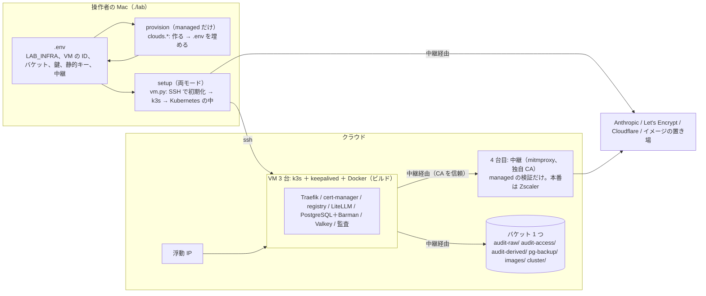

# 変更設計書: 既存の VM 3 台とバケット 1 つからの構築（`LAB_INFRA=provided`）と、出口プロキシ（Zscaler 相当）の中での構築

作成: 2026-10-30
状態: 実装済み・GCP で配備と試験済み（2026-10-31。14 章）。AWS は EC2 の vCPU 上限で未配備。docs/spec.md 12 章、docs/design.md 21 章に反映済み
対応する変更仕様書: 同じディレクトリの `変更仕様書.md`
この文書の役割: **どう作るか**（`.env` の項目、provision と setup の分け方、1 バケットの配置と権限、SSH での初期化、VM 上のビルド、CA とプロキシの配布、段階の変更）。実装と試験が済んだら `docs/design.md` に反映する（13 章）

---

## 1. 作りの全体



- **provision** は `managed` のときだけ動き、作った物の識別子と静的キーを `.env` に書く。
- **setup** は `.env` だけを見る。`provided` では人が `.env` を埋める。`clouds.discover`（タグで探す）は setup では使わない。
- VM の初期化は **SSH で `vm/node-init.sh` を流す**（`vm.run_on`）。ユーザーデータと GCP の startup-script は使わない。

---

## 2. `.env` の項目

| 項目 | 既定 | モード | 意味 |
|---|---|---|---|
| `LAB_INFRA` | `managed` | 両方 | `managed`: ツールが作る。`provided`: 既存の物を使う |
| `LAB_VM_NODES` | （provision が書く） | 両方 | VM の識別子 3 つをカンマ区切り（AWS: `i-…`、GCP: `<ゾーン>/<名前>`）。順番が台の番号 1〜3 |
| `LAB_VM_SSH_KEY` | `.build/vm-ssh-key` | 両方 | SSH の秘密鍵のパス（provision が作る。provided は用意する側の鍵） |
| `LAB_VM_SSH_USER` | `ubuntu` | 両方 | SSH の利用者名（`sudo` が通ること） |
| `LAB_VM_BUCKET` | （provision が書く） | 両方 | バケット名（1 つ） |
| `LAB_VM_ENTRY_IP_ID` | （provision が書く） | 両方 | 浮動 IP の識別子（AWS: `eipalloc-…`、GCP: アドレスの名前） |
| `LAB_VM_S3_<利用者>_KEY` / `_SECRET` | （provision が書く） | 両方 | 静的キー。利用者は `LITELLM_WRITER`、`AUDIT_COMPACTOR`、`AUDIT_VIEWER`、`PG_BACKUP`、`REGISTRY`、`OPERATOR`（GCP で必須。AWS は空なら操作者の資格情報） |
| `LAB_EGRESS_PROXY` | （空） | 両方 | VM と Pod が使う中継の URL（例 `http://10.60.0.20:3128`）。空なら中継なし |
| `LAB_EGRESS_CA_FILE` | （空） | 両方 | 中継の CA（PEM）のパス。中継があるとき必須 |
| `LAB_EGRESS_PROXY_MAC` | （空） | 両方 | `./lab` 自身が使う中継の URL（Mac から届く宛先。本番は Zscaler、検証は中継の VM の公開 IP）。空なら Mac は中継を使わない |
| `LAB_EGRESS_PROXY_VM` | `false` | managed | `true` で 4 台目の VM に中継を作り、`LAB_EGRESS_PROXY` / `LAB_EGRESS_CA_FILE` / `LAB_EGRESS_PROXY_MAC` を埋め、3 台の直接の外向き通信を遮断する |
| `LAB_VM_ARCH` | （空＝VM から読む） | 両方 | 自作イメージのアーキテクチャ（`arm64` / `amd64`）。空なら 1 台目の `uname -m` |

消すもの: Env にだけ載せていた `LAB_BUCKET_PREFIX`（VM の環境）、`vm.drop_env_static_keys` / `load_static_keys`（静的キーは `.env` の `LAB_VM_S3_*` から読む。Mac の `S3_*` と名前が違うので衝突しない）、`clouds.CLUSTER_BUCKET` の「VM が自分の権限で読む」前提。
`LAB_SSH_ALLOW_CIDR` / `LAB_WEB_ALLOW_CIDR` は managed だけが使う（provided はネットワークを触らない）。

---

## 3. 層の分け方とクラウド固有層の関数の組

### 3.1 setup（両モード共通。`labtool/vm.py`、`labtool/stages.py`）

| 段階 | 内容 |
|---|---|
| `load_infra(env)` | `.env` の `LAB_VM_NODES` を `cloud.describe_nodes(env, ids)` で `Node`（id、index、private_ip、public_ip、zone）にし、`LAB_VM_ENTRY_IP_ID` を `cloud.describe_entry_ip` で IP にする。バケットは `LAB_VM_BUCKET`。`.build/vm-infra.json` は目安 |
| `ensure_access` | managed: 22 と 80/443 の許可を直す（今と同じ）。provided: 何もしない。両方: SSH のポート転送 |
| `init_nodes(env, infra)` | 3 台それぞれに `node-init.sh` を描画して `run_on`（`ready` があれば中で抜ける）。1 番から順に（1 番がクラスタを起こし、2・3 番が参加する。並列にしない） |
| `cluster_objects` | 操作者の S3 クライアントで `cluster/k3s/token`（無ければ乱数）と `cluster/k3s/version`（無ければコードの版。違えば止める）を読み書きする。VM には SSH で渡す |
| ビルド | 6 章 |

### 3.2 provision（managed だけ。`labtool/clouds/aws_ec2.py`、`gcp.py`）

| 関数 | AWS | GCP |
|---|---|---|
| `provision(env, pubkey) -> dict` | VPC・サブネット 3・IGW・経路・S3 エンドポイント・SG、キーペアの取り込み（`import_key_pair`）、Elastic IP、バケット 1（4 章）、IAM ユーザー 5 と静的キー、インスタンスロール（EIP の付け替えだけ）、EC2 3 台（ユーザーデータなし、`KeyName`）。中継あり: 4 台目（amd64、`t3.small`）、SG の egress を「自分の SG と中継の SG だけ」に | VPC・サブネット・ファイアウォール（web、internal、ssh、proxy-in）、静的 IP、バケット 1、SA 6 と HMAC キー、カスタムロール（node、lister、writer）、VM 3 台（startup-script なし、`ssh-keys`）。中継あり: 4 台目（amd64、`e2-small`、タグ `<prefix>-proxy`）、egress の deny（タグ `<prefix>-node`、0.0.0.0/0、優先度 1000）と allow（サブネット、優先度 900） |
| 戻り値 | `{"nodes": [id…], "bucket": 名前, "entry_ip_id": …, "keys": {利用者: (key, secret)}, "proxy_node": id or None}` → `stages` が `.env` に書く（キーは Secret に既にあっても `.env` に無ければ作り直す） | 同じ |
| `destroy(env)` | タグで探して全部消す（今と同じ ＋ キーペア、中継） | 名前とラベルで探して全部消す（今と同じ ＋ カスタムロール 2 つ、中継） |
| `destroy_provided(env, infra)` | `.env` の識別子の物を消す（VM、EIP、バケットを空にして消す、IAM ユーザーは `LAB_VM_S3_*` のキー ID から利用者を逆引きせず **消さない**。消すのは用意する側） | VM、静的 IP、バケット、HMAC キーは消さない（同上） |
| `describe_nodes(env, ids)` | `describe_instances` | `instances.get` |
| `describe_entry_ip(env, id)` | `describe_addresses` | `addresses.get` |
| `entry_ip_holder`、`stop_node`、`start_node`、`node_init_hooks`、`s3_endpoint`、`identity`、`ensure_apis`、`snapshot`、`check_bucket`、`allow_ssh_from`、`allow_web_from`、`ensure_proxy_access` | 今のまま（`allow_*` は managed だけが呼ぶ） | 同じ |

`clouds.FUNCTIONS` を上の組に更新し、単体テストで両実装の一致を確かめる。

---

## 4. 1 バケットの配置、権限、保持

### 4.1 配置（`labtool/objectstore.py` の `location`）

```
location(env, logical) -> (bucket, prefix)
  local（RustFS）: (logical, "")
  aws（EKS 版）:   (LAB_AWS_BUCKET_PREFIX + logical, "")
  aws-ec2 / gcp-vm: (LAB_VM_BUCKET, logical + "/")
```

`render.bucket_name(env, logical)` は `location()[0]` を返し、新しい `render.store_prefix(env, logical)` が `[1]` を返す。使う側（Barman の `destinationPath`、registry の `ROOTDIRECTORY`、監査の Pod の環境変数、監査の試験、`cluster/k3s/*`）は両方を使う。

| 使う側 | 渡し方 |
|---|---|
| LiteLLM の監査コールバック | `AUDIT_S3_BUCKET` ＋ 新しい `AUDIT_S3_KEY_PREFIX`（`audit-raw/`）、`AUDIT_S3_RETENTION_DAYS`（90）、`AUDIT_S3_RETENTION_MODE`（GOVERNANCE / COMPLIANCE）。日数が空なら保持を付けない（Mac） |
| 監査アプリ（整形、検索、試験の Job、合成） | 新しい `AUDIT_S3_BUCKET`（1 バケット名。空なら従来の `AUDIT_S3_BUCKET_PREFIX` ＋ 論理名）、`AUDIT_ACCESS_RETENTION_DAYS`（400）、`AUDIT_RETENTION_MODE`。`common.py` の `RAW` / `ACCESS` / `DERIVED` を `Store(bucket, prefix)` にし、`ref(key)`（`{"Bucket", "Key"}`）、`url(key)`（`s3://…`）、`key(k)` を持たせる。`list_keys` は返す `Key` から接頭辞を外す（呼ぶ側は論理の鍵だけを見る） |
| Barman | `destinationPath: s3://<bucket>/<prefix>litellm-pg` |
| registry | `REGISTRY_STORAGE_S3_ROOTDIRECTORY=/<prefix>registry` |
| k3s のトークンと版 | `<prefix>k3s/token`、`<prefix>k3s/version` |

### 4.2 バケットの仕様（1 つ）

| 項目 | S3 | GCS |
|---|---|---|
| 作成 | `ObjectLockEnabledForBucket=True`（既定の保持は**付けない**）、バージョニング有効、パブリックアクセスの遮断 | `enable_object_retention=True`（作成時）、バージョニング有効、公開アクセスの防止 `enforced`、**均一なバケットレベルのアクセス**（IAM の条件に必須。配備で判明、14 章）、ラベル |
| ライフサイクル | 接頭辞ごと: `audit-raw/`（現行 91 日・非現行 91 日）、`audit-access/`（401・401）、`audit-derived/meta/`・`meta_day/`（91・1）、`usage_daily/`（400・1）、`billing/settlement/`（400・400）、`synth/`（7・1）、`pg-backup/`（非現行 1）、`images/`（非現行 1）、`cluster/`（非現行 30） | 同じ規則を `matchesPrefix` で |
| 検査（`check_bucket`） | Object Lock 有効、バージョニング、PAB。ライフサイクルの差は managed はエラー、provided は警告 | オブジェクト保持 Enabled、バージョニング、PAP。同上 |

### 4.3 権限（利用者 → ディレクトリ）

`render.s3_policies()` の論理名の ARN を、`location` で `arn:aws:s3:::<bucket>/<prefix>…` に写す。一覧（`s3:ListBucket`、`s3:ListBucketMultipartUploads`）はバケット全体に許す（書き込み用には許さない）。足すもの:

| 利用者 | 追加 |
|---|---|
| litellm-writer | `s3:PutObjectRetention` on `audit-raw/raw/*`（保持を付けて書くために要る） |
| audit-viewer | `s3:PutObjectRetention` on `audit-access/*` |
| 全員（Deny） | `audit-raw/*`・`audit-access/*` の `DeleteObjectVersion`、`BypassGovernanceRetention`、`PutObjectLegalHold`。バケットの `DeleteBucket`、`PutBucketObjectLockConfiguration`、`PutLifecycleConfiguration`、`PutBucketVersioning` |

GCS（条件付きバインディング、`resource.name.startsWith(".../objects/<prefix>…")`）:

| S3 の操作 | GCS |
|---|---|
| `PutObject`（接頭辞限定。原本、閲覧記録） | カスタムロール `<prefix>_writer`: `storage.objects.create`、`storage.objects.setRetention` |
| `PutObject`（ディレクトリ全体。上書きあり） | `roles/storage.objectUser` |
| `GetObject` | `roles/storage.objectViewer`（条件付き） |
| `ListBucket` | カスタムロール `<prefix>_lister`: `storage.objects.list`、`storage.buckets.get`（条件なし。一覧だけ） |
| `s3:*`（pg-backup、registry） | `roles/storage.objectAdmin`（条件付き） |
| 操作者 | `roles/storage.objectAdmin`（条件なし） |

### 4.4 保持の付け方（書く側）

- S3: `put_object(..., ObjectLockMode=<mode>, ObjectLockRetainUntilDate=now+days)`。
- GCS（接続先が `storage.googleapis.com`）: boto3 の `before-call.s3.PutObject` で `x-goog-object-lock-mode`（GOVERNANCE → `GOVERNANCE`、COMPLIANCE → `COMPLIANCE`）と `x-goog-object-lock-retain-until-date`（RFC 3339）を足す。`x-amz-object-lock-*` が GCS に効くかは配備で確かめ、効くなら分岐を消す。
- `objectstore.self_check` と監査の試験の「管理者でも保持の回避なしには消せない」: 書いた直後の原本を版指定で消し、`AccessDenied` / `RetentionPolicyNotMet` / GCS のオブジェクト保持の拒否コード（配備で確かめる）を期待する。

---

## 5. VM の初期化（SSH。`vm/node-init.sh`、`vm/hooks-*.sh`）

`vm.render_node_init(node, all_nodes, hooks, pubkey, values)` の `values` に次を足す: `K3S_VERSION`、`K3S_TOKEN`（SSH の標準入力で渡す。ディスクには k3s 自身の保存先だけ）、`EGRESS_PROXY`、`EGRESS_NO_PROXY`、`EGRESS_CA`（PEM の中身）、`VM_CIDR`。

手順（`ready` があれば CA とプロキシの設定だけ直して抜ける）:

1. CA: `EGRESS_CA` があれば `/usr/local/share/ca-certificates/lab-egress.crt` に置き `update-ca-certificates`
2. プロキシ: `/etc/environment` に `HTTP_PROXY` / `HTTPS_PROXY` / `NO_PROXY`（小文字も）、`/etc/apt/apt.conf.d/90lab-proxy`、`/etc/systemd/system/docker.service.d/http-proxy.conf`。シェルにも export（k3s のインストールスクリプトがそれを `k3s.service.env` に写す）
3. `NO_PROXY`: `127.0.0.1,localhost,10.42.0.0/16,10.43.0.0/16,.svc,.cluster.local,<VM の CIDR>,169.254.169.254,metadata.google.internal,metadata`
4. 道具: `apt-get install keepalived curl docker.io`（＋ hooks の `lab_install_tools`。AWS は awscli の snap に `snap set system proxy.*`）
5. registries.yaml、/etc/hosts（今のまま）
6. k3s: 版とトークンは `K3S_VERSION` / `K3S_TOKEN`。参加先の探し方、config.yaml は今のまま
7. keepalived、hooks（`declare -f` と `lab_hook_values`。hooks.sh の先頭に `export HTTPS_PROXY=…` と CA の環境変数（`AWS_CA_BUNDLE`、`CURL_CA_BUNDLE`）を書き、notify スクリプトから呼ぶ `aws` / `curl` が中継を通る）
8. 起動時の外向き IP の復元: systemd の `lab-egress.service`（oneshot、`After=network-online.target`、`source /var/lib/lab/hooks.sh; lab_ensure_egress`）。GCP の startup-script の代わり
9. `touch /var/lib/lab/ready`

hooks から消すもの: `lab_read_object`（トークンと版は SSH で渡す。VM にバケットの権限は不要）。

---

## 6. VM 上のビルド（`stages.images`、`_build_and_push_vm`）

1. ビルドする台: SSH の転送先の台（`vm.forward_target()`）。無ければ 1 番。
2. アーキテクチャ: `LAB_VM_ARCH` か、その台の `uname -m`（`aarch64` → `arm64`、`x86_64` → `amd64`）。タグは今のハッシュ（中身が同じなら同じタグ。アーキテクチャはタグに含めない。置き場はクラスタごとなので混ざらない）。
3. 置き場に同じタグがあれば何もしない（`registry_forward` で HEAD。今のまま）。
4. 無ければ: ビルドの文脈（`litellm/` または `apps/audit/`。`__pycache__` を除く）を tar にし、`egress-ca.pem`（中継の CA。無ければ空ファイル）を足して `ssh <台> sudo docker build -t <name>:<tag> --build-arg … -` に標準入力で渡す。`docker tag` → `docker push 127.0.0.1:30500/<name>:<tag>`（Docker は 127.0.0.0/8 を既定で平文の置き場として扱う）。
5. Dockerfile 2 つに `COPY egress-ca.pem /tmp/egress-ca.pem` と、中身があれば OS の信頼店に入れる `RUN` を足す（監査アプリは `pip` に `PIP_CERT=/etc/ssl/certs/ca-certificates.crt`）。Mac のビルド（local）でも同じ Dockerfile を使うので、`images` の段階が両方の文脈に `egress-ca.pem`（空）を置く（`.gitignore`）。
6. preflight（VM）から `docker info` の確認を外す。`./lab test-unit` のガードレールの試験は Mac の Docker のまま（local 用）。

---

## 7. 出口プロキシ

### 7.1 中継の VM（managed、`LAB_EGRESS_PROXY_VM=true`）

- 4 台目: 同じサブネットの `.20`、amd64 の小さい機種、Ubuntu 24.04、公開 IP あり。初期化は SSH（`vm/proxy-init.sh`）: `apt-get install mitmproxy`、`/etc/mitmproxy` に CA を生成（`mitmdump` の初回起動）、systemd の `lab-proxy.service`（`mitmdump --mode regular --listen-host 0.0.0.0 --listen-port 3128 --set block_global=false --set confdir=/etc/mitmproxy -w /var/log/lab-proxy/flows`）。
- CA を SSH で `.build/egress-ca.pem` に取り、`.env` に `LAB_EGRESS_CA_FILE=.build/egress-ca.pem`、`LAB_EGRESS_PROXY=http://<内部 IP>:3128`、`LAB_EGRESS_PROXY_MAC=http://<公開 IP>:3128` を書く。
- 3128 を開ける送信元: サブネットと操作者の IP（`cloud.ensure_proxy_access`）。
- 遮断: GCP は egress の deny（`<prefix>-node` タグ、0.0.0.0/0、優先度 1000）＋ allow（サブネット、優先度 900）。メタデータサーバー（169.254.169.254）はファイアウォールの対象外。AWS は SG の egress を「自分の SG と中継の SG」だけに。
- 中継の記録: `/var/log/lab-proxy/flows`（`mitmdump -nr` で読める）。検証では `./lab proxy-log` で宛先ホストの集計を出す。

### 7.2 Pod への配布（`render.egress_env(env)`、`render.add_egress(docs, env)`）

- ConfigMap `lab-egress-ca`（`litellm-lab` と `cert-manager` の名前空間）と Secret `lab-egress-ca`（Barman の `endpointCA` は Secret を参照する）に `ca.crt`。
- 環境変数: `HTTP_PROXY` / `HTTPS_PROXY` / `NO_PROXY`（小文字も）、`SSL_CERT_FILE` / `REQUESTS_CA_BUNDLE` / `AWS_CA_BUNDLE` / `CURL_CA_BUNDLE` = `/etc/lab-egress/ca.crt`。マウントは ConfigMap を `/etc/lab-egress`。
- `NO_PROXY`（Pod）: `127.0.0.1,localhost,10.42.0.0/16,10.43.0.0/16,.svc,.svc.cluster.local,.cluster.local,fake-llm,workspace-mcp,lab-registry,litellm-pg-rw,litellm-pg-pooler-rw,valkey,valkey-sentinel`（Python の requests は接尾辞の一致なので、クラスタの中の名前を列挙する）。
- `add_egress` は YAML の辞書（Deployment / CronJob / Job / StatefulSet の Pod の仕様、`ObjectStore` の `instanceSidecarConfiguration.env` と `configuration.endpointCA`）を受けて env・volume・volumeMount を足す。`kapply` に渡す前に文字列から辞書にして通す。
- 配る先: LiteLLM（Helm の `envVars` / `volumes` / `volumeMounts`。中継があるときは `DISABLE_AIOHTTP_TRANSPORT=True`）、cert-manager（Helm の `http_proxy` / `https_proxy` / `no_proxy`、`extraEnv`、`volumes` / `volumeMounts`）、registry、workspace-mcp、audit-compactor、audit-viewer、監査の試験の Job、Barman の sidecar（`endpointCA` と env）。
- DuckDB（監査アプリ）: `HTTPS_PROXY` があれば `SET http_proxy`、`SSL_CERT_FILE` があれば `SET ca_cert_file`。

### 7.3 操作者の Mac（`LAB_EGRESS_PROXY_MAC`）

`Env.load()` で `os.environ` に `HTTP_PROXY` / `HTTPS_PROXY`（Mac 用の URL）、`NO_PROXY`（`127.0.0.1,localhost`）、`REQUESTS_CA_BUNDLE` / `SSL_CERT_FILE` / `AWS_CA_BUNDLE` / `CURL_CA_BUNDLE` / `GRPC_DEFAULT_SSL_ROOTS_FILE_PATH`（CA のファイル）を入れる。子プロセス（helm、kubectl）に継がれる。Helm には `--ca-file <CA>` を足す（Go は macOS で `SSL_CERT_FILE` を読まない）。操作者の公開 IP の検出は中継を通さない（`urllib` に空の proxy handler）。`kubectl`（127.0.0.1 の転送）と `ssh` は中継を通らない。

---

## 8. 段階の変更（`stages.py`、`ops.py`、`lab`）

| 段階 | 変更 |
|---|---|
| preflight（VM） | `docker` を道具から外す。provided: `LAB_VM_NODES`（3 つ）、`LAB_VM_BUCKET`、`LAB_VM_ENTRY_IP_ID`、`LAB_VM_SSH_KEY` の存在、静的キー 5（GCP は 6）を確かめる。中継: `LAB_EGRESS_PROXY` があれば `LAB_EGRESS_CA_FILE` の存在 |
| cluster（`_cluster_vm`） | managed: `cloud.provision` → `.env` を埋める → 中継の初期化（あれば）。両方: `load_infra` → `ensure_access` → `cluster_objects` → `init_nodes`（1 番 → 2 番 → 3 番）→ 転送 → Traefik → namespace → SA → CA の ConfigMap/Secret → registry → オペレーター（cert-manager に中継の値）→ ClusterIssuer |
| images | 6 章 |
| secrets | 静的キーは `.env` の `LAB_VM_S3_*` から。`lab-operator-s3` の Secret は不要（操作者のキーも `.env`） |
| objectstore | `cloud.check_bucket` ＋ `self_check`（4.4 節） |
| datastores | `pg_backup_values` に 1 バケットの `destinationPath`、`add_egress`（ObjectStore） |
| mcp / audit / litellm | `add_egress` |
| down | managed: `cloud.destroy`（今と同じ ＋ 中継）→ `.env` の provision が書いた項目を消す。provided: `vm.uninstall`（各台で `k3s-uninstall.sh`、`rm /var/lib/lab/ready`）＋ 保持の無いディレクトリ（`audit-derived/`、`pg-backup/`、`images/`、`cluster/`）を空にする |
| down --all | provided: `cloud.destroy_provided`（VM、浮動 IP、バケット。静的キーは消さない） |
| status | `load_infra` から（`discover` を使わない） |
| test-failover / upgrade-k8s | `load_infra` から。`recreate_node` は managed だけ |
| proxy-log（新） | 中継の記録を SSH で読み、宛先ホストごとの件数を出す |

---

## 9. 試験

| 単体テスト（`labtool/tests`） | 内容 |
|---|---|
| `location` | 3 環境 × 論理名 |
| S3 のポリシー | 1 バケットの ARN、PutObjectRetention の許可、Deny の範囲 |
| GCS のバインディング | ロールの写し（writer / lister / objectUser / objectViewer / objectAdmin） |
| `render_node_init` | トークンと版、CA、プロキシの環境変数が入る。`@@` が残らない。`bash -n` |
| `egress_env` / `add_egress` | Deployment、CronJob、ObjectStore への差し込み。中継なしでは何も変わらない |
| provided の `.env` | 不足の項目で止まる、`LAB_VM_NODES` の分割 |
| `clouds.FUNCTIONS` | 両実装の一致 |
| 監査アプリ（`apps/audit/tests`） | `Store` の `ref` / `url` / `key`、`list_keys` の接頭辞の除去、保持のヘッダー |

GCP での試験は変更仕様書 3 章。

---

## 10. 用意する側への前提（`LAB_INFRA=provided`）

| 項目 | 内容 |
|---|---|
| VM | Ubuntu 24.04（arm64 / amd64）、3 台、固定の内部 IP、公開 IP（操作者の SSH と、浮動 IP を持つ台の入口）、ディスク 40 GiB 以上。SSH の鍵と `sudo` できる利用者 |
| ネットワーク | 3 台の間はすべて通る。22、80、443 は操作者の回線から届く。外向きは中継（Zscaler）経由 |
| 浮動 IP と VM の権限 | 浮動 IP 1 つ。VM の権限: AWS は `ec2:AssociateAddress` / `DisassociateAddress` / `DescribeAddresses`、GCP は `compute.instances.get/list/addAccessConfig/deleteAccessConfig`、`compute.addresses.get/list/use`、`compute.zoneOperations.get`、`compute.subnetworks.use/useExternalIp`。AWS は各台に 2 つ目のプライベート IP（Elastic IP の宛先） |
| バケット | 1 つ。S3: Object Lock 有効（既定の保持なし）、バージョニング有効、パブリックアクセスの遮断。GCS: オブジェクト保持ロック有効（作成時）、バージョニング有効、公開アクセスの防止、**均一なバケットレベルのアクセスは無効**。ライフサイクルは 4.2 節（無くても動く。警告だけ） |
| 静的キー | 4.3 節の権限で 5 組（GCP は操作者を含めて 6 組） |
| 中継 | URL と CA（PEM） |

---

## 11. 費用の目安を決めるもの

今の 3 台 ＋ バケットに、検証のときだけ中継の VM 1 台（amd64 の小型。`e2-small` / `t3.small`）。`./lab down` で消える。

---

## 12. 配備で確かめること

- GCS の XML API で `x-goog-object-lock-*` のヘッダーがオブジェクト単位の保持になること。拒否のエラーコード
- GCS の 1 バケット（均一アクセス無効）で registry の push が通ること
- カスタムロール（writer / lister）で、原本の書き込み・一覧・DuckDB の読み取りが通り、原本の読み取り（writer）と削除が拒まれること
- 直接の外向き通信を遮断した状態で: apt、k3s のインストール、containerd のイメージ取得、Docker のビルド（ベースイメージ、pip）、LiteLLM → Anthropic、cert-manager → Let's Encrypt と Cloudflare、Barman → GCS、registry → GCS、監査アプリ → GCS、浮動 IP の付け替え（compute API）
- Mac: boto3、Google のクライアント（REST と gRPC）、Cloudflare の API、Helm（OCI のチャート）が中継を通ること
- DuckDB の `http_proxy` / `ca_cert_file`
- SSH での初期化の所要時間（3 台を順に）

---

## 13. `docs/design.md` への反映の仕方（試験の後）

| design の章 | 変更 |
|---|---|
| 環境ごとの構成 | VM の環境に `LAB_INFRA`、provision と setup、`.env` の項目（2 章） |
| オブジェクトストレージ | 1 バケットの配置（4 章）、保持の付け方、権限の表 |
| VM の中 | SSH での初期化（5 章）、VM 上のビルド（6 章） |
| 出口プロキシ | 7 章を新しい章に |
| 構築ツール | 8 章の表 |

---

## 14. 実装と試験で分かったこと（2026-10-31、GCP）

- **GCS の IAM の条件（ディレクトリ単位の権限）は「均一なバケットレベルのアクセス」が有効なバケットにしか付けられない**（`412 To set IAM conditions in this bucket, enable uniform bucket-level access`）。一方 registry 3.0 の S3 ドライバは ACL を付けるので均一のバケットに書けない（前回の配備で判明）。6 バケットのときは `images` だけ均一を切って逃げていたが、1 バケットでは両立しない。対処: バケットは均一アクセスを有効にし、**GCP の registry は GCS ドライバ**（`REGISTRY_STORAGE=gcs`、サービスアカウントの JSON キーを Secret `lab-registry-gcs` で渡す。`.env` の `LAB_VM_GCS_REGISTRY_KEY_JSON`、base64）にした。AWS は S3 ドライバのまま。4.2 節の「均一アクセス無効」は取り消し。
- **作った直後のサービスアカウントは HMAC キーの一覧も 404 になる**（前回は作成だけ再試行していた）。一覧と作成をまとめて 5 秒おきに最大 12 回試す。
- **消したカスタムロールは 7 日間「削除済み」として残り、同じ名前で作れず権限も付けられない**（`400 Cannot add new grants to deleted role`。前日の `./lab down` で消したロール）。`get_role` の結果が `deleted` なら `undelete_role` で戻す。
- **22 が開いた直後の SSH は banner exchange で切れる**（sshd が鍵を用意する前）。`wait_ssh` はポートだけでなく `ssh … true` が通るまで待つ。
- **Ubuntu 24.04 の apt の mitmproxy（10.x）が作る証明書には Authority Key Identifier が無く、Python 3.13 以降の既定の厳格な検証が拒む**（`CERTIFICATE_VERIFY_FAILED: Missing Authority Key Identifier`。`./lab` 自身の Google への接続で判明）。中継の VM には PyPI の mitmproxy 11 以降を venv に入れる。本番の Zscaler の証明書には AKI がある。
- **Mac が中継の CA だけを信頼する設定になると、中継を通さない直接の HTTPS（操作者の公開 IP の問い合わせ）が検証で失敗する。** 問い合わせは平文（`http://checkip.amazonaws.com`）で、中継を通さずに行う。
- **中継の VM を作り直すと、手元の CA が古いまま最初の API を呼ぶ**（`Env.load` が `.env` の `LAB_EGRESS_PROXY_MAC` で中継を適用するため）。`apply_mac_proxy` が中継と CA の疎通を確かめ、managed で合わなければ警告してその実行は中継を使わない（provided は止める）。
- **前回の配備の VM と同じ識別子で台を作り直すと、known_hosts の古いホスト鍵と衝突する。** SSH の確認（`_ssh_ok`）が `Host key verification failed` を見たらその行を消して再試行する。
- **初期化の前に `ensure_access` を呼ぶと、k3s がまだ無い台に転送を張ろうとして止まる。** `cluster` の段階は初期化の前は許可だけ直し（`forward=False`）、初期化の後に転送を張る。
- **Python の tarfile の既定（PAX 形式）で作った文脈を `docker build -` に渡すと、Docker のビルダーが別のファイルを Dockerfile と読み違える**（`failed to parse Dockerfile: Syntax error` に guardrails の Python の行が出た。PAX 形式は小数の mtime を拡張ヘッダに書く）。GNU 形式、整数の mtime、所有者 root で作る。Mac の Docker でも同じ症状が再現し、直した形で通ることを確かめた。
- **registry（GCS ドライバ）が push の間に 256Mi で OOMKilled**（層の数だけ並列にアップロードを溜める）。メモリの上限を 1Gi に上げた（VM 上のビルドの push が `connection reset by peer` で止まる形で現れた）。
- **Docker の systemd の Environment（中継）は `docker build` の中（pip）には継がれない。** ビルドのコマンドに `--build-arg HTTP_PROXY/HTTPS_PROXY/NO_PROXY` を付ける（Dockerfile に書かなくても Docker が組み込みの ARG として環境に入れる）。CA は文脈の `egress-ca.pem` から。
- **GCS の XML API は boto3 が付ける `x-amz-object-lock-mode` / `x-amz-object-lock-retain-until-date` をそのまま受ける。** `x-goog-object-lock-*` に写すと `ExcessHeaderValues` で拒まれる（設計書 4.4 節の分岐は不要。空の関数にした）。
- **均一アクセスのバケットでは、操作者の ADC の主体（project の Editor 相当）がオブジェクトに触れない**（`storage.objects.get` の 403）。`./lab` が Cloud Storage のクライアントで消す・読むために、バケットの IAM に操作者の主体を objectAdmin で足す（provision が管理するバインディングの 1 つ）。

### 14.1 GCP での配備の結果（2026-10-31）

- `./lab up`（managed、中継の VM あり、Mac も中継経由）は 14 回目で全段階を通過（手戻り 13 件は上の箇条書き）。最後の 1 回は約 15 分（provision 済み。VM 上の監査アプリのビルド 30 秒、PostgreSQL 157 秒、A レコードの反映待ち 6 分）。
- **3 台の直接の外向きは塞がれている**: 台から `curl --noproxy '*' https://api.anthropic.com/` はタイムアウト、中継経由は応答。`k3s.service.env` に中継が入っている。
- **中継の記録（`./lab proxy-log`）に全部の外向きが現れた**: storage.googleapis.com（バケット。Barman・registry・監査アプリ・LiteLLM）、oauth2 / compute / iam / cloudresourcemanager / serviceusage / www.googleapis.com（./lab と VM の hooks）、ghcr.io・registry-1.docker.io・quay.io・pkg-containers.githubusercontent.com（containerd と Docker のイメージ取得）、ports.ubuntu.com（apt）、pypi.org・files.pythonhosted.org（ビルドの pip）、acme-v02.api.letsencrypt.org・api.cloudflare.com（cert-manager と ./lab の A レコード）、get.k3s.io・github.com（k3s のインストール）、charts.jetstack.io（Mac の helm）、litellm-lab のホスト名（Mac から入口へ）。
- Mac 側: boto3、Google のクライアント（REST と gRPC）、Cloudflare の API、helm（`--ca-file`。チャートのリポジトリと OCI の両方）が中継経由で通った。
- `test-smoke`: 75 件すべて OK。`test-idempotency`: 62 項目を比較して 2 回目で変化なし（2 回目は 142 秒）。
- **`LAB_INFRA=provided` に切り替えた `./lab up`**（managed が作った物を既存資源として使う）: 何も作らず、3 台は「already initialized」、全段階を 89 秒で通過。
- `test-audit`（provided で）: 32 件中 31 件 OK。NG の 1 件は「MCP の記録」（ユーザー 1 が Gmail に未サインイン。前回と同じで環境に依らない）。原本と閲覧記録が書き込み用・検索アプリ・管理者（保持の回避なし）のどの資格情報でも消せないこと（オブジェクト単位の保持）、ローリング更新の間の要求 73 件の記録、整形と検索アプリ、精算を確認。
- `test-failover`（provided、要求は Mac → 中継 → 入口。毎秒約 20 件）: 6 場面のうち 5 場面は目安の中。監査ログの欠けは 6 場面とも 0 件。

| 場面 | 結果（1 回目） | 目安（GCP） |
|---|---|---|
| pg-switchover | 失敗 0 | 60 秒 |
| pg-pod | 失敗 0 | 60 秒 |
| pg-node | 111.9 秒（失敗 1 件） | 180 秒 |
| valkey-pod | 失敗 0 | 60 秒 |
| valkey-node | 失敗 0 | 180 秒 |
| entry-node | **227.2 秒**（失敗 1068 件、状態 0 / 502 / 503） | 120 秒 |

- entry-node の回復が前回（中継なし。76.8 秒、87.5 秒）より長い。要求は中継（mitmproxy）を経由して浮動 IP に届く。2 回目の計測は下。
- entry-node の 2 回目（node2 を停止）: 回復まで **139.7 秒**（失敗 1925 件）、監査ログの欠け 27 件（上限 240）。2 回とも目安（120 秒）を超えた。前回（中継なし）の 76.8 / 87.5 秒との差は、要求が中継（mitmproxy）を経由して浮動 IP に届く経路の分と見られる（止まった台への接続が中継で切れるまでの時間が足され、浮動 IP の付け替え自体は前回と同じ GCP の API の往復）。原因の切り分け（中継なしでの再計測、中継の接続の切り方の調整）と目安の扱いは未決（報告で確認）。
- **provided の `./lab down` で 3 台目に届かなかった**: 1・2 台目の k3s を外すと keepalived が浮動 IP を 3 台目に移し、その公開 IP が入れ替わる（GCP）。台ごとに公開 IP を引き直してから SSH する。1 回目は `audit-derived/` `pg-backup/` `images/` `cluster/` の 468 版を消し、2 回目で 3 台目も外した。
- **利用者の ADC は主体のメールを持たない**（`identity` が `(ADC)` を返し、操作者の IAM が付かず、`./lab down` で保持を外せなかった）。tokeninfo で引く（userinfo は serviceusage の権限を求めて 403）。`destroy` でも消す前にバケットの objectAdmin を付ける。
- **managed の `./lab down` が中継の VM を消した後、Mac の API 呼び出し（中継越し）が届かなくなった。** 消す前にこのプロセスの中継の設定を外す（`Env.drop_mac_proxy`）。
- **片付け**（03:23 完了）: provided の `./lab down` で k3s を外して保持の無いディレクトリを空にし（468 版）、managed に戻した `./lab down` でバケット（保持を外して 804 版）・サービスアカウント 7・VM 4 台（中継を含む）・カスタムロール 3・ファイアウォール・サブネット・ネットワーク・静的 IP を消した。API で確認して、残るのは既定のネットワーク、既定の compute のサービスアカウント、削除済み（7 日で消える）のカスタムロールだけ。`.env` の識別子と静的キーも消えた。
- 配備と試験の所要: 23:54〜03:23（構築 14 回、試験 6 種、片付け 2 種）。
