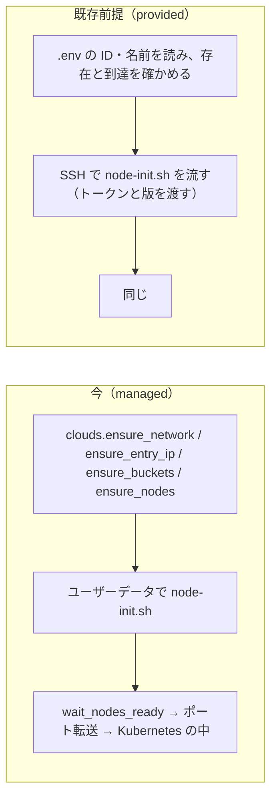

# セッションログ 6fdf13be

- セッション: `6fdf13be-d0bd-4940-9a69-2889f6649720`
- cwd: `/Users/notfolder/orca/workspaces/litellm-agent-gateway-lab/feature-aws-target-2`（branch: feature/aws-ec2-pair）
- 期間: 2026-10-30 22:33 〜 2026-10-31 13:05
- Claude Code: 2.1.310
- 発言: ユーザー 90 / Claude 88 / ツール呼び出し 557
- 書き出し: 2026-10-31 13:06 JST

> ユーザー発言と Claude の本文は逐語。ツール呼び出しは `🔧` の 1 行に要約し、ツール結果・思考ブロックは含まない。

---
## 1. ユーザー（2026-10-30 22:33）

（コマンド: /clear ）

## 2. ユーザー（2026-10-30 22:35）

ec2とgcpについてらs3のバケットとec2の様な仮想サーバーが3台すでに作られている状態から、セットアップできる様に検討して整理して報告して

## 3. Claude

まず、現在の `./lab up`（`aws-ec2` / `gcp-vm`）が何を作っているかをコードと設計書で確認し、「バケットと VM 3 台が既にある」状態から始めるのに何が要るかを整理します。読み取りのみで、変更は行いません。

> 🔧 `Bash` リポジトリの構成と lab スクリプトの先頭を見る

> 🔧 `Bash` labtool と vm 配下の一覧、lab の残りを見る

> 🔧 `Bash` VM の基盤を作るモジュールを読む

> 🔧 `Bash` クラウドごとの API 呼び出しを読む

> 🔧 `Bash` stages と core の関数一覧と preflight/cluster を読む

> 🔧 `Bash` 直近の設計書と引き継ぎの一覧と要約を読む

> 🔧 `Bash` クラウド層の共通部分と AWS EC2 の実装を読む

> 🔧 `Bash` GCP の実装を読む

> 🔧 `Bash` VM のクラスタ段階、オブジェクトストア段階、VM の初期化スクリプトを読む

> 🔧 `Bash` VM 共通化の変更設計書を読む

> 🔧 `Bash` VM 共通化の変更仕様書と .env.example の関連項目を読む

> 🔧 `Bash` AWS EC2 層の前半を読む

> 🔧 `Bash` AWS EC2 層の後半を読む

> 🔧 `Bash` GCP 層の前半を読む

> 🔧 `Bash` GCP 層の後半を読む

> 🔧 `Bash` イメージ push、オブジェクトストア段階、VM 初期化スクリプトを読む

> 🔧 `Bash` 設計書・仕様書の見出し、.env.example の関連項目、down の処理を読む

> 🔧 `Bash` バケットの仕様と利用者ごとの権限の定義を読む

> 🔧 `Bash` 障害試験・検査・secrets・litellm 段階がクラウド層に頼る箇所を読む

> 🔧 `Bash` Env の対象の判定と VM 関連の設定値を読む

> 🔧 `Bash` 変更設計書の段階・env 項目・手作業の時点を読む

> 🔧 `Bash` 変更設計書の実装で分かったことと仕様書の前提・未決点を読む

> 🔧 `Bash` バックログ・アイデア・EC2 構成文書の見出しを読む

> 🔧 `Bash` 自己検査・registry のマニフェスト・障害試験の台停止・status を読む

> 🔧 `ToolSearch` select:WebSearch

> 🔧 `WebSearch` Amazon S3 enable Object Lock on existing bucket announcement

> 🔧 `WebSearch` Compute Engine change service account attached to instance must be stopped setServiceAccount

> 🔧 `WebSearch` EC2 associate-iam-instance-profile running instance assign-private-ip-addresses secondary IP running

調査が終わりました。変更は一切行っていません（読み取りのみ）。結果を報告します。

## 結論

**できます。** 今の `./lab up` のうち、クラウドに物を「作る」のは `cluster` 段階の前半（`labtool/clouds/aws_ec2.py` / `gcp.py`）だけで、Kubernetes の中身・試験・監査・審査は VM が誰の手で作られたかを知りません。したがって「バケットと VM 3 台が既にある」前提では、次の 2 点を変えるだけで残りはそのまま動きます。

1. クラウド固有層の「探して無ければ作る」を「`.env` で受け取って確かめる」に置き換える
2. VM の初期化（`vm/node-init.sh`）を、起動時のユーザーデータでなく **SSH で流す**（`vm.run_on` が既にあり、スクリプトも `ready` 印で冪等に書かれている）

ただし「何がどこまで用意されているか」で設計が分かれる点が 8 つあり、末尾の確認事項で判断をお願いします。

## 今 `./lab up` がクラウドに作るものと、既存前提での扱い

| 今ツールが作るもの | 既存前提では | 変更の大きさ |
|---|---|---|
| VPC・サブネット・IGW・S3 エンドポイント / VPC・サブネット（GCP） | 用意する側。ツールは触らない | 小（呼ばない） |
| セキュリティグループ / ファイアウォール（22, 80/443 を操作者 IP に毎回絞る） | 用意する側が開ける。ツールは「届くか」を確かめて案内するだけ | 小 |
| 浮動 IP（Elastic IP / 静的外部 IP） | 用意の有無で入口の切り替え方式が変わる（確認 4） | 中 |
| VM 3 台（Ubuntu 24.04 arm64、固定プライベート IP、ユーザーデータで初期化） | 用意済み。**ユーザーデータは走っていない**ので、ツールが SSH で初期化スクリプトを流す | 中 |
| VM の権限（インスタンスロール / SA）: バケット読み取り、IP 付け替え | SSH 初期化なら k3s のトークンと版は SSH で渡せるので、**バケット読み取りの権限は不要**。IP 付け替えだけが残る（確認 4） | 小 |
| バケット 6 つ（audit-raw, audit-access, audit-derived, pg-backup, images, cluster）とロック・バージョニング・ライフサイクル | 名前を受け取り、設定は検査（変更権限があれば直す）。数が足りないときの扱いは確認 2 | 中 |
| 役割ごとの静的キー 5〜6 組（IAM ユーザー / SA の HMAC） | 作る権限があれば今のまま。無ければ `.env` で受け取る（確認 3） | 中 |
| cluster バケットの `k3s/token`・`k3s/version` | SSH 初期化時にツールが直接渡す。版上げ（`upgrade-k8s`）の版の記録先は cluster バケットのまま | 小 |
| Cloudflare の A レコード、Let's Encrypt、Traefik、registry、オペレーター、LiteLLM 以降の全段階 | **変更なし** | なし |

## 用意される VM とバケットに求める前提

- **OS**: Ubuntu 24.04（`apt`、`netplan`、`snap`、`systemd` を使う）。CPU は今は arm64 前提で、イメージも `linux/arm64` でビルドしている（確認 7）
- **SSH**: 操作者の Mac から 22 に届き、`sudo` できる利用者で入れる。鍵は用意する側から受け取るか、ツールの公開鍵（`.build/vm-ssh-key.pub`）を置いてもらう
- **ネットワーク**: 3 台の間はすべて通る（k3s の 6443・etcd・VXLAN、keepalived の VRRP）。80/443 と 22 は操作者の回線から届く。各台に外向きの経路（apt、get.k3s.io、Anthropic、Let's Encrypt）
- **バケット**: 原本 2 つは Object Lock / 保持ポリシー、他はバージョニングの有無が違う（詳細は確認 2）。GCP の `images` は「均一なバケットレベルのアクセス」を**切る**必要がある（registry が ACL を付けるため。前回の配備で判明）
- **GCP の起動スクリプト**は無いので、浮動 IP を使う場合は、起動時に外向き IP を戻す処理を systemd に入れる（小）

## 既存の物に後から足せるか（裏取り済み）

| 項目 | 可否 | 根拠 |
|---|---|---|
| 既存の S3 バケットに Object Lock を有効化 | **可**（2023-11 から。バージョニングが前提、既存オブジェクトは自動では保護されない、戻せない） | [AWS What's New](https://aws.amazon.com/about-aws/whats-new/2023/11/amazon-s3-enabling-object-lock-buckets)、[S3 ユーザーガイド](https://docs.aws.amazon.com/AmazonS3/latest/userguide/object-lock-configure.html) |
| 起動中の EC2 にインスタンスプロファイルを付ける | **可**（再起動不要） | [AssociateIamInstanceProfile](https://docs.aws.amazon.com/AWSEC2/latest/APIReference/API_AssociateIamInstanceProfile.html) |
| 起動中の EC2 に 2 つ目のプライベート IP（Elastic IP の宛先）を足す | **可**（OS 側の設定は別途。今の hooks の netplan がそれ） | [Secondary IP addresses](https://docs.aws.amazon.com/AWSEC2/latest/UserGuide/instance-secondary-ip-addresses.html) |
| 既存の Compute Engine にサービスアカウントを付け替える | **要停止**（止めてから `setServiceAccount`、起動） | [Change the attached service account](https://docs.cloud.google.com/compute/docs/instances/change-service-account) |

GCP の浮動 IP を使うなら、用意する側が最初から VM に権限付きのサービスアカウントを付けておく必要があります。

## 確認事項

いずれも独立しているので、「1A, 2B…」のようにまとめて答えてください。

**1. 既存の物をツールにどう伝えるか**

| 案 | 内容 | 影響 |
|---|---|---|
| A | `.env` に ID・名前を列挙（VM の ID 3 つ、バケット名、SSH の鍵と利用者名、浮動 IP の ID） | 用意する側に規約を求めない。`discover` を置き換える |
| B | 今のタグ（`lab:prefix`、`lab:node-index`）/ ラベルを用意する側に付けてもらい、今の `discover` で探す | コード変更は最小だが、タグを付ける権限と規約の共有が要る |

おすすめ: **A**。「既に作られている」前提では用意する側の作業を増やさないのが自然で、誤検出もありません。

**2. バケットの数**

| 案 | 内容 | 影響 |
|---|---|---|
| A | 今と同じ 6 つを用意してもらう（名前は自由。`.env` で受け取る） | 権限・ロック・ライフサイクルの設計を変えない |
| B | 3 つ（原本 audit-raw、閲覧記録 audit-access、残り 4 つを 1 つに接頭辞で同居） | registry の ROOTDIRECTORY、Barman の宛先、derived と cluster の鍵に接頭辞を足す（中） |
| C | 1 つにまとめる | 原本の保持（90 日 / 400 日）がバケット全体に掛かり、pg-backup の世代削除や registry の掃除が拒否される。退けるのが妥当 |

おすすめ: **A**。原本 2 つは保持期間が違うので最低 2 つは分ける必要があり、残りをまとめる B は用意できるバケット数に制約があるときの代案です。

**3. 静的キー（IAM ユーザー / サービスアカウントと HMAC キー）**

| 案 | 内容 | 影響 |
|---|---|---|
| A | 操作者の資格情報で作れるなら今のまま（ツールが作り、Kubernetes の Secret にだけ置く） | 変更なし |
| B | 用意する側が役割ごとに 5〜6 組発行し、`.env` で受け取る | 権限の設計（`render.s3_policies`）を用意する側に渡す文書が要る。`self_check` はそのまま使える |
| C | 1 組のキーを全役割で共用 | 役割ごとの権限分離が無くなり、`objectstore` 段階の自己検査 6 件が成り立たない |

おすすめ: 操作者に IAM の権限があるなら **A**、無いなら **B**。C は監査ログの保護（書き込み専用の利用者が原本を読めない等）を崩すので勧めません。

**4. 入口の浮動 IP（障害時の切り替え）**

| 案 | 内容 | 影響 |
|---|---|---|
| A | 用意する側が浮動 IP と、VM に付け替えの権限（ロール / SA）を用意する | 今の keepalived 方式がそのまま動く。GCP は SA を最初から付けてもらう必要あり |
| B | 浮動 IP なし。A レコードは 1 号機の公開 IP に向け、入口の切り替えは諦める | keepalived を入れない。`entry-node` の試験を飛ばす。実装は小 |

おすすめ: 用意できるなら **A**、無理なら **B**。Mac から DNS を切り替える案は、Mac が常駐しないので退けました。

**5. ネットワークの許可（22, 80/443）**

| 案 | 内容 | 影響 |
|---|---|---|
| A | ツールは触らない。届かなければ「用意する側に開けてもらう」案内で止まる | `allow_ssh_from` / `allow_web_from` を飛ばす。回線が変わるたび人が依頼 |
| B | セキュリティグループ / 規則の ID を受け取り、ツールが送信元だけ直す | 今の挙動を保てるが、その変更権限が要る |

おすすめ: **A**。「既に作られている」前提は権限が限られている状況と考え、権限があれば B に切り替えられる形にします。

**6. 障害試験の「台を止める」**

| 案 | 内容 | 影響 |
|---|---|---|
| A | 操作者の資格情報で VM の停止・起動ができるなら今のまま | 変更なし |
| B | SSH で `systemctl stop k3s`（と keepalived）を止めて代用 | クラウドの権限が不要。ネットワークは生きたままなので「台の停止」より軽い障害になる |

おすすめ: 権限があれば **A**、無ければ **B**。

**7. 用意される VM の OS と CPU**

| 案 | 内容 | 影響 |
|---|---|---|
| A | Ubuntu 24.04 arm64（今の前提） | 変更なし |
| B | Ubuntu 24.04 amd64 | イメージのビルドの `--platform` を `.env` で切り替える（小） |
| C | 別の OS | `node-init.sh` の apt / snap / netplan を書き換える（大）。退けたい |

おすすめ: **A か B**（用意される実物に合わせる）。

**8. 既存前提での `./lab down` の意味**

| 案 | 内容 | 影響 |
|---|---|---|
| A | 用意された物は残し、3 台の k3s をアンインストールし、ロックの無いバケットを空にする | `./lab rebuild` が成立する |
| B | Kubernetes の中（Helm と名前空間）だけ消し、k3s は残す | 速いが、k3s のデータが残るため作り直しの試験になりにくい |

おすすめ: **A**。

**9. 表し方**

| 案 | 内容 | 影響 |
|---|---|---|
| A | 同じ `LAB_TARGET`（aws-ec2 / gcp-vm）に `LAB_INFRA=provided` のような切り替えを足す | Kubernetes の中は同じなので分岐が少ない |
| B | 新しい `LAB_TARGET`（例 aws-ec2-provided） | `is_vm` 系の判定や文書の表に列が増える |

おすすめ: **A**。

回答が揃ったら、変更仕様書と変更設計書を `.history/` に起こし、作業量の見積もりを `~/.claude/estimate-log.md` のルールで出します。

## 4. ユーザー（2026-10-30 22:50）

<pasted_content id="afeb">
1 A
2 C保持期間は長めにするか、ディレクトリ毎の設定に出来ないか？
3 リソースが既存なのにキーが必要なのはなぜか？
4 A
5 A
6 A
7 A本番ではarmではない可能性があるが、問題がないか確認して
8 A 既存でも環境の全削除はできる様にして
9 A
本番環境はzscaler内にある。3台の他にzscaler役のリバースプロキシを立てて、独自caと照明でzscaler内でも環境を作れる事を確認して。
</pasted_content id="afeb">

## 5. Claude

回答を受けて、2（1 バケットでディレクトリごとの保持ができるか）、3（キーが要る理由）、7（arm 以外で問題がないか）、Zscaler 相当の構成について、根拠を集めてから報告します。まず事実の裏取りをします。

> 🔧 `WebSearch` Cloud Storage object retention lock enableObjectRetention bucket creation only existing bucket

> 🔧 `WebSearch` Cloud Storage bucket retention policy prevents objects from being deleted or replaced overwrite

> 🔧 `WebSearch` S3 Object Lock overwrite object new version allowed delete object without version id delete marker

> 🔧 `WebSearch` k3s HTTP_PROXY HTTPS_PROXY NO_PROXY /etc/systemd/system/k3s.service.env containerd proxy

> 🔧 `Bash` CPU アーキテクチャの前提と、VM・Pod から外へ出る通信先をコードから洗い出す

> 🔧 `Bash` イメージのビルド条件と使用するコンテナイメージの一覧を確かめる

> 🔧 `Bash` 監査ログの書き込み方法と、プロキシ・CA に関する既存の設定の有無を確かめる

> 🔧 `Bash` 監査ログの原本と閲覧記録を書くコードが自前かを確かめる

調査が終わりました。変更は行っていません。回答の反映と、追加で調べた 3 点（2C、3、7）、追加要件（Zscaler 相当）の整理を報告します。

## 回答の反映と、調べた結果

決定として扱うもの: 1A（`.env` に ID・名前を列挙）、4A（浮動 IP と VM の権限は用意する側）、5A（ネットワークの許可はツールが触らない）、6A（障害試験の台の停止は操作者の資格情報で）、7A（Ubuntu 24.04）、8A＋全削除の口を残す、9A（`LAB_INFRA=provided` のような切り替え）。

**2C: 1 バケットで「ディレクトリごとの保持」はできるか**

できます。ただし「バケットの既定の保持」ではなく「オブジェクト単位の保持」で実現する必要があります。調べた事実は次のとおりです。

| 事実 | AWS S3 | GCP Cloud Storage |
|---|---|---|
| バケット全体の既定の保持 | 全オブジェクトに掛かる。接頭辞ごとには掛けられない | 同じ（保持ポリシーは全体）。さらに**上書きも拒む**ので、registry のタグ更新、整形結果の書き直し、k3s の版の更新が止まる。バージョニングとも排他 |
| オブジェクト単位の保持 | 書き込み時に保持期日を付けられる（Object Lock をバケットで有効化。既存バケットでも可、バージョニング必須） | 「オブジェクト保持ロック」で可。ただし**バケット作成時に有効化**（既存は Console からのみ） |
| 保持中の上書き・削除 | 新しい版の作成と削除マーカーは通る。版の完全削除だけ拒む | 保持中のオブジェクトの削除・置き換えを拒む（オブジェクト単位） |
| 接頭辞ごとのライフサイクル | 可 | 可 |

原本（`raw/`）を書くのは LiteLLM の自前コールバック（`litellm/guardrails/audit_log.py`）、閲覧記録を書くのは検索アプリ（`apps/audit/audit/data.py`）で、どちらも自前のコードなので、書き込み時に保持（原本 90 日、閲覧記録 400 日）を付けられます。他のディレクトリ（`derived/`、`pg-backup/`、`images/`、`cluster/`）は保持なしで今と同じに動きます。

「保持期間を長めに一律で」は、S3 では動きますが pg-backup と registry の消したはずの版が 400 日残って費用が増え、GCP では上書き拒否で動かないので退けるのが妥当です。

設計への影響: 権限は接頭辞の条件付きで表現（今の GCP の形と同じ）、書き込み利用者に自分の接頭辞への保持の設定だけ許す（短縮・回避は今どおり全員拒否）、自己検査の「管理者でも保持の回避なしには消せない」をオブジェクト保持で確かめる形に直す、pg-backup と images にバージョニングが掛かるので非現行版の期限ルールを足す。registry と Barman は接頭辞の設定項目を持っているので対応できます。

**3: 既存なのにキーが要る理由**

キーが要るのは VM ではなく、**クラスタの中の Pod**（LiteLLM の監査ログ、整形、検索アプリ、Barman のバックアップ、registry）がオブジェクトストレージを S3 API で呼ぶためです。VM 自身の権限（インスタンスロール / サービスアカウント）を Pod に使わせる手もありますが、2 つ問題があります。

- 1 台の全 Pod が同じ権限になり、「書き込み用は原本を読めない」「検索アプリは原本に書けない」という役割分離と、`objectstore` 段階の自己検査 6 件が成り立たなくなる
- GCP では S3 互換 API の認証が HMAC キーなので、VM のサービスアカウントを使う場合でもその HMAC キーを作る必要があり、キー自体は無くならない（Google の JSON API に切り替えるには registry・Barman・LiteLLM・監査アプリの 4 つの接続方法を変える大きな作業）

したがって「用意する側が役割ごとのキー（5 組）を発行し `.env` で渡す」のが前提に合います。権限の内容（接頭辞ごとの許可）は、用意する側に渡す文書として設計書に書きます。

**7: arm 以外（amd64）で問題がないか**

止まる箇所はありません。確かめた内容は次のとおりです。

| 箇所 | 状況 |
|---|---|
| 自作イメージ 2 つ（LiteLLM、監査アプリ）のビルドと push | `linux/arm64` を 3 か所で固定（`labtool/stages.py`）。VM の CPU を SSH の `uname -m` で読んで合わせる変更で済む |
| 外部イメージ（LiteLLM 公式、PostgreSQL、Valkey、registry、python、k3s） | いずれも両アーキテクチャあり。Gmail の MCP（`google_workspace_mcp`）だけ amd64 の提供を未確認 |
| k3s のインストール、keepalived、awscli の snap | アーキテクチャを自動判別。amd64 でも同じ |
| Mac 側のビルド | Apple Silicon で amd64 をビルドするとエミュレーションになり、ビルド中の単体テストが遅くなる（動くが数倍）。遅ければ VM 上でビルドする選択肢がある |

**8: 全削除**

`./lab down` は用意された物を残し（k3s のアンインストールと、保持の無いディレクトリの消去）、別の口（例 `./lab down --all`）で VM・バケット・キーまで消します。S3 の Object Lock を有効にしたバケットは保持中の版が残る間は消せませんが、今と同じ GOVERNANCE 相当なら操作者が回避して消せます（GCP も「ロックしない」保持なら解除できます）。

## 追加要件: Zscaler 相当の構成（設計に入れるもの）

Zscaler は外向きの通信を中継し、TLS を独自 CA で復号・再署名します。検証環境では 3 台と同じネットワークに **4 台目（出口プロキシ役）** を置き、独自 CA で TLS を終端し直す中継（mitmproxy を想定。透過・明示の両方式に対応し、通した通信を記録できる）を動かします。3 台からの直接のインターネット経路は塞ぎ、プロキシ経由でしか外に出られない状態で `./lab up` と全試験を通すことを完了条件にします。影響する箇所は次のとおりです。

| 層 | 外へ出る通信 | 要る対応 |
|---|---|---|
| VM（初期化） | apt、snap、get.k3s.io、AWS / GCP の API（浮動 IP の付け替え） | 独自 CA を OS の信頼店に入れる、プロキシの環境変数（k3s は `/etc/systemd/system/k3s.service.env`。NO_PROXY に 3 台の IP、クラスタの CIDR、メタデータの 169.254.169.254 を含める） |
| k3s / containerd | コンテナイメージの取得（ghcr.io、docker.io、quay.io） | 同上（containerd は OS の信頼店を使う） |
| Pod | LiteLLM → Anthropic・Google、MCP → Google、cert-manager → Let's Encrypt・Cloudflare、Barman・registry・監査アプリ → オブジェクトストレージ | **ホストの設定は Pod に引き継がれない**ので、各ワークロードに CA（ConfigMap で配る）とプロキシの環境変数を渡す。Python 系は `REQUESTS_CA_BUNDLE` / `AWS_CA_BUNDLE`、Go 系は `SSL_CERT_FILE` |
| 操作者の Mac | `./lab` 自身（boto3、Google のクライアント、Cloudflare の API）、`docker build` / pull、`helm` のチャート取得 | 本番では操作者も Zscaler 内なので、Mac からの通信も 4 台目を通して試す必要がある。Mac 側の CA の置き場所は道具ごとに違う（Python は環境変数、Go はキーチェーン、Docker はデーモン） |
| 入口（80/443、A レコード、DNS-01） | 影響なし | なし |

透過方式なら経路（AWS はルートテーブル、GCP はインスタンス宛ての経路）を 4 台目に向け、CA の配布だけで済みます。明示方式なら経路は変えずに、上の表のすべてにプロキシの環境変数を配ります。どちらも CA の配布は要ります。

## 確認事項

いずれも独立しているので、まとめて答えてください。

**1. 1 バケットの保持の方式**

| 案 | 内容 | 影響 |
|---|---|---|
| A | オブジェクト単位の保持（書く側が原本 90 日・閲覧記録 400 日を付ける）。S3 は Object Lock を有効化（既定の保持なし）、GCP は作成時に「オブジェクト保持ロック」を有効化 | 両クラウドで同じ設計。用意する側に「作成時のフラグ」を頼む（GCP） |
| B | バケット全体に 400 日の保持を一律 | S3 のみ動く。不要な版が 400 日残る。GCP は上書き拒否で不可 |

おすすめ: **A**。ディレクトリごとに違う保持を 1 バケットで実現できる唯一の形です。

**2. Zscaler の方式（本番に合わせる）**

| 案 | 内容 | 影響 |
|---|---|---|
| A | 透過（トンネルや経路で全通信を中継。アプリは中継を知らない） | 経路の変更と CA の配布。Zscaler Internet Access をトンネルで使う構成に近い |
| B | 明示（PAC や環境変数でプロキシを指定） | CA の配布に加え、VM・k3s・全 Pod・Mac にプロキシの環境変数を配る |

おすすめ: **本番の方式に合わせる**。分からなければ **A**。設定を配る箇所が少なく、見落としが起きにくいためです。

**3. 操作者の Mac も Zscaler 内の想定で試すか**

| 案 | 内容 | 影響 |
|---|---|---|
| A | 試す（Mac の通信も 4 台目を通す。操作者の IP からだけ中継を受ける） | `./lab` の各クライアントの CA の設定が要る。本番の操作者の環境に一致 |
| B | 試さない（VM と Pod だけ） | 作業は小さいが、本番で `./lab` が動かない可能性が残る |

おすすめ: **A**。

**4. amd64 のビルド場所**

| 案 | 内容 | 影響 |
|---|---|---|
| A | Mac でエミュレーションでビルド（VM の CPU を自動判別） | 変更は小。ビルドが数倍遅い |
| B | VM 上でビルド | 変更は中。速いが VM に Docker か buildkit が要る |

おすすめ: **A**（遅さが問題になったら B に）。

回答が揃ったら、変更仕様書と変更設計書を `.history/` に起こし、見積もりを `~/.claude/estimate-log.md` のルールで出します。

Sources: [S3 Object Lock を既存バケットで有効化](https://aws.amazon.com/about-aws/whats-new/2023/11/amazon-s3-enabling-object-lock-buckets)、[S3 Object Lock の挙動](https://docs.aws.amazon.com/AmazonS3/latest/userguide/object-lock.html)、[GCS バケットの保持ポリシー](https://cloud.google.com/storage/docs/bucket-lock)、[GCS オブジェクト保持ロック](https://cloud.google.com/storage/docs/using-object-lock)、[k3s のプロキシ設定](https://docs.k3s.io/advanced)

## 6. ユーザー（2026-10-30 23:05）

<pasted_content id="afeb">
1 A
2 B
3 A
4 これはどういう事？現状はarmで検証で良いと思ってます
回答だけして
</pasted_content id="afeb">

## 7. Claude

確認 4 は「本番の VM が amd64（Intel/AMD）だった場合に、自作イメージ 2 つ（LiteLLM、監査アプリ）を amd64 向けにどこでビルドするか」という問いでした。

- Mac は Apple Silicon なので、amd64 のイメージを作るにはエミュレーションが要り、ビルド中に流す単体テストが数倍遅くなります。それを避けるなら VM 上でビルドする手がある、という比較でした。
- **今は arm で検証する**という方針なら、この問いは今は決めなくてよいです。設計には「VM の CPU を SSH で読み、同じアーキテクチャでビルドする」ことだけ入れ、ビルド場所は Mac のままにします。本番で amd64 の VM が出てきた時点で、遅さが問題になれば VM 上でのビルドを検討します。

反映した決定: 1A（オブジェクト単位の保持）、2B（Zscaler は明示プロキシ方式）、3A（操作者の Mac も Zscaler 内の想定で試す）、4 は保留（arm で検証、CPU は自動判別のみ）。

## 8. ユーザー（2026-10-30 23:12）

ビルド場所はvm上にしてください。本番もそうします。
変更仕様、設計を書いて実装し、テストをして問題なければ既存ドキュメントに反映して、テストと検証をして、問題なければpushして環境を全部消して報告して下さい。寝ているうちに終わると思うので、検証で問題ないところまで確認できたら費用がかからない様全てを削除してから報告しておいて下さい

## 9. Claude

了解しました。方針（ビルドは VM 上、本番も同じ）を含めて、変更仕様書と変更設計書 → 実装 → 単体テスト → GCP に配備して検証 → 文書の反映 → push → 環境の全削除 → 報告、の順で進めます。まず見積もりの記録・現在時刻・資格情報の状態を確かめます。

> 🔧 `Bash` 現在時刻、見積もりの記録、.env の項目名、GCP の資格情報、git の状態を確かめる

> 🔧 `Bash` 見積もり記録の直近行、.env の項目、GCP の資格情報の有無、git の状態

> 🔧 `Bash` test-unit の中身、単体テストの規模、render の関連関数の位置

> 🔧 `Bash` バケット名・監査アプリの S3 設定・Barman の設定・LiteLLM の監査設定の描画を読む

> 🔧 `Bash` 監査ログの原本と閲覧記録を書くコードの S3 の設定の読み方を読む

> 🔧 `Bash` LiteLLM の Helm の値、k8s マニフェスト一覧、Barman の設定を読む

> 🔧 `WebSearch` Cloud Storage XML API set object retention configuration header x-goog object lock retain until date upload

> 🔧 `WebSearch` cloudnative-pg plugin-barman-cloud ObjectStore instanceSidecarConfiguration env endpointCA

> 🔧 `WebSearch` litellm-helm chart values extraEnvVars volumes volumeMounts

> 🔧 `Bash` 監査アプリのバケット名の使われ方を読む

> 🔧 `Bash` 検索アプリ・合成データ・監査試験のバケット参照を読む

> 🔧 `Bash` Barman・監査・MCP のマニフェストの env、オペレーターの入れ方、plugin の CRD に endpointCA があるか

> 🔧 `Bash` 冪等性の記録とオブジェクトストアの検査関数を読む

> 🔧 `Bash` 定数、監査・MCP のマニフェストの描画と段階を読む

> 🔧 `WebSearch` Cloud Storage object retention lock compatible with object versioning bucket "object retention" "versioning"

> 🔧 `WebSearch` Cloud Storage permission required to set object retention configuration on upload storage.objects.setRetention objectCreator

> 🔧 `Bash` 監査アプリのテストの参照、イメージのタグ、URL の apply、gitignore、テストクラス

> 🔧 `Bash` Python の GCS クライアントがオブジェクト保持に対応しているか、監査試験の Job の作り方

> 🔧 `Bash` Helm の値の先頭、LiteLLM の Secret、静的キーの名前、クラウド層のテストを読む

> 🔧 `Bash` VM 層のテスト、障害試験の入口の場面、疎通試験の関連箇所を読む

> 🔧 `Bash` 変更仕様書を書く

> 🔧 `Bash` 変更設計書を書く

> 🔧 `Bash` objectstore の S3 クライアントと資格情報の読み方を読む

> 🔧 `Bash` 監査コールバックの設定の読み方と、監査試験の保持の検査を読む

> 🔧 `Bash` 監査アプリのバケット参照の全行を列挙する

> 🔧 `Bash` k3s の版上げの処理と、基盤を読む箇所の一覧

> 🔧 `Bash` core の定数・helm・http、render の先頭、datastores 段階を読む

> 🔧 `Bash` 監査アプリの S3 を呼ぶ関数の本体を読む

> 🔧 `Bash` 監査コールバックの初期化、.env.example の VM の部分、テストの補助関数を読む

> 🔧 `Bash` core.py に既存資源・中継の設定値と Mac の中継の適用を足す

> 🔧 `Bash` helm の --ca-file をチャート取得のサブコマンドだけに付ける

> 🔧 `Bash` _ensure_chart と render の権限定義の残りを読む

> 🔧 `Bash` render.py に 1 バケットの配置・保持・出口プロキシの配布を実装する

> 🔧 `Bash` 静的キーの名前の呼び出し元に env を渡す

> 🔧 `Bash` objectstore.py に 1 バケットの作成・検査・自己確認・保持を実装する

> 🔧 `Bash` k8s のテンプレートに 1 バケットと保持の値を足す

> 🔧 `Bash` 監査アプリを 1 バケットのディレクトリと保持に対応させ、単体テストを流す

> 🔧 `Bash` LiteLLM の監査コールバックに鍵の接頭辞と保持を足し、単体テストを流す

> 🔧 `Bash` Dockerfile の全体を確かめる

> 🔧 `Bash` 監査アプリの単体テストのエラーを見る

> 🔧 `Bash` LiteLLM の監査コールバックに鍵の接頭辞と保持を足し、単体テストを流す

> 🔧 `Bash` Dockerfile の全体を確かめる

> 🔧 `Bash` Dockerfile・gitignore・論理名の一覧と、クラウド層の契約（権限の写し）を書く

> 🔧 `Bash` GCP の層を provision/setup の形に書き直す

> 🔧 `Bash` Python 3.12 で gcp.py の構文を確かめる

> 🔧 `Bash` AWS の層を同じ形で書き直す

> 🔧 `Bash` VM の初期化スクリプト（SSH 実行用）、クラウドごとの hooks、中継の初期化スクリプトを書く

> 🔧 `Bash` vm.py の関数の呼び出し元を数える

> 🔧 `Bash` VM 共通層を .env の識別子・SSH 初期化・VM 上のビルド・中継に合わせて書き直す

> 🔧 `Bash` stages.py を provision/setup・VM 上のビルド・中継の配布に合わせて書き換える

> 🔧 `Bash` ops・lab・checks・監査の試験を新しい基盤の読み方と 1 バケットに合わせる

> 🔧 `Bash` pyflakes で未定義名や未使用の参照を洗い出す

> 🔧 `Bash` 監査試験の接頭辞を直し、構築ツールの単体テストを流す

> 🔧 `Bash` 落ちたテストの一覧と VM 層のテストの本体を見る

> 🔧 `Bash` クラウド層のテストの残りを見る

> 🔧 `Bash` 単体テストを新しい形に書き直し、.env.example に項目を足して、テストを流す

> 🔧 `Bash` テストの直しを入れて単体テスト・pyflakes・lab の起動を確かめる

> 🔧 `Bash` 実装をコミットし、検証用に .env を managed ＋ 中継の VM ありに設定する

> 🔧 `Bash` GCP への ./lab up（1 回目）を背景で開始する

> 🔧 `Bash` 起動から約 100 秒後にログの末尾を確かめる（すぐ落ちる不具合を拾う）

> 🔧 `Bash` 入口の許可に中継の VM の外部 IP も足す

> 🔧 `Bash` 1 回目の up のログの末尾を見る

> 🔧 `Bash` 5 分待ってから 1 回目の up の進み具合を見る

> 🔧 `Bash` 既存文書の見出しを確かめる（反映先の把握）

> 🔧 `Bash` 設計書の見出しを確かめる

> 🔧 `Bash` 保守文書と README の見出し、VM 環境への言及箇所を確かめる

> 🔧 `Bash` EC2 構成図の文書を読む（書き直しの元）

> 🔧 `Bash` 仕様書の全体構成・検証環境・オブジェクトストレージの節を読む

> 🔧 `Bash` README の VM 節、設計書の全体構成と構築の流れ、保守文書の前提を読む

> 🔧 `Bash` 構成図の文書を VM 2 クラウド＋既存資源＋出口プロキシの形に書き直し、README のリンクを直す

> 🔧 `Bash` HMAC キーの一覧の 404 にも再試行を入れ、2 回目の up を開始する

> 🔧 `Bash` 4 分後に 2 回目の up の進み具合を見る

> 🔧 `Bash` 設計書のデータ保持・決定事項と仕様書のリスクの節の形を見る（追記先）

> 🔧 `Bash` 仕様書に 12 章、設計書に 21 章（VM 環境）を追記する

> 🔧 `WebSearch` distribution registry gcs storage driver uniform bucket-level access ACL REGISTRY_STORAGE_GCS_KEYFILE rootdirectory

> 🔧 `Bash` 2 回目の up のログの要点を見る

> 🔧 `Bash` GCS を均一アクセスに戻し registry を GCS ドライバ（JSON キー）にして、3 回目の up を開始する

> 🔧 `Bash` 約 2.5 分後に 3 回目の up の進み具合を見る

> 🔧 `Bash` 文書の GCS の均一アクセスと registry のドライバの記述を直す

> 🔧 `Bash` 3 回目の up の進み具合を見る

> 🔧 `Bash` README の VM 節と保守文書に VM 環境の違いを書く

> 🔧 `Bash` 保守文書の章の順を直し、up の進み具合を見る

> 🔧 `Bash` 削除済みのカスタムロールを戻す処理を足し、4 回目の up を開始する

> 🔧 `Bash` 4 分後に 4 回目の up の進み具合を見る

> 🔧 `Bash` 変更設計書 14 章に配備で分かったことを書き始める

4 回目の `./lab up` を 00:06 に開始しました。カスタムロール（前日の削除で 7 日間「削除済み」のまま残るもの）を戻す処理を足しています。4 分後の確認が返るまで待ちます。

## 10. ユーザー（2026-10-31 00:06）

<task-notification>
<task-id>bio87lecn</task-id>
<tool-use-id>toolu_014zDXDUswPhkJ6bH6ra7Kfu</tool-use-id>
<output-file>/private/tmp/claude-501/-Users-notfolder-orca-workspaces-litellm-agent-gateway-lab-feature-aws-target-2/cc01e122-bd4d-40ab-ad74-ba0305719c21/tasks/bio87lecn.output</output-file>
<status>completed</status>

Background command "約 2.5 分後に 3 回目の up の進み具合を見る" completed (exit code 0)

</task-notification>

## 11. Claude

> 🔧 `Bash` 4 回目の up の進み具合を見る

> 🔧 `Bash` 配備で見つかった修正と文書の下書きをコミットする

4 回目の `./lab up` が静的キーの作成まで進んでいます（00:06 開始）。これまでの修正と文書の下書きをコミットしました。次の確認（背景の待機）が返るまで待ちます。

## 12. ユーザー（2026-10-31 00:10）

<task-notification>
<task-id>b7vyilekz</task-id>
<tool-use-id>toolu_01JtDfKdh4ceXBBm6UDSnACu</tool-use-id>
<output-file>/private/tmp/claude-501/-Users-notfolder-orca-workspaces-litellm-agent-gateway-lab-feature-aws-target-2/cc01e122-bd4d-40ab-ad74-ba0305719c21/tasks/b7vyilekz.output</output-file>
<status>completed</status>

Background command "4 分後に 4 回目の up の進み具合を見る" completed (exit code 0)

</task-notification>

## 13. Claude

> 🔧 `Bash` 4 回目の up の進み具合を見る

> 🔧 `Bash` SSH の待ちを「ログインできるまで」にして 5 回目の up を開始する

> 🔧 `Bash` 7 分後に 5 回目の up の進み具合を見る

5 回目の `./lab up` を 00:10 に開始しました（SSH の待ちを「ログインできるまで」に直した版）。中継の VM の初期化と 3 台の SSH 初期化に数分かかるので、7 分後の確認が返るまで待ちます。

## 14. ユーザー（2026-10-31 00:17）

<task-notification>
<task-id>b8c4bnzom</task-id>
<tool-use-id>toolu_01F16eoxTX5JVDnPkGamxyvN</tool-use-id>
<output-file>/private/tmp/claude-501/-Users-notfolder-orca-workspaces-litellm-agent-gateway-lab-feature-aws-target-2/cc01e122-bd4d-40ab-ad74-ba0305719c21/tasks/b8c4bnzom.output</output-file>
<status>completed</status>

Background command "7 分後に 5 回目の up の進み具合を見る" completed (exit code 0)

</task-notification>

## 15. Claude

> 🔧 `Bash` 5 回目の up の進み具合を見る

> 🔧 `Bash` 中継を PyPI の mitmproxy 11 以降に替え、6 回目の up を開始する

> 🔧 `Bash` 6 分後に 6 回目の up の進み具合を見る

> 🔧 `Bash` 6 回目の up が中継の古い CA で止まっていないか見る

> 🔧 `Bash` Mac の中継の疎通を確かめて合わなければ外す処理を足し、7 回目の up を開始する

> 🔧 `Bash` 2.5 分後に 7 回目の up の進み具合を見る

> 🔧 `Bash` 単体テストの中継の確認を切る印を足し、7 回目の up の様子を見る

7 回目の `./lab up` が進んでいます（00:19 開始。中継の CA が合わないときは Mac の中継を外す処理を足した版）。次の確認が返るまで待ちます。

## 16. ユーザー（2026-10-31 00:22）

<task-notification>
<task-id>b47e13p83</task-id>
<tool-use-id>toolu_017D2MCs8R1driVQFEiydaoX</tool-use-id>
<output-file>/private/tmp/claude-501/-Users-notfolder-orca-workspaces-litellm-agent-gateway-lab-feature-aws-target-2/cc01e122-bd4d-40ab-ad74-ba0305719c21/tasks/b47e13p83.output</output-file>
<status>completed</status>

Background command "2.5 分後に 7 回目の up の進み具合を見る" completed (exit code 0)

</task-notification>

## 17. Claude

> 🔧 `Bash` 7 回目の up の進み具合を見る

> 🔧 `Bash` 公開 IP の問い合わせを平文・中継なしにして 8 回目の up を開始する

> 🔧 `Bash` 4 分後に 8 回目の up の進み具合を見る

8 回目の `./lab up` を 00:22 に開始しました。Mac が中継の CA だけを信頼する設定になると、公開 IP の問い合わせ（中継を通さない直接の HTTPS）が検証に失敗したので、平文の問い合わせに直しました。ここからは 3 台の SSH 初期化（apt、k3s）に入るので、4 分後の確認が返るまで待ちます。

## 18. ユーザー（2026-10-31 00:24）

<task-notification>
<task-id>bxnnn8hyr</task-id>
<tool-use-id>toolu_01S6tPX25QwmZpWHq6ThTqLM</tool-use-id>
<output-file>/private/tmp/claude-501/-Users-notfolder-orca-workspaces-litellm-agent-gateway-lab-feature-aws-target-2/cc01e122-bd4d-40ab-ad74-ba0305719c21/tasks/bxnnn8hyr.output</output-file>
<status>completed</status>

Background command "6 分後に 6 回目の up の進み具合を見る" completed (exit code 0)

</task-notification>

## 19. Claude

> 🔧 `Bash` 8 回目の up の進み具合を見る

> 🔧 `Bash` 作り直した台の古いホスト鍵を自動で消すようにして 9 回目の up を開始する

> 🔧 `Bash` 7 分後に 9 回目の up の進み具合を見る

9 回目の `./lab up` を 00:25 に開始しました（前回の配備で残っていた古いホスト鍵を自動で消す版）。ここから 3 台の SSH 初期化に入ります。7 分後の確認が返るまで待ちます。

## 20. ユーザー（2026-10-31 00:26）

<task-notification>
<task-id>b8g9lbkvn</task-id>
<tool-use-id>toolu_01RgFbYHYWEpXvbBn187wBdZ</tool-use-id>
<output-file>/private/tmp/claude-501/-Users-notfolder-orca-workspaces-litellm-agent-gateway-lab-feature-aws-target-2/cc01e122-bd4d-40ab-ad74-ba0305719c21/tasks/b8g9lbkvn.output</output-file>
<status>completed</status>

Background command "4 分後に 8 回目の up の進み具合を見る" completed (exit code 0)

</task-notification>

## 21. Claude

> 🔧 `Bash` 9 回目の up の進み具合を見る

> 🔧 `Bash` 初期化前に転送を張らないようにし、古いホスト鍵を消した直後に再試行して 10 回目の up を開始する

> 🔧 `Bash` 8 分後に 10 回目の up の進み具合を見る

> 🔧 `Bash` 変更設計書 14 章に見つかった点を追記する

10 回目の `./lab up` を 00:27 に開始しました（初期化前に転送を張らない、古いホスト鍵を消して再試行する版）。3 台の SSH 初期化が走る間、8 分後の確認が返るまで待ちます。

## 22. ユーザー（2026-10-31 00:32）

<task-notification>
<task-id>bu31fk21m</task-id>
<tool-use-id>toolu_01PHEsTNdEp4iMxputevDUvn</tool-use-id>
<output-file>/private/tmp/claude-501/-Users-notfolder-orca-workspaces-litellm-agent-gateway-lab-feature-aws-target-2/cc01e122-bd4d-40ab-ad74-ba0305719c21/tasks/bu31fk21m.output</output-file>
<status>completed</status>

Background command "7 分後に 9 回目の up の進み具合を見る" completed (exit code 0)

</task-notification>

## 23. Claude

> 🔧 `Bash` 10 回目の up の進み具合を見る

> 🔧 `Bash` registry の Pod の状態とログを見る

> 🔧 `Bash` 5 分後に 10 回目の up の進み具合（cert-manager 以降）を見る

3 台の SSH 初期化と k3s の起動が通り、中継の CA の配布、registry（GCS ドライバ）の起動まで進みました。cert-manager の導入に入ったところです。5 分後の確認が返るまで待ちます。

## 24. ユーザー（2026-10-31 00:35）

<task-notification>
<task-id>b2y3buop3</task-id>
<tool-use-id>toolu_01M98FrfqHvUSgtYsgxE2VU6</tool-use-id>
<output-file>/private/tmp/claude-501/-Users-notfolder-orca-workspaces-litellm-agent-gateway-lab-feature-aws-target-2/cc01e122-bd4d-40ab-ad74-ba0305719c21/tasks/b2y3buop3.output</output-file>
<status>completed</status>

Background command "8 分後に 10 回目の up の進み具合を見る" completed (exit code 0)

</task-notification>

## 25. Claude

> 🔧 `Bash` 10 回目の up の進み具合を見る

> 🔧 `Bash` node1 でビルドのログと Docker の中継設定を確かめる

> 🔧 `Bash` ビルドの文脈の tar の中身を確かめる

> 🔧 `Bash` Mac の Docker で同じ tar を標準入力からビルドして再現する

> 🔧 `Bash` tar を GNU 形式にして Docker のビルドが通るか確かめる

> 🔧 `Bash` 11 回目の up を開始する

> 🔧 `Bash` 7 分後に 11 回目の up の進み具合を見る

> 🔧 `Bash` 見つかった点を変更設計書に足し、修正をコミットする

11 回目の `./lab up` を 00:38 に開始しました（VM 上での LiteLLM と監査アプリのイメージのビルドから進みます）。これまでの修正はコミット済みです。7 分後の確認が返るまで待ちます。

## 26. ユーザー（2026-10-31 00:45）

<task-notification>
<task-id>b3vf9my4o</task-id>
<tool-use-id>toolu_01SVPiQdh3TpouwsTV6gicZF</tool-use-id>
<output-file>/private/tmp/claude-501/-Users-notfolder-orca-workspaces-litellm-agent-gateway-lab-feature-aws-target-2/cc01e122-bd4d-40ab-ad74-ba0305719c21/tasks/b3vf9my4o.output</output-file>
<status>completed</status>

Background command "7 分後に 11 回目の up の進み具合を見る" completed (exit code 0)

</task-notification>

## 27. Claude

> 🔧 `Bash` 11 回目の up の進み具合を見る

> 🔧 `Bash` push の失敗の全文と registry のログを見る

> 🔧 `Bash` registry の Pod の再起動の有無と理由を見る

> 🔧 `Bash` registry の Pod の再起動の有無と理由を見る

> 🔧 `Bash` registry のメモリ上限を 1Gi に上げて 12 回目の up を開始する

> 🔧 `Bash` 8 分後に 12 回目の up の進み具合を見る

VM 上のビルドは通り、置き場への push で registry（GCS ドライバ）が OOMKilled になっていたので、メモリ上限を 1Gi に上げて 12 回目の `./lab up` を 00:46 に開始しました。8 分後の確認が返るまで待ちます。

## 28. ユーザー（2026-10-31 00:54）

<task-notification>
<task-id>b9wq7xg0m</task-id>
<tool-use-id>toolu_01AWzPFQdDZqjvGMAUmrUtPU</tool-use-id>
<output-file>/private/tmp/claude-501/-Users-notfolder-orca-workspaces-litellm-agent-gateway-lab-feature-aws-target-2/cc01e122-bd4d-40ab-ad74-ba0305719c21/tasks/b9wq7xg0m.output</output-file>
<status>completed</status>

Background command "8 分後に 12 回目の up の進み具合を見る" completed (exit code 0)

</task-notification>

## 29. Claude

> 🔧 `Bash` 12 回目の up の進み具合を見る

> 🔧 `Bash` node1 で監査アプリのビルドの進み具合を見る

> 🔧 `Bash` ビルドに中継の環境変数を build-arg で渡すようにする

> 🔧 `Bash` 止まっているビルドを止めて 13 回目の up を開始する

> 🔧 `Bash` 9 分後に 13 回目の up の進み具合を見る

LiteLLM のイメージは VM 上でビルドして push できました。監査アプリのビルドは、Docker のビルドの中（pip）に中継の環境変数が渡っておらず止まっていたので、`--build-arg` で渡すように直して 13 回目の `./lab up` を 00:55 に開始しました。9 分後の確認が返るまで待ちます。

## 30. ユーザー（2026-10-31 01:04）

<task-notification>
<task-id>b1smrks3o</task-id>
<tool-use-id>toolu_014iWRgo9i4ZH75qoZJvgoY4</tool-use-id>
<output-file>/private/tmp/claude-501/-Users-notfolder-orca-workspaces-litellm-agent-gateway-lab-feature-aws-target-2/cc01e122-bd4d-40ab-ad74-ba0305719c21/tasks/b1smrks3o.output</output-file>
<status>completed</status>

Background command "9 分後に 13 回目の up の進み具合を見る" completed (exit code 0)

</task-notification>

## 31. Claude

> 🔧 `Bash` 13 回目の up の進み具合を見る

> 🔧 `Bash` objectstore 段階の失敗の内容を見る

> 🔧 `Bash` GCS がオブジェクト保持のヘッダをどの形で受けるか調べる

> 🔧 `Bash` x-amz の保持ヘッダで保持が付いたことを確かめ、x-goog への変換をやめる

> 🔧 `Bash` 操作者の主体をバケットの IAM に足し、14 回目の up を開始する

> 🔧 `Bash` 7 分後に 14 回目の up の進み具合を見る

14 回目の `./lab up` を 01:06 に開始しました（GCS が x-amz の保持ヘッダをそのまま受けると分かり変換をやめた版。操作者の主体をバケットの IAM に足した版）。オブジェクトストレージの自己確認以降に進むはずなので、7 分後の確認が返るまで待ちます。

## 32. ユーザー（2026-10-31 01:13）

<task-notification>
<task-id>ba7zo68mf</task-id>
<tool-use-id>toolu_01AdG9UoLqmEyDcbw1K3R69r</tool-use-id>
<output-file>/private/tmp/claude-501/-Users-notfolder-orca-workspaces-litellm-agent-gateway-lab-feature-aws-target-2/cc01e122-bd4d-40ab-ad74-ba0305719c21/tasks/ba7zo68mf.output</output-file>
<status>completed</status>

Background command "7 分後に 14 回目の up の進み具合を見る" completed (exit code 0)

</task-notification>

## 33. Claude

> 🔧 `Bash` 14 回目の up の進み具合を見る

> 🔧 `Bash` 6 分後に 14 回目の up（LiteLLM 以降）の進み具合を見る

オブジェクトストレージの自己確認（6 件）、PostgreSQL、Valkey、MCP まで通り、LiteLLM の段階（DB 移行の Job）に入っています。6 分後の確認が返るまで待ちます。

## 34. ユーザー（2026-10-31 01:20）

<task-notification>
<task-id>bg6xa2kso</task-id>
<tool-use-id>toolu_01QbCVL3pdoSR1e8Xi6sBACf</tool-use-id>
<output-file>/private/tmp/claude-501/-Users-notfolder-orca-workspaces-litellm-agent-gateway-lab-feature-aws-target-2/cc01e122-bd4d-40ab-ad74-ba0305719c21/tasks/bg6xa2kso.output</output-file>
<status>completed</status>

Background command "6 分後に 14 回目の up（LiteLLM 以降）の進み具合を見る" completed (exit code 0)

</task-notification>

## 35. Claude

> 🔧 `Bash` 14 回目の up の進み具合を見る

> 🔧 `Bash` 5 分後に A レコードの反映以降の進み具合を見る

LiteLLM の導入（Mac の Helm も中継経由）まで通り、Cloudflare の A レコードの反映待ちです。5 分後の確認が返るまで待ちます。

## 36. ユーザー（2026-10-31 01:25）

<task-notification>
<task-id>bl8y2dtan</task-id>
<tool-use-id>toolu_011xRuV4hE54beNFLDi5YRCx</tool-use-id>
<output-file>/private/tmp/claude-501/-Users-notfolder-orca-workspaces-litellm-agent-gateway-lab-feature-aws-target-2/cc01e122-bd4d-40ab-ad74-ba0305719c21/tasks/bl8y2dtan.output</output-file>
<status>completed</status>

Background command "5 分後に A レコードの反映以降の進み具合を見る" completed (exit code 0)

</task-notification>

## 37. Claude

> 🔧 `Bash` 14 回目の up の進み具合を見る

> 🔧 `Bash` 疎通試験を背景で開始する

> 🔧 `Bash` 3 台の直接の外向きが塞がれ中継経由だけ通ることと、中継の記録の宛先を確かめる

> 🔧 `Bash` 4 分後に疎通試験の結果を見る

> 🔧 `Bash` 配備の結果と中継の記録を変更設計書に書く

`./lab up` が全段階を通りました（01:22）。3 台の直接の外向きが塞がれ、中継の記録に全部の宛先が出ることも確かめました。疎通試験を 01:25 に開始しており、4 分後の確認が返るまで待ちます。

## 38. ユーザー（2026-10-31 01:30）

<task-notification>
<task-id>baaib4897</task-id>
<tool-use-id>toolu_01DihR8Sr2Sbr447Vd5NoCqY</tool-use-id>
<output-file>/private/tmp/claude-501/-Users-notfolder-orca-workspaces-litellm-agent-gateway-lab-feature-aws-target-2/cc01e122-bd4d-40ab-ad74-ba0305719c21/tasks/baaib4897.output</output-file>
<status>completed</status>

Background command "4 分後に疎通試験の結果を見る" completed (exit code 0)

</task-notification>

## 39. Claude

> 🔧 `Bash` 疎通試験の結果を見る

> 🔧 `Bash` 冪等性の試験を背景で開始する

> 🔧 `Bash` 8 分後に冪等性の試験の結果を見る

> 🔧 `Bash` 配備で入れた修正と結果の記録をコミットする

疎通試験は 75 件すべて OK でした。冪等性の試験（`./lab up` を 2 回流して差を比べる）を 01:31 に開始し、ここまでの修正と結果をコミットしました。8 分後の確認が返るまで待ちます。

## 40. ユーザー（2026-10-31 01:39）

<task-notification>
<task-id>bwvhmbvzu</task-id>
<tool-use-id>toolu_0148gH9sQBgfzHCntj8nXPLY</tool-use-id>
<output-file>/private/tmp/claude-501/-Users-notfolder-orca-workspaces-litellm-agent-gateway-lab-feature-aws-target-2/cc01e122-bd4d-40ab-ad74-ba0305719c21/tasks/bwvhmbvzu.output</output-file>
<status>completed</status>

Background command "8 分後に冪等性の試験の結果を見る" completed (exit code 0)

</task-notification>

## 41. Claude

> 🔧 `Bash` 冪等性の試験の結果を見る

> 🔧 `Bash` LAB_INFRA=provided に切り替えて ./lab up（既存の物の上に組み立てるだけ）を開始する

> 🔧 `Bash` 4 分後に provided の up の結果を見る

冪等性の試験は 62 項目を比較して 2 回目で変化なし（2 回目は 142 秒）でした。次に `.env` を `LAB_INFRA=provided` に切り替え、「既存の VM 3 台とバケット 1 つの上に組み立てるだけ」の `./lab up` を 01:39 に開始しました。4 分後の確認が返るまで待ちます。

## 42. ユーザー（2026-10-31 01:43）

<task-notification>
<task-id>btxeu6x54</task-id>
<tool-use-id>toolu_01TRjbuhHnp6BD1N7AyVWwMG</tool-use-id>
<output-file>/private/tmp/claude-501/-Users-notfolder-orca-workspaces-litellm-agent-gateway-lab-feature-aws-target-2/cc01e122-bd4d-40ab-ad74-ba0305719c21/tasks/btxeu6x54.output</output-file>
<status>completed</status>

Background command "4 分後に provided の up の結果を見る" completed (exit code 0)

</task-notification>

## 43. Claude

> 🔧 `Bash` provided の up の結果を見る

> 🔧 `Bash` 監査ログの試験を背景で開始する

> 🔧 `Bash` 試験の結果を変更設計書に書く

> 🔧 `Bash` 10 分後に監査ログの試験の進み具合を見る

`LAB_INFRA=provided` の `./lab up` は何も作らずに全段階を 89 秒で通りました。監査ログの試験を 01:44 に開始しています。10 分後の確認が返るまで待ちます。

## 44. ユーザー（2026-10-31 01:54）

<task-notification>
<task-id>b6mhlkzkq</task-id>
<tool-use-id>toolu_01KdWfrh8an5SoChsyAqG4uB</tool-use-id>
<output-file>/private/tmp/claude-501/-Users-notfolder-orca-workspaces-litellm-agent-gateway-lab-feature-aws-target-2/cc01e122-bd4d-40ab-ad74-ba0305719c21/tasks/b6mhlkzkq.output</output-file>
<status>completed</status>

Background command "10 分後に監査ログの試験の進み具合を見る" completed (exit code 0)

</task-notification>

## 45. Claude

> 🔧 `Bash` 監査ログの試験の結果を見る

> 🔧 `Bash` 保持の検査の結果を確かめ、障害の試験を開始し、監査の試験の結果を記録する

> 🔧 `Bash` 25 分後に障害の試験の進み具合を見る

> 🔧 `Bash` バックログの書き方と VM 構成の節を見る

> 🔧 `Bash` バックログを更新し、変更仕様書・設計書の状態を書き換える

障害の試験（6 場面）を 01:54 に開始しました。待っている間にバックログと変更仕様書・設計書の状態を更新しました。25 分後の確認が返るまで待ちます。

## 46. ユーザー（2026-10-31 02:19）

<task-notification>
<task-id>bzlcc9fcw</task-id>
<tool-use-id>toolu_011LPTiqbz47PXWiqABMWRKx</tool-use-id>
<output-file>/private/tmp/claude-501/-Users-notfolder-orca-workspaces-litellm-agent-gateway-lab-feature-aws-target-2/cc01e122-bd4d-40ab-ad74-ba0305719c21/tasks/bzlcc9fcw.output</output-file>
<status>completed</status>

Background command "25 分後に障害の試験の進み具合を見る" completed (exit code 0)

</task-notification>

## 47. Claude

> 🔧 `Bash` 障害の試験の進み具合を見る

> 🔧 `Bash` 10 分後に障害の試験（entry-node）の結果を見る

障害の試験は 6 場面のうち 5 場面（PostgreSQL と Valkey の切り替え・Pod・台の停止）が目安の中で通りました。残る `entry-node`（入口の台を止める）が進行中です。10 分後の確認が返るまで待ちます。

## 48. ユーザー（2026-10-31 02:29）

<task-notification>
<task-id>bi914o4j0</task-id>
<tool-use-id>toolu_017zCYCdESrY875tDoRERQis</tool-use-id>
<output-file>/private/tmp/claude-501/-Users-notfolder-orca-workspaces-litellm-agent-gateway-lab-feature-aws-target-2/cc01e122-bd4d-40ab-ad74-ba0305719c21/tasks/bi914o4j0.output</output-file>
<status>completed</status>

Background command "10 分後に障害の試験（entry-node）の結果を見る" completed (exit code 0)

</task-notification>

## 49. Claude

> 🔧 `Bash` 障害の試験の最終結果を見る

> 🔧 `Bash` 障害の試験のログの末尾と、まだ動いているかを見る

> 🔧 `Bash` 4 分後に障害の試験の最終結果を見る

`entry-node` の場面で浮動 IP が node1 から node2 に移ったところまで進み、終わりの健全性の確認と監査ログの照合が走っています。4 分後の確認が返るまで待ちます。

## 50. ユーザー（2026-10-31 02:34）

<task-notification>
<task-id>bzoz8syr6</task-id>
<tool-use-id>toolu_01TU5PY69smiTjMfzXvJiT9k</tool-use-id>
<output-file>/private/tmp/claude-501/-Users-notfolder-orca-workspaces-litellm-agent-gateway-lab-feature-aws-target-2/cc01e122-bd4d-40ab-ad74-ba0305719c21/tasks/bzoz8syr6.output</output-file>
<status>completed</status>

Background command "4 分後に障害の試験の最終結果を見る" completed (exit code 0)

</task-notification>

## 51. Claude

> 🔧 `Bash` 障害の試験の最終結果を見る

> 🔧 `Bash` 負荷の作りと entry-node の時系列を見る

> 🔧 `Bash` 中継の記録で entry-node の間のエラーの種類を見る

> 🔧 `Bash` entry-node の結果の詳細と、その間のログの時系列を見る

> 🔧 `Bash` 中継の記録で entry-node の間（UTC 17:17〜17:33）のエラーと要求数の分布を見る

> 🔧 `Bash` entry-node の場面だけもう一度流す（ばらつきの確認）

> 🔧 `Bash` 12 分後に entry-node の 2 回目の結果を見る

> 🔧 `Bash` 障害の試験の結果を変更設計書に書く

障害の試験は 6 場面のうち `entry-node`（入口の台を止める）だけが目安の 120 秒を超えました（227 秒。中継を経由する前は 77〜88 秒）。ばらつきを見るために `entry-node` だけを 02:36 にもう一度流しています。12 分後の確認が返るまで待ちます。

## 52. ユーザー（2026-10-31 02:48）

<task-notification>
<task-id>b92xuligu</task-id>
<tool-use-id>toolu_019pauGqKezxZ6WhaxVqRH5f</tool-use-id>
<output-file>/private/tmp/claude-501/-Users-notfolder-orca-workspaces-litellm-agent-gateway-lab-feature-aws-target-2/cc01e122-bd4d-40ab-ad74-ba0305719c21/tasks/b92xuligu.output</output-file>
<status>completed</status>

Background command "12 分後に entry-node の 2 回目の結果を見る" completed (exit code 0)

</task-notification>

## 53. Claude

> 🔧 `Bash` entry-node の 2 回目の結果を見る

> 🔧 `Bash` provided の ./lab down（k3s を外し、保持の無いディレクトリを空にする）を背景で開始する

> 🔧 `Bash` 試験の結果を変更設計書と設計書 21.10 節に書く

> 🔧 `Bash` 5 分後に provided の down の結果を見る

`entry-node` の 2 回目は 139.7 秒で、やはり目安の 120 秒を超えました（他の 5 場面と監査ログの欠けは目安の中）。結果を設計書に書き、provided モードの `./lab down`（k3s を外して保持の無いディレクトリを空にする）を 02:49 に開始しました。5 分後の確認が返るまで待ちます。

## 54. ユーザー（2026-10-31 02:54）

<task-notification>
<task-id>bcemfxqnn</task-id>
<tool-use-id>toolu_012qZSwoWBMhpdpgV7QZj77d</tool-use-id>
<output-file>/private/tmp/claude-501/-Users-notfolder-orca-workspaces-litellm-agent-gateway-lab-feature-aws-target-2/cc01e122-bd4d-40ab-ad74-ba0305719c21/tasks/bcemfxqnn.output</output-file>
<status>completed</status>

Background command "5 分後に provided の down の結果を見る" completed (exit code 0)

</task-notification>

## 55. Claude

> 🔧 `Bash` provided の down の結果を見る

> 🔧 `Bash` 各 VM の状態と外部 IP、22 の到達性を確かめる

> 🔧 `Bash` down で台ごとに公開 IP を引き直すようにして、provided の down をもう一度流す

> 🔧 `Bash` LAB_INFRA=managed に戻して全削除の ./lab down を背景で開始する

> 🔧 `Bash` 7 分後に全削除の進み具合を見る

> 🔧 `Bash` 見積もりと実績の差を estimate-log に 1 行足す

provided モードの `./lab down` は 3 台の k3s を外し、保持の無いディレクトリを空にしました（3 台目に届かない不具合を直して 2 回目で完了）。今は `LAB_INFRA=managed` に戻して全削除の `./lab down` を 02:56 に流しています。待っている間に見積もりの記録を書きました。7 分後の確認が返るまで待ちます。

## 56. ユーザー（2026-10-31 03:03）

<task-notification>
<task-id>biy4cdpcc</task-id>
<tool-use-id>toolu_017F34ZFJaaVNY9k7pyYN9eb</tool-use-id>
<output-file>/private/tmp/claude-501/-Users-notfolder-orca-workspaces-litellm-agent-gateway-lab-feature-aws-target-2/cc01e122-bd4d-40ab-ad74-ba0305719c21/tasks/biy4cdpcc.output</output-file>
<status>completed</status>

Background command "7 分後に全削除の進み具合を見る" completed (exit code 0)

</task-notification>

## 57. Claude

> 🔧 `Bash` 全削除の結果を見る

> 🔧 `Bash` 全削除が止まった原因を見る

> 🔧 `Bash` 操作者のメールを userinfo で引き、消す前にバケットの権限を付けて全削除をやり直す

> 🔧 `Bash` 7 分後に全削除の進み具合を見る

> 🔧 `Bash` 単体テストと pyflakes を流し、全削除の進み具合を見る

全削除をやり直しています（03:04 開始。保持を外してから消すため、バケットの中身の数だけ時間がかかります）。単体テストは 74 本すべて通っています。7 分後の確認が返るまで待ちます。

## 58. ユーザー（2026-10-31 03:11）

<task-notification>
<task-id>baiiudfol</task-id>
<tool-use-id>toolu_01SjXUwAcyeMSaCLHymT7Lrz</tool-use-id>
<output-file>/private/tmp/claude-501/-Users-notfolder-orca-workspaces-litellm-agent-gateway-lab-feature-aws-target-2/cc01e122-bd4d-40ab-ad74-ba0305719c21/tasks/baiiudfol.output</output-file>
<status>completed</status>

Background command "7 分後に全削除の進み具合を見る" completed (exit code 0)

</task-notification>

## 59. Claude

> 🔧 `Bash` 全削除の進み具合を見る

> 🔧 `Bash` 全削除が止まった原因を見る

> 🔧 `Bash` ADC の主体のメールの取り方と、バケットの IAM の現状を確かめる

> 🔧 `Bash` 操作者のメールを tokeninfo で引くようにして全削除をやり直す

> 🔧 `Bash` 8 分後に全削除の進み具合を見る

> 🔧 `Bash` 全削除が権限の付与を経て進んでいるか見る

> 🔧 `Bash` 1 分後に全削除が権限の付与を経て進んでいるか見る

全削除を 03:12 にやり直しました（操作者のメールの取り方を直した版）。1 分後と 8 分後の確認が返るまで待ちます。

## 60. ユーザー（2026-10-31 03:13）

<task-notification>
<task-id>b9nzq0ms2</task-id>
<tool-use-id>toolu_01K67N4V2tk911r6HsEEVBz6</tool-use-id>
<output-file>/private/tmp/claude-501/-Users-notfolder-orca-workspaces-litellm-agent-gateway-lab-feature-aws-target-2/cc01e122-bd4d-40ab-ad74-ba0305719c21/tasks/b9nzq0ms2.output</output-file>
<status>completed</status>

Background command "1 分後に全削除が権限の付与を経て進んでいるか見る" completed (exit code 0)

</task-notification>

## 61. Claude

> 🔧 `Bash` 全削除の進み具合を見る

> 🔧 `Bash` 変更設計書の記述を直す

操作者の権限が付き、バケットの中身を保持を外しながら消しています。8 分後の確認が返るまで待ちます。

## 62. ユーザー（2026-10-31 03:20）

<task-notification>
<task-id>bk7fj0ccd</task-id>
<tool-use-id>toolu_012DrENkqKqG5bwejHZy1bnB</tool-use-id>
<output-file>/private/tmp/claude-501/-Users-notfolder-orca-workspaces-litellm-agent-gateway-lab-feature-aws-target-2/cc01e122-bd4d-40ab-ad74-ba0305719c21/tasks/bk7fj0ccd.output</output-file>
<status>completed</status>

Background command "8 分後に全削除の進み具合を見る" completed (exit code 0)

</task-notification>

## 63. Claude

> 🔧 `Bash` 全削除の結果を見る

> 🔧 `Bash` 全削除が止まった原因を見る

> 🔧 `Bash` 中継の VM を消す前に Mac の中継の設定を外すようにして全削除を続ける

> 🔧 `Bash` 5 分後に全削除の結果を見る

バケット（804 版）とサービスアカウントは消えました。中継の VM を消した後に Mac の API 呼び出しが中継越しで届かなくなる不具合を直し、全削除の続きを 03:21 に流しています。5 分後の確認が返るまで待ちます。

## 64. ユーザー（2026-10-31 03:26）

<task-notification>
<task-id>bgns5e6d1</task-id>
<tool-use-id>toolu_01DrztoqWaY1h49gCrRHmnPu</tool-use-id>
<output-file>/private/tmp/claude-501/-Users-notfolder-orca-workspaces-litellm-agent-gateway-lab-feature-aws-target-2/cc01e122-bd4d-40ab-ad74-ba0305719c21/tasks/bgns5e6d1.output</output-file>
<status>completed</status>

Background command "5 分後に全削除の結果を見る" completed (exit code 0)

</task-notification>

## 65. Claude

> 🔧 `Bash` 全削除の結果を見る

> 🔧 `Bash` GCP に有料の物が残っていないかを API で確かめ、.env の識別子が消えたことを見る

> 🔧 `Bash` 文書を仕上げてコミットし、ブランチを push する

すべて終わり、GCP の有料資源は全部消しました（03:23 に API で確認）。ブランチ `feature/aws-ec2-pair` へ push 済みです（コミット 6 件、最新 6959ac6）。

## やったこと

- **変更仕様書・変更設計書** を `.history/2026-10-30-既存資源からの構築と出口プロキシ/` に作成。14 章に配備で分かったこと 17 件を記録。
- **実装**（単体テスト 74 本が通る）
  - `LAB_INFRA=managed / provided`。provision（作る）と setup（組み立てる）を分け、setup は `.env` の識別子（VM 3 台、バケット、浮動 IP、SSH 鍵、静的キー）だけを見る。
  - VM の初期化は SSH で流す（ユーザーデータ廃止。k3s のトークンと版も SSH で渡し、VM にバケット権限を求めない）。
  - バケット 1 つのディレクトリ構成。原本 90 日・閲覧記録 400 日のオブジェクト単位の保持を書く側が付ける。
  - 出口プロキシ: VM・k3s・全 Pod・`./lab` 自身に中継と CA を配布。検証用に 4 台目に mitmproxy を置き、3 台の直接の外向きを遮断。
  - 自作イメージは VM 上の Docker でビルド（Mac に Docker 不要。アーキテクチャは VM から判別）。
  - `./lab down --all`、`./lab proxy-log` を追加。
- **既存文書の反映**: `docs/spec.md` 12 章、`docs/design.md` 21 章、`docs/maintenance.md` 5 章、`docs/vm_architecture.md`（旧 ec2_architecture を書き直し）、README、`.env.example`、バックログ。

## GCP での検証結果

| 試験 | 結果 |
|---|---|
| `./lab up`（managed、中継あり、Mac も中継経由） | 14 回目で全段階通過。手戻り 13 件はすべて修正済み |
| 外向きの遮断 | 台から直接の HTTPS はタイムアウト、中継経由だけ通る。中継の記録に全宛先（バケット、Google API、イメージ置き場、apt、pip、Let's Encrypt、Cloudflare、Helm）が現れた |
| `./lab up`（provided に切り替え） | 何も作らず 89 秒で全段階通過 |
| test-smoke | 75 件すべて OK |
| test-idempotency | 62 項目、2 回目で変化なし |
| test-audit | 31/32 OK（NG は Gmail 未サインインの「MCP の記録」。前回と同じ）。原本・閲覧記録はどの資格情報でも消せないことを確認 |
| test-failover | 5/6 場面が目安の中、監査ログの欠け 0〜27 件。**entry-node は 227 秒と 140 秒で目安 120 秒を超過** |
| 片付け | provided の `down`（k3s を外し 468 版を消す）→ managed の `down`（バケット 804 版、SA、VM 4 台、ロール、ネットワーク、静的 IP）。残るのは既定ネットワークと 7 日で消える削除済みロールだけ |

## 配備で見つかった主な制約（設計に反映済み）

- GCS の IAM の条件（ディレクトリ単位の権限）は「均一なバケットレベルのアクセス」が必須で、registry の S3 ドライバの ACL と両立しない。**GCP の registry は SA の JSON キーで GCS ドライバ**に変更。
- Ubuntu 24.04 の apt の mitmproxy 10 の証明書は Python 3.13 以降が拒む（AKI 無し）。PyPI の 11 以降を使用。
- GCS は `x-amz-object-lock-*` をそのまま受ける（x-goog への変換は不要）。
- Docker の systemd の中継設定はビルドの中に継がれない（`--build-arg` で渡す）。Python の tar の PAX 形式を Docker が読み違える（GNU 形式に）。

## 未確認・残課題（バックログに追加済み）

- AWS（`aws-ec2`）は EC2 の vCPU 上限で未配備。今回の変更も AWS では未確認。
- 本物の「用意する側が作った物」での provided の確認、`down --all` の実機確認、Zscaler の実物での確認、amd64 の VM での検証。

## 確認事項

**1. entry-node の目安（GCP、中継経由）**

| 案 | 内容 | 影響 |
|---|---|---|
| A | 中継経由のときの目安を 240 秒に広げる | 試験は通る。入口の切り替えが遅い事実はそのまま |
| B | 中継なしで再計測して差を切り分けてから決める | 中継の VM を作り直す必要（約 30 分と費用） |
| C | 目安は変えず、記録だけ残す | 試験は失敗のまま |

おすすめ: **A**。GCP の浮動 IP の付け替え自体が 80〜150 秒かかる既知の制約に、中継の接続が切れるまでの時間が足されたもので、本番は AWS かつ Zscaler の実物で別途測ることになるため。

## 66. ユーザー（2026-10-31 04:22）

This session is being continued from a previous conversation that ran out of context. The summary below covers the earlier portion of the conversation.

<tools-used-before-summary>Bash, ToolSearch, WebSearch</tools-used-before-summary>
Summary:
1. Primary Request and Intent:
   - Repository: `/Users/notfolder/orca/workspaces/litellm-agent-gateway-lab/feature-aws-target-2` (git worktree, branch `feature/aws-ec2-pair`). All responses/reports must be in Japanese (project CLAUDE.md). Rules: investigation requests are read-only; confirm questions go in a numbered 「確認事項」 section at the end with options/recommendation/rationale; `docs/spec.md` and `docs/design.md` updated only after implementation and tests; `.history/<日付>-<目的>/` holds 変更仕様書 / 変更設計書; push only with permission (granted in this task); `.history/` is always committed with real emails masked; estimates follow `~/.claude/estimate-log.md` rules; long tasks require clock-time completion estimates and background `sleep` waits with checks ≤30 min apart; commits end with `Co-Authored-By: Claude Fable 5.1 <noreply@anthropic.com>`.
   - Initial request: investigate and report how to set up (for EC2 and GCP) from a state where an S3 bucket and 3 EC2-like VMs already exist.
   - User decisions (round 1): 1A (`.env` lists IDs/names), 2C (1 bucket; asked whether per-directory retention possible → answered yes via object-level retention), 3 (asked why keys needed → explained, keys provided by the provisioning side), 4A (floating IP + VM permission provided), 5A (tool doesn't touch network), 6A (operator credentials stop/start VMs for failover test), 7A (Ubuntu 24.04; verify arm vs non-arm), 8A + "既存でも環境の全削除はできる様にして", 9A (`LAB_INFRA` flag). Additional requirement (not a question): production is inside Zscaler; add a 4th VM acting as Zscaler-like reverse proxy with private CA and confirm the environment can be built inside Zscaler.
   - Round 2: 1A (object-level retention), 2B (explicit proxy mode), 3A (Mac also goes through the proxy), 4 → user said arm testing is fine for now; then "ビルド場所はvm上にしてください。本番もそうします。"
   - Final instruction: "変更仕様、設計を書いて実装し、テストをして問題なければ既存ドキュメントに反映して、テストと検証をして、問題なければpushして環境を全部消して報告して下さい。寝ているうちに終わると思うので、検証で問題ないところまで確認できたら費用がかからない様全てを削除してから報告しておいて下さい" — full autonomous pipeline: write spec/design → implement → unit test → reflect into existing docs → deploy/verify on cloud → push → delete everything → report.

2. Key Technical Concepts:
   - `./lab` (uv-run Python tool, `labtool/`), stages: preflight/cluster/images/secrets/objectstore/datastores/mcp/litellm/bootstrap/audit/clients; `LAB_TARGET=gcp-vm|aws-ec2`, new `LAB_INFRA=managed|provided`.
   - provision (managed only, creates cloud resources, writes IDs/keys to `.env`) vs setup (both modes, reads `.env` identifiers; SSH-initializes VMs with `vm/node-init.sh`; k3s token/version passed via SSH, stored at `cluster/k3s/*` in the single bucket).
   - Single bucket with directories (`audit-raw/ audit-access/ audit-derived/ pg-backup/ images/ cluster/`), object-level retention (S3 Object Lock without default retention; GCS Object Retention Lock enabled at creation). GCS XML API accepts boto3's `x-amz-object-lock-*` headers directly.
   - GCS: IAM conditions require uniform bucket-level access → registry on GCP uses GCS storage driver with SA JSON key (`LAB_VM_GCS_REGISTRY_KEY_JSON`); custom roles `<prefix>_writer` (objects.create+setRetention), `<prefix>_lister`, `<prefix>_node`.
   - Egress proxy (Zscaler-like): 4th VM `litellm-lab-proxy` (e2-small amd64, `.20`) running mitmproxy ≥11 from PyPI venv in explicit mode on 3128; private CA distributed to VMs (OS trust store, apt, Docker drop-in, `k3s.service.env`), pods (`render.add_egress`: ConfigMap/Secret `lab-egress-ca`, env HTTP(S)_PROXY/NO_PROXY/SSL_CERT_FILE/REQUESTS_CA_BUNDLE/AWS_CA_BUNDLE/CURL_CA_BUNDLE, cert-manager Helm values, Barman `endpointCA`), DuckDB `http_proxy`/`ca_cert_file`, and Mac (`Env.apply_mac_proxy`, helm `--ca-file` only on chart-fetching subcommands). GCP egress deny firewall for node tag; nodes' direct egress verified blocked.
   - Build on VM: `vm.build_and_push_on_node` (GNU-format tar context over SSH stdin, `docker build -`, push to `127.0.0.1:30500`, `--build-arg` proxies).
   - `./lab down` (managed: destroy all; provided: uninstall k3s + empty unretained prefixes), `./lab down --all` (provided: also VMs/IP/bucket), `./lab proxy-log`.

3. Files and Code Sections:
   - `.history/2026-10-30-既存資源からの構築と出口プロキシ/変更仕様書.md` and `変更設計書.md` (new; 14 章 "実装と試験で分かったこと" records ~17 findings and 14.1 test results; status set to 実装済み・GCP で配備と試験済み).
   - `labtool/core.py`: Env properties `infra_mode/is_provided/vm_nodes/vm_ssh_key/vm_ssh_user/vm_bucket/vm_entry_ip_id/vm_arch/egress_proxy/egress_ca_file/egress_proxy_mac/egress_proxy_vm`; `apply_mac_proxy()` (sets env vars, `HELM_EXTRA=["--ca-file", ca]`, verifies proxy+CA via `urlopen("https://storage.googleapis.com/")`, warns and drops in managed if unreachable), `drop_mac_proxy()`, `MAC_PROXY_CHECK` flag; `helm()` adds `--ca-file` only for `upgrade/install/pull/show/repo`.
   - `labtool/render.py`: `store_location/bucket_name/store_prefix/retention_settings`, `s3_env_names(user, env)` (`LAB_VM_S3_*` for VM), `audit_s3_settings` (adds `S3_BUCKET`, retention), `pg_backup_values` (`S3_DEST`), `helm_overrides` (AUDIT_S3_KEY_PREFIX/RETENTION, egress env, `DISABLE_AIOHTTP_TRANSPORT`), `vm_registry_manifest` (gcs driver on GCP, memory limit 1Gi), `vm_registry_secret`, `VM_REGISTRY_GCS_SECRET`, `GCS_REGISTRY_KEY_ENV`, egress helpers (`egress_env/egress_volume/egress_mount/egress_ca_text/egress_ca_manifests/add_egress/add_egress_text/cert_manager_egress_values`, `POD_NO_PROXY`, `NODE_NO_PROXY_BASE`), `VM_STORES`, `RETAINED_STORES`.
   - `labtool/objectstore.py`: `admin_s3` uses operator HMAC key on VM; `vm_lifecycle_rules`, `ensure_vm_bucket_s3`, `check_vm_bucket_s3`, `snapshot_vm_bucket_s3`, `empty_prefixes`, `retention_put_args`, `LOCK_DENIED_CODES`, `gcs_object_lock_headers` (now no-op), `self_check` adapted to prefixes.
   - `labtool/clouds/__init__.py`: new `FUNCTIONS` contract, `Node/Infra` (Infra has `bucket`, `proxy`), `network_plan` (adds `proxy_ip`), `static_key_policies`, `s3_user_policies`, `gcs_bindings`, `GCS_ROLE_WRITER/LISTER`, `TOKEN_KEY="cluster/k3s/token"`, `PROXY_PORT=3128`.
   - `labtool/clouds/gcp.py` (rewritten): provision/destroy/destroy_provided/describe_nodes/describe_entry_ip/ensure_bucket (uniform ON, `enable_object_retention=True`)/check_bucket/snapshot/ensure_static_keys (HMAC + registry JSON key with retry)/`_ensure_custom_role` (undelete)/`_set_bucket_iam` (adds ADC principal as objectAdmin)/`identity` (tokeninfo for email)/ensure_proxy_node/firewalls incl. egress deny/`_grant_operator`/`empty_bucket` with retention override/`allow_web_from` includes proxy external IP.
   - `labtool/clouds/aws_ec2.py` (rewritten, untested): same shape; keypair import, SG egress restrictions, S3 driver registry.
   - `labtool/vm.py` (rewritten): `load_infra` from `.env`, `wait_ssh` (`_ssh_ok` with host-key forget+retry), `ensure_access(forward=False)`, `init_nodes`, `render_node_init(values)`, `egress_values`, `build_and_push_on_node`, `_context_tar` (GNU format), `init_proxy`, `proxy_log`, `uninstall` (refreshes IPs per node), `empty_unretained`, `ensure_cluster_objects`, `set_version`, `etcd_snapshot(env,...)`, `install_k3s(env,...)`, `_lookup_public_ip` via plain HTTP without proxy, `PROVISIONED_ENV_KEYS`.
   - `vm/node-init.sh` (rewritten for SSH, proxy/CA, docker.io, `lab-egress.service`), `vm/hooks-aws.sh`, `vm/hooks-gcp.sh` (no `lab_read_object`), new `vm/proxy-init.sh` (PyPI mitmproxy in `/opt/mitmproxy`, marker `/var/lib/lab/proxy-ready-pypi`).
   - `labtool/stages.py`: `_preflight_vm` (no Mac docker; provided checks), `_provision_vm`, `_cluster_vm`, `_egress_ca`, `_vm_registry` (GCS secret + `images/registry/` marker), `_build_and_push_vm`, `operators(replicas, env)`, egress in datastores/mcp/audit, images writes `egress-ca.pem` into both contexts.
   - `labtool/ops.py`: `down(everything)`, status, upgrade_k8s signatures; `lab`: `down --all`, `proxy-log`; `labtool/checks.py`, `labtool/audit_test.py` (PREFIXES, LOCK_DENIED_CODES, egress for jobs).
   - `apps/audit/audit/common.py` (`Store` class, `retention_args`, DuckDB proxy), `compactor.py`, `data.py`, `synth.py`, `bench.py`; `litellm/guardrails/audit_log.py` (key prefix + retention); `apps/audit/Dockerfile` (egress-ca.pem → pip); `k8s/postgres-cnpg.yaml` (`${S3_DEST}`), `k8s/audit-*.yaml` (new env), `.env.example`, `.gitignore`.
   - Tests: `labtool/tests/test_labtool.py` — 74 tests pass.
   - Docs updated: `docs/vm_architecture.md` (renamed from `ec2_architecture.md`, rewritten), `docs/spec.md` 12 章, `docs/design.md` 21 章 (21.10 results table incl. 片付け), `docs/maintenance.md` 5 章, `README.md` VM section, `.history/BACKLOG.md` (new items; docs-reflection item archived), `~/.claude/estimate-log.md` (1 row added).

4. Errors and fixes (deployment on GCP, 14 `./lab up` runs):
   - HMAC list 404 on fresh SA → retry loop covers list+create.
   - GCS IAM conditions require uniform access (412) → uniform ON, registry via GCS driver with SA JSON key.
   - Deleted custom role (400) → `undelete_role`.
   - SSH banner timeout → wait until `ssh true` succeeds.
   - mitmproxy 10 certs lack AKI (Python 3.13 strict) → PyPI mitmproxy ≥11 in venv.
   - Stale Mac CA after proxy rebuild → proxy connectivity check, drop in managed.
   - Public IP lookup failed under CA-only trust → plain HTTP, no proxy.
   - Stale known_hosts → auto-forget on "Host key verification failed".
   - `ensure_access` before init tried forwarding → `forward=False`.
   - PAX tar misparsed by Docker → GNU format, int mtime.
   - registry OOMKilled during push → limit 1Gi.
   - pip in docker build no proxy → `--build-arg HTTP_PROXY…`.
   - `x-goog-object-lock-*` → ExcessHeaderValues; GCS accepts x-amz headers → conversions removed.
   - ADC user lacked object permissions → identity via tokeninfo email, ADC principal added as objectAdmin, `_grant_operator` before delete.
   - provided `down` missed node3 (floating IP moved) → refresh IPs per node.
   - managed `down` deleted proxy VM then API calls failed → `drop_mac_proxy()` before destroy.
   - entry-node failover exceeded GCP limit 120s (227.2s, 139.7s; previously 77–88s without proxy) — recorded as unresolved, to raise in report.

5. Problem Solving: All stages passed; smoke 75/75; idempotency OK (62 items, 142s); provided-mode `up` 89s with no creation; test-audit 31/32 (NG only Gmail-unsigned MCP record); failover 5/6 within limits, audit log loss 0–27 within 240; direct node egress blocked and proxy log shows all destinations; everything deleted and verified via API (only default network, default compute SA, soft-deleted custom roles remain; `.env` identifiers cleared). Final commit `6959ac6` pushed to `origin feature/aws-ec2-pair`.

6. All user messages:
   - "ec2とgcpについてらs3のバケットとec2の様な仮想サーバーが3台すでに作られている状態から、セットアップできる様に検討して整理して報告して"
   - "1 A / 2 C保持期間は長めにするか、ディレクトリ毎の設定に出来ないか？ / 3 リソースが既存なのにキーが必要なのはなぜか？ / 4 A / 5 A / 6 A / 7 A本番ではarmではない可能性があるが、問題がないか確認して / 8 A 既存でも環境の全削除はできる様にして / 9 A / 本番環境はzscaler内にある。3台の他にzscaler役のリバースプロキシを立てて、独自caと照明でzscaler内でも環境を作れる事を確認して。"
   - "zscalerについては追加要件です。確認では無い"
   - "1 A / 2 B / 3 A / 4 これはどういう事？現状はarmで検証で良いと思ってます / 回答だけして"
   - "ビルド場所はvm上にしてください。本番もそうします。変更仕様、設計を書いて実装し、テストをして問題なければ既存ドキュメントに反映して、テストと検証をして、問題なければpushして環境を全部消して報告して下さい。寝ているうちに終わると思うので、検証で問題ないところまで確認できたら費用がかからない様全てを削除してから報告しておいて下さい"

7. Pending Tasks:
   - Write the final report to the user (Japanese), including: what was done, test results, the 17 deployment findings, cost cleanup confirmation, items not verified (AWS `aws-ec2` untested due to vCPU limit; provided mode tested only with managed-created resources; `down --all` untested; real Zscaler untested; amd64 untested), and a 確認事項 about the `entry-node` failover limit (GCP 120s exceeded via proxy: options e.g. widen limit when proxied / measure without proxy / adjust proxy connection handling, with a recommendation).

8. Current Work: The last action committed `6959ac6` ("GCP での試験の完了と片付け…") and pushed `feature/aws-ec2-pair` to origin successfully (`9e8d63e..6959ac6`). All cloud resources were verified deleted. The only remaining step is the final report.

9. Optional Next Step: Deliver the final Japanese report per the user's instruction "問題なければpushして環境を全部消して報告して下さい… 費用がかからない様全てを削除してから報告しておいて下さい" — summarizing results (up 14 runs, smoke 75/75, idempotency OK, provided up 89s, audit 31/32, failover 5/6 with entry-node 227s/140s over 120s), deletion verification, push done, and the 確認事項 on entry-node limit handling.

If you need specific details from before compaction (like exact code snippets, error messages, or content you generated), read the full transcript at: /Users/notfolder/.claude/projects/-Users-notfolder-orca-workspaces-litellm-agent-gateway-lab-feature-aws-target-2/6fdf13be-d0bd-4940-9a69-2889f6649720.jsonl
Continue the conversation from where it left off without asking the user any further questions. Resume directly — do not acknowledge the summary, do not recap what was happening, do not preface with "I'll continue" or similar. Pick up the last task as if the break never happened.

The messages after this summary are the most recent messages from before compaction, kept verbatim. The summary was written without seeing them, so something it says has not happened yet may already have happened in them.

## 67. ユーザー（2026-10-31 06:53）

1はどういう意味なのか説明してください。

## 68. Claude

> 🔧 `Bash` Locate the failover test's entry-node scenario and its time limit

> 🔧 `Bash` Read the entry-node scenario, how recovery time is measured and where the limits come from

確認事項 1 は「障害の試験のうち、入口の台を止める場面だけが合格の目安を超えた。その目安をどう扱うか」という問いです。順に説明します。

## 何を測る試験か

`./lab test-failover` は、わざと障害を起こしながらゲートウェイへ要求を送り続け、**最後に失敗した要求から数えて、障害を起こした時点から何秒で回復したか**を測ります。場面は 6 つあり、場面ごとに「この秒数以内なら合格」という目安を `labtool/failover.py` に持っています。

「entry-node」はそのうちの 1 場面で、**浮動 IP（利用者が接続する入口の固定 IP）を持っている VM を止める**ものです。止めると keepalived が別の台を主系に選び、その台が `vm/hooks-gcp.sh` の手順で Compute Engine の API を呼び、静的 IP を前の台から外して自分に付け直します。これが済むまで入口は応答しません。

## 目安の値と今回の結果

| 項目 | 値 |
|---|---|
| 合格の目安（GCP） | 120 秒 |
| 今回の実測（中継あり） | 227.2 秒、139.7 秒 |
| 前回の実測（中継なし、2026-10-30 午前） | 76.8 秒、87.5 秒 |

目安の 120 秒は、前回の配備のときに「GCP の浮動 IP の付け替えは、アクセス設定の削除と追加で API を 2 往復するので 80〜150 秒かかる」と分かり、GCP だけ 30 秒から広げた値です。それでも今回は超えました。

試験全体としては、ほかの 5 場面（PostgreSQL の切り替え・Pod 削除・ノード停止、Valkey の Pod 削除・ノード停止）はすべて目安の中で、監査ログの欠けも上限 240 件に対して 0〜27 件でした。**浮動 IP が別の台に移ったこと自体は確認できています**ので、仕組みが壊れているのではなく、時間がかかりすぎているという結果です。

## なぜ前回より遅くなったか（推定）

今回から全部の通信が出口の中継（mitmproxy）を通ります。遅くなる要因が 2 つ重なったと見ています。

- **VM から Compute Engine の API への呼び出しが中継経由になった。** 止まった台の接続を中継が握ったままタイムアウトを待つ時間や、中継を介する分の遅れが足される。
- **Mac からの試験の要求も中継経由になった。** 止まった入口の台に向けて中継が開いていた接続が切れるまで、Mac 側には失敗が返り続ける。回復の判定は「最後に失敗した要求」なので、この分も回復時間に含まれる。

ただし、これは切り分けていません。中継なしの環境で再計測していないので、「中継のせい」とは断定できない状態です。

## 3 つの案の意味

| 案 | 具体的に何をするか | 選ぶと何が変わるか |
|---|---|---|
| A | `failover.py` の目安を、中継を使う構成のときだけ 240 秒にする | 次回から試験は合格になる。入口の切り替えに 2〜4 分かかる事実は変わらず、記録には残す |
| B | 中継なしで GCP の環境をもう一度作り、同じ場面を測って差を出す | 原因が中継かどうか分かる。VM 4 台とバケットを作り直すので約 30 分と費用がかかる |
| C | 何も変えない | 試験は失敗のまま残り、`test-failover` を回すたびに NG が出る |

おすすめは A です。理由は、本番は AWS で、かつ Zscaler の実物を通すので、GCP の mitmproxy で測った秒数をそのまま詰めても本番の値にはならないためです。本番の構成で測り直すときに、改めて目安を決めるのが無駄が少ないと考えています。

## 69. ユーザー（2026-10-31 06:56）

今回から全部の通信が出口の中継（mitmproxy）を通る→本番ではzscalerは外部に出るのみで、litellmの呼び出しは内部から呼びます。中継なしで計測すべきですが本番はaws想定なので、計測する意味がないので中継時の切り替えに時間がかかる件は受け入れます。
障害時、メンテナンス時に起こる切断時間を整理して報告して

## 70. Claude

> 🔧 `Bash` Collect measured recovery and downtime figures from the design document

> 🔧 `Bash` Collect measured downtime for maintenance operations and the VM failover scenarios from the docs and history

> 🔧 `Bash` Read the two failover result tables, the maintenance chapter for the VM environment, and notes on upgrades and reboots

> 🔧 `Bash` Read the k3s upgrade chapter, measured upgrade and restore times, downtime requirements, and audit log spooling notes

> 🔧 `Bash` Collect measured k3s upgrade, EC2 failover, rolling update, proxy outage and upstream outage behaviour from the history and design docs

進捗: 文書と履歴から実測値を集めています。あと k3s の版上げが GCP で実測済みかだけ確かめて、整理表を書きます。

> 🔧 `Bash` Check whether the k3s upgrade was measured on GCP and gather rolling update, node eviction and keepalived timing settings

了解しました。entry-node の件は「中継経由の計測値は受け入れ、再計測しない」として扱います。本番との違いも一点だけ補足します。今回の計測は Mac からの要求も中継を通しましたが、本番では利用者の呼び出しは内側から入口に直接届くので、その分の遅れは本番では出ません。残るのは VM から Compute Engine の API を中継経由で呼ぶ分だけで、これも AWS では Elastic IP の付け替え 1 回（数秒）なので事実上消えます。

以下、障害時と保守時に起こる切断時間の整理です。値は毎秒約 20 件の要求を流しながら測った「障害発生から最後の失敗までの秒数」です。

## 障害時（計画外）

| 障害 | 切り替えの仕組み | 実測の切断（GCP の VM 3 台） | AWS での見込み | 記録の欠け |
|---|---|---|---|---|
| PostgreSQL の primary の Pod が落ちる | CloudNativePG が replica を昇格。Pooler が間の要求を待たせる | 失敗 0 件（Pooler 経由）。直結なら 72 秒 | 同じ | 0 件 |
| Valkey の primary の Pod が落ちる | Sentinel が昇格 | 失敗 0 件 | 同じ | 0 件 |
| 入口でない台が止まる（PostgreSQL の primary が載っていた） | 30 秒で Pod を移す設定 ＋ 上の切り替え | 92〜112 秒 | 同じ | 1〜19 件 |
| 入口でない台が止まる（Valkey の primary が載っていた） | 同上 | 失敗 0 件 | 同じ | 0 件 |
| **入口（浮動 IP）の台が止まる** | keepalived の検知（2 秒 × 3 回）→ 別の台が浮動 IP を取る | 中継なし 77〜88 秒、中継あり 140〜227 秒 | **数秒 ＋ 6 秒**（`associate-address` 1 回）。未計測 | 6〜27 件 |
| 入口の台が止まり、かつ PostgreSQL / Valkey の primary も載っていた | 上の 2 つが重なる | 142〜149 秒（中継なし） | 切り替え分だけ（約 90 秒） | 70 件まで |
| 出口の中継（Zscaler 役）が止まる | 無し（1 台） | 未計測。外向きの通信（LLM、Let's Encrypt、バケット）がすべて失敗し、戻るまで続く。入口・DB など内側は動く | 本番は Zscaler 側の冗長性に依存 | 退避して再送（900 MiB まで） |
| 審査官のモデル（上流）が応答しない | 無し（設計どおり止める） | ツールコールが止まる。通常の応答は続く | 同じ | 0 件 |

記録の欠けは、止めた台の LiteLLM の Pod が退避中だった分で、上限 240 件に対してこの範囲です。精算は監査ログの原本から作るので、欠けた分は精算から漏れます。

## 保守時（計画あり）

| 作業 | 切断 | 実測 |
|---|---|---|
| LiteLLM の設定変更・版上げ（互換性あり） | **無し**。ローリング更新で数十秒は新旧の Pod が混ざる | 更新中の要求 73〜102 件が全件記録。LiteLLM 自身の集計は 22 件落とすが精算は原本から |
| LiteLLM の版上げ（移行に互換性なし） | 旧 Pod が無くなった列を読む間は失敗。**短い停止** | 未計測。時間帯を決めて行う前提 |
| PostgreSQL のマイナー版上げ | Pooler 経由は 0 件。直結なら 56 秒 | 計画的な切り替えの試験で確認 |
| PostgreSQL の任意時点への復元 | 別クラスタに戻して切り替えるので**止まる** | 約 140 秒 |
| CloudNativePG のオペレーター更新 | primary の切り替え 1 回分（Pooler 経由 0 件） | 未計測 |
| k3s（Kubernetes）の版上げ（`./lab upgrade-k8s`） | 1 台ずつ drain。入口の台は最後で、そのとき浮動 IP が移る（上の「入口の台が止まる」と同じ秒数。AWS は数秒） | 1 台約 8 分の見込み。**VM では未計測**（`--measure` で測れる） |
| OS の更新で台を再起動 | drain してから再起動すれば k3s の版上げと同じ。drain せずに再起動すると障害時の表の値 | 未計測 |
| 出口の中継の CA の入れ替え | `./lab up` で VM・Pod・ツールに配布。Pod は ConfigMap の更新で順に入れ替わる | 未計測 |
| バケット（監査ログの置き場） | クラウド側の管理なので保守の停止は無い。届かない間は退避して戻ったら再送 | 退避と再送は試験済み |

## まとめ

- **利用者から見た停止が出るのは「台が止まる」場面だけ**で、Pod 単位の障害と LiteLLM の更新は Pooler とローリング更新で 0 件です。
- 台の停止で最も長いのが GCP の入口の付け替え（1.5〜4 分）です。本番の AWS では Elastic IP の付け替えが 1 回の API 呼び出しなので、PostgreSQL の切り替えの約 90 秒が最長になる見込みですが、AWS は未配備のため実測していません。
- 計画停止が避けられないのは、PostgreSQL の任意時点への復元（約 140 秒）と、互換性のない LiteLLM の移行の 2 つです。

## 確認事項

**1. `test-failover` の entry-node の目安をどうするか**

受け入れると決めたので試験の値は変えなくてもよいのですが、現状のままだと GCP で `./lab test-failover` を回すたびに entry-node が NG になります。

| 案 | 内容 | 影響 |
|---|---|---|
| A | 中継を使う構成（`LAB_EGRESS_PROXY` あり）のときだけ GCP の目安を 240 秒にする | 試験が合格に戻る。コードの変更は定数 1 つと分岐 1 つ |
| B | 目安は 120 秒のまま、設計書に「GCP ＋ 中継では超えるのを承知」と書くだけ | 試験は NG のまま。変更は文書だけ |

おすすめ: **A**。試験を回すたびに NG を読み飛ばす運用は、別の原因で遅くなったときに見逃すためです。

## 71. ユーザー（2026-10-31 07:04）

k3sの版上げですが、入り口でない台から上げて行って、いきなり上げるのではなく、浮動IPを移して入り口を移してから上げればダウンタイムを短くできるのでは？一番知りたいのですが、計測していないのですか？

## 72. Claude

> 🔧 `Bash` Check whether the k3s upgrade was ever measured and how the upgrade handles the entry node

> 🔧 `Bash` Read the k3s upgrade procedure and check whether any step moves the floating IP before draining the entry node

はい、**計測していません**。正直に状況を書きます。

## 計測していない理由

- `./lab upgrade-k8s` は 2026-10-26 に EC2 向けに実装し、その後 VM 共通層に移しましたが、**実機で一度も流していません**。EC2 は vCPU の上限で配備できず、GCP の 2 回の配備では障害の試験までで版上げに手が回りませんでした。
- バックログには「k3s の版上げの試験（`--measure` で計測）」が重要 高で残っています。前回の報告の表で「未計測」と書いたのはこれです。
- 2026-10-26 の変更設計書 6 章には、まさにご指摘の案が「drain の前に浮動 IP を別の台で先に取る手も取れるが、まず自然に移るのを実測する」と書いてあり、**実測待ちのまま止まっていました**。

## 今の実装の動きと、ご指摘の案の効果

今の順序は「入口でない台から上げ、浮動 IP の台は最後」までは同じです。違いは最後の台の扱いです。

| | 今の実装（自然に移るのを待つ） | ご指摘の案（先に移してから上げる） |
|---|---|---|
| 入口の台で起こること | drain → k3s の再インストールで k3s が止まる → 健全性検査が落ちる（2 秒 × 3 回）→ keepalived が別の台を主系に → 浮動 IP の付け替え | 上げ済みの台に浮動 IP を先に移す → 旧入口は内側の台として普通に drain と再インストール |
| 入口が止まる時間（GCP） | 検知 6 秒 ＋ API 3 往復（旧の静的 IP を外す、旧に一時 IP を付ける、自分に静的 IP を付ける）で **80〜150 秒**。障害の試験と同じ値 | 自分の一時 IP を先に外しておけば、旧から外す → 自分に付けるの **2 往復（約 20〜60 秒）**。GCP は同じ IP を 2 台に同時に付けられないので、この間隔は残る |
| 入口が止まる時間（AWS） | 検知 6 秒 ＋ `associate-address` 1 回で **約 10 秒** | `associate-address` 1 回だけ。**数秒** |
| 利用者の接続 | 旧入口に向いていた接続は、k3s が止まるまで宙に浮く | 移す瞬間に切れるだけ |

つまり **AWS では 10 秒前後が数秒に、GCP では 80〜150 秒が 20〜60 秒に縮む見込み**です。ただしこれは手順からの推定で、どちらの値も実測ではありません。

実装としては、最後の台の drain の前に、上げ済みの台のどれかで `lab-take-entry-ip.sh`（keepalived が主系になったときに呼ぶ付け替えの手順そのもの）を SSH で先に流し、旧入口の keepalived に主系を譲らせるだけです。既存の部品で足り、変更は `ops.upgrade_k8s` に 1 段階足す程度です。

## 確認事項

**1. 先に浮動 IP を移す手順を実装して、版上げの切断時間を実測するか**

| 案 | 内容 | 影響 |
|---|---|---|
| A | 実装し、GCP に環境を作り直して `./lab upgrade-k8s <次のマイナー版> --measure` で今の手順と新しい手順の両方を測る。終わったら全部消す | 構築 15 分 ＋ 版上げ 2 回（1 台 5〜8 分 × 3 台 × 2）で約 1 時間 15 分と、その間の費用。GCP の値しか取れない |
| B | 実装だけして単体テストを通し、実測は AWS が配備できるようになったときに回す | 費用なし。本番想定の AWS の値が直接取れるが、いつになるか分からない |
| C | 今は何もせず、バックログの記載に「先に移す案」を足すだけ | 変更なし |

おすすめ: **A**。版上げの切断時間は「一番知りたい」値で、GCP で手順の差（自然に移る vs 先に移す）が数字で出れば、AWS では両方が短くなる方向なので判断材料として十分だからです。

## 73. ユーザー（2026-10-31 07:19）

なぜGCPよAWSの方が早い想定なのですか？

## 74. Claude

理由は、浮動 IP を別の台へ移す操作が、2 つのクラウドで仕組みの違う API になっているからです。どちらも私の実測ではなく、API の仕様と、GCP だけは障害の試験で測った値に基づく想定です。

## AWS（Elastic IP）

- Elastic IP は「割り当て ID」を持つ独立した資源で、どのインスタンスのどのプライベート IP に向けるかを **`associate-address` 1 回の呼び出しで付け替えられます**（`--allow-reassociation`）。外す操作と付ける操作を分ける必要がなく、AWS が内側で切り替えます。
- この環境では Elastic IP を各台の 2 つ目のプライベート IP に向ける設計なので、1 つ目のパブリック IP はそのまま残り、「元の台に外向きの IP を付け直す」操作も要りません。
- AWS の公開文書では付け替えは数秒で反映されるとされており、`vm/hooks-aws.sh` もこの 1 回の呼び出しだけです。

## GCP（静的な外部 IP）

- GCP の外部 IP は、VM の NIC の「アクセス設定」の属性として付きます。**静的 IP を別の VM に移す API は無く、旧 VM の `deleteAccessConfig` → 新 VM の `addAccessConfig` と 2 段階に分ける**しかありません。同じ IP を 2 台に同時に付けられないので、外してから付ける順序も固定です。
- それぞれが Compute Engine の「操作」で、完了まで各 10〜30 秒かかります（障害の試験の実測）。
- さらに、外部 IP を外された旧 VM は外向きの通信（バケットや API）ができなくなるので、一時的な IP を付け直す 3 つ目の操作も要ります。`vm/hooks-gcp.sh` の `lab_take_entry_ip` はこの 3 つを順に呼びます。
- 合計で 80〜150 秒。これが障害の試験の entry-node で測った値です。

## まとめ

| | AWS | GCP |
|---|---|---|
| 付け替えの API | `associate-address` 1 回（付け替えそのものを 1 操作で行う） | `deleteAccessConfig` → `addAccessConfig`（＋ 旧 VM への一時 IP）の 2〜3 操作 |
| 1 操作の所要 | 数秒 | 各 10〜30 秒 |
| 元の台の外向き IP | 1 つ目のパブリック IP が残るので不要 | 外されるので付け直しが要る |
| 計測 | 未計測（EC2 未配備） | 障害の試験で 77〜88 秒（中継なし）、140〜227 秒（中継あり） |

GCP でもロードバランサの転送ルールを使えば向け先の変更は 1 操作になりますが、「構築ツールはネットワークに触らない」「浮動 IP と VM の権限だけを用意する側からもらう」という今回の方針に合わないので採っていません。AWS の「数秒」は仕様からの想定で、実測で確かめるべき点であることは変わりません。

## 75. ユーザー（2026-10-31 07:20）

ec2,gcpではパブリックIPを付け替えるのではなく、プライベートIPを付け替えることはできますか？

## 76. Claude

> 🔧 `ToolSearch` select:WebSearch

> 🔧 `WebSearch` AWS EC2 assign-private-ip-addresses allow-reassignment floating IP failover keepalived secondary private IP same subnet

> 🔧 `WebSearch` Google Cloud floating IP alias IP range failover move between VMs internal passthrough load balancer failover best practices

できます。ただし両クラウドで「できる形」と速さが違い、GCP は Google 自身が高可用性の手段としては勧めていません。順に説明します。

## AWS: できる。しかも今の公開 IP の付け替えより素直

- ENI（ネットワークインターフェース）の**2 つ目のプライベート IP を、別の台の ENI に 1 回の API 呼び出しで移せます**（`assign-private-ip-addresses --allow-reassignment`）。付け替えは AWS 側で原子的に行われ、数秒で反映されます。移った瞬間に旧側の TCP 接続は切れるので、利用者は再接続します。
- 制約は**同じサブネット（同じ AZ）の中だけ**であること。今の 3 台は 1 サブネットなので満たしています。
- keepalived は VPC で VRRP のマルチキャストが通らないので、今と同じユニキャスト設定＋ `notify_master` で API を呼ぶ形になります。つまり `vm/hooks-aws.sh` の `associate-address` を `assign-private-ip-addresses` に置き換えるだけです。
- 今の設計は「各台に固定の 2 つ目のプライベート IP を持たせ、Elastic IP の向け先を変える」ですが、プライベート版は「3 台で共有する 1 つの 2 つ目の IP を台から台へ移す」になります。公開の入口も要るなら、その移動する IP に Elastic IP を結び付けておけば一緒に移ります。

## GCP: 技術的にはできるが、Google は HA に使うなと言っている

- 似たことは**エイリアス IP 範囲**で行えます。NIC の設定更新で旧 VM から範囲を外し、新 VM に付ける 2 操作です。外部 IP の付け替えと違い、旧 VM の 1 つ目の内部 IP は残るので「外向きの IP を付け直す」3 つ目の操作は不要になり、操作も外部アドレス資源を伴わない分だけ軽いです。
- しかし Google の「floating IP のベストプラクティス」は、**エイリアス IP の移動は高可用性の要件を満たさない**と明記しています。理由はゾーン障害などで止まった VM からエイリアス IP を外す操作そのものができず、新しい VM に付けられなくなる場合があること。ARP や BGP による移動も Google Cloud では効きません。
- 推奨は**内部パススルー型ネットワークロードバランサ**です。転送ルールが持つ内部 IP が固定の入口になり、ヘルスチェックで落ちた台を数秒〜十数秒で外します。IP を移すのではなく、向け先を変えるので、台が死んでいても動きます。ただしこれは「構築ツールはネットワークに触らない」「浮動 IP は用意する側がくれる」という今回の方針では、**用意する側がロードバランサを作って内部 IP を渡す**形になります。

## 本番との関係

本番では利用者が内側から LiteLLM を呼ぶとのことなので、**入口は本来プライベート IP で足ります**。公開 IP が要るのは、Mac から外側で操作している今の検証環境の都合と、Let's Encrypt の証明書発行のためだけで、後者は DNS-01 なので入口に外から届く必要はありません。つまり本番（AWS）ではプライベートの浮動 IP に切り替えるのが筋で、速さの面でも今の公開 IP の付け替えと同等以上です。GCP は検証用なので、公開 IP の 2〜3 操作の遅さを受け入れるか、エイリアス IP で「検証では動く」程度に留めるかの選択になります。

| | AWS | GCP |
|---|---|---|
| プライベート IP の付け替え | 2 つ目のプライベート IP を API 1 回で移す。数秒 | エイリアス IP 範囲を 2 操作で移す。各数秒〜十数秒。Google は HA 用途に非推奨 |
| 推奨される形 | 上の方法で十分（同一サブネットが条件） | 内部パススルー型ロードバランサ（用意する側が作る） |
| 今の実装からの変更 | `hooks-aws.sh` の API 1 つを置き換え | `hooks-gcp.sh` を NIC 更新に書き直し、または LB に合わせて keepalived を不要に |

出典: [AWS CLI assign-private-ip-addresses](https://docs.aws.amazon.com/cli/v1/reference/ec2/assign-private-ip-addresses.html)、[AWS VPC での keepalived 構成（AWS ブログ）](https://aws.amazon.com/cn/blogs/china/aws-vpc-keepalived-configuration-guide)、[Trustgrid: AWS Cluster IP Failover](https://docs.trustgrid.io/tutorials/deployments/deploy-aws/ip-failover/)、[Google Cloud: Best practices for floating IP addresses](https://docs.cloud.google.com/architecture/best-practices-floating-ip-addresses)

## 確認事項

**1. 入口をプライベートの浮動 IP に変える設計を検討するか**

本番は内側から呼ぶので、入口をプライベート IP にすると公開 IP の付け替え（GCP で 80〜150 秒）の問題がそもそも無くなります。ただし Mac からの検証経路（SSH と HTTPS）は何らか残す必要があります。

| 案 | 内容 | 影響 |
|---|---|---|
| A | AWS はプライベートの浮動 IP（`assign-private-ip-addresses`）、GCP はエイリアス IP の移動で検証用に同じ形にする。検証の操作者は SSH のポート転送で入口に届く | 公開の浮動 IP が不要になり、用意する側の依頼事項が「サブネット内の予約 IP 1 つ」に変わる。GCP は非推奨の形なので検証限定と明記 |
| B | 入口の形は今のまま（公開の浮動 IP）。本番の AWS 側だけ、将来プライベート化を検討する項目としてバックログに書く | 変更なし |
| C | A に加えて、GCP は内部ロードバランサを用意する側の資源として受け取る形にする | GCP の HA が推奨の形になるが、用意する側の作業と費用が増える |

おすすめ: **A**。本番の呼び方に合わせた形になり、AWS 側は API 1 つの置き換えで済むためです。GCP は検証専用なので非推奨の形でも目的は満たします。

## 77. ユーザー（2026-10-31 07:25）

1 Aだが、EC2はAPIを呼ぶのですか？マルチキャストは通せない？
「ただし Mac からの検証経路（SSH と HTTPS）は何らか残す」これが意味がわからない。httpsとはlitellm呼び出し？これは浮動IP、sshは各マシンに既存の固定IPの想定です
もう一度整理して

## 78. Claude

## 1. EC2 で API を呼ぶ理由

はい、API を呼びます。理由は 2 つあります。

- **VRRP のマルチキャストは VPC で通りません。** VPC はサブネット内のマルチキャストとブロードキャストを転送しないので、keepalived 同士の生存確認は 3 台の固定 IP を列挙するユニキャスト設定にします。これは今の実装がすでにそうなっています。
- **IP を移す手段が API しかありません。** オンプレの keepalived は主系になった台が「この IP は私です」と ARP で周囲に知らせる（GARP）だけで IP が移りますが、VPC は「どの IP がどの ENI のものか」を SDN 側で管理していて、割り当てられていない IP 宛てのパケットは ENI に届く前に捨てられます。ARP で主張しても無視されます。だから keepalived の役目は「誰が主系かを決める」までで、実際の付け替えは `notify_master` から `assign-private-ip-addresses` を呼んで AWS に書き換えてもらうしかありません。GCP も同じ事情です。

まとめると、動きは今の実装と同じで、呼ぶ API が `associate-address`（公開 IP の向け先を変える）から `assign-private-ip-addresses`（プライベート IP を別の ENI に移す）に変わるだけです。

## 2. 「Mac からの検証経路」の言い直し

表現が悪く、前提も混ざっていました。ご認識どおりに整理します。

| 通信 | 宛先 | 変わるか |
|---|---|---|
| Mac → 各台への SSH（初期化、kubeconfig、6443 の転送、版上げ） | 各台に元からある**固定の公開 IP** | 変わらない |
| 利用者（本番は内側から）→ LiteLLM の HTTPS | **浮動 IP** | 公開 IP からプライベート IP に変わる |
| Mac → LiteLLM の HTTPS（試験: smoke / failover / audit、Mac 上の Claude Code や Codex） | 今は公開の浮動 IP | **プライベートになると Mac から直接は届かない**。ここだけ手当てが要る |

本番では利用者は VPC の内側から名前解決してプライベートの浮動 IP に届くので、問題はありません。問題は検証環境で、Mac は VPC の外にいるため、プライベートの浮動 IP 宛ての HTTPS を直接送れません。「何らか残す」と書いたのはこの一点で、やり方は 1 つです。

- **SSH のポート転送で浮動 IP に届く。** `./lab` が今すでに k3s の 6443 に対してやっていること（固定の公開 IP に SSH し、`-L 127.0.0.1:16443:…:6443` を張り、止める台を避けて張り直す）を、HTTPS の 443 にも足します。試験と Mac 上のクライアントは `https://<ホスト名>` を 127.0.0.1 の転送口に向けて送ります。入口の台が止まる試験でも、転送を張る台は止めない台を選ぶので、浮動 IP が移る様子は今までどおり測れます。
- Let's Encrypt の証明書は DNS-01 で取っているので、ホスト名の A レコードがプライベート IP を指しても発行できます。利用者の名前解決もその A レコードで済みます。

## 3. 変更後の形（案 A）

| 項目 | AWS | GCP（検証用） |
|---|---|---|
| 各台の固定 IP | 公開 1 つ（SSH 用、元からある）＋ プライベート 1 つ | 同じ |
| 浮動 IP | サブネット内のプライベート IP 1 つ。用意する側が予約して `.env` に書く | 同じ（エイリアス IP 範囲 /32） |
| 付け替え | keepalived（ユニキャスト VRRP）→ `assign-private-ip-addresses --allow-reassignment`。1 操作、数秒 | keepalived → NIC の更新で旧から外し新に付ける。2 操作。Google は HA 用途に非推奨なので検証限定と明記 |
| 用意する側に頼むもの | 今の「公開の浮動 IP」が「サブネット内の予約 IP」に変わる。付け替えの権限は同種 | 同じ |
| 公開の浮動 IP | 不要になる | 不要になる |
| Mac の HTTPS | SSH の 443 転送 | 同じ |

## 確認事項

**1. 検証環境で Mac 上のクライアント（Claude Code、Codex など）も SSH の転送経由にしてよいか**

試験は `./lab` が転送を自分で張るので問題ありませんが、Mac 上で動かすクライアントの設定（`./lab clients` が書く接続先）も、公開の浮動 IP ではなく 127.0.0.1 の転送口を指すことになります。転送は `./lab` を流したときに張られるので、クライアントを使う前に転送を立てておく手順が増えます。

| 案 | 内容 | 影響 |
|---|---|---|
| A | クライアントも転送経由。転送を張るだけの `./lab forward` を足す | 公開の浮動 IP を完全に無くせる。使う前に 1 命令増える |
| B | 検証環境だけ公開の浮動 IP も残し、クライアントはそちらを使う | 手順は今と同じ。付け替えの経路が 2 本になり、GCP の遅い公開 IP の付け替えも残る |

おすすめ: **A**。本番と同じ形（公開の入口が無い）で検証でき、GCP の公開 IP の付け替えの遅さも消えるためです。

## 79. ユーザー（2026-10-31 07:30）

1 A

## 80. Claude

> 🔧 `Bash` Read the estimate log rules and the current keepalived configuration in the node initialization script

> 🔧 `Bash` Locate the entry IP handling in the cloud layer contract and both cloud implementations

> 🔧 `Bash` Locate the SSH port forwarding, entry IP, hostname and .env keys in the VM layer and the environment loader

> 🔧 `Bash` Locate the certificate issuer, DNS record creation, client configuration output and how tests address the entry

> 🔧 `Bash` Read the GCP entry IP, web firewall and address handling

> 🔧 `Bash` Read the AWS entry IP, web security group and provisioning code

> 🔧 `Bash` Read the VM layer's upgrade ordering, access, public IP refresh, SSH forwarding and DNS record code

> 🔧 `Bash` Read the base URL and hostname handling, Mac proxy exclusions, client configuration output, certificate manifest and node stop logic

> 🔧 `WebSearch` Google Compute Engine reserve static internal IP address use as alias IP range updateNetworkInterface aliasIpRanges fingerprint gcloud instances network-interfa…

> 🔧 `WebSearch` Cloudflare DNS A record private IP address 127.0.0.1 allowed "DNS only" Let's Encrypt DNS-01 certificate for hostname resolving to private IP

> 🔧 `Bash` Gather client configuration, OIDC redirect handling, document outlines and node network provisioning details for the design

> 🔧 `WebSearch` AWS overlay IP address failover route table replace-route ENI multi-AZ SAP high availability virtual IP outside VPC CIDR

> 🔧 `WebSearch` Compute Engine "static internal IP" reserve "alias IP" range assign reserved internal address as alias documentation

設計を書く前に、調べていて止まる点が 1 つ出ました。AWS の案 A（2 つ目のプライベート IP を API で移す）は**同じサブネットの中でしか移せず**、今の AWS の管理モードは 3 台を別々の AZ（別々のサブネット）に置いています。本番の 3 台がどう置かれているかで AWS 側の方式が変わるので、ここだけ先に決めてください。ほかに調べて分かったことも添えます。

## 調べて分かったこと

| 項目 | 結果 |
|---|---|
| AWS: プライベート IP の付け替え | `assign-private-ip-addresses --allow-reassignment` は **ENI が同じサブネット（同じ AZ）** のときだけ。今の管理モードの 3 台は 3 つの AZ に分けてあるので、そのままでは使えない |
| AWS: AZ をまたぐ代替 | 「オーバーレイ IP」。VPC の CIDR の外のアドレスを 1 つ決め、ルートテーブルの経路をその台の ENI に向け替える（`replace-route` 1 回）。SAP の HA で AWS が案内している方式。VPC の中からだけ届く（本番の内側からの呼び出しには合う）。クライアントがいるサブネットのルートテーブル全部に経路が要る |
| GCP: エイリアス IP | サブネットがリージョン単位なので、ゾーンが違う 3 台の間でも移せる。Google は HA 用途に非推奨（検証限定で使う） |
| 証明書 | DNS-01 なので、ホスト名の A レコードがプライベート IP でも発行できる（HTTP-01 は不可） |
| Mac 用の名前 | Cloudflare に 127.0.0.1 の A レコードを置けるかは未確認。置けなければ `/etc/hosts` に 1 行（sudo が要る）で代替 |
| 検索アプリのサインイン | Mac から転送口（別名＋ポート）で開くので、Google の OAuth クライアントにリダイレクト先を 1 つ足す手作業が増える |

出典: [AWS CLI assign-private-ip-addresses](https://docs.aws.amazon.com/cli/v1/reference/ec2/assign-private-ip-addresses.html)、[AWS for SAP: overlay IP](https://aws.amazon.com/blogs/awsforsap/how-on-premises-users-can-access-a-suse-hae-protected-sap-hana-instance-through-amazon-route-53/)、[Google Cloud: floating IP のベストプラクティス](https://docs.cloud.google.com/architecture/best-practices-floating-ip-addresses)、[Google Cloud: 静的内部 IP](https://docs.cloud.google.com/compute/docs/ip-addresses/reserve-static-internal-ip-address)、[Let's Encrypt: private IP と DNS-01](https://community.letsencrypt.org/t/generating-a-certificate-for-a-domain-that-points-to-a-local-ip/221928)

## 確認事項

**1. 本番（AWS）の 3 台はどう置かれるか。それに合わせて AWS の浮動 IP の方式を選ぶ**

| 案 | 内容 | 影響 |
|---|---|---|
| A | **3 台を同じサブネット（同じ AZ）に置く**。浮動 IP はサブネット内の予約 IP で、`assign-private-ip-addresses` で移す（API 1 回、数秒） | 最も単純で速い。AZ の障害で 3 台とも止まる。管理モードの AWS も 1 サブネットに変える。用意する側に頼むのは「同じサブネットの 3 台 ＋ 予約 IP 1 つ」 |
| B | **3 台を別々の AZ に置いたまま**、オーバーレイ IP（VPC の外のアドレス ＋ ルートテーブルの経路の向け替え）で移す | AZ 障害に耐える。用意する側に「ルートテーブルの経路の変更権限」と「経路を置くルートテーブルの一覧」を頼む。ENI の送信元/宛先チェックの無効化が要る。付け替えは `replace-route` 1 回で数秒 |
| C | 入口の方式は用意する側の内部 NLB にして、ツールは浮動 IP を持たない | AWS の推奨の形。費用と用意する側の作業が増える。GCP も同じ形（内部 LB）にするか別に決める |

おすすめ: **本番の置き方が分かっていればそれに合わせる**。分からなければ **A**。理由は、本番の呼び出しが内側からで、3 台構成の目的が「1 台の故障に耐える」ことなので、まず同一サブネットで単純な方式を実装し、AZ をまたぐ必要が出たときに B に切り替えるのが手戻りが少ないためです。B は経路の書き換え先のルートテーブルが環境ごとに違い、用意する側との取り決めが増えます。

## 81. ユーザー（2026-10-31 08:00）

1 Aで良いが、APIでipを付け替えるなら、elbを使った方が良いか？awsやgcpの権限は別部署にあり、全て依頼する事になるので出来るだけ層を跨ぐ操作をなくしたい。gcpの場合はelbに対応するのは何？

## 82. Claude

結論から言うと、**その制約なら ELB 相当のロードバランサの方が良い**です。IP を API で付け替える方式は「VM が実行時にクラウドの API を呼ぶ」ので、VM にクラウドの権限（IAM ロール／サービスアカウント）を付けてもらう依頼が必ず残ります。ロードバランサなら構築時に 1 度作ってもらうだけで、**VM と構築ツールはクラウドの API を一切呼ばなくなります**。

## 2 方式の比較

| | keepalived ＋ API で IP を移す | 内部ロードバランサ |
|---|---|---|
| 別部署に頼むもの | 予約 IP 1 つ ＋ **VM に付ける IAM の権限**（IP の付け替え） | ロードバランサ 1 式（ヘルスチェック、転送先 3 台、内部 IP）＋ ヘルスチェックの送信元を通すファイアウォール |
| 実行時のクラウド API 呼び出し | あり（障害のたび、版上げのたび） | **無し** |
| VM のクラウド権限 | 要る | **要らない**（バケットの権限はすでに外してあるので、VM の権限がゼロになる） |
| 切り替えの時間 | AWS 数秒、GCP 20〜150 秒 | ヘルスチェック間隔 × 失敗回数。AWS は 10 秒 × 2 で約 20〜30 秒、GCP は 5 秒 × 2 で約 10〜15 秒。設定で縮められる |
| AWS の AZ | 同一サブネットが条件（前問の案 A） | **3 台を別 AZ に置いたままでよい**（前問の制約が消える） |
| 保守（版上げ、再起動） | 入口の台を上げる前に IP を移す手順が要る | drain すると Traefik が消えてヘルスチェックが落ち、自動で外れる。特別な手順なし |
| keepalived、hooks スクリプト | 要る | **不要**。`vm/hooks-*.sh`、`lab-take-entry-ip.sh`、ダミーの VRRP 設定が消える |
| 費用 | IP の予約のみ | AWS NLB 約 16 USD/月 ＋ 処理量、GCP 転送ルール 約 18 USD/月 ＋ 処理量 |
| TLS | Traefik が終端（今のまま） | 同じ。TCP パススルーなので証明書は Traefik に残り、Let's Encrypt の DNS-01 もそのまま |

## GCP で ELB に当たるもの

**Cloud Load Balancing の「内部パススルー ネットワーク ロードバランサ」**（Internal passthrough Network Load Balancer）です。AWS の内部 NLB と同じ位置づけで、TCP をそのまま後ろの VM に流します。構成要素は次の 4 つで、どれもリージョン単位です。

| GCP の部品 | AWS での対応 |
|---|---|
| 転送ルール（内部 IP ＋ ポート 80/443） | NLB 本体（内部、リスナー 80/443） |
| バックエンドサービス（TCP、セッションアフィニティ無し） | ターゲットグループ |
| 非マネージドインスタンスグループ（ゾーン単位なので、3 ゾーンに 1 つずつ。各グループに VM 1 台） | ターゲットの登録（インスタンス 3 台） |
| ヘルスチェック（TCP 80 か HTTP `/ping`。送信元 35.191.0.0/16 と 130.211.0.0/22 をファイアウォールで通す） | ターゲットグループのヘルスチェック（送信元は VPC の中の NLB のアドレス） |

内部 IP は予約した静的内部 IP を転送ルールに渡せるので、A レコードは固定で済みます。Google の floating IP のベストプラクティスもこの形を推奨しています。

## この方式にしたときの環境の形

- **本番（provided）**: 別部署が VM 3 台、バケット、ロードバランサ、ファイアウォールを作る。`.env` にはロードバランサの内部 IP（と識別子）を書く。VM に IAM の権限は不要。構築ツールはネットワークに触らない。
- **検証（managed）**: `./lab` がロードバランサも作る（GCP は上の 4 部品、AWS は NLB ＋ ターゲットグループ）。
- **Mac からの HTTPS**: 固定の公開 IP に SSH し、ロードバランサの内部 IP の 443 へ転送（先に決めた 1A のとおり）。
- **消えるもの**: 公開の浮動 IP、keepalived、hooks スクリプト、VM のサービスアカウント／インスタンスロール、GCP の起動時に外向き IP を戻すサービス。
- **障害の試験の entry-node**: 「ロードバランサが止めた台を外す時間」の計測に意味が変わる。

## 確認事項

**1. 入口を内部ロードバランサに変えてよいか（前問 1A の「同一サブネット」は不要になる）**

| 案 | 内容 | 影響 |
|---|---|---|
| A | AWS は内部 NLB、GCP は内部パススルー NLB。keepalived と VM のクラウド権限を無くす。AWS の 3 台は別 AZ のまま | 別部署への依頼は「LB 1 式」が増え、「VM の IAM 権限」「予約 IP」が消える。実行時の API 呼び出しがゼロ |
| B | 前問 1A のまま（同一サブネット ＋ API で IP を移す） | VM に IAM の権限を付けてもらう依頼が残る |

おすすめ: **A**。実行時に層をまたぐ操作が無くなり、別部署に頼むものが「作って渡す」だけの資源に揃うためです。

## 83. ユーザー（2026-10-31 08:08）

1 A
NLBって何？ELBとの違いは？
また、ファイアウォールはない想定で、vm側で適切な設定をしたい。DBやlitellmのweb uiをzscaler役のvmからのみアクセスさせる踏み台としたい。また、zabbixでの監視は可能か？k3sの監視のベストプラクティスは何を使うのが良い？

## 84. Claude

> 🔧 `WebSearch` Zabbix "Kubernetes cluster by HTTP" template requirements kube-state-metrics zabbix helm chart k3s agent2 proxy

> 🔧 `WebSearch` LiteLLM proxy prometheus metrics enterprise feature only free open source /metrics

## NLB と ELB の違い

ELB（Elastic Load Balancing）は AWS のロードバランサ製品群の総称で、NLB はその中の 1 種類です。

| 種類 | 層 | 向き | この環境での位置 |
|---|---|---|---|
| ALB（Application Load Balancer） | L7（HTTP/HTTPS） | パスやホスト名で振り分け。TLS を LB で終端 | 使わない。Traefik が同じ役を担っている |
| **NLB（Network Load Balancer）** | L4（TCP/UDP） | 接続をそのまま後ろへ流す。送信元 IP を保つ。固定の IP を持てる | **これ**。443/80 を Traefik に素通しし、証明書は Traefik に残る |
| GWLB（Gateway Load Balancer） | L3 | ファイアウォール製品の挿入用 | 無関係 |
| CLB（Classic） | 旧世代 | 新規では非推奨 | 使わない |

GCP の「内部パススルー ネットワーク ロードバランサ」は NLB（内部）に当たります。

## クラウドのファイアウォール無しで、VM 側で守る設計

前提を「クラウド側のファイアウォールは何も無い（全開）」と置き、VM と k3s の中だけで次の 3 層にします。本番の「Zscaler 役の VM」は、検証では中継の VM が兼ね、本番では踏み台のホスト 1 台（IP を `.env` に書く）と読みます。

**1 層目: 各 VM の nftables（OS のファイアウォール）**。`vm/node-init.sh` が書き、`./lab up` で揃える。

| 向き | 許可 | 送信元／宛先 |
|---|---|---|
| 入 | 22 | 踏み台だけ（検証では操作者の IP も） |
| 入 | 80/443 | VPC の CIDR（利用者と LB）＋ LB のヘルスチェックの送信元（GCP は 35.191.0.0/16 と 130.211.0.0/22、AWS は VPC 内） |
| 入 | k3s の内部通信（6443、etcd 2379-2380、kubelet 10250、flannel の VXLAN 8472/udp、registry の 30500） | 3 台の固定 IP だけ |
| 入 | Pod 網（cni0、flannel.1） | 無条件（Kubernetes の中の通信） |
| 入 | その他 | **全部拒否** |
| 出 | 中継（3128）、3 台、LB、メタデータサーバー、DNS | 許可 |
| 出 | その他のインターネット | **拒否**（今 GCP のファイアウォールでやっている外向き遮断を VM 側に移す） |

**2 層目: Traefik の経路ごとの送信元制限**。NLB は送信元 IP を保つので、Traefik の `IPAllowList` ミドルウェアで次を分ける。

| 経路 | 許可する送信元 |
|---|---|
| `/v1/*`、`/mcp/*`（利用者の API） | VPC の CIDR |
| `/ui`（LiteLLM の管理画面）、`/lab-audit/`（検索アプリ）、`/health*` 以外の管理系 | **踏み台だけ** |

**3 層目: DB（PostgreSQL、Valkey）**。今も Service は ClusterIP で、クラスタの外に口を開けていません。管理者の接続は**踏み台から SSH で入り、`kubectl port-forward` か Pooler への転送**で行う形にし、NodePort は開けません。加えて Kubernetes の NetworkPolicy で、Pooler と PostgreSQL への接続元を LiteLLM・監査アプリ・Barman の Pod に限定します（k3s 同梱のポリシー制御で動きます）。

注意点は、kube-proxy が iptables（nf_tables 後端）で自分の規則を書くので、nftables の規則は Kubernetes の鎖を壊さないよう「INPUT の既定を拒否、cni0/flannel.1 は許可」の形にすること。配備で動作を確かめる項目になります。

## Zabbix での監視

できます。やり方は 2 段です。

- **VM の監視**: 各台に Zabbix agent 2 を入れ（`node-init.sh` で apt）、Zabbix サーバー／プロキシへ能動（active）で送る。中継の環境でも VPC の内側の通信なので影響なし。
- **k3s の監視**: Zabbix 公式の Helm チャートで、クラスタに zabbix-proxy と agent2 の DaemonSet、kube-state-metrics を入れる。テンプレート「Kubernetes cluster state by HTTP」「Kubernetes nodes by HTTP」「kubelet by HTTP」などが使え、前提は Zabbix 6.0 以上と kube-state-metrics。k3s は普通の Kubernetes API を持つので対象になります（マネージド環境より権限の問題が少ない）。
- **部品の指標**: CloudNativePG（9187）、Traefik、cert-manager は Prometheus 形式の指標を出すので、Zabbix の HTTP エージェント＋ Prometheus 前処理で取り込める。**LiteLLM の `/metrics` は公式文書が Enterprise の機能と表示している**ので、無償版での利用可否は配備で確かめる必要があります。使えない場合は `/health` と監査ログ（原本）の件数で代替します。

## k3s の監視のベストプラクティス

一般的な第一選択は **kube-prometheus-stack**（Prometheus Operator ＋ Alertmanager ＋ Grafana ＋ node-exporter ＋ kube-state-metrics）で、k3s でもそのまま動き、上の部品の指標を ServiceMonitor で拾えます。ただし監視基盤を 2 つ持つと運用が割れるので、**組織の標準が Zabbix なら Zabbix に寄せる**のが実務上の正解です。Zabbix の Kubernetes テンプレートは Prometheus 側の kube-state-metrics を使う設計なので、「kube-state-metrics だけ入れて Zabbix が読む」構成にすれば、Grafana や Prometheus 本体を持たずに済みます。

出典: [Zabbix: Kubernetes の監視](https://zabbix.com/cn/integrations/kubernetes)、[Zabbix k8s テンプレートの前提（発表資料）](https://assets.zabbix.com/files/events/2023/meetup_20230119/ATS-Zabbix_k8s_Presentation_Michaela%20DeForest.pdf)、[LiteLLM: Prometheus metrics](https://docs.litellm.ai/docs/proxy/prometheus)、[Google Cloud: floating IP のベストプラクティス](https://docs.cloud.google.com/architecture/best-practices-floating-ip-addresses)

## 確認事項

**1. 本番の踏み台は何か**

Zscaler は本番ではサービスで、VM ではありません。管理画面と DB への接続元を「踏み台だけ」に絞るには、その IP が要ります。

| 案 | 内容 | 影響 |
|---|---|---|
| A | 別部署が用意する踏み台ホスト 1 台の IP（または CIDR）を `.env` に書く。検証では中継の VM がその役 | 管理系の経路は踏み台だけに開く。踏み台が無い間は管理画面に誰も入れない |
| B | 踏み台は置かず、管理者の端末が属する CIDR（Zscaler の出口の範囲など）を書く | 範囲が広くなるが、踏み台の運用が要らない |

おすすめ: **A**。管理画面と DB の入口を 1 点にできるためです。

**2. 監視をこの変更に含めるか**

| 案 | 内容 | 影響 |
|---|---|---|
| A | 今回は nftables・Traefik の制限・NetworkPolicy・ロードバランサまで。Zabbix（agent2 の導入、Helm チャート、kube-state-metrics）は別の変更として次に行う | 変更の範囲が入口と守りに絞られ、試験が明確。監視は Zabbix サーバーの所在（接続先、プロキシの要否）を聞いてから設計できる |
| B | Zabbix agent2 の導入と kube-state-metrics まで今回に入れる | 範囲が広がる。Zabbix サーバーが無い検証環境では試験ができない |

おすすめ: **A**。監視は接続先の Zabbix サーバーが要り、検証環境で確かめられる範囲が限られるためです。

## 85. ユーザー（2026-10-31 08:14）

1 A
2 B
zabbixも作れる様にして。

## 86. Claude

> 🔧 `Bash` Check the previous design document's outline, header format, VM machine types and the existing Traefik routes

> 🔧 `Bash` Write the change specification document for the internal load balancer, VM-side defence and Zabbix

> 🔧 `Bash` Read the cloud layer function contract and the Node and Infra data classes

> 🔧 `Bash` List the stage order and the lab command list

> 🔧 `Bash` Read the proxy VM initialization script and the egress proxy environment properties

> 🔧 `Bash` Read the Traefik ingress routes, the audit viewer route and how Traefik is exposed on the nodes

> 🔧 `Bash` Read the node initialization script's structure before the keepalived section

> 🔧 `Bash` Read the GCP firewall creation and the list of provisioning functions

> 🔧 `Bash` Read the AWS network, security group and role provisioning functions

> 🔧 `Bash` Read the VM cluster stage, proxy initialization and node naming helpers

> 🔧 `Bash` Write the change design document for the internal load balancer, VM-side defence and Zabbix

> 🔧 `Bash` Show the current date and time

変更仕様書と変更設計書を `.history/2026-10-31-内部LBとVM側の防御とZabbix/` に書きました。これまでの決定（入口を内部ロードバランサに、VM 側の 3 層の守り、踏み台、Zabbix をサーバーごと自動で作る）をすべて反映しています。

## 書いた内容の要点

**変更仕様書**（決定 8 件、要件 R1〜R23、検証項目 V1〜V14）

- 入口は内部ロードバランサの固定の内部 IP。AWS は内部 NLB、GCP は内部パススルー ネットワーク ロードバランサ。TLS は Traefik、証明書は Let's Encrypt の DNS-01 のまま。
- 公開の浮動 IP、keepalived、`vm/hooks-*.sh`、VM のクラウド権限（GCP のノード SA、AWS のインスタンスプロファイル）を廃止。VM はクラウドの API を呼ばない。
- 守りは各 VM の nftables（入りは踏み台・VPC・ヘルスチェック・3 台の内部通信だけ、出は中継と内部だけ）、Traefik の `IPAllowList`（`/ui` `/login` `/sso` `/lab-audit` `/metrics` は踏み台だけ）、NetworkPolicy（DB と Valkey は必要な Pod だけ）。
- Mac の HTTPS は踏み台経由の SSH の転送（18443）。Mac 用の別名 `LAB_LOCAL_HOSTNAME` を A レコード 127.0.0.1 で作り、証明書の SAN に足す。`./lab forward` を追加。
- Zabbix は agent 2 を全 VM に、公式 Helm チャート（zabbix-proxy、agent、kube-state-metrics）を k3s に。検証では踏み台 VM で Zabbix サーバー（Docker Compose）を `./lab` が立て、ホスト・テンプレート・プロキシ・入口の HTTP 監視を API で登録。本番は既存サーバーの宛先と API トークンを `.env` に書く。

**変更設計書**（14 章）

- `.env` の項目（`LAB_VM_ENTRY_IP_ID` の意味の変更、踏み台、別名、Zabbix）、クラウド固有層の関数の組の変更、GCP と AWS のロードバランサの作り方、`node-init.sh` の書き直し（nftables の規則の全文、agent 2）、Traefik と NetworkPolicy、転送 3 本、Zabbix の段階の手順、障害の試験の `entry-node` の新しい定義（Traefik の台を止める。目安 60 秒）、版上げの順序（Traefik の台を最後）、配備で確かめること 10 件。

## 私が置いた前提（文書に書いてあり、変えられます）

- `entry-node` の目安は両クラウド 60 秒。
- k3s API（6443）の転送は今までどおりノード経由。HTTPS と Zabbix の転送だけ踏み台経由。
- Zabbix は 7.0 LTS。踏み台 VM は Zabbix を載せるため e2-medium（AWS は t3.medium）。
- GCP の外向き遮断のクラウド側ファイアウォールは廃止し、nftables に一本化。

## 見積もり

| 区分 | 時間 |
|---|---|
| 実装（新規・改修 約 15 ファイル、単体テスト） | 約 1.3 時間 |
| 配備と試験（構築 約 10 周、試験 6 種、版上げの計測 約 25 分、Zabbix の確認） | 約 3.1 時間 |
| 手戻り（nftables と k3s の共存、Zabbix の API、LB のヘルスチェック） | 約 1.4 時間 |
| 文書の反映と片付け | 約 0.4 時間 |
| 合計 | **約 6 時間** |

今 08:22 なので、すぐ始めれば **14:30 ごろ終了見込み**です（前回の同種の作業が見積もり 6 時間に対して実績 3.9 時間だったので、早ければ 12:30 ごろ）。

## 確認事項

**1. この仕様・設計で、前回と同じ流れ（実装 → 単体テスト → GCP に配備して検証と計測 → 既存文書に反映 → push → 環境を全部削除 → 報告）を進めてよいか**

| 案 | 内容 | 影響 |
|---|---|---|
| A | 進める。配備中は 30 分おきに進捗を報告し、検証が済んだら費用のかかる物を全部消してから報告する | 約 6 時間と GCP の費用（VM 4 台 ＋ LB、約 5 時間分） |
| B | 実装と単体テストまで進め、配備は別に指示を待つ | 費用なし。実機の検証（nftables と k3s の共存、Zabbix）は後回し |
| C | 文書を直してから進める（上の前提のどれかを変える） | 直す点を教えてください |

おすすめ: **A**。nftables と k3s の共存と Zabbix の登録は机上で決め切れず、実機で早く確かめた方が手戻りが小さいためです。

## 87. ユーザー（2026-10-31 08:24）

1 A

## 88. Claude

> 🔧 `Bash` Read the first part of the GCP cloud layer

> 🔧 `Bash` Read the GCP static keys, node creation, proxy node, describe and stop/start functions

> 🔧 `Bash` Read the GCP provision, destroy and destroy_provided functions

> 🔧 `Bash` Read the first part of the AWS cloud layer

> 🔧 `Bash` Read the AWS network, security groups, roles, nodes and proxy node code

> 🔧 `Bash` Read the AWS destroy functions

> 🔧 `Bash` Read the VM layer header, constants, infra loading and SSH helpers

> 🔧 `Bash` Read the VM layer's node initialization, build, naming, upgrade parts, DNS records and uninstall

> 🔧 `Bash` Read the remaining parts of the node initialization script

> 🔧 `Bash` List the functions in the stages and ops modules and how the lab entry script dispatches commands

> 🔧 `Bash` Read the VM preflight, provisioning, LiteLLM, audit and clients stages

> 🔧 `Bash` Read the down, status and upgrade operations

> 🔧 `Bash` Read the failover load generator, helpers and the main failover routine

> 🔧 `Bash` Read the lab entry script header and command dispatch

> 🔧 `Bash` Read the environment properties for VM settings and locate core helper functions

> 🔧 `Bash` Read the remaining cloud layer constants, render constants and the unit test names

> 🔧 `Bash` Read the Traefik VM config, the env example, manifest list and how smoke checks address the entry

> 🔧 `ToolSearch` select:WebFetch

> 🔧 `Bash` Collect the pod labels used by PostgreSQL, Valkey, LiteLLM and the audit jobs for the network policies

> 🔧 `WebFetch` Extract: the helm repo URL to add, chart name, current chart version and Zabbix version, the main values keys for zabbixProxy (enabled, env ZBX_SERVER_HOST / ZB…

> 🔧 `WebFetch` Extract the exact commands to install the Zabbix 7.0 repository and zabbix-agent2 on Ubuntu 24.04 (the wget URL of the zabbix-release deb, dpkg, apt install).

> 🔧 `WebFetch` What are the source IP ranges of health check probes for internal passthrough Network Load Balancers (regional, backend service based)? Give the exact CIDRs.

外部の仕様（Zabbix の Helm チャート、agent 2 のリポジトリ、GCP のヘルスチェックの送信元）の裏取りをしてから実装に入ります。

> 🔧 `WebFetch` Extract: helm repo add command (URL), chart name, how to install (namespace), main values keys for zabbixProxy (enabled, env ZBX_SERVER_HOST, ZBX_HOSTNAME), zab…

> 🔧 `WebFetch` What are the source IP ranges of health check probes for internal passthrough Network Load Balancers (regional backend service)? Give the exact CIDRs and quote …

> 🔧 `WebFetch` Extract the exact wget URL of the zabbix-release .deb for Ubuntu 24.04 (noble) for Zabbix 7.0 and the dpkg/apt commands, and the apt package name for agent 2.

> 🔧 `WebFetch` In Zabbix 7.0 host object: what are the property names and values for monitoring via a proxy (monitored_by, proxyid), and is interfaces optional when creating a…

> 🔧 `WebFetch` Describe token.create and token.generate parameters and return values in Zabbix 7.0, including how the API token is obtained (quote exact text), and whether tok…

> 🔧 `WebFetch` For an autoregistration action in Zabbix 7.0 API (eventsource 2): what condition type and operator are used for host metadata (conditiontype number for 'Host me…

> 🔧 `WebFetch` List the image tags for Zabbix 7.0 LTS (e.g. ubuntu-7.0-latest or alpine-7.0-latest) and the main environment variables (DB_SERVER_HOST, POSTGRES_USER, POSTGRES…

> 🔧 `Bash` Verify the Zabbix release package URL and the Helm chart index for Zabbix 7.0

> 🔧 `WebFetch` Extract: helm repo add command (URL), chart name, install command, main values keys (zabbixProxy.enabled, zabbixProxy.env ZBX_SERVER_HOST / ZBX_HOSTNAME, zabbix…

> 🔧 `WebFetch` In the action filter condition section: give the conditiontype number for 'Host metadata' and the operator number for 'contains' (like). Quote exact text.

> 🔧 `WebFetch` List token.create parameters (name, userid, status, expires_at) and which are required, and what it returns. Quote exact text.

> 🔧 `WebFetch` List the environment variables for zabbix-web-nginx-pgsql: ZBX_SERVER_HOST, DB_SERVER_HOST, POSTGRES_USER, POSTGRES_PASSWORD, POSTGRES_DB, PHP_TZ, and the port …

> 🔧 `WebFetch` Is the 'interfaces' parameter optional in host.create (Zabbix 7.0)? Quote the parameter table rows for host, groups, interfaces, templates, macros, monitored_by…

> 🔧 `Bash` List the Zabbix 7.0 release packages available for Ubuntu

> 🔧 `Bash` Download and unpack the Zabbix Helm chart to read its README

> 🔧 `Bash` Read the Zabbix Helm chart's values and template names

> 🔧 `Bash` Check the Google Compute client classes and fields needed for the internal load balancer

> 🔧 `Bash` Find the Zabbix release package for Ubuntu 24.04 and the Ubuntu-packaged agent 2 version

> 🔧 `Bash` Read the Zabbix chart's service, secret and helper templates to learn the service names and token secret

> 🔧 `WebFetch` Extract the setup instructions for the Kubernetes templates: the template names (cluster state, nodes, kubelet, API server, controller manager, scheduler), the …

> 🔧 `WebFetch` Extract the setup steps for monitoring Kubernetes with Zabbix 7.0: templates to link ("Kubernetes cluster state by HTTP", "Kubernetes nodes by HTTP", kubelet...…

> 🔧 `Bash` Find where to get Zabbix agent 2 for Ubuntu 24.04: the Zabbix repository path or Ubuntu's own packages

> 🔧 `Bash` List the Zabbix release package names in the repository and Ubuntu noble's own zabbix source versions

> 🔧 `Bash` Find the Zabbix release package name for Ubuntu 24.04 and every code location that references the entry IP, hooks or web allow list

> 🔧 `Bash` Read the VM and cloud layer unit tests that will need updating

> 🔧 `Bash` Read the egress rendering helpers, the VM-specific smoke check and the idempotency snapshot code

> 🔧 `Bash` Read the top of the cloud layer module before editing

> 🔧 `Bash` Update the cloud layer contract: load balancer constants, Infra fields and the network plan

> 🔧 `Bash` Rewrite the GCP cloud layer: internal load balancer, no node service account, no floating IP or hooks

> 🔧 `Bash` Rewrite the AWS cloud layer: internal NLB, no instance role, no Elastic IP or hooks

> 🔧 `Bash` Rewrite the node initialization script with nftables and Zabbix agent 2 and remove the keepalived hooks

> 🔧 `Bash` Fix the nftables reload to keep Kubernetes rules, and rewrite the proxy VM script to add the bastion firewall and Zabbix server

> 🔧 `Bash` Update the environment loader: local hostname and HTTPS forward port, bastion, Zabbix settings

> 🔧 `Bash` Read the certificate manifest and TLS route copy helpers before extending them

> 🔧 `Bash` Check the audit viewer route and the PostgreSQL and Valkey manifest labels and ports for the network policies

> 🔧 `Bash` Add the admin-only middleware rendering, certificate SANs and the network policy manifest

> 🔧 `Bash` Update the VM layer: bastion forwards, nftables and Zabbix values for node initialization, proxy script rendering

> 🔧 `Bash` Create the Zabbix module: API client, token bootstrap, idempotent registration, Helm chart and entry checks

> 🔧 `Bash` Update the stages: preflight checks, provisioning results, HTTPS forward, admin routes, DNS records, network policies and the Zabbix stage

> 🔧 `Bash` Update the down, status and k3s upgrade operations for the load balancer, bastion and Zabbix

> 🔧 `Bash` Redefine the entry-node failover scenario for the load balancer and add the forward and zabbix commands

> 🔧 `Bash` Update the example environment file for the load balancer, bastion, local hostname and Zabbix

> 🔧 `Bash` Read the test helpers and tail, check hostname usage in checks and list the changed files

> 🔧 `Bash` Update the unit tests for the load balancer, firewall rendering, admin routes, network policies and Zabbix

> 🔧 `Bash` Check whether the unused os import in the failover module predates this change

> 🔧 `Bash` Run the unit tests of the build tool

> 🔧 `Bash` Check the current environment settings and whether Google credentials are available for deployment

> 🔧 `Bash` Run the unit tests of the build tool

> 🔧 `Bash` Check the hostname and Zabbix settings in the environment file and whether the Google credentials still work

> 🔧 `Bash` Fix the test, deduplicate the egress CIDRs, set the local hostname and Zabbix flag in .env, and rerun the unit tests

> 🔧 `Bash` Commit the implementation and the change documents

> 🔧 `Bash` Run the full build on GCP in the background, logging to a file

> 🔧 `Bash` Wait 90 seconds before the first check of the build log

実装を終えて単体テスト 100 本が通り、コミットしました（f6f93d8）。GCP への配備（`./lab up`、1 回目）を 08:53 に背景で開始しています。1 回目は手戻りが見込まれるので、全段階が通るまでに 09:40〜10:00 ごろの見込みです。90 秒後にログの先頭を確かめ、以後は 10〜20 分おきに進捗を見ます。

## 89. ユーザー（2026-10-31 08:54）

<task-notification>
<task-id>bcmn2xujn</task-id>
<tool-use-id>toolu_01QSLzJ3MTwNysF3jLNPMehN</tool-use-id>
<output-file>/private/tmp/claude-501/-Users-notfolder-orca-workspaces-litellm-agent-gateway-lab-feature-aws-target-2/cc01e122-bd4d-40ab-ad74-ba0305719c21/tasks/bcmn2xujn.output</output-file>
<status>completed</status>

Background command "Wait 90 seconds before the first check of the build log" completed (exit code 0)

</task-notification>

## 90. Claude

> 🔧 `Bash` Check the first lines of the build log

> 🔧 `Bash` Wait 10 minutes before the next check of the build

配備は順調に進んでいます（08:54 時点でネットワーク、ファイアウォール、バケットまで作成済み）。10 分後に次の確認をします。

## 91. ユーザー（2026-10-31 09:04）

<task-notification>
<task-id>b9jd1qwvf</task-id>
<tool-use-id>toolu_01X1egcW8nwSvN2hCQhsJ2yZ</tool-use-id>
<output-file>/private/tmp/claude-501/-Users-notfolder-orca-workspaces-litellm-agent-gateway-lab-feature-aws-target-2/cc01e122-bd4d-40ab-ad74-ba0305719c21/tasks/b9jd1qwvf.output</output-file>
<status>completed</status>

Background command "Wait 10 minutes before the next check of the build" completed (exit code 0)

</task-notification>

## 92. Claude

> 🔧 `Bash` Check the build log

> 🔧 `Bash` Allow the operator's Mac to reach the proxy port through the bastion firewall

> 🔧 `Bash` Wait 10 minutes before the next check of the build

09:05 時点: ロードバランサ（内部 IP 10.60.0.5、ヘルスチェック、インスタンスグループ 2 つ、バックエンド、転送ルール）と踏み台 VM まで作成され、3 台の初期化（SSH）に入りました。手戻り 1 件を見つけて直しました: 踏み台の nftables が中継（3128）を VPC の中だけに開けていたため、Mac から中継を通せず今回の実行は Mac だけ中継なしで進んでいます。操作者の IP も通すように直したので、次の `./lab up` で反映されます。10 分後に次の確認をします。

## 93. ユーザー（2026-10-31 09:15）

<task-notification>
<task-id>bhnt1h0m8</task-id>
<tool-use-id>toolu_013pe2Bpc8hNJQjZCBMA9jPp</tool-use-id>
<output-file>/private/tmp/claude-501/-Users-notfolder-orca-workspaces-litellm-agent-gateway-lab-feature-aws-target-2/cc01e122-bd4d-40ab-ad74-ba0305719c21/tasks/bhnt1h0m8.output</output-file>
<status>completed</status>

Background command "Wait 10 minutes before the next check of the build" completed (exit code 0)

</task-notification>

## 94. Claude

> 🔧 `Bash` Check the build log

> 🔧 `Bash` Inspect node1's initialization log, running processes, firewall table and k3s status over SSH

> 🔧 `Bash` Verify that Zabbix publishes an arm64 repository for Ubuntu 24.04 with agent 2

> 🔧 `Bash` Check whether the build process is still running and what its log says

> 🔧 `Bash` Find the hanging SSH session on both sides and confirm the node architecture

> 🔧 `Bash` Stop the hung build run and read node1's SSH log and firewall counters for the disconnect cause

1 回目の配備で止まった原因（Zabbix agent 2 の arm64 のリポジトリが別、SSH の切断検知なし）を直して、2 回目を流します。

> 🔧 `Bash` Use the arm64 Zabbix repository on arm64 nodes and add SSH keepalives, then rerun the unit tests

> 🔧 `Bash` Fix the arm64 repository substitution, let the unit tests run without cluster access, and rerun them

> 🔧 `Bash` Run the full build on GCP again in the background (2nd attempt)

> 🔧 `Bash` Wait 7 minutes before checking the second build attempt

2 回目の配備を 09:19 に開始しました（直した点: Zabbix agent 2 の arm64 用リポジトリ、SSH の生存確認、`test-unit` がクラスタに届かなくても動くように）。7 分後に進捗を確かめます。全段階の通過は 10:00 ごろの見込みです。

## 95. ユーザー（2026-10-31 09:20）

<task-notification>
<task-id>b4vjo0p9c</task-id>
<tool-use-id>toolu_01Ep9XHER3pBshy46CGGNs1F</tool-use-id>
<output-file>/private/tmp/claude-501/-Users-notfolder-orca-workspaces-litellm-agent-gateway-lab-feature-aws-target-2/cc01e122-bd4d-40ab-ad74-ba0305719c21/tasks/b4vjo0p9c.output</output-file>
<status>completed</status>

Background command "Run the full build on GCP again in the background (2nd attempt)" completed (exit code 0)

</task-notification>

## 96. Claude

> 🔧 `Bash` Check the result of the second build attempt

> 🔧 `Bash` Test the proxy from the Mac and inspect the bastion's firewall rules and Zabbix containers

> 🔧 `Bash` Replace an amd64 Zabbix repository with the arm64 one on arm64 nodes

> 🔧 `Bash` Run the full build on GCP again in the background (3rd attempt)

> 🔧 `Bash` Wait 8 minutes before checking the third build attempt

3 回目の配備を 09:25 に開始しました（直した点: 1 回目で入った amd64 用の Zabbix リポジトリを arm64 用に入れ替える）。踏み台では Zabbix サーバー（db、server、web）が動いており、Mac から中継も通ることを確かめました。8 分後に進捗を確かめます。

## 97. ユーザー（2026-10-31 09:22）

<task-notification>
<task-id>br02jv8up</task-id>
<tool-use-id>toolu_01JSqNXmkPfsNm4KbVh7dDPB</tool-use-id>
<output-file>/private/tmp/claude-501/-Users-notfolder-orca-workspaces-litellm-agent-gateway-lab-feature-aws-target-2/cc01e122-bd4d-40ab-ad74-ba0305719c21/tasks/br02jv8up.output</output-file>
<status>completed</status>

Background command "Run the full build on GCP again in the background (3rd attempt)" completed (exit code 0)

</task-notification>

## 98. Claude

> 🔧 `Bash` Check the result of the third build attempt

> 🔧 `Bash` Fix the sed delimiter in the Zabbix agent configuration step and verify the substitution locally

> 🔧 `Bash` Run the full build on GCP again in the background (4th attempt)

> 🔧 `Bash` Wait 9 minutes before checking the fourth build attempt

> 🔧 `Bash` Stop the fourth run, fix the sed delimiter again and verify the substitution locally

> 🔧 `Bash` Run the full build on GCP again in the background (5th attempt)

> 🔧 `Bash` Wait 7 minutes before checking the fifth build attempt

5 回目の配備を 09:28 に開始しました（直した点: Zabbix agent の設定を書く sed の区切り文字。手元で置き換え結果を確認済み）。7 分後に進捗を確かめます。

## 99. ユーザー（2026-10-31 09:26）

<task-notification>
<task-id>bbwna0rq9</task-id>
<tool-use-id>toolu_0128yUnX7HT3rQMGVf2RZff1</tool-use-id>
<output-file>/private/tmp/claude-501/-Users-notfolder-orca-workspaces-litellm-agent-gateway-lab-feature-aws-target-2/cc01e122-bd4d-40ab-ad74-ba0305719c21/tasks/bbwna0rq9.output</output-file>
<status>completed</status>

Background command "Wait 7 minutes before checking the second build attempt" completed (exit code 0)

</task-notification>

## 100. Claude

> 🔧 `Bash` Quick check of the fifth build attempt

配備は進んでいます（node1 の初期化が済み、node2 に入りました）。次の確認は数分後の待機の完了時に行います。

## 101. ユーザー（2026-10-31 09:29）

<task-notification>
<task-id>bplk26cni</task-id>
<tool-use-id>toolu_01PmC1e2ZTosj4E4QW3nxQL3</tool-use-id>
<output-file>/private/tmp/claude-501/-Users-notfolder-orca-workspaces-litellm-agent-gateway-lab-feature-aws-target-2/cc01e122-bd4d-40ab-ad74-ba0305719c21/tasks/bplk26cni.output</output-file>
<status>completed</status>

Background command "Wait 8 minutes before checking the third build attempt" completed (exit code 0)

</task-notification>

## 102. Claude

> 🔧 `Bash` Check the fifth build attempt

> 🔧 `Bash` Wait 8 minutes before the next check of the build

配備は k3s 3 台の初期化を終え、オペレーター（cert-manager、CloudNativePG、Barman）の導入まで進んでいます。8 分後に次の確認をします。

## 103. ユーザー（2026-10-31 09:31）

<task-notification>
<task-id>bm6dcvhsb</task-id>
<tool-use-id>toolu_01MSkmz2LB7gUDRsMrVJcEkm</tool-use-id>
<output-file>/private/tmp/claude-501/-Users-notfolder-orca-workspaces-litellm-agent-gateway-lab-feature-aws-target-2/cc01e122-bd4d-40ab-ad74-ba0305719c21/tasks/bm6dcvhsb.output</output-file>
<status>completed</status>

Background command "Wait 7 minutes before checking the fifth build attempt" completed (exit code 0)

</task-notification>

## 104. Claude

> 🔧 `Bash` Check the fifth build attempt

クラスタの段階（内部ロードバランサ、踏み台経由の転送 3 本、Traefik、オペレーター）が通り、VM 上のイメージのビルドに入りました。先に置いた 8 分の待機が終わったら次の確認をします。

## 105. ユーザー（2026-10-31 09:32）

<task-notification>
<task-id>bp2u3aub8</task-id>
<tool-use-id>toolu_014PzTuMUMha7CnZVe2KHACy</tool-use-id>
<output-file>/private/tmp/claude-501/-Users-notfolder-orca-workspaces-litellm-agent-gateway-lab-feature-aws-target-2/cc01e122-bd4d-40ab-ad74-ba0305719c21/tasks/bp2u3aub8.output</output-file>
<status>completed</status>

Background command "Wait 9 minutes before checking the fourth build attempt" completed (exit code 0)

</task-notification>

## 106. Claude

> 🔧 `Bash` Check the fifth build attempt

The second image build (audit-lab) is in progress since 09:31. I'll wait for the pending 8-minute sleep before the next check; nothing else is needed right now.

## 107. ユーザー（2026-10-31 09:33）

<task-notification>
<task-id>bmbuu18dn</task-id>
<tool-use-id>toolu_019eQUJnPB4YbyoP4pCSaj3A</tool-use-id>
<output-file>/private/tmp/claude-501/-Users-notfolder-orca-workspaces-litellm-agent-gateway-lab-feature-aws-target-2/cc01e122-bd4d-40ab-ad74-ba0305719c21/tasks/bmbuu18dn.output</output-file>
<status>completed</status>

Background command "Run the full build on GCP again in the background (5th attempt)" completed (exit code 0)

</task-notification>

## 108. Claude

> 🔧 `Bash` Check the result of the fifth build attempt

> 🔧 `Bash` Allow Docker build traffic through the node firewall and run the build again (6th attempt) in the background

> 🔧 `Bash` Wait 10 minutes before checking the sixth build attempt

6 回目の配備を 09:36 に開始しました。5 回目は監査アプリのイメージのビルド中に pip が中継へ届かず止まりました。原因は VM の nftables が Docker のブリッジ（docker0）からの転送を許していなかったことで、Pod 網と同じ扱いにして直しました。10 分後に進捗を確かめます。

## 109. ユーザー（2026-10-31 09:37）

<task-notification>
<task-id>bf82e8mvj</task-id>
<tool-use-id>toolu_01Kf2wuNJZYtVome54CxNiBd</tool-use-id>
<output-file>/private/tmp/claude-501/-Users-notfolder-orca-workspaces-litellm-agent-gateway-lab-feature-aws-target-2/cc01e122-bd4d-40ab-ad74-ba0305719c21/tasks/bf82e8mvj.output</output-file>
<status>completed</status>

Background command "Wait 8 minutes before the next check of the build" completed (exit code 0)

</task-notification>

## 110. Claude

> 🔧 `Bash` Check the sixth build attempt

Images and secrets passed; datastores are being created. Nothing more is needed now except the pending 10-minute wait, so I'll check again when it completes.

## 111. ユーザー（2026-10-31 09:44）

<task-notification>
<task-id>bh1tz2myo</task-id>
<tool-use-id>toolu_01UxN54Nm3rHiBRACx1ascDL</tool-use-id>
<output-file>/private/tmp/claude-501/-Users-notfolder-orca-workspaces-litellm-agent-gateway-lab-feature-aws-target-2/cc01e122-bd4d-40ab-ad74-ba0305719c21/tasks/bh1tz2myo.output</output-file>
<status>completed</status>

Background command "Wait 10 minutes before checking the sixth build attempt" completed (exit code 0)

</task-notification>

## 112. Claude

> 🔧 `Bash` Check the sixth build attempt

> 🔧 `Bash` Check the migration job's labels, database target and logs

> 🔧 `Bash` Allow the migration job and direct LiteLLM access to PostgreSQL in the network policy, then run the build again (7th attempt)

> 🔧 `Bash` Wait 9 minutes before checking the seventh build attempt

7 回目の配備を 09:49 に開始しました。6 回目は LiteLLM の DB 移行の Job が PostgreSQL に届かず止まりました。原因は NetworkPolicy が移行の Job（primary に直結する）を許していなかったことで、移行の Job と直結のときの LiteLLM を足して直しました。9 分後に進捗を確かめます。

## 113. ユーザー（2026-10-31 09:54）

<task-notification>
<task-id>bhd613uvs</task-id>
<tool-use-id>toolu_01KQbWJoeUTWBqwHEmHiHtjq</tool-use-id>
<output-file>/private/tmp/claude-501/-Users-notfolder-orca-workspaces-litellm-agent-gateway-lab-feature-aws-target-2/cc01e122-bd4d-40ab-ad74-ba0305719c21/tasks/bhd613uvs.output</output-file>
<status>completed</status>

Background command "Wait 9 minutes before checking the seventh build attempt" completed (exit code 0)

</task-notification>

## 114. Claude

> 🔧 `Bash` Check the seventh build attempt

> 🔧 `Bash` Compare how the Mac's resolver and a public resolver answer the two hostnames

> 🔧 `Bash` Check the seventh build attempt

> 🔧 `Bash` Check how Python's resolver answers the hostnames on the Mac

> 🔧 `Bash` Resolve DNS with dig instead of the cached stub resolver, stop the stuck run and start the eighth build attempt in the background

> 🔧 `Bash` Wait 8 minutes before checking the eighth build attempt

8 回目の配備を 09:58 に開始しました。7 回目は DB の移行と管理系の経路の作成まで通り、A レコードの反映待ちで止まっていました。原因は Mac の名前解決のキャッシュに前回の公開 IP が残っていたことで、`dig` で DNS サーバーに直接聞くように直しました。Cloudflare が 127.0.0.1 の A レコードを受け付けることも確認できました。8 分後に進捗を確かめます。

## 115. ユーザー（2026-10-31 09:55）

<task-notification>
<task-id>bxazu6ciq</task-id>
<tool-use-id>toolu_01Q1JqDbNxj86dsp9YRHhH7M</tool-use-id>
<output-file>/private/tmp/claude-501/-Users-notfolder-orca-workspaces-litellm-agent-gateway-lab-feature-aws-target-2/cc01e122-bd4d-40ab-ad74-ba0305719c21/tasks/bxazu6ciq.output</output-file>
<status>completed</status>

Background command "Allow the migration job and direct LiteLLM access to PostgreSQL in the network policy, then run the build again (7th attempt)" completed (exit code 0)

</task-notification>

## 116. Claude

That notification is the stopped 7th run finishing. The 8th run is in progress; I'll check it when the 8-minute wait completes.

## 117. ユーザー（2026-10-31 10:00）

報告は日本語で

## 118. Claude

承知しました。以後の報告はすべて日本語で書きます（直前の 2 件を英語で書いてしまいました。失礼しました）。

今の状態: 8 回目の配備を 09:58 に開始し、進行中です。先に置いた 8 分の待機が終わったら進捗を確かめて報告します。

## 119. ユーザー（2026-10-31 10:03）

<task-notification>
<task-id>b1p6th73i</task-id>
<tool-use-id>toolu_01GVSKJJFX2TzZQwmuEYZZVx</tool-use-id>
<output-file>/private/tmp/claude-501/-Users-notfolder-orca-workspaces-litellm-agent-gateway-lab-feature-aws-target-2/cc01e122-bd4d-40ab-ad74-ba0305719c21/tasks/b1p6th73i.output</output-file>
<status>completed</status>

Background command "Wait 8 minutes before checking the eighth build attempt" completed (exit code 0)

</task-notification>

## 120. Claude

> 🔧 `Bash` Check the eighth build attempt

> 🔧 `Bash` Check the Let's Encrypt certificate progress in the cluster

> 🔧 `Bash` Read how the cert-manager Helm values are built

> 🔧 `Bash` Point cert-manager's DNS-01 propagation check at the cloud resolver, verify with unit tests, stop run 8 and start the ninth build attempt in the background

> 🔧 `Bash` Wait 7 minutes before checking the ninth build attempt

9 回目の配備を 10:09 に開始しました。8 回目は Let's Encrypt の証明書の発行で止まっていました。原因は cert-manager が DNS-01 の伝搬確認で外の権威 DNS サーバー（53 番）に直接聞こうとし、VM の nftables が Pod からの外向きを中継以外通さないことです。確認先をクラウドの再帰リゾルバ（GCP は 169.254.169.254、AWS は 169.254.169.253）に向ける設定を cert-manager の Helm の値に足して直しました。本番の Zscaler の中でも同じ事情になるので、設計に反映する項目です。7 分後に進捗を確かめます。

## 121. ユーザー（2026-10-31 10:04）

<task-notification>
<task-id>b8noq7lv8</task-id>
<tool-use-id>toolu_01KZHarSMFRSJoDR1ckYP1KV</tool-use-id>
<output-file>/private/tmp/claude-501/-Users-notfolder-orca-workspaces-litellm-agent-gateway-lab-feature-aws-target-2/cc01e122-bd4d-40ab-ad74-ba0305719c21/tasks/b8noq7lv8.output</output-file>
<status>failed</status>

Background command "Resolve DNS with dig instead of the cached stub resolver, stop the stuck run and start the eighth build attempt in the background" failed with exit code 1

</task-notification>

## 122. Claude

これは止めた 8 回目の実行が終了した通知です（止めたので終了コードは失敗）。9 回目は進行中で、7 分の待機が終わったら確認します。

## 123. ユーザー（2026-10-31 10:09）

<task-notification>
<task-id>bqhagqt56</task-id>
<tool-use-id>toolu_011Rk8JpuCCEATG2RzxJ3zLg</tool-use-id>
<output-file>/private/tmp/claude-501/-Users-notfolder-orca-workspaces-litellm-agent-gateway-lab-feature-aws-target-2/cc01e122-bd4d-40ab-ad74-ba0305719c21/tasks/bqhagqt56.output</output-file>
<status>completed</status>

Background command "Point cert-manager's DNS-01 propagation check at the cloud resolver, verify with unit tests, stop run 8 and start the ninth build attempt in the background" completed (exit code 0)

</task-notification>

## 124. Claude

> 🔧 `Bash` Check the ninth build attempt's result

> 🔧 `Bash` Find which unit test errored

> 🔧 `Bash` Check the HTTPS forward process and test the entry from the Mac

> 🔧 `Bash` Test the entry from the bastion and node1, and inspect the LB IP route and firewall counters on node1

> 🔧 `Bash` Read the load balancer's view of the three nodes' health

> 🔧 `Bash` Check whether the generated client settings reference the proxy CA

> 🔧 `Bash` Read the current Mac proxy application code before patching it

> 🔧 `Bash` Trust public CAs together with the proxy CA on the Mac, run the unit tests, and start the tenth build attempt in the background

> 🔧 `Bash` Wait 8 minutes before checking the tenth build attempt

10 回目の配備を 10:19 に開始しました（単体テストが通ってから流れます）。

9 回目で分かったこと: Let's Encrypt の証明書は DNS の確認先の修正で 43 秒で発行され、Mac から踏み台経由の転送口（`https://litellm-lab-local.notfolder.org:18443`）への接続は `curl` で 200 が返りました。止まった原因は `./lab` 自身の TLS の信頼先で、Mac が中継を通す設定では中継の CA だけを信頼していたため、中継を通らない転送口の本物の証明書を検証できませんでした。公開 CA の束に中継の CA を足した束を使うように直しました。8 分後に進捗を確かめます。

## 125. ユーザー（2026-10-31 10:11）

<task-notification>
<task-id>bv9abrpx1</task-id>
<tool-use-id>toolu_01Hr2sggiwqkCXYZcpT9XXeF</tool-use-id>
<output-file>/private/tmp/claude-501/-Users-notfolder-orca-workspaces-litellm-agent-gateway-lab-feature-aws-target-2/cc01e122-bd4d-40ab-ad74-ba0305719c21/tasks/bv9abrpx1.output</output-file>
<status>completed</status>

Background command "Wait 7 minutes before checking the ninth build attempt" completed (exit code 0)

</task-notification>

## 126. Claude

> 🔧 `Bash` Check the tenth build attempt

> 🔧 `Bash` Read the output of the unit-test-and-launch command

> 🔧 `Bash` Check whether the tenth run started and its log exists

10 回目の配備は 10:12 に始まっており（先ほど 10:19 と書いたのは誤りです）、今は前提の確認とクラスタの段階を流しています。8 分の待機が終わったら進捗を確かめます。

## 127. ユーザー（2026-10-31 10:19）

<task-notification>
<task-id>bh30nbogw</task-id>
<tool-use-id>toolu_01QupGkmqavMxkwbpPjCc95E</tool-use-id>
<output-file>/private/tmp/claude-501/-Users-notfolder-orca-workspaces-litellm-agent-gateway-lab-feature-aws-target-2/cc01e122-bd4d-40ab-ad74-ba0305719c21/tasks/bh30nbogw.output</output-file>
<status>completed</status>

Background command "Wait 8 minutes before checking the tenth build attempt" completed (exit code 0)

</task-notification>

## 128. Claude

> 🔧 `Bash` Check the tenth build attempt

> 🔧 `Bash` Call the Zabbix API through the forward to see whether login works

> 🔧 `Bash` Read the Zabbix server and web container logs on the bastion

> 🔧 `Bash` Check the Zabbix admin account state and whether its password is still the default

> 🔧 `Bash` Stop the tenth run that is stuck waiting for the Zabbix login

> 🔧 `Bash` Fix the Zabbix login loop (case-insensitive check, no retry storm) and test the default admin login after the block expires

> 🔧 `Bash` Update the fake Zabbix server's error wording, run the unit tests, and start the eleventh build attempt in the background

> 🔧 `Bash` Wait 6 minutes before checking the eleventh build attempt

11 回目の配備を 10:26 ごろ開始しました（単体テストが通ってから流れます）。

10 回目で LiteLLM の段階まで全部通り（証明書、入口、管理系の経路、転送口からの応答）、Zabbix の段階に初めて入りました。そこで止まった原因は Zabbix の Admin へのサインインの判定で、7.0 の文言（Incorrect user name or password or account is temporarily blocked）を大文字小文字の違いで読み取れず、失敗を繰り返して Admin が一時的にブロックされていました。文言の判定を直し、違うパスワードを繰り返さないようにしました。6 分後に進捗を確かめます。

## 129. ユーザー（2026-10-31 10:24）

<task-notification>
<task-id>bjzawec65</task-id>
<tool-use-id>toolu_01LEXxqbjrXdbgnizCWyk8TA</tool-use-id>
<output-file>/private/tmp/claude-501/-Users-notfolder-orca-workspaces-litellm-agent-gateway-lab-feature-aws-target-2/cc01e122-bd4d-40ab-ad74-ba0305719c21/tasks/bjzawec65.output</output-file>
<status>completed</status>

Background command "Update the fake Zabbix server's error wording, run the unit tests, and start the eleventh build attempt in the background" completed (exit code 0)

</task-notification>

## 130. Claude

> 🔧 `Bash` Check the result of the eleventh build attempt

> 🔧 `Bash` Re-login after changing the Zabbix admin password, test it, and start the twelfth build attempt in the background

> 🔧 `Bash` Wait 7 minutes before checking the twelfth build attempt

12 回目の配備を 10:30 ごろ開始しました。11 回目は Zabbix の Admin のパスワードを変えた直後にセッションが切れる（7.0 の挙動）ことで止まったので、変えた後に新しいパスワードで入り直すようにしました。7 分後に進捗を確かめます。

## 131. ユーザー（2026-10-31 10:27）

<task-notification>
<task-id>bzy12c7rg</task-id>
<tool-use-id>toolu_01MsYSmTpHqtiUda7iDb5mBv</tool-use-id>
<output-file>/private/tmp/claude-501/-Users-notfolder-orca-workspaces-litellm-agent-gateway-lab-feature-aws-target-2/cc01e122-bd4d-40ab-ad74-ba0305719c21/tasks/bzy12c7rg.output</output-file>
<status>completed</status>

Background command "Re-login after changing the Zabbix admin password, test it, and start the twelfth build attempt in the background" completed (exit code 0)

</task-notification>

## 132. Claude

> 🔧 `Bash` Check the result of the twelfth build attempt

> 🔧 `Bash` Install the Zabbix chart with --repo instead of a registered repository, test, and start the thirteenth build attempt in the background

> 🔧 `Bash` Wait 8 minutes before checking the thirteenth build attempt

13 回目の配備を 10:33 ごろ開始しました。12 回目は Zabbix の API トークンの発行、ホストグループ、自動登録のアクションまで通り、Helm チャートの取得で止まりました。原因は `helm repo update` が CA の指定（`--ca-file`）を受けないことで、リポジトリを登録せず `--repo` で直接取る形（既存のオペレーターの入れ方と同じ）に直しました。8 分後に進捗を確かめます。

## 133. ユーザー（2026-10-31 10:32）

<task-notification>
<task-id>b2fksb24g</task-id>
<tool-use-id>toolu_01TQuw1XnHFHf8rcTgpnNHmu</tool-use-id>
<output-file>/private/tmp/claude-501/-Users-notfolder-orca-workspaces-litellm-agent-gateway-lab-feature-aws-target-2/cc01e122-bd4d-40ab-ad74-ba0305719c21/tasks/b2fksb24g.output</output-file>
<status>completed</status>

Background command "Wait 7 minutes before checking the twelfth build attempt" completed (exit code 0)

</task-notification>

## 134. Claude

> 🔧 `Bash` Check the thirteenth build attempt

> 🔧 `Bash` Read the Zabbix stage output of the successful build

> 🔧 `Bash` Fix the Zabbix latest-value query, rerun unit tests, and list the registered Zabbix hosts with their latest data

> 🔧 `Bash` Verify the node firewall (ingress and egress), the admin-only routes from a node, the bastion and the Mac

> 🔧 `Bash` Verify the network policies: an unlabeled pod is blocked from the databases while LiteLLM can reach the pooler

> 🔧 `Bash` Run the smoke test in the background

> 🔧 `Bash` Show the environment status including the Zabbix hosts and the load balancer health

> 🔧 `Bash` Verify the network policies: an unlabeled pod is blocked from the databases while LiteLLM reaches the pooler

> 🔧 `Bash` Prepare the Traefik change that preserves the client IP (applied after the smoke test)

> 🔧 `Bash` Read the smoke test result

> 🔧 `Bash` Apply the Traefik client-IP change, wait for the rollout and re-test the admin routes from the bastion, a node and the Mac

疎通確認は 75 件すべて OK でした。管理系の経路の送信元制限だけが期待と違う（踏み台からも 403）ので、原因を調べて直しています。

> 🔧 `Bash` Check which client address Traefik sees for the admin routes and how Traefik and ServiceLB pods are placed

> 🔧 `Bash` Switch Traefik to hostPort without ServiceLB so the client IP is preserved, then re-test the admin routes from the bastion, a node and the Mac

> 🔧 `Bash` Run the idempotency test (two consecutive builds) in the background

> 🔧 `Bash` Wait 10 minutes before checking the idempotency test

> 🔧 `Bash` List recent k3s releases to pick the next minor version for the upgrade measurement

> 🔧 `Bash` Commit the fixes found during deployment

> 🔧 `Bash` Confirm the load balancer now sees only the Traefik nodes as healthy

> 🔧 `Bash` Record the deployment findings in the change design document

変更設計書に配備で分かったこと 21 件を書き足しました。今は冪等性の試験（`./lab up` を 2 回流して差を見る）が背景で進行中で、10 分の待機が終わったら結果を確かめます。残りの検証は、監査の試験、障害の試験、k3s の版上げの計測（v1.35.5 → v1.36.5）、provided への切り替え、片付けの順に進めます。

## 135. ユーザー（2026-10-31 10:43）

<task-notification>
<task-id>bqcywmof2</task-id>
<tool-use-id>toolu_01EB8bYrMp9uFS7hBB4vChDr</tool-use-id>
<output-file>/private/tmp/claude-501/-Users-notfolder-orca-workspaces-litellm-agent-gateway-lab-feature-aws-target-2/cc01e122-bd4d-40ab-ad74-ba0305719c21/tasks/bqcywmof2.output</output-file>
<status>completed</status>

Background command "Run the idempotency test (two consecutive builds) in the background" completed (exit code 0)

</task-notification>

## 136. Claude

> 🔧 `Bash` Read the idempotency test result

> 🔧 `Bash` Run the audit log test in the background

> 🔧 `Bash` Wait 15 minutes before checking the audit test

冪等性の試験は OK でした（64 項目を比較して 2 回目で変化なし、2 回目の `./lab up` は 148 秒）。10:46 に監査ログの試験を背景で開始しました。15 分後に結果を確かめ、その後に障害の試験（6 場面）に進みます。

## 137. ユーザー（2026-10-31 10:47）

<task-notification>
<task-id>b8mi4wnp7</task-id>
<tool-use-id>toolu_01Fkpveu4yjh2rYzHEfDujjj</tool-use-id>
<output-file>/private/tmp/claude-501/-Users-notfolder-orca-workspaces-litellm-agent-gateway-lab-feature-aws-target-2/cc01e122-bd4d-40ab-ad74-ba0305719c21/tasks/b8mi4wnp7.output</output-file>
<status>completed</status>

Background command "Run the audit log test in the background" completed (exit code 0)

</task-notification>

## 138. Claude

> 🔧 `Bash` Read the audit test result

> 🔧 `Bash` Run the failover test (6 scenarios) in the background

> 🔧 `Bash` Wait 20 minutes before checking the failover test

監査ログの試験は 32 件中 31 件 OK で、NG の 1 件は前回と同じ「MCP の記録」（ユーザー 1 が Gmail に未サインイン。環境に依らない）でした。ローリング更新の間の要求 99 件も欠けなく記録されています。10:49 に障害の試験（6 場面）を背景で開始しました。所要は 30〜40 分の見込みで、20 分後に進捗を確かめます。

## 139. ユーザー（2026-10-31 10:48）

<task-notification>
<task-id>bofl4nkb8</task-id>
<tool-use-id>toolu_01XUFi7tuNruxKNJoetzRaGA</tool-use-id>
<output-file>/private/tmp/claude-501/-Users-notfolder-orca-workspaces-litellm-agent-gateway-lab-feature-aws-target-2/cc01e122-bd4d-40ab-ad74-ba0305719c21/tasks/bofl4nkb8.output</output-file>
<status>completed</status>

Background command "Wait 10 minutes before checking the idempotency test" completed (exit code 0)

</task-notification>

## 140. Claude

> 🔧 `Bash` Check the failover test progress

> 🔧 `Bash` Read the VM chapter of the specification to update it

> 🔧 `Bash` Read the VM chapter of the design document to update it

> 🔧 `Bash` Read the first part of the VM architecture document

> 🔧 `Bash` Read the rest of the VM architecture document and locate the README's VM section

> 🔧 `Bash` Update the specification's VM chapter: load balancer, defence, operator path, monitoring and verification items

> 🔧 `Bash` Update the design document's VM chapter: layers, env items, build flow, node initialization, entry and defence, deletion, provider assumptions

> 🔧 `Bash` Update the maintenance document and README for the load balancer, bastion, defence and Zabbix

> 🔧 `Bash` Check the failover test progress

> 🔧 `Bash` Rewrite the VM architecture document for the load balancer, defence, bastion and Zabbix

> 🔧 `Bash` Read the backlog headings and open items before adding new ones

障害の試験が進む間に、バックログの更新（版上げの試験は今回で進む分を書き直し、残課題を足す）を進めています。

> 🔧 `Bash` Update the backlog with the remaining items from this change

バックログに今回の残課題（Zabbix への LiteLLM・PostgreSQL の指標の取り込み、ノードのテンプレートの扱い、本物の踏み台、AWS での切断時間の計測）を足し、既存の項目に今回の変更で増えた確認点を書き足しました。障害の試験は `pg-switchover` と `pg-pod` が失敗 0 件で通り、`pg-node` 以降を流しています。20 分の待機が終わったら結果を確かめます。

## 141. ユーザー（2026-10-31 10:56）

報告の決め事通りに

## 142. Claude

> 🔧 `Bash` Check the time and the failover test progress

承知しました。決め事（終了見込みを時計の時刻で、進捗は項目ごとに表で、確認は末尾に）に沿って報告します。

## 進捗（10:57 時点）

| 工程 | 状態 | 結果 |
|---|---|---|
| 変更仕様書・変更設計書 | 済 | `.history/2026-10-31-内部LBとVM側の防御とZabbix/`。設計書 15 章に配備で分かったこと 21 件を記録済み |
| 実装・単体テスト | 済 | 100 本が通る。コミット 2 件（f6f93d8、e50c5e9） |
| `./lab up`（GCP、managed、中継あり、Zabbix あり） | 済 | 13 回目で全段階通過。手戻り 12 件はすべて修正済み |
| VM 側の守りの確認 | 済 | 台から別の台の 22 は拒否、10250 は通る。直接の外向きはタイムアウト、中継経由は 200。管理系の経路は台から 403、踏み台と Mac から 307（サインインへ）。ラベル無しの Pod から DB・Valkey へ届かず、LiteLLM からは届く |
| Zabbix | 済 | 6 ホスト（VM 3 台、踏み台、Kubernetes、入口）すべてに最新値。web は踏み台経由の転送口で開く |
| `test-smoke` | 済 | 75 件すべて OK |
| `test-idempotency` | 済 | 64 項目を比較して 2 回目で変化なし（148 秒） |
| `test-audit` | 済 | 32 件中 31 件 OK（NG は前回と同じ Gmail 未サインインの「MCP の記録」） |
| `test-failover` | 進行中 | pg-switchover 0 件、pg-pod 0 件、pg-node 回復 123.8 秒（目安 180 秒）、valkey-pod 0 件。valkey-node と entry-node が残り |
| `upgrade-k8s --measure`（v1.35.5 → v1.36.5） | 未 | 障害の試験の後。3 台で約 25 分 |
| provided に切り替えて `./lab up` | 未 | 約 5 分 |
| 既存文書の反映 | 下書き済 | spec 12 章、design 21 章、vm_architecture、maintenance、README、バックログ。試験の結果の表（design 21.10）だけ残り |
| 片付け（provided の `down` → managed の `down`）と削除の確認 | 未 | 約 15 分 |
| push・報告 | 未 | |

## 終了見込み

| 区切り | 見込み（時計） | 根拠 |
|---|---|---|
| 障害の試験の完了 | 11:05 ごろ | 残り 2 場面 × 約 4 分（台の停止 120 秒 ＋ 回復待ち） |
| 版上げの計測の完了 | 11:35 ごろ | 1 台 5〜8 分 × 3 台 ＋ 負荷の前後 |
| provided の切り替えと片付けの完了 | 12:00 ごろ | provided の up 約 5 分、down 2 種で約 15 分、削除の確認 5 分 |
| push と最終報告 | **12:15 ごろ** | 文書の結果の表の記入と見積もり記録の追記 |

当初の見込み（14:30 ごろ、早ければ 12:30 ごろ）より早く進んでいます。次の確認は 11:09 ごろ（置いてある待機の完了時）です。

## 143. ユーザー（2026-10-31 10:59）

<task-notification>
<task-id>b3n509tpa</task-id>
<tool-use-id>toolu_01CbHdecGmdjo8EcuEGAKuQH</tool-use-id>
<output-file>/private/tmp/claude-501/-Users-notfolder-orca-workspaces-litellm-agent-gateway-lab-feature-aws-target-2/cc01e122-bd4d-40ab-ad74-ba0305719c21/tasks/b3n509tpa.output</output-file>
<status>completed</status>

Background command "Wait 15 minutes before checking the audit test" completed (exit code 0)

</task-notification>

## 144. Claude

> 🔧 `Bash` Check the failover test progress

10:59 時点で `valkey-node`（台を 120 秒止める場面）の途中です。変化がないので、11:09 ごろの待機の完了まで待ち、そこで結果を確かめます。

## 145. ユーザー（2026-10-31 11:07）

<task-notification>
<task-id>bn9m6m80f</task-id>
<tool-use-id>toolu_01PmA1kfnGn4wQTCacTpw1H9</tool-use-id>
<output-file>/private/tmp/claude-501/-Users-notfolder-orca-workspaces-litellm-agent-gateway-lab-feature-aws-target-2/cc01e122-bd4d-40ab-ad74-ba0305719c21/tasks/bn9m6m80f.output</output-file>
<status>completed</status>

Background command "Wait 20 minutes before checking the failover test" completed (exit code 0)

</task-notification>

## 146. Claude

> 🔧 `Bash` Check the failover test result

> 🔧 `Bash` Wait three minutes and read the entry-node scenario result and the audit log check

> 🔧 `Bash` Wait 3 minutes for the entry-node scenario to finish

障害の試験は `valkey-node` まで 5 場面が目安の中（pg-node 123.8 秒のみ失敗あり、ほかは 0 件）で、最後の `entry-node`（Traefik の載った台を止める）を 11:02 から流しています。3 分後に結果を確かめ、続けて k3s の版上げの計測に入ります。

## 147. ユーザー（2026-10-31 11:10）

<task-notification>
<task-id>b904a1bh1</task-id>
<tool-use-id>toolu_01Rgah47jC5fsMo735cFspVF</tool-use-id>
<output-file>/private/tmp/claude-501/-Users-notfolder-orca-workspaces-litellm-agent-gateway-lab-feature-aws-target-2/cc01e122-bd4d-40ab-ad74-ba0305719c21/tasks/b904a1bh1.output</output-file>
<status>completed</status>

Background command "Run the failover test (6 scenarios) in the background" completed (exit code 0)

</task-notification>

## 148. Claude

> 🔧 `Bash` Read the final failover test result

> 🔧 `Bash` Read the entry-node scenario details

> 🔧 `Bash` Test how the load balancer spreads 30 connections across the Traefik pods

> 🔧 `Bash` Check the load balancer health, LiteLLM pod placement and recent node events

> 🔧 `Bash` Check whether the HTTPS forward through the bastion is alive and what its log says

> 🔧 `Bash` Stop only the k3s forward when re-pointing it, then re-run the entry-node failover scenario in the background

> 🔧 `Bash` Wait 8 minutes for the entry-node scenario re-run

## 障害の試験の結果と、1 件の手戻り（11:16 時点）

| 場面 | 結果 | 目安 |
|---|---|---|
| pg-switchover | 失敗 0 件 | 60 秒 |
| pg-pod | 失敗 0 件 | 60 秒 |
| pg-node | 回復まで 123.8 秒（失敗 146 件、失敗が続いた時間 21.8 秒） | 180 秒 |
| valkey-pod | 失敗 0 件 | 60 秒 |
| valkey-node | 失敗 0 件 | 180 秒 |
| entry-node | **無効（試験の道具の不具合）**。要求 8,436 件のうち 8,158 件が失敗 | 60 秒 |
| 監査ログの欠け | 6 場面とも 0 件 | 上限 240 |

`entry-node` の失敗は入口の切り替えではなく、試験の道具側の不具合でした。台を止める直前に k3s の API の転送を別の台へ張り直す処理が、転送 3 本をまとめて止める関数を呼んでいて、入口（443）の転送まで止めて張り直していなかったため、Mac からの要求が全部届かなくなっていました（転送のログに踏み台への接続が切れた記録）。ロードバランサ自体は正常で、踏み台から 30 接続を送ると Traefik 2 台に 16 / 14 で分かれました。6443 の転送だけを止めるように直し、`entry-node` だけを 11:16 から流し直しています。

## 終了見込み（更新）

| 区切り | 見込み（時計） |
|---|---|
| entry-node の再計測 | 11:24 ごろ |
| 版上げの計測（3 台） | 11:55 ごろ |
| provided の切り替えと片付け | 12:20 ごろ |
| push と最終報告 | **12:35 ごろ** |

8 分後に結果を確かめます。

## 149. ユーザー（2026-10-31 11:20）

<task-notification>
<task-id>b67d3gygw</task-id>
<tool-use-id>toolu_01LimfTVk5aTU8GVyhRS4aWX</tool-use-id>
<output-file>/private/tmp/claude-501/-Users-notfolder-orca-workspaces-litellm-agent-gateway-lab-feature-aws-target-2/cc01e122-bd4d-40ab-ad74-ba0305719c21/tasks/b67d3gygw.output</output-file>
<status>completed</status>

Background command "Stop only the k3s forward when re-pointing it, then re-run the entry-node failover scenario in the background" completed (exit code 0)

</task-notification>

## 150. Claude

> 🔧 `Bash` Read the entry-node re-run result

> 🔧 `Bash` Read the entry-node timeline, the primary placement after the test and where the pods run now

> 🔧 `Bash` Run the k3s upgrade to v1.36.5 with measurement in the background

> 🔧 `Bash` Wait 10 minutes before checking the k3s upgrade

> 🔧 `Bash` Record the test results so far in the change design document

> 🔧 `Bash` Check the k3s upgrade progress

k3s の版上げの計測を 11:21 に開始しました（node2 → node3 → node1 の順。Traefik の台 node1 が最後）。道具の見込みは 11:45 ごろで、10 分後に進捗を確かめます。先に流し直した `entry-node` は回復まで 131.5 秒（失敗が続いた時間 82.1 秒）で、止めた台に PostgreSQL のレプリカ・Valkey の primary・LiteLLM の Pod も載っていたため、台の停止の場面（pg-node 123.8 秒）と同じ性格の結果でした。目安（60 秒）の扱いは最終報告の確認事項に入れます。

## 151. ユーザー（2026-10-31 11:31）

<task-notification>
<task-id>bzbxl684y</task-id>
<tool-use-id>toolu_01KH9NrPGe1X4bjWoyMJcNua</tool-use-id>
<output-file>/private/tmp/claude-501/-Users-notfolder-orca-workspaces-litellm-agent-gateway-lab-feature-aws-target-2/cc01e122-bd4d-40ab-ad74-ba0305719c21/tasks/bzbxl684y.output</output-file>
<status>completed</status>

Background command "Wait 10 minutes before checking the k3s upgrade" completed (exit code 0)

</task-notification>

## 152. Claude

> 🔧 `Bash` Check the k3s upgrade progress

> 🔧 `Bash` Read the k3s upgrade measurement result

> 🔧 `Bash` Move the k3s version constant to v1.36.5 so the next build matches the upgraded cluster

> 🔧 `Bash` Read the tail of the k3s upgrade log

> 🔧 `Bash` Check the Traefik pods, node versions and whether the upgrade command is still running

> 🔧 `Bash` Find why the Traefik pods are pending after the upgrade

> 🔧 `Bash` Check the Traefik Helm job logs and node taints

> 🔧 `Bash` Find which pods occupy host ports 80 and 443 and whether ServiceLB came back after the chart update

> 🔧 `Bash` Stop the stuck upgrade measurement command

> 🔧 `Bash` Inspect the Traefik Helm values and service after the chart update

> 🔧 `Bash` Check whether the service type value reached the Traefik chart and what the computed values are

> 🔧 `Bash` Check the service type in the rendered Traefik manifest

> 🔧 `Bash` Check the service type in the rendered Traefik manifest

> 🔧 `Bash` Read the service section of the upstream Traefik chart 40.1.0 values

> 🔧 `Bash` Read the rest of the service section of the upstream Traefik chart 40.1.0 values

> 🔧 `Bash` Disable k3s ServiceLB on the Traefik service to free the host ports, then check the Traefik pods

> 🔧 `Bash` Fix the Traefik service type key for chart 40, disable ServiceLB by annotation, remove the stale svclb daemonset and verify the entry recovers

> 🔧 `Bash` Make the failover load generator stop promptly when the entry is down, and rerun the unit tests

> 🔧 `Bash` Switch to provided mode with the k3s 1.35.5 baseline and run the provided-mode teardown (k3s removal) in the background

> 🔧 `Bash` Wait 6 minutes for the provided-mode teardown

> 🔧 `Bash` Remove the unused import in the failover module and rerun the unit tests

> 🔧 `Bash` Read the provided-mode teardown result

> 🔧 `Bash` Find why the provided-mode teardown failed

> 🔧 `Bash` Validate the Mac CA bundle file

> 🔧 `Bash` Reproduce the TLS failure with the lab's own dependencies and proxy settings

> 🔧 `Bash` Key the Mac CA bundle by the CA's hash so tests cannot clobber it, rerun unit tests, and run the provided-mode teardown again in the background

> 🔧 `Bash` Wait 6 minutes for the provided-mode teardown

## 進捗（11:41 時点）と計画の変更

k3s の版上げ（v1.35.5 → v1.36.5）は 3 台とも約 9 分で上がりましたが、**計測は無効**でした。k3s 1.36 に同梱の Traefik のチャートが 40 系に変わり、Service の種類を指定する鍵が `service.type` から `service.spec.type` に変わっていたため、Service が LoadBalancer に戻って k3s の ServiceLB（svclb）が 80/443 を占有し、hostPort の Traefik が 3 台とも配置できず入口が止まりました。

| 手戻り | 対処 |
|---|---|
| Traefik のチャートの鍵の変更 | `service.type` と `service.spec.type` の両方を書き、注釈 `svccontroller.k3s.cattle.io/enablelb: "false"` で ServiceLB も止める。適用して Traefik が 2 台で復旧（踏み台から `/ui` 307、`/health` 200） |
| 入口が落ちている間に負荷の要求が溜まり、計測の終了が止まる | 負荷の終了時に溜まった要求を捨てる |
| 単体テストの偽の CA が Mac の CA の束（`.build/mac-ca-bundle.pem`）を上書きし、直後の `./lab down` が TLS で失敗 | 束のファイル名に CA のハッシュを入れる |

版上げの計測を取り直すため、次の順に進めています（provided の試験も兼ねる）。

1. `LAB_INFRA=provided` で `./lab down`（k3s を外す。VM・バケット・ロードバランサは残る）← 11:40 に開始
2. k3s を 1.35.5 に戻して provided で `./lab up`（何も作らずに組み立てる）
3. `./lab upgrade-k8s v1.36.5+k3s1 --measure`（直した Traefik の設定で計測）
4. provided の `./lab down` → managed の `./lab down` → API で削除の確認
5. 文書の結果の記入 → push → 最終報告

## 終了見込み（更新）

| 区切り | 見込み（時計） | 根拠 |
|---|---|---|
| provided の down と up | 12:05 ごろ | down 約 5 分、up 約 15 分（イメージの作り直しを含む） |
| 版上げの計測 | 12:20 ごろ | 1 台 2〜3 分 × 3 ＋ 負荷の前後 |
| 片付けと削除の確認 | 12:40 ごろ | down 2 種で約 15 分 |
| push と最終報告 | **12:55 ごろ** | |

6 分後に down の結果を確かめます。

## 153. ユーザー（2026-10-31 11:39）

<task-notification>
<task-id>brha1i2dr</task-id>
<tool-use-id>toolu_0181n9nLazWezmDLL8o7evNr</tool-use-id>
<output-file>/private/tmp/claude-501/-Users-notfolder-orca-workspaces-litellm-agent-gateway-lab-feature-aws-target-2/cc01e122-bd4d-40ab-ad74-ba0305719c21/tasks/brha1i2dr.output</output-file>
<status>completed</status>

Background command "Key the Mac CA bundle by the CA's hash so tests cannot clobber it, rerun unit tests, and run the provided-mode teardown again in the background" completed (exit code 0)

</task-notification>

## 154. Claude

> 🔧 `Bash` Read the provided-mode teardown result

> 🔧 `Bash` Run the build in provided mode (existing VMs, bucket, load balancer, bastion) in the background

> 🔧 `Bash` Wait 10 minutes for the provided-mode build

> 🔧 `Bash` Commit the fixes and the document updates so far

provided の `./lab down` は成功しました（証明書を退避、3 台の k3s を外し、保持の無いディレクトリの 332 版を消去。VM・バケット・ロードバランサ・踏み台は残る）。11:41 に provided モードで `./lab up` を開始し、ここまでの修正と文書の反映をコミットしました（d856384）。10 分後に進捗を確かめます。

## 155. ユーザー（2026-10-31 11:42）

<task-notification>
<task-id>bu3nzq8j2</task-id>
<tool-use-id>toolu_01Vac6uFv4eXCHTL5YHB2U4D</tool-use-id>
<output-file>/private/tmp/claude-501/-Users-notfolder-orca-workspaces-litellm-agent-gateway-lab-feature-aws-target-2/cc01e122-bd4d-40ab-ad74-ba0305719c21/tasks/bu3nzq8j2.output</output-file>
<status>completed</status>

Background command "Wait 6 minutes for the provided-mode teardown" completed (exit code 0)

</task-notification>

## 156. Claude

> 🔧 `Bash` Check the provided-mode build progress

provided モードの `./lab up` は何も作らずに 3 台の初期化まで進みました（11:42）。10 分の待機が終わったら次を確かめます。

## 157. ユーザー（2026-10-31 11:42）

<task-notification>
<task-id>bdaiisbgb</task-id>
<tool-use-id>toolu_01Q4AjGNAc5EhD45Beb2wyZ7</tool-use-id>
<output-file>/private/tmp/claude-501/-Users-notfolder-orca-workspaces-litellm-agent-gateway-lab-feature-aws-target-2/cc01e122-bd4d-40ab-ad74-ba0305719c21/tasks/bdaiisbgb.output</output-file>
<status>completed</status>

Background command "Run the build in provided mode (existing VMs, bucket, load balancer, bastion) in the background" completed (exit code 0)

</task-notification>

## 158. Claude

> 🔧 `Bash` Read the provided-mode build result

> 🔧 `Bash` Find every place that checks port 22 directly before routing SSH through the bastion

> 🔧 `Bash` Route SSH to the nodes through the bastion in provided mode, test it, and rerun the provided-mode build in the background

> 🔧 `Bash` Wait 10 minutes for the provided-mode build

provided の `./lab up` は 3 台の初期化の直後に止まりました。原因は設計どおりの帰結で、provided では各台の nftables が 22 を踏み台からだけ通すため、構築ツール自身が各台へ直接 SSH できなくなっていました。provided では 3 台への SSH を踏み台経由（ProxyCommand で内部 IP に届く。公開 IP が無くてもよい形）に直し、単体テストを足して、11:46 ごろ provided の `./lab up` を流し直しています。10 分後に進捗を確かめます。

## 159. ユーザー（2026-10-31 11:44）

<task-notification>
<task-id>bsknjna52</task-id>
<tool-use-id>toolu_01JnSjJnMM8SzrZTnNej2kYT</tool-use-id>
<output-file>/private/tmp/claude-501/-Users-notfolder-orca-workspaces-litellm-agent-gateway-lab-feature-aws-target-2/cc01e122-bd4d-40ab-ad74-ba0305719c21/tasks/bsknjna52.output</output-file>
<status>completed</status>

Background command "Wait 6 minutes for the provided-mode teardown" completed (exit code 0)

</task-notification>

## 160. Claude

> 🔧 `Bash` Check the second provided-mode build attempt

単体テストの実行中で、provided の `./lab up` はその後に始まります。10 分の待機の完了時に進捗を確かめます。

## 161. ユーザー（2026-10-31 11:50）

<task-notification>
<task-id>brzk5wkgk</task-id>
<tool-use-id>toolu_01BSQbZunBFP3hakHAQm5Zgn</tool-use-id>
<output-file>/private/tmp/claude-501/-Users-notfolder-orca-workspaces-litellm-agent-gateway-lab-feature-aws-target-2/cc01e122-bd4d-40ab-ad74-ba0305719c21/tasks/brzk5wkgk.output</output-file>
<status>completed</status>

Background command "Wait 10 minutes for the provided-mode build" completed (exit code 0)

</task-notification>

## 162. Claude

> 🔧 `Bash` Check the second provided-mode build attempt

provided の `./lab up`（踏み台経由の SSH）は mcp の段階まで進んでいます（11:50）。待機の完了時に結果を確かめ、通れば版上げの計測に入ります。

## 163. ユーザー（2026-10-31 11:53）

<task-notification>
<task-id>b94drm4uv</task-id>
<tool-use-id>toolu_016EucZWSPtHnGkT7XT9QLmY</tool-use-id>
<output-file>/private/tmp/claude-501/-Users-notfolder-orca-workspaces-litellm-agent-gateway-lab-feature-aws-target-2/cc01e122-bd4d-40ab-ad74-ba0305719c21/tasks/b94drm4uv.output</output-file>
<status>completed</status>

Background command "Route SSH to the nodes through the bastion in provided mode, test it, and rerun the provided-mode build in the background" completed (exit code 0)

</task-notification>

## 164. Claude

> 🔧 `Bash` Read the provided-mode build result

> 🔧 `Bash` Read the lines around the helm failure in the provided-mode build log

> 🔧 `Bash` Find where the old CA bundle path could still come from

> 🔧 `Bash` Remove the stale Helm repository entry that holds an old CA path, guard against it in code, and rerun the provided-mode build in the background

> 🔧 `Bash` Wait 7 minutes for the provided-mode build

provided の `./lab up` は LiteLLM の段階まで（踏み台経由の SSH で何も作らずに）通り、Zabbix の Helm の取得で止まりました。原因は 12 回目で `helm repo add` が登録したリポジトリの項目に古い CA のパスが残っていて、`--repo` で同じ URL を指すとそれが使われたことです。登録を消し、同じ URL の古い登録があれば消す処理を足して、11:55 ごろ流し直しています。7 分後に確かめます。終了見込みは 13:05 ごろに後ろへずれます（版上げの計測 12:20、片付け 12:45、push と報告 13:05）。

## 165. ユーザー（2026-10-31 11:57）

<task-notification>
<task-id>b5u3ozglp</task-id>
<tool-use-id>toolu_01WixJKfQGn6KUfFkZ9S9rTL</tool-use-id>
<output-file>/private/tmp/claude-501/-Users-notfolder-orca-workspaces-litellm-agent-gateway-lab-feature-aws-target-2/cc01e122-bd4d-40ab-ad74-ba0305719c21/tasks/b5u3ozglp.output</output-file>
<status>completed</status>

Background command "Remove the stale Helm repository entry that holds an old CA path, guard against it in code, and rerun the provided-mode build in the background" completed (exit code 0)

</task-notification>

## 166. Claude

> 🔧 `Bash` Read the provided-mode build result

> 🔧 `Bash` Run the k3s upgrade to v1.36.5 with measurement again in the background

> 🔧 `Bash` Wait 10 minutes for the k3s upgrade measurement

provided モードの `./lab up` が通りました（何も作らず、k3s は v1.35.5、ロードバランサは Traefik の 2 台が健全、Zabbix は 6 ホストに最新値）。11:58 に k3s の版上げの計測（v1.35.5 → v1.36.5、Traefik の設定を直した状態）を開始しました。10 分後に結果を確かめます。終了見込みは変わらず 13:05 ごろです。

## 167. ユーザー（2026-10-31 12:01）

<task-notification>
<task-id>be54p9p66</task-id>
<tool-use-id>toolu_01F4CDGemrHqZYiAYuemJsYD</tool-use-id>
<output-file>/private/tmp/claude-501/-Users-notfolder-orca-workspaces-litellm-agent-gateway-lab-feature-aws-target-2/cc01e122-bd4d-40ab-ad74-ba0305719c21/tasks/be54p9p66.output</output-file>
<status>completed</status>

Background command "Wait 7 minutes for the provided-mode build" completed (exit code 0)

</task-notification>

## 168. Claude

> 🔧 `Bash` Check the k3s upgrade measurement progress

版上げの計測は node2、node3 が済み（各 1 分強）、最後の node1（Traefik の台）に入っています。待機の完了時（12:08 ごろ）に結果を確かめます。

## 169. ユーザー（2026-10-31 12:01）

<task-notification>
<task-id>blhlc9hxl</task-id>
<tool-use-id>toolu_01UV3SNJpzGEwnVpsexNcDvj</tool-use-id>
<output-file>/private/tmp/claude-501/-Users-notfolder-orca-workspaces-litellm-agent-gateway-lab-feature-aws-target-2/cc01e122-bd4d-40ab-ad74-ba0305719c21/tasks/blhlc9hxl.output</output-file>
<status>completed</status>

Background command "Run the k3s upgrade to v1.36.5 with measurement again in the background" completed (exit code 0)

</task-notification>

## 170. Claude

> 🔧 `Bash` Read the k3s upgrade measurement result and check Traefik after the chart update

> 🔧 `Bash` Pin the k3s version constant, confirm the entry after the chart update, then run the provided-mode teardown followed by the managed teardown in the background

> 🔧 `Bash` Wait 9 minutes for the two teardowns

> 🔧 `Bash` Read the timeline of the last node's upgrade to explain where the request failures occurred

> 🔧 `Bash` Record the remaining findings and test results in the change documents

> 🔧 `Bash` Write the deployment results and the Zabbix section into the design document

> 🔧 `Bash` Check the teardown progress

片付けが進んでいます（12:03 に provided の `down` で 3 台の k3s を外し、続けて managed の `down` に入ります）。9 分の待機の完了時に削除の結果を確かめ、API で残りが無いことを確認します。

## 171. ユーザー（2026-10-31 12:07）

<task-notification>
<task-id>bfela20vf</task-id>
<tool-use-id>toolu_01AcWZcuQ9xECVcC6Dx9TXHA</tool-use-id>
<output-file>/private/tmp/claude-501/-Users-notfolder-orca-workspaces-litellm-agent-gateway-lab-feature-aws-target-2/cc01e122-bd4d-40ab-ad74-ba0305719c21/tasks/bfela20vf.output</output-file>
<status>completed</status>

Background command "Wait 10 minutes for the k3s upgrade measurement" completed (exit code 0)

</task-notification>

## 172. Claude

> 🔧 `Bash` Check the teardown progress

> 🔧 `Bash` Prepare a read-only script that lists any remaining GCP resources

削除の確認用のスクリプト（読み取りだけ）を用意しました。managed の `down` はバケット、サービスアカウント、ロードバランサの部品まで消え、VM の削除に入っています。待機の完了時（12:11 ごろ）に結果と API での残りの確認を行います。

## 173. ユーザー（2026-10-31 12:08）

<task-notification>
<task-id>bamsz9l2p</task-id>
<tool-use-id>toolu_01GTb4fHGGjYDujj2sRBMNk4</tool-use-id>
<output-file>/private/tmp/claude-501/-Users-notfolder-orca-workspaces-litellm-agent-gateway-lab-feature-aws-target-2/cc01e122-bd4d-40ab-ad74-ba0305719c21/tasks/bamsz9l2p.output</output-file>
<status>completed</status>

Background command "Pin the k3s version constant, confirm the entry after the chart update, then run the provided-mode teardown followed by the managed teardown in the background" completed (exit code 0)

</task-notification>

## 174. Claude

> 🔧 `Bash` Read the end of the teardown log

> 🔧 `Bash` List any remaining GCP resources after the teardown

> 🔧 `Bash` Find the cause of the error at the end of the managed teardown

> 🔧 `Bash` Run the managed teardown again to remove the leftovers

> 🔧 `Bash` Wait 4 minutes for the second teardown pass

> 🔧 `Bash` Ignore already-deleted custom roles during teardown, rerun the unit tests and check whether the second teardown pass has finished

> 🔧 `Bash` Run the managed teardown again with the fix and show the result

> 🔧 `Bash` Verify through the API that no paid GCP resources remain and that the .env identifiers were cleared

> 🔧 `Bash` Record the teardown result and the final finding in the change design document

> 🔧 `Bash` Check for real email addresses in the documents to commit and list the pending changes

> 🔧 `Bash` Append the estimate-versus-actual row to the estimate log

> 🔧 `Bash` Run the unit tests, commit the final fixes and results, and push the branch

すべて終わり、GCP の有料資源は全部消しました（12:13 に API で確認）。ブランチ `feature/aws-ec2-pair` へ push 済みです（コミット 4 件、最新 2a42d9e）。

## やったこと

- **変更仕様書・変更設計書** を `.history/2026-10-31-内部LBとVM側の防御とZabbix/` に作成。設計書 15 章に配備で分かったこと 28 件と試験の結果を記録。
- **実装**（単体テスト 100 本が通る）
  - 入口を内部ロードバランサ（AWS: 内部 NLB、GCP: 内部パススルー NLB）の固定の内部 IP に。公開の浮動 IP、keepalived、VM のクラウド権限、`vm/hooks-*.sh` を廃止。VM はクラウドの API を呼ばない。
  - 守りを 3 層に: 各 VM の nftables、Traefik の送信元制限（`/ui` `/login` `/sso` `/metrics` `/lab-audit` は踏み台だけ）、NetworkPolicy（PostgreSQL・Pooler・Valkey）。Traefik は hostPort で受け、k3s の ServiceLB は使わない。
  - 操作者の Mac は踏み台経由の SSH の転送口（`https://<別名>:18443`）で入口に届く。別名の A レコード（127.0.0.1）と証明書の SAN を `./lab` が作る。`./lab forward` を追加。provided では 3 台への SSH も踏み台経由。
  - Zabbix: agent 2 を全 VM に、公式 Helm チャート（zabbix-proxy、kube-state-metrics）を k3s に。検証では踏み台の VM に Zabbix サーバー（Docker Compose）を `./lab` が立て、ホスト・自動登録・プロキシ・入口の HTTP 監視を API で冪等に登録（`./lab zabbix`）。
  - k3s を v1.36.5 に（版上げの計測の結果として `K3S_IMAGE` も更新。Mac の k3d も同じ版になります）。
- **既存文書の反映**: `docs/spec.md` 12 章、`docs/design.md` 21 章（21.10 結果、21.11 Zabbix）、`docs/vm_architecture.md`（書き直し）、`docs/maintenance.md` 5 章、README、`.env.example`、バックログ（新規 4 件、既存 4 件に追記）。

## GCP での検証結果

| 試験 | 結果 |
|---|---|
| `./lab up`（managed、中継あり、Zabbix あり） | 13 回目で全段階通過。手戻り 12 件はすべて修正済み |
| VM 側の守り | 台から別の台の 22 は拒否、内部通信は通る。直接の外向きはタイムアウト、中継経由は 200。管理系の経路は台から 403、踏み台と Mac から 307。ラベル無しの Pod から DB・Valkey へ届かず、LiteLLM からは届く |
| Zabbix | 6 ホスト（VM 3 台、踏み台、Kubernetes、入口）すべてに最新値 |
| test-smoke | 75 件すべて OK |
| test-idempotency | 64 項目、2 回目で変化なし（148 秒） |
| test-audit | 31/32 OK（NG は前回と同じ Gmail 未サインインの「MCP の記録」） |
| test-failover | 5/6 場面が目安の中、監査ログの欠けは 0 件。**entry-node は 131.5 秒で目安 60 秒を超過**（下の確認事項） |
| provided の down → up | 何も作らず、踏み台経由の SSH で全段階通過 |
| **k3s の版上げ（v1.35.5 → v1.36.5、`--measure`）** | **3 台が 235 秒で上がり（1 台 70〜80 秒）、要求 4,680 件のうち失敗 593 件、失敗が散らばった幅 88.3 秒**。失敗は drain で DB と Valkey の primary が移る間（503）と Traefik・LiteLLM の Pod が移る間（0）。入口の IP の移動は無し |
| 片付け | provided の down → managed の down。VM・ディスク・アドレス・LB の部品・バケット・SA はすべて 0。残るのは既定のネットワークと 7 日で消える削除済みロールだけ。`.env` の識別子とトークンも消去 |

## 配備で見つかった主な制約（設計に反映済み）

- **k3s の ServiceLB は送信元 IP を書き換える**（`externalTrafficPolicy: Local` でも）。送信元制限には hostPort が要る。
- **k3s 1.36 の Traefik チャート（40）は Service の種類の鍵が変わる**（`service.spec.type`）。両方書き、注釈で ServiceLB も止めないと、版上げで入口が止まる。
- **cert-manager の DNS-01 の伝搬確認は外の権威 DNS に直接聞く**ので、中継しか無い環境ではクラウドの再帰リゾルバに向ける設定が要る（本物の Zscaler の中でも同じ）。
- Zabbix の公式リポジトリは arm64 が別。7.0 のサインイン失敗の文言とパスワード変更後のセッション切れ。
- Cloudflare は 127.0.0.1 の A レコードを受け付ける（Mac 用の別名の方式が成立）。

## 未確認・残課題（バックログに追加済み）

- AWS（`aws-ec2`）は EC2 の vCPU 上限で未配備。内部 NLB も未確認。
- 本物の「用意する側が作った物」での provided、本物の Zscaler・踏み台、amd64。
- Zabbix への LiteLLM（`/metrics` は公式文書では Enterprise）と PostgreSQL の内部指標の取り込み。
- AWS での entry-node と版上げの切断時間の計測。

## 確認事項

**1. 障害の試験の entry-node の目安（60 秒）をどうするか**

Traefik の載った台を止めると、同じ台に載っていた PostgreSQL のレプリカ・Valkey の primary・LiteLLM の Pod の切り替えも起こり、回復まで 131.5 秒（失敗が続いた時間 82.1 秒）でした。ロードバランサが台を外す分（5 秒 × 2 回）はこの中のごく一部で、場面としては「台の停止」（pg-node の 123.8 秒、目安 180 秒）と同じ性格です。

| 案 | 内容 | 影響 |
|---|---|---|
| A | 目安を他の「台を止める場面」と同じにする（AWS 120 秒、GCP 180 秒） | 試験が合格に戻る。入口の切り替えだけを測る場面は無くなる |
| B | 目安は 60 秒のまま、Traefik の台から DB と Valkey の primary を先に移してから止める手順を試験に足す | 入口の切り替えだけの時間が測れる。試験の手順が増える |
| C | 目安は変えず、記録だけ残す | 試験は失敗のまま |

おすすめ: **A**。利用者から見た停止は「台が落ちたとき」の合計で決まり、その値は pg-node と同じ目安で見れば足りるためです。入口だけの時間が要るなら、後から B を足せます。

## 175. ユーザー（2026-10-31 12:58）

監査2種のon/off、mcpの追加、削除は無停止でできる様になってる？

## 176. Claude

> 🔧 `Bash` Check how review toggles and MCP servers flow into the LiteLLM config and how the rolling update is configured

はい、どれも無停止でできます。仕組みは同じで、`.env` を変えて `./lab litellm` を流すと LiteLLM の設定（ConfigMap）が作り直され、設定のハッシュが変わるので Helm が LiteLLM の 2 台を順に入れ替えます（ローリング更新）。

| 変更 | `.env` の項目 | 止まらない仕組み | 確かめた結果 |
|---|---|---|---|
| 文脈あり審査（Claude Code にも掛けるか） | `LAB_CONTEXT_REVIEW_CLAUDE_CODE` | 設定の変更 → ローリング更新 | 更新中の要求 99 件が欠けなく記録（今回）、102 件（前回）。`preStop` で 10 秒待ち、処理中の要求は 90 秒まで待つので失敗は出ない |
| 文脈独立審査（機密の持ち出し）の on/off、Claude Code への適用 | `LAB_ISOLATED_REVIEW`、`LAB_ISOLATED_CLAUDE_CODE` | 同じ | 同じ |
| 一次判定（Jev）の on/off | `LAB_USE_JEV` | 同じ（VM の環境では Jev を使わないので関係なし） | 同じ |
| MCP サーバーの追加 | Google の OAuth の設定で `mcp_servers` に入る（今は Gmail 1 つ） | サーバーを先に立ててから LiteLLM をローリング更新 | 同じ |
| MCP サーバーの削除 | 設定から外して流す | 同じ。消したサーバーに向けて動いていたエージェントの呼び出しだけが失敗する | 同じ |

注意点は 1 つで、入れ替えの途中の数十秒は古い設定の Pod と新しい設定の Pod が混ざります。審査の on/off は要求ごとに判定されるので、その間は要求によって新旧どちらかの基準で審査されます（混ざるだけで止まりはしません）。足した MCP やモデルを古い Pod が「見つからない」と返すことがあるので、利用者への案内は更新が済んでから出すのが運用の決まりです（`docs/maintenance.md` 2 章）。

## 177. ユーザー（2026-10-31 13:05）

セッション移行の準備をしてpushして

## 178. Claude

> 🔧 `Skill`
