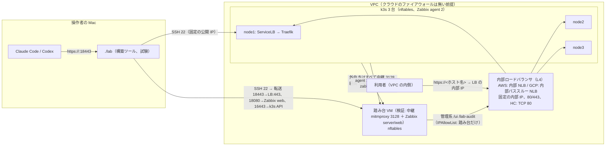

# 変更設計書: 入口を内部ロードバランサに、VM 側の防御（nftables・経路の送信元制限・NetworkPolicy）、Zabbix による監視

作成: 2026-10-31
状態: 実装済み・GCP で配備と試験済み（2026-10-31。15 章）。AWS は EC2 の vCPU 上限で未配備。docs/spec.md 12 章、docs/design.md 21 章に反映済み
対応する変更仕様書: 同じディレクトリの `変更仕様書.md`
この文書の役割: **どう作るか**（`.env` の項目、クラウド固有層のロードバランサ、VM の初期化の書き直し、Traefik と NetworkPolicy、操作者の経路、Zabbix の段階、試験の変更）。実装と試験が済んだら `docs/design.md` に反映する（14 章）

---

## 1. 作りの全体



変わる点を 1 行ずつ:

| 今 | 変更後 |
|---|---|
| 公開の浮動 IP（EIP／静的外部 IP）を keepalived が API で付け替える | 内部ロードバランサの固定の内部 IP。付け替えは無い |
| VM にクラウドの権限（GCP ノード SA、AWS インスタンスプロファイル） | 無し。VM はクラウドの API を呼ばない |
| クラウドのファイアウォールで 22/80/443/外向きを制御 | 各 VM の nftables ＋ Traefik の IPAllowList ＋ NetworkPolicy。クラウド側は managed で「通す」規則だけ |
| Mac は公開の浮動 IP に直接 HTTPS | 踏み台経由の SSH の転送（18443）。別名 `LAB_LOCAL_HOSTNAME` を証明書に足す |
| 監視なし | Zabbix agent 2（全 VM）、Zabbix Helm チャート（k3s）、検証では Zabbix サーバーを踏み台 VM に |

---

## 2. `.env` の項目

| 項目 | 意味 | managed | provided |
|---|---|---|---|
| `LAB_VM_ENTRY_IP_ID` | **意味が変わる**: ロードバランサの識別子。AWS は NLB の ARN、GCP は転送ルールの名前 | provision が書く | 用意する側 |
| `LAB_VM_BASTION_HOST` | 踏み台の SSH の宛先（公開 IP かホスト名）。`./lab` の HTTPS・Zabbix の転送に使う | provision が中継の VM の公開 IP を書く | 用意する側（SSH できる踏み台） |
| `LAB_VM_BASTION_CIDR` | 踏み台の内部 IP（/32 か CIDR）。nftables の 22 と Traefik の管理系の許可、Zabbix の 10050 の許可 | provision が中継の VM の内部 IP/32 を書く | 用意する側 |
| `LAB_VM_PROXY_NODE` | 中継の VM の識別子（既存） | provision | （Zscaler の実物なので空） |
| `LAB_LOCAL_HOSTNAME` | Mac 用の別名（A レコード 127.0.0.1、証明書の SAN） | 利用者が書く（検証で必須） | 本番では空 |
| `LAB_VM_LOCAL_HTTPS_PORT` | Mac の HTTPS の転送口（既定 18443） | 既定 | 既定 |
| `LAB_ZABBIX_VM` | `true` で踏み台の VM に Zabbix サーバーを立てる | `true`（検証） | `false` |
| `LAB_ZABBIX_SERVER` | agent と zabbix-proxy が送る宛先（`host:10051`）。`LAB_ZABBIX_VM=true` なら provision が踏み台の内部 IP を書く | provision | 用意する側 |
| `LAB_ZABBIX_API_URL` | Zabbix の API（`http(s)://.../api_jsonrpc.php`）。`LAB_ZABBIX_VM=true` なら転送口 `http://127.0.0.1:18080/api_jsonrpc.php` | 自動 | 用意する側 |
| `LAB_ZABBIX_API_TOKEN` | API トークン。`LAB_ZABBIX_VM=true` なら初回に `./lab zabbix` が Admin の初期パスワードを変えて発行し、`.env` に書く | 自動 | 用意する側 |
| `LAB_ZABBIX_LOCAL_PORT` | Zabbix web の転送口（既定 18080） | 既定 | 既定 |
| 廃止 | `LAB_VM_KEEP_ENTRY_IP`（浮動 IP が無くなる） | | |

`Infra` に足す: `bastion_host`、`bastion_cidr`、`lb_ip`（= `entry_ip`）。`Node` は変えない。

---

## 3. クラウド固有層（`labtool/clouds/`）

### 3.1 関数の組（`FUNCTIONS`）の変更

| 関数 | 変更 |
|---|---|
| `describe_entry_ip(env, id)` | ロードバランサの識別子 → 内部 IP（AWS: `describe_load_balancers` の `AvailabilityZones[].LoadBalancerAddresses[].PrivateIPv4Address` の先頭、GCP: `ForwardingRule.I_p_address`） |
| `entry_ip_holder` | **削除**（入口の持ち主は無い）。障害の試験は Traefik の Pod の台を見る（8 章） |
| `node_init_hooks` | **削除**（`vm/hooks-*.sh` が無くなる） |
| `lb_targets_healthy(env, infra) -> dict[str, bool]` | **追加**。ロードバランサが見る 3 台の健全性（試験と `status` で使う）。AWS `describe_target_health`、GCP `backend_services.get_health` |
| `allow_web_from` | **削除**。80/443 は VPC の CIDR と HC の送信元に固定（managed のファイアウォールは provision が作る） |
| `allow_ssh_from` / `allow_proxy_from` | 維持（managed だけ。操作者の IP の自動更新） |
| `provision` | ロードバランサ、踏み台の役割（中継 VM）、Zabbix の宛先を返す。ノード SA／インスタンスプロファイルを作らない |
| `destroy` / `destroy_provided` | ロードバランサの部品も消す。`keep_entry_ip` 引数は削除 |

### 3.2 GCP（`gcp.py`）

- **ロードバランサ**（`ensure_load_balancer(env, net, nodes) -> (ip, forwarding_rule_name)`）。名前は `_names` に `address_internal`、`health_check`、`backend`、`ig_<ゾーン>`、`forwarding_rule` を足す。
  1. 静的内部 IP: `AddressesClient.insert(address_type="INTERNAL", purpose="GCE_ENDPOINT", subnetwork=...)`。サブネットの `.5` を指定（`network_plan` に `lb_ip` を足す）。
  2. ヘルスチェック: `RegionHealthChecksClient`、`type_="TCP"`、`tcp_health_check.port=80`、`check_interval_sec=5`、`timeout_sec=5`、`unhealthy_threshold=2`、`healthy_threshold=2`。
  3. 非マネージドインスタンスグループ: ゾーンごとに 1 つ（`InstanceGroupsClient.insert` → `add_instances`）。3 台は 3 ゾーンに置いてあるので 3 グループ。
  4. バックエンドサービス: `RegionBackendServicesClient.insert(load_balancing_scheme="INTERNAL", protocol="TCP", backends=[{group: ig}], health_checks=[hc], connection_draining_timeout_sec=10)`。
  5. 転送ルール: `ForwardingRulesClient.insert(load_balancing_scheme="INTERNAL", I_p_protocol="TCP", ports=["80","443"], network, subnetwork, I_p_address=<静的内部 IP>, backend_service, allow_global_access=False)`。
  - すべて「あれば使う、無ければ作る」。`describe_entry_ip` は転送ルールの名前から IP。
- **ファイアウォール（managed の「通す」規則）**: `fw_web` の送信元を `0.0.0.0/0` から **サブネット ＋ `35.191.0.0/16` ＋ `130.211.0.0/22`** に。`fw_egress_deny` と `fw_egress_internal` は**削除**（nftables に移す）。`fw_internal`（サブネットの中は全部）、`fw_ssh`（操作者）、`fw_proxy`（3128）は維持。Zabbix（10050/10051）はサブネットの中なので `fw_internal` で足りる。
- **ノード SA の廃止**: `ensure_nodes(..., sa_email=None)`。`_ensure_custom_role(node_role)` と `node_sa` の作成・削除を消す。`REQUIRED_PERMISSIONS` から compute の付け替え系を消す（provision 自身の操作者権限には compute の LB 系を足す）。
- **中継 VM**: マシンタイプを `e2-medium`（Zabbix サーバーを載せるため。`LAB_ZABBIX_VM=false` なら `e2-small`）。provision は `LAB_VM_BASTION_HOST`（公開 IP）と `LAB_VM_BASTION_CIDR`（内部 IP/32）を返す。
- `destroy`: 転送ルール → バックエンドサービス → ヘルスチェック → インスタンスグループ → 静的内部 IP の順で消す（VM の削除より前にインスタンスグループを空にする必要はない。VM を消すとグループから外れる）。

### 3.3 AWS（`aws_ec2.py`。実装のみ、未配備）

- **NLB**（`ensure_load_balancer`）: `elbv2.create_load_balancer(Type="network", Scheme="internal", SubnetMappings=[{SubnetId, PrivateIPv4Address: <各サブネットの .5>}] × 3, SecurityGroups=[sg_lb])`、`modify_load_balancer_attributes(load_balancing.cross_zone.enabled=true)`。ターゲットグループ 2 つ（TCP 443、TCP 80、`TargetType=instance`、HC: TCP 80、`HealthCheckIntervalSeconds=10`、`HealthyThresholdCount=2`、`UnhealthyThresholdCount=2`、`preserve_client_ip.enabled=true`（既定））、リスナー 2 つ、`register_targets` に 3 台。`LAB_VM_ENTRY_IP_ID` は NLB の ARN。
- **セキュリティグループ**: ノードの SG は「VPC の中から全部 ＋ 22 は操作者」に単純化（防御は nftables）。NLB 用の SG は VPC の中から 80/443。外向きの「中継だけ」の制限（`_ensure_egress_via_proxy`）は**削除**（nftables に移す）。
- **インスタンスプロファイルとロールの廃止**: `ensure_nodes` から `IamInstanceProfile` を外し、`_ensure_role` と `_ensure_instance_profile` と、EIP 関連（`allocate_address`、`associate_address`、2 つ目のプライベート IP の `PrivateIpAddresses`、`AWS_SECONDARY_IP` の netplan）を消す。`network_plan(subnets_per_node=True)` の `secondary_ip` を `lb_ip`（各サブネットの .5）に置き換える。
- 中継 VM: `t3.medium`（Zabbix あり）／`t3.small`（無し）。

### 3.4 中継 VM を踏み台にする（`vm/proxy-init.sh`）

- 既存の mitmproxy に加えて、`LAB_ZABBIX_VM=true` なら Docker（docker.io）と Compose プラグインを入れ、`/opt/lab-zabbix/compose.yaml`（`postgres:16`、`zabbix/zabbix-server-pgsql:7.0-ubuntu-latest`、`zabbix/zabbix-web-nginx-pgsql:7.0-ubuntu-latest`。web は 127.0.0.1:8080 だけに公開、server は 0.0.0.0:10051）を `docker compose up -d`。DB のパスワードは初回に生成して `/opt/lab-zabbix/.env`（600）に置く。
- 踏み台の nftables: 入りは 22（操作者。managed の規則はクラウド側と二重）、3128（サブネット）、10051（サブネットと Pod 網）、8080 は 127.0.0.1 だけ。出は全部許可（中継は外へ出る役）。
- マーカー `/var/lib/lab/zabbix-ready` で 2 回目以降は `compose up -d` だけ。

---

## 4. VM の初期化（`vm/node-init.sh`）の書き直し

| 節 | 変更 |
|---|---|
| 置き換え印 | `@@PRIORITY@@`、`@@HOOKS@@` を消す。足す: `@@NODE_IPS@@`（3 台の固定 IP）、`@@VPC_CIDR@@`、`@@LB_IP@@`、`@@HC_RANGES@@`（GCP は 2 範囲、AWS は VPC の CIDR）、`@@BASTION_CIDR@@`、`@@OPERATOR_CIDR@@`（managed の操作者。provided は空）、`@@PROXY_IP@@`（中継の内部 IP。無ければ空）、`@@ZABBIX_SERVER@@`、`@@META_IPS@@`（メタデータ・DNS・NTP の内部アドレス。GCP は `169.254.169.254`、AWS は `169.254.169.254 169.254.169.253 169.254.169.123` ＋ VPC の `.2`）、`@@POD_CIDR@@`（`10.42.0.0/16`）、`@@SVC_CIDR@@`（`10.43.0.0/16`） |
| クラウド固有の関数 | 無し（`lab_install_tools` 等は消える。AWS の 2 つ目の IP の netplan も消える） |
| keepalived | 節ごと削除（`lab-health.sh`、`lab-take-entry-ip.sh`、`lab-release-entry-ip.sh`、`/var/lib/lab/hooks.sh`、`lab-egress.service`） |
| nftables | 新設（4.1） |
| Zabbix agent 2 | 新設（4.2）。`ZABBIX_SERVER` が空なら入れない |
| 2 回目以降 | CA・中継・nftables・agent の設定を直して抜ける（nftables は `.env` の踏み台や操作者の IP が変わると更新が要る） |

### 4.1 nftables（`/etc/nftables.conf`、`systemctl enable --now nftables`）

```
table inet lab {
  set nodes     { type ipv4_addr; elements = { <3 台> } }
  set hc        { type ipv4_addr; flags interval; elements = { <HC の範囲> } }
  set admins    { type ipv4_addr; flags interval; elements = { <踏み台>, <操作者（managed）> } }
  set internal  { type ipv4_addr; flags interval; elements = { <VPC の CIDR>, <Pod 網>, <Service 網> } }
  set egress_ok { type ipv4_addr; flags interval; elements = { <3 台>, <LB>, <中継>, <踏み台>, <メタデータ等> } }

  chain input {
    type filter hook input priority 0; policy drop;
    ct state established,related accept
    iif lo accept
    iifname { "cni0", "flannel.1" } accept            # Pod 網（Kubernetes の中）
    ip saddr @internal ip daddr 10.43.0.0/16 accept    # ClusterIP への host からの到達（kube-proxy の DNAT 後）
    ct state invalid drop
    icmp type echo-request accept
    tcp dport 22 ip saddr @admins accept
    tcp dport { 80, 443 } ip saddr <VPC の CIDR> accept
    tcp dport { 80, 443 } ip saddr @hc accept
    tcp dport { 6443, 2379, 2380, 10250, <REGISTRY_NODEPORT> } ip saddr @nodes accept
    udp dport 8472 ip saddr @nodes accept              # flannel VXLAN
    tcp dport 10050 ip saddr { <Zabbix server>, <Pod 網> } accept
    tcp dport 10250 ip saddr 10.42.0.0/16 accept       # kubelet（metrics-server、Zabbix の kubelet テンプレート）
    counter drop
  }
  chain forward {                                      # Pod からの外向き
    type filter hook forward priority 0; policy drop;
    ct state established,related accept
    iifname { "cni0", "flannel.1" } ip daddr @internal accept
    iifname { "cni0", "flannel.1" } ip daddr @egress_ok accept
    oifname { "cni0", "flannel.1" } accept             # 入ってくる向き（DNAT 済み）
    counter drop
  }
  chain output {
    type filter hook output priority 0; policy drop;
    ct state established,related accept
    oif lo accept
    oifname { "cni0", "flannel.1" } accept
    ip daddr @internal accept
    ip daddr @egress_ok accept
    udp dport 53 ip daddr <クラウドの DNS> accept
    udp dport 123 ip daddr <クラウドの NTP> accept
    counter drop
  }
}
```

- kube-proxy と flannel の iptables（nf_tables 後端）とは**別の表**なので共存する。こちらの `drop` は最終なので、「Kubernetes が通したいもの」を上の accept で漏れなく拾う必要がある。配備で確かめる（13 章）。
- 中継（`EGRESS_PROXY`）が無い環境（provided で Zscaler が透過の場合）は `egress_ok` に `0.0.0.0/0` を足す（外向き遮断は行わない）。`.env` の `LAB_EGRESS_PROXY` が空のとき。
- GCP の `lab-egress.service`（外向き IP の復旧）は不要になる。managed の一時的な外部 IP は VM の起動時に自動で付く。

### 4.2 Zabbix agent 2

- Zabbix 公式リポジトリ（`repo.zabbix.com` の 7.0 LTS、Ubuntu 24.04）を中継経由で足し、`zabbix-agent2` と `zabbix-agent2-plugin-*` は入れない（最小）。
- `/etc/zabbix/zabbix_agent2.d/lab.conf`: `Server=<Zabbix server IP>,<Pod 網>`、`ServerActive=<Zabbix server>`、`Hostname=<VM の名前>`、`HostMetadata=litellm-lab-node`（自動登録の目印）。
- 踏み台にも agent 2（`HostMetadata=litellm-lab-bastion`）。

---

## 5. Traefik の経路の送信元制限と NetworkPolicy

### 5.1 Traefik（`render.admin_allowlist_manifest(env)`、`k8s/ingress.yaml` の変更）

- Middleware `admin-only`（`ipAllowList.sourceRange = [踏み台の CIDR]`、`ipStrategy.depth=0`）。
- IngressRoute `litellm` に優先度 95 の経路を足す: `PathPrefix(`/ui`) || PathPrefix(`/login`) || PathPrefix(`/sso`) || PathPrefix(`/metrics`)` → `admin-only` → litellm。`audit-viewer` の経路（優先度 50）に `admin-only` を足す。
- 利用者の経路（優先度 1 の `PathPrefix(`/`)`）は制限しない（nftables と LB の段で VPC の中に限られている）。
- Mac の k3d（local）では `admin-only` を付けない（`render` が `env.is_vm` で分ける）。
- 送信元 IP は LB が保つ。踏み台経由の SSH の転送は踏み台の内部 IP で届く。

### 5.2 NetworkPolicy（`k8s/network-policies.yaml`。`litellm-lab` の名前空間）

| 対象（podSelector） | 入りを許す送信元 | ポート |
|---|---|---|
| `cnpg.io/cluster=litellm-pg`（PostgreSQL） | 同じクラスタの Pod（レプリケーション）、`cnpg.io/podRole=pooler`、CloudNativePG のオペレーター（名前空間 `cnpg-system`）、監査アプリの Job（`app=audit-*`） | 5432、8000（status） |
| `cnpg.io/podRole=pooler`（Pooler） | `app.kubernetes.io/name=litellm`、監査アプリ、`app=lab-restore`（復元の試験） | 5432 |
| `app=valkey`（Valkey、Sentinel） | LiteLLM、Valkey と Sentinel 同士 | 6379、26379 |
| 共通 | kube-system（Prometheus/Zabbix の指標の取得、DNS） | 9187、9121 |

- k3s 同梱のネットワークポリシー制御（kube-router）で動く。`policyTypes: [Ingress]` だけ（出は nftables）。
- ラベルの実際の値は配備時に `kubectl get pods --show-labels` で確かめて合わせる（13 章）。

---

## 6. 操作者（Mac）の経路

- **`vm.ensure_https_forward(env, infra)`**: 踏み台（`LAB_VM_BASTION_HOST`）に SSH し、`-L 127.0.0.1:<LAB_VM_LOCAL_HTTPS_PORT>:<LB の IP>:443` を背景で張る。PID とターゲットは `.build/vm-https-forward.*`。k3s の 6443 の転送（`ensure_forward`）は今までどおりノード経由（踏み台から 6443 は nftables で拒否される。将来は踏み台を経由してもよいが、今回は変えない）。
- **Zabbix の転送** `vm.ensure_zabbix_forward`: 踏み台の `127.0.0.1:8080` → Mac の `18080`。
- **`./lab forward`**: 3 本の転送（6443、443、Zabbix）を確かめて張るだけの命令。`./lab down` で全部止める。
- **`Env.base_url`**: `is_vm` かつ `LAB_LOCAL_HOSTNAME` があれば `https://<LAB_LOCAL_HOSTNAME>:<port>`、無ければ `https://<hostname>`。`public_host` も同じ。Mac の中継の `NO_PROXY` に `LAB_LOCAL_HOSTNAME` を足す（転送口は中継を通さない）。
- **A レコード**: `vm.ensure_a_record(env, host, ip)` を 2 回（本番のホスト名 → LB の IP、`LAB_LOCAL_HOSTNAME` → `127.0.0.1`）。`wait_for_a_record` も 2 名。
- **証明書**: `render.vm_certificate_manifest` の `dnsNames` に `LAB_LOCAL_HOSTNAME` を足す。Traefik の TLS は SNI で選ぶので経路は変わらない。
- **検索アプリ**: `BASE_URL = env.base_url`（上の定義で自動的に切り替わる）。

---

## 7. Zabbix の段階（`./lab zabbix`、`labtool/zabbix.py`）

順序: `litellm` の後、`audit` の前（入口の HTTP 監視が LiteLLM を見るため）。`LAB_ZABBIX_VM=false` かつ `LAB_ZABBIX_SERVER` が空なら「Zabbix は使いません」と出して抜ける。

1. **サーバー（managed、`LAB_ZABBIX_VM=true`）**: `vm.init_proxy` の中で `proxy-init.sh` が Docker Compose を立てている。`ensure_zabbix_forward` で web に届くのを待つ（`/api_jsonrpc.php` の `apiinfo.version`）。
2. **初期パスワードとトークン**: `.env` に `LAB_ZABBIX_API_TOKEN` が無ければ、`Admin`/`zabbix` でログイン → `user.update` でパスワードを生成した値に（`.env` の `LAB_ZABBIX_ADMIN_PASSWORD`）→ `token.create` ＋ `token.generate` で API トークンを作り `.env` に書く。
3. **ホストグループ**: `litellm-lab/vm`、`litellm-lab/k8s`、`litellm-lab/service`。
4. **自動登録のアクション**: 条件 `HostMetadata contains litellm-lab-node` → グループ `litellm-lab/vm`、テンプレート `Linux by Zabbix agent active`。`litellm-lab-bastion` も同様。
5. **Kubernetes**: Helm チャート `zabbix-community/zabbix-helm-chrt`（名前空間 `monitoring`）。値: `zabbixProxy.enabled=true`、`ZBX_SERVER_HOST=<Zabbix server>`、`ZBX_HOSTNAME=litellm-lab-k8s-proxy`、`zabbixAgent.enabled=true`（DaemonSet、`hostNetwork`）、`kube-state-metrics.enabled=true`、`rbac.create=true`、egress（中継の環境変数と CA。イメージ取得は中継経由）。チャートが作る ServiceAccount のトークンを `kubectl create token`（長期は Secret）で取る。
6. **プロキシの登録**: `proxy.create`（`name=litellm-lab-k8s-proxy`、`operating_mode=0`（active））。
7. **Kubernetes のホスト**: `host.create`（`litellm-lab-k8s`、監視は上のプロキシ経由、インターフェースなし）にテンプレート `Kubernetes cluster state by HTTP`、`Kubernetes nodes by HTTP`、`Kubernetes kubelet by HTTP`（nodes テンプレートの LLD が kubelet のホストを作る）。マクロ `{$KUBE.API.URL}=https://kubernetes.default.svc:443`、`{$KUBE.API.TOKEN}`、`{$KUBE.STATE.ENDPOINT.NAME}=zabbix-kube-state-metrics`、`{$KUBE.NODES.ENDPOINT.NAME}=zabbix-zabbix-helm-chrt-agent`。
8. **入口の HTTP 監視**: ホスト `litellm-lab-entry`（エージェントなし）に HTTP agent のアイテム `https://<ホスト名>/health/liveliness`（プロキシ経由で、クラスタの中から LB の IP に）と、`/lab-audit/healthz`。応答が 200 でないトリガー。
9. すべて `*.get` で探して無ければ `*.create`、違えば `*.update`（冪等。`test-idempotency` の比較対象に Zabbix の設定の要約を足す）。
10. `./lab status` に Zabbix のホストと最新値の有無を足す。`./lab down` は managed で VM と一緒に消えるので何もしない。provided の `down` は Helm のリリースを消し、Zabbix 側のホストは残す（用意する側の資産）。

---

## 8. 障害の試験と k3s の版上げ

- `failover.py`: `entry-node` の trigger を「Traefik の Pod（`kube-system`、`app.kubernetes.io/name=traefik`）が載ったノードを止める」に変える（2 レプリカのうち 1 つ目）。`eip_moved` は「LB の健全性でその台が unhealthy になった後、healthy に戻ったか」（`cloud.lb_targets_healthy`）に置き換える。目安 `LIMITS["entry-node"]=60`、`GCP_LIMITS` から `entry-node` を外す。
- `upgrade_order`: 「浮動 IP の台」の代わりに「Traefik の Pod の台」を最後にする。`ops.upgrade_k8s` は `vm.traefik_nodes()` で取る。
- `--measure` の要求は Mac → 踏み台の転送 → LB → 3 台。転送先の踏み台は止めないので張り直しは不要。6443 の転送（ノード経由）は今までどおり `avoid` で逃がす。

---

## 9. 段階と命令の変更（`stages.py`、`ops.py`、`lab`）

| 段階／命令 | 変更 |
|---|---|
| `preflight`（VM） | `LAB_LOCAL_HOSTNAME`（検証では必須と警告）、`LAB_VM_BASTION_HOST/CIDR`（provided で必須）、`LAB_ZABBIX_*` の整合 |
| `cluster`（VM） | provision（LB・踏み台・Zabbix の宛先）→ `init_proxy`（中継 ＋ Zabbix サーバー）→ `init_nodes`（nftables、agent 2）→ 6443 の転送 → Traefik → … → `ensure_https_forward` |
| `litellm` | A レコード 2 本、証明書の SAN 2 名、`admin-only` の経路、NetworkPolicy の適用、入口の確認は `env.base_url`（転送口） |
| `zabbix`（新） | 7 章 |
| `audit` | `BASE_URL=env.base_url`、`admin-only` |
| `clients` | 接続先は `env.base_url`（別名 ＋ 18443）。信頼するドメインに別名 |
| `forward`（新） | 転送 3 本を張る |
| `status` | LB の健全性（3 台）、転送の状態、Zabbix の最新値 |
| `down` | 転送を止める。managed: LB の部品も消す。provided: k3s を外す（`--all` で LB・VM・バケットも） |
| `proxy-log` | 維持 |
| 削除 | `LAB_VM_KEEP_ENTRY_IP` の分岐 |

---

## 10. 試験（単体テスト。`labtool/tests/test_labtool.py`）

- `FUNCTIONS` の一致（両クラウド）。
- `network_plan` の `lb_ip`。`render_node_init` の置き換え印（keepalived が無い、nftables の集合に 3 台・LB・踏み台・HC の範囲が入る、中継なしでは `0.0.0.0/0`）。
- `admin_allowlist_manifest` の sourceRange、`vm_certificate_manifest` の SAN 2 名、`base_url` の切り替え（`LAB_LOCAL_HOSTNAME` の有無）。
- `upgrade_order` が Traefik の台を最後にする。`limit_for("entry-node")` が両クラウド 60。
- Zabbix の API の呼び出しを偽のサーバー（`http.server`）で: 初回のトークン発行、`host.get` → `create`/`update` の冪等、マクロの形。
- `nft -c -f`（構文の検査）は配備時に VM で。Mac には `nft` が無い。

---

## 11. 用意する側への前提（provided）

| 資源 | 内容 |
|---|---|
| VM 3 台 | Ubuntu 24.04、同じ VPC（AWS は別 AZ でよい）、固定のプライベート IP、SSH の鍵、**クラウドの権限は不要** |
| 内部ロードバランサ | L4（TCP）、80 と 443、固定の内部 IP、3 台をターゲット、HC は TCP 80（AWS 10 秒 × 2、GCP 5 秒 × 2）、送信元 IP の保持（既定） |
| 踏み台 | 操作者が SSH できるホスト 1 台（`LAB_VM_BASTION_HOST`）と、その内部 IP（`LAB_VM_BASTION_CIDR`） |
| バケット、静的キー | 変わらず |
| DNS | Cloudflare の API トークン（A レコード 1〜2 本） |
| Zabbix（任意） | サーバーの宛先（10051）、API の URL とトークン（ホストの作成・更新・プロキシの登録の権限） |
| クラウドのファイアウォール | **無くてもよい**。あるなら 22（踏み台）、80/443（VPC と HC）、内部、10050/10051 を通す |

---

## 12. 費用の目安を決めるもの

- GCP: 内部パススルー NLB の転送ルール（最初の 5 本は 1 本あたり約 0.025 USD/時）＋ 処理量。中継 VM を e2-medium にする分（e2-small の約 2 倍）。静的内部 IP は無料。外部の静的 IP が無くなる分は減る。
- AWS: 内部 NLB 約 0.0225 USD/時 ＋ LCU。中継 VM を t3.medium にする分。Elastic IP が無くなる分は減る。

---

## 13. 配備で確かめること

1. nftables と k3s の共存: Pod 間（別ノード）、ClusterIP、NodePort（registry 30500）、ServiceLB（80/443）、metrics-server、CoreDNS（Pod → 10.43.0.10）。落ちる経路があれば accept を足す。
2. LB のヘルスチェックの送信元（GCP の 2 範囲）が nftables とファイアウォールで通ること。`lb_targets_healthy` が 3 台 healthy。
3. 送信元 IP の保持: 踏み台経由で `/ui` が通り、ノードから LB 経由の `/ui` が 403。
4. Cloudflare が `127.0.0.1` の A レコードを受けるか。受けなければ `/etc/hosts`（13 章の結果で仕様書 4 章を更新）。
5. 証明書の SAN 2 名で Let's Encrypt が発行するか（レート制限に注意。ステージングで先に）。
6. Zabbix: 公式リポジトリへの到達（中継経由）、agent 2 の自動登録、Helm チャートのイメージ取得（中継経由）、Kubernetes のテンプレートの最新値、`{$KUBE.STATE.ENDPOINT.NAME}` のサービス名、kubelet への 10250 の到達（hostNetwork の agent から）。
7. NetworkPolicy のラベルの実値（CloudNativePG、Pooler、Valkey、監査の Job）。
8. `test-failover` の `entry-node`（Traefik の台）の回復時間と、LB が台を外す時間。
9. `upgrade-k8s --measure` の失敗の数と幅（初回の実測）。
10. 踏み台 VM（e2-medium）で mitmproxy と Zabbix サーバーが同居して足りるか（メモリ）。

---

## 14. `docs/design.md` への反映の仕方（試験の後）

| 章 | 変更 |
|---|---|
| 21.1 層の分け方 | VM はクラウドの API を呼ばない。クラウド固有層の関数の組 |
| 21.2 `.env` | 2 章の表 |
| 21.3 構築の流れ | LB、踏み台、Zabbix、転送 3 本 |
| 21.4 VM の初期化 | nftables、agent 2、keepalived の廃止 |
| 21.7 出口プロキシ | 外向き遮断は nftables。中継 VM が踏み台と Zabbix サーバーを兼ねる |
| 21.8 削除 | LB の部品 |
| 21.9 用意する側への前提 | 11 章 |
| 21.10 結果 | 配備の結果と 13 章の答え |
| 新 21.11 監視（Zabbix） | 7 章 |
| 5.x（Traefik の経路）、16（障害の試験） | 管理系の経路の制限、`entry-node` の新しい定義 |
| `docs/vm_architecture.md` | 図（1 章）、入口、守り、監視 |
| `docs/maintenance.md` 5 章 | 版上げの順序（Traefik の台が最後）、転送、Zabbix |

---

## 15. 実装と試験で分かったこと（2026-10-31、GCP）

`./lab up` は 13 回目で全段階を通過した（手戻り 12 件）。13 章の「配備で確かめること」の答えを含む。

| # | 分かったこと | 対処 |
|---|---|---|
| 1 | 踏み台の nftables が中継（3128）を VPC の中だけに開けていて、Mac が中継を通せなかった | 操作者の IP（`ADMIN_CIDRS`）からも 3128 を通す |
| 2 | Zabbix の公式リポジトリは arm64 が別（`.../7.0/ubuntu-arm64/`）。amd64 用を入れると `zabbix-agent2` が見つからない | `dpkg --print-architecture` で選ぶ。違う方が入っていれば入れ替える |
| 3 | agent の設定を書く `sed` の区切りが `/` で、Pod 網の CIDR（`10.42.0.0/16`）と衝突。`#` もコメント行の `# HostMetadata` と衝突 | 区切りを `\|` に |
| 4 | nftables を入れた直後に SSH の相手が黙って消え、`./lab` 側が待ち続けた | `ssh` に `ServerAliveInterval=15` / `ServerAliveCountMax=4` |
| 5 | VM 上のイメージのビルドで pip が中継に届かない。Docker のブリッジ（docker0）からの転送を nftables が落としていた | forward と output で `docker0` を Pod 網と同じ扱い |
| 6 | LiteLLM の DB の移行の Job（primary に直結、`app: litellm-migrate`）が NetworkPolicy で PostgreSQL に届かない | `postgres-ingress` に移行の Job と、直結のときの LiteLLM を足す |
| 7 | **Cloudflare は 127.0.0.1 の A レコードを受け付ける**（DNS のみ）。Mac 用の別名はこの方式で成立 | 13 章 4 の答え。`/etc/hosts` は不要 |
| 8 | Mac の名前解決（mDNSResponder）に前の配備の公開 IP が TTL を超えて残り、A レコードの反映待ちが終わらない | `dig +short` で設定の DNS サーバーに直接聞く（`vm.resolve_a`） |
| 9 | **cert-manager の DNS-01 の伝搬確認は権威 DNS サーバー（外の 53）に直接聞く**。Pod からの外向きは中継しか無いので届かず、証明書が出ない。本番の Zscaler の中でも同じ | Helm の値 `dns01RecursiveNameservers=<クラウドの DNS>:53`、`dns01RecursiveNameserversOnly=true`（`clouds.dns_ips`: GCP 169.254.169.254、AWS 169.254.169.253）。発行は 43 秒 |
| 10 | Mac が中継を通す設定では中継の CA だけを信頼していて、中継を通らない転送口（Let's Encrypt の証明書）の検証に失敗 | 公開 CA の束（certifi）＋ 中継の CA を `.build/mac-ca-bundle.pem` に作って使う |
| 11 | Zabbix 7.0 のサインイン失敗の文言は「Incorrect user name or password or account is temporarily blocked.」。大文字小文字の違いで読めず、失敗を繰り返して Admin が 30 秒ブロックされた | 小文字で判定し、違うと分かったら待たずに止める。試すのは保存したパスワードと初期パスワードだけ |
| 12 | Zabbix で Admin のパスワードを変えるとセッションが切れる（Session terminated） | 新しいパスワードで入り直す |
| 13 | `helm repo update` は `--ca-file` を受けない（`core.helm` が付ける） | リポジトリを登録せず `--repo` で直接取る（オペレーターと同じ） |
| 14 | `item.get` は `lastclock` で並べられない（Sorting by field "lastclock" not allowed） | 手元で最大を取る |
| 15 | **k3s の ServiceLB（svclb）は送信元を自分の Pod の IP に書き換える（MASQUERADE。`externalTrafficPolicy: Local` でも）**。Traefik に利用者の IP が届かず、管理系の経路の IPAllowList が踏み台にも 403 を返した | Traefik を hostPort（80/443）で受け、Service は ClusterIP に（svclb を使わない）。CNI の portmap は DNAT だけで送信元を保つ。Traefik の Pod が無い台はロードバランサのヘルスチェックに落ちて外れる（健全 2/3 台） |
| 16 | nftables と k3s の共存（13 章 1）: Pod 間、ClusterIP、NodePort（registry）、hostPort、CoreDNS、metrics-server はすべて動いた。入りの絞り込みは prerouting（DNAT の前）で行う形で問題なし。`flush ruleset` は kube-proxy の規則まで消すので表だけを作り直す | 設計どおり |
| 17 | ヘルスチェックの送信元（13 章 2）: GCP の 35.191.0.0/16 と 130.211.0.0/22 を通せば 3 台（hostPort 後は Traefik の 2 台）が healthy | 設計どおり |
| 18 | Zabbix（13 章 6）: 公式リポジトリ・Helm チャートのイメージは中継経由で取れた。agent 2 は 4 台とも自動登録され最新値あり。`Kubernetes cluster state by HTTP` のホストと入口の HTTP 監視も最新値あり | 設計どおり（チャートの agent は入れない: VM の agent 2 と 10050 とノード名が重なる） |
| 19 | NetworkPolicy（13 章 7）: ラベル無しの Pod から Pooler・PostgreSQL・Valkey へは届かず、LiteLLM から Pooler へは届く | 設計どおり（ラベルの実値は 6 と `k8s/network-policies.yaml` の先頭の注記） |
| 20 | 送信元 IP の保持（13 章 3）: hostPort にした後、踏み台と Mac（踏み台経由）から `/ui` は 307（サインインへ）、台から LB 経由は 403、`/v1/models` はどこからも 401（キー無し） | 設計どおり |
| 21 | 踏み台 VM（e2-medium）の mitmproxy ＋ Zabbix サーバーの同居（13 章 10）: 使用 1.4 GiB / 3.9 GiB | 足りる |

| 22 | 障害の試験で台を止める直前に k3s の API の転送を別の台へ張り直す処理が、転送 3 本をまとめて止める関数を呼び、入口（443）の転送まで止めていた。1 回目の entry-node は要求 8,436 件のうち 8,158 件が失敗（転送のログに踏み台への接続が切れた記録）。入口そのものは正常で、踏み台から 30 接続を送ると Traefik 2 台に 16 / 14 で分かれた | 6443 の転送だけを止める |
| 23 | **k3s 1.36 に同梱の Traefik のチャートは 40 系で、Service の種類の鍵が `service.type` から `service.spec.type` に変わった**。版上げで Service が LoadBalancer に戻り、ServiceLB（svclb）が 80/443 を占有して hostPort の Traefik が 3 台とも Pending になり、入口が止まった（1 回目の版上げの計測は無効） | 両方の鍵を書き、注釈 `svccontroller.k3s.cattle.io/enablelb: "false"` で ServiceLB も止める |
| 24 | 入口が落ちている間、負荷の要求（15 秒待ち）が溜まり、計測の終了が何分も待った | 負荷を止めるときに溜まった要求を捨てる（`shutdown(cancel_futures=True)`） |
| 25 | 単体テストが偽の CA（`Q0E=`）で `Env.apply_mac_proxy` を呼び、本物の CA の束 `.build/mac-ca-bundle.pem` を上書きした。直後の `./lab down` が `[X509] PEM lib` で失敗 | 束のファイル名に CA のハッシュを入れる |
| 26 | 前の版が `helm repo add` で登録したリポジトリの項目に古い CA のパスが保存され、`--repo` で同じ URL を指すとそれが使われて失敗 | 同じ URL の登録があれば消してから取る |
| 27 | **provided では各台の 22 が踏み台からだけ通る（nftables）ので、構築ツール自身も各台へ直接 SSH できない** | provided の 3 台への SSH は踏み台を ProxyCommand で経由して内部 IP に届く（公開 IP が無くてもよい）。踏み台そのものと managed は直接 |
| 28 | managed の `down` で、前の版が作って削除済み（7 日残る）のカスタムロール `litellm_lab_node` をもう一度消そうとして FailedPrecondition（already deleted）で止まり、ファイアウォールとネットワークが残った | 削除済みのロールは飛ばす。流し直しで全部消えた |

### 15.1 試験の結果（GCP、2026-10-31、managed、中継あり、Mac も中継経由、Zabbix あり）

| 試験 | 結果 |
|---|---|
| `./lab up` | 13 回目で全段階を通過（15 章の 1〜15）。最後の 1 回は約 13 分 |
| VM 側の守り（V3〜V6） | 台から別の台の 22 は拒否、10250 と 6443 は通る。台からの直接の `https://pypi.org` はタイムアウト、中継経由は 200。管理系の経路（`/ui`、`/lab-audit/`）は台からロードバランサ経由で 403、踏み台と Mac（踏み台経由）から 307（サインインへ）。`/v1/models` はどこからも 401（キー無し）、`/health/liveliness` は 200。ラベル無しの Pod から Pooler・PostgreSQL・Valkey へは届かず、LiteLLM から Pooler へは届く |
| Zabbix（V12） | 6 ホスト（VM 3 台と踏み台は自動登録、Kubernetes、入口）すべてに最新値。web は踏み台経由の転送口で開く |
| `test-smoke` | 75 件すべて OK |
| `test-idempotency` | 64 項目を比較して 2 回目で変化なし（2 回目の up は 148 秒） |
| `test-audit` | 32 件中 31 件 OK（NG は Gmail 未サインインの「MCP の記録」。環境に依らない）。ローリング更新の間の要求 99 件は欠け 0 件 |
| `test-failover` | pg-switchover 0 件、pg-pod 0 件、pg-node 回復 123.8 秒（目安 180）、valkey-pod 0 件、valkey-node 0 件。監査ログの欠けは 6 場面とも 0 件 |
| `test-failover --scenario entry-node`（流し直し） | Traefik の載った node2 を 120 秒停止。要求 6,405 件のうち失敗 455 件（状態 0 / 502 / 503）、**回復まで 131.5 秒、失敗が続いた時間 82.1 秒（目安 60 秒を超過）**。node2 には PostgreSQL のレプリカ・Valkey の primary・LiteLLM の Pod も載っていて、503（DB と Valkey の切り替え）と 502（止まった台の LiteLLM の Pod が送り先から外れるまで）が混ざる。ロードバランサが台を外す分（ヘルスチェック 5 秒 × 2）はこの中の一部で、場面としては「台の停止」（pg-node の 123.8 秒）と同じ性格。目安の扱いは報告で確認 |
| provided に切り替えて `./lab down` → `./lab up` | down: 証明書を退避、3 台の k3s と Zabbix agent を外し、保持の無いディレクトリの 332 版を消した（VM・バケット・ロードバランサ・踏み台は残る）。up: 何も作らず、踏み台経由の SSH で全段階を通過（27 の修正の後。流し直しは 163 秒） |
| `upgrade-k8s v1.36.5+k3s1 --measure`（provided、Traefik の設定を直した後） | **3 台が 235 秒で上がった**（node2 → node3 → node1（Traefik の台）。1 台あたり 70〜80 秒）。要求 4,680 件のうち失敗 593 件（状態 0 / 503）、**失敗が散らばった幅 88.3 秒**。失敗は drain で PostgreSQL と Valkey の primary が移る間（503）と Traefik・LiteLLM の Pod が移る間（0）。k3s 1.36 の Traefik チャート（40）への更新も、23 の対処で入口が止まらずに済んだ。入口は内部ロードバランサなので IP の移動は無い |
| 片付け | provided の `./lab down`（3 台の k3s と agent を外す。ロードバランサ・VM・バケットは残る）→ managed の `./lab down`（バケット 899 版、サービスアカウント 6、転送ルール・バックエンドサービス・ヘルスチェック・インスタンスグループ・内部 IP、VM 4 台、カスタムロール、ファイアウォール、サブネット、ネットワーク。28 の修正の後に流し直して完了）。API で確認: VM・ディスク・アドレス・転送ルール・バックエンド・ヘルスチェック・インスタンスグループ・バケット・サービスアカウント（既定の compute SA を除く）はすべて 0。残るのは既定のネットワークと、7 日で消える削除済みのカスタムロール 3 つ。`.env` の識別子・踏み台・Zabbix のトークンは消えた |
