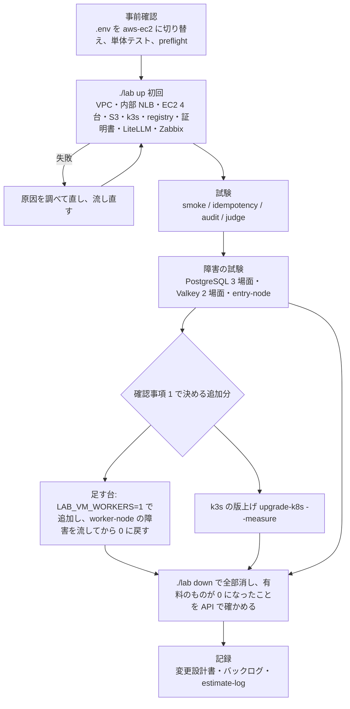

# セッションログ e2a02df0

- セッション: `e2a02df0-f418-449f-9a21-285f82014ccd`
- cwd: `/Users/notfolder/Documents/litellm-agent-gateway-lab`（branch: main）
- 期間: 2026-11-04 20:06 〜 2026-11-06 17:02
- Claude Code: 2.1.317
- 発言: ユーザー 17 / Claude 14 / ツール呼び出し 408
- 書き出し: 2026-11-06 17:02 JST

> ユーザー発言と Claude の本文は逐語。ツール呼び出しは `🔧` の 1 行に要約し、ツール結果・思考ブロックは含まない。

---
## 1. ユーザー（2026-11-04 20:06）

（コマンド: /clear ）

## 2. ユーザー（2026-11-04 20:06）

awsのec2の検証をしてください。まずは計画を説明して

## 3. Claude

> 🔧 `Bash` リポジトリ構成と EC2 関連のバックログを確認

> 🔧 `Bash` バックログと GCP 配備の記録を読む

> 🔧 `Bash` 直近の引き継ぎ記録を読む

> 🔧 `Bash` 10/31 と 11/4 の引き継ぎ記録を読む

> 🔧 `Bash` lab の命令一覧と .env の設定名を確認

> 🔧 `Bash` EC2 構成の設定項目を確認

> 🔧 `Bash` .env の VM 関連の値（秘密以外）を確認

> 🔧 `Bash` EC2 の機種と障害試験の場面を確認

> 🔧 `Bash` 見積もりのルールと記録を読む

> 🔧 `Bash` 配備に関する過去の見積もり実績を抜き出す

> 🔧 `Bash` プロファイルと aws-ec2 での Bedrock の扱いを確認

> 🔧 `Bash` VM 構成のモデル一覧の作り方を確認

> 🔧 `Bash` ホスト名の設定と AWS の資格情報の状態を確認

> 🔧 `Bash` k3s の版の指定と障害試験の目安を確認

> 🔧 `Bash` Object Lock の方式と k3s の版の決め方を確認

> 🔧 `Bash` 現在時刻と k3s の版の決め方を確認

# AWS の EC2 構成（`LAB_TARGET=aws-ec2`）の検証計画

## 前提として確かめたこと

| 項目 | 状態 |
|---|---|
| EC2 の vCPU の上限 | 解除済み（オンデマンド 64 vCPU。11/3 に確認）。使うのは 3 台 × 2 vCPU ＋ 中継 1 台 2 vCPU で、上限に十分収まる |
| AWS の資格情報 | `litellm-lab` プロファイルの SSO はいまも有効（`sts get-caller-identity` が通った） |
| `.env` | 今は `LAB_TARGET=aws`。VM 用の値（`LAB_VM_*`、Zabbix、中継の VM、審査官用の Anthropic の API キー、Cloudflare のトークン）はそろっている。ホスト名は `LAB_AWS_HOSTNAME` をそのまま使う |
| 機種 | 既定の `t4g.large`（arm64、2 vCPU・8 GiB）。GCP の `c4a-standard-2` と同じ大きさ。中継の VM は `t3.medium` |
| AWS ではまだ一度も流していない部分 | 10/30 以降の作り替え（API を直接呼ぶ形への変更、provision と setup の分離）、1 つのバケットへの Object Lock と接頭辞ごとの IAM、キーペアの取り込み、中継の VM、内部 NLB（ターゲットグループ 2 つ、ヘルスチェック）、ロールを持たない EC2、足す台、S3 のチェックサムの既定値、AWS に固有の処理（snap の awscli、netplan の 2 つ目の IP）、11/4 に直した監査ログ（`async_logging_hook`） |

**注意:** EC2 構成では、Claude Code の通信は Claude Max のトークンの転送で流れ、Bedrock を通りません。このため、バックログにある「5.5 系の Bedrock のモデルを 3 つ呼んで確かめる」は、この検証の中では確かめられません（下の確認事項 3）。

## 進め方



### 段階ごとの中身

| 段階 | やること | 合格の条件 |
|---|---|---|
| 1. 事前確認 | `.env` を `LAB_TARGET=aws-ec2` に変更、`./lab test-unit`、`./lab preflight` | 単体テストがすべて通る |
| 2. 構築 | `./lab up`。AWS に固有の不具合が出たら直して流し直す（GCP の初回では 19 件、EKS の初回では 14 件出た） | 全段階が通る。内部 NLB の 2 つのターゲットグループで全台が healthy |
| 3. 試験 | `test-smoke`、`test-idempotency`、`test-audit`（監査ログの直しの確認を含む）、`test-judge` | GCP と同じ水準（smoke 75/75、2 回目の `up` で変化なし、audit 31/32 で残りは Gmail の未サインイン、judge は Haiku 4.5 で 255 前後/288） |
| 4. 障害の試験 | `test-failover`（pg-switchover、pg-pod、pg-node、valkey-pod、valkey-node、entry-node）。Valkey の後に Redis の遮断器が戻るかも見る | 各場面が目安（60〜120 秒）以内に回復する。entry-node の回復時間を AWS の値として記録する |
| 5. 片付け | `./lab down`。EC2・NLB・EIP・バケット・キーペア・セキュリティグループ・VPC が残っていないことを API で確かめる | 有料のものが 0 件 |
| 6. 記録 | 結果と分かったことを変更設計書（`.history/2026-10-31-内部LBとVM側の防御とZabbix/` の結果の節）に追記し、バックログと `estimate-log.md` を更新する | — |

- 直したコードは作業用のブランチ（`fix/aws-ec2-deploy`）にコミットします。push は確認を取ってから行います。
- 長い処理は背景で流します。起動から 1〜2 分後にログを確かめ、そのあとは 30 分を超えない間隔で進み具合を報告します。

## 見積もり（AI の作業速度。参照クラスは GCP の初回の配備（比 1.0）、VM 構成の追加の配備（比 0.65〜0.67）、EKS の初回の配備（比 0.70））

| 単位 | 種類 | O / M / P（時間） | 期待値 |
|---|---|---|---|
| 事前確認 | 実行 | 0.1 / 0.15 / 0.3 | 0.17 |
| 初回の `./lab up`（EC2 の起動、k3s、VM 上でのイメージのビルド、証明書） | 実行 | 0.3 / 0.5 / 1.0 | 0.55 |
| 初回の手戻り（直しと流し直し 5〜15 件。AWS に固有の部分が未確認） | 手戻り | 0.5 / 1.2 / 3.0 | 1.42 |
| 試験 4 種 ＋ 障害 6 場面 | 実行 | 0.6 / 1.0 / 1.8 | 1.07 |
| 片付けと残りの確認 | 実行 | 0.15 / 0.25 / 0.5 | 0.28 |
| 記録 | 実装 | 0.2 / 0.3 / 0.6 | 0.33 |
| **合計（基本の範囲）** | | **1.9 / 3.4 / 7.2** | **3.8 → 補正（×0.7）後 約 2.7 時間** |
| 追加: 足す台（追加、障害、削除） | 実行 | 0.2 / 0.3 / 0.6 | 0.33 |
| 追加: `upgrade-k8s --measure`（古い版で建て直す分を含む） | 実行 | 0.3 / 0.5 / 1.0 | 0.55 |

- 手戻りの P が M の約 2.5 倍あります。AWS で初めて流す部分（内部 NLB、Object Lock の接頭辞ごとの IAM、netplan）の不具合の数が読めないためです。
- いま（20:08）始めると、基本の範囲で **22:50 ごろ終了見込み**です。追加分を両方含めると **23:40 ごろ**です。人の操作を待つ時間（Gmail のサインインなど）は含めていません。
- 費用の概算（未確認。請求で確かめます）: 動かしている間は 1 時間あたり 約 0.4 ドルです（t4g.large 3 台、t3.medium 1 台、NLB、EBS、公開 IPv4）。検証全体で 2 ドル以内の見込みです。

## 確認事項

**1. 試験の範囲**

基本の範囲のほかに、バックログにある AWS での未確認の項目をどこまで含めるかを決めてください。

| 案 | 内容 | 影響 |
|---|---|---|
| A | 基本の範囲だけ（構築、試験 4 種、障害 6 場面、片付け） | 約 2.7 時間（22:50 ごろ）。足す台は AWS で未確認のまま残る |
| B | A ＋ 足す台（`LAB_VM_WORKERS=1` で 1 台を足し、3 つのサブネットへの割り振り、ターゲットグループへの登録と解除、worker-node の障害を確かめてから 0 に戻す） | 約 3.0 時間（23:10 ごろ）。重要度「高」の項目「aws-ec2 の配備と試験」の残りがすべて埋まる |
| C | B ＋ k3s の版上げを `--measure` 付きで計測（AWS の内部 NLB での切断時間） | 約 3.6 時間（23:40 ごろ）。重要度「中」の「AWS での版上げの切断時間の計測」も済む |

おすすめ: **B**。足す台は重要度「高」の項目に含まれていて、AWS に固有の処理（サブネットへの割り振り、NLB への登録）の確認が要ります。版上げの計測は GCP で済んでいて、AWS で変わるのはヘルスチェックの間隔だけです。別の機会に回しても困りません。

**2. 検証の後の環境**

| 案 | 内容 | 影響 |
|---|---|---|
| A | 試験が済んだらすぐ `./lab down` で全部消す | 費用が止まる。次に試すときは作り直し（約 20〜30 分） |
| B | 残しておき、消す時期は別に決める | 1 日 約 10 ドル。追加の確認がすぐできる |

おすすめ: **A**。これまでの GCP と EKS の検証と同じ扱いです。作り直しは `./lab up` 1 回で済みます。

**3. Bedrock の 5.5 系のモデルの確認（EC2 構成では使わないもの）**

バックログには「次の AWS か EC2 の配備で、Claude Code 用の 3 つのモデル（`jp.` の Sonnet 4.6・Haiku 5.5・Opus 5.5）を呼んで確かめる」とあります。ただ、EC2 構成は Bedrock を通らないので、配備しても確かめられません。

| 案 | 内容 | 影響 |
|---|---|---|
| A | 今回、Mac から Bedrock の API で 3 つを 1 回ずつ直接呼ぶ | 数分で、費用は 1 セント未満。初めて呼んだときに AWS Marketplace の利用の申し込みが自動で行われる（料金は使った分だけ）。LiteLLM を通した確認ではないので、モデル ID が正しいことと、呼び出す権限があることの確認にとどまる |
| B | 今回は行わず、次の EKS 構成の配備で確かめる | バックログはそのまま残る |

おすすめ: **A**。モデル ID の誤りや利用の申し込みの不備を早く見つけられ、LiteLLM の設定の形は EKS の配備で Sonnet 4.5 を使ってすでに確かめてあります。

「1B、2A、3A」のようにお答えいただければ、事前確認から始めます。

## 4. ユーザー（2026-11-04 20:11）

1 C
2 A
3 B

## 5. Claude

> 🔧 `Bash` 作業ブランチを作り、.env の対象を aws-ec2 に切り替える

> 🔧 `Bash` 単体テストを流す

> 🔧 `Bash` 単体テストの中身と動いているプロセスを確認

> 🔧 `Bash` 単体テストの途中結果と Docker の状態を確認

> 🔧 `Bash` aws-ec2 の前提を確認する

> 🔧 `Bash` 2 分待って単体テストの進み具合を見る

> 🔧 `Bash` aws-ec2 の初回の構築を背景で流す

> 🔧 `Bash` 構築の開始 90 秒後にログを確認する

> 🔧 `Bash` 単体テストの進み具合の結果を読む

<system-reminder>
Background task completed: b8fbwky6h
</system-reminder>

> 🔧 `Bash` 構築の開始直後のログを読む

> 🔧 `Bash` 構築のログの中身を直接確認する

> 🔧 `Bash` 構築のプロセスの状態を確認する

> 🔧 `Bash` 75 秒待って構築のログを確認する

> 🔧 `Bash` 単体テストの結果を確認する

単体テストはすべて通りました（構築ツールは 105 本、ガードレールの試験も合格）。

<system-reminder>
Background task completed: byryg0lyh
</system-reminder>

> 🔧 `Bash` 待機後の構築のログを読む

> 🔧 `ToolSearch` select:Monitor

> 🔧 `Bash` 構築が終わった理由をログで確認する

> 🔧 `Bash` 静的キーの IAM ポリシーを作る処理を読む

> 🔧 `Bash` 利用者ごとの S3 のポリシーの組み立てを読む

> 🔧 `Bash` 利用者ごとのポリシーの大きさを測る

> 🔧 `Edit` /Users/notfolder/Documents/litellm-agent-gateway-lab/labtool/clouds/__init__.py

> 🔧 `Bash` まとめた後の大きさを測り、単体テストを流す

> 🔧 `Bash` 実際のバケット名を確認する

> 🔧 `Bash` IAM ユーザーの削除の処理を探す

管理ポリシー（上限 6,144 文字）に移します。インラインポリシー（上限 2,048 文字）より 3 倍の余裕があり、片付けの処理も同じ場所で直せます。

> 🔧 `Read` /Users/notfolder/Documents/litellm-agent-gateway-lab/labtool/clouds/aws_ec2.py

Ensure 側と片付け側の両方を書き換えます。

> 🔧 `Edit` /Users/notfolder/Documents/litellm-agent-gateway-lab/labtool/clouds/aws_ec2.py

> 🔧 `Edit` /Users/notfolder/Documents/litellm-agent-gateway-lab/labtool/clouds/aws_ec2.py

> 🔧 `Edit` /Users/notfolder/Documents/litellm-agent-gateway-lab/labtool/clouds/aws_ec2.py

> 🔧 `Bash` 旧方式の参照を探し、単体テストと静的検査を流す

流し直します。今度は段階の見出しとエラーの行を、出たときに通知するようにします。

> 🔧 `Bash` 管理ポリシーへの直しのあと構築を流し直す

> 🔧 `Monitor` 構築（2 回目）の段階とエラー

> 🔧 `Bash` 流し直しの 100 秒後にログを確認する

<system-reminder>
Background task completed: bgboqzs9u
</system-reminder>

> 🔧 `Bash` 100 秒後のログを読む

> 🔧 `Bash` 構築のログを直接読む

> 🔧 `Bash` クラスタの段階が終わるか失敗するまで待つ

> 🔧 `Bash` 4 分待って構築の進み具合を見る

<system-reminder>
Background task completed: bjwobz0nt
</system-reminder>

> 🔧 `Bash` 構築のログの最新を読む

> 🔧 `Bash` クラスタの段階の結果を読む

> 🔧 `Bash` クラスタの段階の待機の結果を読む

> 🔧 `Bash` 構築のログの最新を読む

> 🔧 `Bash` sleep が置き換えられていないか確かめる

> 🔧 `Monitor` 構築（2 回目）の段階・エラー・10 分ごとの経過

> 🔧 `TaskStop`

> 🔧 `Bash` 失敗の内容を読む

> 🔧 `Bash` ログにエラーがあるか、構築が動いているかを確かめる

> 🔧 `TaskStop`

> 🔧 `Bash` 構築の終わりか失敗まで最長 9 分待つ

> 🔧 `Bash` 構築の終わりか失敗まで最長 9 分待つ

2 件目: Mac のポート 18080（転送口）を、ほかのプロセスが使っていました。どのプロセスかを確かめます。

> 🔧 `Bash` ポート 18080 を使っているプロセスを調べる

> 🔧 `Bash` 18080 を公開しているコンテナを調べる

> 🔧 `Bash` 代わりのポートが空いているか確かめる

> 🔧 `Bash` 18443 と 16443 の使い手を確かめる

Those two are this lab's own SSH forwards, so they're fine. I'll add the Zabbix port setting to `.env` and run the build again.

> 🔧 `Bash` Zabbix の転送口を変えて構築を流し直し、最長 9 分待つ

> 🔧 `Bash` 構築の終わりか失敗まで最長 9 分待つ

> 🔧 `Bash` Cloudflare の DNS を扱う処理を探す

> 🔧 `Bash` A レコードの作成処理と EKS 側の CNAME の扱いを読む

> 🔧 `Bash` 残っている DNS のレコードと ALB の有無を確かめる

> 🔧 `Bash` CNAME を作る処理を探す

> 🔧 `Bash` CNAME の注記を付けた場所を履歴まで探す

> 🔧 `Bash` CNAME の注記の出どころを履歴から探す

> 🔧 `Bash` EKS 配備のときの CNAME の扱いの経緯を読む

> 🔧 `Edit` /Users/notfolder/Documents/litellm-agent-gateway-lab/labtool/vm.py

> 🔧 `Bash` 単体テストのあと構築を流し直し、最長 9 分待つ

> 🔧 `Bash` 疎通の試験を流す

> 🔧 `Bash` timeout コマンド無しで疎通の試験を流す

Smoke passed 75/75. Next is the idempotency test (running `up` twice) — it takes several minutes, so I'll run it in the foreground.

> 🔧 `Bash` 冪等性の試験を流し、最長 9 分待つ

> 🔧 `Bash` 監査ログの試験を流し、最長 9 分待つ

> 🔧 `Bash` 審査官の事例試験を流し、最長 9 分待つ

> 🔧 `Bash` 審査官の呼び出しが 400 になる原因をログで調べる

> 🔧 `Bash` LiteLLM の Pod の場所を確認する

> 🔧 `Bash` LiteLLM の記録から審査官の 400 の中身を探す

> 🔧 `Bash` 障害の試験を始め、2 分後に様子を見る

> 🔧 `Bash` 障害の試験を最長 9 分待つ

> 🔧 `Bash` 障害の試験を最長 9 分待つ

> 🔧 `Bash` 障害の試験を最長 9 分待つ

> 🔧 `Bash` 障害の試験の結果のまとめを読む

> 🔧 `Bash` 障害の試験の合否の判定と結果を確かめる

> 🔧 `Bash` 合否の条件と各場面の数値を読む

> 🔧 `Bash` NLB のターゲットの健全性とノードの状態を確かめる

> 🔧 `Bash` entry-node の健全性の確認処理を探す

> 🔧 `Bash` entry-node の場面の処理と健全性の取り方を読む

> 🔧 `Edit` /Users/notfolder/Documents/litellm-agent-gateway-lab/labtool/failover.py

> 🔧 `Edit` /Users/notfolder/Documents/litellm-agent-gateway-lab/labtool/failover.py

> 🔧 `Bash` time の読み込みを確かめ、単体テストを流す

> 🔧 `Bash` GCP での valkey-node の実測を過去の記録から探す

GCP では valkey-node の失敗は 0 件でした。AWS では 172 秒も失敗が続いたので、NLB の振り分けを疑って属性を確かめます。

> 🔧 `Bash` NLB とターゲットグループの振り分けの属性を確かめる

> 🔧 `Bash` LiteLLM の Pod の配置と止めた時間帯のエラーを調べる

> 🔧 `Bash` LiteLLM の Pod の配置と止めた時間帯のエラーを調べる

LiteLLM は 2 台構成で、valkey-node の最中（21:23 ごろ）に 1 台が作り直されていました。その時間帯のイベントを見ます。

> 🔧 `Bash` valkey-node の間の LiteLLM の Pod のイベントを読む

止めた台（node3）に、LiteLLM の 4 台のうち 3 台が載っていました。台ごとに散らす設定がどうなっているかを確かめます。

> 🔧 `Bash` LiteLLM の分散配置と退避の設定を確かめる

> 🔧 `Bash` 障害の試験で場面を選ぶ書き方を確かめる

> 🔧 `Bash` entry-node の場面だけ流し直す

> 🔧 `Bash` 足す台を 1 台にして構築を流す

> 🔧 `Bash` 足す台を止める場面を流す

> 🔧 `Bash` 足す台を 0 台に戻して構築を流し、外れたことを確かめる

> 🔧 `Bash` k3s の新しい版を GitHub で調べる

> 🔧 `Bash` v1.37.1 の公開日と版上げの命令の使い方を確かめる

> 🔧 `Bash` k3s を v1.37.1 に上げながら失敗を測る

> 🔧 `Bash` 版上げの後に疎通の試験を流す

> 🔧 `Bash` EC2 構成の環境を全部消す

Now I'll verify through the API that nothing billable is left.

> 🔧 `Bash` 有料のリソースが残っていないか API で確かめる

zsh doesn't split variables into separate words, which is why those calls failed. I'll pass the options through environment variables and check again.

> 🔧 `Bash` 有料のリソースが残っていないか API で確かめる

> 🔧 `Bash` 変更設計書の章立てと作業ツリーの状態を確かめる

> 🔧 `Read` /Users/notfolder/Documents/litellm-agent-gateway-lab/.history/2026-10-31-内部LBとVM側の防御とZabbix/変更設計書.md

GCP の結果（15.1 節）の後ろに、AWS の結果を 15.2 節として書き足します。

> 🔧 `Bash` 変更設計書に AWS での結果を書き足す

> 🔧 `Bash` 版上げの 1 台あたりの時間を実測に合わせて直す

次はバックログを更新します。先に書き方の決まりを見ます。

> 🔧 `Bash` バックログの書き方と更新する項目の行を確かめる

> 🔧 `Bash` アーカイブの書き方を確かめる

I'll update the backlog with a short script (move the two finished items to the archive, add the new items, and add follow-ups to the related items).

> 🔧 `Bash` バックログとアーカイブを更新する

> 🔧 `Bash` 現在時刻と見積もりの記録の末尾を確かめる

> 🔧 `Bash` 見積もりの実績を記録し、直しと記録をコミットする

# AWS の EC2 構成の検証結果

20:11〜22:10 の約 2 時間で、構築・試験・片付けまで終えました。審査官の試験以外は予定どおり流せました。ただし、障害の試験の 1 場面（valkey-node）は目安を超えています。環境はすべて消し、有料のものが残っていないことを API で確かめてあります。

## 結果

| 項目 | 結果 | 判定 |
|---|---|---|
| `./lab up` | 4 回目で全段階を通過（初回の作成 約 29 分） | 合格 |
| AWS に固有の部分 | snap の awscli、netplan の 2 つ目の IP、キーペアの取り込み、ロールを持たない EC2、内部 NLB（固定の内部 IP、ターゲットグループ 2 つ）、中継の VM、S3 の 1 バケット（Object Lock、接頭辞ごとの権限）、registry、チェックサムの既定値 | すべて動作を確認 |
| `test-smoke` | 75 件すべて OK（k3s を v1.37.1 に上げた後も 75 件 OK） | 合格 |
| `test-idempotency` | 63 項目を比べて、2 回目の `up` で変化なし | 合格 |
| `test-audit` | 32 件中 31 件 OK（NG は Gmail にサインインしていない 1 件で、GCP と同じ）。11/4 の監査ログの直しは、ローリング更新の間の 93 件で欠け 0 件 | 合格 |
| `test-judge` | 0/288。審査官の Anthropic の API キーが、コンソールで設定した利用上限に達していた（12/1 まで使えない）。VM から中継を通って Anthropic に届くことは、この応答で確かめられた | 未了（確認事項 2） |
| 障害の試験 | pg-switchover・pg-pod・valkey-pod は失敗 0 件。pg-node は回復 70.5 秒。entry-node は判定を直して流し直し、回復 70.4 秒。監査ログの欠けは全場面 0 件 | 合格 |
| 障害の試験（valkey-node） | 回復 179.5 秒で、目安の 120 秒を超えた。止めた台に LiteLLM の 4 台のうち 3 台・Valkey の primary・PostgreSQL のプールの 1 台が偏って載っていた | 不合格（確認事項 1） |
| 足す台 | 追加（ターゲットグループへの登録、LiteLLM の最大数 11 → 17）、worker-node（回復 29.6 秒）、削除（drain、登録の解除、EC2 の削除）がすべて通った。ただし止めた台に LiteLLM は載っていなかった | 合格（記録あり） |
| k3s の版上げ（v1.36.5 → v1.37.1 `--measure`） | 3 台で 332 秒。失敗 478/6,635 件、失敗が散らばった幅 274.4 秒（GCP は 235 秒、593/4,680 件、幅 88.3 秒） | 計測済み |
| 片付け | `./lab down` 約 3 分。EC2・EBS・NLB・EIP・VPC・S3・IAM はすべて 0 件 | 完了 |

## 直した不具合（コミット `b73f0ee`、ブランチ `fix/aws-ec2-deploy`。push はまだです）

1. **IAM のポリシーの上限:** IAM ユーザーのインラインポリシーには合計 2,048 文字の上限があり、`lab-app` の権限が 2,163 文字で拒否されました。上限 6,144 文字の管理ポリシーに移し、片付けの処理も合わせて直しました。
2. **残っていた DNS のレコード:** EKS 構成のときに `./lab` が作った ALB 向けの CNAME が残っていて、A レコードを作れませんでした。`./lab` の注記が付いた CNAME なら消してから作るようにしました。注記が無い（人が作った）CNAME は消さずにエラーで知らせます。
3. **entry-node の判定:** 戻った台を NLB が健全と見なすまで待たずに判定していました。最長 180 秒待つように直しました。
4. **Zabbix の画面の転送口:** Mac のポート 18080 をほかのプロジェクトのコンテナが使っていたので、`.env` で 18090 に変えました（コードの変更はありません）。

結果は `.history/2026-10-31-内部LBとVM側の防御とZabbix/変更設計書.md` の 15.2 節に、残りの作業はバックログに書きました。`.env` は `LAB_TARGET=aws-ec2` のままにしてあります。見積もりは補正後の 3.3 時間に対して実績 約 2.0 時間（比 0.61）で、`estimate-log.md` に記録しました。

## 確認事項

**1. valkey-node の回復が遅かった件（台を止めたときに LiteLLM が 1 台に偏る）**

LiteLLM を台ごとに散らす設定が「できれば散らす」（`ScheduleAnyway`）になっています。止める 10 秒前に自動の台数調整（HPA）が台数を減らした直後で、4 台のうち 3 台が同じ台に偏っていました。その台を止めたうえ、新しい LiteLLM の起動に 60 秒以上かかったため、回復まで 179.5 秒かかりました。GCP の同じ場面は失敗 0 件で、配置しだいで結果が変わります。

| 案 | 内容 | 影響 |
|---|---|---|
| A | 偏らないように設計を見直す（散らし方の強さ、最小の台数など。ヒアリングから始める） | 本番で台が 1 台落ちたときの停止時間が短くなる。設計と試験の手間が増える |
| B | 台を止める場面の目安を、GCP と同じ 180 秒にそろえる | すぐ合格になるが、偏ったときの約 3 分の停止を受け入れることになる |
| C | 記録だけにする | バックログに残る |

おすすめ: **A**。台が 1 台落ちるのは本番でも起こりうることで、約 3 分止まる原因（配置の偏り）がはっきりしているためです。

**2. 審査官の試験（Anthropic の API キーが利用上限に達していた件）**

上限に達したままだと、GCP や Mac の VM 構成の審査官も 12/1 まで動きません。

| 案 | 内容 | 影響 |
|---|---|---|
| A | コンソールで上限を上げ、次の配備のときに流し直す | 審査官が使えるようになる。費用が増える |
| B | 12/1 の解除を待つ | 費用は増えない。それまで VM 構成の審査官の試験はできない |
| C | 今回は流し直さない | 判定の正しさは GCP（255/288）と EKS（256/288）で測ってあり、EC2 構成に固有の経路は今回確かめられた |

おすすめ: **C**。EC2 構成に固有なのは、中継を通って Anthropic に届く経路だけで、そこは確かめられています。上限そのものの扱い（A か B）は、ほかの試験の予定に合わせて決めてください。

**3. Business Support+ のトライアル**

EC2 構成の検証は済みました。ただ、11/4 に決めた戻す条件「Redis の遮断器の上流の直しを AWS で確かめ直す」はまだ満たしていません。トライアルは 12/28 まで無料です。

| 案 | 内容 | 影響 |
|---|---|---|
| A | 今すぐ Basic に戻す（ご自身でコンソールから操作） | 戻し忘れの心配が無くなる。残りの AWS の作業でサポートを使えなくなる |
| B | 期限（12/28）の前まで続ける | 費用はかからない。バックログの期限で知らせる |

おすすめ: **B**。11/4 に決めた条件がまだ満たされておらず、期限までは費用がかからないためです。

**4. 直したコードの push**

| 案 | 内容 | 影響 |
|---|---|---|
| A | `fix/aws-ec2-deploy` を push してプルリクエストを作る | レビューのうえ main に取り込める |
| B | 手元に置いたままにする | 確認事項 1 の直しと一緒にまとめられる |

おすすめ: **A**。今回の 3 件の直しは、確認事項 1 の設計の見直しとは関係なく、単独で取り込めるためです。

「1A、2C、3B、4A」のようにお答えください。

## 6. ユーザー（2026-11-04 22:14）

1 A
2 C
3 B
4 A

## 7. Claude

ご回答の順に進めます。まず、2C と 3B をバックログに反映してコミットし、4A の push とプルリクエストの作成を行います。そのあと 1A のヒアリングに入ります。

> 🔧 `Bash` 回答をバックログに反映してコミットし、ブランチを push する

> 🔧 `Bash` プルリクエストを作る

> 🔧 `Bash` LiteLLM の配置・台数・プローブの設定を読む

> 🔧 `Agent` Kubernetes の分散配置の仕様を確認

> 🔧 `Bash` LiteLLM の readiness が確かめる内容をソースで読む

> 🔧 `Bash` readiness の DB の確かめ方を読む

> 🔧 `Bash` 変更設計書とバックログの誤った説明を訂正してコミットする

# 回答への対応と、1A の前提の訂正

## 済んだこと

| 回答 | 対応 |
|---|---|
| 2C（審査官の試験は流し直さない） | バックログの項目を「見送り」としてアーカイブへ移した |
| 3B（Business Support+ は期限の前まで続ける） | バックログに書き足した（期限 12/28） |
| 4A（push してプルリクエストを作る） | `fix/aws-ec2-deploy` を push し、プルリクエストを作った: https://github.com/notfolder/litellm-agent-gateway-lab/pull/9 |

## 1A について: 前回の報告の誤りの訂正

ヒアリングの準備で記録を調べ直したところ、前回の報告の「止めた台に LiteLLM の 4 台のうち 3 台が偏っていた」は**誤り**でした。

- **偏りではなかった:** 止める 10 秒前に、自動の台数調整（HPA）が LiteLLM を 6 台から 4 台に縮めていました。このとき消されたのが止めた台の 2 台で、縮める処理は Pod の多い台から消す仕様どおりに動いています。止めた時点でその台で要求を受けていた LiteLLM は 1 台だけで、私は終了処理中の 2 台まで数えていました。
- **本当の問題:** **別の台で動いていた LiteLLM 2 台まで、readiness が 503 になりました**。LiteLLM の readiness は DB だけを見ていて、DB に届かないと 503 を返します（v1.104.2 のソースで確認）。止めた台には PostgreSQL の primary、Valkey の primary、PostgreSQL のプール（Pooler）の 1 台が載っていました。
- **原因はまだ特定できていない:** ひとつ前の pg-node でも、止めた台に両方の primary が載っていましたが、そちらは 70.5 秒で回復しています。差を生んだものとして、次の 3 つを疑っています。
  - Pooler が止めた台にあったか
  - HPA の縮小と重なったか
  - PostgreSQL の切り替えにかかった時間

変更設計書（15.2 節の 33）とバックログは正しい内容に直して、コミットしました（`9108034`、push はまだです）。プルリクエストの説明にも同じ誤り（「LiteLLM が止めた台に偏った」）が入っています。

「偏らないように設計を見直す」という 1A の前提が成り立たなくなったので、進め方を改めてご判断ください。

## 確認事項

**1. valkey-node の回復の遅さ（LiteLLM 全体が DB に届かなくなった件）の進め方**

| 案 | 内容 | 影響 |
|---|---|---|
| A | 先に原因を切り分ける。Mac の k3d で、PostgreSQL の primary・Valkey の primary・Pooler を同じ台に寄せてから止める。LiteLLM の readiness、PostgreSQL の切り替え、Pooler の接続の時系列を記録し、その結果をもとに設計のヒアリングをする | クラウドの費用はかからない。Mac の k3d でも台を止める場面は流せる。ただし同じ現象が出るかは未確認 |
| B | GCP か AWS で同じ再現をする | 本番に近い。1 回あたり 30 分ほどの構築と、少額の費用がかかる |
| C | 原因は追わず、試験の場面だけ直す（Valkey の primary の台を止める前に、PostgreSQL の primary を別の台へ移す） | すぐ合格に戻るが、台が落ちて約 3 分止まる可能性はそのまま残る |

おすすめ: **A**。原因が分からないまま設計を変えると、同じ失敗を繰り返すおそれがあります（10/12 にも、別の対処で同じ種類の問題に手を入れています）。Mac で再現できなければ、そのとき B に移ります。

**2. 訂正のコミットの push**

| 案 | 内容 | 影響 |
|---|---|---|
| A | 訂正のコミット `9108034` をプルリクエスト #9 に push し、説明文の誤った 1 行も直す | レビューする人が正しい記録を読める |
| B | 手元に置いたままにする | プルリクエストには誤った説明が残る |

おすすめ: **A**。プルリクエストに誤った原因が書かれたままだと、レビューやマージの判断を誤らせるためです。

「1A、2A」のようにお答えください。

## 8. ユーザー（2026-11-04 22:19）

1 A
2 A

## 9. Claude

2A から進めます。訂正のコミットを push し、プルリクエストの説明文の誤った 1 行を直します。

> 🔧 `Bash` 訂正を push し、PR の説明文の該当行を探す

> 🔧 `Bash` PR の説明文を訂正する

> 🔧 `Bash` Mac での台の止め方と構成を確かめる

> 🔧 `Bash` Mac の k3d の台数と過去の実測を確かめる

> 🔧 `Bash` Mac の k3d に切り替えて構築を始め、2 分後に様子を見る

Mac の k3d は、制御用の server 1 台と agent 2 台の構成です（止められるのは agent だけ）。構築を待つあいだに、1 秒ごとの観測スクリプトを書きます。

> 🔧 `Bash` Mac のクラスタの context と jq の有無を確かめる

> 🔧 `Bash` Mac の k3d の context 名を確かめる

> 🔧 `Write` /private/tmp/claude-501/-Users-notfolder-Documents-litellm-agent-gateway-lab/e2a02df0-f418-449f-9a21-285f82014ccd/scratchpad/observe.sh

> 🔧 `Bash` Mac の構築を最長 9 分待つ

> 🔧 `Bash` Mac の構築を最長 9 分待つ

PostgreSQL と Redis の段階に 9 分以上かかっています（AWS では 3 分）。Pod の状態を見ます。

> 🔧 `Bash` データストアの Pod とノードの負荷を確かめる

> 🔧 `Bash` Mac の構築を最長 9.5 分待つ

> 🔧 `Bash` データストアの進み具合とイベントを確かめる

ノードごとにイメージを取り直しているため遅くなっています（1 つ 30〜40 秒）。進んではいるので、そのまま待ちます。

> 🔧 `Bash` Mac の構築を最長 9.5 分待つ

> 🔧 `Bash` Mac の構築を流し直し、最長 9 分待つ

> 🔧 `Bash` Mac の構築を最長 9.5 分待つ

> 🔧 `Bash` DB 移行の Job が終わらない理由を確かめる

> 🔧 `Bash` DB 移行の Job が終わらない理由を確かめる

Mac が混んでいて、手元の registry からのイメージの取得にも 3 分かかっています。DB の移行は動き始めているので、もう一度流し直します。

> 🔧 `Bash` Mac の構築を流し直し、最長 9.5 分待つ

> 🔧 `Bash` 構築の終わりを待ち、Pod の配置を確かめる

> 🔧 `Bash` PostgreSQL の primary と切り替えの手段を確かめる

> 🔧 `Bash` CNPG と Sentinel の切り替えの呼び方を読む

実験ごとに primary を決めた台へ寄せる小さなスクリプトを書きます。`labtool` の関数をそのまま使います。

> 🔧 `Write` /private/tmp/claude-501/-Users-notfolder-Documents-litellm-agent-gateway-lab/e2a02df0-f418-449f-9a21-285f82014ccd/scratchpad/place.py

> 🔧 `Bash` 実験 1 の準備: 両方の primary を agent-0 に寄せる

> 🔧 `Bash` 実験 1: 両方の primary と Pooler が載った台を止める

> 🔧 `Bash` docker stop が失敗した理由を確かめる

> 🔧 `Bash` agent-0 を起こし直して状態の回復を待つ

> 🔧 `Bash` 2 分半待って回復の様子を見る

> 🔧 `Bash` 全 Pod が揃い PostgreSQL が健全になるまで待つ

> 🔧 `Bash` 実験 A: 両方の primary だけが載った台を止める

> 🔧 `Bash` agent-0 の状態と偽 LLM の台数を確かめる

> 🔧 `Bash` agent-0 を起こし直し、偽 LLM の配置の設定を読む

> 🔧 `Bash` run の時間切れの扱いを確かめる

> 🔧 `Edit` /Users/notfolder/Documents/litellm-agent-gateway-lab/labtool/failover.py

> 🔧 `Bash` 使う関数の読み込みと run の戻り値を確かめ、単体テストを流す

> 🔧 `Bash` run の戻り値の形を確かめる

> 🔧 `Bash` agent-0 が戻り全体が健全になるまで待つ

> 🔧 `Bash` 実験 A: 両方の primary と偽 LLM が載った台を止める

実験 A は、要求 2,152 件のうち 2,131 件が失敗し、ほぼ全部が止まりました（回復まで 107.6 秒）。観測の時系列で、何がいつ変わったかを見ます。

> 🔧 `Bash` 実験 A の観測から変化した行だけを並べる

> 🔧 `Bash` 偽 LLM の配置と退避の指定、実験 A の数値を確かめる

> 🔧 `Bash` 回復の時間の数え方と負荷のかけ方を確かめる

> 🔧 `Bash` 負荷を止める条件を読む

> 🔧 `Bash` 負荷の要求の中身を読む

> 🔧 `Bash` 観測に偽 LLM を加え、偽 LLM を agent-0 から移す

Pod を選ぶラベルが違っていて、偽 LLM は移っていませんでした。名前を指定して移し直します。

> 🔧 `Bash` 偽 LLM を名前で指定して agent-0 から移す

> 🔧 `Bash` 偽 LLM の新しい場所を確かめる

> 🔧 `Bash` 台を締めたまま偽 LLM を移し、別の台で ready になってから戻す

> 🔧 `Bash` 偽 LLM の Pod を名前で消し、別の台で ready になるのを待つ

Now the fake LLM is on agent-1. Next is experiment B: put both primaries on agent-0 and stop it.

> 🔧 `Bash` 実験 B: 偽 LLM を外し、両方の primary だけが載った台を止める

> 🔧 `Bash` agent-0 のコンテナとノードの状態を確かめる

> 🔧 `Edit` /Users/notfolder/Documents/litellm-agent-gateway-lab/labtool/failover.py

> 🔧 `Bash` agent-0 を起こし直し、単体テストのあと全体が揃うまで待つ

> 🔧 `Bash` 実験 B をやり直す（偽 LLM なし、両方の primary だけの台を止める）

> 🔧 `Bash` 実験 B の最初の配置と止めた台を確かめる

> 🔧 `Bash` 実験 B の結果と時系列を読む

> 🔧 `Bash` 偽 LLM がいつ戻ったかを時系列から抜き出す

> 🔧 `Bash` 偽 LLM と LiteLLM の送り先の数の変化を時刻付きで並べる

結果がまとまりました。観測は途中（23:59:58）で止まっていましたが、比べるのに必要なところは取れています。

| 実験 | 止めた台に載っていたもの | 別の台の LiteLLM | 偽 LLM | 要求の失敗 |
|---|---|---|---|---|
| A | PostgreSQL の primary、Valkey の primary、偽 LLM | **すべて unready**（23:31:15〜23:32:06）。PostgreSQL の切り替えが終わって 1 秒後に ready に戻った | 台と一緒に落ちた | 2,131/2,152 件 |
| C（B のやり直しのつもりが、別の台を止めた） | Valkey の primary、偽 LLM、Pooler の 1 台、LiteLLM 2 台（PostgreSQL の primary は無し） | **ready のまま** | 台と一緒に落ちた | 1,422/1,578 件 |

ここから分かったことを、確かさの順に並べます。

1. **止めた台に PostgreSQL の primary があると、全部の台の LiteLLM が unready になる**（確か）。LiteLLM の readiness は DB だけを見るからです。Mac では切り替えまで約 60 秒でした。AWS の pg-node（70.5 秒）とも合います。
2. **止めた台に偽 LLM があると、要求はほぼ全部失敗する**（確か）。偽 LLM は 1 台だけで、止まった台からの退避の指定が無いからです（既定では 300 秒たつまで移らない）。そうなると、台が戻るまで要求が届きません。
3. **AWS の valkey-node の 179.5 秒は、主に 2 が原因とみられる**（推定）。「止めた 120 秒 ＋ 台の起動 ＋ 偽 LLM の起動」とよく合います。ただし AWS での偽 LLM の配置は記録に無く、確かめられません。
4. **偽 LLM が落ちる場面では、試験の「回復まで」の数字は当てにならない**。届かない要求がそれぞれ 15 秒待つので、負荷の送り手が詰まって要求を出せなくなり、回復が実際より早く見えます（A では、偽 LLM が戻る前に「回復」と出ました）。

つまり、179.5 秒の大半は**試験の道具（偽 LLM）の作りによるもの**で、本物の構成で残る問題は 1（DB の primary を失うと約 60〜70 秒、全体が止まる）と見ています。試験の直しをコミットし、記録を更新します。

> 🔧 `Bash` 切り分けの結果を記録し、試験の直しとあわせてコミットする

確認事項の選択肢を正確に書くため、LiteLLM に「DB に届かなくても要求を通す」設定があるかを、手元のイメージのソースで確かめます。

> 🔧 `Bash` DB に届かなくても要求を通す設定をソースで確かめる

> 🔧 `Bash` DB に届かないときのキーの確かめ方をソースで読む

> 🔧 `Bash` 切り分けの作業を見積もりの記録に足す

# valkey-node の切り分けの結果（Mac の k3d）

2A は済みました。訂正を push し、プルリクエスト #9 の説明文も直してあります。1A の切り分けは 00:07 に終わりました。終了見込みは当初 0:00 で、3 回延ばして 0:45 としていたので、それより早く済みました。延びたのは、Mac の Docker が混んでいて、構築に 53 分かかり、台を止める処理も 2 回やり直したためです。

## 分かったこと

| 実験 | 止めた台に載っていたもの | 別の台の LiteLLM | 要求の失敗 |
|---|---|---|---|
| A | PostgreSQL の primary、Valkey の primary、偽 LLM | **すべて unready**（PostgreSQL の primary が移るまでの約 60 秒） | 2,131/2,152 件 |
| C | Valkey の primary、偽 LLM、Pooler、LiteLLM 2 台（PostgreSQL の primary は別の台） | ready のまま | 1,422/1,578 件 |

1. **AWS の 179.5 秒の大半は、試験の道具が原因とみられます**（推定）。負荷の相手先の偽 LLM は 1 台だけで、止まった台から別の台へ移る設定もありません（既定では 300 秒たつまで移らない）。偽 LLM の台を止めると、台が戻るまで要求がほぼ全部失敗します。「止めた 120 秒 ＋ 台の起動 ＋ 偽 LLM の起動」で、179.5 秒とよく合います。AWS での偽 LLM の配置は記録に無いので、確定ではありません。
2. **本物の構成で残る問題は 1 つです**（確か）。PostgreSQL の primary が載った台が落ちると、**別の台を含めて LiteLLM の全台が約 60〜70 秒 unready になります**。LiteLLM の readiness が DB だけを見ているためで、AWS の pg-node の 70.5 秒とも合います。目安の 120 秒には収まっています。
3. 試験の小さな不具合を直しました。`docker stop` が終了コード 1 を返しても、実際に止まったかを確かめるようにしています（コミット `61397c6`）。結果は変更設計書の 15.2.1 節とバックログに書きました。

コミット 2 つ（`9108034` の後の `61397c6` を含む）は、まだ push していません。

## 確認事項

**1. 試験の偽 LLM の直し**

| 案 | 内容 | 影響 |
|---|---|---|
| A | 偽 LLM を 2 台にして台ごとに散らし、止まった台からの退避を 30 秒にする（試験の道具だけの変更）。Mac の k3d で valkey-node を流して確かめ、そのあと Mac の環境を消す | 台を止める場面で、本物の構成の回復時間を測れるようになる。作業は約 30 分（Mac が遅いため） |
| B | 偽 LLM は 1 台のまま、場面を起こす前に止めない台へ移す | 変更は小さいが、場面ごとに移す処理が増える |
| C | 直さない | 偽 LLM の場所しだいで、障害の試験の結果が大きく変わり続ける |

おすすめ: **A**。本番では LLM の相手先が止めた台に載ることは無いので、相手先を冗長にしておく方が本番に近い測り方になります。B や C を選んだ場合は、Mac の環境を今消します。

**2. PostgreSQL の primary を失ったときに LiteLLM の全台が約 60〜70 秒止まる件**

| 案 | 内容 | 影響 |
|---|---|---|
| A | 受け入れる（目安 120 秒以内）。本番の文書に「DB の primary の台が落ちると約 1 分止まる」と書く | 作業は記録だけ |
| B | 切り替えを速くできるかを先に調べる（k3s が台の故障と判断するまでの時間、CloudNativePG が切り替えを始めるまでの待ち時間）。結果を持ってヒアリングする | 調査に約 1 時間。縮められれば、本番の停止時間が短くなる |
| C | LiteLLM の `allow_requests_on_db_unavailable` を有効にする | DB に届かない間も要求は通るが、キーを確かめずに権限を絞った利用者として通すので、キーごとの審査の有無や MCP の権限が効かなくなるおそれがある |

おすすめ: **B**。1A で選ばれた「設計を見直す」の対象は、本当はここです。C は審査のゲートウェイとしての守りを弱めるので勧めません。

**3. コミット 2 つの push**

| 案 | 内容 | 影響 |
|---|---|---|
| A | プルリクエスト #9 に push する | 切り分けの記録と試験の直しも、レビューの対象に入る |
| B | 確認事項 1 の直しとまとめて、あとで push する | push の回数が減る |

おすすめ: **A**。プルリクエスト #9 の記録を、正しい原因の説明と揃えておけるためです。

「1A、2B、3A」のようにお答えください。

## 10. ユーザー（2026-11-05 00:16）

1 A
2 B
3 A

## 11. Claude

3A から進めます。

> 🔧 `Bash` push し、偽 LLM のマニフェストと適用の仕方を読む

> 🔧 `Bash` 偽 LLM が状態を持つかを確かめる

Stateless, so splitting it across 2 pods doesn't break anything. Next I'll change the manifest: 2 pods, spread across nodes, and evict 30 seconds after a node stops.

> 🔧 `Edit` /Users/notfolder/Documents/litellm-agent-gateway-lab/k8s/fake-llm.yaml

偽 LLM は状態を持たないので、2 台に分けても試験は壊れません。MCP の段階だけを流して反映し、配置を確かめます。

> 🔧 `Bash` 偽 LLM の変更を Mac に反映して配置を確かめる

> 🔧 `Bash` 偽 LLM の配置を確かめ、primary を寄せる

前の版の偽 LLM（`9988f47cb`）が 2 つ残っています。終了処理中かどうかを確かめます。

> 🔧 `Bash` 前の版の偽 LLM の Pod の状態を確かめる

It turns out they had already disappeared (the earlier list was out of date). One fake LLM pod each is now on agent-0 and server-0. I'll stop agent-0 while recording the observation.

> 🔧 `Bash` 実験 D: 偽 LLM を 2 台にして Valkey の primary の台を止める

> 🔧 `Bash` 実験 D の時系列から変化した行を並べる

> 🔧 `Bash` Mac の環境の削除を始め、今の故障判定と切り替えの設定を探す

> 🔧 `Agent` CNPG の故障検知と Pooler を調べる

> 🔧 `Agent` k8s/k3s の故障判定の時間を調べる

> 🔧 `Bash` VM の故障判定の設定と CNPG の設定を読み、CNPG の文書の原本を探す

> 🔧 `Bash` CNPG の failover と failure_modes の文書から関係する行を読む

> 🔧 `Bash` CNPG の failover の文書の前半を読む

> 🔧 `Bash` CNPG のリースの設定の場所と、導入された版を確かめる

文書は main ブランチのものなので、使っている v1.30.1 にこの設定（`primaryLease`）があるかを、リリースの枝で確かめます。

> 🔧 `Bash` v1.30.1 にリースの設定があるかと、プローブの既定を確かめる

> 🔧 `Bash` Mac の環境の削除を確かめ、LiteLLM のプローブの設定を読む

> 🔧 `Bash` 残ったコンテナと LiteLLM のプローブの指定場所を確かめる

> 🔧 `Bash` 消したクラスタの残りのコンテナを確かめて消す

Next, I'll add the experiment D result and the 2B findings to the change design doc and the backlog, then commit.

> 🔧 `Bash` 実験 D と調査の結果を記録し、偽 LLM の直しとあわせてコミットする

# 1A の確認と 2B の調査の結果（00:29 に終了）

## 1A: 偽 LLM の直し（済み）

偽 LLM を 2 台にして台ごとに散らし、止まった台からは 30 秒で移すようにしました（`k8s/fake-llm.yaml`）。Mac で、偽 LLM の 1 台が載った台を止めて確かめた結果は次のとおりです。

- 要求の失敗は、直す前の 2,131/2,152 件から **473/3,523 件**に減りました。
- 止めた台の偽 LLM は約 50 秒で送り先から外れ、別の台で作り直されました。

Mac の環境は、ご指示どおり消してあります（消し残ったコンテナ 1 つも削除済み）。

今回の確認で、もう 1 つ分かったことがあります。**PostgreSQL の primary を失わなくても、止めた台にあった Pooler（PostgreSQL への接続をまとめる中継）の 1 台が外れるまでの約 30 秒、別の台の LiteLLM がすべて unready になりました**。DB への経路が一時的に切れるだけで、LiteLLM 全体が止まります。

## 2B: 切り替えの時間を決めるもの

| 段階 | 決めるもの | VM 構成の今の値 | 縮める余地 |
|---|---|---|---|
| 台が落ちたと判断する | Kubernetes の `node-monitor-grace-period` | 20 秒（既定 50 秒から縮め済み） | 小さい。kubelet の状態の報告（10 秒ごと）の複数回分より大きくする必要がある |
| PostgreSQL の切り替えを始める | CNPG の `failoverDelay` | 0 秒（既定） | 無い |
| 新しい primary が昇格する | CNPG の `primaryLease.leaseDurationSeconds` | 15 秒（既定） | 数秒。縮めると、API サーバーが遅いときに不要な切り替えが起こりうる（公式の注意あり） |
| LiteLLM が戻る | LiteLLM の readiness が DB だけを見る | DB に届かない間は全台が unready | **ここが最も大きい**。DB の切り替えや Pooler の 1 台の喪失のたびに、全体が止まる |

20 秒 ＋ 15 秒 ＋ 昇格とつなぎ直しで、AWS の pg-node の 70.5 秒とおおむね合います。

コミット `fc10c23`（偽 LLM の直しと調査の記録）は、まだ push していません。

## 確認事項

**1. LiteLLM の readiness を DB に依存させるか**

| 案 | 内容 | 影響 |
|---|---|---|
| A | 今のまま（DB に届かなければ全台を外す） | DB の切り替えや Pooler の 1 台の喪失のたびに、全体が 30〜70 秒止まる |
| B | readiness を DB に依存しない確認（`/health/liveliness` など）に変える。先に実験で、DB の切り替えの間に要求がどうなるかを確かめる | LiteLLM が覚えているキーの要求は、DB の切り替え中も通る可能性がある。覚えていないキーの要求や利用料の DB への記録がどうなるかは、実験で確かめる。監査ログは S3 に書くので影響しない見込み |
| C | `allow_requests_on_db_unavailable` を有効にする | DB に届かない間は、キーを確かめずに通す。キーごとの審査や MCP の権限が効かなくなるおそれがある |

おすすめ: **B**。止まる時間を最も大きく縮められる見込みがあります。ただ、DB の切り替え中の振る舞い（覚えていないキー、利用料の記録）が分からないので、実験で確かめてから決めます。

**2. CNPG の昇格の待ち時間（リース 15 秒）**

| 案 | 内容 | 影響 |
|---|---|---|
| A | 既定の 15 秒のまま | 変更なし |
| B | 8 秒ほどに縮める | 数秒速くなる。台が落ちて API サーバーが遅くなったときに、元気な primary まで手放す切り替えが起こりうる |

おすすめ: **A**。縮められるのは数秒だけで、API サーバーは同じ 3 台に載っているため、台が落ちたときこそ遅くなりやすいからです。

**3. 台の故障判定（20 秒）**

| 案 | 内容 | 影響 |
|---|---|---|
| A | 20 秒のまま | 変更なし |
| B | kubelet の報告の間隔とあわせて、さらに縮める（例: 報告 4 秒、判定 12 秒） | 約 8 秒速くなる。負荷の高いときに、台を誤って落ちたと判断しやすくなる |

おすすめ: **A**。すでに既定の半分以下で、これ以上縮めると誤判定の危険が増えます。

**4. 1B の実験と、偽 LLM の直しの確認をどこで行うか**

| 案 | 内容 | 影響 |
|---|---|---|
| A | AWS の EC2 構成 | 本番と同じ経路（内部 NLB、EC2 の停止）で測れる。構築 約 30 分、費用 1〜2 ドル |
| B | GCP | AWS とほぼ同じ形。費用も同程度 |
| C | Mac の k3d | 費用はかからない。ただし Mac が混んでいて遅く、台の止まり方も違うため、時間は比べられない |

おすすめ: **A**。valkey-node の 179.5 秒が出た環境そのものなので、偽 LLM の直しが効いたかも同じ条件で確かめられます。

**5. コミット `fc10c23` の push**

| 案 | 内容 | 影響 |
|---|---|---|
| A | プルリクエスト #9 に push する | 偽 LLM の直しもレビューの対象に入る |
| B | 確認事項 1 の実験が終わるまで手元に置く | push の回数が減る |

おすすめ: **A**。偽 LLM の直しは確認事項 1 の結果とは関係なく、障害の試験を正しく測るのに要る直しだからです。

「1B、2A、3A、4A、5A」のようにお答えください。

## 12. ユーザー（2026-11-05 00:33）

1 B
2 A
3 A

## 13. ユーザー（2026-11-05 00:34）

1 B
2 A
3 A
4 A
5 A

## 14. Claude

5A から進めます。

> 🔧 `Bash` push し、検証ユーザーのキーで使えるモデルを確かめる

> 🔧 `Bash` 検証ユーザーのキーの作り方と、偽 LLM を使う試験を確かめる

> 🔧 `Bash` .env を aws-ec2 に戻し、AWS に構築を始める

構築を待つあいだに、利用者のキーで要求を送る道具を書きます。まず、試験の負荷が TLS とキーをどう扱っているかを確かめます。

> 🔧 `Bash` 負荷の送り手の作りと管理 API の呼び方を読む

> 🔧 `Write` /private/tmp/claude-501/-Users-notfolder-Documents-litellm-agent-gateway-lab/e2a02df0-f418-449f-9a21-285f82014ccd/scratchpad/keyprobe.py

> 🔧 `Bash` AWS の構築の進み具合を見る

> 🔧 `Bash` LiteLLM のキーのキャッシュの時間を確かめる

> 🔧 `Bash` キーのキャッシュの時間の値を確かめる

> 🔧 `Bash` キーのキャッシュの時間の値をパッケージ全体から探す

> 🔧 `Bash` AWS の構築を最長 9.5 分待つ

> 🔧 `Bash` AWS の構築を最長 9.5 分待つ

> 🔧 `Bash` 構築の終わりを待ち、配置を確かめる

> 🔧 `Bash` AWS 用の観測を用意し、実験 1 の配置に寄せる

> 🔧 `Bash` 実験 1: 偽 LLM と Valkey の primary が載った台を止める（AWS）

> 🔧 `Bash` 実験 1 の時系列から変化した行を並べる

> 🔧 `Bash` LiteLLM の readiness が失敗した中身と、プローブの設定を確かめる

> 🔧 `Bash` 止めた時間帯の LiteLLM の記録から DB と Redis の行を探す

> 🔧 `Bash` readiness が落ちた時間帯の DB に関する記録を読む

> 🔧 `Bash` DB の読み取りの失敗と、DB の見張りが再接続した理由を読む

> 🔧 `Bash` CoreDNS の台数・配置・退避の設定を確かめる

> 🔧 `Bash` CoreDNS を一時的に 3 台にし、配置と PostgreSQL の状態を確かめる

> 🔧 `Bash` 実験 2: CoreDNS 3 台で、実験 1 と同じ台を止める

> 🔧 `Bash` 実験 3: 今の readiness のまま pg-node を流し、利用者のキーの要求も送る

pg-node は**失敗 2,089 件、回復まで 196.8 秒**で、昨日の 70.5 秒よりずっと悪い結果でした。時系列で原因を見ます。

> 🔧 `Bash` 実験 3 の時系列と CoreDNS の状態を確かめる

> 🔧 `Bash` 1 台構成の部品とその配置を洗い出す

> 🔧 `Bash` 実験 3 の利用者のキーの結果を 10 秒ごとに集計する

> 🔧 `Bash` barman-cloud を一時的に 2 台にし、PostgreSQL の回復を待つ

> 🔧 `Bash` 2 台目の barman-cloud が ready にならない理由を確かめる

> 🔧 `Bash` 実験 4: CoreDNS 3 台・barman-cloud 2 台・今の readiness で pg-node を流す

> 🔧 `Bash` 実験 4 の PostgreSQL の状態と LiteLLM の送り先の数の変化を並べる

> 🔧 `Bash` readiness を一時的に DB に依存しない確認へ書き換え、揃うのを待つ

> 🔧 `Bash` 実験 5: readiness を DB に依存させずに pg-node を流す

> 🔧 `Bash` 実験 4 と 5 の利用者のキーの結果を比べる

> 🔧 `Bash` 401 の応答の中身を見る

> 🔧 `Bash` AWS の環境を消し、有料のものが残っていないか確かめる

The backtick escaping broke and some of the checks failed, so I'll redo just those parts.

> 🔧 `Bash` 残りの資源の確認をやり直す

有料のものはすべて消えました（EC2・EBS・NLB・ターゲットグループ・EIP・VPC・S3・IAM・ENI すべて 0 件）。結果を記録してコミットします。

> 🔧 `Bash` AWS での切り分けの結果を記録してコミットする

# 1B・4A の結果: AWS での切り分けと readiness の比較

00:34〜01:49 に、AWS で 5 回の実験を流しました。環境はすでに消してあり、有料のものは 0 件です。コミット `463227a`（記録）は、まだ push していません。

## 分かったこと

| 実験 | 条件 | 止めた台に載っていた主なもの | 試験の負荷（マスターキー） | 利用者のキーが通らなかった時間 |
|---|---|---|---|---|
| 1 | 今のまま（CoreDNS 1 台） | Valkey の primary、偽 LLM、**CoreDNS** | 失敗 1,280 件、回復 102.3 秒 | — |
| 2 | CoreDNS 3 台 | 実験 1 と同じ台 | 失敗 119 件、回復 **23.0 秒** | — |
| 3 | CoreDNS 3 台 | PostgreSQL の primary、**barman-cloud（1 台）** | 失敗 2,089 件、回復 196.8 秒 | 約 120 秒 |
| 4 | CoreDNS 3 台、barman-cloud 2 台 | ほぼ全部（最も厳しい条件） | 失敗 1,049 件、回復 102.8 秒 | 約 90 秒（すべて 503） |
| 5 | 4 と同じ ＋ readiness が DB に依存しない | 4 と同じ | 失敗 175 件、回復 **69.6 秒** | 約 40 秒。ただし **401 が 29 件** |

1. **主な原因は、1 台だけで動いている部品です。**
   - **k3s の名前解決（CoreDNS）**: 既定で 1 台です。載った台が止まると名前解決ができなくなり、LiteLLM が DB に届かないと判断して全台が外れます。3 台にすると、回復は 102 秒から 23 秒になりました。11/4 の valkey-node の 179.5 秒も、主にこれと偽 LLM によるものと見ています。
   - **PostgreSQL のバックアップのプラグイン（barman-cloud）**: これも 1 台で、載った台が止まると、PostgreSQL の切り替えが約 60 秒止まります。2 台にすると、予備がすぐ引き継ぎました。
2. **readiness を DB に依存させない形（1B）は、止まる時間を縮めますが、副作用があります。** DB の切り替えの間、LiteLLM が覚えていないキーの要求は **401（認証の失敗）** になります。
   - 401 は「キーが間違っている」という意味なので、クライアントは再試行しません。利用者にサインインのやり直しを求めるおそれもあります。
   - 今の形（DB を見る）なら、返るのは 503 です。Claude Code や Codex は 503 を自動で再試行します。

## 確認事項

どれも設計の変更になるので、決まったら変更仕様書と変更設計書を書いてから実装します。

**1. CoreDNS（名前解決）を 1 台から増やすか**

| 案 | 内容 | 影響 |
|---|---|---|
| A | `./lab up` のたびに、k3s に同梱の CoreDNS を 3 台にそろえる（台ごとに散らす） | 変更は小さい。k3s が同梱の定義を書き戻しても、次の `up` で直る。実験では、台を作り直した後も 3 台のままだった |
| B | 同梱の CoreDNS を止めて、自前で入れる | 台数を確実に決められる。部品が 1 つ増え、版上げの手間も増える |
| C | 1 台のまま | 名前解決が載った台が落ちると、全体が約 70〜100 秒止まる |

おすすめ: **A**。効果が最も大きく（102 秒 → 23 秒）、今の仕組み（`./lab up` で状態をそろえる）に乗せられるためです。

**2. バックアップのプラグイン（barman-cloud）を 2 台にするか**

| 案 | 内容 | 影響 |
|---|---|---|
| A | 2 台にして台ごとに散らし、止まった台からは 30 秒で移す（動くのは 1 台、もう 1 台は待機） | 載った台が落ちても、PostgreSQL の切り替えが止まらない |
| B | 1 台のまま | 載った台が落ちると、PostgreSQL の切り替えが約 60 秒遅れる |

おすすめ: **A**。待機の 1 台が増えるだけで、切り替えの遅れを無くせるためです。

**3. LiteLLM の readiness**

| 案 | 内容 | 影響 |
|---|---|---|
| A | 今のまま（DB を見る） | 最も厳しい条件で約 90 秒、503 が返る。クライアントは再試行する |
| B | DB に依存させない | 止まる時間は約 40 秒に縮むが、覚えていないキーには 401 が返り、クライアントが再試行しない |
| C | B ＋ キーを覚えておく時間を 60 秒から延ばす（例: 5 分） | 401 は減る見込み。そのかわり、キーの無効化や予算の変更が効くまで最大 5 分遅れる |

おすすめ: **A**。1 と 2 を直せば、多くの場面で回復は 23〜70 秒に縮みます。最も厳しい条件の約 90 秒も目安の 120 秒に収まり、503 ならクライアントが自動で再試行します。B と C は、利用者が「キーが無効」と言われる誤った失敗を生みます。

**4. 直した後の確認**

| 案 | 内容 | 影響 |
|---|---|---|
| A | 変更仕様書と変更設計書を書き、実装して、AWS で valkey-node・pg-node・entry-node を流して確かめる | 構築を含めて約 1 時間 30 分、費用 1〜2 ドル |
| B | 実装だけ行い、次の AWS の配備のときに確かめる | すぐには確かめられない |

おすすめ: **A**。今回 AWS で問題を確かめたので、同じ環境で直ったことまで確かめておくのが確実です。

**5. コミット `463227a` の push**

| 案 | 内容 | 影響 |
|---|---|---|
| A | プルリクエスト #9 に push する | 切り分けの記録もレビューの対象に入る |
| B | 確認事項 1〜3 の直しとまとめて push する | push の回数が減る |

おすすめ: **A**。記録だけのコミットで、直しの内容とは関係なく読めるためです。

「1A、2A、3A、4A、5A」のようにお答えください。

## 15. ユーザー（2026-11-05 07:02）

1 A
2 A
3 A
4 A
5 A

## 16. Claude

5A から進めます。

> 🔧 `Bash` push し、k3s に同梱の CoreDNS の定義を確かめる

> 🔧 `Bash` Barman Cloud Plugin を入れる処理を探す

> 🔧 `Bash` オペレーター類を入れる処理と、server への固定の処理を読む

> 🔧 `Bash` 既存の変更仕様書の書き方を確かめる

時刻は 07:03 でした（お答えをいただいたのが、前回の報告から時間がたってからだったため）。全体の**終了見込みは 8:45 ごろ**に改めます。

> 🔧 `Write` /Users/notfolder/Documents/litellm-agent-gateway-lab/.history/2026-11-05-1台だけの部品の冗長化/変更仕様書.md

> 🔧 `Bash` クラスタの段階の作りと、Deployment を固定する処理を読む

> 🔧 `Bash` Mac と VM のクラスタの段階でオペレーターを入れる前後を読む

実装します。まず render に Barman Cloud Plugin の定義を書き換える関数を足します。

> 🔧 `Edit` /Users/notfolder/Documents/litellm-agent-gateway-lab/labtool/render.py

> 🔧 `Edit` /Users/notfolder/Documents/litellm-agent-gateway-lab/labtool/stages.py

> 🔧 `Bash` write_if_changed と http の戻り値の形を確かめる

Next, the CoreDNS side: add a step that sets the replica count in both the Mac and VM cluster stages.

> 🔧 `Edit` /Users/notfolder/Documents/litellm-agent-gateway-lab/labtool/stages.py

> 🔧 `Edit` /Users/notfolder/Documents/litellm-agent-gateway-lab/labtool/stages.py

> 🔧 `Edit` /Users/notfolder/Documents/litellm-agent-gateway-lab/labtool/stages.py

単体テストを足します。テストの書き方を確かめます。

> 🔧 `Bash` 読み込みとテストの構成を確かめる

> 🔧 `Bash` 既存の固定の試験を読む

> 🔧 `Edit` /Users/notfolder/Documents/litellm-agent-gateway-lab/labtool/tests/test_labtool.py

> 🔧 `Bash` 単体テストを流し、本物のマニフェストで書き換えを確かめる

> 🔧 `Bash` 既存のファイルが取得したままのマニフェストと同じかを確かめる

取得し直したものと同じで、問題ありません。変更設計書を書きます。

> 🔧 `Write` /Users/notfolder/Documents/litellm-agent-gateway-lab/.history/2026-11-05-1台だけの部品の冗長化/変更設計書.md

> 🔧 `Bash` 実装をコミットし、AWS の資格情報を確かめる

Implementation and unit tests are done. Next I'll build the AWS environment.

> 🔧 `Bash` AWS に構築を始め、最長 9.5 分待つ

> 🔧 `Bash` クラスタの段階が終わるまで待ち、CoreDNS と Barman の配置を確かめる

> 🔧 `Edit` /Users/notfolder/Documents/litellm-agent-gateway-lab/labtool/render.py

> 🔧 `Edit` /Users/notfolder/Documents/litellm-agent-gateway-lab/labtool/stages.py

> 🔧 `Bash` json_output と wait_until の使い方を確かめる

Mac（1 台）でもこの待ち方で問題ありません。単体テストに更新のやり方の確認を足し、流してから構築をやり直します。

> 🔧 `Bash` テストを流し、構築をやり直して最長 9 分待つ

> 🔧 `Bash` 構築の終わりを待ち、配置と更新のやり方を確かめる

> 🔧 `Bash` 疎通と冪等性の試験を流す

Both passed: smoke 75/75, idempotency unchanged across 64 items. Next is the full failover test (6 scenarios). It takes about 35 minutes, so I expect it to **finish around 08:17**.

> 🔧 `Bash` 障害の試験の全場面を始め、最長 9 分待つ

> 🔧 `Bash` 障害の試験を最長 9.5 分待つ

pg-node が**回復まで 129.6 秒**で、目安の 120 秒を超えました（11/4 は 70.5 秒）。残りの場面が流れている間に、観測の時系列で原因を見ます。

> 🔧 `Bash` pg-node の時系列から変化した行を並べる

> 🔧 `Bash` 観測を止め、障害の試験の進み具合を確かめる

利用上限に達したため、ここで作業を止めます。障害の試験は途中で、**AWS の環境が動いたまま**になっています。

## 済んだこと

- 確認事項 5A: 切り分けの記録を push しました（プルリクエスト #9）。
- 確認事項 1A・2A・4A の実装（コミット `1bd24e1`。そのあとの直しはまだコミットしていません）:
  - `./lab up` のたびに CoreDNS を 3 台にそろえる
  - VM の barman-cloud を 2 台にして台ごとに散らす
  - 変更仕様書・変更設計書（`.history/2026-11-05-1台だけの部品の冗長化/`）と単体テスト
- AWS で見つけた不具合を直しました（まだコミットしていません）。barman-cloud の待機の 1 台は ready にならないので、待ち方を「1 台以上が ready」に、更新のやり方を `Recreate` に変えました。
- AWS での試験:
  - 疎通 75/75、冪等性は 64 項目で変化なし
  - 障害の試験: pg-switchover・pg-pod・valkey-pod は失敗 0 件
  - **pg-node は回復 129.6 秒で、目安の 120 秒を超えました**。PostgreSQL の切り替え自体は速くなっています（台が NotReady になってから約 20 秒で新しい primary、LiteLLM も 1 分以内に戻った）。それなのに失敗が続いた理由は、まだ分かっていません。

## 残っていること

1. **AWS の環境を消すこと（費用がかかり続けています。1 時間あたり約 0.4 ドル）。** 障害の試験の残り（valkey-node、entry-node）は 08:17 ごろに終わる見込みです。その後に `! ./lab down` を流してください。次のセッションで私が行うこともできます。
2. pg-node が 129.6 秒かかった原因の調査。結果は `.build/failover-*.json` と、観測の記録 `/private/tmp/claude-501/-Users-notfolder-Documents-litellm-agent-gateway-lab/e2a02df0-f418-449f-9a21-285f82014ccd/scratchpad/logs/obs-fix.log` にあります。
3. まだコミットしていない直し（`labtool/render.py`、`labtool/stages.py`、`labtool/tests/test_labtool.py`）のコミットと push、変更設計書 4 章（結果）への記入、見積もりの記録への追記。

> 🔧 `Bash` 現在時刻、障害の試験の結果、AWS の状態を確かめる

> 🔧 `Bash` valkey-node の時系列と LiteLLM の記録の異常を探す

> 🔧 `Bash` 台の停止・復帰の時刻と失敗の始まり・終わりを突き合わせる

> 🔧 `Bash` AWS の環境を消し、有料のものが残っていないか確かめる

Everything billable is gone. Now I'll record the results and commit the uncommitted fixes.

> 🔧 `Bash` 結果を記録し、テストを流して直しをコミットする

# 1 台だけの部品の冗長化: 実装と AWS での確認の結果

作業を再開して、障害の試験の結果を確かめたうえで AWS の環境を消しました。11:06 の時点で、有料の資源は 0 件です。ただ、利用上限で作業が止まっていた間、環境が約 3 時間動いたまま残っていました（追加の費用は 1 ドル前後の見込みです）。

## 結果

| 確認 | 結果 |
|---|---|
| 配置 | CoreDNS は 3 台に 1 つずつ、barman-cloud は 2 台（別の台）、偽 LLM は 2 台（別の台） |
| 疎通・冪等性 | 75/75 件 OK。2 回目の `up` で 64 項目とも変化なし |
| pg-switchover・pg-pod・valkey-pod | 失敗 0 件 |
| entry-node | **回復 35.8 秒**（前回 70.4 秒。改善） |
| pg-node | 回復 **129.6 秒**（目安 120 秒を超過） |
| valkey-node | 回復 **229.5 秒**（目安 120 秒を超過） |
| 監査ログの欠け | 全場面で上限内 |

- **直しは効いています。** PostgreSQL の切り替えは、barman-cloud を待たずに約 20 秒で済むようになり、LiteLLM の全台が外れる時間も 11〜30 秒に縮みました。
- **原因の分からない問題が残っています。** LiteLLM が ready に戻った後も、pg-node では約 45 秒、valkey-node では約 130 秒、失敗が続きました。valkey-node では、止めた台が戻る前に失敗が止んでいるので、台の復帰では説明できません。LiteLLM の記録は、台数の調整で Pod が入れ替わって残っていませんでした。
  - 候補 1: 止めた台にあった Pooler や Valkey への接続が、相手から応答が返らないまま時間切れまで待つこと
  - 候補 2: 試験の負荷の送り手の詰まり

実装で見つけた不具合を 1 件直しました。barman-cloud の予備の 1 台は ready にならない作りなので、更新のやり方を「全台を止めてから作り直す」に、待ち方を「1 台以上が ready」にしています。結果は `.history/2026-11-05-1台だけの部品の冗長化/変更設計書.md` の 4 章に書き、コミット `1bd24e1` と `6fdb7c8` にまとめました。まだ push していません。

## 確認事項

**1. 「LiteLLM は ready なのに失敗が続く」件の進め方**

| 案 | 内容 | 影響 |
|---|---|---|
| A | AWS で、観測を強めて調べ直す（全 LiteLLM の記録を Pod が消える前に集め続ける、要求ごとに実際に送った時刻と待った時間を記録する、止めた台の Pooler・Valkey への接続の状態を見る）。原因が分かったら、直し方をヒアリングする | 約 1 時間 30 分、費用 1〜2 ドル。前回の反省から、試験が終わったら自動で消す手当てを入れて流す |
| B | 台を止める場面の目安を、GCP と同じ 180 秒にそろえる | pg-node は合格になるが、valkey-node（229.5 秒）は超えたまま。原因も分からないまま残る |
| C | 記録だけにして、ほかの作業へ移る | バックログに残る |

おすすめ: **A**。LiteLLM が ready なのに 2 分近く失敗するのは、本番でも台が 1 台落ちたときに起こりうる問題です。目安を緩めても解決しません。

**2. コミット 2 つ（`1bd24e1`、`6fdb7c8`）の push**

| 案 | 内容 | 影響 |
|---|---|---|
| A | プルリクエスト #9 に push する | CoreDNS と barman-cloud の直しも、レビューの対象に入る |
| B | 確認事項 1 の結果が出るまで手元に置く | push の回数が減る |

おすすめ: **A**。今回の直しは単独で効果が確かめられていて（entry-node の改善、PostgreSQL の切り替えの速さ）、確認事項 1 の結果とは関係なく取り込めるためです。

「1A、2A」のようにお答えください。

## 17. ユーザー（2026-11-05 14:58）

1 A
2 A

## 18. Claude

2A から進めます。

> 🔧 `Bash` push し、試験の負荷の記録の形を確かめる

> 🔧 `Bash` 試験の負荷に要求ごとの記録を足し、単体テストを流す

> 🔧 `Write` /private/tmp/claude-501/-Users-notfolder-Documents-litellm-agent-gateway-lab/e2a02df0-f418-449f-9a21-285f82014ccd/scratchpad/collect.sh

> 🔧 `Write` /private/tmp/claude-501/-Users-notfolder-Documents-litellm-agent-gateway-lab/e2a02df0-f418-449f-9a21-285f82014ccd/scratchpad/run-investigation.sh

> 🔧 `Bash` 台本の構文を確かめ、試験の記録の追加をコミットする

macOS の `/bin/bash` は古い版（3.2）で、連想配列（`declare -A`）が使えません。追いかけ済みの Pod は、印のファイルで覚える形に直します。

> 🔧 `Bash` 連想配列を使わない形に直して構文を確かめる

> 🔧 `Bash` 調査の台本を切り離して流し、90 秒後に様子を見る

14:59 に始まり、構築は順調に進んでいます。構築が終わり、観測が動き出すのを待ちます。

> 🔧 `Bash` 構築が終わるまで最長 9.5 分待つ

> 🔧 `Bash` 構築が終わるまで最長 9.5 分待つ

> 🔧 `Bash` 構築と配置の準備を待ち、収集が動いているか確かめる

> 🔧 `Bash` 2 つの場面が終わるまで最長 9.5 分待つ

今回の valkey-node は**合格**でした（失敗 190 件、回復 71.9 秒）。前回の 229.5 秒とは大きく違います。pg-node と片付けを待ちます。

> 🔧 `Bash` pg-node と片付けが終わるまで最長 9.5 分待つ

> 🔧 `Bash` pg-node の要求ごとの記録を 10 秒ごとに集計する

> 🔧 `Bash` valkey-node の失敗の時系列と、転送の張り直しの記録を確かめる

> 🔧 `Bash` 調査の結果を記録してコミットする

# 「LiteLLM は ready なのに失敗が続く」の調査の結果

15:47 に、構築から片付けまでを流し終えました。AWS の環境は台本の最後で自動的に消え、有料の資源は 0 件です。

## 結果

| 場面 | 結果 |
|---|---|
| valkey-node | **合格**（失敗 190 件、回復 71.9 秒）。失敗は止めてから約 40 秒の間だけ |
| pg-node | 回復 131.8 秒で目安を超過（失敗 1,730 件） |

要求ごとの記録を足したので、pg-node の失敗を 3 つの段階に分けられました。

| 段階 | 長さ | 失敗の中身 | 原因 |
|---|---|---|---|
| 1 | 約 40 秒 | 接続のリセット、502、504 | 止めた台の入口（Traefik）と LiteLLM が、送り先から外れるまで |
| 2 | 約 50 秒 | 503（送り先が無い） | PostgreSQL の切り替えの間、LiteLLM の全台が unready（readiness は DB を見るまま。決定 3A） |
| 3 | 約 40 秒 | 接続のリセット、TLS の途中切断 | **LiteLLM は戻っているのに失敗**。溜まった要求が一度に流れた時間帯と重なる |

- **本物の構成で止まるのは、段階 1 と 2 の約 90 秒**で、目安の 120 秒に収まっています。
- **段階 3 は、試験の測り方によるものと推定しています。** 試験の負荷は Mac から踏み台への SSH の転送を通るので、溜まった要求が一度に流れ込んで、転送の側で切れていると考えています。本番の利用者は VPC の中から NLB に直接届くので、この経路は通りません。ただし、証明書の検証の失敗が混ざった理由は分かっていません。
- 前回の valkey-node（229.5 秒）は記録が無く段階を分けられませんが、同じく段階 3 が長く続いたと推定しています。

結果は `.history/2026-11-05-1台だけの部品の冗長化/変更設計書.md` の 4.1 節に書きました。コミット 2 つ（`194122a`: 試験の記録の追加、`0e3bfe7`: 結果の記録）は、まだ push していません。

## 確認事項

**1. 障害の試験の測り方**

| 案 | 内容 | 影響 |
|---|---|---|
| A | VM 構成では、試験の負荷を VPC の中（中継の VM）から送る。Mac は結果を受け取るだけにする | 本番の利用者と同じ経路（VPC の中 → NLB）で測れる。段階 3 が本当に転送のせいかも確かめられる。試験の作りを変えるので、変更仕様書から書く。確認にもう一度 AWS で約 1 時間、費用 1〜2 ドル |
| B | Mac から送るまま、転送の側の失敗（接続のリセットなど）を数えない | 変更は小さいが、段階 1 の入口の失敗も同じ形で出るので、本物の失敗まで隠してしまう |
| C | 今のまま。結果を読むときに段階 3 を除いて判断する | 試験は不合格と出続ける |

おすすめ: **A**。本番と同じ経路で測れば、段階 3 が測り方のせいかどうかをはっきりさせられます。B は本物の失敗まで隠すおそれがあります。

**2. コミット 2 つの push**

| 案 | 内容 | 影響 |
|---|---|---|
| A | プルリクエスト #9 に push する | 試験の記録の追加と調査の結果も、レビューの対象に入る |
| B | 確認事項 1 の直しとまとめて push する | push の回数が減る |

おすすめ: **A**。試験の記録の追加は判定を変えないので、単独で取り込んでも害が無く、次の調査にも使えるためです。

「1A、2A」のようにお答えください。

## 19. ユーザー（2026-11-05 15:51）

1 A
2 A
何度もやり直していますが、なぜですか？

## 20. Claude

> 🔧 `Bash` コミット 2 つを push する

> 🔧 `Write` /Users/notfolder/.claude/projects/-Users-notfolder-Documents-litellm-agent-gateway-lab/memory/feedback-investigate-with-full-observation-first.md

> 🔧 `Bash` 記憶の索引に 1 行足す

2A は済みました（push 済み）。

## 何度もやり直した理由

主な原因は、私の調べ方にあります。

1. **観測をそろえずに配備を始めた。** はじめは、要求ごとの記録も、LiteLLM の記録を残す仕組みも、名前解決やバックアップの部品の配置の記録もありませんでした。そのため 1 回の配備で答えられる問いが 1 つだけで、試すたびに次の層の原因が見えてきました。偽 LLM → CoreDNS → barman-cloud → 試験の負荷の経路、の順です。最初に要求の経路と、経路にある部品の台数・配置を全部洗い出していれば、1〜2 回の配備でまとめて調べられました。
2. **裏付けの無いまま原因を報告した。** 「LiteLLM が止めた台に偏った」は、記録の読み違いでした。終了処理中の Pod まで数えていて、あとで訂正しています。誤った前提でご判断（1A）をいただくことになりました。
3. **環境の側の手戻り。** Mac の Docker が混んでいて遅く、台を止める処理が 3 回失敗しました。利用上限で作業が止まった間、AWS の環境が約 3 時間動いたままでした。片付けを台本の最後に必ず入れる手当ては、その後に足しています。

これからは、障害の調査では「経路と部品の洗い出し」と「観測の準備」を先に済ませ、1 回の配備でまとめて試します。この方針は記憶にも残しました。

## 1A の進め方

この反省を踏まえ、次の確認は 1 回の配備で済ませる計画にします。試験の負荷を VPC の中から送るようにしたうえで、今回足した観測（要求ごとの記録、全 Pod の記録の保全、接続と部品の配置の時系列）を最初から付けて流します。変更仕様書を書く前に、決めていただきたい点が 2 つあります。

## 確認事項

**1. 試験の負荷を送る場所（既存の資源を使う構成 `LAB_INFRA=provided` の扱い）**

検証の構成（managed）では、中継の VM は `./lab` が作ったものです。本番の構成（provided）の踏み台は、担当部署が用意するものです。

| 案 | 内容 | 影響 |
|---|---|---|
| A | managed では中継の VM から送る。provided では今までどおり Mac から送る | 担当部署への依頼が増えない。provided の結果は、Mac の転送の影響を受けたまま |
| B | provided でも踏み台から送る | 両方とも本番の経路で測れる。踏み台に Python と試験の道具を置いてよいか、担当部署への確認が要る |
| C | クラスタの中の Pod から NLB に送る | VM の準備は要らない。ただし NLB は送信元を保つ設定のため、送り手の Pod が載った台に戻る要求が通らないおそれがある |

おすすめ: **A**。障害の試験は検証の構成（managed）で流すもので、本番の踏み台に試験の道具を置く依頼は避けられるためです。

**2. 確認の配備で流す場面**

| 案 | 内容 | 影響 |
|---|---|---|
| A | 障害の試験の全 6 場面を、観測を付けて 1 回の配備で流す | 約 1 時間 20 分、費用 2 ドル前後。直した部品と測り方を、全場面でまとめて確かめられる |
| B | pg-node と valkey-node だけ流す | 約 1 時間。ほかの場面は前回の結果のまま |

おすすめ: **A**。1 回の配備でまとめて確かめるという今回の反省に沿い、配備をやり直す回数を減らせるためです。

「1A、2A」のようにお答えください。

## 21. ユーザー（2026-11-05 15:52）

1 A
2 a'

## 22. Claude

「2 a'」は 2A と受け取って進めます（全 6 場面を、観測を付けて 1 回の配備で流す）。

今回の反省に沿って、先に要求の経路と、使う部品・関数を洗い出します。試験の負荷を中継の VM から送るのに要るものを、コードで確かめます。

> 🔧 `Bash` 負荷の送り手の使われ方と、VM への SSH の関数を探す

> 🔧 `Bash` SSH の関数、中継の VM の読み込み、負荷の使い方を読む

> 🔧 `Bash` 変更仕様書と変更設計書を書く

送り手を書く前に、managed かどうかを見分ける `Env` の属性名を確かめます。

> 🔧 `Bash` managed の判定と既存の試験のフォルダを確かめる

> 🔧 `Bash` 中継の VM で動かす負荷の送り手を書く

次は、Mac 側の受け手（`RemoteLoad`）です。今の `Load` の続きを読んで書き足します。

> 🔧 `Read` /Users/notfolder/Documents/litellm-agent-gateway-lab/labtool/failover.py

> 🔧 `Edit` /Users/notfolder/Documents/litellm-agent-gateway-lab/labtool/failover.py

> 🔧 `Bash` 負荷の作り方を差し替え、読み込みと前提の属性を確かめる

`subprocess` が読み込まれていないので足します。`is_provided` がプロパティかどうかも確かめます。

> 🔧 `Bash` is_provided の形を確かめ、subprocess を読み込む

Next, I'll add unit tests: converting one line back into a Sample, and how the load sender is chosen.

> 🔧 `Bash` テストの読み込みと Env の作り方を確かめる

> 🔧 `Bash` 単体テストを足して流す

> 🔧 `Bash` 負荷の送り手を手元のサーバーに向けて動かす

> 🔧 `Bash` 実装をコミットし、全場面を流す台本を作る

> 🔧 `Bash` 全場面の台本を切り離して流し、90 秒後に様子を見る

> 🔧 `Bash` 構築が終わるまで最長 9.5 分待つ

> 🔧 `Bash` 構築が終わるまで最長 9.5 分待つ

> 🔧 `Bash` 最初の場面の結果が出るまで待つ

> 🔧 `Bash` 障害の試験を最長 9.5 分待つ

> 🔧 `Bash` pg-node の要求ごとの記録を 10 秒ごとに集計する

> 🔧 `Bash` 入口の Traefik の配置と、段階 3 の時間帯の記録を見る

> 🔧 `Bash` Traefik の入れ替わりの理由を kube-system のイベントで確かめる

> 🔧 `Bash` Traefik の資源とプローブ、台の CPU の割り当てを確かめる

> 🔧 `Bash` 台本の終わりまで最長 9.5 分待つ

> 🔧 `Bash` 台本の終わりまで最長 9.5 分待つ

> 🔧 `Bash` 片付けの終わりを待ち、残りの資源を確かめる

片付けも済み、有料の資源は 0 件です（16:56）。結果を記録してコミットします。

> 🔧 `Bash` 結果を記録してコミットする

直し方を正確に示すため、Traefik の設定をどこで渡しているかを確かめます。

> 🔧 `Bash` Traefik の設定ファイルを確かめる

# 中継の VM からの確認の結果: 本当の原因が分かりました

15:55〜16:56 に、全 6 場面を 1 回の配備で流しました。環境は台本の最後で自動的に消え、有料の資源は 0 件です。コミット 2 つ（`6443f0f`: 負荷を中継の VM から送る実装、`55be886`: 結果の記録）は、まだ push していません。

## 結果

| 場面 | 結果（負荷は中継の VM から） |
|---|---|
| pg-switchover・pg-pod・valkey-pod | 失敗 0〜1 件 |
| pg-node | 回復 175.1 秒（目安超過） |
| valkey-node | 回復 159.7 秒（目安超過） |
| entry-node | 回復 100.8 秒 |

- **「段階 3 は Mac の転送のせい」という前回の私の推定は誤りでした。** VPC の中から送っても、LiteLLM が戻った後の失敗は残りました。
- **本当の原因は、入口の Traefik の再起動でした。** 台を止めた 3 場面のすべてで、**止めていない台の Traefik** が生存確認（2 秒の時間切れ、3 回）に応答できず、Kubernetes に再起動させられていました（イベントの記録で確認）。
  - 止まっている間は、接続の拒否と TLS の握手の時間切れになります。
  - 起動の直後は、正しい証明書を読み込む前の既定の証明書で応答するので、証明書の検証に失敗します。
- **応答できなかった理由は、CPU の取り合いと見ています。** k3s に同梱の Traefik は CPU とメモリの要求（`requests`）を持たず、Kubernetes で最も優先度の低い扱いになります。台の CPU の要求の合計は 74〜97% あり、台が 1 台止まると残りの台で LiteLLM などが一斉に起動して CPU が混み、Traefik が真っ先に CPU を回してもらえなくなります。ただし、台ごとの CPU の時系列は取っていないので、ここは推定です。

送り手を中継の VM に移したことは、無駄ではありませんでした。Mac の転送の影響が混ざらない測り方になり、送る時刻のずれも無くなっています。

## 確認事項

どの直しも、`k8s/traefik-config-vm.yaml`（VM 構成の Traefik の設定）に書き足す形になります。

**1. Traefik に CPU とメモリの要求を付けるか**

| 案 | 内容 | 影響 |
|---|---|---|
| A | CPU 100m・メモリ 64Mi の要求を付ける | CPU が混んでも、一定の取り分が確保される。台の CPU の要求の合計は 1 台あたり 0.1 コア増える |
| B | CPU 250m（LiteLLM と同じ）の要求を付ける | 取り分はより大きくなるが、LiteLLM を置ける数が台ごとに 1 つ前後減る |
| C | 付けない | 台を止めたときの Traefik の再起動が続く |

おすすめ: **A**。Traefik が必要とするのは、生存確認に応え、要求を中継するだけの CPU です。取り分を確保すれば足り、LiteLLM を置ける数への影響も小さいためです。

**2. Traefik の生存確認を緩めるか**

| 案 | 内容 | 影響 |
|---|---|---|
| A | 今のまま（時間切れ 2 秒、3 回失敗で再起動） | 一時的に遅いだけの Traefik も再起動させられる |
| B | 時間切れ 5 秒、6 回失敗で再起動（約 1 分応答しなければ再起動） | 一時的な遅れでは再起動しない。本当に固まったときの再起動は約 30 秒遅れる |

おすすめ: **B**。再起動そのものが、証明書の読み込み前の応答という新しい失敗を生んでいます。1 と組み合わせれば、本当に固まることは減る見込みです。

**3. 直した後の確認**

| 案 | 内容 | 影響 |
|---|---|---|
| A | AWS で全 6 場面を、今回と同じ台本（観測付き、最後に必ず片付け）で 1 回流す | 約 1 時間 10 分、費用 2 ドル前後。台ごとの CPU の時系列も新しく記録し、推定の裏付けも取る |
| B | 次の配備のときに確かめる | すぐには確かめられない |

おすすめ: **A**。今回の推定（CPU の取り合い）の裏付けと、直しの効果を 1 回の配備でまとめて確かめられるためです。

**4. コミット 2 つの push**

| 案 | 内容 | 影響 |
|---|---|---|
| A | プルリクエスト #9 に push する | 送り手の移動と調査の結果も、レビューの対象に入る |
| B | 確認事項 1〜2 の直しとまとめて push する | push の回数が減る |

おすすめ: **A**。送り手の移動は判定を変えず、単独で取り込めるためです。

「1A、2B、3A、4A」のようにお答えください。

## 23. ユーザー（2026-11-05 18:12）

1 A 2 B 3 A 4 A

## 24. Claude

4A から進めます。

> 🔧 `Bash` push し、VM 構成の Traefik の設定を読む

> 🔧 `Edit` /Users/notfolder/Documents/litellm-agent-gateway-lab/k8s/traefik-config-vm.yaml

> 🔧 `Bash` 変更仕様書と変更設計書を書く

設計書に「LiteLLM の最大数は台の空きから数え直す」と書いたので、本当に既存の Pod の要求を差し引いて数えているかを確かめます。

> 🔧 `Bash` LiteLLM の最大数の数え方を確かめる

> 🔧 `Bash` CPU の記録を足した台本を作り、設定の変更をコミットする

Ready to go. I'll start it now. Based on last time's timings (build 25 min, all scenarios 33 min, cleanup 3 min), I expect it to **finish around 19:20**.

> 🔧 `Bash` 台本を切り離して流し、90 秒後に様子を見る

18:13 に始まりました。**終了見込みは 19:15 ごろ**です。構築が終わったら、Traefik の Pod の定義に値が入ったかを最初に確かめます。

> 🔧 `Bash` 構築が終わるまで最長 9.5 分待つ

> 🔧 `Bash` 構築の終わりを待ち、Traefik の定義を確かめる

> 🔧 `Bash` pg-node の結果が出るまで最長 9.5 分待つ

> 🔧 `Bash` pg-node の結果と、Traefik の再起動の有無、CPU の時系列を見る

> 🔧 `Bash` pg-node の間の台ごとの CPU を見る

> 🔧 `Bash` 台本の終わりまで最長 9.5 分待つ

> 🔧 `Bash` 台本の終わりを待ち、全場面の結果と Traefik の再起動の有無を見る

> 🔧 `Bash` 結果を記録し、バックログを更新してコミットする

# 入口の Traefik の直し: AWS で全 6 場面が合格

18:13〜19:10 に、1 回の配備で全場面を確かめました。環境は台本の最後で自動的に消え、有料の資源は 0 件です。

## 結果

| 場面 | 今回 | 直す前（同じ測り方、16 時台） |
|---|---|---|
| pg-switchover・pg-pod・valkey-pod | 失敗 0 件 | 0〜1 件 |
| pg-node | **回復 90.9 秒** | 175.1 秒（目安超過） |
| valkey-node | **回復 83.6 秒** | 159.7 秒（目安超過） |
| entry-node | **回復 66.3 秒** | 100.8 秒 |

- **全 6 場面が目安（120 秒）以内**で、監査ログの欠けは全場面で 0 件です。
- 止めていない台の Traefik は、どの場面でも再起動させられませんでした（直す前は、台を止める 3 場面すべてで起きていました）。
- **CPU の取り合いという推定も裏付けられました。** 台を止めた後、残りの 2 台の CPU は割り当て可能な量の 105〜133% に張り付きました。そのなかでも Traefik は、要求した 100m 前後の CPU を得て応答し続けていました。
- 新しく気づいた点: CPU の値を集める metrics-server も 1 台だけで、止めた台に載っていると、その間は値が取れず、自動の台数調整も止まります。これはバックログに「2 台にするか決める」として足しました（重要度 低）。

11/4 の valkey-node の 179.5 秒から続いた件は、次の 4 つの原因を直して解決しました。

1. 試験の偽 LLM が 1 台だけだった
2. CoreDNS が 1 台だけだった
3. barman-cloud が 1 台だけだった
4. 入口の Traefik が CPU の要求を持たず、CPU が混むと再起動させられていた

経緯は `.history/` の 3 つの変更記録（`2026-11-05-1台だけの部品の冗長化`、`2026-11-05-障害試験の負荷をVPCの中から`、`2026-11-05-入口のTraefikの資源と生存確認`）にまとめ、バックログの項目は完了に移しました。コミット 2 つ（`d459a82`: 設定の変更、`db3a41e`: 結果の記録）は、まだ push していません。

## 確認事項

**1. コミット 2 つの push**

| 案 | 内容 | 影響 |
|---|---|---|
| A | プルリクエスト #9 に push する | Traefik の直しと確認の結果も、レビューの対象に入る |
| B | 手元に置いたままにする | プルリクエストに最後の直しが入らない |

おすすめ: **A**。全場面の合格を確かめた直しで、プルリクエスト #9 の残りの課題（valkey-node の目安超過）を閉じるものだからです。

**2. `docs/spec.md`・`docs/design.md` などへの反映**

このリポジトリの決まりでは、実装と試験が終わった変更を `docs/` の仕様書と設計書に反映します。今回の対象は、CoreDNS 3 台、barman-cloud 2 台、Traefik の要求と生存確認、試験の負荷の送り先、偽 LLM 2 台です。

| 案 | 内容 | 影響 |
|---|---|---|
| A | 今、反映する（`docs/spec.md`・`docs/design.md`・`docs/vm_architecture.md`・`docs/maintenance.md`） | 約 30 分。プルリクエスト #9 に文書も入る |
| B | プルリクエスト #9 のマージの後、別の作業として反映する | 今回の作業はここで区切れる |

おすすめ: **A**。変更の記録が新しいうちに反映すると、書き漏れが少なく済むためです。

「1A、2A」のようにお答えください。

## 25. ユーザー（2026-11-05 20:06）

This session is being continued from a previous conversation that ran out of context. The summary below covers the earlier portion of the conversation.


Summary:
1. Primary Request and Intent:
   - The initial request was to verify the AWS EC2 configuration (`LAB_TARGET=aws-ec2`), explaining the plan first: 「awsのec2の検証をしてください。まずは計画を説明して」.
   - The work then went through several rounds of user decisions (listed in section 6). It ended up as:
     - deploying and testing aws-ec2;
     - investigating why node-stop failover scenarios exceeded the 120s target;
     - fixing the causes: single-replica components (fake-llm, CoreDNS, barman-cloud) and Traefik being BestEffort and killed by its liveness probe;
     - moving the failover load generator into the VPC (relay VM);
     - verifying everything on AWS with all 6 scenarios.
   - The user asked 「何度もやり直していますが、なぜですか？」. I explained: insufficient observation up front, an unverified cause report (the LiteLLM-bias claim, later corrected), and environment issues. I saved a memory about this.
   - Standing rules from CLAUDE.md (must stay in effect):
     - Answer in Japanese.
     - Put questions at the end under 「確認事項」, numbered when independent, each with options, a recommendation and the reason.
     - Do not write undecided items into spec/design. Design docs must not contain estimates or steps.
     - Update docs/spec.md and docs/design.md only after implementation and tests.
     - **Push requires confirmation each time (a commit instruction does not include push).**
     - Google login/consent buttons are pressed by the user.
     - Commit all of `.history/`, masking real email addresses as `<ユーザー1のメール>` and confirming no secrets are present.
     - Do not write tokens, passwords or hosts in ~/.claude files.
     - Report the ETA of long tasks as clock time, use background waits, and check 1–2 minutes after starting.
     - Record estimates and actuals in ~/.claude/estimate-log.md without product or tech names.
     - New Claude models should be from the 5.5 series.

2. Key Technical Concepts:
   - VM 3-node k3s cluster on EC2 (t4g.large arm64), internal NLB (TCP health check 10s×2, cross-zone), relay/bastion VM (t3.medium, egress proxy and Zabbix), S3 single bucket with Object Lock (GOVERNANCE), static IAM users (litellm-writer, lab-app).
   - IAM inline user policy limit of 2048 chars versus customer managed policy (6144).
   - CloudNativePG 1.30.1: Pooler (PgBouncer), Barman Cloud Plugin v0.15.1 (leader election; the standby is never ready), `primaryLease.leaseDurationSeconds`=15, failoverDelay=0.
   - k3s CoreDNS: 1 replica by default; the manifest has no replicas field and a topologySpread DoNotSchedule on hostname.
   - VM settings: node-monitor-grace-period=20s, default toleration 30s.
   - LiteLLM v1.104.2: `/health/readiness` checks only the DB (503 when unreachable); key cache TTL 60s (`user_api_key_cache_ttl`); `allow_requests_on_db_unavailable` was rejected; on DB outage, uncached keys get 401 auth_error.
   - Traefik DaemonSet with hostPort. With no requests it is BestEffort, so under CPU saturation (remaining nodes at 105–133% CPU) it was killed by its liveness probe (2s timeout, 3 failures) and then served the default cert while restarting.
   - topologySpread nodeTaintsPolicy: Honor. ReplicaSet scale-down deletes from nodes with more replicas.
   - The failover load generator recorded `start` as submit time, so a jammed pool caused an artifact. This was fixed by adding sent/elapsed/detail and by using RemoteLoad with per-request threads.

3. Files and Code Sections:
   - **labtool/clouds/aws_ec2.py**: added `_policy_arn`, `_ensure_user_policy`, `_delete_user_policy`. ensure_static_keys calls `_ensure_user_policy(env, iam, name, policy)`, which creates or updates the managed policy, attaches it and removes the legacy inline "lab" policy. destroy calls `_delete_user_policy` before deleting the user.
   - **labtool/clouds/__init__.py** (`s3_user_policies`): merges statements that have the same Action list:
     ```python
     same = next((s for s in statements if s["Action"] == actions), None)
     if same is None: statements.append({"Effect": "Allow", "Action": actions, "Resource": resources})
     else: same["Resource"] += [r for r in resources if r not in same["Resource"]]
     ```
   - **labtool/vm.py** (ensure A record): before creating the A record, deletes a CNAME for the same host if its comment starts with "litellm-agent-gateway-lab". Otherwise it raises LabError.
   - **labtool/failover.py**:
     - `LB_HEALTHY_WAIT_SECONDS = 180`: entry-node polls `cloud.lb_targets_healthy` until all targets are healthy.
     - `_stop_node` (Mac): runs docker stop with check=False, then polls `docker inspect {{.State.Running}}` for up to 60s.
     - Sample gained `sent`, `elapsed` and `detail` fields; `_one` records them; per-scenario raw samples are written to `.build/failover-samples-{scenario}-{stamp}.json`.
     - Added `REMOTE_LOAD_SCRIPT`, `REMOTE_LOAD_PATH="/tmp/lab-failover-load.py"`, `_sample_from_line(line)`, `class RemoteLoad(Load)` (copies the script via vm.run_on, Popen of ssh_base + python3 -u, config JSON with url, key and rate on stdin, a reader thread, stdin close to stop) and `make_load(env)` (returns RemoteLoad if env.is_vm, not provided, and the LAB_VM_PROXY_NODE relay exists).
     - run_scenario uses `with make_load(env) as load:`; ops.py upgrade measure uses `failover.make_load(env)`.
     - Added `import subprocess`.
   - **tests/failover-load/remote_load.py** (new, stdlib only): reads the config line, opener with ProxyHandler({}), one thread per request at the given rate, prints a JSON line per sample with start, sent, elapsed, status, call_id and detail, and stops when stdin hits EOF.
   - **labtool/render.py**: `barman_plugin_manifest(manifest_text, node_selector, replicas)` calls pin_deployments; when replicas>1 it sets replicas, strategy Recreate and a topologySpread (hostname, DoNotSchedule, maxSkew 1, nodeTaintsPolicy Honor, labelSelector from the selector). Added `COREDNS_REPLICAS = 3`.
   - **labtool/stages.py**:
     - `ensure_coredns()` scales kube-system/coredns to 3 when different and waits for the rollout. It is called after all nodes are Ready, for both Mac and VM.
     - In operators(), the raw barman manifest is cached in `.build/barman-cloud-{ver}.yaml` and transformed on every run with write_if_changed into `-pinned.yaml`.
     - The barman wait is `_barman_ready`: observedGeneration == generation, updatedReplicas == replicas and readyReplicas >= 1.
   - **k8s/fake-llm.yaml**: replicas 2, topologySpread on hostname (ScheduleAnyway), tolerations unreachable/not-ready 30s.
   - **k8s/traefik-config-vm.yaml**: added:
     ```yaml
     resources:
       requests:
         cpu: 100m
         memory: 64Mi
     livenessProbe:
       timeoutSeconds: 5
       failureThreshold: 6
     ```
   - **labtool/tests/test_labtool.py**: added `test_barman_plugin_manifest` (including the Recreate check) and `RemoteLoadTest` (`test_sample_from_line`, `test_make_load_chooses_mac_without_relay`, `test_remote_load_script_is_stdlib_only`). All tests pass.
   - **.history docs**:
     - `2026-10-31-内部LBとVM側の防御とZabbix/変更設計書.md`: sections 15.2, 15.2.1, 15.2.2 and 15.2.3, with the AWS results, the Mac and AWS isolation, and the correction of the bias claim.
     - New `.history/2026-11-05-1台だけの部品の冗長化/`, `.history/2026-11-05-障害試験の負荷をVPCの中から/` and `.history/2026-11-05-入口のTraefikの資源と生存確認/`, each with 変更仕様書.md and 変更設計書.md, results filled in, status 実装済み.
     - BACKLOG.md and BACKLOG-archive.md updated. The aws-ec2 deploy item, the entry-node/upgrade measurement item and the failover item are archived as done. The test-judge rerun is marked [-] (skipped). New backlog item: metrics-server single replica (low priority). The Business Support+ item is annotated "期限の前まで続ける（3B）".
   - **~/.claude/estimate-log.md**: several lines added.
   - **Memory**: `feedback-investigate-with-full-observation-first.md` added, plus a MEMORY.md index line.
   - **.env** (gitignored): LAB_TARGET=aws-ec2 and LAB_ZABBIX_LOCAL_PORT=18090 added.
   - **Scratchpad scripts** (not in the repo): observe.sh, observe-ec2.sh, place.py, keyprobe.py, collect.sh, cpu.sh, run-investigation.sh, run-all.sh and run-all3.sh. The run-all scripts always run `./lab down` through an EXIT trap.

4. Errors and fixes:
   - **IAM inline policy limit exceeded (LimitExceeded)** → switched to a managed policy and merged statements.
   - **Port 18080 conflict on the Mac** → set the .env port.
   - **Cloudflare 81054 (CNAME exists)** → auto-delete CNAMEs that `./lab` created.
   - **entry-node judged LB health 2/3 immediately** → wait up to 180s.
   - **Background `sleep` and Monitor notifications seemed unreliable** → used foreground until-loops with a deadline.
   - **zsh variable word-splitting in aws CLI options** → use AWS_PROFILE and AWS_REGION env vars. Backtick escaping in jmespath also broke and was redone.
   - **Mac docker stop returns exit 1 ("did not receive an exit event") but stops later** → poll the container state for up to 60s.
   - **Mac k3d slowness** (image pulls ~3 min, PG wait timeouts) → reran `./lab up`.
   - **Wrong cause reported** ("3 of 4 LiteLLM on the stopped node", which counted terminating pods) → corrected in the docs, backlog and PR body. This led to the user's 「なぜ」 question and the memory note.
   - **Hypothesis that phase 3 was the SSH tunnel** was wrong. Moving the load to the relay VM revealed that the real cause was Traefik being killed by its liveness probe.
   - **barman-cloud 2 replicas: the standby is never ready**, so rollout status hung → Recreate strategy plus the custom ready wait.
   - **macOS bash 3.2 has no `declare -A`** → used marker files instead.
   - **Usage-limit interruption** left the AWS environment running about 3 hours → afterwards, the scripts always tear down via an EXIT trap.

5. Problem Solving:
   - The node-stop failover overruns were solved step by step:
     - fake-llm made redundant;
     - CoreDNS ×3 (valkey-node with the same placement went from 102.3s to 23.0s);
     - barman ×2 (the PG failover no longer waits about 60s for the plugin);
     - the load moved into the VPC;
     - Traefik given CPU requests and a relaxed liveness probe.
   - Final AWS run (18:13–19:10, 2026-11-05): all 6 scenarios pass.

     | Scenario | Result |
     |---|---|
     | pg-switchover | 0 failures |
     | pg-pod | 0 failures |
     | pg-node | 90.9s (was 175.1s) |
     | valkey-pod | 0 failures |
     | valkey-node | 83.6s (was 159.7s) |
     | entry-node | 66.3s (was 100.8s) |

     Audit-log missing count was 0 everywhere, and Traefik was never killed. The CPU log showed the remaining nodes at 105–133% CPU while Traefik still got 76–114m.
   - Remaining accepted downtime: about 40s for entry/endpoint removal, plus the 503s during PG failover (decision 3A: keep readiness DB-based).
   - The environment was destroyed at 19:10; API checks show nothing billable left.

6. All user messages:
   - "awsのec2の検証をしてください。まずは計画を説明して"
   - "1 C / 2 A / 3 B"
   - "1 A / 2 C / 3 B / 4 A"
   - "1 A / 2 A"
   - "1 B / 2 A / 3 A / 4 A / 5 A"
   - "1 A / 2 A / 3 A / 4 A / 5 A"
   - "1 A / 2 A"
   - "1 A / 2 a' / 何度もやり直していますが、なぜですか？"
   - "1 A 2 B 3 A 4 A"

7. Pending Tasks:
   - Report the final verification results to the user, in Japanese, with 確認事項.
   - Ask for confirmation before pushing the unpushed commits d459a82 (Traefik settings) and db3a41e (results). The branch is ahead 2 of origin/fix/aws-ec2-deploy (PR #9).
   - Later, as backlog items for the user to decide:
     - reflect the changes into docs/spec.md, docs/design.md and docs/vm_architecture.md (done only after implementation and tests);
     - the metrics-server single-replica item;
     - Business Support+ until 12/28;
     - Bedrock 5.5 models to be verified at the next EKS deployment.
   - .env currently has LAB_TARGET=aws-ec2.

8. Current Work:
   - I had just finished the final AWS verification (run-all3.sh, 18:13–19:10). I updated the design doc `.history/2026-11-05-入口のTraefikの資源と生存確認/変更設計書.md` section 3 with a results table, marked the spec status as 実装済み・AWS で確認済み, archived the resolved backlog item, added the metrics-server backlog item and the estimate-log line, and committed `db3a41e 入口の Traefik の直しを AWS で確かめた結果を記録する（全 6 場面が目安以内）`. git status shows `## fix/aws-ec2-deploy...origin/fix/aws-ec2-deploy [ahead 2]`. The final report to the user had not been written yet.

9. Optional Next Step:
   - Give the user the final report in Japanese:
     - all 6 scenarios pass after the Traefik fix (pg-node 90.9s, valkey-node 83.6s, entry-node 66.3s, audit missing 0, no Traefik liveness kills, CPU evidence at 105–133%);
     - the environment is destroyed and nothing billable is left;
     - commits d459a82 and db3a41e are not yet pushed.
   - End with 確認事項:
     - 1: push the 2 commits to PR #9 (recommend A);
     - possibly 2: whether to proceed to reflecting the changes into docs/spec.md and docs/design.md, or to the metrics-server redundancy item.
   - This follows the user's last answer 「1 A 2 B 3 A 4 A」 (3A: "AWS で全 6 場面を、今回と同じ台本（観測付き、最後に必ず片付け）で 1 回流す"), which is now complete.

If you need specific details from before compaction (like exact code snippets, error messages, or content you generated), read the full transcript at: /Users/notfolder/.claude/projects/-Users-notfolder-Documents-litellm-agent-gateway-lab/e2a02df0-f418-449f-9a21-285f82014ccd.jsonl
Continue the conversation from where it left off without asking the user any further questions. Resume directly — do not acknowledge the summary, do not recap what was happening, do not preface with "I'll continue" or similar. Pick up the last task as if the break never happened.

The messages after this summary are the most recent messages from before compaction, kept verbatim. The summary was written without seeing them, so something it says has not happened yet may already have happened in them.

## 26. ユーザー（2026-11-05 20:44）

1 A
2 A

## 27. Claude

> 🔧 `Bash` Push the two commits to the PR branch

> 🔧 `Bash` Read estimate log and find relevant doc sections

> 🔧 `Bash` Find relevant sections in the docs

> 🔧 `Bash` Read the design doc sections on placement and failover tests

> 🔧 `Bash` Read the VM section of the design doc

> 🔧 `Bash` List headings and relevant lines in the VM section

I've pushed the 2 commits to PR #9 (#9 now matches the remote). Next I'm working out where in `docs/` the changes need to go.

> 🔧 `Bash` List VM-section headings and relevant lines

> 🔧 `Bash` Read the redundancy change design doc

> 🔧 `Bash` Read the other two change design docs and the spec

> 🔧 `Bash` Check whether earlier PR changes are in docs and list PR commits

> 🔧 `Bash` Read the maintenance doc first half

> 🔧 `Bash` Read the maintenance doc second half

> 🔧 `Bash` Read the VM architecture doc sections

> 🔧 `Bash` Read the spec VM section and design 21.5–21.10

> 🔧 `Bash` Read the AWS deploy results section from the change design doc

> 🔧 `Bash` Read DNS lines, idempotency table, flow diagrams, sections 21.11–21.12

> 🔧 `Bash` Locate CoreDNS call and IAM policy code

> 🔧 `Bash` Read where CoreDNS is ensured in cluster stages

Next I'll edit `docs/design.md`, starting with the build flow, the placement table, and the operators section.

> 🔧 `Edit` /Users/notfolder/Documents/litellm-agent-gateway-lab/docs/design.md

> 🔧 `Edit` /Users/notfolder/Documents/litellm-agent-gateway-lab/docs/design.md

> 🔧 `Edit` /Users/notfolder/Documents/litellm-agent-gateway-lab/docs/design.md

> 🔧 `Edit` /Users/notfolder/Documents/litellm-agent-gateway-lab/docs/design.md

> 🔧 `Edit` /Users/notfolder/Documents/litellm-agent-gateway-lab/docs/design.md

> 🔧 `Bash` Check failover load rate and sample file names

> 🔧 `Edit` /Users/notfolder/Documents/litellm-agent-gateway-lab/docs/design.md

> 🔧 `Edit` /Users/notfolder/Documents/litellm-agent-gateway-lab/docs/design.md

Next is the VM section (21.3, 21.5, 21.7) of the design doc.

> 🔧 `Edit` /Users/notfolder/Documents/litellm-agent-gateway-lab/docs/design.md

> 🔧 `Edit` /Users/notfolder/Documents/litellm-agent-gateway-lab/docs/design.md

> 🔧 `Edit` /Users/notfolder/Documents/litellm-agent-gateway-lab/docs/design.md

> 🔧 `Edit` /Users/notfolder/Documents/litellm-agent-gateway-lab/docs/design.md

> 🔧 `Bash` Check the end of design doc and policy deletion code

> 🔧 `Edit` /Users/notfolder/Documents/litellm-agent-gateway-lab/docs/design.md

> 🔧 `Edit` /Users/notfolder/Documents/litellm-agent-gateway-lab/docs/design.md

Next I'm adding a new 21.13 section to the design doc (how the parts are set up so that one node going down does not stop everything).

> 🔧 `Bash` Append section 21.13 to the design doc

> 🔧 `Bash` Confirm node timing settings in the init script

Now `docs/spec.md`, `docs/vm_architecture.md`, and `docs/maintenance.md`.

> 🔧 `Edit` /Users/notfolder/Documents/litellm-agent-gateway-lab/docs/spec.md

> 🔧 `Edit` /Users/notfolder/Documents/litellm-agent-gateway-lab/docs/spec.md

> 🔧 `Edit` /Users/notfolder/Documents/litellm-agent-gateway-lab/docs/vm_architecture.md

> 🔧 `Edit` /Users/notfolder/Documents/litellm-agent-gateway-lab/docs/vm_architecture.md

> 🔧 `Edit` /Users/notfolder/Documents/litellm-agent-gateway-lab/docs/vm_architecture.md

> 🔧 `Edit` /Users/notfolder/Documents/litellm-agent-gateway-lab/docs/vm_architecture.md

> 🔧 `Edit` /Users/notfolder/Documents/litellm-agent-gateway-lab/docs/maintenance.md

> 🔧 `Edit` /Users/notfolder/Documents/litellm-agent-gateway-lab/docs/maintenance.md

> 🔧 `Bash` Check repo tree and Mac spec line

> 🔧 `Edit` /Users/notfolder/Documents/litellm-agent-gateway-lab/docs/design.md

> 🔧 `Edit` /Users/notfolder/Documents/litellm-agent-gateway-lab/docs/spec.md

> 🔧 `Bash` Check backlog for doc items and working tree

> 🔧 `Bash` Show status lines of the three change docs

> 🔧 `Bash` Mark the change docs as reflected into docs

I've finished the edits to the 4 files under `docs/`. Now I'm marking the change records' status lines as "reflected".

> 🔧 `Bash` Update status lines of the change docs with Python

Running the unit tests to check whether any of them read the docs.

> 🔧 `Bash` Run labtool unit tests and scan the diff for secrets

> 🔧 `Bash` Commit the docs reflection

> 🔧 `Bash` Find when the user's answer arrived and the log format

> 🔧 `Bash` Find timestamp of the user's latest answer

> 🔧 `Bash` Find timestamp of the push step

> 🔧 `Bash` Check timestamps of intermediate steps

I've committed the docs reflection. Last step: adding a line to the estimate log.

> 🔧 `Bash` Append an estimate-vs-actual line to the log

# 2 件とも済みました

**1A（push）**: コミット 2 つ（`d459a82` Traefik の設定、`db3a41e` 結果の記録）を、プルリクエスト #9 に push しました。

**2A（docs/ への反映）**: コミット `177fb3e` にまとめました。単体テスト 86 本は全部通っています。この push はまだです。

| 文書 | 反映した内容 |
|---|---|
| `docs/design.md` | 5 つにまとめます。<ul><li>配置の表と理由: CoreDNS 3 台、偽 LLM 2 台。</li><li>Barman Cloud Plugin のマニフェストの書き換え方。冪等性の表と、構築の流れの図（Mac・VM の両方）も更新。</li><li>障害の試験の作り: 要求ごとの記録、中継の VM からの負荷、`docker stop` の止まりの確認。</li><li>IAM の管理ポリシー（インラインの 2,048 文字の上限への対処）、CNAME の扱い、Traefik の CPU の予約と生存確認。</li><li>21.10 節に AWS の配備と試験の結果、新しい 21.13 節に「1 台が止まったときに全体を止めない部品の置き方」と「切り替えの時間を決めるもの」の表。</li></ul> |
| `docs/spec.md` | VM 構成の可用性の要件に次の 2 つを追加。<ul><li>要求の経路に 1 台だけの部品を置かない。</li><li>LiteLLM の readiness は DB を見るまま（DB の切り替えの間は 503）。</li></ul>あわせて、障害の試験の負荷を中継の VM から送ることと、Mac の CoreDNS を 3 台にすること。 |
| `docs/vm_architecture.md` | 構成図に CoreDNS 3 台、Barman 2 台、Traefik の CPU の予約を追加。1 台が止まったときの説明と、障害の試験の行も更新。 |
| `docs/maintenance.md` | 部品の表に CoreDNS を追加。VM の節に「台が 1 台止まったとき」の行（回復まで 66〜91 秒、metrics-server の制約）を追加。 |

3 つの変更記録（`.history/2026-11-05-*`）の状態は「docs/ に反映済み」に変えました。見積もり 30 分に対して実績は約 5 分で、見積もりの記録に 1 行足しました。

## 確認事項

**1. 文書を反映したコミット `177fb3e` の push**

| 案 | 内容 | 影響 |
|---|---|---|
| A | プルリクエスト #9 に push する | レビューで、コードと文書を一緒に見られる |
| B | 手元に置いたままにする | プルリクエスト #9 の文書が古いまま残る |

おすすめ: **A**。プルリクエストの変更が文書と食い違ったままマージされるのを防げるためです。

**2. 次の作業**

この流れで残っているのはバックログの 1 件です。CPU の値を集める metrics-server が 1 台だけで、止まった台に載っていると、その間は CPU の値が取れず、LiteLLM の自動の台数調整も止まります（重要度 低）。

| 案 | 内容 | 影響 |
|---|---|---|
| A | ここで区切る | プルリクエスト #9 のレビューとマージに進める。metrics-server はバックログに残る |
| B | metrics-server を 2 台にする件の、変更仕様書の確認から始める | 確かめるには、もう一度 AWS への配備が要る（1 時間ほど） |

おすすめ: **A**。metrics-server は要求の経路に無く、止まるのは台が止まっている間の自動の台数調整だけです。今回の目的（全 6 場面を目安以内にする）は達成しています。

「1A、2A」のようにお答えください。

## 28. ユーザー（2026-11-06 17:02）

1 A pushしてください
2 A

## 29. Claude

> 🔧 `Bash` Push the docs commit to the PR branch

I pushed `177fb3e` (the docs updates) to PR #9, and the local branch now matches the remote. PR #9 now has the code changes, the AWS test results and the updated docs together.

As agreed (2A), I'm stopping here. The next step is for you to review and merge PR #9. The metrics-server item (a single replica, low priority) stays on the backlog.

## 30. ユーザー（2026-11-06 17:02）

セッション引き継ぎをしてpushしてください

## 31. Claude

> 🔧 `Skill`

> 🔧 `Bash` Export the session transcript to the history folder
