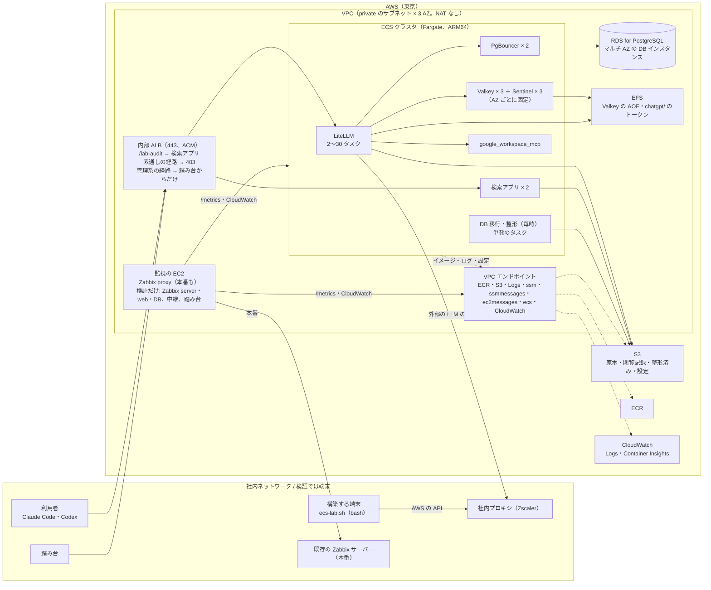

# 変更仕様書: ECS 構成の追加（`LAB_TARGET=aws-ecs`、社内プロキシの中で本番に使える形）

作成: 2026-11-21
状態: 案（実装前。2026-11-21 の 7 回のヒアリングで決めた内容。未決の点は無い）
この文書の役割: **何を満たすか（要件）と、何を決めたか（決定）**。どう作るか（テンプレートの中身、タスクの大きさ、環境変数の名前、スクリプトの流れ）は同じディレクトリの `変更設計書.md` に書く
`docs/spec.md` への反映: 実装と試験が済んでから、13 章の表に従って書き換える

---

## 0. 背景と決定事項

### 0.1 背景

- 同じ仕組みを、これまでに 3 つの形で組んでいる。Mac の k3d（`local`）、EKS とマネージドサービス（`aws`）、VM 3 台とオブジェクトストレージだけ（`aws-ec2` / `gcp-vm`）。
- ECS（Fargate）でも組みたい。ユーザーの方針は「**本番で使える構成でないと検証の意味がない**」（2026-11-21）。検証の都合で機能を落とす案は取らない。
- 本番は社内プロキシ（Zscaler、明示プロキシ、独自 CA で TLS を終端し直す）の中にある。構築も動作も、その中で成り立つ必要がある。
- 構築スクリプトはできるだけ単純にし、**1 ファイルで持ち運べる**ようにしたい（ユーザー 2026-11-21）。

### 0.2 決定事項（2026-11-21、ユーザーの回答）

| 項目 | 決定 |
|---|---|
| 前提 | **本番寄り**。入口は内部 ALB だけで、公開の入口は作らない。利用者は VPC の内側から呼ぶ（1 回目 1B） |
| 使う部品 | **PostgreSQL の RDS、EFS、S3、ECS を中心にする**（1 回目 1B）。ECR、VPC エンドポイント、内部 ALB と ACM の証明書、CloudWatch Logs、IAM、EventBridge Scheduler、Cloud Map も使う。これらは外せない（2 回目の調査。理由は 2.3）。Secrets Manager、ElastiCache、Bedrock、NAT ゲートウェイは使わない |
| 実行環境 | **ECS on Fargate（ARM64）**（1 回目 2A） |
| LiteLLM の設定 | **S3 に置き、LiteLLM が起動時に読む**（1 回目 3A） |
| EKS 構成との関係 | **同じアカウントで、接頭辞を分けて別に作る**（1 回目 4A） |
| Redis | **Valkey を ECS のタスクとして自分で動かす**（2 回目 1C）。利用量の溜め込みと流量制限は今の仕様どおり使う |
| 秘密の値 | **S3 に置いた環境変数のファイル（`environmentFiles`）でタスクに渡す**（2 回目 2A） |
| イメージ | **構築する端末の Docker でビルドし、ECR に push する**（2 回目 3A） |
| PostgreSQL | **RDS for PostgreSQL**（2 回目 4B）。形は **マルチ AZ の DB インスタンス**（primary 1 台、standby 1 台、同期複製）（5 回目 2B） |
| Valkey と Sentinel の置き方 | **別々にする**。Valkey 3 サービスと Sentinel 3 サービス（3 回目 1A） |
| TLS の証明書 | **両方に対応する**。社内で発行した証明書のファイルがあれば ACM に取り込み、無ければ ACM の公開証明書を DNS で検証して発行する（3 回目 2C） |
| VPC | **両方に対応する**。スクリプトが作る形（検証）と、用意された VPC とサブネットを受ける形（本番）（3 回目 3A） |
| 検証での社内プロキシと踏み台 | **監視の EC2（下の行）が中継（mitmproxy と独自の CA）と踏み台を兼ねる。**固定の公開 IP を付ける。端末からは SSM のポート転送で入る（7 回目 2A。3 回目 4A の「Fargate のタスクで中継」は、EC2 を置くことになったので改めた） |
| 監視 | **既存の Zabbix に登録する**（3 回目 5A）。収集は VPC の中の **EC2 に置いた Zabbix proxy** が、インスタンスのロール（読み取りだけ）で AWS を読む（6 回目 1C。Fargate のタスクロールでは Zabbix の AWS 用のテンプレートが認証できないため）。検証では Zabbix のサーバー、web、Zabbix 専用の PostgreSQL も**同じ EC2** に載せる（7 回目 1A。監視が監視対象の RDS に依存しないように）。本番の EC2 は proxy だけ |
| 監視の登録 | **1 ファイルに Zabbix の書き出しの形式（YAML）の定義を埋め込み、取り込みの API（`configuration.import`）で登録する**（6 回目 2C） |
| 前提の確認 | 東京リージョン、スクリプトの置き場、provided の VPC に用意してもらう物、本番の DNS、ECS Exec、RDS の既定、削除の扱い（12 章）はそのままでよい（6 回目 3A） |
| 構築スクリプトの言語 | **bash**。使うのは `aws` CLI、`docker`、`curl` だけ（4 回目 1A） |
| 試験の置き場 | 1 ファイルには**構築と疎通の確認だけ**を入れる。細かい試験は今の `./lab` を `LAB_TARGET=aws-ecs` に対応させて流す（4 回目 2C） |
| DB の接続の窓口 | **PgBouncer（transaction モード）を ECS のサービスとして 2 タスク置き**、LiteLLM からは Service Connect で振り分ける（5 回目 1A） |
| S3 のバケット | **EKS 構成と同じ 3 つ**（原本、閲覧記録、整形済み）。権限はタスクロールに付ける（5 回目 3A） |
| LiteLLM の大きさと数 | **`.env` で CPU、メモリ、最小数、最大数を指定する。** 既定は 1 vCPU・8 GiB、最小 2、最大 30。CPU の使用率で自動で増減する（5 回目 5A） |

### 0.3 今までの検証での Zscaler の扱い（引き継ぐもの）

`aws-ec2` / `gcp-vm` では、Zscaler の代わりに 4 台目の VM で mitmproxy（明示プロキシ、独自 CA）を動かした。VM の直接の外向き通信は nftables で遮断し、中継経由でしか外に出られない状態で全段階と全試験を流した。操作する Mac の通信も中継に通した（`.history/2026-10-30-既存資源からの構築と出口プロキシ/`）。ECS 構成でも同じ条件を作る。違いは、直接外に出させない方法として**経路そのものを作らない**こと（NAT もインターネットへの経路も無いサブネット）である。

---

## 1. 対象範囲

| 対象 | 対象外 |
|---|---|
| ECS 構成の AWS の基盤（VPC、内部 ALB、ECS、RDS、EFS、S3、ECR、IAM ほか）を 1 つの CloudFormation のテンプレートに書く | ElastiCache、Secrets Manager、Bedrock、NAT ゲートウェイ、RDS Proxy、CodeBuild |
| 構築スクリプト 1 ファイル（bash）: 構築、削除、状態の表示、疎通の確認、端末からの転送 | 1 ファイルの中の細かい試験（`./lab` に置く） |
| `./lab` の試験を `LAB_TARGET=aws-ecs` に対応させる（疎通、審査官、監査ログ、障害、冪等性、守り、監視） | `./lab` の構築の段階を ECS 向けに作ること（構築は 1 ファイルだけが行う） |
| 社内プロキシの中での構築と動作。検証用の中継（監視の EC2） | 透過型のプロキシへの対応（CLAUDE.md のとおり明示型だけ） |
| Zabbix への登録（本番は既存サーバー、検証は監視の EC2 に立てたサーバー） | Zabbix の通知の設定（本番のサーバーの設定に任せる） |
| 審査ガードレール、監査ログ、検索アプリ、整形の処理はそのまま動かす（中身は変えない。出口プロキシの CA の扱いだけ足す） | 審査の判定基準の変更 |

---

## 2. 全体構成

### 2.1 構成図

### 2.2 部品と、今の仕様との対応

| 部品 | ECS 構成 | 今の仕様（`docs/spec.md`）からの変わり方 |
|---|---|---|
| LiteLLM | ECS サービス。最小 2、最大 30（既定）、CPU の使用率で自動増減 | 増減の仕組みが HPA から Application Auto Scaling に替わる |
| PostgreSQL | RDS for PostgreSQL 17、マルチ AZ の DB インスタンス（同期複製の standby 1 台） | 5.1 の「3 台」が「primary 1 ＋ standby 1」になる（5 回目 2B）。バックアップは RDS の自動バックアップ（30 日、任意の時点に戻せる）で、S3 には送らない（EKS 構成と同じ） |
| 接続の窓口 | PgBouncer 2 タスク（transaction モード）。直結にも設定 1 つで切り替えられる | 5.1 のまま |
| DB 移行 | 単発のタスク。PgBouncer を通さず primary に直結する | 5.1 のまま |
| Redis | Valkey 3 ＋ Sentinel 3。それぞれ別の AZ に固定。AOF を EFS に書く | 5.2 のまま（「別々のノード」が「別々の AZ のタスク」になる） |
| オブジェクトストレージ | S3 のバケット 3 つ（Object Lock。本番は COMPLIANCE）＋ 設定のバケット 1 つ | 5.3 のまま |
| 秘密の値 | 設定のバケットの環境変数のファイル | ECS 構成だけの方式 |
| 入口 | 内部 ALB（TLS を終端し、経路を振り分ける）。Traefik は置かない | 素通しの経路の 403、MCP のセッション無しの GET への 405、`/lab-audit/` の振り分け、管理系の経路の送信元の制限を ALB の規則で行う |
| 守り | セキュリティグループ（サービスごと）。NAT もインターネットへの経路も作らない | VM 構成の nftables と NetworkPolicy の役割を、セキュリティグループと経路の無さが持つ |
| 監視 | Zabbix（本番は既存サーバー、検証は監視の EC2 の上のサーバー）。Zabbix proxy を VPC の中の EC2 に置く | 12.1 の「監視」を ECS の見え方に合わせて書き換える（6 章） |
| モデルと審査官 | VM 構成と同じ。Claude Max のトークンの転送、審査官は Anthropic の API キー | Bedrock は使わない |
| 認証 | 検証は Google SSO、本番は Entra ID（設定だけで切り替える） | 2 章のまま |

### 2.3 「RDS・EFS・S3・ECS」以外に使う部品と理由

| 部品 | 理由 |
|---|---|
| ECR | Fargate は社内プロキシ越しに外のレジストリからイメージを取れない。外のイメージ（Valkey、PgBouncer、Zabbix など）も ECR に写す |
| VPC エンドポイント | Fargate の基盤の通信（イメージの取得、ログ、S3 の設定ファイル、ECS Exec）はプロキシを通れない。NAT は使わないので、エンドポイントで AWS に届ける |
| 内部 ALB、ACM | TLS の終端、経路の振り分け、管理系の経路の送信元の制限 |
| CloudWatch Logs と Container Insights | 判定ログ（標準出力）の置き場と、Zabbix が読む ECS の数値 |
| IAM | タスクロール（S3 の権限）、タスク実行ロール（イメージ、ログ、環境変数のファイル） |
| EventBridge Scheduler | 整形の定期処理（毎時）の起動 |
| Cloud Map | Valkey と Sentinel の名前（タスクを作り直すと IP が変わるため）と Service Connect |
| EC2（監視の台） | Zabbix の AWS 用のテンプレートは Fargate のタスクロールで認証できない（ZBX-27315、未解決）。EC2 のインスタンスのロールなら認証できる。本番は proxy だけの 1 台（台数 1 の Auto Scaling グループで、落ちたら作り直す）、検証は Zabbix 一式・中継・踏み台を兼ねる 1 台 |

---

## 3. 冗長化

| 部品 | 要件 |
|---|---|
| LiteLLM | 1 つの AZ が止まっても処理が続く（3 つの AZ に散らす）。更新は 1 つずつ入れ替え、利用者の要求を止めない。新しい版が起動しなければ自動で前の版に戻す |
| PostgreSQL | primary の AZ が止まったら、RDS が standby に切り替える。切り替えでデータを失わない（同期複製）。切り替えの間、LiteLLM の readiness は 503 を返す（今の仕様のまま） |
| PgBouncer | 2 タスクを別の AZ に置く。1 つが止まっても、もう 1 つで処理が続く |
| Valkey | 5.2 のまま。primary が落ちたら、Sentinel の判断で人の操作なしに replica が primary になる。落ちた primary は replica として戻る。primary が 2 台になる状態を作らない。AOF を EFS に書き、タスクを作り直してもデータを残す |
| 検索アプリ | 2 タスクを別の AZ に置く |
| 1 つだけの部品 | 要求の経路に、1 タスクだけの部品を置かない（google_workspace_mcp は MCP の経路だけに効く。今の仕様と同じく 1 タスク） |

---

## 4. ネットワークと守り

| 項目 | 要件 |
|---|---|
| 入口 | 内部 ALB の 443 だけ。公開の入口は作らない。利用者は VPC の内側から、ホスト名（ALB の名前への CNAME）で呼ぶ |
| 管理系の経路 | LiteLLM の `/ui`、`/login`、`/sso`、`/metrics` と検索アプリの `/lab-audit` は、踏み台の CIDR からだけ通す。ほかからは 403 |
| 素通しの経路 | 今の仕様（spec 4.2）の接頭辞は 403。MCP の経路へのセッション無しの GET は 405 |
| 外向きの通信 | タスクを置くサブネットには NAT もインターネットへの経路も作らない。外部の API には社内プロキシを通してだけ届く |
| AWS への通信 | VPC エンドポイントを通す。社内プロキシを通さない |
| DB と Valkey | セキュリティグループで、必要なサービスからだけ受ける。PostgreSQL は PgBouncer・DB 移行・LiteLLM（直結のとき）・Zabbix proxy・管理者の経路から。PgBouncer は LiteLLM・検索アプリ・整形から。Valkey は LiteLLM と Valkey・Sentinel 同士から |
| 管理者の DB 接続 | 踏み台から SSM のポート転送で入る |
| 出口プロキシ | `.env` に中継の URL と CA を書けば、全タスクと構築スクリプト自身がその中継を通り、CA を信頼する。方式は明示プロキシ（環境変数） |

---

## 5. 構築スクリプトの要件（1 ファイル）

| 項目 | 要件 |
|---|---|
| 形 | bash の 1 ファイル。CloudFormation のテンプレートを中に持つ。使う道具は `aws` CLI v2、`docker`（buildx）、`curl` と、OS に普通にある道具だけ |
| 命令 | `up`（構築と更新。何度流しても同じ結果）、`down`（有料の物を全部消す）、`status`、`smoke`（疎通の確認）、`forward`（端末から入口への転送） |
| 基盤の持ち方 | `managed`（VPC、サブネット、VPC エンドポイントを作る。検証）と `provided`（用意された VPC とサブネットの ID を `.env` で受ける。本番）。provided ではネットワークの設定を変えない |
| 社内プロキシ | `.env` に URL と CA を書けば、スクリプト自身（`aws`、`docker`、`curl`）と全タスクが中継を通る。検証（managed）では、監視の EC2 に中継を作り、端末も中継を通す設定にできる |
| 人の手作業 | 残さない。DNS のレコード（入口の CNAME、ACM の DNS 検証）は Cloudflare の API で登録する |
| 証明書 | 社内で発行した証明書のファイル（証明書・秘密鍵・中間証明書）を `.env` で渡せば ACM に取り込む。無ければ ACM の公開証明書を DNS で検証して発行する |
| 削除 | `down` の後に有料の物が残らない。COMPLIANCE のバケットは消せないので残して知らせる。provided では、用意された物（VPC、サブネット、踏み台）は消さない |
| 疎通の確認 | `up` の最後に、入口の健全性、キーでの 1 回の要求、監査ログの 1 件の書き込みを確かめる |

---

## 6. 監視

| 項目 | 要件 |
|---|---|
| 送り先 | 本番は既存の Zabbix サーバー（宛先と API トークンを `.env` に書く）。検証は、構築スクリプトが監視の EC2 に Zabbix のサーバー、web、専用の PostgreSQL を立てる（VM 構成の Docker Compose と同じ）。通知は送らない |
| 収集 | VPC の中の監視の EC2 に Zabbix proxy を置く（インスタンスのロールで CloudWatch と ECS の API を読む）。LiteLLM の数値は、ECS の API でタスクの一覧を得てタスクごとに `/metrics` を読み、全タスクを足す（今の Kubernetes の発見ルールと同じ形）。ECS（サービスごとの予定のタスク数と動いている数、CPU とメモリ）、ALB（健全なターゲットの数、5xx）、RDS（状態、CPU、接続数、空き容量、複製の遅れ）、Valkey（primary の数、replica の数）、LiteLLM の数値（要求の数、失敗した要求の割合、平均の待ち時間、LLM の送り先の失敗）、証明書の期限、監査ログの整形の最後の成功を見る |
| 警告 | 今の仕様（12.1、12.3）の閾値を引き継ぐ。LiteLLM の失敗の割合が 5 分続けて 5% を超える、送り先の失敗が 5 分続く、など |
| 登録 | 構築スクリプトが、埋め込んだ YAML の定義を Zabbix の取り込みの API（`configuration.import`）で登録する。何度流しても同じ結果。中身が今の監視の宣言（`labtool/zabbix_monitors.py`）と食い違わないことを単体テストで確かめる |

---

## 7. 検証項目

| 項目 | 確かめ方 |
|---|---|
| 構築 | `up` が managed と provided の両方で通り、2 回目で何も変わらない |
| 社内プロキシ | 検証の中継の中で、全段階と全試験が通る。中継の記録に、外部の API（Anthropic、ChatGPT、Google、Cloudflare）と、端末からの AWS の API・イメージの取得が現れる。タスクからの直接の外向き HTTPS はタイムアウトし、中継経由は通る |
| 疎通・審査・監査 | `./lab test-smoke`、`test-judge`、`test-audit` が通る |
| 障害 | `./lab test-failover` の場面が回復の目安（120 秒）以内に戻る。場面: LiteLLM のタスクを止める、PgBouncer のタスクを止める、RDS の切り替え、Valkey の primary のタスクを止める、Sentinel のタスクを止める。監査ログの欠けは 0 件 |
| 更新 | 要求を流しながら LiteLLM を更新しても失敗が 0 件。起動しない版を入れると自動で前の版に戻る |
| 守り | 管理系の経路は踏み台からだけ通り、ほかからは 403。利用者の API はどこからも通る。許していないサービスから PostgreSQL・PgBouncer・Valkey に届かない |
| 保持 | 原本と閲覧記録が、書き込み用・検索アプリ・管理者（保持の回避なし）のどの資格情報でも消せない |
| 監視 | Zabbix に 6 章の値が入り、閾値を超えると警告になる |
| 全削除 | `down` の後に有料の物が残らない |

---

## 8. リスク・注意事項

| 項目 | 内容 |
|---|---|
| 秘密の値の置き方 | 環境変数のファイルは、S3 の上では平文のファイルになる（サーバー側の暗号化はする）。読めるのはタスク実行ロールと構築する操作者だけに絞る。値を替えたらタスクの入れ替えが要る |
| 1 ファイルと `./lab` の二重持ち | 1 ファイルは `labtool/render.py` を読めないので、LiteLLM の設定、S3 の権限、監視の宣言を 1 ファイルの中に持ち直す。食い違いを防ぐ仕組みが要る（設計書 12 章） |
| ALB の再送 | Traefik は接続できなかった要求だけを別の Pod に送り直していた。ALB にはこの再送が無い。タスクが止まる瞬間の要求は、登録の解除と止める時間の順番で守る |
| 長い要求 | ALB のアイドルタイムアウトの既定は 60 秒で、長いストリーミングが切れる。長く取る |
| Fargate の止まり方 | タスクを止めるときに待てるのは最長 120 秒。監査ログの書き出しはこの中で終える |
| PostgreSQL の台数 | マルチ AZ の DB インスタンスの standby は読めない。今の仕様（3 台）より台数が少ない（5 回目 2B） |
| 端末の道具 | SSM のポート転送には Session Manager のプラグインが端末に要る（`forward` と試験だけ） |
| 監視の EC2 | OS の更新が要る（設定の変更や AMI の更新は台の作り直しで行う）。本番の proxy の台が作り直される間（数分）は数値が欠ける |

---

## 9. 用語

| 用語 | 意味 |
|---|---|
| タスク | ECS が動かすコンテナの組。Kubernetes の Pod にあたる |
| サービス | 決めた数のタスクを動かし続ける ECS の仕組み。Kubernetes の Deployment にあたる |
| タスクロール | タスクの中のアプリが AWS を呼ぶときの権限 |
| タスク実行ロール | ECS 自身がイメージの取得、ログ、環境変数のファイルの読み込みに使う権限 |
| 環境変数のファイル | S3 に置いた `名前=値` の行のファイル。ECS がタスクの起動時に読み、環境変数にする |
| Service Connect | ECS のサービス同士を名前でつなぎ、振り分ける仕組み |
| VPC エンドポイント | VPC の中から、インターネットを通らずに AWS のサービスへ届く口 |

---

## 10. この文書で決めないこと（変更設計書に書く）

テンプレートのリソースの一覧、タスクごとの CPU とメモリ、環境変数とファイルの名前、スクリプトの命令ごとの流れ、`./lab` の試験の ECS 向けの分岐、障害の場面の起こし方。

---

## 11. 前提（ユーザーに確認済み。2026-11-21 の 6 回目 3A）

| 項目 | 内容 |
|---|---|
| リージョン | 東京（今までと同じ） |
| スクリプトの置き場 | リポジトリの中に置き、ビルドの材料（`litellm/`、`apps/audit/`）を読む。ビルド済みのイメージのタグを `.env` で渡せばビルドを飛ばせる |
| provided の VPC | 用意する側が、private のサブネット 3 つ（3 AZ）、VPC エンドポイント（2.3 の表）、社内プロキシへの経路を用意する。足りなければスクリプトは足りない物を示して止まる |
| DNS | 本番も Cloudflare の API でレコードを登録する（VM 構成の provided と同じ） |
| ECS Exec | 試験のために有効にする。本番では `.env` で切れる |
| RDS の既定と削除の扱い | 設計書のとおり（`db.m7g.large`・100 GB。`lab` は全部消し、`prod` は削除保護・スナップショット・COMPLIANCE） |

---

## 12. 調べて分かったこと

| 項目 | 内容 |
|---|---|
| Zabbix と Fargate | Zabbix の AWS 用のテンプレートの `role_base` は EC2 のメタデータ（169.254.169.254）だけを読み、Fargate の資格情報の取得先（169.254.170.2）を読まないので、タスクロールでは認証できない（[ZBX-27315](https://support.zabbix.com/browse/ZBX-27315)、未解決、2026-11-21 に確認）。そのため proxy を EC2 に置く |
| Fargate とプロキシ | Fargate の基盤（イメージの取得、ログ、環境変数のファイル、EFS）は明示プロキシの設定を持たない。VPC エンドポイントで AWS に届ける |
| LiteLLM の設定 | `LITELLM_CONFIG_BUCKET_NAME` / `LITELLM_CONFIG_BUCKET_OBJECT_KEY` で、起動時に S3 から設定を読む |

---

## 13. `docs/spec.md` への反映の仕方（実装と試験の後）

| 反映先 | 内容 |
|---|---|
| 新しい章（13 章「ECS 構成」） | 2〜7 章を、決定の経緯を除いて書く |
| 5 章 冗長化 | 環境ごとの違い（RDS のマルチ AZ の DB インスタンス、Valkey の置き方）を表に足す |
| 1 章 全体構成 | 環境の一覧に `aws-ecs` を足す |
