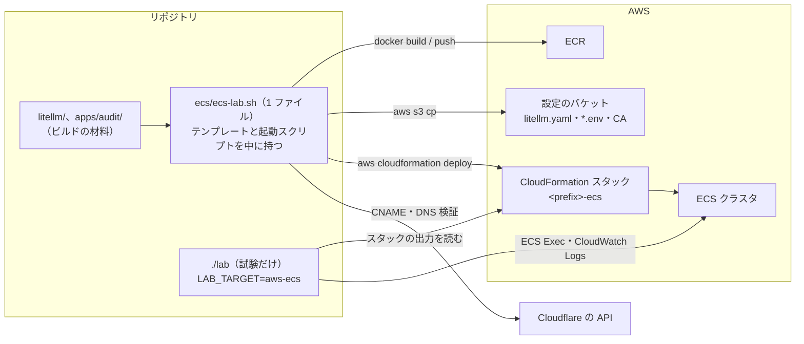

# 変更設計書: ECS 構成の追加（`LAB_TARGET=aws-ecs`）

作成: 2026-11-21
状態: 案（実装前）
対応する変更仕様書: 同じディレクトリの `変更仕様書.md`
この文書の役割: **どう作るか**。何を満たすかは変更仕様書に書いてある。実装と試験が済んだら `docs/design.md` に反映する（15 章）

---

## 1. 作りの全体

| 置き場 | 中身 | 環境を知るか |
|---|---|---|
| `ecs/ecs-lab.sh` | 構築・削除・状態・疎通・転送。テンプレート（heredoc）、Valkey と Sentinel と PgBouncer の起動スクリプト（heredoc）、LiteLLM の設定の生成 | ECS だけ |
| `litellm/`、`apps/audit/` | 今のまま。CA の扱いだけ足す（7.3） | 知らない |
| `labtool/` | 試験の分岐を足す（13 章）。構築の段階は足さない | `Env.target == "aws-ecs"` で分岐 |

スタックは 1 つ（`<prefix>-ecs`）にする。消して作り直せる物と状態を持つ物を分けないのは、`down` がどちらも消すため（今の EKS 構成と同じ扱い）。状態を持つ物（RDS、EFS、S3）には `DeletionPolicy` を付け、本番（`LAB_ECS_SCALE=prod`）では残す。

---

## 2. `.env` の項目

| 変数 | 既定 | 内容 |
|---|---|---|
| `LAB_TARGET` | | `aws-ecs`（`./lab` の試験の分岐に使う。`ecs-lab.sh` は見ない） |
| `LAB_PREFIX` | `litellm-ecs` | 名前の接頭辞。EKS 構成（`litellm-lab`）と分ける |
| `LAB_ECS_SCALE` | `lab` | `lab`（検証。削除で全部消す）か `prod`（削除保護、スナップショット、COMPLIANCE） |
| `LAB_ECS_INFRA` | `managed` | `managed` / `provided` |
| `LAB_ECS_VPC_ID` / `LAB_ECS_SUBNET_IDS` | | provided だけ。private のサブネット 3 つ（3 AZ） |
| `LAB_ECS_VPC_CIDR` | `10.70.0.0/16` | managed の VPC。provided は VPC から読む |
| `LAB_ECS_HOSTNAME` | | 入口のホスト名（`LAB_ECS_LOCAL_HOSTNAME` が端末の別名。既定は最初の名前に `-local`） |
| `LAB_TLS_CERT_FILE` / `LAB_TLS_KEY_FILE` / `LAB_TLS_CHAIN_FILE` | | 社内で発行した証明書。あれば ACM に取り込む。無ければ DNS 検証で発行 |
| `CLOUDFLARE_API_TOKEN` / `CLOUDFLARE_ZONE_ID` | | DNS のレコード |
| `LAB_EGRESS_PROXY` / `LAB_EGRESS_CA_FILE` | | タスクが使う中継と CA（今の変数と同じ名前） |
| `LAB_EGRESS_PROXY_MAC` | | スクリプト自身が使う中継 |
| `LAB_ECS_BASTION_CIDR` | | 管理系の経路を許す送信元（provided で必須）。managed では監視の EC2 の内部 IP（/32）を自動で入れる。managed は必ず検証の中継（監視の EC2 の mitmproxy）を作る（VPC に NAT が無く、外へは中継を通るしかないため） |
| `LAB_ECS_MONITOR_TYPE` | `t3.medium` | 監視の EC2 の種類。amd64（VM 構成の中継の VM と同じ。Zabbix の Docker のイメージと agent 2 の公式リポジトリを試した組み合わせ） |
| `LAB_LITELLM_CPU` / `LAB_LITELLM_MEMORY` | `1024` / `8192` | LiteLLM のタスクの CPU（単位）とメモリ（MiB） |
| `LAB_LITELLM_MIN` / `LAB_LITELLM_MAX` | `2` / `30` | 自動増減の範囲 |
| `LAB_ECS_RDS_CLASS` / `LAB_ECS_RDS_STORAGE_GB` | `db.m7g.large` / `100` | RDS |
| `LAB_DB_POOLER` | `pooler` | `pooler` / `direct`（今の変数と同じ） |
| `LAB_ZABBIX_SERVER` / `LAB_ZABBIX_API_URL` / `LAB_ZABBIX_API_TOKEN` | | 本番の既存サーバー。空なら検証の Zabbix（server、web、PostgreSQL）を監視の EC2 に立てる |
| `LAB_ECS_EXEC` | `true` | ECS Exec を有効にする |
| `LAB_IMAGE_LITELLM` / `LAB_IMAGE_AUDIT` | | ビルド済みのタグ。あればビルドを飛ばす |
| 秘密の値 | | `LITELLM_MASTER_KEY`、`LITELLM_SALT_KEY`、`POSTGRES_PASSWORD`、`REDIS_PASSWORD`、`SENTINEL_PASSWORD`、Google の OAuth、Anthropic の API キーなど。今の `.env` と同じ名前。無ければ生成して `.env` に書く |

---

## 3. テンプレートのリソース

### 3.1 ネットワーク（managed だけ。provided は条件で作らない）

| リソース | 作り |
|---|---|
| VPC | `LAB_ECS_VPC_CIDR`、DNS のホスト名と解決を有効 |
| private のサブネット | /20 × 3 AZ。ルートテーブルにインターネットへの経路を作らない |
| 中継のサブネット | /24 × 1（managed のとき。VPC の末尾の /24。private の /20 と重ならない）。インターネットゲートウェイへの経路。監視の EC2 だけを置く |
| VPC エンドポイント | ゲートウェイ型: S3。インターフェース型（private の 3 サブネット）: `ecr.api`、`ecr.dkr`、`logs`、`ssm`、`ssmmessages`、`ec2messages`（ECS Exec と、監視の EC2 への SSM）、`monitoring`、`ecs`（Zabbix が CloudWatch とタスクの一覧を読む）。Fargate の基盤はこれらを社内プロキシを通さずに使う |

### 3.2 入口

| リソース | 作り |
|---|---|
| 内部 ALB | private の 3 サブネット。アイドルタイムアウト 1800 秒。削除保護は `prod` のとき |
| リスナー 443 | 証明書は ACM の ARN（パラメータ）。TLS の方針は TLS 1.2 以上 |
| リスナー 80 | 443 への転送 |
| 規則（優先度の小さい順） | 1〜2: 素通しの接頭辞（spec 4.2 の 10 個。1 つの規則に入る条件の数の上限に合わせて分ける）→ 固定の 403。3: `/<MCP サーバー名>/mcp` への GET で `mcp-session-id` ヘッダーが無い → 固定の 405。4: 管理系の経路（`/ui*`、`/login*`、`/sso*`、`/metrics*`）かつ送信元が踏み台の CIDR → LiteLLM。5: 管理系の経路 → 固定の 403。6: `/lab-audit/*` かつ送信元が踏み台 → 検索アプリ。7: `/lab-audit/*` → 403。既定: LiteLLM |
| ターゲットグループ | `ip` 型。LiteLLM: ヘルスチェック `/health/readiness`、10 秒間隔、2 回で外す、登録解除の待ち 60 秒。検索アプリ: `/lab-audit/healthz`（今の readiness と同じ経路） |
| セキュリティグループ | 入り 443・80: VPC の CIDR と `LAB_ECS_BASTION_CIDR`（provided は `.env` で社内の CIDR を足せる） |

### 3.3 データ

| リソース | 作り |
|---|---|
| RDS | PostgreSQL 17、`LAB_ECS_RDS_CLASS`、マルチ AZ の DB インスタンス、gp3、暗号化、自動バックアップ 30 日、`max_connections` 200（パラメータグループ）、`rds.force_ssl` 1。マスターのパスワードは `.env` の `POSTGRES_PASSWORD`（パラメータ、`NoEcho`）。`lab` は削除時にスナップショットを取らない、`prod` は削除保護とスナップショット |
| DB | `litellm`（LiteLLM）。Zabbix の DB は監視の EC2 の中に置き、RDS には置かない |
| EFS | 暗号化、private の 3 サブネットにマウントターゲット。アクセスポイント: `valkey-0`〜`valkey-2`（AOF）、`sentinel-0`〜`sentinel-2`（Sentinel が書き換える設定）。UID 999。VM 構成と同じく ChatGPT のモデルは置かないので、トークンの置き場は要らない。それぞれ別の UID のディレクトリ |
| S3 | `<prefix>-<アカウント>-audit-raw`、`-audit-access`、`-audit-derived`（EKS 構成の `render.s3_buckets()` と同じ定義を書き写す）、`-config`（設定と環境変数のファイル。Object Lock なし、バージョニングあり、SSE-S3、パブリックアクセスの全遮断、SSL の強制） |
| ECR | `<prefix>/litellm`、`<prefix>/audit`、`<prefix>/mirror/<名前>`（外のイメージの写し）。最新 10 タグを残す |

### 3.4 IAM

| ロール | 権限 |
|---|---|
| タスク実行ロール（全タスク共通） | `AmazonECSTaskExecutionRolePolicy`、設定のバケットの `s3:GetObject`（サービスごとの環境変数のファイルだけ）と `s3:GetBucketLocation` |
| `litellm` | 原本への追記（EKS 構成の `litellm-writer` と同じ）、設定のバケットの `litellm/*` の読み取り、ECS Exec（`ssmmessages:*`） |
| `audit-viewer` / `audit-compactor` | EKS 構成と同じ |
| 監視の EC2（インスタンスのロール） | `cloudwatch:GetMetricData`、`cloudwatch:ListMetrics`、`ecs:ListTasks`、`ecs:DescribeTasks`、`ecs:DescribeServices`、`elasticloadbalancing:Describe*`、`rds:DescribeDBInstances`（読み取りだけ）、`AmazonSSMManagedInstanceCore`。検証の中継のときは、設定のバケットの中継の CA の読み取りも |
| `valkey` / `pgbouncer` / ほか | EFS のマウントと ECS Exec だけ |
| 明示的な Deny（全ロール） | EKS 構成と同じ。ロック付きバケットの削除、保持の回避、保持と Legal Hold の変更 |
| Scheduler の実行ロール | `ecs:RunTask`（整形のタスク定義）、`iam:PassRole`（そのタスクのロール） |

### 3.5 ECS

| リソース | 作り |
|---|---|
| クラスタ | Container Insights を有効。キャパシティプロバイダは `FARGATE` |
| 名前空間 | Cloud Map の private DNS `<prefix>.internal`。Service Connect の名前空間も同じ |
| ロググループ | サービスごとに `/<prefix>/<サービス>`。保持 30 日（`prod` は `.env` で変えられる） |
| 自動増減 | LiteLLM: Application Auto Scaling の目標追跡（CPU 60%。今の HPA と同じ）、`LAB_LITELLM_MIN`〜`MAX`、縮めるときの待ち 300 秒 |
| Scheduler | `cron(10 * * * ? *)`、時刻帯 `Asia/Tokyo`。整形のタスクを private のサブネットで起動する |

---

## 4. タスクとサービス

| サービス | 数 | CPU / メモリ | イメージ | ポート | 置き方 | 保存 |
|---|---|---|---|---|---|---|
| `litellm` | 2〜30 | `.env`（既定 1 vCPU / 8 GiB） | 自作（ECR） | 4000 | 3 AZ に散らす | 一時ディスク 21 GiB（監査ログの退避） |
| `pgbouncer` | 2 | 0.25 / 0.5 GiB | CloudNativePG の PgBouncer のイメージ（Pooler と同じ版）の写し | 5432（Service Connect `pgbouncer`） | 別々の AZ | なし |
| `valkey-0`〜`valkey-2` | 各 1 | 0.5 / 1 GiB | `valkey/valkey:9.0.6` の写し | 6379（Cloud Map `valkey-N.<prefix>.internal`） | サービスごとに 1 つの AZ のサブネットに固定 | EFS `valkey-N` |
| `sentinel-0`〜`sentinel-2` | 各 1 | 0.25 / 0.5 GiB | 同じ | 26379（Cloud Map `sentinel-N.<prefix>.internal`） | 同上 | EFS `sentinel-N` |
| `audit-viewer` | 2 | 0.5 / 1 GiB | 自作（ECR） | 8000 | 別々の AZ | なし |
| `workspace-mcp` | 1 | 0.25 / 0.5 GiB | `google_workspace_mcp:2.1.0` の写し | 8000（Service Connect） | | なし |
| `fake-llm` | 2（試験のときだけ） | 0.25 / 0.5 GiB | `python:3.13-alpine` の写し | 8000（Service Connect） | 別々の AZ | なし |
| 単発: `litellm-migrate` | — | 1 / 4 GiB | LiteLLM と同じ | — | | なし |
| 単発: `audit-compactor` | — | 1 / 2 GiB | 自作（監査） | — | | なし |

- 配備の設定: LiteLLM、PgBouncer、検索アプリは `minimumHealthyPercent 100`、`maximumPercent 200`、配備の遮断器（失敗したら前の版に戻す）。Valkey と Sentinel は `minimumHealthyPercent 0`、`maximumPercent 100`。EFS の同じディレクトリに 2 つのタスクが同時に書かないように、止めてから起こす
- 止める時間: LiteLLM の `stopTimeout` 120 秒（Fargate の上限）。ALB の登録解除の待ち（60 秒）の後に SIGTERM が届くので、新しい要求が来なくなってから監査ログを書き出す
- ヘルスチェック: LiteLLM はコンテナのヘルスチェック（`/health/liveliness`）と ALB のヘルスチェック（`/health/readiness`）の両方。Valkey は `valkey-cli ping`

---

## 5. 設定と秘密の値

| 物 | 置き場 | 渡し方 |
|---|---|---|
| LiteLLM の設定 | `s3://<config>/litellm/<ハッシュ>.yaml` | `LITELLM_CONFIG_BUCKET_NAME` と `LITELLM_CONFIG_BUCKET_OBJECT_KEY`。中身が変われば鍵（ハッシュ）が変わり、タスク定義が変わって 1 つずつ入れ替わる |
| 秘密の値 | `s3://<config>/env/<サービス>.env` | タスク定義の `environmentFiles`。サービスごとに要る値だけを書く。中身のハッシュをタスク定義の環境変数 `LAB_ENV_HASH` に入れ、値を替えたら入れ替わるようにする |
| 審査の判定基準 | イメージの中（`litellm/guardrails/policies/`） | 設定の `isolated_policy` に中身を入れる（今と同じ） |
| Valkey・Sentinel・PgBouncer の起動スクリプト | テンプレートのタスク定義の `command`（`sh -c`） | 今の `k8s/valkey/start-*.sh` の中身を書き写す。名前は Cloud Map の DNS 名に置き換える |

LiteLLM の設定は `labtool/render.py` の `litellm_config` と同じ中身を、`ecs-lab.sh` の heredoc で作る。分岐（Gmail、Jev、ChatGPT のトークン、文脈独立審査）は今の `.env` の変数で同じように切り替える。違いは 2 か所: Redis を Sentinel の DNS 名で指定することと、偽 LLM の `api_base` を Service Connect の名前にすること。

---

## 6. 順番のある処理

### 6.1 DB 移行

`up` の中で、LiteLLM のサービスを更新する前に `aws ecs run-task` で `litellm-migrate` を流す。接続先は RDS の writer に直結し、`DISABLE_SCHEMA_UPDATE=false` にする（中身は今の Job と同じ）。終わるまで `aws ecs wait tasks-stopped` で待ち、終了コードが 0 でなければログ（CloudWatch Logs）の末尾を出して止まる。流したかどうかは、イメージのタグと RDS の `DbiResourceId` から作ったハッシュを設定のバケットに印として置いて判断する（今の Job の名前のハッシュと同じ考え方）。

### 6.2 Valkey と Sentinel

- `valkey-N` は起動時に、Sentinel（`sentinel-0`〜`2`）に今の primary を聞く。自分なら primary、違えば replica として起動する。答えが無ければ `valkey-0` を primary とする（今と同じ）
- `replica-announce-ip` には自分の DNS 名を入れる。Sentinel は `resolve-hostnames yes`、`announce-hostnames yes`
- Cloud Map の DNS の TTL は 10 秒。タスクを作り直して IP が変わっても、10 秒ほどで新しい IP が引ける
- LiteLLM には `REDIS_SENTINEL_NODES`（`sentinel-N.<prefix>.internal:26379` の 3 つ）を渡す（今と同じ）

### 6.3 PgBouncer

設定は今の Pooler と同じ（`pool_mode transaction`、`max_client_conn 1000`、`default_pool_size 40`、`max_prepared_statements 0`、`server_login_retry 1`、`server_connect_timeout 3`）。RDS へは TLS（`server_tls_sslmode require`）。LiteLLM の `database_connection_pool_limit` は 10（今と同じ）。最大 30 タスクで LiteLLM からの接続は 300、RDS への接続は 40 × 2 = 80 に収まる。

---

## 7. 社内プロキシ

### 7.1 構築する端末

`LAB_EGRESS_PROXY_MAC` があれば、スクリプトの最初に `HTTP(S)_PROXY`、`NO_PROXY=127.0.0.1,localhost`、`AWS_CA_BUNDLE`・`CURL_CA_BUNDLE`・`SSL_CERT_FILE`（OS の CA の束と中継の CA を合わせたもの。`.build/ecs-ca-bundle.pem`）を入れる。`docker build` には `--build-arg HTTP(S)_PROXY` を渡し、Docker 自身の取得と push は Docker の設定のプロキシに任せる（スクリプトは設定されているかを確かめ、無ければ設定の場所を示して止まる）。

### 7.2 タスク

| 変数 | 値 |
|---|---|
| `HTTP_PROXY` / `HTTPS_PROXY`（大文字と小文字） | `LAB_EGRESS_PROXY` |
| `NO_PROXY`（大文字と小文字） | `localhost,127.0.0.1,169.254.169.254,169.254.170.2,.<prefix>.internal,.amazonaws.com,<VPC の CIDR>` |
| `SSL_CERT_FILE` / `REQUESTS_CA_BUNDLE` / `AWS_CA_BUNDLE` / `CURL_CA_BUNDLE` | `/etc/lab/ca-bundle.pem` |
| `DISABLE_AIOHTTP_TRANSPORT` | `True`（LiteLLM。今と同じ） |

- `169.254.170.2` はタスクロールの資格情報の取得先で、ここを中継に通すと AWS の認証が壊れる。`.amazonaws.com` は VPC エンドポイントで届けるので中継に通さない
- 中継を通らない宛先（S3 など）は公開の CA の証明書を返すので、CA は「OS の CA の束 ＋ 中継の CA」を 1 つのファイルにする。自作イメージはビルド時に作る（監査アプリの `egress-ca.pem` の扱いを LiteLLM にも足す）。外のイメージ（Valkey、PgBouncer、Zabbix）は外部の HTTPS を使わないので要らない
- DuckDB（監査アプリ）の `SET http_proxy` と `SET ca_cert_file` は今のまま

### 7.3 自作イメージの変更

`litellm/Dockerfile` に、`egress-ca.pem` があれば OS の CA の束に足して `/etc/lab/ca-bundle.pem` を作る処理を足す（監査アプリと同じ）。中継が無いときは OS の CA の束をそのまま置く。

### 7.4 監視の EC2（Zabbix proxy。検証では Zabbix 一式・中継・踏み台も）

| 項目 | 本番（provided） | 検証（managed） |
|---|---|---|
| 台 | 台数 1 の Auto Scaling グループ（落ちたら作り直す）。private のサブネット 3 つ | 1 台。中継のサブネット、固定の公開 IP（Elastic IP） |
| AMI | Ubuntu 24.04 arm64 の最新（SSM のパラメータから引く。VM 構成と同じ OS） | 同じ |
| 初期化 | ユーザーデータ（1 ファイルに埋め込んだスクリプト）。中身のハッシュを起動テンプレートに入れ、変われば台を作り直す。SSH の鍵は使わない | 同じ |
| 載せる物 | Docker と Zabbix proxy（能動型、サーバーは `LAB_ZABBIX_SERVER`） | 加えて Docker Compose で Zabbix の server、web（127.0.0.1:8080 だけ）、PostgreSQL（`vm/proxy-init.sh` の構成を書き写す）。mitmproxy（`--mode regular`、3128、`block_global=false`）を systemd で |
| 外向き | OS のパッケージと Docker のイメージは社内プロキシ経由（`LAB_EGRESS_PROXY`）。AWS は VPC エンドポイント | 自分が中継なので直接外に出る |
| 入り | 10051 は無し（proxy は能動型で、自分から server へつなぐ） | 3128 は VPC の CIDR と操作する端末の IP だけ。22 は開けない |

- 検証の中継の CA は、スクリプトが端末の `openssl` で作り（`.build/egress-ca.pem` と鍵）、設定のバケットに置く。EC2 はユーザーデータで読み、mitmproxy の CA にする。CA が変わらなければ台を作り直しても同じ CA になる
- 中継の記録は journal に出す。`./lab proxy-log` は SSM のコマンド（`AWS-RunShellScript`）で宛先ホストごとの件数を数える（今の SSH の代わり）
- `LAB_EGRESS_PROXY` は、検証では `http://<監視の EC2 の内部 IP>:3128`、`LAB_EGRESS_PROXY_MAC` は `http://<Elastic IP>:3128` をスクリプトが入れる

---

## 8. 踏み台と端末からの入口

- 検証（managed）: 監視の EC2 が踏み台を兼ねる。管理系の経路を許す CIDR はこの EC2 の内部 IP（/32）。端末からは `aws ssm start-session --target <インスタンス ID> --document-name AWS-StartPortForwardingSessionToRemoteHost` で、ALB の 443（`ecs-lab.sh forward`）と Zabbix の web（127.0.0.1:8080）に転送する。端末の別名（`LAB_LOCAL_HOSTNAME`、127.0.0.1）は証明書の SAN に入れる（DNS 検証で発行するとき）
- 本番（provided）: 社内の踏み台から入る。`LAB_ECS_BASTION_CIDR` に踏み台の CIDR を書く
- 管理者の DB 接続: 同じ転送で RDS の 5432 に入る

---

## 9. 監視（Zabbix）

| 部品 | 作り |
|---|---|
| Zabbix proxy | 監視の EC2 の上の Docker（`zabbix-proxy-sqlite3` 7.0、ホストのネットワーク、待ち受け 10061）。能動型。サーバーの宛先は `LAB_ZABBIX_SERVER`（検証は同じ台の server） |
| ECS・ALB・RDS | Zabbix 公式の AWS 用のテンプレート（「AWS ECS Cluster by HTTP」「AWS RDS instance by HTTP」「AWS ELB Application Load Balancer by HTTP」）。認証は `role_base`（インスタンスのロール）。このテンプレートは IMDSv1 の形で資格情報を読むので、監視の EC2 だけ IMDSv1 を許す（`HttpTokens: optional`、Docker の中から届くよう段数 2） |
| 監視の台の補助 | Zabbix agent 2 の UserParameter から、標準ライブラリの Python（`/usr/local/bin/lab-ecs-api`。SigV4 は自前）を呼ぶ。`services`（ECS のサービスごとの予定と動いている数）、`tasks litellm`（LiteLLM のタスクの IP の発見）、`valkey`（3 台に AUTH と INFO replication を送り、primary と replica の数）、`compactor`（整形済みのバケットの `_state/compactor.json` の更新時刻＝整形の最後の成功） |
| LiteLLM の数値 | 発見ルールでタスクごとに `http://<タスクの IP>:4000/metrics` を proxy が読み、Prometheus の値を毎秒の変化にして、計算アイテムで全タスクを足す（今の Kubernetes の発見ルールと同じ形。指標と閾値は `labtool/zabbix_monitors.py` と同じ）。見えなくなったタスクのアイテムはすぐ止め、1 時間後に消す |
| 証明書の期限 | agent 2 の `web.certificate.get[<ホスト名>,443]` |
| 監視の EC2 自身 | agent 2（`Linux by Zabbix agent`）。受け身の確認だけ（Server=127.0.0.1） |
| 登録 | `up` の最後に、ecs-lab.sh が取り込みの YAML、補助、登録の処理（標準ライブラリの Python）、設定（秘密の値を含む。設定のバケットの `zabbix/`）を置き、SSM のコマンドで監視の台に準備のスクリプトを流す。登録は監視の台の上から Zabbix の API に向けて行う（検証は 127.0.0.1:8080、本番は `LAB_ZABBIX_API_URL`。社内の Zabbix には VPC の中から届くので、端末からの経路は要らない）。テンプレートは `configuration.import`（作成・更新・消えた物の削除）、プロキシ・ホストグループ・ホスト（監視の台、ECS、RDS、ALB の 4 つ）は get → create / update。何度流しても同じ結果 |
| 閾値 | Valkey の primary が 1 台でない状態が 2 分（重大）、replica が 2 台より少ない状態が 5 分、サービスの動いているタスクが予定より少ない状態が 5 分、LiteLLM の失敗の割合が 5 分続けて 5%、送り先の失敗が 5 分、整形が 2 時間成功していない、証明書の期限まで 14 日（いずれも警告） |

---

## 10. スクリプトの命令

| 命令 | 流れ |
|---|---|
| `up` | 道具と `.env` の確認（provided ならサブネットと VPC エンドポイントの有無を確かめ、足りなければ示して止まる）→ 中継と CA の設定 → 証明書（取り込みか、DNS 検証の発行と Cloudflare への検証のレコード）→ ECR のリポジトリ（スタックの外。イメージを先に置くため）→ 外のイメージの写しと自作イメージのビルドと push → 設定と環境変数のファイルを置く → `aws cloudformation deploy`（変更が無ければ何もしない）→ DB 移行 → サービスの安定を待つ（`aws ecs wait services-stable`）→ Cloudflare の CNAME → Zabbix の登録（9 章）→ `smoke` |
| `down` | 既存の Zabbix（`LAB_ZABBIX_SERVER` があるとき）から、この環境のホスト 4 つ・プロキシ・空のホストグループを外す（監視の台から。テンプレートは共有なので残す）→ Cloudflare のレコードを消す → スタックを消す → 残る物（ロック付きバケットの中身とバケット、ECR、`lab` の RDS のスナップショット）を消す → COMPLIANCE のバケットが残れば知らせる。provided では VPC とサブネットに触らない |
| `status` | スタックの状態、サービスごとの予定と動いている数、ALB の健全なターゲット、RDS の状態、Valkey の primary |
| `smoke` | 入口の `/health/readiness` が 200、マスターキーで `fake-tools`（試験のときだけ。無ければ `/v1/models`）への要求が 200、監査ログの原本に 1 件増える |
| `forward` | 8 章の転送だけを張る |

冪等性: CloudFormation の差分で決まる物はそちらに任せる。スタックの外の物（ECR のリポジトリ、証明書、DNS のレコード、設定のファイル、移行の印）は、あれば何もしない作りにする。

---

## 11. 障害の試験（`./lab test-failover`、`LAB_TARGET=aws-ecs`）

| 場面 | 起こし方 | 合格の目安 |
|---|---|---|
| `litellm-task` | LiteLLM のタスクを 1 つ `ecs stop-task` | 失敗 0 件（ALB が外すまでの要求は別のタスクに届く） |
| `pgbouncer-task` | PgBouncer のタスクを 1 つ止める | 120 秒以内に回復 |
| `rds-failover` | `rds reboot-db-instance --force-failover` | 120 秒以内に回復 |
| `valkey-primary` | Sentinel に primary を聞き、そのタスクを止める | 120 秒以内に回復。primary は常に 1 台 |
| `sentinel-task` | Sentinel のタスクを 1 つ止める | 失敗 0 件 |

負荷は VPC の中から送る。監視の EC2 で `tests/failover-load/remote_load.py` を SSM の対話のセッション（`AWS-StartInteractiveCommand`）で動かし、標準出力で 1 件 1 行の JSON を受け取る（今の SSH の標準入出力と同じ形）。

---

## 12. 1 ファイルと `./lab` の食い違いを防ぐ

`ecs-lab.sh` は `labtool/render.py` を読めないので、次の 3 つを書き写す。`labtool/tests/` に単体テストを足し、同じ `.env` から作った物が一致することを確かめる。

| 書き写す物 | 確かめ方 |
|---|---|
| LiteLLM の設定 | `ecs-lab.sh render-config`（設定を標準出力に出すだけの隠し命令）の出力と `render.litellm_config` の出力を、ECS 固有の 2 か所（5 章）を除いて比べる |
| S3 のバケットと権限 | テンプレートを `ecs-lab.sh render-template` で出し、バケットの定義と Deny の一覧を `render.s3_buckets()`・`render.s3_policies()` と比べる |
| Valkey の起動スクリプト | `k8s/valkey/start-*.sh` と、名前の置き換えを除いて一致する |
| Zabbix の監視の定義 | 埋め込んだ YAML のアイテム・トリガー・閾値が、`labtool/zabbix_monitors.py` の宣言のうち ECS にも当てはまる物と一致する |
| 検証の Zabbix と中継の初期化 | `vm/proxy-init.sh` の Docker Compose と mitmproxy の部分と、置き換えを除いて一致する |

---

## 13. `./lab` の試験の分岐（`LAB_TARGET=aws-ecs`）

| 処理 | 今（Kubernetes） | ECS |
|---|---|---|
| 入口の URL | Traefik / 転送口 | `https://<LAB_ECS_HOSTNAME>`。端末は検証の中継（`.build/ecs/relay-proxy` と `relay-ca.pem`。ecs-lab.sh が書く）を通って内部 ALB に届く。中継は VPC の中にあり、管理系の経路でも踏み台として扱われる（VM 構成で Mac を中継に通したのと同じ形） |
| コンテナの中での実行 | `kubectl exec` | `aws ecs execute-command` |
| ログ | `kubectl logs` | CloudWatch Logs（`aws logs filter-log-events`） |
| 健全性 | rollout の完了 | `services-stable` |
| 基盤の識別子 | `.env` と Kubernetes | スタックの出力（`aws cloudformation describe-stacks`） |

ECS 構成だけの検証は `./lab test-ecs`（単発のタスクを VPC の中で動かし、直接の外向き・中継経由・管理系の経路の 403・RDS と Valkey と PgBouncer の分離を確かめ、起動しない版を入れて配備の遮断器が前の版に戻すことを確かめる）。
`test-audit` の「原本を消せない」は、書き込み用と検索アプリのタスクロールを付けた一時的なタスク定義（監査のイメージ）で、VPC の中から消そうとして拒否されることを確かめる。

`Env` に `is_aws_ecs` を足し、試験の入口（`checks.py`、`audit_test.py`、`failover.py`）で分ける。構築の段階（`stages.py`）は `aws-ecs` では「`ecs/ecs-lab.sh up` を使ってください」と示して止める。

---

## 14. 費用を決めるもの

| 部品 | 常時か | 下げ方 |
|---|---|---|
| RDS（マルチ AZ、2 台分） | 常時 | `down` |
| Fargate のタスク（LiteLLM 2 × 8 GiB が大半） | タスクがある間 | `down` |
| インターフェース型の VPC エンドポイント（8 種 × 3 AZ） | 常時 | `down` |
| 監視の EC2（検証 `t3.medium` ＋ Elastic IP、本番 proxy だけ） | 常時 | `down` |
| 内部 ALB | 常時 | `down` |
| EFS、S3、ECR、CloudWatch Logs | 容量 | 小さい |
| Container Insights | タスクの数 | `down` |

価格は配備の後に請求のダッシュボードで確かめ、`docs/spec.md` への反映のときに書く。

---

## 15. AWS での結果（2026-11-21〜22、managed）

| 試験 | 結果 |
|---|---|
| `ecs-lab.sh up`（初回） | スタックの作成 約 25 分（RDS のマルチ AZ が大半）。DB 移行、LiteLLM の起動、Zabbix の登録、疎通の確認まで通った |
| `ecs-lab.sh up`（2 回目、冪等性） | 63 秒。スタックの変更 0 件、移行は済みの印で飛ばした。2 回目からは端末の通信も検証の中継を通る（中継の記録に、端末からの CloudFormation・ECR・S3・SSM・ACM・Cloudflare が現れた） |
| `./lab test-smoke` | 75 件すべて OK（`./lab bootstrap` で検証の利用者とキーを作った後）。1 回目は 2 件 NG: 利用者のキーが無かった 1 件と、中継から内部 ALB への接続が 1 回だけ失敗した 1 件（中継の `CONNECT` が 502。審査とは関係ない。下の障害の試験では、同じ経路の約 6,100 件の要求で同じ失敗は出なかった） |
| `./lab test-ecs` | 9 件すべて OK。タスクから外への直接の HTTPS は届かず（`URLError`）、中継経由は届く。管理画面と検索アプリは踏み台以外から 403、API は 401。許していないサービスから RDS・Valkey・PgBouncer に届かない。起動しない版（設定のキーが無い）を入れると、配備の遮断器が 12 分で前の版に戻した |
| `./lab test-audit` | 32 件のうち 31 件 OK。ローリング更新の間の要求 92 件がすべて記録された（欠け 0 件）。原本は書き込み用・検索アプリのタスクロールでも、管理者（保持の回避なし）でも消せない。NG の 1 件は MCP の記録で、ユーザー 1 の Gmail へのサインイン（人が押すボタン）が要る |
| `./lab test-failover` | 5 場面すべて目安以内。`litellm-task` 1,235 件中 失敗 0、`pgbouncer-task` 1,233 件中 0、`rds-failover` 1,198 件中 40 件（状態 0、4.0 秒の間）・回復 19.3 秒、`valkey-primary` 1,216 件中 0（Redis のエラーは 79 秒で止んだ）、`sentinel-task` 1,198 件中 0。監査ログの欠けは全場面 0 件 |
| `./lab test-judge` | 未確認。審査官の Anthropic の API キーが利用の上限に当たっていた（「2026-12-01 00:00 UTC に回復」）。ECS のタスクから中継を通って Anthropic に届き、API の応答（400）が返ることは確かめた |
| Zabbix | ECS・RDS・ALB の公式テンプレートが `role_base`（インスタンスのロール）で値を取れた（取れない項目 0）。Valkey の primary 1・replica 2、サービスごとのタスクの数、証明書の期限、LiteLLM のタスクごとの指標と合計が入った |
| 単体テスト | `labtool/tests/test_ecs.py` 17 本（設定・バケット・権限・Valkey の設定・Zabbix の定義・請求の初期値の突き合わせ）と、既存の 105 本 |

### 15.1 配備で見つけて直したこと

| 起きたこと | 直し方 |
|---|---|
| macOS の bash 3.2 は、`$変数` の直後の日本語を変数名の続きと読む（`$REGION、` が未定義になる） | 日本語の直前の変数を `${変数}` にした（ユーザーデータの中は CloudFormation の `Fn::Sub` を通るので除く） |
| ACM の検証のレコードが、2 つの名前のうち 1 つしか出ていない時点で読んでいた | 全部の名前のレコードが出るまで待つ |
| 監視の台を別の ENI に付けると、作り直しで新旧の台が取り合う | 台に自分の ENI を持たせ、Elastic IP は台に結び付ける |
| 中継のサブネット（/28）が private の /20 と重なった | VPC の末尾の /24 にした |
| 作成に失敗したスタックの後に、保持の指定（Retain）のバケットが残り、次の作成の事前の検査で止まった | 失敗したスタックを消すとき、空のバケットも消す |
| 初めて ECS を使うアカウントでは、サービスにリンクされたロールが無くクラスタの作成が失敗する | 前提の確認で作る（あれば何もしない） |
| `aws ecs wait services-stable` は一度に 10 個まで | 10 個ずつ待つ |
| AWS CLI が自動でページを分けると `KeyCount` が `None` | `length(Contents || [])` で数える |
| 換算のレートの初期値の JSON が、bash の既定値の書き方で壊れた | 関数にし、`labtool` の `render.initial_fx_rates` と突き合わせるテストを足した |
| Zabbix の計算アイテムの式のテンプレート名が、ホストに付けたときに置き換わらなかった | 計算アイテムの式は `//キー`（同じホスト）にした。トリガーはテンプレート名のまま |
| 自動増減のアラーム（TargetTracking-…）が、最小数のときは常に ALARM で、障害として出続ける | ECS のホストで公式テンプレートの除外のマクロに `^TargetTracking-` を入れた |
| 障害の試験で、自動増減の縮小で止まったタスクを「落ちた」と数えた | 落ちた（コンテナが自分で終わった・起動に失敗した）タスクだけを数える |
| 中継の台を作り直す更新で、端末の通信が中継を通っていたため、更新の直後の AWS の呼び出しが届かなかった | スタックの更新の後、中継が戻るまで待つ |
| macOS の Go の道具（buildx）が中継の CA を信頼できず、外のイメージの写しが失敗した。しかも bash 3.2 の `$(...)` の中の失敗で止まらなかった | 中継を通すときは、CA を読める Linux のコンテナの skopeo で写す。失敗したら止まる |
| Zabbix のテンプレートに入口のホスト名を持たせると、2 つ目の環境の登録で上書きされる | ホストのマクロにした（テンプレートは環境の間で共有する） |

---

## 16. `docs/design.md` への反映の仕方（試験の後）

新しい章（22 章「ECS 構成」）に 1〜14 章を、経緯を除いて書く。2 章の全体構成に `aws-ecs` を足す。
