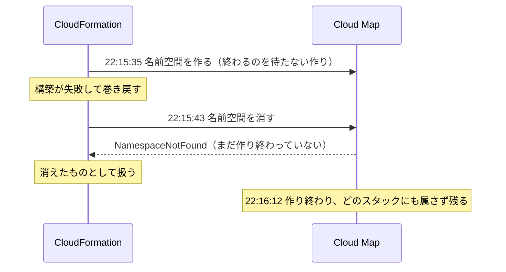

# セッションログ 8a0a94cc

- セッション: `8a0a94cc-324e-49bf-a36c-b9cf47cd917e`
- cwd: `/Users/notfolder/Documents/litellm-agent-gateway-lab`（branch: feature/aws-ecs）
- 期間: 2026-11-22 08:56 〜 2026-11-25 09:20
- Claude Code: 2.1.329
- 発言: ユーザー 8 / Claude 7 / ツール呼び出し 57
- 書き出し: 2026-11-25 09:20 JST

> ユーザー発言と Claude の本文は逐語。ツール呼び出しは `🔧` の 1 行に要約し、ツール結果・思考ブロックは含まない。

---
## 1. ユーザー（2026-11-22 08:56）

（コマンド: /clear ）

## 2. ユーザー（2026-11-22 09:06）

マージしたので、mainに復帰して

## 3. Claude

> 🔧 `Bash` Check status, fetch, and confirm PR merged

> 🔧 `Bash` Switch to main and fast-forward

`main` に戻しました。

- プルリクエスト #10（`feature/aws-ecs`）は 2026-11-22 09:06（日本時間）にマージ済みです。
- ローカルの `main` を `origin/main` の `118f2ed`（#10 のマージコミット）まで早送りしました。
- 未追跡の `tmp/` は前からあったもので、手を付けていません。
- ローカルの `feature/aws-ecs` ブランチは残っています。中身はすべて `main` に入っています。

## 確認事項

1. **ローカルの `feature/aws-ecs` ブランチを消しますか。**

   | 案 | 内容 | 影響 |
   |---|---|---|
   | A | ローカルのブランチだけ消す（`git branch -d`） | 中身はすべて `main` に入っているので何も失いません。ブランチの一覧がすっきりします |
   | B | ローカルと GitHub の両方で消す | A に加えて GitHub からも消えます。外部への操作です |
   | C | 残す | 何も変わりません |

   おすすめ: A。中身はすべて `main` に入っているので、消しても何も失いません。GitHub 側を消すのは外部への操作なので、ご指示があるまで控えます。

## 4. ユーザー（2026-11-22 09:35）

1 A

## 5. Claude

> 🔧 `Bash` Delete local merged feature branch

ローカルの `feature/aws-ecs` ブランチを消しました（中身は `21340c3` で、すべて `main` に入っています）。いま残っているローカルのブランチは `main` だけです。GitHub 上のブランチはそのままです。

## 6. ユーザー（2026-11-25 08:55）

awsで動いているものはないですか？

## 7. Claude

> 🔧 `Bash` Check AWS settings and previous session summary

> 🔧 `Bash` Check AWS credentials are valid

> 🔧 `Bash` Scan Tokyo region for remaining AWS resources (read-only)

> 🔧 `Bash` Inspect leftover Cloud Map namespace and hosted zone

> 🔧 `Bash` Find how the Cloud Map namespace is created and deleted

> 🔧 `Bash` Inspect the namespace template and down logic

> 🔧 `Bash` Read the down command implementation

> 🔧 `Bash` Look up CloudTrail events for namespace create/delete

原因が分かりました。ほかのリージョンと直近の課金も確かめます。

> 🔧 `Bash` Scan all regions for main paid resources and check daily cost

> 🔧 `Bash` Break down recent daily cost by service

動いているものはありません。課金が続いているのは、消し残しの Route 53 のホストゾーン 1 つ（月 0.5 ドル）だけです。

**確かめた範囲（読み取りだけ）**
- 全リージョンで、EC2・EBS・NAT ゲートウェイ・Elastic IP・ロードバランサー・RDS は 0 件でした。
- 東京では、EKS・ECS・ElastiCache・EFS・VPC エンドポイント・Auto Scaling グループ・秘密の値・Scheduler・バックアップも 0 件でした。
- 課金（Cost Explorer）は次のとおりです。

| 日付 | 金額 | 中身 |
|---|---|---|
| 11/21 | 15.78 ドル | ECS 構成の試験 |
| 11/22 | 0.50 ドル | 全額 Route 53（下のホストゾーンの月額） |
| 11/23・11/24 | 0.0001 ドル/日 | ほぼ 0 |

**残っているもの**

| もの | 料金 | 安全に消せるか | 消したときの効果 |
|---|---|---|---|
| Cloud Map の名前空間 `litellm-ecs.internal`（`ns-z3i53o5ljglqf3bm`）と、それが作った非公開のホストゾーン（`Z04058703DMU45965LZJA`） | ホストゾーンが月 0.5 ドル。名前空間そのものは無料 | 消せます。サービスは 0 件で、レコードは既定の NS と SOA だけです。つないでいた VPC（`vpc-0a51dee2fe6fe2023`）はもうありません | 12/1 からの月 0.5 ドルが止まります |
| ACM の証明書 3 枚（litellm-lab / litellm-ecs / litellm-ecp）と `litellm-lab-cert` スタック | 無料 | 意図して残したもの（前回の決定）です | なし |
| `CDKToolkit` スタックとそのバケット・ECR、`notfolder.test` バケット（6 バイト）、空のロググループ 2 つ | ほぼ 0 | 以前からあり、今回の作業とは関係ありません | ほぼなし |

**ホストゾーンが残った原因**

CloudTrail で調べると、11/21 22:15 の最初の構築が失敗したときに残ったものでした。

そのため、そのあとの `down` はこの名前空間を知らず、前回「有料の物は 0 件」と確かめたときにも見落としていました。ほかの 3 回の作成は、どれも正しく消えています。

## 確認事項

1. **消し残しの Cloud Map の名前空間 `litellm-ecs.internal`（ホストゾーンも一緒に消えます）を消しますか。**

   | 案 | 内容 | 影響 |
   |---|---|---|
   | A | いま消す（`aws servicediscovery delete-namespace`） | 12/1 からの月 0.5 ドルが止まります。次の構築では新しく作られるので、困ることはありません |
   | B | 残す | 毎月 0.5 ドルかかり続けます |

   おすすめ: A。使われておらず、つながっていた VPC ももう無いためです。

2. **同じ消し残しが二度と出ないように、`ecs/ecs-lab.sh` の `down` を直しますか。** 直し方は、スタックを消したあとに `<接頭辞>.internal` という名前の名前空間が残っていれば消す、というものです。

   | 案 | 内容 | 影響 |
   |---|---|---|
   | A | 新しいブランチで直し、プルリクエストにする | 構築が失敗して巻き戻ったあとでも、`down` で消し残しが出なくなります。いまは `main` にいるので、ブランチを切る必要があります |
   | B | 直さず、バックログに書くだけにする | 次の構築が失敗したときに、また消し残しが出ることがあります |

   おすすめ: A。このリポジトリでは、見つけた不具合はその場で直すと決めているためです。直したあとは、名前空間を作って `down` で消えるかを AWS で 1 回確かめます（費用はほぼかかりません）。

## 8. ユーザー（2026-11-25 09:02）

1A
2 A

## 9. Claude

> 🔧 `Bash` Delete the orphaned Cloud Map namespace and confirm

名前空間とホストゾーンは消えました。次に `down` を直します。

> 🔧 `Bash` Create fix branch and read helper functions

> 🔧 `Bash` Check awsc, PREFIX definition, and existing tests

`NS` という変数が既にあります。`down` に、消し残した名前空間を消す処理を足します。

> 🔧 `Edit` /Users/notfolder/Documents/litellm-agent-gateway-lab/ecs/ecs-lab.sh

> 🔧 `Edit` /Users/notfolder/Documents/litellm-agent-gateway-lab/ecs/ecs-lab.sh

> 🔧 `Bash` Syntax check, unit tests, find default VPC

> 🔧 `Bash` Inspect unit test error

> 🔧 `Bash` Find how unit tests are run in this repo

> 🔧 `Bash` Run unit tests with uv and PyYAML

> 🔧 `Bash` Create a test orphan namespace in the default VPC

> 🔧 `Bash` Confirm the test namespace is newly created

作成日時、ホストゾーン、VPC のどれも新しいものです（名前空間の ID だけは前と同じ値になりました）。`down` を流します。

> 🔧 `Bash` Run ECS down with no stack to sweep the test namespace

> 🔧 `Bash` Brace variables before full-width characters

`$id（` が残りました。ほかにも同じ書き方が前からある行（613 行目）が見つかりました。perl でファイル全体を調べます。

> 🔧 `Bash` Find all unbraced variables followed by non-ASCII

> 🔧 `Bash` Brace remaining variables and verify

もう一度、消し残しを作って `down` で消えるか確かめます。

> 🔧 `Bash` Recreate test namespace and run down again

> 🔧 `Bash` Run down with nothing left, rerun unit tests

直しは確かめられました。変更設計書の「配備で見つけた不具合」の一覧（15.1 節）にも書き足します。

> 🔧 `Bash` Read section 15.1 of the change design doc

> 🔧 `Edit` /Users/notfolder/Documents/litellm-agent-gateway-lab/.history/2026-11-21-ECS構成/変更設計書.md

> 🔧 `Bash` Commit the fix and push the branch

> 🔧 `Bash` Commit the fix locally (no push)

1A と 2A を行いました。`down` の直しはコミットまで済んでいますが、push とプルリクエストの作成はまだです。

**1. 消し残しの削除**
- Cloud Map の名前空間 `litellm-ecs.internal` を消しました。一緒にホストゾーンも消えています。
- いま東京リージョンに残っている名前空間とホストゾーンは 0 件です。月 0.5 ドルの課金はここで止まります。

**2. `down` の直し（ブランチ `fix/ecs-down-orphan-namespace`、コミット `3b65686`）**
- `ecs/ecs-lab.sh` の `down` に、スタックを消したあと `<接頭辞>.internal` の名前空間が残っていれば消す処理を足しました。
- AWS で確かめる途中で、別の不具合が 1 つ見つかりました。macOS の bash 3.2 は、`$NS（` のように変数のすぐ後ろに全角の文字があると変数名の一部として読み、`unbound variable` で止まります。足した箇所に加えて、前からあった 1 か所（社内プロキシの中継が戻らないときのメッセージ）も `${…}` で囲みました。
- 確かめた結果:

| 確かめたこと | 結果 |
|---|---|
| 既定の VPC に同じ名前の非公開の名前空間を作り、スタックが無い状態で `down` を流す | 「残っていた Cloud Map の名前空間を消しました」と出て、名前空間もホストゾーンも消えた |
| 何も残っていない状態で `down` を流す | エラーなしで終わった |
| 単体テスト（122 本） | すべて通った |

  - 試験で作ったホストゾーンは数分で消したので、課金されません（作ってから 12 時間以内に消せば無料です）。
  - 変更設計書の 15.1 節（配備で見つけて直したこと）に、この 2 件を書き足しました。

**3. push とプルリクエストの作成**
- コミットと push を 1 回のコマンドで行おうとしたところ、自動の判定に止められました。
- このリポジトリでは push の前に確認を取ると決めているので、コミットまでにして止めています。

## 確認事項

1. **ブランチ `fix/ecs-down-orphan-namespace` を GitHub に push して、プルリクエストを作ってよいですか。** 中身はコミット `3b65686` の 1 つで、変わったのは `ecs/ecs-lab.sh` と変更設計書の 2 ファイルです。

   | 案 | 内容 | 影響 |
   |---|---|---|
   | A | push して、プルリクエストを作る | GitHub で見てマージできるようになります |
   | B | push しない | 直しはこの Mac の中だけに残ります |

   おすすめ: A。AWS で直ったことは確かめてあり、プルリクエストにすると前に決めていたためです。A なら、こちらで push とプルリクエストの作成をします。

## 10. ユーザー（2026-11-25 09:11）

gcpかはメールがいくつか届いているが、内容を確認して

## 11. Claude

> 🔧 `ToolSearch` select:mcp__claude_ai_Gmail__search_threads,mcp__claude_ai_Gmail__get_thread

> 🔧 `mcp__claude_ai_Gmail__search_threads` (from:google.com OR from:cloud.google.com OR from:googlecloud) (cloud OR GCP OR billing OR project) newer_than:21d

> 🔧 `mcp__claude_ai_Gmail__search_threads` ("Google Cloud" OR GCP OR "Cloud Billing" OR "Google Cloud Platform") newer_than:30d -from:payments-noreply@google.com

> 🔧 `mcp__claude_ai_Gmail__get_thread`

> 🔧 `mcp__claude_ai_Gmail__get_thread`

> 🔧 `mcp__claude_ai_Gmail__get_thread`

> 🔧 `mcp__claude_ai_Gmail__get_thread`

> 🔧 `Bash` Check repo usage of Workspace MCP and enabled GCP APIs

> 🔧 `Bash` Find workspace-mcp image and Gmail settings in repo

> 🔧 `Bash` Read spec section on the Workspace MCP server

> 🔧 `ToolSearch` select:WebSearch

> 🔧 `WebSearch` Google Workspace API usage tiers Standard Scaled MCP requirement AI agents February 2027

> 🔧 `WebSearch` Google Cloud Service Specific Terms Section 17 "GCP Access Tools" AI agents

> 🔧 `Agent` Read Workspace usage tiers doc

> 🔧 `Bash` Check whether the leaked API key still exists (read-only)

> 🔧 `Bash` Describe the leaked API key and its project

> 🔧 `Bash` List enabled APIs and billing for that project

GCP からのメールは 4 通で、そのうち未読は 3 通です。この 3 通は、どれもすぐに対応しなくてよいものでした。注意が要るのは、10/26 に届いた既読のメールです。漏れたと通知された API キーが、いまも制限なしで有効なまま残っています。このリポジトリとは別の件です。

## メールの一覧

| 受信（日本時間） | 件名 | 中身 | 対応 |
|---|---|---|---|
| 11/18 | 請求先アカウントが基準額請求に移行します | 毎月 1 日の請求に加え、使った額が基準額に達したときにも月の途中で請求されるようになる。請求書のメールは届かなくなり、お支払いセンターで見る形になる | 不要（メールにも「対応は不要」とある） |
| 11/25 | [Legal Update] Service Specific Terms の更新 | 2027-01-01 から規約に 17 条（GCP Access Tools）が加わる。AI エージェントで API や MCP の情報を長く保存すること、API をスクレイピングすることを禁じる。外部の AI エージェントが起こした害について Google は責任を負わない | 読んでおくだけ。この検証のゲートウェイの使い方は、どちらの禁止にも当たらないと見ています |
| 11/25（2 通） | [Pricing Update] Workspace の API の利用枠の変更 | 下で説明します。影響を受けるプロジェクトとして `litellm-agent-gateway-lab` の名前が挙がっている | 2027-02-01 までに方針を決める |
| 10/26（既読） | My First Project（`<別のプロジェクトの ID>`）の API キーが一般公開されています | 下で説明します | 急いで対応が要る（このリポジトリとは別の件） |

## Workspace の API の変更が、このリポジトリに関わる点

- **何が変わるか**（[Google の説明](https://developers.google.com/workspace/guides/quota-usage-tiers)、[Workspace のブログ](https://workspaceupdates.googleblog.com/2026/11/mcp-servers-cli-standardized-usage-tiers-now-available.html)）
  - 利用枠が 2 段階になります。Standard は無料で、Google の MCP サーバーは 1 プロジェクト・1 製品あたり 1 日 5,000 回までです。Scaled は 2027-04-01 から、無料枠を超えた分が有料になります。
  - **2027-02-01 から、AI エージェントが Workspace の REST API を直接呼ぶと Standard の枠に制限されます。** どちらの段階を選んでいても同じです。止められるとは書かれておらず、枠が絞られるだけです。
- **このリポジトリとの関係**
  - 検証のゲートウェイは、コミュニティ製の Workspace MCP サーバーを自分で置いています（起動引数は `--tools gmail --read-only`、`docs/spec.md:750`）。この MCP サーバーが、利用者のトークンで Gmail の REST API（`gmail.googleapis.com`）を呼んでいます。
  - Google の言う「MCP」は、Google が置く MCP サーバー（Gmail は `https://gmailmcp.googleapis.com/mcp/v1`）のことです。
  - そのため、自前の MCP サーバーの呼び出しは「REST API の直接の呼び出し」と数えられる見込みです。ただし、Google の資料にはこの場合の判定ははっきり書かれていません（推測です）。
- **影響の大きさ**
  - 検証で呼ぶ回数は少ないので、Standard の枠に絞られても困ることはまず無いと見ています（REST API の Standard の枠の具体的な回数は、資料に載っていませんでした）。
  - 一方で、本番で使える構成にするには、2027-02-01 の前に Google の Gmail の MCP サーバーへ切り替えるかを決める必要があります。
  - Google の MCP サーバーは `gmail.readonly` のスコープを扱えます。ただし、使う OAuth クライアントで「AI エージェント用」の設定を有効にする必要があり、案内のページには「Developer Preview」の表示もあります。

## 10/26 の API キーの通知（別のプロジェクトの件）

- 通知の中身: Docker Hub の `notfolder/coding-agent` のイメージの中から、`My First Project` の API キー（`API キー 1`）が見つかった、というものです。
- 読み取りだけで確かめた結果:
  - **漏れたキーの文字列は、いまも有効です。** 文字列からキーを引くと、いまのキーに当たりました。
  - キーには API の制限がありません。10/26 13:05 に更新された記録はありますが、キーの作り直しにはなっていません。
  - このプロジェクトは課金が有効で、Gemini（`generativelanguage`）、Places、Custom Search など、使った分だけ課金される API が有効になっています。
- そのため、漏れたキーを他人に使われると、課金が膨らむおそれがあります。
- この件は `coding-agent` のリポジトリの話なので、ここのバックログには書いていません。

## 確認事項

1. **漏れた API キー（`My First Project` の `API キー 1`）をどうしますか。**

   | 案 | 内容 | 影響 |
   |---|---|---|
   | A | `coding-agent` のリポジトリのセッションで、キーの作り直しと、イメージからキーを抜く作業をまとめて行う | 根本から直せますが、それまでの間は漏れたキーが使えるままです |
   | B | まずこの場で、キーに使える API の制限を付けて被害を止め、根本の直しは A のとおり別のセッションで行う | すぐに課金の危険を下げられます。ただし、そのキーを使っているアプリが止まることがあります |
   | C | 何もしない | 他人に使われると課金が膨らむおそれが残ります |

   おすすめ: B。漏れてから 1 か月たっても有効なままで、課金のある API が開いているためです。B の場合は、キーを何に使っているかを先に教えてください。使う API だけに絞ります。

2. **検証のゲートウェイが使う Gmail の MCP サーバーを、どうしますか。**

   | 案 | 内容 | 影響 |
   |---|---|---|
   | A | Google の Gmail の MCP サーバーに切り替えるかを、仕様の検討として扱う（ヒアリングから始める） | 2027-02-01 以降も枠が絞られず、本番に近い形にできます。自前の MCP サーバーの部品は要らなくなりますが、OAuth クライアントの設定の変更と、試験のやり直しが要ります |
   | B | いまの自前の MCP サーバーのまま使う | 検証の回数なら Standard の枠で足りる見込みです。本番の前提とはずれていきます |

   おすすめ: A。このリポジトリは本番で使える構成を前提にしているので、期限の前に検討を始める価値があります。急ぎではないので、バックログに期限 2027-02-01 で書き足すところから始めます。

3. **`down` の直し（ブランチ `fix/ecs-down-orphan-namespace`、コミット `3b65686`）を push して、プルリクエストを作ってよいですか。** 前の問いの続きで、まだ止めたままです。

   | 案 | 内容 | 影響 |
   |---|---|---|
   | A | push して、プルリクエストを作る | GitHub で見てマージできるようになります |
   | B | push しない | 直しはこの Mac の中だけに残ります |

   おすすめ: A。AWS で直ったことは確かめてあり、プルリクエストにすると前に決めていたためです。

出典:
- [Usage tiers and quotas for Google Workspace APIs and MCP servers](https://developers.google.com/workspace/guides/quota-usage-tiers)
- [Google Workspace Updates: MCP servers, CLI, standardized usage tiers](https://workspaceupdates.googleblog.com/2026/11/mcp-servers-cli-standardized-usage-tiers-now-available.html)
- [Configure the Google Workspace MCP servers](https://developers.google.com/workspace/guides/configure-mcp-servers)

## 12. ユーザー（2026-11-25 09:16）

1 B 出先でそうさできないので、そちらで作業して下さい。許可します
2 B
3 A 許可します

## 13. Claude

3 件とも進めます。まずプルリクエストを作り、並行して API キーを何に使っているかを調べます。

> 🔧 `Bash` Push the fix branch and open a pull request

> 🔧 `Bash` Query 60-day API request counts by service and credential

> 🔧 `Bash` Show hourly API usage of the key over 60 days

> 🔧 `Bash` Compare current key string with the leaked one

> 🔧 `Bash` Confirm the leaked key is rejected by the API

3 件とも終わりました。ただし 1 は、前の報告が間違っていて、作業は要りませんでした。漏れたキーは 10/26 にすでに消されていて、いまは使えません。

## 1. 漏れた API キー（`My First Project` の `API キー 1`）

**前の報告の誤り**: 「漏れたキーの文字列はいまも有効」と書いたのは間違いでした。キーの文字列からキーを引く命令は、消したキーでも結果を返します。私はそれを見て有効と判断していました。

確かめ直した結果:

| 確かめたこと | 結果 |
|---|---|
| 消したキーも含めた一覧 | `API キー 1` は 10/26 13:05、`Gemini API Key` は 13:06（日本時間）に消されていた。通知のメールが届いてから約 1 時間後 |
| 漏れたキーで Gemini を呼ぶ（モデルの一覧を取るだけで、課金はかからない） | `400 API_KEY_INVALID`。拒否された |
| この 60 日の利用の記録 | 消す前の呼び出しは 8 回で、すべて 400。消した後は 10/30 の 1 回だけで、これも 400 |

- 消した後に成功した呼び出しは 0 件なので、不正に使われて課金された記録はありません。
- 消したキーには制限を付けられません。付ける必要もないので、何も変えていません。
- 残りの作業は、Docker Hub の `notfolder/coding-agent` のイメージにキーの文字列が残っていることです。キーはもう使えないので急ぎではありません。この件は `coding-agent` のリポジトリの作業なので、ここのバックログには書いていません。

## 2. Gmail の MCP サーバー

いまの自前の MCP サーバーのままにします。変えたものはありません。

## 3. プルリクエスト

ブランチを push して、プルリクエストを作りました: https://github.com/notfolder/litellm-agent-gateway-lab/pull/11

- push の結果に出た「uncommitted change 1 件」は、前からある未追跡の `tmp/` のことです。
- いまの作業ブランチは `fix/ecs-down-orphan-namespace` です。マージされたら `main` に戻します。

## 14. ユーザー（2026-11-25 09:20）

セッション引き継ぎ準備をして、pushして

## 15. Claude

> 🔧 `Skill`
