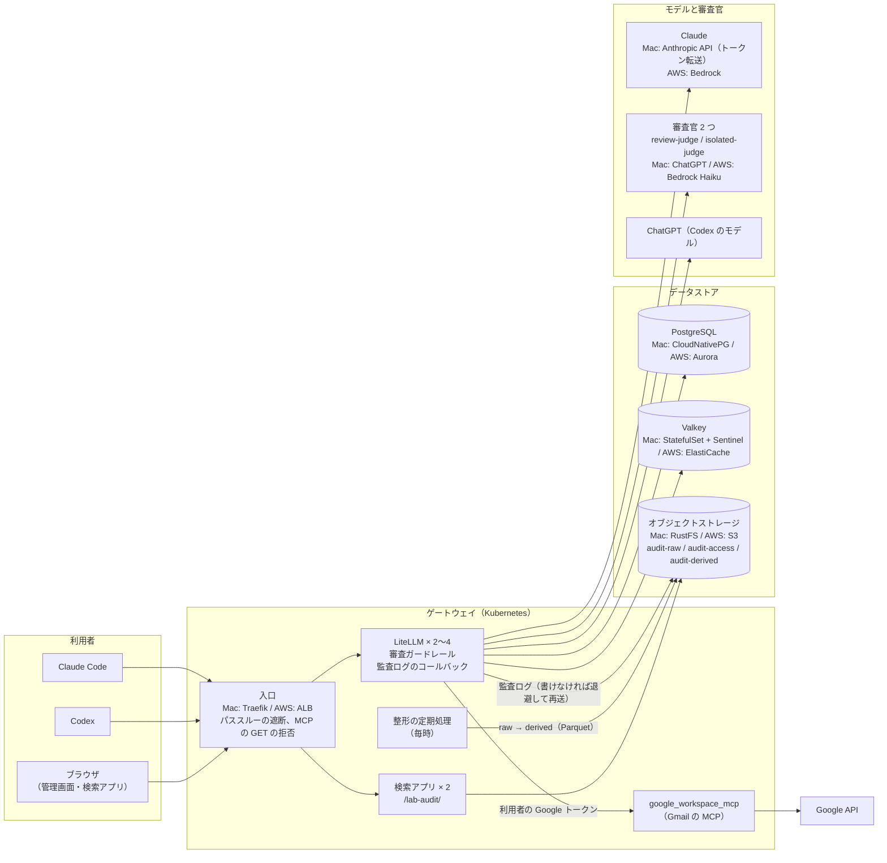
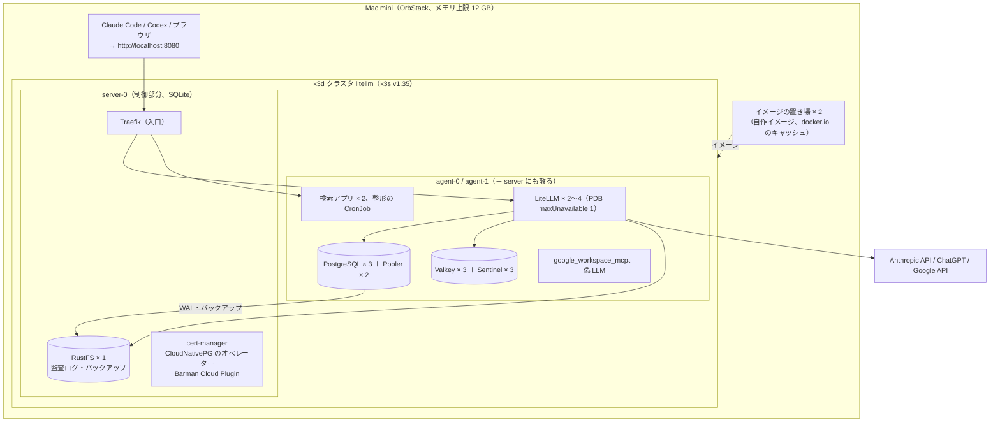
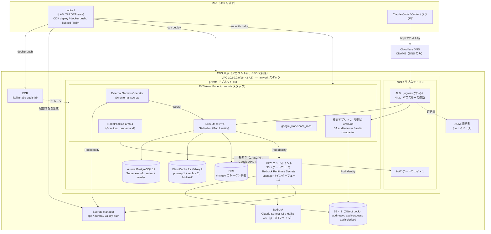

# 構成図

検証環境は同じコード（審査ガードレール、監査ログ、マニフェスト、Helm の値）を Mac の k3d と AWS の EKS の両方で動かす。
`.env` の `LAB_TARGET`（`local` か `aws`）で、構築ツール `./lab` が配備先を切り替える。
細かい設計は [design.md](design.md)（Mac）と `.history/2026-10-24-AWS構成/変更設計書.md`（AWS）にある。
この文書は全体の形を図で示すだけで、値や手順はそちらを正とする。

## 1. 論理構成（両環境で同じ）

利用者のエージェントは LiteLLM のゲートウェイだけを向く。ゲートウェイがモデルの呼び出し、ツールコールの審査、監査ログの記録を一手に引き受ける。

## 2. Mac（k3d）の配置

OrbStack の中の k3d クラスタ 1 つ（server 1 台、agent 2 台）。入口と運用部品は server に固定し、データを持つ部品は 3 台に散らす。

- データは PVC（local-path）に置く。`./lab down` でクラスタごと消える（`.env`、ChatGPT のトークン、イメージの置き場は残る）
- server を作り直すと入口と置き場が止まるので、Kubernetes の版上げは作り直し（[maintenance.md](maintenance.md) 3.3）

## 3. AWS の配置

CloudFormation の 4 スタック（cert / network / data / compute）を CDK で作り、クラスタの中身は Mac と同じマニフェストと Helm で入れる。
DNS は Cloudflare（Route 53 は使わない）。

- 状態を持つもの（Aurora、ElastiCache、S3、EFS、秘密情報）は data スタック。`./lab down` は compute → data → network の順に消し、スタックを消しても残るもの（Object Lock の S3、秘密情報、スナップショット、ECR、EFS、ロググループ）も消す。残るのは無料の証明書と CDK の bootstrap だけ
- Kubernetes の版上げは、制御部分を AWS が入れ替え、Auto Mode が PDB を守ってノードを 1 台ずつ入れ替えるので無停止でできる（[maintenance.md](maintenance.md) 3.3）

## 4. 部品の対応表

| 役割 | Mac（k3d） | AWS（EKS） | コードの置き場 |
|---|---|---|---|
| Kubernetes | k3d（k3s v1.35、server 1 + agent 2） | EKS Auto Mode 1.35（NodePool lab-arm64） | `k8s/k3d-config.yaml` / `cdk/` |
| 入口 | Traefik（`k8s/ingress.yaml`） | ALB（Ingress。`render.alb_ingress_manifest`） | 遮断する経路の一覧は両方で同じ（単体テストが照合） |
| TLS | なし（localhost） | ACM の証明書、Cloudflare の CNAME | `cdk/`（cert スタック） |
| PostgreSQL | CloudNativePG × 3 ＋ Pooler | Aurora Serverless v2（writer + reader） | `k8s/postgres-cnpg.yaml` / `cdk/` |
| Redis 互換 | Valkey × 3 ＋ Sentinel × 3 | ElastiCache for Valkey（primary 1 + replica 2） | `k8s/valkey.yaml` / `cdk/` |
| オブジェクトストレージ | RustFS × 1（静的キー） | S3 × 3（Pod Identity、Object Lock） | `render.s3_buckets()`、`render.s3_policies()` を両方で使う |
| 秘密情報 | `.env` → Secret | Secrets Manager → External Secrets Operator → Secret | `./lab secrets` |
| コンテナイメージ | k3d のレジストリ | ECR | `./lab images` |
| Claude のモデル | Anthropic API（トークン転送） | Bedrock（jp. 推論プロファイル） | `render.litellm_config()` |
| 審査官 | ChatGPT（`chatgpt/`） | Bedrock Haiku 4.5 | 同上 |
| Codex のモデル | ChatGPT（`chatgpt/`） | 同じ（トークンは EFS で共有） | 同上 |
| chatgpt/ のトークン | hostPath | EFS の PVC | `./lab chatgpt-login` |
| LLM の審査（Jev） | `LAB_USE_JEV` | 使わない | `litellm/guardrails/` |
