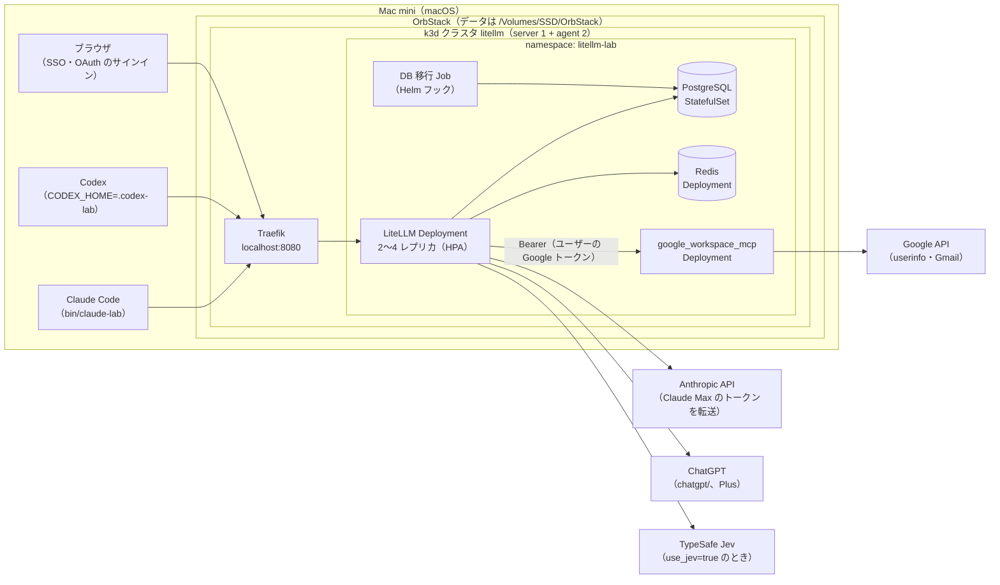
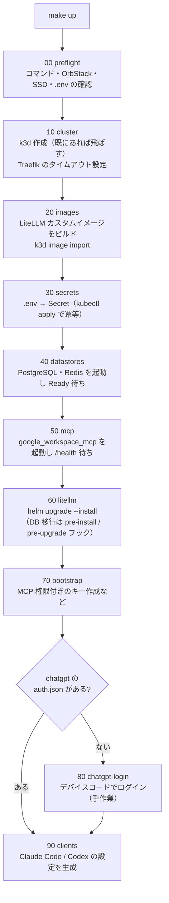
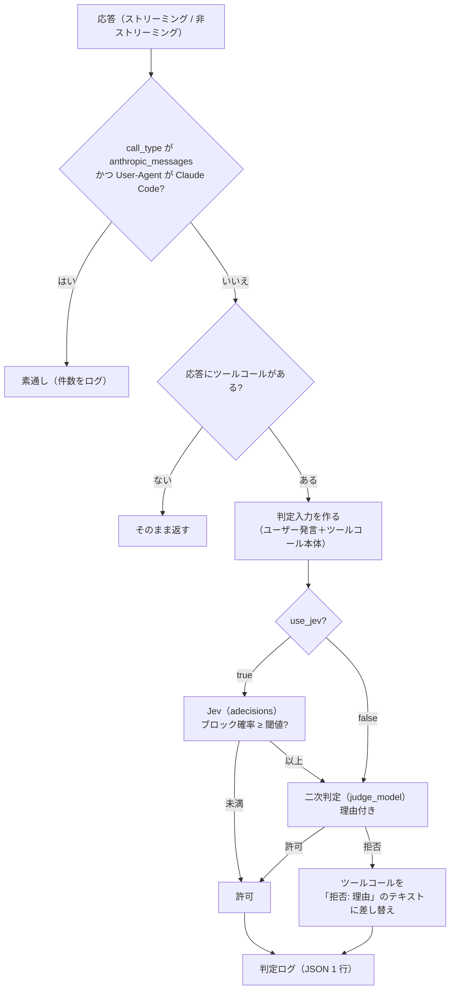

# litellm-agent-gateway-lab 詳細設計（検証環境の構築）

最終更新: 2026-10-11

[spec.md](spec.md) の検証環境（5 章）を、スクリプト一式で再現できるように構築するための設計です。対象は、Mac 1 台の OrbStack 上の k3d クラスタと、その上の LiteLLM、PostgreSQL、Redis、MCP サーバー、自作ガードレール、およびクライアント（Claude Code、Codex）の設定です。

---

## 1. 設計の前提（2026-10-11 に検証済み）

### 1.1 バージョン

すべてのイメージとチャートはバージョンを固定する。

| 部品 | 固定するバージョン | 確認方法 |
|---|---|---|
| OrbStack | 導入済み（Docker 29.4.0、Compose v5.1.2） | `docker info` |
| k3d | v5.9.0 | `k3d version` |
| k3s | `rancher/k3s:v1.35.5-k3s1` | 試験クラスタで起動を確認 |
| Traefik | 3.6.13（k3s v1.35.5 に同梱） | k3s のマニフェスト |
| LiteLLM | `ghcr.io/berriai/litellm-database:v1.104.2`（arm64 あり） | イメージを取得し、ソースを確認 |
| LiteLLM Helm チャート | `oci://ghcr.io/berriai/litellm-helm` 1.104.2 | `helm show values` |
| PostgreSQL | `postgres:16-alpine`（公式イメージ） | arm64 あり |
| Redis | `redis:7-alpine`（公式イメージ） | arm64 あり |
| MCP サーバー | `ghcr.io/taylorwilsdon/google_workspace_mcp:2.1.0`（arm64） | 起動を確認 |

- LiteLLM は 2026 年 3 月の PyPI 汚染（1.82.7 / 1.82.8）以降の版で、CVE-2026-42208（v1.83.7 で修正）と CVE-2026-48710（v1.84.0 で修正）も修正済みの v1.104.2 を使う
- Helm チャートに同梱の PostgreSQL / Redis（Bitnami のサブチャート）は使わない。更新が止まった `bitnamilegacy` のイメージに固定されているため。公式イメージで最小限のマニフェストを書く

### 1.2 実機で確かめたこと

| 確かめたこと | 結果 |
|---|---|
| OrbStack 上で k3d の 3 ノードクラスタが立つか | 立つ（約 90 秒）。Traefik、metrics-server、local-path-provisioner が動く |
| ガードレールに `config.yaml` の独自キーが渡るか | 渡る（`use_jev`、`jev_threshold` を `__init__` の引数で受け取れた） |
| ガードレールで経路と User-Agent を取れるか | 取れる。`call_type` が `/v1/responses` は `aresponses`、`/v1/messages` は `anthropic_messages`、Chat Completions は `acompletion`。User-Agent は `data["proxy_server_request"]["headers"]["user-agent"]` と `data["litellm_metadata"]["user_agent"]` |
| User-Agent が空のときの値 | ヘッダーは `None`、メタデータは空文字 |
| LiteLLM 組み込みのクライアント判定 | `is_claude_code_user_agent`（`claude-cli/` と `claude-code/` の前方一致）、`is_codex_user_agent`（`^codex[-_ /]`）がある。Codex のセッション ID は `session-id` / `thread-id` ヘッダー |
| `google_workspace_mcp` を外部トークンのモードで起動できるか | 起動する。トークンなしは 401、不正なトークンも 401。**`GOOGLE_OAUTH_CLIENT_SECRET` が必須**（ないと起動しない） |
| MCP サーバーが要求するスコープ | `gmail.readonly`、`userinfo.email`、`userinfo.profile`、`openid`（`WWW-Authenticate` と保護リソースのメタデータで確認） |

### 1.3 ドキュメントとソースで確かめたこと

- Codex（0.162.1）の User-Agent は `codex_cli_rs/<ver> (...)`。カスタムプロバイダでは毎ターン会話全体を送る（`store: false`）。MCP の OAuth は `codex mcp login <name>`
- Claude Code の User-Agent は `claude-cli/<ver> (external, cli)`。Claude Max のトークン（`sk-ant-oat…`）は、LiteLLM が `anthropic/*` のデプロイへ自動で転送する
- `chatgpt/` プロバイダのトークンはファイル（`auth.json`）にだけ保存される。複数レプリカでは書き込み可能な 1 つのファイルを共有する必要がある。初回ログインはデバイスコード方式で、プロキシの外で行う
- MCP の保存トークンは上流に `Authorization: Bearer` で送られる。`authorization_url` のクエリは保持される
- Decisions API は v1.104.2 で使える。Jev は TypeSafe 社がホストするモデル（`typesafe/jev-latest`、入力 100 万トークンあたり $0.042）

---

## 2. 全体構成



---

## 3. リポジトリ構成

```
litellm-agent-gateway-lab/
├── Makefile                      # 入口。make up / down / status / test-*
├── .env.example                  # 必要な秘密情報の一覧（値は空）
├── .env                          # 実際の値（.gitignore 対象）
├── scripts/
│   ├── lib.sh                    # 共通関数（ログ、待機、.env 読み込み、冪等チェック）
│   ├── 00-preflight.sh           # 前提の確認（コマンド、OrbStack、SSD、.env の必須項目）
│   ├── 10-cluster.sh             # k3d クラスタ作成、Traefik の設定
│   ├── 20-images.sh              # カスタムイメージのビルドと k3d への取り込み
│   ├── 30-secrets.sh             # .env から k8s Secret を作成
│   ├── 40-datastores.sh          # PostgreSQL、Redis
│   ├── 50-mcp.sh                 # google_workspace_mcp
│   ├── 60-litellm.sh             # LiteLLM（Helm）、DB 移行、起動待ち
│   ├── 70-bootstrap.sh           # 初期データ（キー、MCP 権限）の投入
│   ├── 80-chatgpt-login.sh       # chatgpt/ のデバイスコードログイン（初回のみ）
│   ├── 90-clients.sh             # Claude Code / Codex の設定を生成
│   ├── down.sh                   # クラスタ削除
│   └── status.sh                 # 状態表示
├── k8s/
│   ├── k3d-config.yaml           # クラスタ定義（ノード数、ポート、k3s イメージ、ボリューム）
│   ├── traefik-config.yaml       # HelmChartConfig（タイムアウト）
│   ├── namespace.yaml
│   ├── middleware-block-passthrough.yaml   # パススルー経路の遮断
│   ├── postgres.yaml             # StatefulSet + Service + PVC
│   ├── redis.yaml                # Deployment + Service
│   └── workspace-mcp.yaml        # Deployment + Service（クラスタ内のみ）
├── litellm/
│   ├── Dockerfile                # FROM litellm-database:v1.104.2 + ガードレール
│   ├── values.yaml               # Helm の値
│   ├── config.yaml               # proxy_config（values.yaml に埋め込む元）
│   └── guardrails/
│       ├── tool_call_review.py   # 審査ガードレール本体
│       ├── transcript.py         # 判定入力の抽出（形式ごと）
│       └── tests/                # 単体テスト（pytest、イメージ内で実行）
├── clients/
│   ├── claude-lab                # Claude Code 起動用ラッパー（環境変数を設定して claude を実行）
│   ├── mcp.json.tmpl             # Claude Code 用 MCP 設定
│   └── codex-config.toml.tmpl    # Codex 用設定
├── tests/
│   ├── smoke/                    # 疎通確認（curl）
│   ├── review-scenarios/         # spec 6.2 のシナリオ（使い捨てリポジトリを作る）
│   └── load/                     # k6 の負荷試験
└── docs/
    ├── spec.md
    └── design.md
```

- `.env` とクライアント設定の生成物（`.codex-lab/`、`clients/out/`）は `.gitignore` に入れる
- スクリプトはすべて bash（`set -euo pipefail`）。追加の実行環境を要らなくするため

---

## 4. 構築の流れ



- どのスクリプトも、何度実行しても同じ状態になるように書く（作成済みなら飛ばす、`kubectl apply`、`helm upgrade --install`）
- 各段階は単独でも実行できる（`make litellm` で 60 だけなど）
- `make down` はクラスタを消す。保持するデータは 9 章

---

## 5. Kubernetes の構成

### 5.1 クラスタ（`k8s/k3d-config.yaml`）

| 項目 | 値 |
|---|---|
| ノード | server 1、agent 2 |
| k3s イメージ | `rancher/k3s:v1.35.5-k3s1` |
| ポート | `8080:80@loadbalancer`（Traefik の HTTP） |
| ボリューム | `${LAB_DATA_DIR}/chatgpt:/var/lib/lab/chatgpt@all`（chatgpt/ のトークン共有用。全ノードに同じホストのフォルダを見せる） |
| イメージの取り込み | `k3d image import`（レジストリは立てない） |

`LAB_DATA_DIR` の既定は `/Volumes/SSD/litellm-lab`。

### 5.2 Traefik（`k8s/traefik-config.yaml`）

`HelmChartConfig` で `ports.web.transport.respondingTimeouts` の `readTimeout` / `writeTimeout` / `idleTimeout` を 600 秒にする（長いストリーミングと判定待ちで切れないように）。適用後、Traefik の Deployment の起動引数に反映されたかを確かめる。

### 5.3 公開する経路とパススルーの遮断

Ingress（Traefik）で `localhost:8080` の全経路を LiteLLM に流す。ただし、プロバイダ API の素通し中継（spec 4.2）は Middleware で 403 にする。

- 遮断する接頭辞: `/anthropic`、`/openai`、`/azure`、`/bedrock`、`/vertex_ai`、`/gemini`、`/cohere`、`/mistral`、`/assemblyai`、`/langfuse`
- 実装時に、v1.104.2 のパススルー経路の一覧をソースから抽出して照合する

### 5.4 名前空間と配置

| 部品 | 種類 | レプリカ | requests / limits（メモリ） | 保存 |
|---|---|---|---|---|
| LiteLLM | Deployment（Helm） | 2〜4（HPA、CPU 60%） | 512Mi / 1Gi（構築後に実測して見直す） | なし |
| DB 移行 | Job（Helm フック） | — | — | — |
| PostgreSQL | StatefulSet | 1 | 256Mi / 512Mi | PVC（local-path、1Gi） |
| Redis | Deployment | 1 | 64Mi / 128Mi | なし（キャッシュのみ） |
| google_workspace_mcp | Deployment | 1 | 128Mi / 256Mi | なし（stateless モード） |

---

## 6. LiteLLM

### 6.1 カスタムイメージ（`litellm/Dockerfile`）

```dockerfile
FROM ghcr.io/berriai/litellm-database:v1.104.2
COPY guardrails/ /app/guardrails/
ENV PYTHONPATH=/app/guardrails
```

`20-images.sh` で `litellm-lab:<git の短いハッシュ>` としてビルドし、`k3d image import` で取り込む。Helm の `image.tag` にそのタグを渡す。

### 6.2 Helm の値（`litellm/values.yaml` の要点）

| 項目 | 値 | 理由 |
|---|---|---|
| `image.repository` / `tag` | `litellm-lab` / ビルドしたタグ | 自作ガードレール入り |
| `image.pullPolicy` | `IfNotPresent` | 取り込んだイメージを使う |
| `numWorkers` | 1 | Kubernetes では 1 Pod 1 ワーカーが推奨 |
| `autoscaling` | 有効、min 2、max 4、CPU 60% | OrbStack のメモリ上限 8 GB に収める（12 章） |
| `masterkeySecretName` | `litellm-secrets` | Secret から |
| `environmentSecrets` | `litellm-secrets` | 下の表の環境変数 |
| `db.useExisting` | true（`postgres` Service を指す） | 同梱 DB を使わない |
| `db.deployStandalone` / `redis.enabled` | false / false | 同上 |
| `migrationJob.hooks.helm.enabled` | true（argocd は false） | 素の `helm` で移行を走らせる |
| `envVars` | `LITELLM_MODE=PRODUCTION`、`DISABLE_SCHEMA_UPDATE=true`、`LITELLM_LOG=INFO`、`PROXY_BASE_URL=http://localhost:8080`、`CHATGPT_TOKEN_DIR=/var/lib/lab/chatgpt` | spec 5.1、本番の推奨 |
| `volumes` / `volumeMounts` | hostPath `/var/lib/lab/chatgpt` | chatgpt/ のトークン共有（5.1） |
| `ingress` | 無効（自前の Ingress と Middleware を使う） | 5.3 |

### 6.3 プロキシの設定（`litellm/config.yaml`）

```yaml
model_list:
  # Claude Code（Claude Max のトークンを転送。api_key は書かない）
  - model_name: "anthropic/*"
    litellm_params:
      model: "anthropic/*"
  # Codex（ChatGPT Plus）。モデル名は契約後に確定
  - model_name: "<codex 用のモデル名>"
    litellm_params:
      model: "chatgpt/<モデル>"
  # 一次判定
  - model_name: jev
    litellm_params:
      model: typesafe/jev-latest
      api_key: os.environ/TYPESAFE_API_KEY
  # 二次判定（ChatGPT Plus の小さめのモデル。モデル名は 13 章で確定）
  - model_name: review-judge
    litellm_params:
      model: "chatgpt/<小さめのモデル>"

guardrails:
  - guardrail_name: tool-call-review
    litellm_params:
      guardrail: tool_call_review.ToolCallReview
      mode: [post_call]
      default_on: true
      use_jev: true
      jev_model: jev
      jev_threshold: 0.2
      judge_model: review-judge

mcp_servers:
  gmail:
    url: "http://workspace-mcp.litellm-lab.svc.cluster.local:8000/mcp"
    transport: "http"
    auth_type: "oauth2"
    oauth2_flow: "authorization_code"
    client_id: os.environ/GOOGLE_OAUTH_CLIENT_ID
    client_secret: os.environ/GOOGLE_OAUTH_CLIENT_SECRET
    authorization_url: "https://accounts.google.com/o/oauth2/v2/auth?access_type=offline&prompt=consent"
    token_url: "https://oauth2.googleapis.com/token"
    scopes:
      - "openid"
      - "https://www.googleapis.com/auth/userinfo.email"
      - "https://www.googleapis.com/auth/userinfo.profile"
      - "https://www.googleapis.com/auth/gmail.readonly"
    oauth_identity_binding:
      mode: enforce
      issuer: "https://accounts.google.com"
      audiences: [os.environ/GOOGLE_OAUTH_CLIENT_ID]   # 実装時に env 参照が使えるか確認
      principal_claim: email
      caller_field: user_email
      require_email_verified: true

router_settings:
  redis_host: os.environ/REDIS_HOST
  redis_port: os.environ/REDIS_PORT
  redis_password: os.environ/REDIS_PASSWORD
  routing_strategy: simple-shuffle
  disable_cooldowns: true          # Claude Max のトークン切れで他人が止まらないように

general_settings:
  master_key: os.environ/LITELLM_MASTER_KEY
  database_url: os.environ/DATABASE_URL
  database_connection_pool_limit: 5
  require_key_mcp_access_defined: true
  proxy_batch_write_at: 60
```

- `oauth_identity_binding` で、Gmail にサインインした Google アカウントのメールと、LiteLLM のユーザー（Google SSO）のメールが一致しないと 403 にする。これで「他人の Gmail を自分のキーで読む」経路を閉じる
- `database_connection_pool_limit: 5` は、PostgreSQL の上限 100 ÷（最大 Pod 数 4 × ワーカー 1）に、DB 移行の Job と管理用の接続の余裕を持たせた値
- 二次判定は ChatGPT Plus を使うため、Codex と同じ利用上限を分け合う。上限に当たるようになったら、`review-judge` の `model` を Anthropic API などに替える（設定 1 行）

### 6.4 環境変数（Secret `litellm-secrets`）

| 変数 | 内容 | 出所 |
|---|---|---|
| `LITELLM_MASTER_KEY` | 管理用キー（`sk-` で始まる） | `30-secrets.sh` が未設定なら生成して `.env` に保存 |
| `LITELLM_SALT_KEY` | DB 内の秘密の暗号化キー（後から変えない） | 同上 |
| `DATABASE_URL` | PostgreSQL の接続先 | `.env` のパスワードから組み立て |
| `REDIS_HOST` / `REDIS_PORT` / `REDIS_PASSWORD` | Redis | 同上 |
| `GOOGLE_CLIENT_ID` / `GOOGLE_CLIENT_SECRET` | 管理画面の Google SSO | Google Cloud（7 章） |
| `GOOGLE_OAUTH_CLIENT_ID` / `GOOGLE_OAUTH_CLIENT_SECRET` | Gmail の MCP 用 OAuth | 同上（SSO と同じクライアントでよい） |
| `TYPESAFE_API_KEY` | Jev | TypeSafe（作成済み） |
| `PROXY_ADMIN_ID` | 管理者にする SSO ユーザー | 自分の Google アカウント |
| `ALLOWED_EMAIL_DOMAINS` | SSO を許可するドメイン | `gmail.com`（個人アカウントのため、実質は同意画面のテストユーザーで絞る） |

---

## 7. Google Cloud の設定

OAuth クライアントは 1 つ（ウェブ アプリケーション）にして、SSO と Gmail の MCP で共用する。

| 項目 | 値 |
|---|---|
| 有効にする API | Gmail API |
| 同意画面 | 外部、テストモード。テストユーザーに検証用の Google アカウント 2 つ |
| スコープ | `openid`、`userinfo.email`、`userinfo.profile`、`gmail.readonly` |
| リダイレクト URI | `http://localhost:8080/sso/callback`（SSO）、`http://localhost:8080/callback`（MCP）、`http://localhost:8080/ui/mcp/oauth/callback`（管理画面から接続する場合） |

この手順は手作業。`docs/` に手順書を置き、`00-preflight.sh` は `.env` に値があるかだけを確かめる。

---

## 8. 審査ガードレール（`litellm/guardrails/`）

### 8.1 処理の流れ



### 8.2 部品

| 部品 | 内容 |
|---|---|
| `ToolCallReview.__init__` | `use_jev`、`jev_model`、`jev_threshold`、`judge_model`、`fail_mode`（判定 API の失敗時に拒否するか通すか。既定は拒否）を受け取る |
| `async_post_call_success_hook` | 非ストリーミングの応答を判定する |
| `async_post_call_streaming_iterator_hook` | ストリーミングの応答を判定する。テキストの差分はそのまま流し、ツールコールの項目（Responses API の `function_call` / `custom_tool_call` / `local_shell_call`、Chat Completions の `tool_calls`、Anthropic の `tool_use`）の部分だけ溜めて、完了時に判定してから流すか差し替える |
| `transcript.py` | 3 形式（Responses、Chat Completions、Anthropic Messages）の会話から、ユーザー発言とツールコール本体だけを抜き出す。アシスタントの文章、推論、ツールの結果は捨てる |
| クライアント判定 | LiteLLM 組み込みの `is_claude_code_user_agent`、`is_codex_user_agent` を使う |
| 判定ログ | 標準出力に JSON 1 行: 時刻、クライアント（UA 種別）、セッション ID、キーの別名、ツール名、引数の冒頭 200 文字、`use_jev`、Jev の確率とカテゴリ、二次判定の結果と理由、判定にかかった時間、最終判定 |

### 8.3 テスト

- `transcript.py` と判定分岐は、モデルを呼ばずに単体テストできるように分ける（pytest、カスタムイメージの中で実行）
- ストリーミングの差し替えは、LiteLLM の `mock_response` で固定のツールコールを返すモデルを使って結合テストする（実装時に、`mock_response` でツールコールを返せるかを確かめる）

---

## 9. データの保持

| データ | 置き場所 | `make down`（クラスタ削除）で |
|---|---|---|
| Docker のイメージ・ボリューム | `/Volumes/SSD/OrbStack`（OrbStack） | 残る |
| PostgreSQL（ユーザー、キー、MCP の OAuth トークン、利用量） | クラスタ内の PVC | **消える**（作り直すたびにまっさらから試すため）。ユーザーとキーは `70-bootstrap.sh` が同じ値で作り直す。Gmail のサインインだけはやり直す |
| chatgpt/ のトークン（`auth.json`） | `${LAB_DATA_DIR}/chatgpt`（SSD） | 残る |
| `.env`（秘密情報） | リポジトリ直下（Git 管理外） | 残る |

---

## 10. クライアントの設定（`90-clients.sh`）

利用者の普段の設定（`~/.claude`、`~/.codex`）は書き換えない。

| クライアント | 方法 |
|---|---|
| Claude Code | `clients/claude-lab` で `ANTHROPIC_BASE_URL=http://localhost:8080` と `ANTHROPIC_CUSTOM_HEADERS="x-litellm-api-key: Bearer <キー>"` を設定し、`--mcp-config clients/out/mcp.json` を付けて `claude` を起動する |
| Codex | `CODEX_HOME=<repo>/.codex-lab` に `config.toml` を生成する（モデルプロバイダ `litellm`、`wire_api = "responses"`、MCP の `gmail`）。`codex mcp login gmail` で初回サインイン |

キーは `70-bootstrap.sh` が利用者ごとに 2 本（Claude Code 用、Codex 用）作る。どちらも `object_permission.mcp_servers: ["gmail"]` を付ける。キーの値は `.env` に保存した固定値を使う（`/key/generate` の `key` 指定）ので、クラスタを作り直してもクライアントの設定は変わらない。

---

## 11. spec の検証項目との対応

| spec の項目 | 使うもの |
|---|---|
| 6.1 認証・Copilot 連携 | `tests/smoke/`、2 アカウントでの手動確認 |
| 6.2 ツールコール審査 | `tests/review-scenarios/`（使い捨てリポジトリとローカルの bare リポジトリを作り、シナリオを再現）、判定ログの集計スクリプト |
| 6.3 スケール | `tests/load/`（k6）、`kubectl scale` と HPA の観察、`make upgrade`（バージョンを上げてローリング更新） |

---

## 12. 決定事項（2026-10-11 のヒアリング）

| 項目 | 決定 | 反映先 |
|---|---|---|
| 二次判定の LLM | ChatGPT Plus（`chatgpt/` の小さめのモデル）。上限に当たったら Anthropic API などに切り替える | 6.3 |
| Jev | 使う（TypeSafe のアカウントは作成済み）。既定は `use_jev: true` | 6.3、6.4 |
| メモリと台数 | OrbStack は 8 GB のまま。LiteLLM は 2〜4 台 | 5.4、6.2、spec 5.1 |
| クライアントの設定 | 普段の設定から分ける（`clients/claude-lab`、`CODEX_HOME`） | 10 章 |
| DB の保持 | 残さない。クラスタを消すと DB も消える | 9 章 |
| 2 つ目の Google アカウント | 手持ちのアカウントを使う | 7 章 |
| 構築スクリプト | 冪等性を重視する。検証で何度も作り直す前提 | 14 章 |

## 13. 実装時に確かめること

- 事前に作ったユーザー（メールアドレス付き）に、Google SSO でログインしたユーザーが結び付くか（ソースではユーザー ID とメールで既存ユーザーを探しているので、結び付く見込み）
- 二次判定と Codex に使う `chatgpt/` のモデル名

- ストリーミングの Responses API で、ツールコールの項目がどのイベントの並びで届くか（溜めて差し替える処理の設計に直結）
- `mock_response` でツールコールを含む応答を作れるか
- `oauth_identity_binding.audiences` に環境変数の参照を書けるか
- Traefik の HelmChartConfig のタイムアウトが反映されるか
- `chatgpt/` で Codex が使えるモデル名と、Codex から LiteLLM 経由で動くか
- 複数レプリカが 1 つの `auth.json` を共有したときに、トークンの更新が競合しないか
- `google_workspace_mcp` に LiteLLM から実際の Google トークンを渡して Gmail を読めるか

---

## 14. 冪等性の設計

検証では環境を何度も作り直すため、どのスクリプトも「何度流しても同じ結果になる」ことを最優先にする。

### 14.1 原則

- **状態を見てから動く。** 作る前に「もうあるか」を確かめ、あれば飛ばすか差分だけ反映する
- **宣言的な道具を使う。** k8s は `kubectl apply`、Helm は `helm upgrade --install`、k3d は設定ファイル（`k3d-config.yaml`）から作る
- **途中で失敗しても、もう一度流せば続きから進む。** 各段階は前の段階の完了を前提にせず、必要な状態を自分で確かめる
- **値は固定する。** 生成する秘密情報やキーは最初に 1 回だけ作って `.env` に保存し、以後は同じ値を使う
- **待つときは状態で待つ。** `sleep` ではなく `kubectl wait`、`kubectl rollout status`、ヘルスチェックの URL を、上限時間つきで繰り返し確かめる

### 14.2 段階ごとの冪等化

| 段階 | 「もうある」の判定 | 2 回目以降の動き |
|---|---|---|
| 00 preflight | — | 毎回確かめるだけ（変更しない） |
| 10 cluster | `k3d cluster list -o json` にクラスタがあり、全ノードが Ready | 飛ばす。設定（ノード数、k3s の版、ポート）が `k3d-config.yaml` と違えば、作り直しを促して止まる |
| 10 Traefik の設定 | `kubectl apply` | 差分だけ反映 |
| 20 images | イメージのタグを `litellm/` 以下の内容のハッシュにし、同じタグがローカルにあればビルドを飛ばす。ノードにそのタグがあるかを `crictl images` で確かめ、なければ `k3d image import` | 中身が変わったときだけビルドと取り込み |
| 30 secrets | `.env` の各値。空なら生成して `.env` に書き足す（既存の値は決して上書きしない） | `kubectl create secret … --dry-run=client -o yaml \| kubectl apply -f -` で差分だけ反映 |
| 40 datastores | `kubectl apply` | 差分だけ反映。`rollout status` で Ready を待つ |
| 50 mcp | `kubectl apply` | 同上。`/health` を待つ |
| 60 litellm | `helm upgrade --install --atomic --wait` | 値が同じなら変化なし。DB 移行の Job はフックで毎回走るが、移行自体が冪等 |
| 70 bootstrap | ユーザーは `/user/info`、キーは `/key/info` で存在を確かめる | なければ `.env` の固定値で作る。あれば権限（MCP サーバー）だけ `/key/update` で揃える |
| 80 chatgpt-login | `${LAB_DATA_DIR}/chatgpt/auth.json` がある | 飛ばす（クラスタを作り直しても残る） |
| 90 clients | 生成物を一時ファイルに書き、内容が変わったときだけ置き換える | 差分がなければ何もしない |

### 14.3 作り直しの入口

| コマンド | 動き | 残るもの |
|---|---|---|
| `make up` | 全段階を順に流す（何度でも可） | — |
| `make down` | クラスタを削除する | `.env`、chatgpt のトークン、Docker のイメージ |
| `make rebuild` | `make down` の後に `make up` | 同上 |
| `make upgrade VERSION=<版>` | LiteLLM のイメージを指定の版で作り直し、`helm upgrade` でローリング更新する（spec 6.3 の無停止更新の試験用） | すべて |
| `make clean-all` | `make down` に加えて、生成したクライアント設定とカスタムイメージを消す。確認のプロンプトを出す | `.env`、chatgpt のトークン |

- `.env` と chatgpt のトークンは、どのコマンドでも消さない（消すと Google の再設定や ChatGPT の再ログインが要るため）。消したいときは手で消す
- `make rebuild` の所要時間を計測して記録し、作り直しの負担を把握する

### 14.4 冪等性の試験

- `make up` を 2 回続けて流し、2 回目で何も変わらないこと（Helm のリビジョンが増えない、Pod が再起動しない）を確かめる
- 各段階の途中で止め（`Ctrl-C`）、もう一度 `make up` で最後まで進むことを確かめる
- `make rebuild` の後、生成済みのクライアント設定のまま Claude Code と Codex がつながることを確かめる（キーの固定値の確認）

