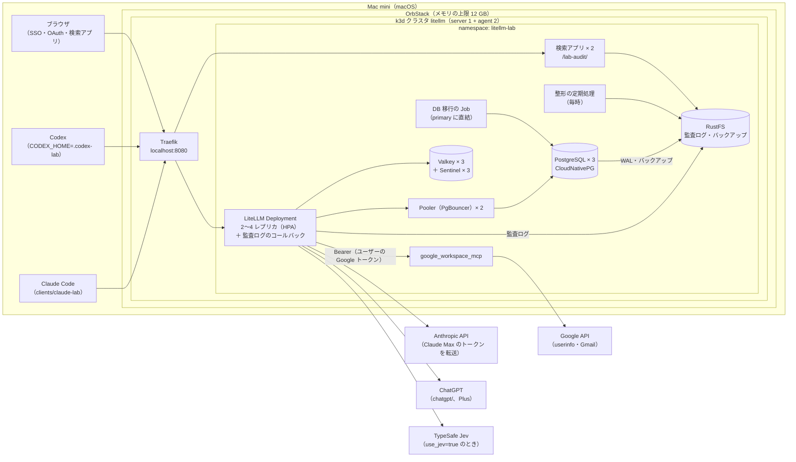
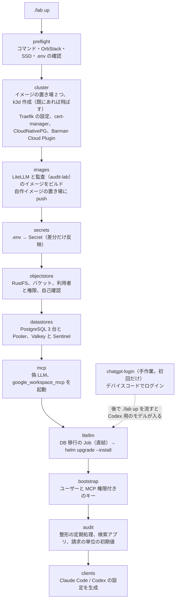
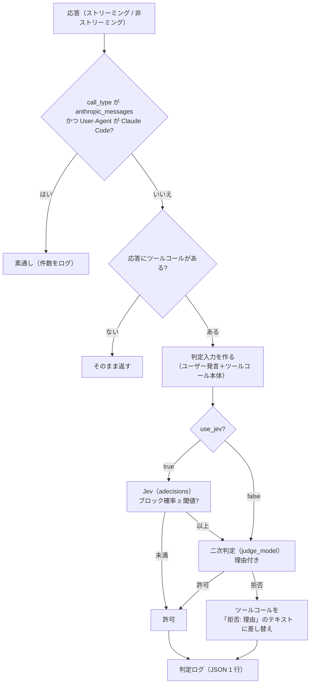

# litellm-agent-gateway-lab 詳細設計（検証環境の構築）

最終更新: 2026-10-12（DB と Redis の自前の冗長化、監査ログ、利用料・入出力の検索アプリを追加。17 章）

[spec.md](spec.md) の検証環境（5 章）を、スクリプト一式で再現できるように構築するための設計です。対象は、Mac 1 台の OrbStack 上の k3d クラスタと、その上の LiteLLM、PostgreSQL（CloudNativePG、3 台）、Valkey と Sentinel（各 3 台）、S3 互換のオブジェクトストレージ（RustFS）、MCP サーバー、自作ガードレール、監査ログ（S3）と検索アプリ、およびクライアント（Claude Code、Codex）の設定です。

冗長化と監査ログの変更の要件と作り方の詳細は、`.history/2026-10-11-冗長構成と監査ログ/` の変更仕様書と変更設計書にある。この文書はその結果の要点を持つ（17 章）。

---

## 1. 設計の前提（2026-10-11 に検証済み）

### 1.1 バージョン

すべてのイメージとチャートはバージョンを固定する。

| 部品 | 固定するバージョン | 確認方法 |
|---|---|---|
| OrbStack | 導入済み（Docker 29.4.0、Compose v5.1.2） | `docker info` |
| k3d | v5.9.0 | `k3d version` |
| k3s | `rancher/k3s:v1.35.5-k3s1` | 試験クラスタで起動を確認 |
| Traefik | 3.6.13（k3s v1.35.5 に同梱） | k3s のマニフェスト |
| LiteLLM | `ghcr.io/berriai/litellm-database:v1.104.2`（arm64 あり） | イメージを取得し、ソースを確認 |
| LiteLLM Helm チャート | `oci://ghcr.io/berriai/litellm-helm` 1.104.2 | `helm show values` |
| PostgreSQL | CloudNativePG 1.30.1（Helm チャート `cnpg/cloudnative-pg` 0.29.1）、`ghcr.io/cloudnative-pg/postgresql:17.11-minimal-trixie`、3 台と Pooler（PgBouncer） | 2026-10-12 に構築して試験 |
| バックアップ | Barman Cloud Plugin v0.15.1（cert-manager v1.21.2 が要る） | 同上 |
| Redis 互換 | `valkey/valkey:9.0.6`（公式イメージ）。Valkey 3 台と Sentinel 3 台 | 同上 |
| オブジェクトストレージ | `rustfs/rustfs:1.0.1`（S3 互換。Object Lock） | 同上 |
| 監査ログの整形と検索アプリ | 自作イメージ `audit-lab`（Python 3.12、DuckDB 1.5.6、FastAPI 0.143.0、Authlib 1.8.0） | 同上 |
| MCP サーバー | `ghcr.io/taylorwilsdon/google_workspace_mcp:2.1.0`（arm64） | 起動を確認 |

- LiteLLM は 2026 年 3 月の PyPI 汚染（1.82.7 / 1.82.8）以降の版で、CVE-2026-42208（v1.83.7 で修正）と CVE-2026-48710（v1.84.0 で修正）も修正済みの v1.104.2 を使う
- Helm チャートに同梱の PostgreSQL / Redis（Bitnami のサブチャート）は使わない。更新が止まった `bitnamilegacy` のイメージに固定されているため。PostgreSQL は CloudNativePG、Redis 互換は公式の Valkey イメージで自分で書いた構成にする（マネージドサービスは使わない。17 章）

### 1.2 実機で確かめたこと

| 確かめたこと | 結果 |
|---|---|
| OrbStack 上で k3d の 3 ノードクラスタが立つか | 立つ（約 90 秒）。Traefik、metrics-server、local-path-provisioner が動く |
| ガードレールに `config.yaml` の独自キーが渡るか | 渡る（`use_jev`、`jev_threshold` を `__init__` の引数で受け取れた） |
| ガードレールで経路と User-Agent を取れるか | 取れる。`call_type` が `/v1/responses` は `aresponses`、`/v1/messages` は `anthropic_messages`、Chat Completions は `acompletion`。User-Agent は `data["proxy_server_request"]["headers"]["user-agent"]` と `data["litellm_metadata"]["user_agent"]` |
| User-Agent が空のときの値 | ヘッダーは `None`、メタデータは空文字 |
| LiteLLM 組み込みのクライアント判定 | `is_claude_code_user_agent`（`claude-cli/` と `claude-code/` の前方一致）、`is_codex_user_agent`（`^codex[-_ /]`）がある。Codex のセッション ID は `session-id` / `thread-id` ヘッダー |
| `google_workspace_mcp` を外部トークンのモードで起動できるか | 起動する。トークンなしは 401、不正なトークンも 401。**`GOOGLE_OAUTH_CLIENT_SECRET` が必須**（ないと起動しない） |
| MCP サーバーが要求するスコープ | `gmail.readonly`、`userinfo.email`、`userinfo.profile`、`openid`（`WWW-Authenticate` と保護リソースのメタデータで確認） |

### 1.3 ドキュメントとソースで確かめたこと

- Codex（0.162.1）の User-Agent は `codex_cli_rs/<ver> (...)`。カスタムプロバイダでは毎ターン会話全体を送る（`store: false`）。MCP の OAuth は `codex mcp login <name>`
- Claude Code の User-Agent は `claude-cli/<ver> (external, cli)`。Claude Max のトークン（`sk-ant-oat…`）は、LiteLLM が `anthropic/*` のデプロイへ自動で転送する
- `chatgpt/` プロバイダのトークンはファイル（`auth.json`）にだけ保存される。複数レプリカでは書き込み可能な 1 つのファイルを共有する必要がある。初回ログインはデバイスコード方式で、プロキシの外で行う
- MCP の保存トークンは上流に `Authorization: Bearer` で送られる。`authorization_url` のクエリは保持される
- Decisions API は v1.104.2 で使える。Jev は TypeSafe 社がホストするモデル（`typesafe/jev-latest`、入力 100 万トークンあたり $0.042）

---

## 2. 全体構成



---

## 3. リポジトリ構成

```
litellm-agent-gateway-lab/
├── lab                           # 入口（Python。uv で動かす）。./lab up / down / rebuild / status / upgrade / test-*
├── labtool/                      # 構築ツールの本体
│   ├── core.py                   # 定数、ログ、.env、外部コマンド、待機、kapply、HTTP
│   ├── stages.py                 # 構築の段階（preflight 〜 clients、chatgpt-login）
│   ├── render.py                 # .env から設定を作る副作用のない関数（プロキシ設定、Secret、クライアント設定）
│   ├── ops.py                    # down / status / upgrade / clean-all / test-unit
│   ├── checks.py                 # 疎通確認、冪等性、負荷、判定ログの集計
│   ├── objectstore.py            # RustFS のバケット、利用者と権限、自己確認
│   ├── failover.py               # 障害の試験と、任意の時点への復元の試験
│   ├── audit_test.py             # 監査ログの試験、監査のイメージの 1 回限りの Job
│   └── tests/                    # 構築ツールの単体テスト（unittest）
├── .env.example                  # 設定と秘密情報の一覧（値は空。.env にコピーして使う）
├── .env                          # 実際の値（.gitignore 対象）
├── k8s/
│   ├── k3d-config.yaml           # クラスタ定義（ノード数、ポート、k3s の版、ボリューム、レジストリ）
│   ├── traefik-config.yaml       # HelmChartConfig（タイムアウト）
│   ├── namespace.yaml
│   ├── ingress.yaml              # 入口（IngressRoute）とパススルー経路の遮断（Middleware）
│   ├── postgres-cnpg.yaml        # PostgreSQL（CloudNativePG の Cluster、Pooler、バックアップ）
│   ├── litellm-migrate.yaml      # DB 移行の Job（primary に直結）
│   ├── valkey.yaml、valkey/*.sh  # Valkey と Sentinel、起動スクリプト
│   ├── rustfs.yaml               # S3 互換のオブジェクトストレージ
│   ├── audit-compactor.yaml      # 監査ログの整形の定期処理（CronJob）
│   ├── audit-viewer.yaml         # 検索アプリと、その入口（/lab-audit/）
│   ├── workspace-mcp.yaml        # google_workspace_mcp（クラスタ内のみ）
│   └── fake-llm.yaml             # 試験用の偽 LLM
├── litellm/
│   ├── Dockerfile                # 公式イメージ + ガードレール（ビルド時に単体テスト）
│   ├── values.yaml               # Helm の値
│   └── guardrails/
│       ├── tool_call_review.py   # 審査ガードレール本体（判定、差し替え、ログ）
│       ├── transcript.py         # 判定入力の抽出（形式ごと、モデルを呼ばない）
│       ├── audit_log.py          # 監査ログの書き込み（LiteLLM のコールバック）
│       ├── clientkind.py         # User-Agent からクライアントの種類（審査と監査ログで共通）
│       └── tests/                # 単体テスト（unittest）
├── apps/audit/                   # 監査ログの整形（compactor）、検索アプリ（viewer）、合成データ、速さの試験
│   ├── audit/                    # common、compactor、data、viewer、synth、bench、testing、templates/
│   └── tests/                    # 単体テスト（イメージのビルドの中で流す）
├── clients/
│   ├── claude-lab                # Claude Code の起動ラッパー
│   └── codex-lab                 # Codex の起動ラッパー（CODEX_HOME=.codex-lab）
├── tests/
│   ├── fake-llm/server.py        # 試験用の偽 LLM（ツールコールと審査官の役）
│   ├── load/k6.js                # k6 の負荷試験のシナリオ（./lab test-load で流す）
│   └── review-scenarios/         # spec 6.2 のシナリオ試験（手順と使い捨てリポジトリ）
├── docs/
│   ├── spec.md / design.md
│   └── setup-google.md           # Google Cloud の手作業の手順
└── .history/<日付>-<目的>/        # 変更仕様書と変更設計書（それ以外の .history/ の中身は公開しない）
```

- `.env`、クライアント設定の生成物（`.codex-lab/`、`clients/out/`）、`.build/` は `.gitignore` に入れる
- 構築ツールは Python で書く（2026-10-11 に Make + bash から移した。理由は 16 章）。`./lab` の先頭に必要な Python の版（3.12 以上）と依存（PyYAML、boto3）を書いてあり、uv が自動で用意する。前提の道具は uv、Docker（OrbStack）、k3d、kubectl、helm、kubectl cnpg（`brew install kubectl-cnpg`）

---

## 4. 構築の流れ



- どの段階も、何度実行しても同じ状態になるように書く（作成済みなら飛ばす、差分だけ反映、`helm upgrade --install`）
- 各段階は単独でも実行できる（`./lab litellm` で LiteLLM の段階だけなど）
- `./lab down` はクラスタを消す。保持するデータは 9 章

---

## 5. Kubernetes の構成

### 5.1 クラスタ（`k8s/k3d-config.yaml`）

| 項目 | 値 |
|---|---|
| ノード | server 1、agent 2 |
| k3s イメージ | `rancher/k3s:v1.35.5-k3s1` |
| ポート | `8080:80@loadbalancer`（Traefik の HTTP） |
| ボリューム | `${LAB_DATA_DIR}/chatgpt:/var/lib/lab/chatgpt@all`（chatgpt/ のトークン共有用。全ノードに同じホストのフォルダを見せる） |
| イメージの置き場 | クラスタとは別に k3d のレジストリを 2 つ立てる（15 章）。自作イメージ用（`k3d-litellm-registry.localhost`）と、Docker Hub の中継キャッシュ（`k3d-dockerio-cache.localhost`）。`./lab down` では消さない |

`LAB_DATA_DIR` の既定は `/Volumes/SSD/litellm-lab`。

### 5.2 Traefik（`k8s/traefik-config.yaml`）

`HelmChartConfig` で `ports.web.transport.respondingTimeouts` の `readTimeout` / `writeTimeout` / `idleTimeout` を 600 秒にする（長いストリーミングと判定待ちで切れないように）。適用後、Traefik の Deployment の起動引数に反映されたかを確かめる。

### 5.3 公開する経路とパススルーの遮断

Ingress（Traefik）で `localhost:8080` の全経路を LiteLLM に流す。ただし、プロバイダ API の素通し中継（spec 4.2）は Middleware で 403 にする。

- 遮断する接頭辞: `/anthropic`、`/openai`、`/azure`、`/bedrock`、`/vertex_ai`、`/gemini`、`/cohere`、`/mistral`、`/assemblyai`、`/langfuse`
- 実装時に、v1.104.2 のパススルー経路の一覧をソースから抽出して照合する
- 検索アプリは `/lab-audit/` の規則（優先度 50）で送る。LiteLLM 自身が `/audit` と `/audit/{id}`（管理画面の Audit Logs の API）を持っているので、`/audit` は使わない。規則の優先度は 100（素通しの拒否）、90（MCP の GET を 405）、50（検索アプリ）、1（その他すべてを LiteLLM）

### 5.4 名前空間と配置

| 部品 | 種類 | レプリカ | requests / limits（メモリ） | 保存 |
|---|---|---|---|---|
| LiteLLM | Deployment（Helm） | 2〜4（HPA、CPU 60%） | 512Mi / 1Gi | 監査ログの退避先（emptyDir、上限 1Gi） |
| DB 移行 | Job（`litellm-migrate-<ハッシュ>`） | — | 256Mi / 2Gi（流れている間だけ） | — |
| PostgreSQL | CloudNativePG の Cluster（3 台を別々のノードに） | 3 | 384Mi / 512Mi | PVC（local-path、2Gi） |
| Pooler（PgBouncer） | Deployment（CloudNativePG） | 2 | 32Mi / 64Mi | なし |
| Valkey | StatefulSet（別々のノードに） | 3 | 128Mi / 256Mi | PVC（1Gi。AOF） |
| Sentinel | StatefulSet（別々のノードに） | 3 | 32Mi / 64Mi | PVC（64Mi。Sentinel が書き換える設定） |
| RustFS | StatefulSet（server ノードに固定） | 1 | 512Mi / 1Gi | PVC（10Gi） |
| 検索アプリ | Deployment | 2 | 128Mi / 512Mi | なし |
| 整形の定期処理 | CronJob（毎時 10 分、日本時間） | — | 256Mi / 1Gi | なし |
| google_workspace_mcp | Deployment | 1 | 128Mi / 256Mi | なし（stateless モード） |
| cert-manager、CloudNativePG のオペレーター、Barman Cloud Plugin | Deployment（`cert-manager`、`cnpg-system` の名前空間） | 各 1 | — | — |

OrbStack のメモリの上限は 12 GB（2026-10-11 に 8 GB から上げた）。負荷時（LiteLLM 4 台）の見積もりは約 11 GB。

---

## 6. LiteLLM

### 6.1 カスタムイメージ（`litellm/Dockerfile`）

```dockerfile
FROM ghcr.io/berriai/litellm-database:v1.104.2
COPY guardrails/ /app/guardrails/
ENV PYTHONPATH=/app/guardrails
```

`./lab images` で `litellm-lab:<中身のハッシュ>` としてビルドし、自作イメージ用のレジストリに push する。Helm の `image.repository` / `image.tag` にはクラスタ内から見た名前（`k3d-litellm-registry.localhost:5000/litellm-lab`）を渡す。

### 6.2 Helm の値（`litellm/values.yaml` の要点）

| 項目 | 値 | 理由 |
|---|---|---|
| `image.repository` / `tag` | `litellm-lab` / ビルドしたタグ | 自作ガードレール入り |
| `image.pullPolicy` | `IfNotPresent` | 取り込んだイメージを使う |
| `numWorkers` | 1 | Kubernetes では 1 Pod 1 ワーカーが推奨 |
| `autoscaling` | 有効、min 2、max 4、CPU 60% | 検証環境のメモリに収める（5.4 節） |
| `masterkeySecretName` | `litellm-secrets` | Secret から |
| `environmentSecrets` | `litellm-secrets` | 下の表の環境変数 |
| `db.useExisting` | true。`db.endpoint` は `./lab litellm` が `LAB_DB_POOLER` で切り替える（`litellm-pg-pooler-rw` か `litellm-pg-rw`）。`db.secret.name` は `litellm-pg-app` | 同梱 DB を使わない。チャートは `DATABASE_URL` を Pod の `env` に直接書くので、接続先は `db.endpoint` で変える |
| `db.deployStandalone` / `redis.enabled` | false / false | 同上 |
| `migrationJob.enabled` | false | DB 移行は自前の Job で primary に直結して流す（PgBouncer の transaction モード越しでは壊れるおそれがあるため。17 章） |
| `envVars` | `LITELLM_MODE=PRODUCTION`、`DISABLE_SCHEMA_UPDATE=true`、`PROXY_BASE_URL`、`CHATGPT_TOKEN_DIR`、`DATABASE_DISABLE_PREPARED_STATEMENTS=true`（Pooler のとき）、`REDIS_SENTINEL_NODES` / `REDIS_SERVICE_NAME`、監査ログの書き込み先（`AUDIT_S3_*`、`AUDIT_FLUSH_SECONDS`） | spec 5.1、本番の推奨、17 章 |
| `volumes` / `volumeMounts` | hostPath `/var/lib/lab/chatgpt`、emptyDir `/var/lib/audit-spool`（上限 1Gi） | chatgpt/ のトークン共有（5.1）、監査ログを S3 に書けないときの退避先 |
| `lifecycle.preStop` | `sleep 10` | 止まる Pod に届く要求を 502 にしない（15 章） |
| `ingress` | 無効（自前の Ingress と Middleware を使う） | 5.3 |

### 6.3 プロキシの設定（`./lab litellm` が生成する ConfigMap `litellm-config`）

`labtool/render.py` の `litellm_config` が `.env` から生成する。要点:

```yaml
model_list:
  - model_name: "anthropic/*"          # Claude Code（Claude Max のトークンを転送。api_key は書かない）
    litellm_params: { model: "anthropic/*" }
  - model_name: gpt-5.6-terra          # Codex（ChatGPT Plus。トークンがあるときだけ）
    litellm_params: { model: chatgpt/gpt-5.6-terra }
    model_info:                         # 概算（A）用の単価。ChatGPT の定額は単価表に無いため（17 章）
      input_cost_per_token: 2.0e-06
      output_cost_per_token: 1.2e-05
      cache_read_input_token_cost: 2.0e-07
  - model_name: fake-tools             # 試験用の偽 LLM。精算の試験のため単価を付ける
    litellm_params: { model: openai/fake-tools, api_base: http://fake-llm…/v1 }
    model_info: { input_cost_per_token: 1.0e-06, output_cost_per_token: 2.0e-06 }
  - model_name: review-judge           # 二次判定（ChatGPT のトークンが無いときは偽 LLM）
    litellm_params: { model: chatgpt/gpt-5.6-luna }

litellm_settings:
  callbacks: ["audit_log.audit_logger_instance"]   # 監査ログ（17 章）

guardrails:
  - guardrail_name: tool-call-review
    litellm_params:
      guardrail: tool_call_review.ToolCallReview
      mode: [post_call]
      default_on: true
      use_jev: true                    # TypeSafe の API キーがあるとき
      jev_model: typesafe/jev-latest
      jev_threshold: 0.2
      judge_model: review-judge
      fail_open: false
      test_model: fake-tools           # 試験用のモデルへの要求は、偽 LLM の審査官だけで判定する
      test_judge_model: fake-tools

mcp_servers:
  gmail: …                             # Google の OAuth クライアントがあるとき。oauth_identity_binding は enforce

router_settings:                       # Redis のキーは書かない（Sentinel は環境変数で指定する。17 章）
  routing_strategy: simple-shuffle
  disable_cooldowns: true              # Claude Max のトークン切れで他人が止まらないように

general_settings:
  master_key: os.environ/LITELLM_MASTER_KEY
  database_url: os.environ/DATABASE_URL
  database_connection_pool_limit: 10   # Pooler のとき（直結なら 5）
  proxy_batch_write_at: 60
  use_redis_transaction_buffer: true   # 利用量の DB への書き込みを Redis に溜める
  require_key_mcp_access_defined: true
  disable_spend_logs: true             # 利用ログの表は書かない（監査ログから集計する。使用額と日次の集計は更新される）
```

- `oauth_identity_binding` で、Gmail にサインインした Google アカウントのメールと、LiteLLM のユーザー（Google SSO）のメールが一致しないと 403 にする。これで「他人の Gmail を自分のキーで読む」経路を閉じる
- 接続数の上限は、Pooler のとき Pod ごとに 10（PgBouncer が DB への接続を 40 × 2 台に抑える）、直結のとき 5（最大 4 Pod で 20 本。PostgreSQL の `max_connections` 200 に収まる）
- 二次判定は ChatGPT Plus を使うため、Codex と同じ利用上限を分け合う。上限に当たるようになったら、`review-judge` の `model` を Anthropic API などに替える（設定 1 行）
- `disable_spend_logs: true` のため、LiteLLM の管理画面の「Usage」と「Logs」は使えない。代わりに検索アプリ（`/lab-audit/`）を使う

### 6.4 環境変数（Secret `litellm-secrets`）

| 変数 | 内容 | 出所 |
|---|---|---|
| `LITELLM_MASTER_KEY` | 管理用キー（`sk-` で始まる） | `./lab secrets` が未設定なら生成して `.env` に保存 |
| `LITELLM_SALT_KEY` | DB 内の秘密の暗号化キー（後から変えない） | 同上 |
| `DATABASE_URL` | PostgreSQL の接続先（チャートが Secret `litellm-pg-app` と `db.endpoint` から Pod の `env` に組み立てる） | `.env` の `POSTGRES_PASSWORD` |
| `REDIS_PASSWORD` / `REDIS_SENTINEL_PASSWORD` | Valkey のデータの Pod と Sentinel のパスワード | `.env` の `REDIS_PASSWORD`、`SENTINEL_PASSWORD` |
| `AUDIT_S3_ACCESS_KEY` / `AUDIT_S3_SECRET_KEY` | 監査ログの書き込み専用の利用者（`litellm-writer`） | `.env` の `S3_LITELLM_WRITER_*` |
| `GOOGLE_CLIENT_ID` / `GOOGLE_CLIENT_SECRET` | 管理画面の Google SSO | Google Cloud（7 章） |
| `GOOGLE_OAUTH_CLIENT_ID` / `GOOGLE_OAUTH_CLIENT_SECRET` | Gmail の MCP 用 OAuth | 同上（SSO と同じクライアントでよい） |
| `TYPESAFE_API_KEY` | Jev | TypeSafe（作成済み） |
| `PROXY_ADMIN_ID` | 管理者にする SSO ユーザー | 自分の Google アカウント |
| `ALLOWED_EMAIL_DOMAINS` | SSO を許可するドメイン | `gmail.com`（個人アカウントのため、実質は同意画面のテストユーザーで絞る） |

---

## 7. Google Cloud の設定

OAuth クライアントは 1 つ（ウェブ アプリケーション）にして、SSO と Gmail の MCP で共用する。

| 項目 | 値 |
|---|---|
| 有効にする API | Gmail API |
| 同意画面 | 外部、テストモード。テストユーザーに検証用の Google アカウント 2 つ |
| スコープ | `openid`、`userinfo.email`、`userinfo.profile`、`gmail.readonly` |
| リダイレクト URI | `http://localhost:8080/sso/callback`（SSO）、`http://localhost:8080/callback`（MCP）、`http://localhost:8080/ui/mcp/oauth/callback`（管理画面から接続する場合） |

この手順は手作業。`docs/` に手順書を置き、`./lab preflight` は `.env` に値があるかだけを確かめる。

---

## 8. 審査ガードレール（`litellm/guardrails/`）

### 8.1 処理の流れ



### 8.2 部品

| 部品 | 内容 |
|---|---|
| `ToolCallReview.__init__` | `use_jev`、`jev_model`、`jev_threshold`、`judge_model`、`fail_mode`（判定 API の失敗時に拒否するか通すか。既定は拒否）を受け取る |
| `async_post_call_success_hook` | 非ストリーミングの応答を判定する |
| `async_post_call_streaming_iterator_hook` | ストリーミングの応答を判定する。テキストの差分はそのまま流し、ツールコールの項目（Responses API の `function_call` / `custom_tool_call` / `local_shell_call`、Chat Completions の `tool_calls`、Anthropic の `tool_use`）の部分だけ溜めて、完了時に判定してから流すか差し替える |
| `transcript.py` | 3 形式（Responses、Chat Completions、Anthropic Messages）の会話から、ユーザー発言とツールコール本体だけを抜き出す。アシスタントの文章、推論、ツールの結果は捨てる |
| クライアント判定 | LiteLLM 組み込みの `is_claude_code_user_agent`、`is_codex_user_agent` を使う |
| 判定ログ | 標準出力に JSON 1 行: 時刻、クライアント（UA 種別）、セッション ID、キーの別名、ツール名、引数の冒頭 200 文字、`use_jev`、Jev の確率とカテゴリ、二次判定の結果と理由、二次判定を試した回数、判定にかかった時間、最終判定 |

### 8.3 テスト

- `transcript.py` と判定分岐は、モデルを呼ばずに単体テストできるように分ける（pytest、カスタムイメージの中で実行）
- ストリーミングの差し替えは、LiteLLM の `mock_response` で固定のツールコールを返すモデルを使って結合テストする（実装時に、`mock_response` でツールコールを返せるかを確かめる）

---

## 9. データの保持

| データ | 置き場所 | `./lab down`（クラスタ削除）で |
|---|---|---|
| Docker のイメージ・ボリューム | OrbStack | 残る |
| PostgreSQL（ユーザー、キー、MCP の OAuth トークン、使用額、日次の集計） | クラスタ内の PVC（3 台） | **消える**（作り直すたびにまっさらから試すため）。ユーザーとキーは `./lab bootstrap` が同じ値で作り直す。Gmail のサインインだけはやり直す |
| PostgreSQL のバックアップと WAL | RustFS の `pg-backup`（30 日） | **消える**（RustFS がクラスタの中にあるため） |
| 監査ログ（原本 90 日、閲覧・管理操作の記録 13 か月、整形済み・日次の集計・精算） | RustFS の `audit-raw`、`audit-access`、`audit-derived` | **消える**（検証環境だけの振る舞い。本番の置き場はクラスタの外に置く） |
| chatgpt/ のトークン（`auth.json`） | `${LAB_DATA_DIR}/chatgpt`（SSD） | 残る |
| `.env`（秘密情報） | リポジトリ直下（Git 管理外） | 残る |

---

## 10. クライアントの設定（`./lab clients`）

利用者の普段の設定（`~/.claude`、`~/.codex`）は書き換えない。

| クライアント | 方法 |
|---|---|
| Claude Code | `clients/claude-lab` で `ANTHROPIC_BASE_URL=http://localhost:8080` と `ANTHROPIC_CUSTOM_HEADERS="x-litellm-api-key: Bearer <キー>"` を設定し、`--mcp-config clients/out/mcp.json` を付けて `claude` を起動する |
| Codex | `CODEX_HOME=<repo>/.codex-lab` に `config.toml` を生成する（モデルプロバイダ `litellm`、`wire_api = "responses"`、MCP の `gmail`）。`codex mcp login gmail` で初回サインイン |

キーは `./lab bootstrap` が利用者ごとに 2 本（Claude Code 用、Codex 用）作る。どちらも `object_permission.mcp_servers: ["gmail"]` を付ける。キーの値は `.env` に保存した固定値を使う（`/key/generate` の `key` 指定）ので、クラスタを作り直してもクライアントの設定は変わらない。

---

## 11. spec の検証項目との対応

| spec の項目 | 使うもの |
|---|---|
| 6.1 認証・Copilot 連携 | `tests/smoke/`、2 アカウントでの手動確認 |
| 6.2 ツールコール審査 | `tests/review-scenarios/`（使い捨てリポジトリとローカルの bare リポジトリを作り、シナリオを再現）、判定ログの集計スクリプト |
| 6.3 スケール | `tests/load/`（k6）、`kubectl scale` と HPA の観察、`./lab upgrade`（バージョンを上げてローリング更新）、`./lab test-failover`（DB と Redis の切り替え）、`./lab test-restore`（任意の時点への復元） |
| 監査ログ・利用料（17 章） | `./lab test-audit`、`./lab audit-synth` と `./lab audit-bench`（検索の速さ） |

---

## 12. 決定事項（2026-10-11 のヒアリング）

| 項目 | 決定 | 反映先 |
|---|---|---|
| 二次判定の LLM | ChatGPT Plus（`chatgpt/` の小さめのモデル）。上限に当たったら Anthropic API などに切り替える | 6.3 |
| Jev | 使う（TypeSafe のアカウントは作成済み）。既定は `use_jev: true` | 6.3、6.4 |
| メモリと台数 | OrbStack は 8 GB のまま。LiteLLM は 2〜4 台（2026-10-11 に、冗長化と監査ログのため 12 GB に上げた） | 5.4、6.2、spec 5.1 |
| クライアントの設定 | 普段の設定から分ける（`clients/claude-lab`、`CODEX_HOME`） | 10 章 |
| DB の保持 | 残さない。クラスタを消すと DB も消える | 9 章 |
| 2 つ目の Google アカウント | 手持ちのアカウントを使う | 7 章 |
| 構築スクリプト | 冪等性を重視する。検証で何度も作り直す前提 | 14 章 |

## 13. 実装時に確かめること（2026-10-11 時点の一覧。結果は 15 章と 17 章）

- 事前に作ったユーザー（メールアドレス付き）に、Google SSO でログインしたユーザーが結び付くか（ソースではユーザー ID とメールで既存ユーザーを探しているので、結び付く見込み）
- 二次判定と Codex に使う `chatgpt/` のモデル名

- ストリーミングの Responses API で、ツールコールの項目がどのイベントの並びで届くか（溜めて差し替える処理の設計に直結）
- `mock_response` でツールコールを含む応答を作れるか
- `oauth_identity_binding.audiences` に環境変数の参照を書けるか
- Traefik の HelmChartConfig のタイムアウトが反映されるか
- `chatgpt/` で Codex が使えるモデル名と、Codex から LiteLLM 経由で動くか
- 複数レプリカが 1 つの `auth.json` を共有したときに、トークンの更新が競合しないか
- `google_workspace_mcp` に LiteLLM から実際の Google トークンを渡して Gmail を読めるか

---

## 14. 冪等性の設計

検証では環境を何度も作り直すため、どのコマンドも「何度流しても同じ結果になる」ことを最優先にする。

### 14.1 原則

- **状態を見てから動く。** 作る前に「もうあるか」を確かめ、あれば飛ばすか差分だけ反映する
- **宣言的な道具を使う。** k8s は `kubectl apply`、Helm は `helm upgrade --install`、k3d は設定ファイル（`k3d-config.yaml`）から作る
- **途中で失敗しても、もう一度流せば続きから進む。** 各段階は前の段階の完了を前提にせず、必要な状態を自分で確かめる
- **値は固定する。** 生成する秘密情報やキーは最初に 1 回だけ作って `.env` に保存し、以後は同じ値を使う
- **待つときは状態で待つ。** `sleep` ではなく `kubectl wait`、`kubectl rollout status`、ヘルスチェックの URL を、上限時間つきで繰り返し確かめる

### 14.2 段階ごとの冪等化

| 段階 | 「もうある」の判定 | 2 回目以降の動き |
|---|---|---|
| preflight | — | 毎回確かめるだけ（変更しない） |
| cluster | `k3d cluster list -o json` にクラスタがあり、全ノードが Ready | 飛ばす。設定（ノード数、k3s の版、ポート）が `k3d-config.yaml` と違えば、作り直しを促して止まる |
| cluster（Traefik の設定） | `kubectl apply` | 差分だけ反映 |
| cluster（cert-manager、CloudNativePG） | 値のハッシュをリリースの説明（`--description labValuesHash=…`）に持つ | 同じなら helm を流さない（cert-manager のチャートは値に知らない項目を入れると断るため、説明に持つ） |
| cluster（Barman Cloud Plugin） | マニフェストを `.build/` に 1 回だけ取得し、`kapply` | 差分だけ反映 |
| images | イメージのタグを `litellm/`、`apps/audit/` 以下の内容のハッシュにし、同じタグがローカルにあればビルドを飛ばす。レジストリにそのタグのマニフェストがあれば push も飛ばす | 中身が変わったときだけビルドと push |
| objectstore | バケット、バージョニング、既定の保持、ライフサイクル、利用者、権限を読み、違えば直す | Object Lock が無効のまま作られたバケットは直せないのでエラーで止める。最後に毎回、許した操作と拒否される操作を確かめる |
| secrets | `.env` の各値。空なら生成して `.env` に書き足す（既存の値は決して上書きしない） | Secret のマニフェストを作り、`kubectl diff` で差分があるときだけ apply する |
| datastores | `kubectl apply`。以前の 1 台の PostgreSQL と Redis は、あれば消す（`--ignore-not-found`） | 差分だけ反映。Cluster の Ready、Valkey と Sentinel の起動、Sentinel 3 台が同じ primary を指すことを待つ |
| mcp | `kubectl apply` | 同上。`/health` を待つ |
| litellm | DB 移行の Job の名前を、イメージのタグと Cluster の uid のハッシュにする。渡す値のハッシュをリリースの値（`labValuesHash`）に入れておき、同じなら helm を流さない | 同じ名前の Job が成功済みなら移行を流さない（Job に TTL を付けない）。値が変わったときだけ `helm upgrade --install --wait` |
| audit | `kubectl apply`。請求の単位と換算のレートは、1 つも無いときだけ初期値を書く | 差分だけ反映 |
| bootstrap | ユーザーは `/user/info`、キーは `/key/info` で存在を確かめる | なければ `.env` の固定値で作る。あれば権限（MCP サーバー）だけ `/key/update` で揃える |
| chatgpt-login | `${LAB_DATA_DIR}/chatgpt/auth.json` にトークンがある | 飛ばす（クラスタを作り直しても残る） |
| clients | 生成物を一時ファイルに書き、内容が変わったときだけ置き換える | 差分がなければ何もしない |

### 14.3 作り直しの入口

| コマンド | 動き | 残るもの |
|---|---|---|
| `./lab up` | 全段階を順に流す（何度でも可） | — |
| `./lab down` | クラスタを削除する | `.env`、chatgpt のトークン、Docker のイメージ |
| `./lab rebuild` | `./lab down` の後に `./lab up` | 同上 |
| `./lab upgrade <版>` | LiteLLM のイメージを指定の版で作り直し、`helm upgrade` でローリング更新する（spec 6.3 の無停止更新の試験用） | すべて |
| `./lab clean-all` | `./lab down` に加えて、生成したクライアント設定とカスタムイメージを消す。確認のプロンプトを出す | `.env`、chatgpt のトークン |

- `.env` と chatgpt のトークンは、どのコマンドでも消さない（消すと Google の再設定や ChatGPT の再ログインが要るため）。消したいときは手で消す
- `./lab rebuild` の所要時間を計測して記録し、作り直しの負担を把握する

### 14.4 冪等性の試験

- `./lab up` を 2 回続けて流し、2 回目で何も変わらないこと（Helm のリビジョンが増えない、Pod が再起動しない）を確かめる。比べるのは、3 つの名前空間の Helm のリリース、Pod、ConfigMap と Secret（CloudNativePG が自分で更新するものは除く）、Deployment・StatefulSet・CronJob・CloudNativePG のリソース・入口の規則、オブジェクトストレージのバケットの設定と利用者と権限
- 各段階の途中で止め（`Ctrl-C`）、もう一度 `./lab up` で最後まで進むことを確かめる
- `./lab rebuild` の後、生成済みのクライアント設定のまま Claude Code と Codex がつながることを確かめる（キーの固定値の確認）

---

## 15. 実装で分かったこと（2026-10-11）

実装と試験の中で分かり、設計を変えたことをまとめる。

| 分かったこと | 対応 |
|---|---|
| `k3d image import` は、複数アーキテクチャのイメージ（`docker save` に arm64 以外の参照が残る）で「content digest not found」になる。しかも最後に「成功」と表示する | 取り込みをやめ、レジストリ方式にした。自作イメージは `docker push --platform linux/arm64` で入れ、外部イメージは Docker Hub の中継キャッシュ経由でノードが取る。キャッシュはクラスタを消しても残るので、作り直しの 2 回目以降が速い |
| `chatgpt/` のモデルをトークン無しで設定に入れると、LiteLLM が起動の途中でデバイスコードのログインを始めて止まる（起動の確認に通らず、再起動を繰り返す）。途中で止まると、要求時刻だけの `auth.json` が書き残される | トークン（`refresh_token` か `access_token`）があるときだけ、Codex 用のモデルと二次判定の `chatgpt/` を設定に入れる。ログインは `./lab chatgpt-login` で、クラスタの外の 1 回限りのコンテナで行う |
| post_call のフックに渡る `data` には `call_type` が入っていない | 形式（Responses / Chat Completions / Anthropic Messages）は、`user_api_key_dict.request_route` などの経路から判定する |
| ストリーミングでガードレールに届く形は形式ごとに違う。Responses はイベントのオブジェクト、Chat Completions は `ModelResponseStream`、Anthropic Messages は SSE のバイト列 | 形式ごとの処理（`ResponsesStream` / `ChatStream` / `AnthropicStream`）に分けた。ツールコールの始まりまでは素通しで流し、そこから先を溜めて判定する |
| Helm チャートは、`migrationJob` を有効にすると本体の Pod に `DISABLE_SCHEMA_UPDATE=true` を自分で入れる。`envVars` で重ねて指定すると、重複でインストールが失敗する | `envVars` から外した |
| `helm --wait` を途中で止めると、リリースが pending のまま残り、次の helm が失敗する | `./lab litellm` の冒頭で、pending-install なら削除、pending-upgrade なら直前の版に戻す（戻せなければ削除）、failed なら入れ直す |
| `kubectl apply` は、中身が同じでも `configured` と出ることがある | `kubectl diff` で差分があるときだけ apply する（`kapply`）。冪等性の試験で「変化なし」を判定できるようにするため |
| Kubernetes は Service ごとに `<名前>_PORT=tcp://…` の環境変数を Pod に入れる。google_workspace_mcp は `WORKSPACE_MCP_PORT` を自分の待ち受けポートとして読むので、Service 名が `workspace-mcp` だと起動に失敗する（Docker 単体での起動確認では起きなかった） | Pod に `enableServiceLinks: false` を付けて、Service の環境変数を入れない |
| 管理画面の「Connect」で Gmail にサインインすると、Google のトークンの交換までは通るが、保存の段階で 403（`oauth_identity_binding_enforced`）になる。enforce の設定では、本人を確かめられない保存の経路を LiteLLM が閉じている（仕様） | サインインは MCP クライアント（Codex の `mcp login`、Claude Code の `/mcp`）からゲートウェイの OAuth の手順で行う。`docs/setup-google.md` の 5 章 |
| Codex の設定で MCP の要求に LiteLLM のキー（`x-litellm-api-key`）を付けていると、`codex mcp login` が「OAuth metadata discovery failed」で失敗する。キーがあると `GET /gmail/mcp` が 401 ではなく 200（SSE）を返し、Codex がそれをメタデータとして読もうとするため | `clients/codex-lab` は `mcp login` のときだけキーを外す |
| サインイン後、ユーザー 1 のキーでは Gmail のツールが使え、サインインしていないユーザー 2 のキーは 401 になった（ユーザーごとのトークンの分離） | 疎通確認の「未サインインなら 401」は、サインインしないマスターキーで確かめるように変えた |
| Codex（0.162.1）を試験用の偽 LLM（モデル名 `fake-tools`）で動かすと、Gmail の MCP のツールがモデルに渡されない（`codex mcp list` では enabled / OAuth） | 本物のモデルでも同じことが起き、原因は下の「Codex がツールの一覧を待たない」だった。偽 LLM ではやり直していない |
| ChatGPT のデバイスコードでのログインは、アカウント側の設定で有効にしないと、コードを入力した後に「ChatGPT のセキュリティ設定で、Codex、Excel、PowerPoint、Word のデバイスコードによるサインインを有効にしてから、`codex login --device-auth` をもう一度実行してください」と出て止まる（2026-10-11 に確認）。また、LiteLLM のログイン処理は URL とコードを表示するだけでブラウザを開かず、コードを要求した時刻だけが `auth.json` に残っていると 5 分間は新しいコードを出さずに黙って待つ | ChatGPT の設定 →「セキュリティ」で、デバイスコードによるサインインを有効にしてから `./lab chatgpt-login` を実行する（文中の `codex login --device-auth` は Codex 本体向けの案内なので、この環境では `./lab chatgpt-login` をやり直す）。`./lab chatgpt-login` は、トークンの無い `auth.json` を消してから始め、表示された URL をブラウザで開く |
| LiteLLM は MCP の経路（`/<サーバー名>/mcp`）へのセッション無しの GET に、終わらないイベントストリーム（200）を返す。Codex（0.162.1）は起動時にこの GET を送って応答を待ち続け、MCP サーバーを使えなくなる | 入口（Traefik）で、この GET だけを POST 専用の経路に置き換えて 405 を返す（`k8s/ingress.yaml`）。MCP の仕様では、サーバーはこの GET に 405 を返してよい。直した後、Codex は MCP につながり、ツール 7 個の一覧を取れた |
| Codex は MCP の一覧を取れるようになったが、本物のモデル（gpt-5.6-terra）で「Gmail のラベルの数」を頼むと、ときどき「Gmail にアクセスできない」と答える。**原因は、Codex が MCP のツールの一覧（`tools/list`）の応答を待たずに最初のターンを始めること。** 起動から約 1 秒で最初の要求を出すが、ゲートウェイ経由の一覧は 0.6〜1.0 秒かかる（LiteLLM が毎回 MCP サーバーに問い合わせる）。間に合わなかった回は、Gmail のツールが無いまま動く。実測では一覧の応答が 564 ms の回は使え、811 ms と 985 ms の回は使えなかった（Traefik のアクセスログで確認） | Codex の設定に `mcp_optional_startup_grace_ms = 10000` を入れ、任意の MCP サーバーの一覧を最初のターンの前に最大 10 秒待たせる（`./lab clients` が生成）。Pod を入れ替えた直後 3 回と、その 2 回目 3 回の計 12 回すべてで Gmail のツール 7 個が見え、ラベルの数（38）にも正しく答えた。`mcp_servers.gmail.required = true` でも 6 回中 6 回使えたが、Gmail のサインインが切れると Codex 自体が起動しなくなるので採らなかった |
| ローリング更新の途中で、終了の決まった Pod にも数秒は要求が届き、502 になる（入口が送り先から外すまでの遅れ）。Codex の起動時の確認がこれに当たると、その回は MCP のツールを使えない | LiteLLM の Pod に `preStop` で 10 秒待つ設定を足した（`litellm/values.yaml`）。待つ間も要求は普通に処理する |
| 上の原因を調べるため、入口（Traefik）の要求ごとの記録が要った | Traefik のアクセスログを有効にした（`k8s/traefik-config.yaml`）。ヘッダーは記録しない（キーやトークンを残さないため） |
| ゲートウェイの MCP の OAuth は、リフレッシュトークンを使うたびに新しいものに替える（使い回すと `invalid_grant`「already used」）。Pod の入れ替えを何度も繰り返す試験の途中で、Codex のリフレッシュトークンが拒否され、Gmail を使えなくなった | `clients/codex-lab mcp login gmail` でサインインし直す（`docs/setup-google.md` 5 章と同じ手順）。普段の運用では起きていない |
| 試したが採らなかったこと: 同じ Pod に送り続ける設定（入口のスティッキーセッション）、起動時に MCP のセッションを用意しておくモジュール、未知のセッション ID に 404 を返す改修 | どれも原因（Codex が待たない）に効かなかった。404 の改修は正しいセッションまで壊したので戻した |
| `chatgpt/` で使えるモデル名は、ChatGPT のアカウントで決まる。`gpt-5.3-codex` は「ChatGPT のアカウントでは使えない」と拒否された。Codex 本体のモデル一覧（`~/.codex/models_cache.json`）にある名前なら使える | `.env` の既定を `LAB_CODEX_MODEL=gpt-5.6-terra`、`LAB_JUDGE_MODEL=gpt-5.6-luna` にした |
| 二次判定が本物のモデルになると判定が揺れ、疎通確認（偽 LLM で危険な操作が止まるか）が決まらなくなる | ガードレールに `test_model` / `test_judge_model` を足し、試験用のモデル（`fake-tools`）への要求は偽 LLM の審査官だけで判定する（Jev も使わない） |
| 本物の二次判定が、Codex がツールを探す操作（MCP のリソースの一覧）を「頼まれたツールではない」として止めることがあった（誤った拒否）。審査官への指示が「頼まれた範囲かを厳しく確かめる」形だったため | 指示を、Claude Code の auto モードと同じ「原則は通し、決めた危険な操作だけを止める」形に書き直した。止める操作は、頼まれていない破壊的な変更、外部の文章に書かれた指示の実行、別の認証情報の探索、頼まれていない公開（「共有して」だけでは公開の依頼とみなさない）、検証の回避など。ツールや MCP のリソースの一覧・検索は通す例に挙げた。通すべき 5 件と止めるべき 5 件の事例（`tests/review-scenarios/judge-cases.json`）を 3 回ずつ判定させ、旧い指示は 30 回中 27 回（リソースの一覧を 3 回とも止めた）、新しい指示は 30 回中 30 回、期待どおりだった。`./lab test-judge` でいつでも測り直せる |
| ChatGPT は、審査の依頼を同時に何件も受けると、ときどき中身の無い応答を返す（LiteLLM は「Unknown items in responses API response: []」で 500 にする）。6 件並列で 18 件中 1 件ほど。LiteLLM 自身の再試行は間を空けずに続けるので同じく失敗する。審査に失敗すると操作を止める設定なので、誤った拒否になる | ガードレールで審査官の呼び出しを、1 秒、2 秒と間を空けて最大 3 回まで試す。判定ログに試した回数（`judge_attempts`）を出す。`./lab test-judge` も同じく頼み直し、やり直した回数を表示する |
| ローリング更新の直後に、終了中の Pod に当たって入口のヘルスチェックが一時的に失敗し、bootstrap の段階が止まった | bootstrap の接続の確認を、1 回ではなく最大 60 秒待つようにした |
| TypeSafe は、組織の残高（クレジット）が無いと API キーを作れない | 手作業の準備に「Billing でクレジットを追加してからキーを作る」を足した。キーを入れた後、Codex のツールコールが Jev の一次判定（約 0.3 秒、確率 0.03 と 0.16）で判定されることを確かめた |
| OrbStack が `~/Documents` 以下をコンテナに見せるには、macOS の「書類フォルダへのアクセス」の許可が要る。許可を求める画面が出ている間、`docker run` は止まる | 2026-10-11 に許可済み。構築スクリプトは `~/Documents` をコンテナに見せない（ビルドは Docker のビルドコンテキストで送る） |
| （2026-10-12）cert-manager のチャートは値の形を検査し、知らない項目（`labValuesHash`）を断る | 値のハッシュはリリースの説明（`--description`）に持つ |
| （2026-10-12）CloudNativePG の 3 台を初めて作るとき、イメージの取得と 1 台ずつの参加で 10 分を超えた | 準備を待つ上限を 20 分にした（2 回目以降は数十秒） |
| （2026-10-12）DB 移行の Job が、メモリの上限 768Mi で `prisma generate` の途中に OOM で落ちた | 上限を 2Gi にした（流れている 20 秒ほどの間だけ） |
| （2026-10-12）CloudNativePG の既定では、消した primary の Pod が、Pooler の接続が切れるのを待って 30 分近く Terminating のまま残った（`stopDelay` 1800 秒、`switchoverDelay` 3600 秒） | `stopDelay: 120`、`smartShutdownTimeout: 15`、`switchoverDelay: 60` にした |
| （2026-10-12）RustFS がメモリの上限 256Mi に張り付き、CPU を 8 コア使って応答しなくなった。その間、監査ログの書き込みが止まった | 上限を 1Gi（CPU 2）にした |
| （2026-10-12）マニフェストのひな形（`string.Template`）の `${...}` が、コメントの中や Valkey の起動スクリプトのシェルの `$` とぶつかった | コメントに `${` を書かない。起動スクリプトは別のファイル（`k8s/valkey/*.sh`）にし、構築ツールが ConfigMap にする。マニフェストの中のシェルの `$` は `$$` と書く |
| （2026-10-12）マスターキーの要求は、LiteLLM が仮の利用者 `default_user_id` を付ける | 監査ログでは利用者なしとして扱う（精算の「利用者なし」の行） |
| （2026-10-12）DuckDB は時刻（TIMESTAMPTZ）を Python の値にするのに `pytz` が要る。無いと検索アプリの履歴が出ない | 依存に足し、整形済みのデータを書いて読み戻す単体テストを足した |
| （2026-10-12）Jev の呼び出し（`litellm.adecisions`）には `no-log` が効かない（ログの設定に渡らない） | 監査ログの側で、呼び出しの種類（`decision` を含む）でも外す |

### 試験用の偽 LLM（`tests/fake-llm`）

ChatGPT や Claude の利用枠を使わずに審査を試すため、OpenAI 互換の偽 LLM を足した（クラスタ内の `fake-llm`、モデル名 `fake-tools`）。

- ユーザーの発言に `TOOL:<名前>:<引数の JSON>` があれば、そのツールコールを返す（Chat Completions と Responses API、ストリーミングあり・なし）
- 審査の依頼（`[[tool-call-review]]` の印が付いたもの）には、危険な語（`--delete`、`rm -rf` など）を含むかどうかで block / allow の JSON を返す
- ChatGPT のトークンが無いあいだは、二次判定（`review-judge`）もこの偽 LLM を使う

### 審査の試験の結果（2026-10-11、偽 LLM で実施）

3 形式 × ストリーミングあり・なしのすべてで、危険なツールコールは「拒否: 理由」に差し替わり、安全なものはそのまま通った。
Claude Code の User-Agent の Anthropic 形式は審査されずに素通りし、User-Agent が空のものは審査された。

---

## 16. 構築ツールを Python にした理由（2026-10-11）

最初は Make + bash で実装し、試験がすべて通った版をコミットした（`7880fa8`）。そのうえで、Python の 1 本の CLI（`./lab`）に書き直した。

| 観点 | Make + bash | Python（`./lab`） |
|---|---|---|
| Make の依存関係の機能 | 作る対象がファイルではなくクラスタの状態なので、ほぼ使えない。各ターゲットは順に流すだけのメニューになる | 要らない |
| 冪等性の判定（状態を読み、差だけを直す） | `kubectl -o json` や API の応答を jq で読む。文字列の比較が多い | JSON を辞書として扱える |
| 待機、リトライ、エラー処理 | `set -e` の落とし穴（パイプやサブシェル）に注意し続ける | 例外で書ける |
| 設定の生成 | envsubst のテンプレートと Python が混在 | Python だけ（副作用のない関数にして単体テストする） |
| 前提の道具 | make（macOS は 2006 年の 3.81）、jq、gettext | uv（Python 3.12 以上と PyYAML を自動で用意する） |

- k8s のマニフェスト（`k8s/`）は YAML のまま残し、`${名前}` の置き換えは Python の `string.Template` で行う。渡していない名前が残っていればエラーにする
- 外部コマンド（k3d、kubectl、helm、docker）は `subprocess` で呼ぶ。ツールのログは標準エラーに流す
- 移行の確認（2026-10-11）: 生成するプロキシ設定が bash 版と同じ内容であること、単体テスト（構築ツール 17 件、ガードレール 9 件）、疎通確認 19 項目、冪等性の試験（2 回目は 3 秒で変化なし）、まっさらからの作り直し（559 秒。bash 版は 514 秒で、差はイメージの展開など毎回ばらつく待ち時間の範囲）と、その後の疎通確認 19 項目

---

## 17. DB と Redis の自前の冗長化、監査ログ、利用料・入出力の検索アプリ（2026-10-12）

要件と決定は `.history/2026-10-11-冗長構成と監査ログ/変更仕様書.md`、作り方の詳細（設定値、記録の形、置き場所、API、確証を取った事実と出どころ）は同じディレクトリの `変更設計書.md` にある。ここには要点と試験の結果をまとめる。

### 17.1 構成の要点

| 部品 | 要点 |
|---|---|
| PostgreSQL | CloudNativePG で 3 台（別々のノード）。同期複製（どれか 1 台の standby が受け取れば完了）、過半数の合意で切り替え。WAL と毎日のバックアップを RustFS に送り、任意の時点に戻せる。止めるときの待ちに上限（`stopDelay: 120`、`smartShutdownTimeout: 1`、`switchoverDelay: 5`） |
| 接続の窓口 | Pooler（PgBouncer、transaction モード、2 台を別々のノードに）。`max_prepared_statements=0`（LiteLLM の Prisma 5.4.2 と PgBouncer の準備済みの問い合わせの組み合わせの既知の問題を避ける）。`server_login_retry: 1`、`server_connect_timeout: 3`。`.env` の `LAB_DB_POOLER=direct` で直結にも切り替えられる |
| DB 移行 | primary に直結する自前の Job（`python litellm/proxy/prisma_migration.py`）。名前はイメージと DB のハッシュで、成功済みなら流さない |
| Redis 互換 | 公式の `valkey/valkey:9.0.6` で、Valkey 3 台と Sentinel 3 台を自分で書いた構成。AOF、`noeviction`、`min-replicas-to-write 1`。LiteLLM は環境変数（`REDIS_SENTINEL_NODES` など）だけで Sentinel を使う（`router_settings` に Redis のキーを書くと Sentinel を使わない接続ができるので書かない）。利用量を Redis に溜める（`use_redis_transaction_buffer`） |
| オブジェクトストレージ | RustFS（S3 互換）。監査ログの原本（`audit-raw`、Object Lock 90 日）、閲覧と管理操作の記録（`audit-access`、13 か月）、整形済み・集計・精算（`audit-derived`）、DB のバックアップ（`pg-backup`）。利用者ごとに必要な操作だけを許し、原本の削除と保持の回避は誰にも許さない。S3 の API だけを使うので、AWS S3 などに設定だけで置き換えられる |
| 監査ログの書き込み | 自作の LiteLLM のコールバック（`litellm/guardrails/audit_log.py`）。LiteLLM に元からある S3 への出力は、圧縮しない（保存量が約 5 倍）、ディスクに退避しないので使わない。要求ごとの記録と本文（`StandardLoggingPayload` をそのまま、1 件ずつ取り出せる gzip）を、日本時間の時間ごとに書く。要求と審査は `litellm_call_id` で結び付ける。審査官と Jev の呼び出しは要求として記録しない |
| 整形 | 毎時の CronJob。審査を要求に結び付け、利用者のメールアドレスと時刻の順の Parquet にする。日次の集計と月次の精算（概算 A と按分 B、円への換算）を作る |
| 検索アプリ | `/lab-audit/`（FastAPI と DuckDB）。OpenID Connect でサインイン（検証環境は Google、本番は Entra ID に設定だけで切り替え）。一般の利用者は自分の分だけ、監査担当は全員の分。本文を開くと閲覧の記録を必ず残す（書けなければ本文を見せない）。CSRF の対策あり |
| クラスタ全体の部品 | cert-manager、CloudNativePG のオペレーター、Barman Cloud Plugin、Traefik は server ノードに置く（障害の試験で止めるのは agent ノードだけ。本番ではこれらを複数台にする） |
| 入口 | LiteLLM への経路は、接続を 2 秒で諦め、接続できなかった要求だけを別の Pod に送り直す（止まったノードに残った Pod に要求が届いても待ち続けないように） |
| LiteLLM の配置 | Pod をノードに散らし（`topologySpreadConstraints`）、ノードが止まったら 30 秒で別のノードに移す |

### 17.2 試験の結果（2026-10-12）

**障害の試験**（`./lab test-failover`。1 秒 20 件の要求を流しながら起こす。最終の構成での結果）

| 場面 | Pooler（主） | 直結（比較用） | 目安 |
|---|---|---|---|
| PostgreSQL の計画的な切り替え | 失敗 0 件 | 回復まで 56.3 秒（失敗 166 / 1,545 件） | 60 秒（直結は 90 秒） |
| PostgreSQL の primary の Pod を消す | 失敗 0 件 | 回復まで 72.3 秒（失敗 1,090 / 1,844 件） | 60 秒（直結は 90 秒） |
| PostgreSQL の primary のノードを止める | 回復まで 93.2 秒（失敗 1,052 / 2,766 件） | 回復まで 88.9 秒（失敗 1,278 / 2,901 件） | 120 秒 |
| Valkey の primary の Pod を消す | 失敗 0 件 | 失敗 0 件 | 60 秒 |
| Valkey の primary のノードを止める | 失敗 0 件 | 失敗 0 件 | 120 秒 |
| 監査ログの欠け | ノードを止める場面だけ 111 件（許す上限 240 件。止めたノードの書き出し前の分）。ほかは 0 件 | ノードを止める場面だけ 105 件（許す上限 240 件）。ほかは 0 件 | 0 件（ノードを止める場面は書き出し前の分まで） |

- Pooler は切り替えの間の要求を待たせて吸収するので、計画的な切り替えと Pod の削除で失敗が出なかった。直結では新しい primary が立つまでの間がそのまま失敗になるので、直結の 2 場面だけ目安を 90 秒に見直した
- ノードを止める場面の失敗は、止めたノードの Pod が送り先から外れるまで（約 40 秒）と、PostgreSQL の切り替えの間に出る
- 途中で直したこと（15 章の 2026-10-12 の行と、変更設計書 14 章）: CloudNativePG のオペレーターと入口を server ノードに置く、LiteLLM と Pooler を散らして 30 秒で移す、入口の接続の 2 秒の打ち切りと送り直し、CloudNativePG の止めるときの待ち、PgBouncer の早いつなぎ直し

**復元の試験**（`./lab test-restore`）: 時刻 T を指定して別のクラスタに戻すと、T までの行があり、T より後の行は無かった（復元に約 140 秒）。

**監査ログの試験**（`./lab test-audit`）: 27 項目すべてが通った（MCP の記録は、DB を作り直した後に `clients/codex-lab mcp login gmail` で Gmail にサインインし直してから確かめた）。主な項目:

- 3 形式（ストリーミングあり・なし）と Claude Code の要求がすべて記録され、トークン数と利用料が LiteLLM の応答と一致する
- 審査の記録が要求と結び付き、審査官の呼び出しは要求として記録されない
- 原本と閲覧の記録は、どの資格情報でも、保持の回避なしには消せない
- 検索アプリで、自分の分だけが見え、本文を開くと閲覧の記録が残る。CSRF の値が無ければ断る
- 精算で、円の請求の単位の按分の合計が実費に一致し、マスターキーの要求は「利用者なし」の行に、審査の分はツールコールを出した利用者に付く
- ローリング更新の間の要求（107 件）が欠けずに記録される。RustFS を止めている間の要求は退避され、戻ると再送される
- 監査ログから集計した件数とトークン数が、LiteLLM の日次の集計と一致する
- MCP のツールの呼び出し（Gmail）が、ツール名と引数とともに記録される

検索アプリへのブラウザでのサインイン: Google Cloud の OAuth クライアントにリダイレクト URI（`/lab-audit/auth/callback`）を足した後、ブラウザで Google にサインインして入れ、利用状況が表示された（2026-10-12）。試験（`./lab test-audit`）はサインインの画面を通らない試験用のセッションで確かめている。

**検索の速さ**（`./lab audit-bench`。合成データ 1 日 100 万件 × 7 日、利用者 1 万 5 千人。検索アプリと同じメモリの上限 512Mi）

| 操作 | 実測 | 目標（本番 1 日 1,000 万件） |
|---|---|---|
| 1 か月分の利用状況（全員） | 0.39 秒 | 3 秒 |
| 1 人の 1 日分の履歴 | 0.10 秒 | 3 秒 |
| 1 人の履歴（データのある 7 日分） | 0.40 秒（90 日分なら、日ごとのファイル 90 個で約 5 秒の見込み） | 30 秒（90 日分） |
| 本文の表示（実際の記録） | 0.01 秒 | 1 秒 |

- 途中で直したこと: 利用量を DuckDB の中で集計する、DuckDB のスレッドとメモリを絞る、締まった日を 1 個のファイルにまとめる（変更設計書 14 章）
- 1 日 1,000 万件の値は、ファイルの数が同じで行グループの読み飛ばしが効くことからの見積もり。本番の規模のデータでの実測はしていない

**冪等性の試験**: 2 回目の `./lab up` で何も変わらなかった（68 項目を比較、2 回目は 49 秒）。単体テスト（構築ツール、ガードレールと監査ログ、監査のイメージ）と疎通確認（21 件）も通った。

