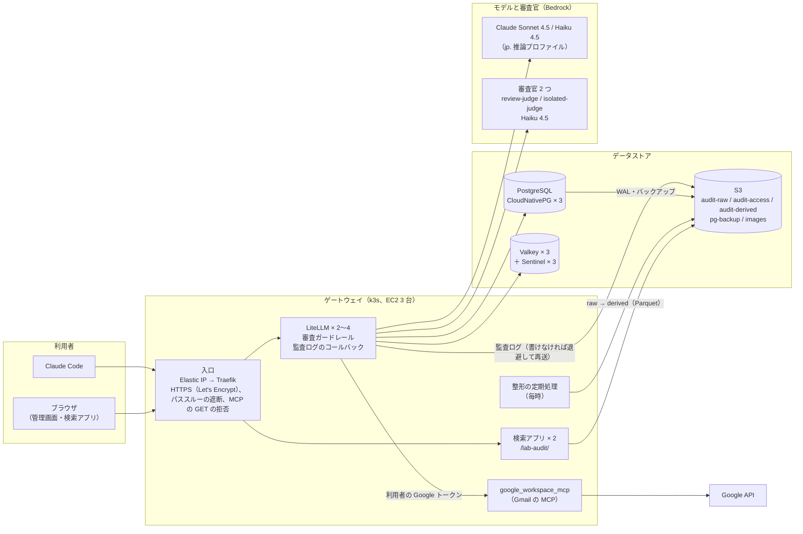
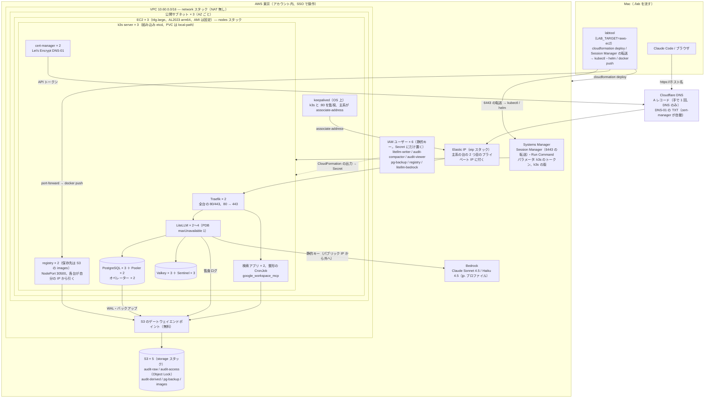
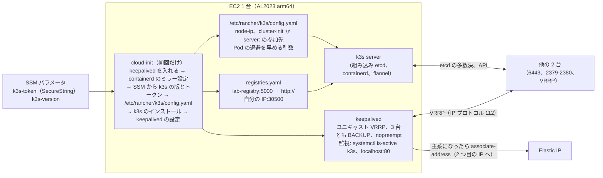
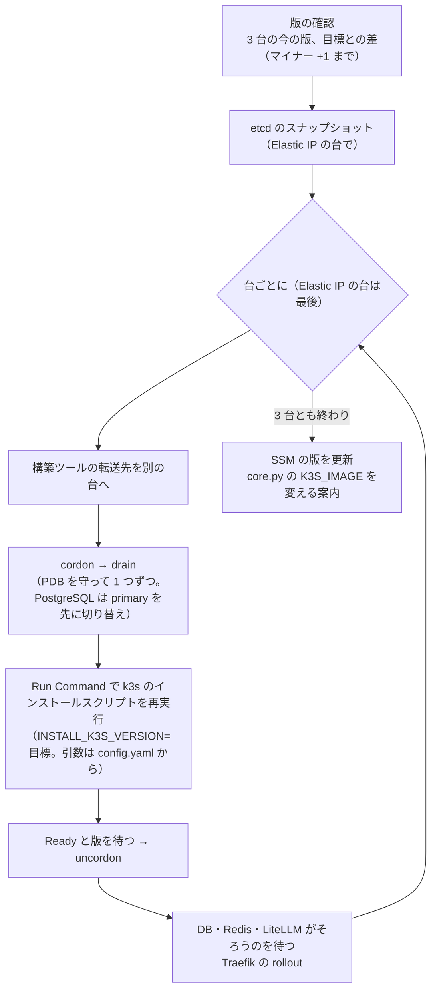

# 構成図（AWS の EC2 3 台と S3 だけの環境、`LAB_TARGET=aws-ec2`）

マネージドサービスを使わず、EC2 3 台（別 AZ、k3s の server 3 台、組み込み etcd）と S3 だけで、Mac の k3d と同じ中身を動かす 3 つ目の環境。
Mac と EKS の構成図は [aws_architecture.md](aws_architecture.md) にある。
細かい設計は `.history/2026-10-25-EC2三台構成/変更設計書.md`（環境の作り）と `.history/2026-10-26-k3s版上げ/変更設計書.md`（Kubernetes の版上げと AMI の固定）にある。
この文書は全体の形を図で示すだけで、値や手順はそちらを正とする（実装済み、配備はアカウントの制限の解除待ち）。

## 1. 論理構成

利用者のエージェントは LiteLLM のゲートウェイだけを向く。審査ガードレール、監査ログ、検索アプリの層は環境を知らず、Mac と同じコードが動く。
Mac と違うのは、オブジェクトストレージが RustFS から S3 に替わること、モデルと審査官が Bedrock になること、Codex のモデル（ChatGPT）を置かないことだけ。

## 2. AWS の配置

CloudFormation の 4 スタック（eip / storage / network / nodes）は `labtool/cfn.py` が JSON で組み、`aws cloudformation deploy` で配備する。
クラスタの中身は Mac と同じマニフェストと Helm で入れる。入口は keepalived が Elastic IP を 3 台の間で移し、HTTPS は cert-manager が Let's Encrypt（DNS-01、Cloudflare）で取る。
SSH も 6443 も開けず、構築ツールは Systems Manager の Session Manager で k3s の API に届く。

- 各台はプライベート IP を 2 つ持つ。1 つ目（`.10`）は k3s と keepalived と、起動時のパブリック IP（外向きの通信: Bedrock、Let's Encrypt、Docker Hub）に使い、Elastic IP は 2 つ目（`.11`）に付ける。Elastic IP が別の台に移っても、その台の外向きの通信は途切れない
- 1 台が落ちても処理が続く（etcd、PostgreSQL、Sentinel はいずれも 3 台の多数決）。入口の台が落ちると、keepalived の検知（約 3 秒）と Elastic IP の付け替えで別の台に移る（障害の試験 `--scenario eip-node`）
- データは各台の PVC（local-path）に置き、PostgreSQL のバックアップと監査ログは S3 に出る。`./lab down` は nodes → network → storage（バケットを空にしてから）→ eip の順に消し、有料のものは残らない（Elastic IP は `LAB_EC2_KEEP_EIP=true` のときだけ残す）
- `chatgpt/` のトークンの共有先（EKS 版は EFS）が無いので、Codex のモデルと ChatGPT の審査官は置かない。Pod Identity 相当も無く、S3 と Bedrock は IAM ユーザーの静的キー（Kubernetes の Secret にだけ置き、`.env` には書かない）

## 3. 1 台の中（k3s と keepalived）

各台は cloud-init（`cfn/node-init.sh`）で同じ手順を踏み、1 番の台だけがクラスタを作る。参加先は配備済みの台から探すので、1 台を作り直しても別のクラスタにならない。

## 4. Kubernetes（k3s）の版上げ（`./lab upgrade-k8s <版>`）

版は SSM のパラメータに置き、`./lab up` では変えない（nodes スタックに差分が出ないので、3 台が同時に再起動しない）。AMI も固定の ID で渡すので、新しい AMI が出ても `./lab up` で置き換えられない。
上げるときは 1 台ずつ、Elastic IP を持つ台を最後にする。マイナー版は 1 つずつで、飛ばす・下げる指示は止める。途中で止まっても再実行で続きから進む。

`--measure` を付けると、障害の試験と同じ測り方（毎秒 20 要求）で、上げている間の要求の失敗数と幅を報告する。

## 5. Mac の k3d との対応

| 役割 | Mac（k3d） | EC2 3 台（k3s） | コードの置き場 |
|---|---|---|---|
| Kubernetes | k3d（k3s v1.35、server 1 + agent 2） | k3s v1.35（server 3、組み込み etcd）。版上げは `./lab upgrade-k8s` | `k8s/k3d-config.yaml` / `labtool/cfn.py`、`cfn/node-init.sh` |
| 入口 | Traefik × 1（`k8s/ingress.yaml`） | Traefik × 2 ＋ keepalived ＋ Elastic IP | 遮断する経路の一覧は同じ（単体テストが照合） |
| TLS | なし（localhost） | cert-manager ＋ Let's Encrypt（DNS-01）、Cloudflare の A レコード | `render.ec2_tls_manifest` |
| PostgreSQL | CloudNativePG × 3 ＋ Pooler | 同じ（バックアップ先は S3 の pg-backup） | `k8s/postgres-cnpg.yaml` |
| Redis 互換 | Valkey × 3 ＋ Sentinel × 3 | 同じ | `k8s/valkey.yaml` |
| オブジェクトストレージ | RustFS × 1（静的キー） | S3 × 5（IAM ユーザーの静的キー、Object Lock） | `render.s3_buckets()`、`render.s3_policies()` を両方で使う |
| 秘密情報 | `.env` → Secret | `.env` ＋ CloudFormation の出力（IAM のキー）→ Secret | `./lab secrets` |
| コンテナイメージ | k3d のレジストリ | クラスタの中の registry × 2（保存先は S3） | `./lab images` |
| 運用部品（オペレーター、cert-manager） | server 1 台に固定 | × 2（3 台とも server なので固定の条件が全台に当たる） | `stages.operators` |
| Claude のモデル | Anthropic API（トークン転送） | Bedrock（jp. 推論プロファイル、静的キー） | `render.litellm_config()` |
| 審査官 | ChatGPT（`chatgpt/`） | Bedrock Haiku 4.5 | 同上 |
| Codex のモデル | ChatGPT（`chatgpt/`） | 置かない | 同上 |
| LLM の審査（Jev） | `LAB_USE_JEV` | 使わない | `litellm/guardrails/` |
| 構築ツールの経路 | localhost | Session Manager の 6443 転送（`litellm-lab-ec2` のコンテキスト） | `labtool/ec2.py` |
| 障害の試験 | DB・Redis・LiteLLM の場面 | 同じ ＋ `eip-node`（入口の台を止める） | `labtool/failover.py` |
