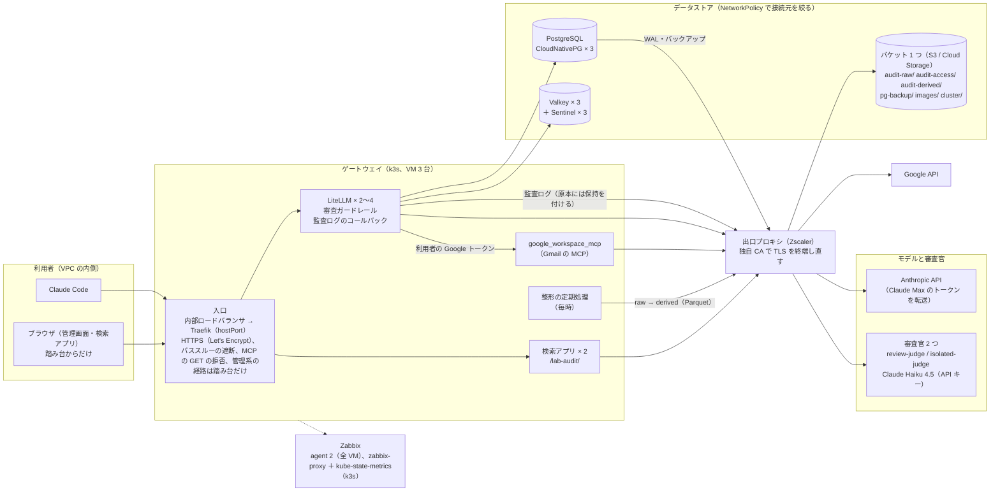
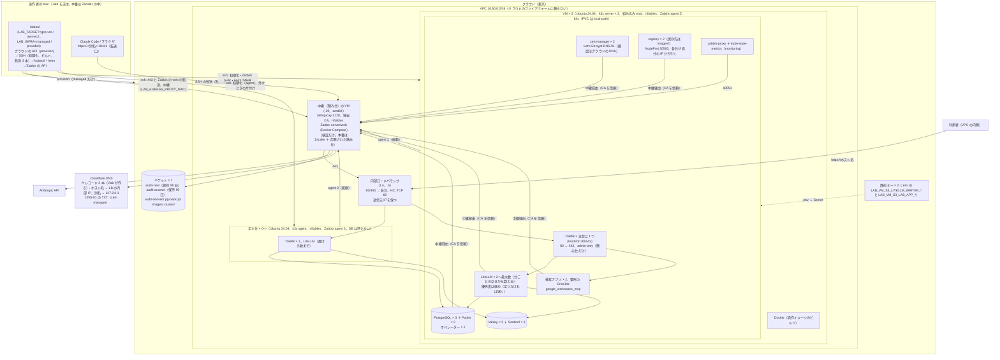
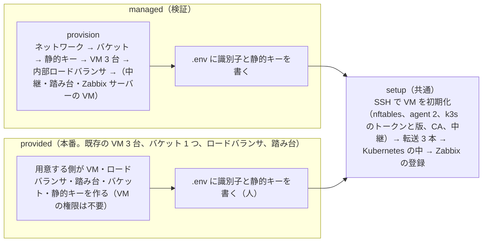
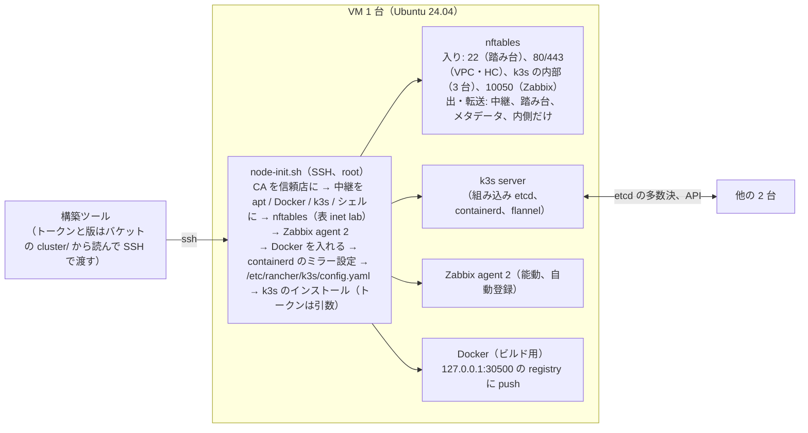

# 構成図（VM 3 台とオブジェクトストレージだけの環境、`LAB_TARGET=aws-ec2` / `gcp-vm`）

マネージドサービスを使わず、クラウドの部品を計算資源とオブジェクトストレージに限って、Mac の k3d と同じ中身を動かす環境。
AWS は EC2 3 台と S3、GCP は Compute Engine 3 台と Cloud Storage。クラウドの違いは `labtool/clouds/` に閉じ、VM の中と Kubernetes の中は 1 つのコード。
Mac と EKS の構成図は [aws_architecture.md](aws_architecture.md) にある。
細かい設計は `.history/2026-10-30-VM環境の共通化とGCP追加/変更設計書.md`（2 クラウドの層）、`.history/2026-10-30-既存資源からの構築と出口プロキシ/変更設計書.md`
（既存資源からの構築、1 バケット、出口プロキシ、VM 上のビルド）、`.history/2026-10-31-内部LBとVM側の防御とZabbix/変更設計書.md`（内部ロードバランサ、
VM 側の防御、踏み台、Zabbix）、`.history/2026-10-26-k3s版上げ/変更設計書.md`（Kubernetes の版上げ）にある。
この文書は全体の形を図で示すだけで、値や手順はそちらと `docs/design.md` 21 章を正とする。

## 1. 論理構成

利用者のエージェントは VPC の内側から LiteLLM のゲートウェイだけを向く。審査ガードレール、監査ログ、検索アプリの層は環境を知らず、Mac と同じコードが動く。
Mac と違うのは、オブジェクトストレージが RustFS からクラウドのバケット 1 つに替わること、審査官が Anthropic の API キーの Claude Haiku 4.5 になること、
Codex のモデル（ChatGPT）を置かないことだけ。Claude Code のモデルは Mac と同じ Claude Max のトークンの転送。

出口プロキシは本番の前提（Zscaler の中）。無い環境では各部品が直接外へ出る（`.env` の `LAB_EGRESS_PROXY` が空。各台の nftables も外向きを遮断しない）。

## 2. クラウドの配置

| 部品 | AWS（`aws-ec2`） | GCP（`gcp-vm`） |
|---|---|---|
| 計算資源 | EC2 × 3（t4g.large、Ubuntu 24.04 arm64、別 AZ の公開サブネット、ロール無し） | Compute Engine × 3（C4A、Ubuntu 24.04 arm64、別ゾーン、Hyperdisk、サービスアカウント無し） |
| ネットワーク | VPC 10.60.0.0/16、サブネット /24 × 3、IGW、S3 のゲートウェイエンドポイント、セキュリティグループ（通す規則だけ） | VPC（カスタム）、サブネット /24 × 1、ファイアウォール（web / internal / ssh / proxy-in。通す規則だけ） |
| 入口 | 内部 NLB（各サブネットの .5、クロスゾーン、TCP 443 / 80、ヘルスチェック TCP 80 10 秒 × 2） | 内部パススルー ネットワーク ロードバランサ（静的内部 IP .5、ゾーンごとのインスタンスグループ、TCP 80/443、ヘルスチェック TCP 80 5 秒 × 2） |
| オブジェクトストレージ | S3 × 1（Object Lock 有効、既定の保持なし、バージョニング） | Cloud Storage × 1（オブジェクト保持ロック、バージョニング、均一なバケットレベルのアクセス） |
| 静的キー | IAM ユーザー × 2（原本を書く litellm-writer、それ以外の lab-app。ディレクトリ単位の権限） | サービスアカウント × 2。HMAC キー（lab-app は registry の GCS ドライバ用の JSON キーも）、条件付きバインディングとカスタムロール |
| VM の権限 | 無し | 無し |
| 中継・踏み台・Zabbix サーバー（検証だけ） | t3.medium（amd64）、専用のセキュリティグループ | e2-medium（amd64）、タグ `<prefix>-proxy` |

- 1 台が落ちても処理が続く（etcd、PostgreSQL、Sentinel はいずれも 3 台の多数決）。Traefik は全台に 1 つずつで、台が落ちるとロードバランサがヘルスチェック（5〜10 秒 × 2 回）で外す（障害の試験 `--scenario entry-node`、足す台は `worker-node`）。IP の付け替えは無い（VM はクラウドの API を呼ばない）
- 足す台（k3s の agent）は `.env` で増減して `./lab up`。LiteLLM と入口だけを動かし、PostgreSQL と Valkey は今の 3 台だけに置くので、減らしても DB のデータは失わない。減らすときはヘルスチェックを先に落として新しい接続を止めてから、Pod を逃がしてクラスタから外す（経緯は `.history/2026-10-31-台の増減とLiteLLMのメモリ/`）
- データは各台の PVC（local-path）に置き、PostgreSQL のバックアップと監査ログはバケットに出る
- 守りは 3 層: 各 VM の nftables（入りは踏み台・VPC・ヘルスチェックの送信元・全台の間の内部通信だけ。出は中継と内側だけ）、Traefik の送信元制限（管理系の経路は踏み台だけ）、NetworkPolicy（PostgreSQL・Pooler・Valkey は必要な Pod だけ）

## 3. 基盤の持ち方（`LAB_INFRA`）

- provided では、構築ツールはネットワーク・ロードバランサ・権限・バケットの設定を変えない（合わなければ止まるか警告する）。用意する側への前提は `docs/spec.md` 12.2 節
- `./lab down` は managed なら全部消し、provided なら k3s を外して保持の無いディレクトリを空にする。`./lab down --all` で provided でも VM・ロードバランサ・バケットまで消す

## 4. 1 台の中（SSH での初期化）

各台は構築ツールが SSH で流す同じスクリプト（`vm/node-init.sh`）で初期化し、1 番の台だけがクラスタを作る。クラウド固有の手順は無い。
参加先は配備済みの台から探すので、1 台を作り直しても別のクラスタにならない。2 回目以降は中継・CA・nftables・Zabbix agent の設定だけ直して抜ける。

## 5. バケット 1 つのディレクトリ構成と保持

| ディレクトリ | 中身 | 保持 | 書く利用者（鍵は litellm-writer と lab-app の 2 つ。litellm-writer 以外は lab-app の鍵） |
|---|---|---|---|
| `audit-raw/` | 監査ログの原本（`raw/meta`、`raw/body`） | オブジェクト単位、90 日（書くときに付ける） | litellm-writer（追記と保持だけ。読めない・消せない） |
| `audit-access/` | 閲覧と管理操作の記録 | オブジェクト単位、90 日 | audit-viewer |
| `audit-derived/` | 整形済み（Parquet）、集計、精算、請求の単位 | 無し（ライフサイクルで期限） | audit-compactor、audit-viewer（請求の単位） |
| `pg-backup/` | PostgreSQL の WAL とバックアップ | 無し | pg-backup（Barman） |
| `images/` | クラスタの中の registry の保存先 | 無し | registry |
| `cluster/` | k3s のトークンと版 | 無し | 操作者 |

バケット全体の既定の保持は使わない（GCS は上書きも拒むので registry や整形が止まる）。保持の方式は S3 が Object Lock（GOVERNANCE / COMPLIANCE）、GCS がオブジェクト保持ロック（Unlocked / Locked）。
Mac の RustFS は従来の 4 バケットとバケット既定の保持のまま。

## 6. 出口プロキシ（Zscaler 相当）の中での構築

| 層 | 外へ出る通信 | 配り方 |
|---|---|---|
| VM | apt、k3s のインストール、containerd のイメージ取得、Docker のビルド、Zabbix のリポジトリ | CA を OS の信頼店に。`/etc/environment`、apt、Docker、`k3s.service.env` に中継。nftables が中継以外の外向きを落とす。メタデータサーバー（DNS・NTP）は直接 |
| Pod | LiteLLM → Anthropic・Google、MCP → Google、cert-manager → Let's Encrypt・Cloudflare、Barman・registry・監査アプリ → バケット | ConfigMap の CA をマウントし、`HTTPS_PROXY` / `NO_PROXY` / `SSL_CERT_FILE` 系の環境変数（`render.add_egress`）。cert-manager は Helm の値（DNS-01 の伝搬確認はクラウドの再帰リゾルバ）、Barman は `endpointCA` と sidecar の env |
| 操作者の Mac | `./lab`（boto3、Google のクライアント、Cloudflare、Zabbix の API）、helm | `LAB_EGRESS_PROXY_MAC` で環境変数と helm の `--ca-file`。CA は公開 CA の束 ＋ 中継の CA（転送口の Let's Encrypt の証明書も検証できる）。ssh と kubectl と転送口は中継を通らない |

検証では 4 台目の VM に mitmproxy（明示プロキシ、独自 CA）を置き、3 台の直接の外向き通信を nftables で塞いで全段階と全試験を通す（`LAB_EGRESS_PROXY_VM=true`）。
この VM は踏み台と Zabbix サーバーも兼ねる。中継の記録は `./lab proxy-log` で宛先ホストごとに数えられる。

## 7. Kubernetes（k3s）の版上げ（`./lab upgrade-k8s <版>`）

版はバケットの `cluster/k3s/version` に置き、`./lab up` では変えない。上げるときは 1 台ずつ、今の 3 台が先で足す台が後。マイナー版は 1 つずつで、飛ばす・下げる指示は止める。
途中で止まっても再実行で続きから進む。`--measure` で上げている間の要求の失敗数と幅を測る（経緯は `.history/2026-10-26-k3s版上げ/`）。

## 8. Mac の k3d との対応

| 役割 | Mac（k3d） | VM 3 台（k3s） | コードの置き場 |
|---|---|---|---|
| Kubernetes | k3d（server 1 + agent 2） | k3s（server 3、組み込み etcd）。版上げは `./lab upgrade-k8s` | `k8s/k3d-config.yaml` / `vm/node-init.sh` |
| 基盤 | OrbStack | managed: `labtool/clouds/*.provision`。provided: 用意する側 ＋ `.env` | `labtool/clouds/`、`labtool/vm.py` |
| 入口 | Traefik × 1 | 内部ロードバランサ → Traefik × 全台に 1 つ（hostPort、DaemonSet）。管理系の経路は踏み台だけ | 遮断する経路の一覧は同じ。`render.admin_only_manifest` |
| 守り | なし | nftables（VM）、NetworkPolicy（DB と Valkey） | `vm/node-init.sh`、`k8s/network-policies.yaml` |
| TLS | なし（localhost） | cert-manager ＋ Let's Encrypt（DNS-01）、Cloudflare の A レコード 2 本（`./lab` が作る） | `render.vm_issuer_manifest`、`render.vm_certificate_manifest` |
| PostgreSQL / Valkey | CloudNativePG × 3、Valkey × 3 | 同じ（バックアップ先は `pg-backup/`） | `k8s/` |
| オブジェクトストレージ | RustFS × 1、4 バケット、既定の保持 | バケット × 1、ディレクトリ、オブジェクト単位の保持 | `render.store_location`、`objectstore.vm_lifecycle_rules`、`clouds.s3_user_policies` / `gcs_bindings` |
| 秘密情報 | `.env` → Secret | `.env`（`LAB_VM_S3_*`）→ Secret | `./lab secrets` |
| コンテナイメージ | Mac の Docker → k3d のレジストリ | VM の Docker でビルド → クラスタの中の registry × 2（保存先は `images/`。AWS は S3 ドライバ、GCP は GCS ドライバ） | `vm.build_and_push_on_node` |
| 外向きの通信 | 直接 | 中継（Zscaler）経由、CA を信頼 | `render.add_egress`、`vm/node-init.sh` |
| 監視 | なし | Zabbix（agent 2、公式 Helm チャート、API での登録） | `labtool/zabbix.py` |
| 審査官 / Claude のモデル | ChatGPT / Anthropic API（トークン転送） | Anthropic API キーの Haiku 4.5 / 同じ | `render.litellm_config()` |
| 構築ツールの経路 | localhost | SSH の転送 3 本（6443 はノード経由、443 と Zabbix の web は踏み台経由。`litellm-lab-ec2` / `litellm-lab-gcp` のコンテキスト） | `labtool/vm.py` |
| 障害の試験 | DB・Redis・LiteLLM の場面 | 同じ ＋ `entry-node`（Traefik の台）＋ `worker-node`（足す台） | `labtool/failover.py` |
